# cgroup cpu throttle 的逻辑初步分析

> 视频源：[cgroup cpu throttle的逻辑初步分析](https://www.bilibili.com/video/BV1GE421M7gC/)（B 站 @lddlinan，21 分 20 秒）。本文基于视频演说图文稿整理，时间戳可跳转到原视频对应位置。这是作者「Linux 内核学习笔记」系列第一期：从一个困扰已久的问题入手，读内核、改内核、用实验验证。

## 本讲要解决的核心问题（SCQA）

**背景**：一个应用程序有两个进程，一个优先级高、一个优先级低，都狂占 CPU——机器只有两个核，被它们占得满满的。现在用 cgroup（v2）把这个应用的 CPU 限制成一个核：建一个 cgroup，在 `cpu.max` 里写两个值——前面的叫 quota，后面的叫 period。[【跳转到 02:27】](https://www.bilibili.com/video/BV1GE421M7gC/?t=147)

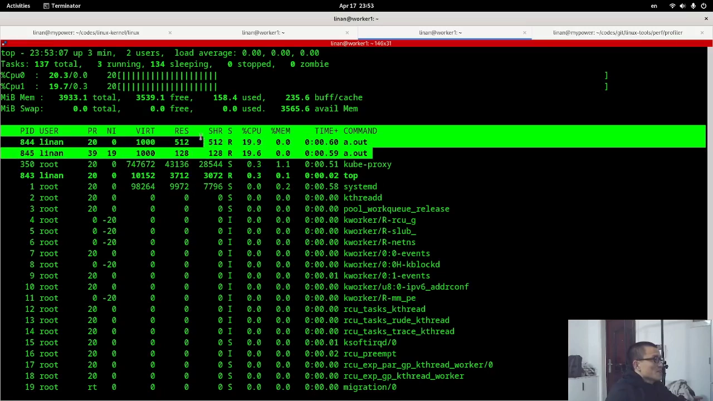

**冲突**：限流生效了——总量确实只有相当于一个核的 CPU 资源。但两个不同优先级的进程各拿了将近 50%：优先级被限流「抹平」了。既然设了优先级，希望高优先级的进程能分到更多 CPU，而不是被拉平。[【跳转到 04:32】](https://www.bilibili.com/video/BV1GE421M7gC/?t=272)

**疑问**：内核的 CPU 限流（throttle）到底是怎么实现的？在限流场景下，还能不能让优先级重新起作用？

**回答（中心思想）**：拆开内核 CFS 带宽控制的实现——三个数据结构（task_group、cfs_bandwidth、cfs_rq）加一个「大杯小杯」补给模型。作者的实验性方案：当预测到高优先级进程的资源将被低优先级进程吃掉时，提前 throttle 掉一个 RQ（让它整组停跑），迫使两类进程落到同一个核上竞争——单核调度是尊重优先级的。实测效果：高优先级约 80%，低优先级约 20%。

## 一、cpu.max：quota 与 period，颗粒度越细控制越细

先看限制本身的语义。cgroup v2 的 CPU 设置就是一个 `cpu.max` 文件，写两个值：quota 和 period。period 可以理解为**颗粒度**：单位时间内允许你用多少 CPU 资源。[【跳转到 02:27】](https://www.bilibili.com/video/BV1GE421M7gC/?t=147)

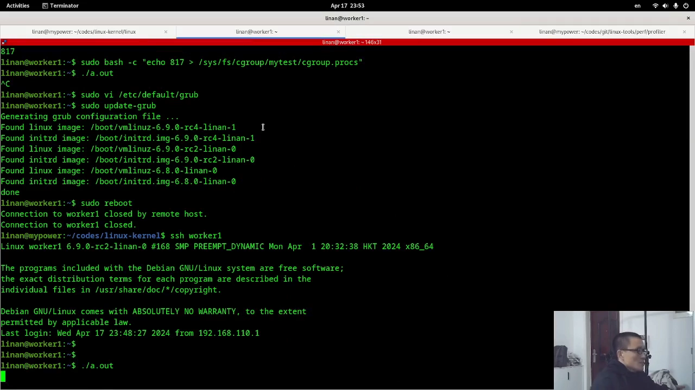

颗粒度粗细直接影响控制效果：如果一天之内允许用 12 小时的 CPU 资源，一个只需跑 10 小时的程序 10 小时就能跑完；但如果限制成每小时只能用 30 分钟的 CPU 资源，同样 10 小时的程序就要跑 20 个小时才能跑完。所以颗粒度越细，控制越精细。[【跳转到 02:52】](https://www.bilibili.com/video/BV1GE421M7gC/?t=172)

当然也不能太细——内核内部有最小颗粒度，看代码大约是 5ms。限制成一个核的写法就是两个值一样：100ms 的 period 里允许用 100ms 的 CPU 资源。CPU 资源是**累加**的：十个核的话，一秒钟你就有十秒钟的 CPU 资源可用。[【跳转到 03:42】](https://www.bilibili.com/video/BV1GE421M7gC/?t=222)

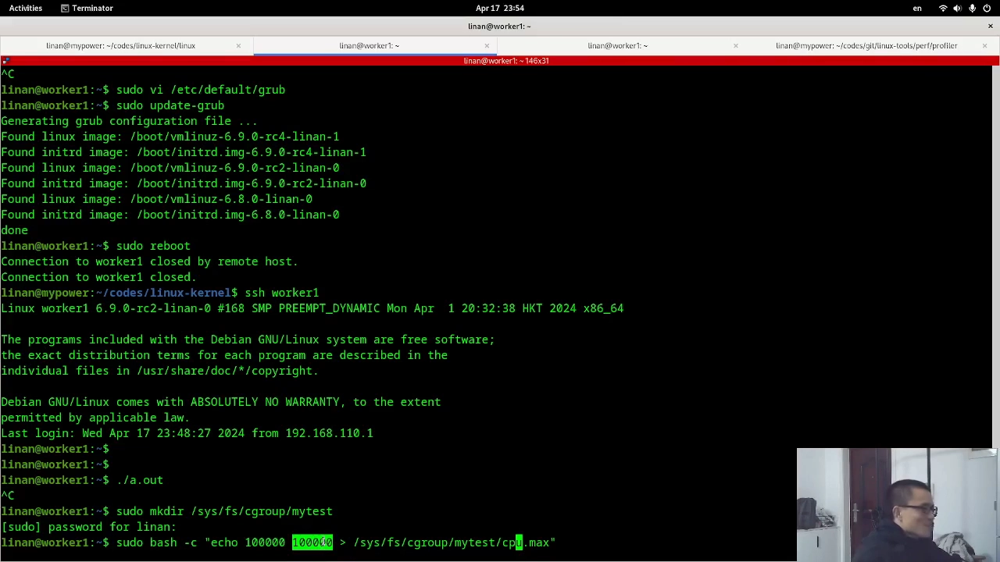

## 二、限流生效了，优先级却失效了

把进程放进这个 cgroup 再跑，限流确实生效：两个进程加起来最多用相当于一个核的资源。但问题在于：高、低优先级两个进程各拿了将近 50%——设了优先级也没用，系统并没有按优先级分配这份受限的资源。[【跳转到 04:32】](https://www.bilibili.com/video/BV1GE421M7gC/?t=272)

作者在之前的视频里分享过类似现象（节点 CPU 数目越多，低优先级进程越「开心」）。这次的思路是：既然想要「高优先级拿更多」，那就想办法把低优先级的进程 throttle 掉——于是去读内核里 CPU throttle 的实现。

## 三、内核实现：两个文件，三个数据结构

CPU throttle 的实现代码其实比较简单，只有两个文件：一个头文件（记录数据结构），一个 `fair.c`——所有相关逻辑都在里面。[【跳转到 06:12】](https://www.bilibili.com/video/BV1GE421M7gC/?t=372)

相关的数据结构主要有三个：

- **task_group**：一个 cgroup 对应一个 task_group，所有进程都挂在里面；[【跳转到 06:17】](https://www.bilibili.com/video/BV1GE421M7gC/?t=377)
- **cfs_bandwidth**：带宽结构，存 quota、period 等配置，也在 task_group 里；
- **cfs_rq（RQ）**：调度队列。每个 CPU 上有一个 RQ，而每个 task_group 在每个 CPU 上也各有一个 RQ——所以是个数组，按核一一对应。[【跳转到 06:42】](https://www.bilibili.com/video/BV1GE421M7gC/?t=402)

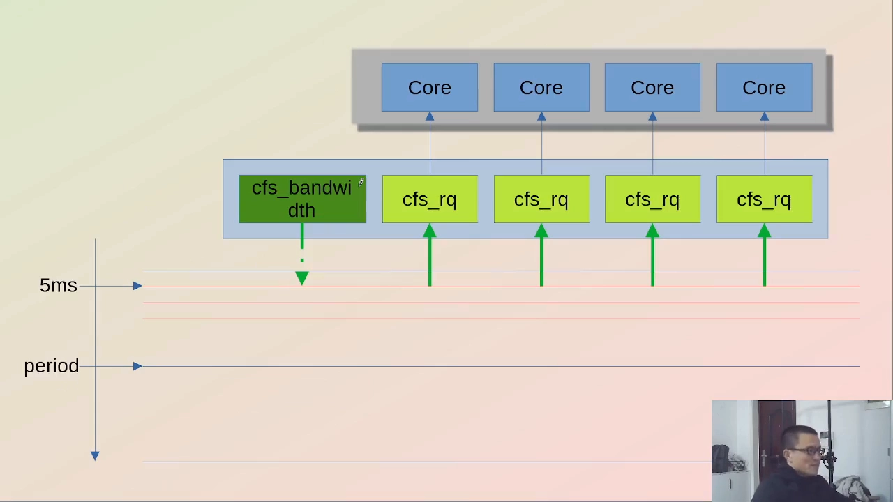

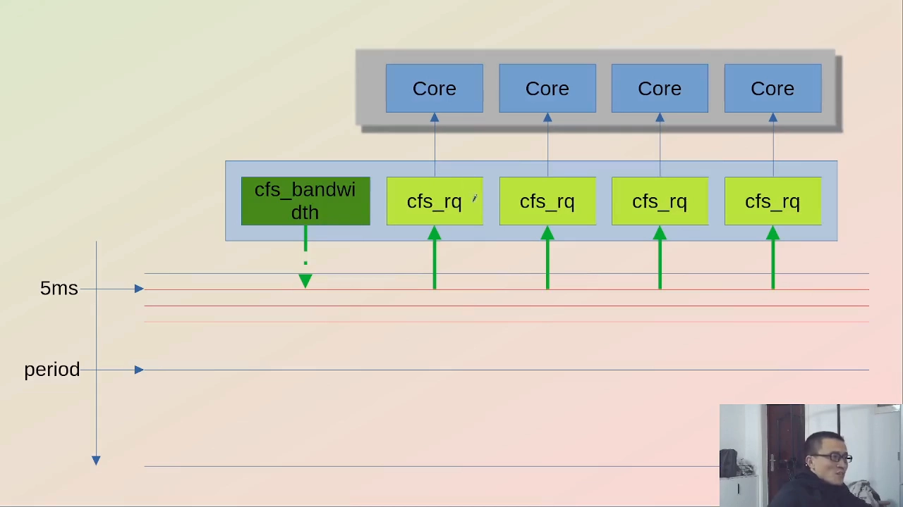

## 四、大杯小杯模型：throttle 是怎么发生的

把机制画成「酒壶和酒杯」：cfs_bandwidth 是大酒壶，每个 CPU 是一个小酒杯。[【跳转到 07:57】](https://www.bilibili.com/video/BV1GE421M7gC/?t=477)

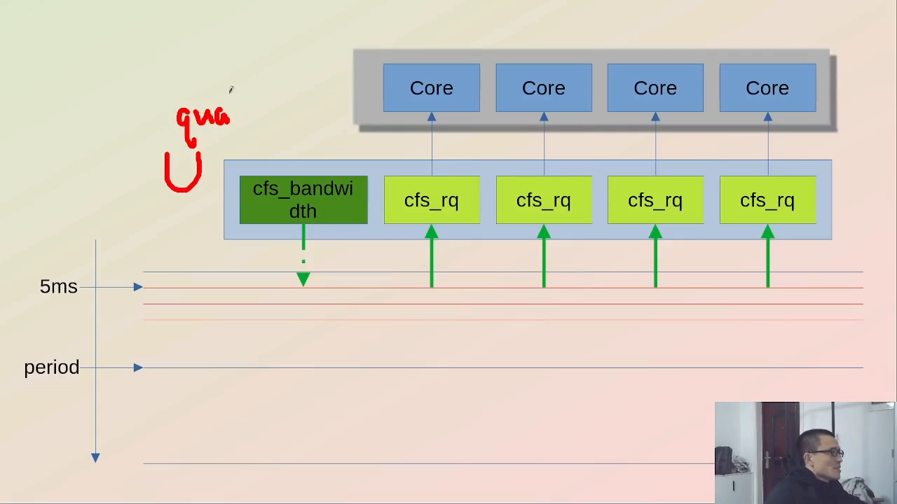

- **补给**：每个 period 开始，大杯先被装满 quota 数量的资源（比如 100ms）；然后每个 CPU 上有一个间隔约 5ms 的 timer，到点就去问大杯要资源——一次只领 5ms，倒进自己的小杯；[【跳转到 08:22】](https://www.bilibili.com/video/BV1GE421M7gC/?t=502)
- **断供**：当大杯被倒空，CPU 再来领时领不到资源，小杯里也没有了——这组任务没有任何份额了。调度时一查这个 RQ 已经没有资源可跑，整个 RQ 就被 **throttle** 掉（停跑）；[【跳转到 09:12】](https://www.bilibili.com/video/BV1GE421M7gC/?t=552)
- **恢复**：等下一个 period 到了，大杯重新被装满，CPU 又能领到下一个 5ms，如此往复。

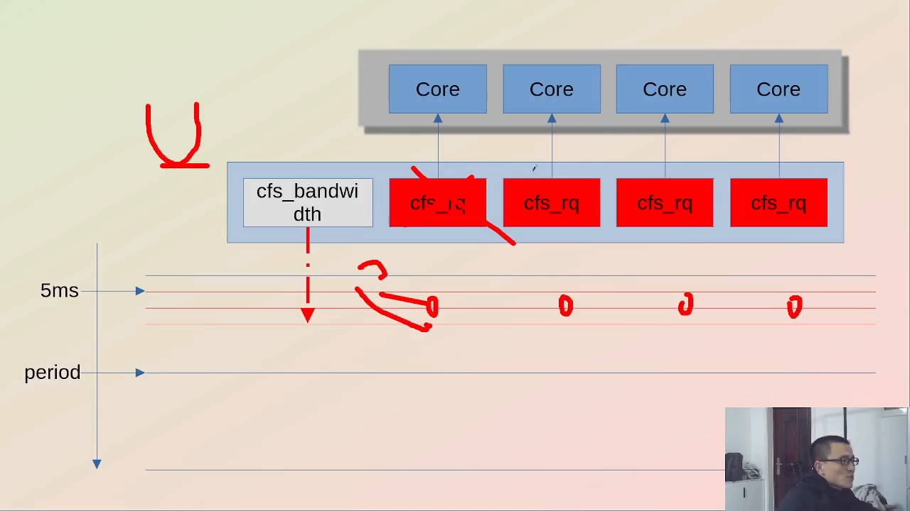

## 五、第一条思路：按 task 与 RQ 绑定做加权统计（走不通）

回到最初的问题：为什么限流后两个进程各拿 50%？作者最初的想法是：假设每个进程（task）和 RQ 是绑定在一起的——高优先级进程在这个核的 RQ 上、低优先级在那个核的 RQ 上——那就可以在 RQ 里统计各自跑了多久，按权重加权：比如高优先级权重 2、低优先级权重 1，从不同角度算各自占用的份额；一旦发现某一方「超标」（加权占比超过阈值），就把它 throttle 掉。[【跳转到 10:02】](https://www.bilibili.com/video/BV1GE421M7gC/?t=602)

做实验才发现：**task 跟 RQ 并不绑定**——哪些 task 放在哪个 RQ 里，是调度和负载均衡（balance）逻辑决定的，task 会在不同核之间跳来跳去。这条路走不通。[【跳转到 11:42】](https://www.bilibili.com/video/BV1GE421M7gC/?t=702)

## 六、新方案：提前 throttle 一个 RQ，逼两类进程同核竞争

既然 task 不绑定核，那就换一个角度：不去挑进程，而是**提前停掉一个 RQ**——让整个 task group 少用一个核。[【跳转到 12:07】](https://www.bilibili.com/video/BV1GE421M7gC/?t=727)

依据是：停掉一个核之后，低优先级进程就会被调度到和高优先级进程**同一个核**上跑。而单核调度是尊重优先级的——优先级高得多跑、优先级低的少跑，优先级机制在单核内重新生效。[【跳转到 12:32】](https://www.bilibili.com/video/BV1GE421M7gC/?t=752)

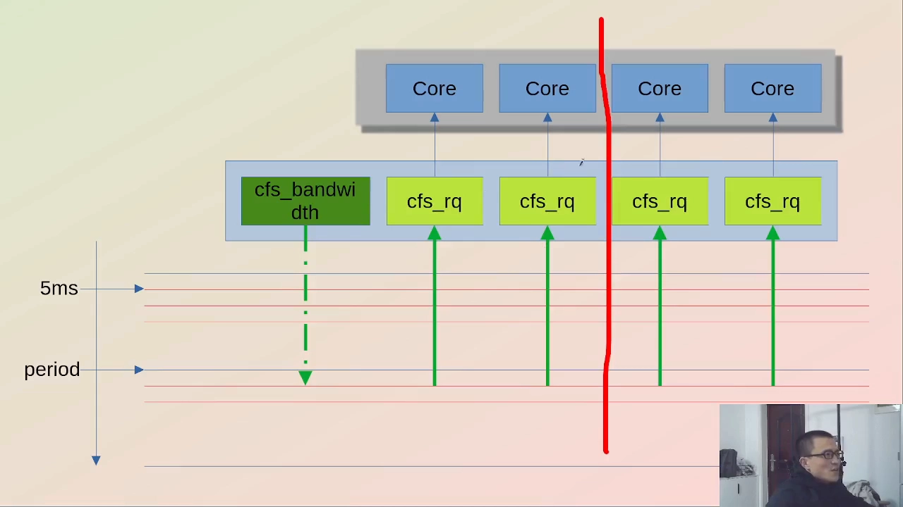

实现上（作者改了内核代码）：在每个 RQ 里维护当前最高优先级进程的优先级及其 CPU 占用时间，汇总到 cfs_bandwidth；用一个简单的预测模型判断——如果高优先级时间占的比重偏小，就预测「低优先级吃掉高优先级资源」的情况概率很高，于是设一个标识位，让后续补给时 amount 为 0——相当于不给某个 RQ 续杯，把它提前停掉。多核场景下可以逐个停：先停一个，还不行再停一个，尽量让高低优先级进程挤到同一个核上。[【跳转到 13:19】](https://www.bilibili.com/video/BV1GE421M7gC/?t=799)

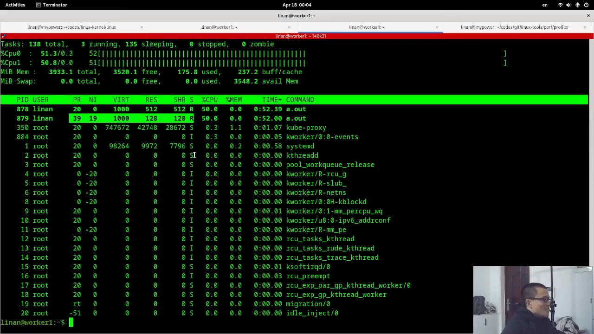

## 七、实验结果：80% / 20%

还是先建 cgroup、设 quota、把进程放进去，然后跑打了补丁的内核。结果正是想看到的：高优先级进程占了 80% 左右的 CPU，低优先级只剩 20%。[【跳转到 18:23】](https://www.bilibili.com/video/BV1GE421M7gC/?t=1103)

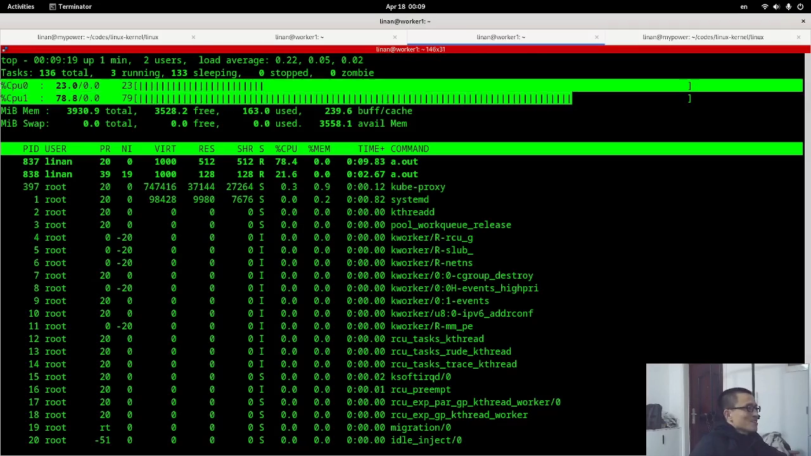

作者也强调：这只是一个很原始的验证。难点在于「预测」——它不是确定性（deterministic）的：可能你预测低优先级会抢资源，但之后高优先级自己不跑了；模型应该更复杂才行。另外你也不能等它真发生了再调——那时候 quota 已经没有了，只能靠提前预测。[【跳转到 14:45】](https://www.bilibili.com/video/BV1GE421M7gC/?t=885)

顺带一个知识点：用户态的优先级数值 20，在内核里就是 120（内核里统一加 100 表示），波动范围是 -20 到 20 之间。[【跳转到 18:48】](https://www.bilibili.com/video/BV1GE421M7gC/?t=1128)

## 八、总结：throttle = 固定 timer 补给 + period 全局配额

这一期对 cgroup CPU throttle 逻辑的整理，可以概括成两部分：[【跳转到 19:09】](https://www.bilibili.com/video/BV1GE421M7gC/?t=1149)

1. **一个固定周期的小 timer**：间隔约 5ms，到点就往 RQ 里「倒」资源（一次 5ms）；没有资源可倒时，RQ 就被 throttle 掉；
2. **一个 period 级的全局配额**：每个 period 系统往大杯里倒满 quota 的资源，大杯不断往各 CPU 小杯里分，直到大杯空了为止；大杯不能立刻续，必须等固定时间（下一个 period）。

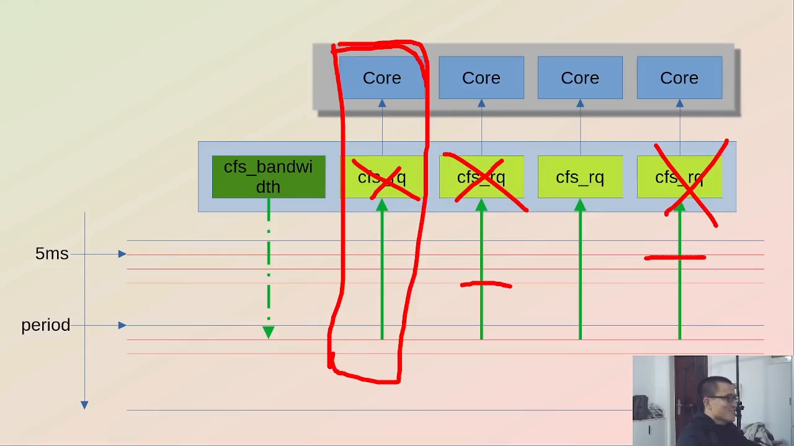

想 throttle 某一个 RQ 的逻辑也很简单：**不给他续杯**——哪怕大杯里还有资源，也不往它的小杯里倒，这个 RQ 自然就被停掉了。

## 九、尾声：一种学内核的方法

作者在片尾说明了这个系列的方法论：每期从一个真实问题入手，研究内核里相关的部分，整理逻辑，最好动手改内核、拿到可观测的结果——比如这次「一改动，行为就从 50/50 变成 80/20」。在他看来，这是学内核最有效也最有趣的方式。下一站是调度与负载均衡：task 到底是怎么被分配到 RQ 上的——那正是这次让第一条思路走不通的机制。[【跳转到 20:19】](https://www.bilibili.com/video/BV1GE421M7gC/?t=1219)
