# Cgroup限制容器能够使用的资源（内存篇）

> 视频源：[深入理解docker和kubernetes（k8s）-4. Cgroup限制容器能够使用的资源（内存篇）](https://www.bilibili.com/video/BV1iML4zdEFq/)（B 站 @双鱼飞鸟，21 分 24 秒）。本文基于视频演说图文稿整理，时间戳可跳转到原视频对应位置。

## 本讲要解决的核心问题（SCQA）

**背景**：容器本质上是宿主机上的一个进程。上一讲里我们用 cgroup 的 CPU 子系统限制了一个容器能用多少 CPU；但内存是另一大资源，如果不对内存设限，容器里的进程可以像普通进程一样无节制地申请内存。[【跳转到 00:00】](https://www.bilibili.com/video/BV1iML4zdEFq/?t=0)

**冲突**：一个失控的程序（比如不断申请内存却不释放）可能把宿主机的物理内存吃光，拖累整台机器。我们希望内存的使用也有一个明确的"天花板"，并且超限之后有明确的处置手段。[【跳转到 00:55】](https://www.bilibili.com/video/BV1iML4zdEFq/?t=55)

**疑问**：怎么限制一个容器最多能用多少内存？超限之后内核会怎么处理？

**回答（中心思想）**：用 cgroup 的 memory 子系统。本讲在容器对应的 cgroup 目录里动手验证三个关键文件：`memory.limit_in_bytes`（物理内存上限，字节）、`memory.memsw.limit_in_bytes`（物理内存+交换分区上限）、`memory.oom_control`（超限策略，默认杀掉违规进程）。`docker run` 的 `--memory` / `--memory-swap` 参数最终就落到这两个 limit 文件上；默认值是一个近乎天文数字的巨大值，等于不限制。

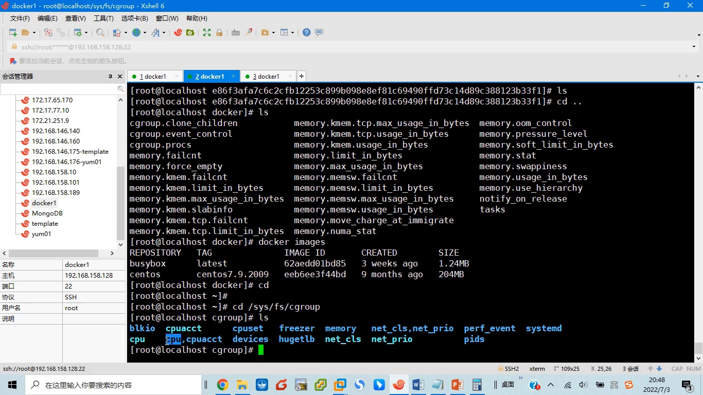

## 一、容器内存限制在 cgroup 里长什么样

### 1.1 从 /sys/fs/cgroup/memory 找到你的容器

限制资源靠 Linux 内核的 cgroup 机制，内存相关的限制位于 `/sys/fs/cgroup/memory` 目录。[【跳转到 00:55】](https://www.bilibili.com/video/BV1iML4zdEFq/?t=55)

里面有一个 `docker/` 目录，结构与 CPU 那边非常像：外层一级的这些 memory 开头的文件，管的是**所有 docker 容器整体**的内存使用；再往里一层，每个容器一个以其容器 ID 命名的目录——用 `docker ps` 对照一下容器 ID（如 `28338f1…`）就能对上号。[【跳转到 01:40】](https://www.bilibili.com/video/BV1iML4zdEFq/?t=100)

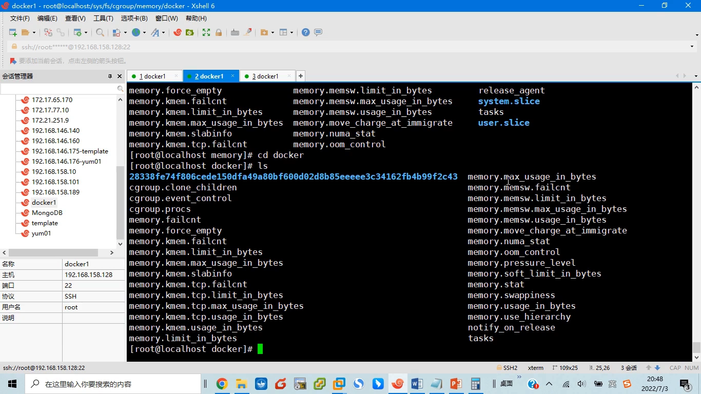

### 1.2 重点关注三个文件

进入容器对应的目录后文件很多，重点看三个就够。[【跳转到 02:18】](https://www.bilibili.com/video/BV1iML4zdEFq/?t=138)

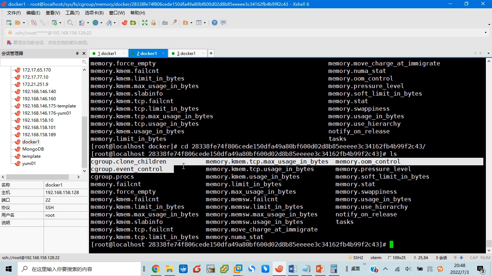

**第一个：`memory.limit_in_bytes`**——容器可以使用的**物理内存**上限，以字节为单位。[【跳转到 02:42】](https://www.bilibili.com/video/BV1iML4zdEFq/?t=162)

**第二个：`memory.memsw.limit_in_bytes`**——SW 代表 swap（交换分区）。程序运行时内存不够，可以用磁盘上的交换分区来充当一部分内存；所以一个程序能用的最大内存空间 = 物理内存 + 交换分区。这个文件描述的就是"物理内存 + 交换分区"的总上限。[【跳转到 02:58】](https://www.bilibili.com/video/BV1iML4zdEFq/?t=178)

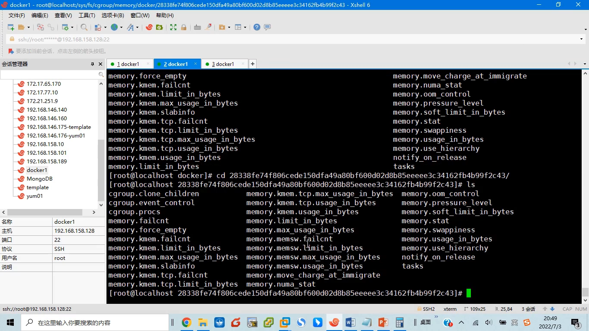

**第三个：`memory.oom_control`**——超限之后的处置策略（下一小节）。

### 1.3 默认值 = 不限制；超限默认杀进程

不设限时，这两个 limit 文件里是一个极大的数字（以字节计），近乎天文数字——实际上等于**对内存没有限制**，因为我们启动容器时命令很简单，什么内存参数都没给。[【跳转到 04:17】](https://www.bilibili.com/video/BV1iML4zdEFq/?t=257)

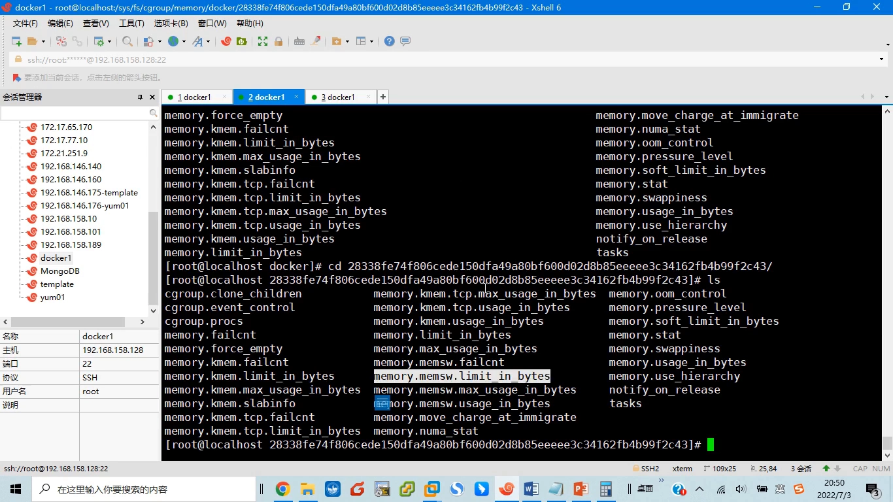

那超限了怎么办？看 `memory.oom_control`：默认措施就是 **OOM（Out Of Memory）——杀掉违规进程**。它的策略是 `oom_kill_disable=0`：disable 等于 0，表示默认情况下会杀掉超限的进程。这个默认策略一般不用改。[【跳转到 05:07】](https://www.bilibili.com/video/BV1iML4zdEFq/?t=307)

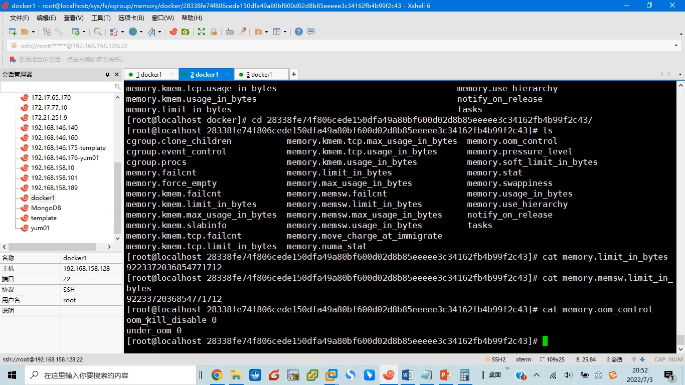

## 二、实验准备：上限、程序与镜像

### 2.1 启动容器时设定上限：--memory 与 --memory-swap

我们设计一个实验：故意让容器里的进程申请超量的内存，验证会不会触发 OOM。第一个条件就是启动容器时必须设置内存上限，这时用到 `--memory` 参数。[【跳转到 05:57】](https://www.bilibili.com/video/BV1iML4zdEFq/?t=357)

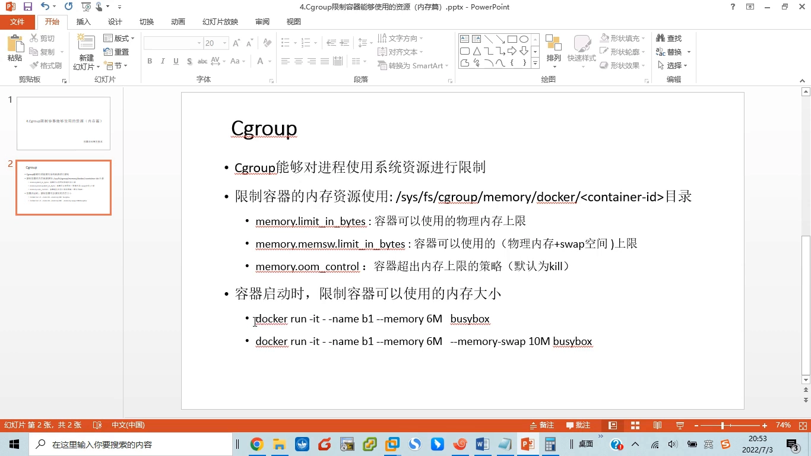

`--memory` 对应的就是 `memory.limit_in_bytes`：比如设 6 兆，容器启动后这个文件就是 6 兆字节。`--memory-swap` 则对应 memsw 文件。注意一个默认行为：**如果只设了 `--memory 6m` 而没设 swap，docker 会把交换空间大小默认设成和 memory 一样**——于是"物理内存 + 交换空间"就是 12 兆，memsw 文件的值就是 12 兆；如果两个都明确指定了，就按指定的值来。[【跳转到 06:39】](https://www.bilibili.com/video/BV1iML4zdEFq/?t=399)

### 2.2 写一个"能按需申请内存"的 C 程序

要验证超限行为，需要一个可控的"吃内存"程序。作者写了一个简单的 C 程序 `mem`：[【跳转到 08:46】](https://www.bilibili.com/video/BV1iML4zdEFq/?t=526)

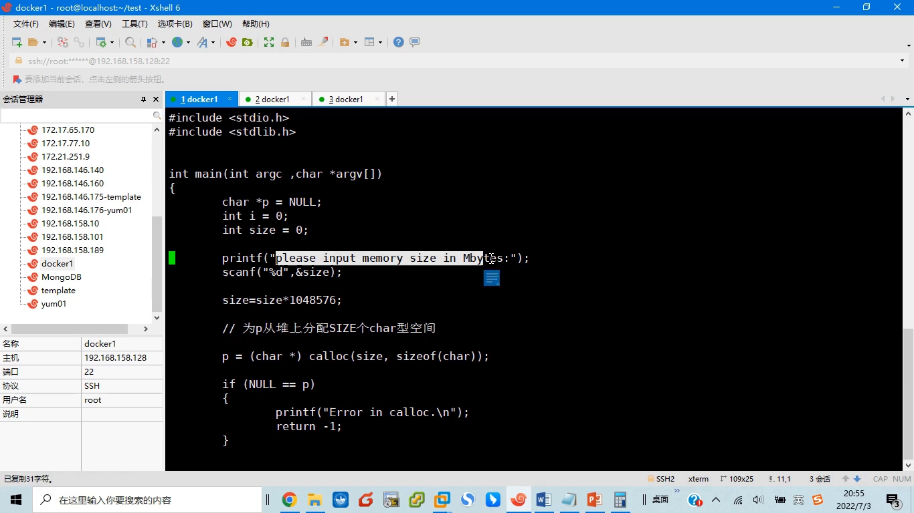

- 先 `printf` 提示输入以兆为单位的内存大小：想申请 1 兆就输入 1，想申请 10 兆就输入 10；
- `size = size × 1048576`（1048576 = 1024×1024，即一兆字节）；
- 用 C 标准函数 `malloc` 申请 `size` 块、每块 `sizeof(char)`（1 字节）的空间，首地址赋给指针 `p`（强制转换成 char 类型）；申请失败就打印一句并 return；
- 申请成功后什么都不做，直接 `free(p)` 归还系统，最后打印一句 **"Memory return"**——看到它就说明"申请过、又归还了"，一切正常。

### 2.3 用 Dockerfile 把程序打进镜像

现有镜像里没有 mem 这个程序（它在宿主机上），所以用 Dockerfile 自制一个镜像：[【跳转到 11:09】](https://www.bilibili.com/video/BV1iML4zdEFq/?t=669)

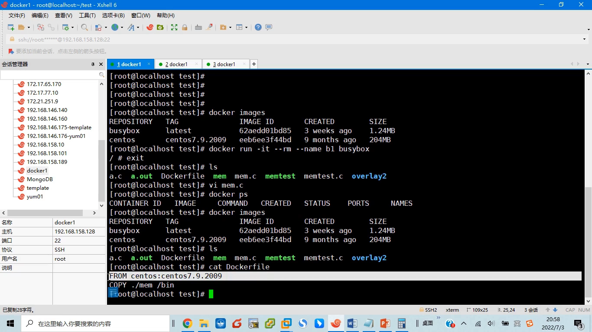

- 基础镜像 `CentOS 7.9`；
- 只做一件事：`COPY` 把 mem 文件拷贝到镜像文件系统的 `/bin` 目录下；
- 在 test 目录里 `docker build -t <镜像名:标签> .` 构建（末尾的点表示从当前目录开始构建、寻找 Dockerfile），完成后 `docker images` 就能看到新镜像——它和 CentOS 原镜像的唯一区别，就是 `/bin` 下多了这个可以申请内存的程序。[【跳转到 11:59】](https://www.bilibili.com/video/BV1iML4zdEFq/?t=719)

## 三、实验一：物理内存 6MB，物理+swap 共 12MB

### 3.1 启动容器并验证两个上限文件

运行新镜像并进入容器，加上限制参数 `--memory 6m`。这里有个小细节：docker 的内存限制**最小得要 6 兆**，小于 6 兆不行，所以最小先给它分 6 兆。[【跳转到 13:39】](https://www.bilibili.com/video/BV1iML4zdEFq/?t=819)

进去之后先确认 mem 已拷入（`ls /bin/mem`），再到这个容器在 cgroup 里对应的目录看值：`memory.limit_in_bytes` = **6291456**——一兆是 1024×1024，再乘 6，正好 6291456，严格按设置生效。[【跳转到 14:29】](https://www.bilibili.com/video/BV1iML4zdEFq/?t=869)

再看 `memory.memsw.limit_in_bytes` = **12582912**，是前者的**两倍**。为什么？因为命令里只设了物理内存 6 兆，docker 默认给了同样大小（6 兆）的交换空间，而 memsw = 物理内存上限 + 交换空间上限 = 6 + 6 = 12 兆。[【跳转到 15:10】](https://www.bilibili.com/video/BV1iML4zdEFq/?t=910)

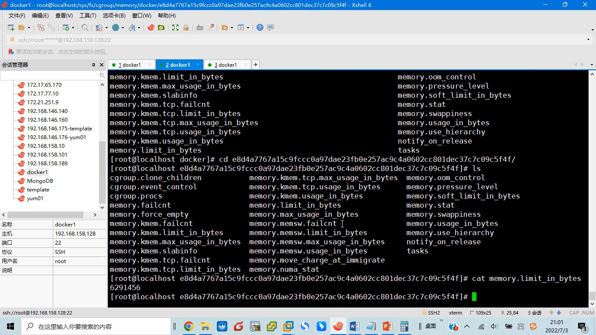

### 3.2 看当前用量

目录里还能看到当前实际用了多少：usage 文件显示约 **757760** 字节——这是容器此刻的内存使用量。[【跳转到 16:24】](https://www.bilibili.com/video/BV1iML4zdEFq/?t=984)

### 3.3 申请 1MB 没事；申请 12MB 被 OOM 杀掉

在容器里运行 mem：输入 `1`（申请一兆）——肯定不会超限，程序申请完马上归还，一切正常。[【跳转到 16:49】](https://www.bilibili.com/video/BV1iML4zdEFq/?t=1009)

先把 mem 跑起来再看 usage：当前用量比刚才大一些，因为 mem 进程产生了。接着输入 `12`（申请 12 兆）——马上看到 **Killed**，"Memory return" 没有出现，程序没执行到那里。[【跳转到 18:00】](https://www.bilibili.com/video/BV1iML4zdEFq/?t=1080)

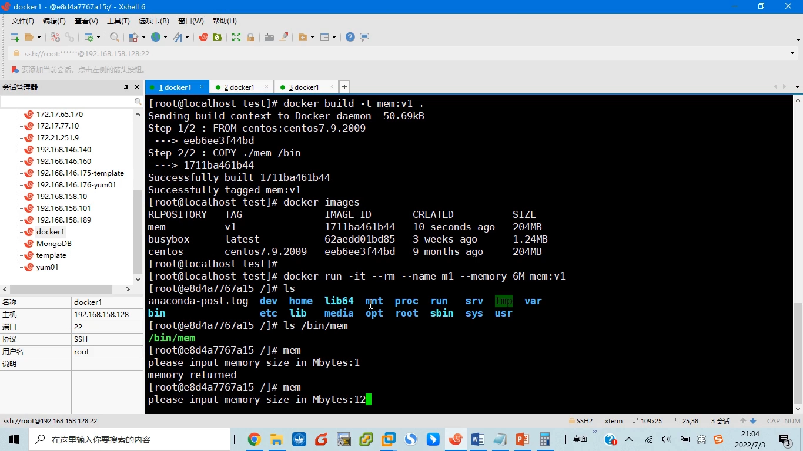

为什么被杀？就是前面说的 `oom_control`：超出设定值，默认 `oom_kill_disable=0` 表示要杀掉超限进程；被杀的是 **mem 进程**。而容器的初始进程是 shell，它还在——容器本身没有被杀掉。[【跳转到 18:16】](https://www.bilibili.com/video/BV1iML4zdEFq/?t=1096)

## 四、实验二：把"物理+swap"上限压到 10MB

### 4.1 --memory-swap 10m：两个值分别指定

这次把 `--memory-swap` 明确指定为 10 兆：物理内存仍是 6 兆，"物理内存 + swap"总上限是 10 兆。[【跳转到 19:04】](https://www.bilibili.com/video/BV1iML4zdEFq/?t=1144)

新容器对应的 cgroup 目录里：`memory.limit_in_bytes` = 6 兆（物理内存），`memory.memsw.limit_in_bytes` = **10 兆**（物理+交换空间）。超过这个值，默认进程就会被 OOM killer 杀掉。[【跳转到 19:37】](https://www.bilibili.com/video/BV1iML4zdEFq/?t=1177)

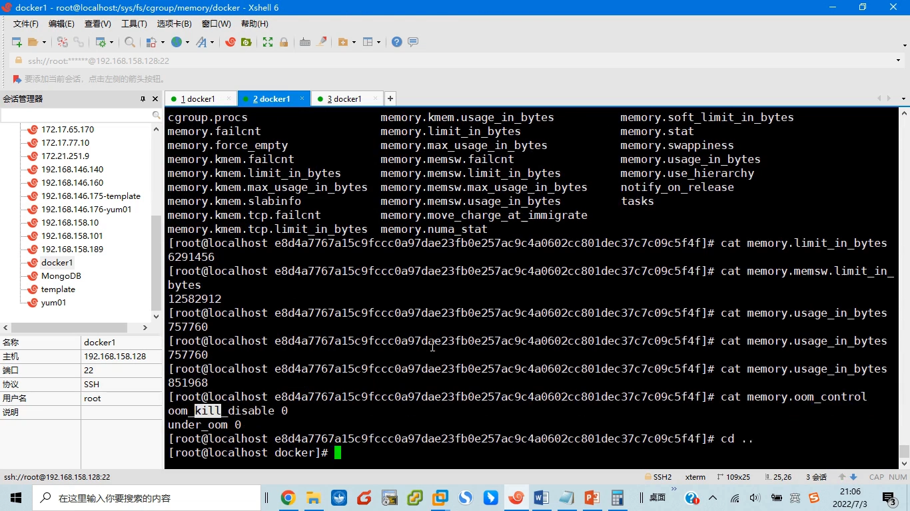

### 4.2 申请 10MB 也会被杀：进程自身还要占内存

跑 mem 输入 `1`：正常，申请完归还。再来一遍，这次输入 `10`（申请 10 兆）——注意进程本身还要占一部分内存，再申请 10 兆必然超限，马上看到 **Killed**：mem 进程被杀，shell 进程还在。[【跳转到 20:27】](https://www.bilibili.com/video/BV1iML4zdEFq/?t=1227)

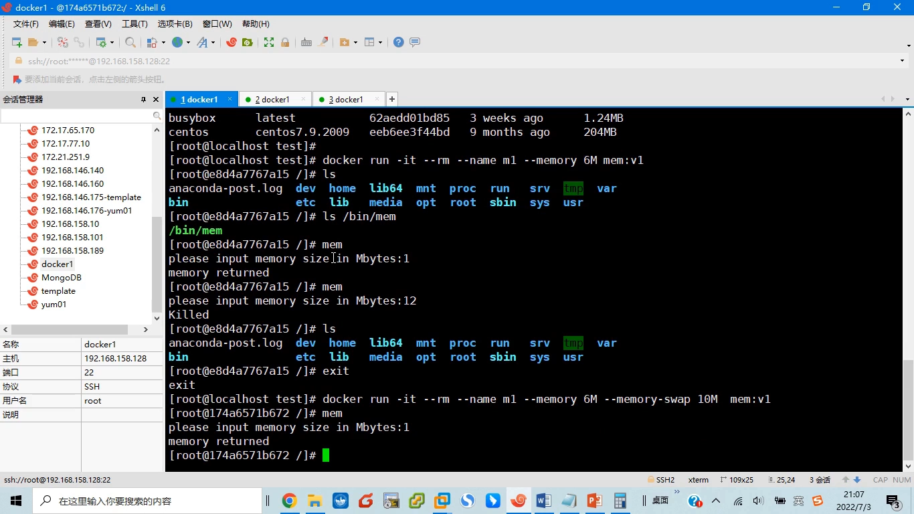

## 小结

- 容器的内存限制落在 `/sys/fs/cgroup/memory/docker/<容器ID>/` 目录，重点三个文件：`memory.limit_in_bytes`（物理内存上限）、`memory.memsw.limit_in_bytes`（物理+swap 上限）、`memory.oom_control`（超限策略）。
- 默认值是一个近乎天文数字的字节数，等于不限制；超限的默认处置是 OOM killer 杀掉违规进程（`oom_kill_disable=0`）。
- `docker run --memory` 映射物理内存上限；只设 `--memory` 时，docker 默认给同等大小的 swap，memsw 就是它的两倍。
- 实验一（6MB/12MB）：申请 12 兆触发 OOM，被杀的是超限的 mem 进程，容器的 shell 初始进程仍存活。
- 实验二（6MB/10MB）：memsw 指定为 10 兆后，申请 10 兆也会被杀——进程自身还要占内存，实际可用比"上限"更小。

## 关键术语速查

| 术语 | 一句话解释 |
| --- | --- |
| cgroup memory 子系统 | 内核中按"组"限制与记账内存的机制，容器限制落在 `/sys/fs/cgroup/memory` 下 |
| memory.limit_in_bytes | 容器可用物理内存的上限（字节） |
| memory.memsw.limit_in_bytes | 物理内存 + 交换分区的总上限（字节） |
| memory.oom_control | 超限处置策略；默认 `oom_kill_disable=0`，即杀掉违规进程 |
| OOM / OOM killer | 内存耗尽时内核选择并终止进程的机制，本例中被杀的是申请超限的 mem 进程 |
| `--memory` | `docker run` 参数，对应 memory.limit_in_bytes |
| `--memory-swap` | `docker run` 参数，对应 memsw 总上限；未指定时默认与 `--memory` 相同 |
| memory.usage_in_bytes | 该容器当前实际使用的内存量（如实验中的 757760 字节） |
