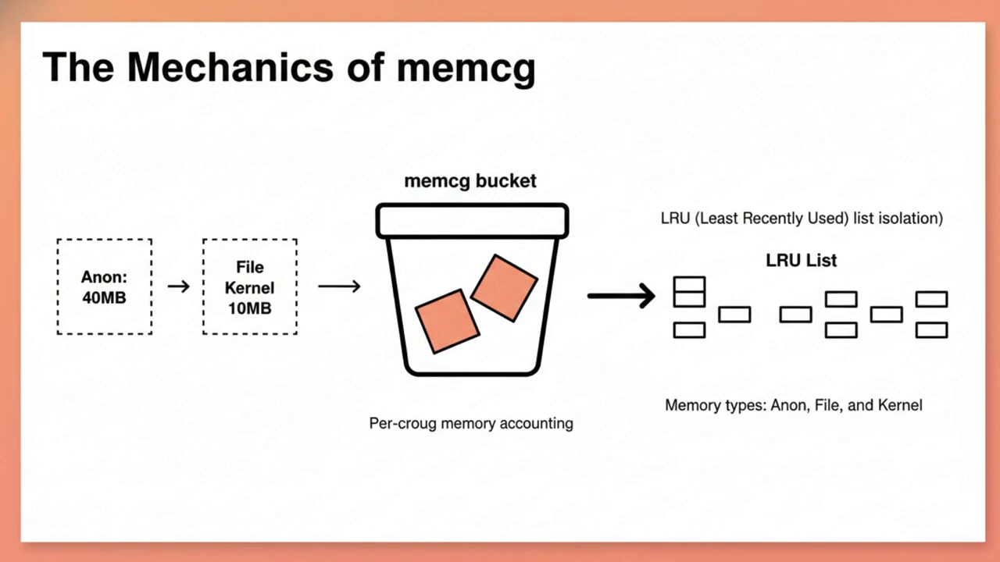
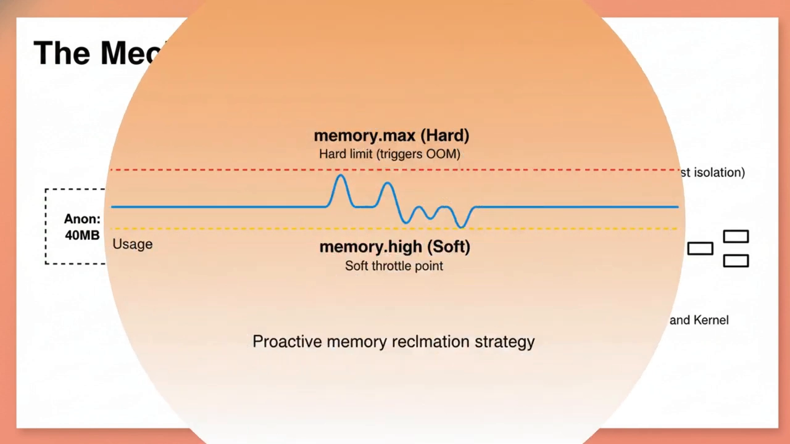
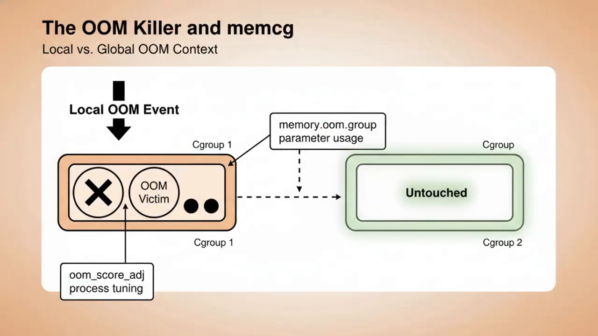
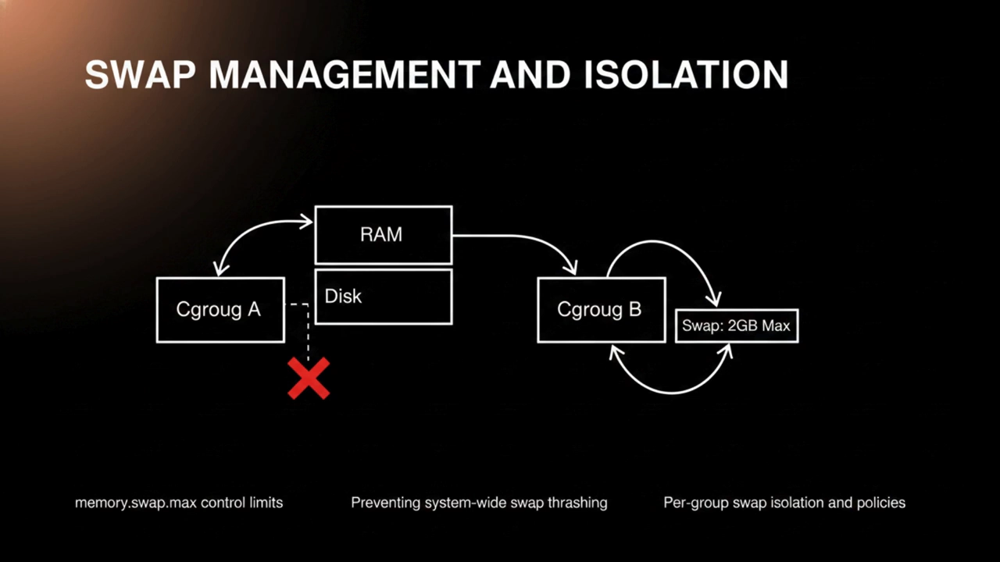
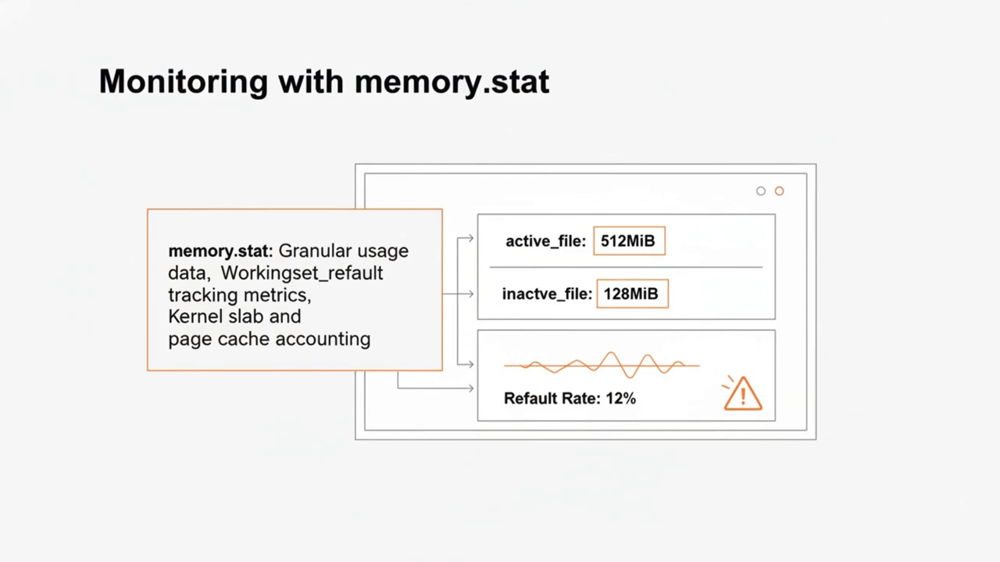
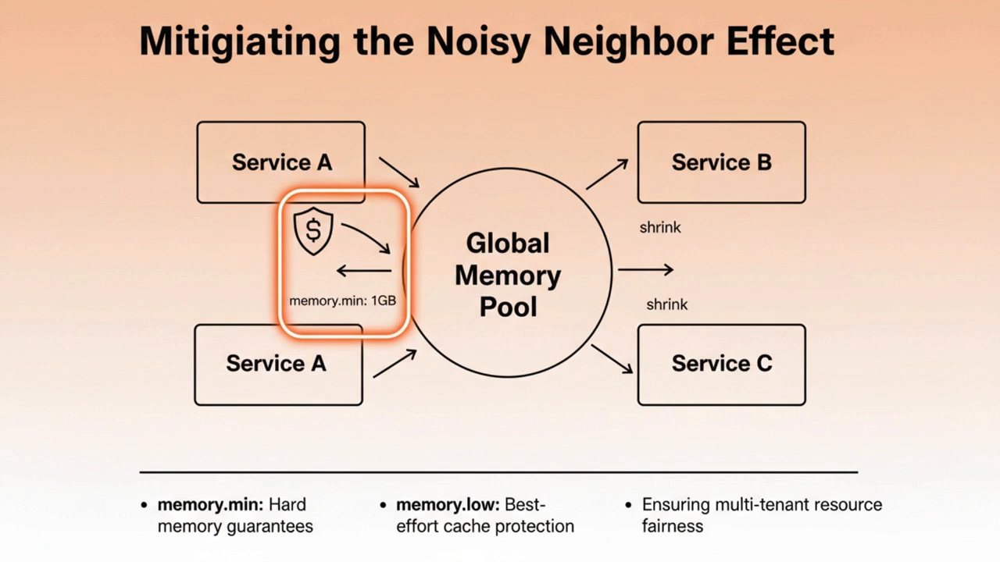

# How to Control Container Memory Like a Pro：memcg 内存控制要点

> 视频源：[How to Control Container Memory Like a Pro: cgroups, memcg, and Kubernetes Memory Limits Tutorial](https://www.youtube.com/watch?v=fkZC9xKJunU)（YouTube @SystemDR，6 分 55 秒，英文讲解）。本文基于视频演说图文稿（英文字幕）整理翻译，时间戳可跳转到原视频对应位置。

## 本讲要解决的核心问题（SCQA）

**背景**：当架构扩展到要承接每秒百万级请求时，单个节点的稳定性变得头等重要。Linux 内核的 cgroup 允许我们按"组"来分配、排定优先级并隔离内存、CPU 这类系统资源；其中负责内存的内存控制组（memcg，memory cgroup），决定了集群是"有韧性"还是"被级联故障拖垮"。[【跳转到 00:00】](https://www.youtube.com/watch?v=fkZC9xKJunU&t=0)

**冲突**：内核是在"组"这个层级上跟踪内存的——但如果只给内存设一条硬上限，超限的进程会被 OOM killer 直接杀掉，服务说没就没；多租户环境里一个服务的内存泄漏，还可能抽干邻居服务的页缓存，引发级联故障。[【跳转到 00:25】](https://www.youtube.com/watch?v=fkZC9xKJunU&t=25)

**疑问**：怎样既把内存限得住，又让系统在内存紧张时"优雅降级"而不是瞬间崩溃？

**回答（中心思想）**：把内存当作**严格管理的资源**而非全局大池子，用 memcg 的整套工具箱：cgroup v2 统一层级、`memory.max`/`memory.high` 两级限制、组内 OOM 处决（`oom_score_adj`、`memory.oom.group`）、`memory.swap.max` 控制 swap、`memory.stat` + PSI 可观测、`memory.min`/`memory.low` 保护关键服务工作集。[【跳转到 06:17】](https://www.youtube.com/watch?v=fkZC9xKJunU&t=377)

## 一、从 v1 到 v2：统一层级是现代功能的前提

cgroup v1 到 v2 的演进，是内存层级管理方式的一次大转向。[【跳转到 00:49】](https://www.youtube.com/watch?v=fkZC9xKJunU&t=49)

- **v1**：不同控制器（memory、IO、CPU……）各自挂在不同树上，交互复杂、资源记账还不一致；
- **v2**：统一层级（所有控制器共用一棵树、只有一个根），资源管理模型大幅简化，memory、IO、CPU 控制器之间能更好地协作。

对资深架构师而言，迁移到 v2 是必须的：压力失速信息（PSI）这类现代特性、更准确的内存记账，只有在统一模型下才能完整发挥。[【跳转到 01:14】](https://www.youtube.com/watch?v=fkZC9xKJunU&t=74)

## 二、memcg 怎么记账：每一页内存都有归属

内存控制组（memcg）就是内核里负责**对内存记账并施加限制**的子系统。[【跳转到 01:33】](https://www.youtube.com/watch?v=fkZC9xKJunU&t=93)

- 进程使用的**每一页**内存——匿名内存、页缓存（page cache）、内核内存——都记到某个具体的 cgroup 头上；
- 内核为每个 cgroup 维护自己的 LRU（最近最少使用）链表；
- 某个组达到上限时，内核**不会**去全局找内存回收，而是在**该组自己的页面里做本地回收**。

这种隔离保证了：一个服务的内存泄漏，不会抽干隔壁高优先级数据库实例的页缓存—— effectively 把"资源大户"的爆炸半径（blast radius）关在了它自己的组里。[【跳转到 01:38】](https://www.youtube.com/watch?v=fkZC9xKJunU&t=98)

## 三、两级限制：memory.max 是硬限，memory.high 是软限

cgroup v2 里主要打两种交道的限制。[【跳转到 02:12】](https://www.youtube.com/watch?v=fkZC9xKJunU&t=132)

- **`memory.max`——硬上限**。进程超过它、且内核无法通过组内回收腾出足够内存时，OOM killer **立即**被触发。
- **`memory.high`——软上限（节流点）**。cgroup 越过它时，内核通过强制直接回收（direct reclaim）让进程**变慢**，为到达硬限前留出缓冲。

架构上用好 `memory.high`，系统就能平滑降级、避免服务被突然终止——这在生产集群的高可用里至关重要。[【跳转到 02:37】](https://www.youtube.com/watch?v=fkZC9xKJunU&t=157)

## 四、OOM 事件：组内选受害者，还能整组"连坐"

内存耗尽（OOM）事件是大规模系统的梦魇。当 memcg 超过硬限且回收失败时，内核的 OOM killer 会**在这个组内部**挑选一个牺牲者终止——与全局 OOM 不同，处置范围只限于违规的 cgroup。[【跳转到 02:56】](https://www.youtube.com/watch?v=fkZC9xKJunU&t=176)

还可以调优这个行为：

- 用 **`oom_score_adj`** 调高/调低进程的牺牲分，保护关键进程；
- 用 **`memory.oom.group`**：置位后，组内任一进程被杀，**整组一起终止**——多进程容器保持一致性。

这种粒度的控制，让架构师能设计出可预期的 **fail-fast** 机制：宁可整组退出，也不留下损坏的中间状态。[【跳转到 03:21】](https://www.youtube.com/watch?v=fkZC9xKJunU&t=201)

## 五、swap：双刃剑，用 memory.swap.max 按组管住

swap 是把双刃剑：对突发流量是安全网，但过度换页（thrashing）会直接拖垮性能。[【跳转到 03:39】](https://www.youtube.com/watch?v=fkZC9xKJunU&t=219)

memcg 允许用 **`memory.swap.max`** 按组控制 swap 用量：设了它，就能防止一个低优先级的批处理任务把系统 swap 占满、拖累主应用的延迟。高性能环境里，常见的做法是对某些组彻底禁用 swap、对另一些放开——确保关键路径服务始终待在物理内存里，避开磁盘 I/O 毫秒级的延迟。[【跳转到 03:44】](https://www.youtube.com/watch?v=fkZC9xKJunU&t=224)

## 六、可观测性：memory.stat 看构成，PSI 看压力

掌握内存管理，可见性是关键。每个 cgroup 目录下的 **`memory.stat`** 提供深入洞察：把用量拆成活跃/不活跃文件缓存、匿名内存、各种内核 slab 等。[【跳转到 04:16】](https://www.youtube.com/watch?v=fkZC9xKJunU&t=256)

对基础设施工程师，**working set（工作集）**指标尤其要盯：如果内核在频繁地把同一批页换出又加载回来，说明该组的内存上限设得太紧，**即使还没碰到硬限，性能已经在劣化**。把这些统计做好监控，是主动容量规划的基础。[【跳转到 04:46】](https://www.youtube.com/watch?v=fkZC9xKJunU&t=286)

**PSI（压力失速信息，Pressure Stall Information）**是现代内核的革命性特性：它量化你的任务**到底花了多少时间在等内存**。比起可能误导人的利用率百分比，PSI 给出 some / full 两档指标——some 表示部分任务被内存压力拖延，full 表示所有非空闲任务都被卡住。对架构师而言，PSI 是在 OOM 真正发生**之前**发现内存饥饿的终极指标，可以据此按真实资源压力做动态负载均衡或自动扩缩容，而不是只看裸用量。[【跳转到 04:54】](https://www.youtube.com/watch?v=fkZC9xKJunU&t=294)

## 七、噪声邻居防御：memory.min 硬保证，memory.low 尽力保护

多租户云环境里，"噪声邻居"是持续威胁：一个流氓进程吃光所有页缓存，就能拖慢整机上所有其他服务。[【跳转到 05:33】](https://www.youtube.com/watch?v=fkZC9xKJunU&t=333)

利用 cgroup 的内存保护参数 **`memory.low` 与 `memory.min`**，可以为组保证一份内核**不会回收**的最低内存：

- **`memory.min`**：硬保证，无论如何不从组里回收；
- **`memory.low`**：尽力而为的保护。

这样即使全局内存压力再大，关键服务的热数据也留在缓存里，在整个共享基础设施上保持低延迟与高可用。[【跳转到 05:38】](https://www.youtube.com/watch?v=fkZC9xKJunU&t=338)

## 小结

- cgroup v2 的统一层级，是 PSI、精确记账等现代内存功能完整生效的前提；
- 硬限 `memory.max` 触发 OOM killer，软限 `memory.high` 先节流缓冲——生产上优先用 high，避免硬杀带来的服务中断；
- OOM 处决是**组内**行为：用 `oom_score_adj` 保护关键进程，用 `memory.oom.group` 让多进程容器整组一致地 fail-fast；
- swap 用 `memory.swap.max` 按组管住，防 thrashing，让关键路径常驻物理内存；
- 可观测性靠 `memory.stat`（构成拆解、working set）+ PSI（some/full 失速），在 OOM 之前发现内存饥饿；
- `memory.min`（硬保证）/`memory.low`（尽力保护）守住关键服务的工作集，抵御噪声邻居。

## 关键术语速查

| 术语 | 一句话解释 |
| --- | --- |
| memcg | memory cgroup，内核中按"组"对内存记账与施加限制的子系统 |
| memory.max | cgroup v2 的内存硬上限；超过且回收失败即触发 OOM killer |
| memory.high | 软上限/节流点；超过后内核强制直接回收，让进程变慢作缓冲 |
| memory.swap.max | 该组可用的 swap 上限，防止个别组占满系统交换空间 |
| oom_score_adj | 调整进程在 OOM 打分中的权重，用于保护或牺牲特定进程 |
| memory.oom.group | 置位后组内任一进程被 OOM 杀死时，整组一起终止 |
| memory.stat | 组内内存用量明细（活跃/不活跃文件缓存、匿名内存、内核 slab 等） |
| PSI | 压力失速信息：量化任务等待内存等资源的时间，分 some / full 两档 |
| memory.min / memory.low | 组内受保护内存：min 是硬保证、不可回收，low 是尽力保护 |
| thrashing | 过度换页：内存页在内存与 swap 间反复倒腾，性能骤降 |
| blast radius | 爆炸半径：故障影响的范围；memcg 的本地回收把超限影响限制在组内 |
