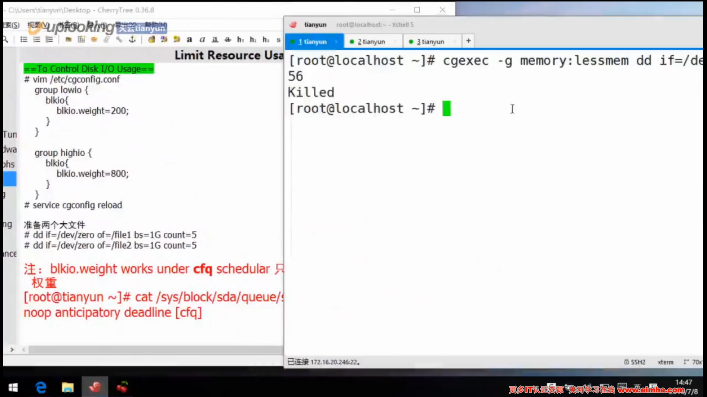
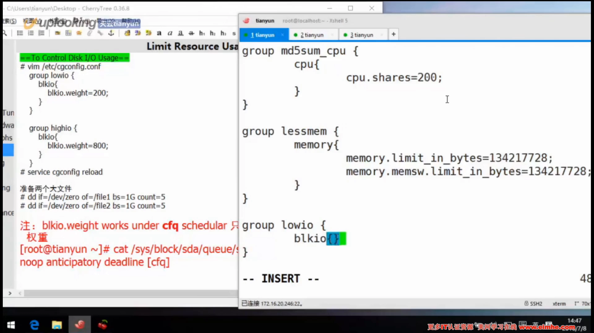
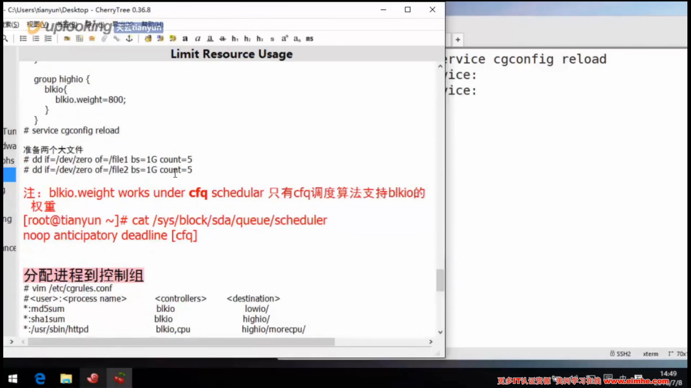
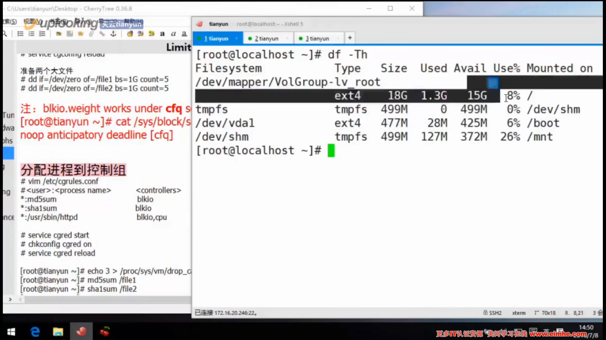
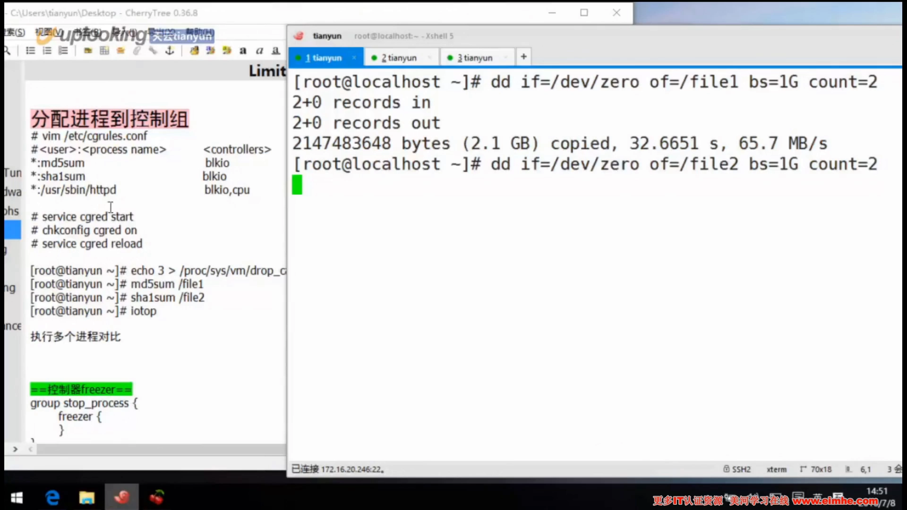
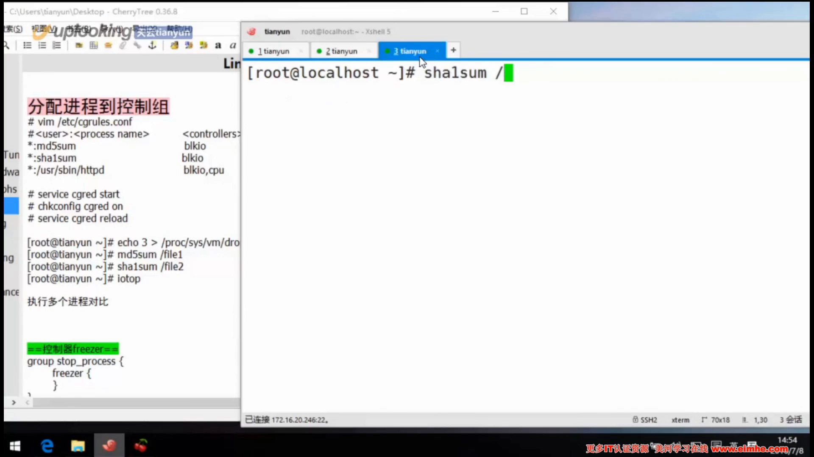
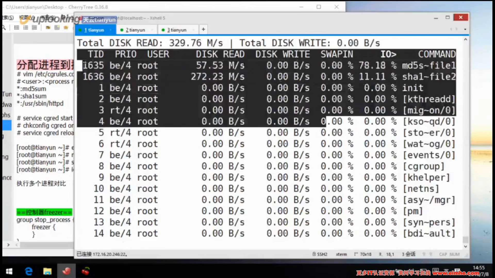
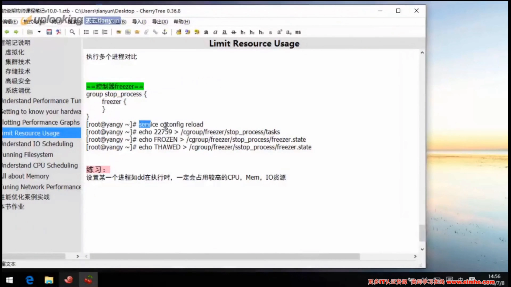
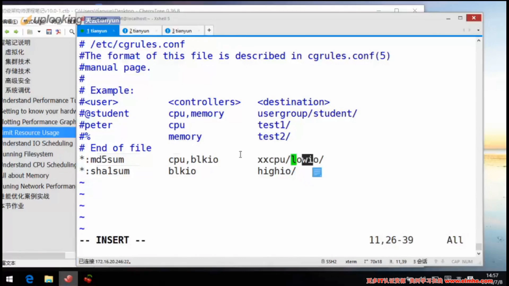

# 08 系统资源限制 Cgroup - 02（blkio 权重限制磁盘 IO）

> 视频源：[08 系统资源限制 Cgroup - 02](https://www.bilibili.com/video/BV1GvgDeEEN4/)（B 站 @飞鱼是什么鱼，13 分 15 秒）。本文基于视频演说图文稿整理，时间戳可跳转到原视频对应位置。

## 本讲要解决的核心问题（SCQA）

**背景**：磁盘 IO 和 CPU 一样，是按比例分配的资源。前面我们用 cgconfig 给进程组限过 CPU，这一讲轮到磁盘 IO——cgroup 里对应的控制器是 blkio。[【跳转到 00:00】](https://www.bilibili.com/video/BV1GvgDeEEN4/?t=0)

**冲突**：两个进程同时读一块盘，如果不设限，谁抢到算谁的。我们希望一个组能拿到的 IO 份额，是另一个组的四倍。[【跳转到 00:00】](https://www.bilibili.com/video/BV1GvgDeEEN4/?t=0)

**疑问**：怎么用 blkio 控制器把两个组的磁盘 IO 控制成 4:1？这个权重靠什么调度算法生效？又怎么让进程"自动"进组，而不是每次手动分配？

**回答（中心思想）**：给两个组分别设 blkio 的 weight 参数为 800 和 200（四倍关系），前提是磁盘调度算法必须是 CFQ；再用 cgred 守护进程配合 /etc/cgrules.conf 规则，让"所有用户执行 md5sum"自动落入指定组；最后用 iotop 验证两个组的读取速度确实维持约四倍比例。此外还演示了 freezer 控制器（把 PID 写进 tasks 即可冻结/解冻进程），以及 cgrules 的两个要点：一行可以并列多个控制器（逗号分隔），但进程必须是二进制程序（最好写绝对路径），不能是脚本。[【跳转到 00:30】](https://www.bilibili.com/video/BV1GvgDeEEN4/?t=30)

## 一、建组：blkio 控制器与权重

### 1.1 在 cgconfig 里建两个组

blkio 是按比例分配的资源，所以要建立两个组来做对比。打开 cgconfig，在里面通过 grp 建立一个 dio 组，用的控制器是 blkio。[【跳转到 00:30】](https://www.bilibili.com/video/BV1GvgDeEEN4/?t=30)

### 1.2 weight 800 对 200：四倍关系

配的就是 blkio 里面的 weight 参数：一个组设 800，dio 组调低到 200，正好是四倍的形式——我们就以四倍来做一个比较。[【跳转到 00:55】](https://www.bilibili.com/video/BV1GvgDeEEN4/?t=55)

配好后重载（reload）一下 cgconfig 服务，让配置生效。[【跳转到 02:10】](https://www.bilibili.com/video/BV1GvgDeEEN4/?t=130)

## 二、测试前提：CFQ 调度算法与大文件

### 2.1 权重只工作在 CFQ 调度模式下

测试有些要求。第一，先准备两个大文件，看谁先把文件读完（不是写完，写完可能测不出来）——5G 太大，用 2G 或 1G 都可以。但有一点必须注意：**这个权重只能工作在 CFQ 调度模式下**，所以要先看一下磁盘的调度算法。查看输出，当前生效的调度策略正是 cfq（方括号括住的就是当前算法）。[【跳转到 02:35】](https://www.bilibili.com/video/BV1GvgDeEEN4/?t=155)

### 2.2 dd 造两个 1G 文件

用 `dd if=/dev/zero of=L1 bs=1G count=2` 这样的命令，先整两个 1G 大小的文件，然后让两个进程去读。清不清缓存对演示影响不大。[【跳转到 03:35】](https://www.bilibili.com/video/BV1GvgDeEEN4/?t=215)

## 三、自动分配：cgred 与 /etc/cgrules.conf

### 3.1 cgred 进程与规则文件

前面分配进程到组，我们始终用的是手动方式；这次准备采用自动的方式。用到另外一个进程——cgred。它有一个配置文件：/etc 下的 cgrules（/etc/cgrules.conf），语法规则是：**用户、进程、控制器、哪个组（目标）**。[【跳转到 04:25】](https://www.bilibili.com/video/BV1GvgDeEEN4/?t=265)

### 3.2 规则：所有用户执行 md5sum 自动进组

在规则文件里配置：所有用户，执行 md5sum 的时候，控制器填 blkio 块设备控制器，目标组分别是 dio（weight 200）和另一个高 IO 组（weight 800）。别搞错了：dio 这个组是 200。[【跳转到 05:15】](https://www.bilibili.com/video/BV1GvgDeEEN4/?t=315)

### 3.3 reload 而不是重启

两个进程分别使用不同的控制组。保存后重新加载——注意不是重启 cgroup，而是 reload 一下 cgconfig 让它加载规则；现在刚启动过，以后修改就是 reload。为了公平，测试前把条件对齐好。[【跳转到 06:05】](https://www.bilibili.com/video/BV1GvgDeEEN4/?t=365)

## 四、验证：iotop 里的四倍比例

找两个终端，分别用 md5sum 去读那两个大文件，然后打开 iotop 看它们的速度。[【跳转到 06:55】](https://www.bilibili.com/video/BV1GvgDeEEN4/?t=415)

两个 md5sum 一瞬间就跑起来了。等它们读完后对比 iotop 的读数：两个进程的读取速度，大致就维持在那个**四倍左右的比例关系**——和 800:200 的权重设置对得上。[【跳转到 08:26】](https://www.bilibili.com/video/BV1GvgDeEEN4/?t=506)

## 五、freezer 控制器：把进程"暂停/解冻"

另外还有一个控制器，它的作用是把进程停下来。这个控制器里没有什么参数，直接就是控制器的名字。用法：把进程的 PID 扔到控制器的 tasks 文件里，然后把它**冷冻（冻结）**起来——它就暂停了；再**解冻**它，就恢复运行。[【跳转到 09:15】](https://www.bilibili.com/video/BV1GvgDeEEN4/?t=555)

## 六、进阶：一行规则限多个资源，但只认二进制

### 6.1 逗号并列多个控制器

练习：设置某个进程（如 dd）在执行时，同时占用较高的 CPU、内存和 IO。查一下文档你会发现，控制器那一列可以**用逗号把多个控制器并列写上**（不是用斜线）。这样 md5sum 执行时就会同时"CPU 比较高、IO 也比较高"。[【跳转到 10:03】](https://www.bilibili.com/video/BV1GvgDeEEN4/?t=603)

### 6.2 必须是二进制程序，最好写绝对路径

注意：进程那一列可以使用绝对路径，也可以不使用路径（它会去找这个进程），但**不能是脚本——必须是二进制程序**。你自己写的脚本没用。比如 Apache 的二进制在哪、md5sum 在哪，最好都写上完整的绝对路径，这是最标准的写法。二进制程序才可以被使用，只有二进制——记住。[【跳转到 10:53】](https://www.bilibili.com/video/BV1GvgDeEEN4/?t=653)

### 6.3 练习与本讲收尾

课后练习：设置 dd 在执行时（与 md5sum 对比）拥有较高的 CPU、内存和 IO——在 cgrules 里写好几个控制器、好几个组就可以了，唯一的要求是进程必须是二进制文件而不能是脚本。其他控制组（比如 cpuset）在后面的实例中还会讲到。[【跳转到 11:54】](https://www.bilibili.com/video/BV1GvgDeEEN4/?t=714)

## 小结

- blkio 控制器负责**按比例**限制磁盘 IO：weight 800 对 200，就是四倍的份额关系。
- **blkio.weight 只在 CFQ 调度模式下生效**，动手前先确认磁盘调度算法。
- 测试思路：dd 造两个大文件 → 两个进程同时读 → iotop 观察速度，比例与权重设置对得上。
- **cgred + /etc/cgrules.conf** 实现"用户 + 进程 + 控制器 → 目标组"的自动分配，改完规则 reload cgconfig 即可。
- **freezer** 控制器没有参数：PID 写进 tasks 即冻结，解冻即恢复。
- cgrules 一行可用逗号并列多个控制器；进程字段必须是**二进制程序**（最好绝对路径），不支持脚本。

## 关键术语速查

| 术语 | 一句话解释 |
| --- | --- |
| blkio 控制器 | cgroup 中负责块设备 IO 的控制器，本讲用它按比例分配磁盘 IO |
| blkio.weight | 权重参数：比例分配的依据，800:200 即 4:1 |
| CFQ | 一种磁盘调度算法；blkio.weight 只工作在 CFQ 模式下 |
| cgconfig | cgroup 配置工具，建组、设参数、reload 生效 |
| cgred | 依据 /etc/cgrules.conf 自动把进程放进对应 cgroup 的守护进程 |
| /etc/cgrules.conf | 规则文件：用户、进程、控制器、目标组 |
| freezer | 冻结/解冻进程组的控制器，没有参数，PID 写入 tasks |
| iotop | 按进程实时查看磁盘 IO 速率的工具 |
