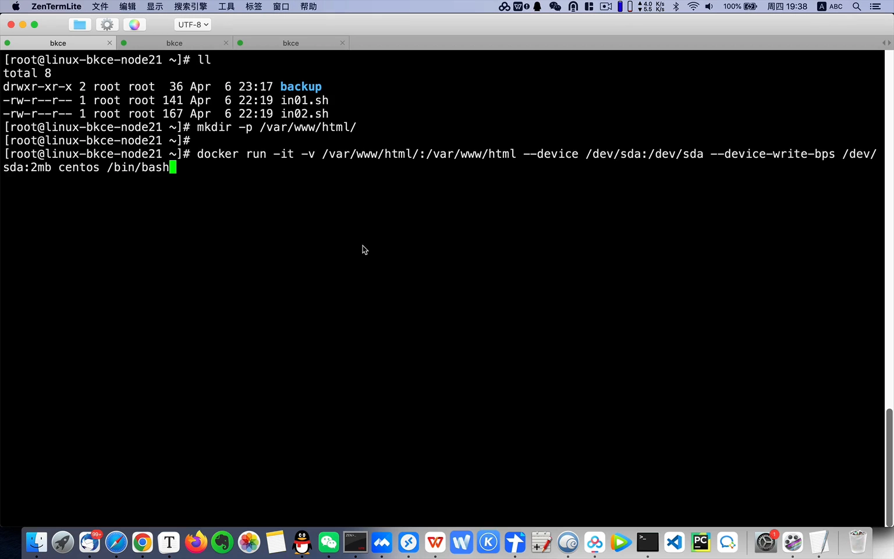
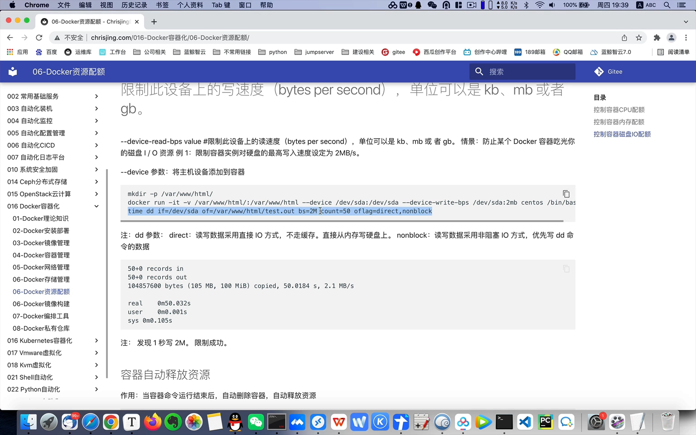
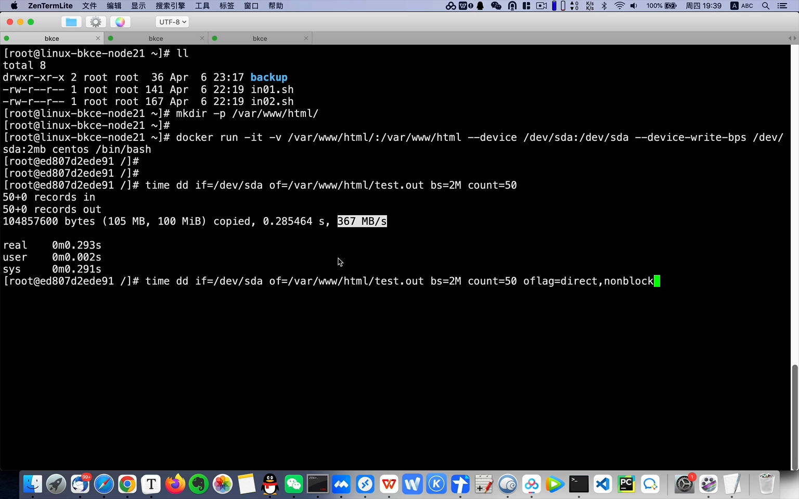
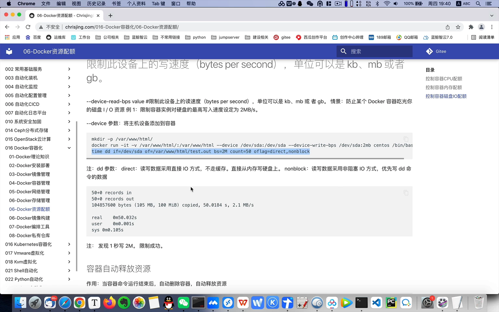
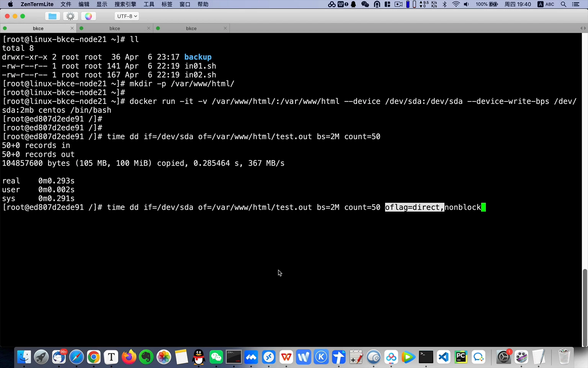
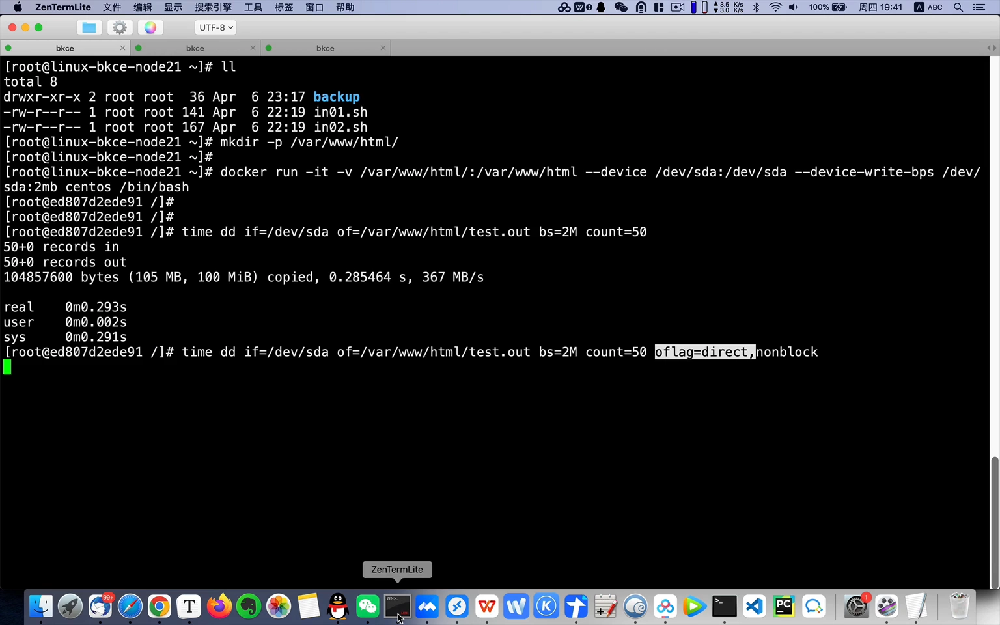
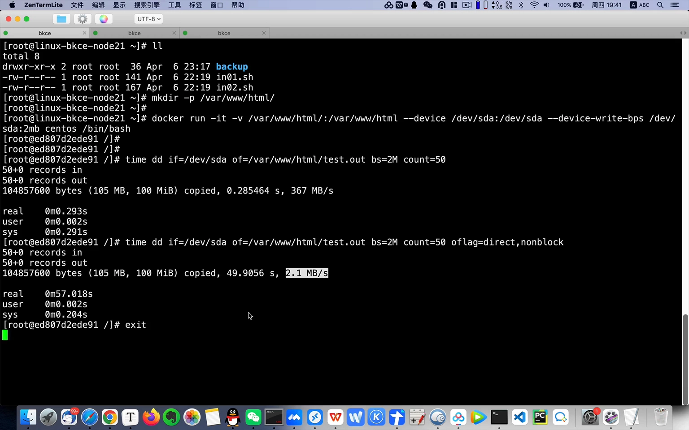

# paas-容器服务36-docker资源配额-控制容器磁盘IO配额

> 视频源：[paas-容器服务36-docker资源配额-控制容器磁盘IO配额](https://www.bilibili.com/video/BV1dS4y1A76V/)（B 站 @ChrisJing46，3 分 36 秒）。本文基于视频演说图文稿整理，时间戳可跳转到原视频对应位置。

## 本讲要解决的核心问题（SCQA）

**背景**：容器本质上是宿主机上的一个进程，它写的每一个字节最终都落在宿主机的物理磁盘（如 /dev/sda）上。[【跳转到 00:00】](https://www.bilibili.com/video/BV1dS4y1A76V/?t=0)

**冲突**：如果不设限，容器里的写密集任务可以把整块盘的写入带宽吃光，拖累同一台机器上的其他服务。我们希望给某个容器的磁盘写入定一个明确的天花板——比如 2MB/s。[【跳转到 00:34】](https://www.bilibili.com/video/BV1dS4y1A76V/?t=34)

**疑问**：怎么限制一个容器的磁盘 IO 配额？为什么有时明明设了限制，测出来的速度却依然飞快？

**回答（中心思想）**：在 docker run 时指定块设备并设置其写入 bps 上限（本例限为 2MB/s）；同时注意一个关键坑——写入默认走内存页缓存，测速必须用直接 IO（dd 的 oflag=direct）绕过缓存，才能看到真实效果：本例从不限速时的 367MB/s 被压到 2MB/s，限制生效。[【跳转到 01:48】](https://www.bilibili.com/video/BV1dS4y1A76V/?t=108)

## 一、给容器设置磁盘 IO 配额

### 1.1 准备：建目录、挂载进容器

第一步先创建一个 /var/www/html 目录，然后把容器命令复制出来：将这个目录挂载到容器的对应目录里，容器来自 CentOS 镜像。[【跳转到 00:20】](https://www.bilibili.com/video/BV1dS4y1A76V/?t=20)

### 1.2 指定设备并限制写入 bps

起容器的同时做两件事：使用 /dev/sda 这个设备，并限制它写入的 bps——上限设为 2MB/s（两兆每秒）。这样容器对这块盘的写入速度就被框在了 2MB/s 以内。[【跳转到 00:34】](https://www.bilibili.com/video/BV1dS4y1A76V/?t=34)

## 二、先看不限速的样子：367MB/s

用 time dd 命令往里写一个文件来看写入速度。先不加限制参数，正常写入速度能达到 367MB/s——但我们肯定是要限制它的速度的。[【跳转到 01:16】](https://www.bilibili.com/video/BV1dS4y1A76V/?t=76)

## 三、为什么设了限制却"限不住"？页缓存在帮忙

你可能会想：为什么我执行了限制命令，速度却还是那么快？**因为它默认走了内存的缓存**——数据先写进内存页缓存再慢慢落盘，所以你感觉它非常快，限制根本没体现出来。[【跳转到 01:31】](https://www.bilibili.com/video/BV1dS4y1A76V/?t=91)

解决办法：让 dd 采用**直接 IO（Direct IO）**的方式——不走缓存、直接落盘。加上对应参数（oflag=direct）再测。[【跳转到 01:48】](https://www.bilibili.com/video/BV1dS4y1A76V/?t=108)

再测一次，写入速度就是 2MB/s 了——相当于我们把它的 IO 限制住了。只要不走内存缓存，肯定达不到之前那么快的速度。[【跳转到 02:00】](https://www.bilibili.com/video/BV1dS4y1A76V/?t=120)

## 四、验证与清理环境

因为按 2MB/s 的速度写入，跑完需要一点时间。等一会儿再观察：写入速度已经降为 2MB/s，说明我们已经成功地将它限制住了。[【跳转到 02:36】](https://www.bilibili.com/video/BV1dS4y1A76V/?t=156)

最后别忘记清理环境：退出并直接删掉这个临时容器，非常方便。[【跳转到 03:09】](https://www.bilibili.com/video/BV1dS4y1A76V/?t=189)

## 小结

- 限制容器磁盘 IO 配额：docker run 时指定块设备并设置写入 bps 上限（本例 /dev/sda、2MB/s）。
- 测速要**绕过页缓存**：dd 加 oflag=direct（直接 IO），否则写入先落内存缓存，速度"虚高"，会误以为限制没生效。
- 实测效果：不限速 367MB/s → 限速后稳定 2MB/s。
- 演示用的临时容器，测完记得删除、清理环境。

## 关键术语速查

| 术语 | 一句话解释 |
| --- | --- |
| bps | 每秒字节数（bytes per second），磁盘写入/读取速率的限额单位 |
| 页缓存 | 内核把写入先存内存、再异步落盘的机制；会让 dd 测速"虚高" |
| 直接 IO（Direct IO） | 绕过页缓存、直接读写磁盘的 IO 方式（dd 的 oflag=direct） |
| docker run --device | 把宿主机块设备（如 /dev/sda）交给容器使用的参数 |
