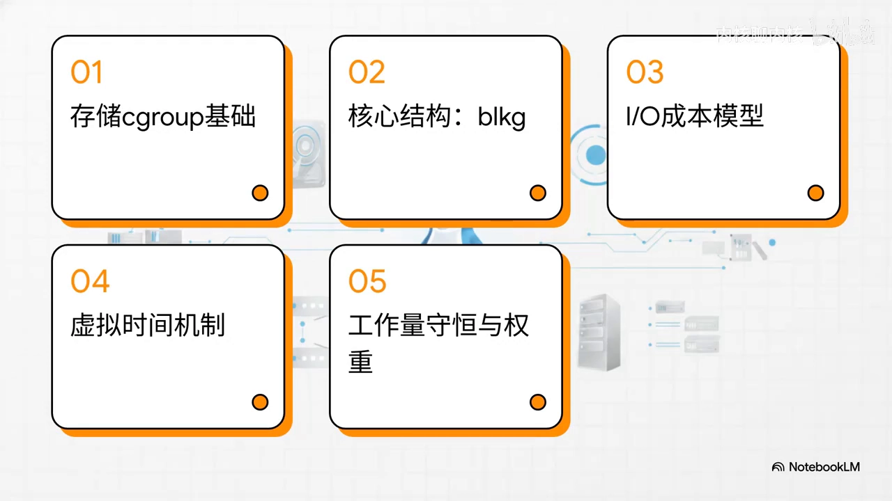
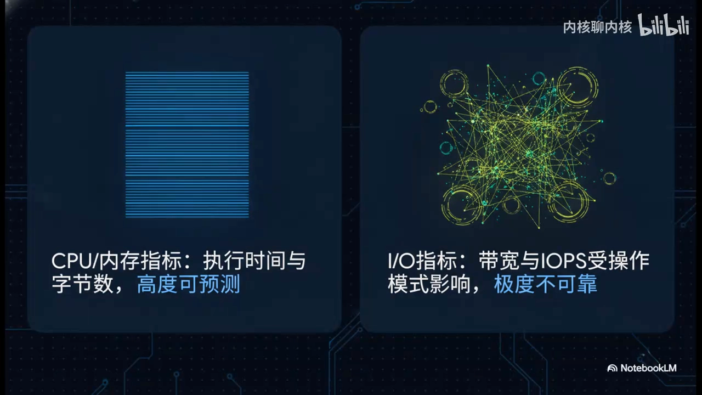
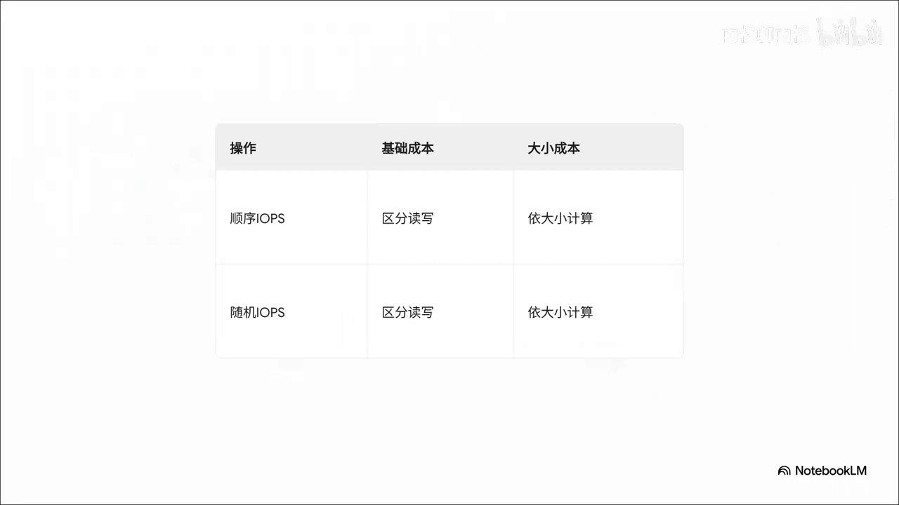
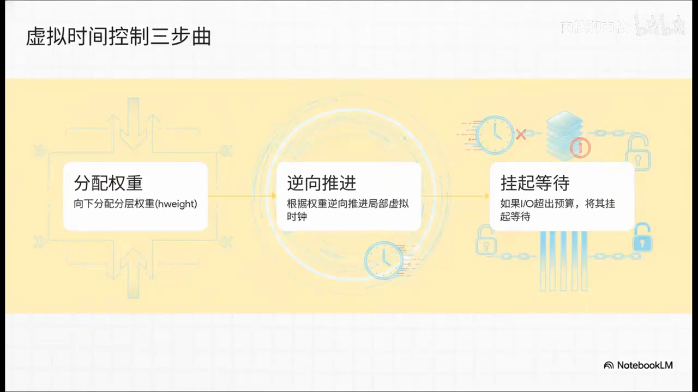

# 揭秘Linux内核-如何实现存储cgroup调度

> 视频源：[揭秘Linux内核-如何实现存储cgroup调度](https://www.bilibili.com/video/BV1ahjU6PEfM/)（B 站 @内核聊内核，9 分 29 秒）。本文基于视频演说图文稿整理，时间戳可跳转到原视频对应位置。

## 本讲要解决的核心问题（SCQA）

**背景**：你已经知道用 cgroup 可以限制一个容器能用多少 CPU、多少内存。磁盘 IO 同样是关键资源，内核也要把它公平、高效地分给各个进程组。[【跳转到 00:00】](https://www.bilibili.com/video/BV1ahjU6PEfM/?t=0)

**冲突**：但 IO 和 CPU、内存都不一样——同样是"读 1MB"，连续的顺序读写和疯狂的随机寻道对底层硬盘的压力差距是天上地下，没法用带宽或 IOPS 这种单一指标衡量；而且成百上千个组同时抢一块盘，稍有设计不当（比如每次记个账都要抢全局大锁）就会把性能瞬间拖垮。[【跳转到 03:27】](https://www.bilibili.com/video/BV1ahjU6PEfM/?t=207)

**疑问**：内核究竟是怎么在这么复杂的物理硬件上，把 IO 资源"公平又高效"地分配给各个进程组的？

**回答（中心思想）**：靠一套五步走的机制——以 blkcg 作为块 IO 对接 cgroup 的接口，用 blkg 把控制组绑定到每块设备的请求队列，用线性 IO 成本模型给不同类型的 IO"算分"，把成本换算成设备虚拟时间（vtime）来控制节奏（超支就挂起、过载就整体踩刹车 vrate），最后靠工作量守恒把硬件的最后一滴性能榨干；而且统计与权重调整全程采用无锁设计，绕开全局锁竞争。[【跳转到 00:30】](https://www.bilibili.com/video/BV1ahjU6PEfM/?t=30)

## 一、两个基础对象：blkcg 与 bio

### 1.1 blkcg：块 IO 控制器对接 cgroup 的接口

存储 cgroup 的第一个核心组件叫 **blkcg**。简单来说，它就是通用块 IO 控制器对接 cgroup 的接口。对刚接触内核的朋友来说，完全可以把它当成内核里的"总指挥部"：专门负责盯紧和控制不同进程组的块 IO 策略。[【跳转到 00:49】](https://www.bilibili.com/video/BV1ahjU6PEfM/?t=49)

也就是说，当你在用户态给某个容器限制磁盘读写速度的时候，底下真正在干活的，其实就是这个控制结构。[【跳转到 00:58】](https://www.bilibili.com/video/BV1ahjU6PEfM/?t=58)

### 1.2 bio：IO 请求的"快递包裹"

那这个总指挥部具体在指挥谁呢？答案是 **bio**。[【跳转到 01:23】](https://www.bilibili.com/video/BV1ahjU6PEfM/?t=83)

你的应用程序不管发多少次读写请求，到了内核这里，全都会被打包成一个一个的 bio 结构体。这就好比寄往硬盘的一个一个快递包裹：内核的日常工作，就是给这成千上万的包裹规划路线、记账，最后把它们调度发车。[【跳转到 01:28】](https://www.bilibili.com/video/BV1ahjU6PEfM/?t=88)

## 二、blkg：把抽象的 cgroup 绑到真实设备上

### 2.1 一座桥：控制组 ↔ 设备请求队列

核心结构 **blkg** 的作用，是把抽象的 cgroup 和真实的物理硬件连到一块：一个控制组通常要访问好几块不同的硬盘，而每块硬盘又都有自己独立的请求队列。blkg 就是一根结结实实的纽带，把"特定的控制组"和"特定的物理设备队列"死死地绑定在一起。[【跳转到 01:59】](https://www.bilibili.com/video/BV1ahjU6PEfM/?t=119)

### 2.2 多核难题：统计不能靠全局大锁

这种绑定在多核 CPU 系统上立刻引出一个致命的性能问题：内核怎么才能在不产生巨大锁开销的情况下，在这么多 CPU 核心之间高效追踪同一个 blkg 的 IO 统计数据？如果每做一次 IO 大家都要抢一把全局大锁，系统性能绝对瞬间崩溃。[【跳转到 02:22】](https://www.bilibili.com/video/BV1ahjU6PEfM/?t=142)

### 2.3 无锁方案：每 CPU 记账 + 延迟汇账

内核的解法是一套完全无锁的追踪方案：[【跳转到 02:47】](https://www.bilibili.com/video/BV1ahjU6PEfM/?t=167)

- **每 CPU 变量（per-CPU 变量）**：每个 CPU 核心自己拿一本小账本，各记各的；
- **无锁链表**：把这些更新串起来；
- **延迟刷新**：不着急的汇账，延迟统一汇总。

于是各 CPU 在干活、记录数据时完全不用互相排队，并发性能直接拉满。[【跳转到 03:12】](https://www.bilibili.com/video/BV1ahjU6PEfM/?t=192)

## 三、IO 成本模型：给不同的 IO"算分"

### 3.1 为什么不能只看带宽或 IOPS

IO 跟 CPU、内存完全不一样：CPU 看运行时间就行，内存看字节数就行，非常直观；但 IO 如果还拿传统的带宽或 IOPS 去算，就大错特错了——顺序读写和随机寻道对硬盘造成的压力差距是天上地下，用传统指标去分摊资源绝对是一笔糊涂账。[【跳转到 03:27】](https://www.bilibili.com/video/BV1ahjU6PEfM/?t=207)

### 3.2 内核源码注释点出灵魂：相对成本

内核源码注释里有非常有意思的一句话：**"如果我们能描述不同类型 IO 的相对成本，就能实现合理的、基于工作量守恒的资源分配。"**搞清楚相对成本，这就是整个现代 IO 调度的灵魂所在。[【跳转到 03:58】](https://www.bilibili.com/video/BV1ahjU6PEfM/?t=238)

### 3.3 线性 IO 成本模型

为了把这笔账算清楚，内核引入了一套**线性 IO 成本模型**：给不同的操作定各种动态系数——不仅分读和写、分顺序和随机，还把一次 IO 拆成"一个基础成本 + 一个和数据量成正比的大小成本"。这样一来，不管 IO 请求长得多特别，全都被拉到同一个数学模型里公平打分、算出成本。[【跳转到 04:16】](https://www.bilibili.com/video/BV1ahjU6PEfM/?t=256)

## 四、虚拟时间机制：让成本落地

### 4.1 vtime：设备内部的一块怀表

算出来的成本怎么执行？靠 **vtime（设备虚拟时间）**——这是掌控全局的内部时钟。可以把它脑补成内核给每个硬件设备内部单独配的一块怀表：五花八门的 IO 成本，最后通通变成这块怀表上滴答滴答流逝的时间。[【跳转到 04:57】](https://www.bilibili.com/video/BV1ahjU6PEfM/?t=297)

### 4.2 精度：一秒 = 2 的 37 次方

为了保证绝对精准，现实生活中的一秒钟，在这个虚拟时间里居然等于 **2 的 37 次方**个单位。这个夸张的天文数字不仅保证了亚纳秒级的恐怖精度，还能拍胸脯保证：就算在极限读写速度下连跑好几年，64 位整数也绝对不会溢出，可谓稳如磐石。[【跳转到 05:18】](https://www.bilibili.com/video/BV1ahjU6PEfM/?t=318)

### 4.3 三步控制：权重分发 → 拨动局部时钟 → 超支挂起

靠虚拟时间控制的具体动作就三步：[【跳转到 05:48】](https://www.bilibili.com/video/BV1ahjU6PEfM/?t=348)

1. **权重分发**：在层级树里把权重（hweight，层级权重）分发下去；
2. **拨动局部时钟**：根据权重逆向调整局部时钟——你的权重越低，时间走得越快，说明你的 IO 越"昂贵"；
3. **超支挂起**：一旦这个组把当前的虚拟时间预算花光，对不起，直接挂起，乖乖去旁边排队。

### 4.4 vrate：给虚拟时钟踩刹车

数学模型再完美，也打不过现实世界里硬件状态的起伏。所以内核又加了一道保险——**vrate（虚拟速率）**：要是硬盘队列全塞满、延迟疯狂飙升，眼看设备就要撑不住了，内核就会果断出手，自动调低 vrate，相当于给整个虚拟时钟踩一脚刹车，所有 IO 的下发速度跟着慢下来，稳稳地保护底层硬件不被压垮。[【跳转到 06:12】](https://www.bilibili.com/video/BV1ahjU6PEfM/?t=372)

## 五、工作量守恒：把硬件的最后一滴性能榨干

### 5.1 死板限制的问题

设想一个极端场景：如果死板地限制死一个 cgroup——即便它只用了分配给它的一小丢丢权重，底下硬盘明明闲得发慌，别的进程却因为资源不够在那干瞪眼。这种傻瓜式调度要是没有工作量守恒机制兜底，会让整个设备的利用率惨不忍睹。[【跳转到 06:53】](https://www.bilibili.com/video/BV1ahjU6PEfM/?t=413)

### 5.2 空闲权重自动出让与接管

内核的化解方法：比如 cgroup A 挺活跃但没吃饱、总体用量低，那它多出来用不掉的空闲权重，系统会自动让它"吐出来"；旁边正满负荷运行、嗷嗷待哺的 cgroup B 立马无缝接管，把这部分剩余容量吃掉——整个硬件的吞吐量瞬间就最大化了。[【跳转到 07:14】](https://www.bilibili.com/video/BV1ahjU6PEfM/?t=434)

### 5.3 三件事：盯用量、让权重、留余量

为了把这套机制玩得转，内核在底层做了三件事：[【跳转到 07:39】](https://www.bilibili.com/video/BV1ahjU6PEfM/?t=459)

1. 死死盯住**真实的活跃用量**；
2. **自动出让**多余的层级权重；
3. 最关键的：必须留一手**安全余量**——万一刚才大方捐出权重的哥们儿突然迎来流量洪峰呢？有了余量，它就能像弹簧一样瞬间把属于自己的处理能力抢回来，绝不让好心人吃亏。[【跳转到 07:44】](https://www.bilibili.com/video/BV1ahjU6PEfM/?t=464)

### 5.4 成百上千个组互相借用，为什么不会乱套？

一个非常硬核的问题浮出水面：如果成百上千个底层 cgroup 叶子节点都在疯狂、动态地互相借用多余权重，内核的计算难道不会乱套？会不会引发惨烈的大规模全局锁竞争？[【跳转到 08:08】](https://www.bilibili.com/video/BV1ahjU6PEfM/?t=488)

答案是：内核根本不需要动全局锁——它仅仅依靠在底层**动态缩放**那些让出权重的叶子节点，就能极其高效地达成全局的工作量守恒。全都是天生安全的本地无锁操作，彻底绕开了同步全局权重的巨大开销。这就是顶级内核架构设计最迷人的地方。[【跳转到 08:29】](https://www.bilibili.com/video/BV1ahjU6PEfM/?t=509)

## 小结

- 存储 cgroup 隔离的两个基础对象：**blkcg**（块 IO 的 cgroup 接口，"总指挥部"）与 **bio**（IO 请求的"快递包裹"）。
- **blkg** 把每个 cgroup 与每块设备的请求队列一一绑定，是 cgroup 通向物理硬件的桥。
- 多核统计用**每 CPU 变量 + 无锁链表 + 延迟刷新**，避免全局大锁。
- IO 的公平不是按字节或次数，而是按**线性成本模型**给不同类型 IO（读/写、顺序/随机、基础+大小成本）算出"相对成本"。
- 成本落地靠**设备虚拟时间 vtime**（一秒 = 2³⁷ 个单位）：权重越低时间走得越快，预算花光就挂起；**vrate** 在设备过载时整体踩刹车。
- **工作量守恒**：空闲权重自动出让、繁忙组无缝接管，并预留安全余量防止"好心人吃亏"。
- 全程无锁：只动态缩放让出权重的叶子节点，绕开全局权重同步开销。
- 留给你思考：NVMe 延迟正逼近微秒甚至纳秒极限，这套线性成本模型未来如何演化才不成为新硬件的累赘？

## 关键术语速查

| 术语 | 一句话解释 |
| --- | --- |
| blkcg | 块 IO cgroup：通用块 IO 控制器对接 cgroup 的接口，块 IO 限制的"总指挥部" |
| bio | 内核中一次块 IO 请求的载体，应用读写请求打包成的"快递包裹" |
| blkg | 把某个 cgroup 与某块设备的请求队列绑定起来的结构 |
| IO 成本模型 | 给不同类型 IO（读/写、顺序/随机、大小）统一算分的线性模型 |
| vtime | 设备虚拟时间：按 IO 成本流逝的内部时钟，权重越低走得越快 |
| vrate | 虚拟速率：设备过载时整体调低，相当于给虚拟时钟踩刹车 |
| hweight | 层级权重：沿 cgroup 层级树分发下去的 IO 权重 |
| 工作量守恒 | 空闲权重自动出让给繁忙组，硬件吞吐量最大化的机制 |
