# Kubernetes_Kubelet_Kernel_Cgroup_PIDs_Nginx_controller_fail_to_start

> 视频源：[Kubernetes Kubelet Kernel Cgroup PIDs - Nginx controller fail to start](https://www.youtube.com/watch?v=pgfB5G4XnMw)（YouTube @loongfire，17 分 40 秒）。本文基于视频演说图文稿整理，时间戳可跳转到原视频对应位置。

## 本讲要解决的核心问题（SCQA）

**背景**：NGINX Controller 是用来监控与配置 NGINX Plus 实例的控制器，它本身要跑在 Kubernetes 集群（单节点或多节点）里。演示者用安装器在一台新虚拟机上装整套环境，安装脚本会检查 Docker 版本、加载 kubeadm 等 Kubernetes 组件，再由 kubeadm 拉起集群 [【跳转到 00:41】](https://www.youtube.com/watch?v=pgfB5G4XnMw&t=41)。

**冲突**：安装中途 kubelet 服务失败，日志一层层报错，最后一行是 `failed to find a subsystem mount for required subsystems pids`，安装失败 [【跳转到 03:44】](https://www.youtube.com/watch?v=pgfB5G4XnMw&t=224)。按网上 issue 的建议禁用 pids 相关 feature gate，错误依旧 [【跳转到 05:44】](https://www.youtube.com/watch?v=pgfB5G4XnMw&t=344)。

**疑问**：一台看起来正常的机器，kubelet 为什么非要一个"不存在"的 pids 子系统？为什么有人靠关 feature gate 解决了，这里却不行？

**回答（中心思想）**：pids 是 kubelet 依赖的 cgroup 子系统之一，而这台机器的内核编译时没开 `CONFIG_CGROUP_PIDS`，根本不提供 pids 控制器。新版 Kubernetes 把"需要 pids"写死为默认 true，feature gate 关不掉；只有老版本（如 1.15.5）在禁用 `SupportPodPidsLimit`/`SupportNodePidsLimit` 后才能绕过。要根治，得换一个支持 pids 子系统的内核。

## 一、故障现场：kubelet 起不来

### 1.1 安装流程

安装器依次完成：检查 Docker 版本 → 加载 kubectl、kubeadm 等工具 → 安装 Kubernetes 组件 → 运行 kubeadm 启动集群（"this may take a while"）[【跳转到 01:56】](https://www.youtube.com/watch?v=pgfB5G4XnMw&t=116)。

### 1.2 日志里的错误链

演示者另开一个 SSH 窗口盯着 kubelet 日志 [【跳转到 02:46】](https://www.youtube.com/watch?v=pgfB5G4XnMw&t=166)，很快看到 kubelet 服务失败，错误一层层嵌套 [【跳转到 03:44】](https://www.youtube.com/watch?v=pgfB5G4XnMw&t=224)：

1. failed to start container manager（容器管理器起不来）
2. failed to initialize top level qos containers（顶层 QoS 容器初始化失败）
3. failed to update the top level qos cgroup（更新顶层 QoS cgroup 失败）
4. failed to set supported cgroup subsystems（设置 cgroup 子系统失败）
5. **failed to find a subsystem mount for required subsystems pids**（找不到必需子系统 pids 的挂载）

最终安装失败 [【跳转到 04:32】](https://www.youtube.com/watch?v=pgfB5G4XnMw&t=272)。报错的主角从"容器管理"一路收缩到"pids 子系统"——排查方向就此清晰。

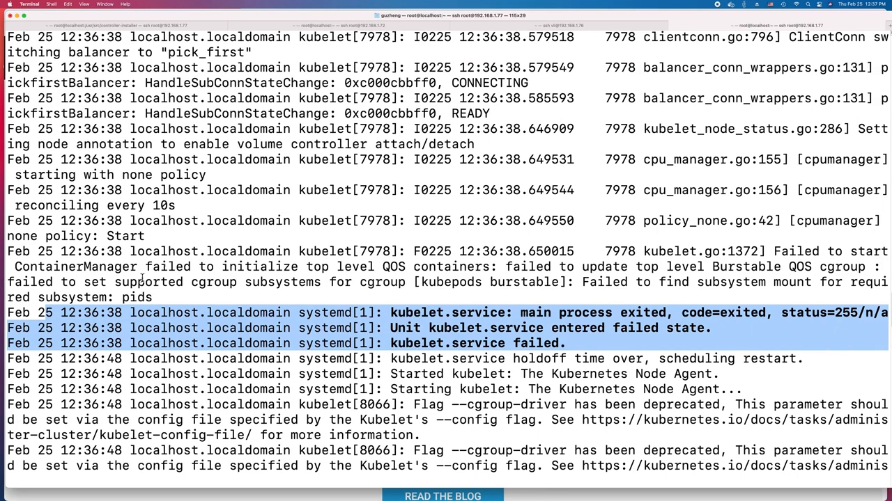

## 二、第一次尝试：按 issue 建议关 feature gate

拿报错去搜，找到 Kubernetes 仓库里的一个 issue，发帖人遇到了一模一样的日志 [【跳转到 04:53】](https://www.youtube.com/watch?v=pgfB5G4XnMw&t=293)。

issue 作者的判断是：**这台机器的内核不支持 cgroup pids 控制器**。他尝试禁用与 pids 相关的 feature gate（`SupportPodPidsLimit` 与 `SupportNodePidsLimit`，字幕里 "load pids limit" 是对后者的误听），期望 kubelet 从此不再要求 pids 子系统——**结果错误依旧** [【跳转到 05:19】](https://www.youtube.com/watch?v=pgfB5G4XnMw&t=319)。

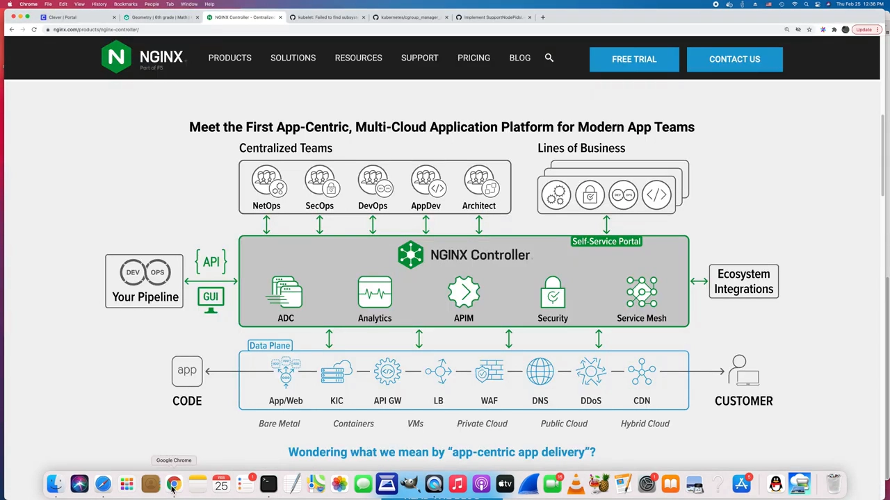

issue 里还贴了关键代码：第 329 行附近，把 cgroups fs 的 pids group 置为 true [【跳转到 05:44】](https://www.youtube.com/watch?v=pgfB5G4XnMw&t=344)。这行代码后来成了理解全案的钥匙。

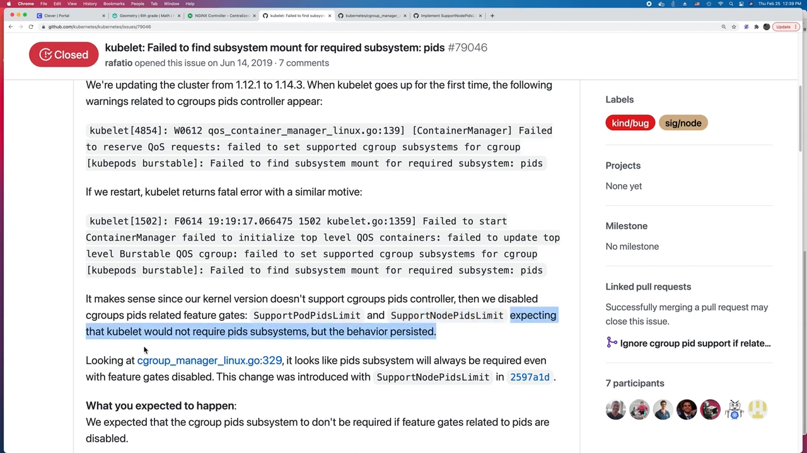

## 三、根因定位：这台内核没有 pids 子系统

### 3.1 /proc/cgroups 对比两台机器

`/proc/cgroups` 列出内核支持哪些 cgroup 子系统。在故障机上 `cat /proc/cgroups`：有 cpuset、cpu、cpuacct、memory……**唯独没有 pids 这一行** [【跳转到 06:44】](https://www.youtube.com/watch?v=pgfB5G4XnMw&t=404)。

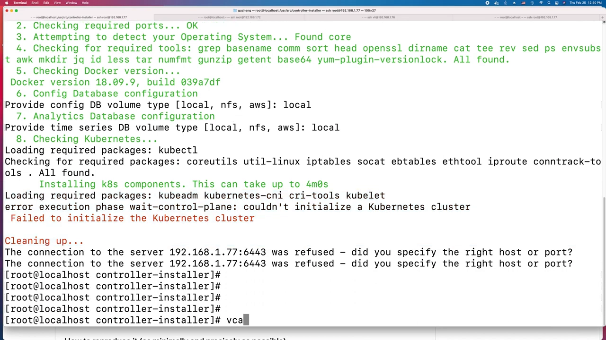

换另一台虚拟机再看：cpu、memory 之外，**pids subsystem support 赫然在列** [【跳转到 08:09】](https://www.youtube.com/watch?v=pgfB5G4XnMw&t=489)。问题不在 Kubernetes 的配置，而在两台机器的内核能力差异。

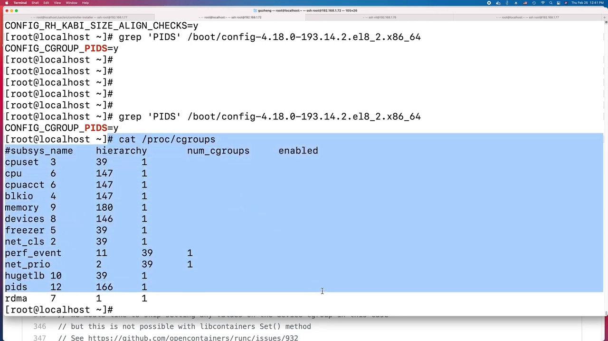

### 3.2 内核配置开关

pids 子系统是否可用，由内核编译配置 `CONFIG_CGROUP_PIDS=y` 决定 [【跳转到 08:33】](https://www.youtube.com/watch?v=pgfB5G4XnMw&t=513)。绝大多数发行版默认启用，但个别发行版或定制内核没开——这台 VM 恰好是后者，于是系统里根本没有 pids 控制器可挂载 [【跳转到 08:58】](https://www.youtube.com/watch?v=pgfB5G4XnMw&t=538)。

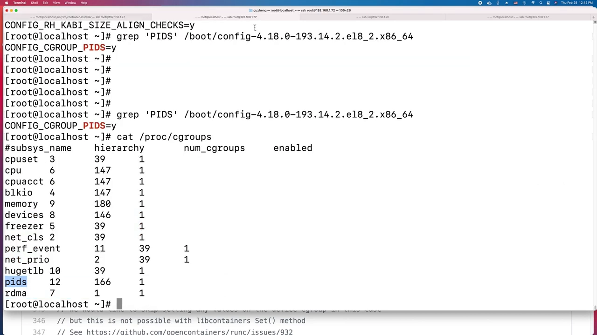

## 四、为什么有人能绕过、有人不能：读代码看版本差异

### 4.1 演示者自己的尝试：在安装器里禁 gate

虽然 issue 作者失败了，演示者还是动手一试：在安装器的 Kubernetes 配置 yaml 里，把 pod pids limit 与 node pids limit 两个 feature gate 显式禁用，然后先卸载、再重装 [【跳转到 10:01】](https://www.youtube.com/watch?v=pgfB5G4XnMw&t=601)。

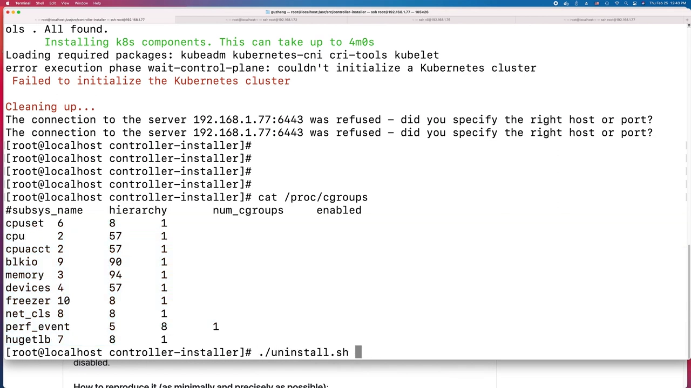

### 4.2 版本差异浮出水面

读新版 Kubernetes 代码：pids 子系统**默认就被置为 true**，无论 feature gate 开还是关——也就是说在新版本里 pids 是硬性必需 [【跳转到 11:14】](https://www.youtube.com/watch?v=pgfB5G4XnMw&t=674)。这是某次提交之后的行为变化 [【跳转到 12:04】](https://www.youtube.com/watch?v=pgfB5G4XnMw&t=724)。

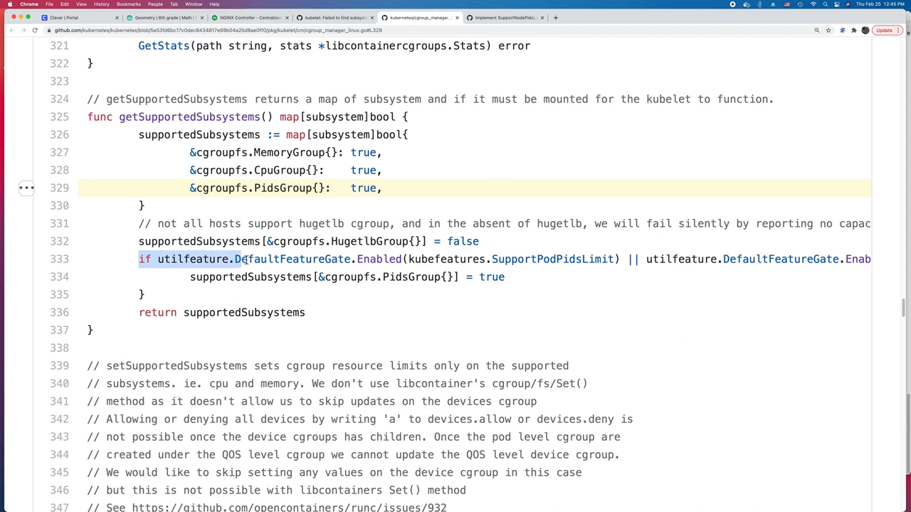

但演示者这次安装用的是 **Kubernetes 1.15.5**——一个"禁用 feature gate 就不要求 pids"的老版本 [【跳转到 12:29】](https://www.youtube.com/watch?v=pgfB5G4XnMw&t=749)。他把 v1.15.5 源码检出来对照 [【跳转到 12:54】](https://www.youtube.com/watch?v=pgfB5G4XnMw&t=774)：

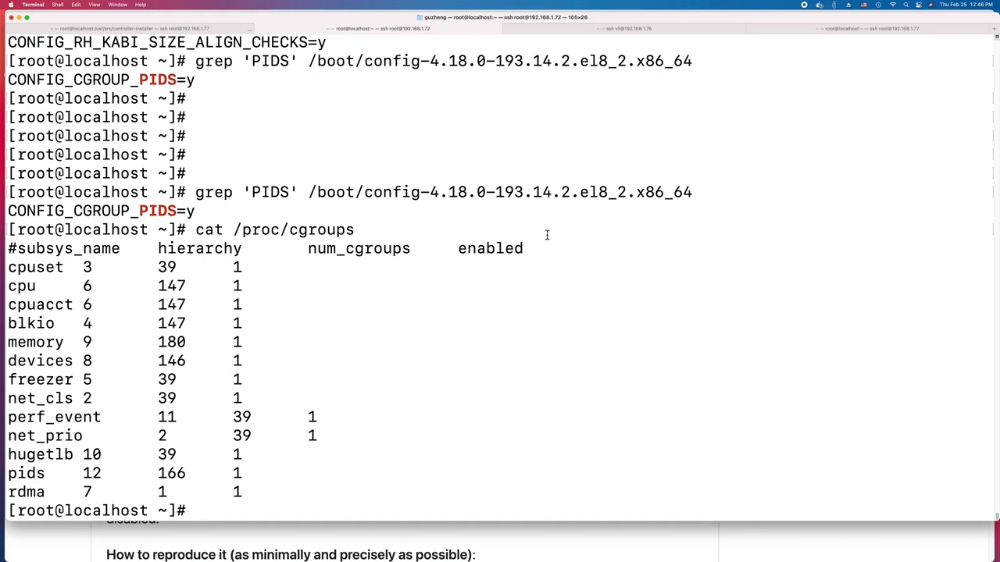

在 1.15.5 里，获取受支持 cgroup 子系统的函数中，cgroups fs pids group **默认是 false**，只有启用了 `SupportPodPidsLimit` 或 `SupportNodePidsLimit` feature gate 之一才会变 true；两个 gate 都禁用，kubelet 就不再要求 pids 子系统 [【跳转到 14:56】](https://www.youtube.com/watch?v=pgfB5G4XnMw&t=896)。

### 4.3 验证：安装通过

禁用 gate 重装后，Kubernetes 组件安装完成，报错消失——问题被绕过了 [【跳转到 13:37】](https://www.youtube.com/watch?v=pgfB5G4XnMw&t=817)。

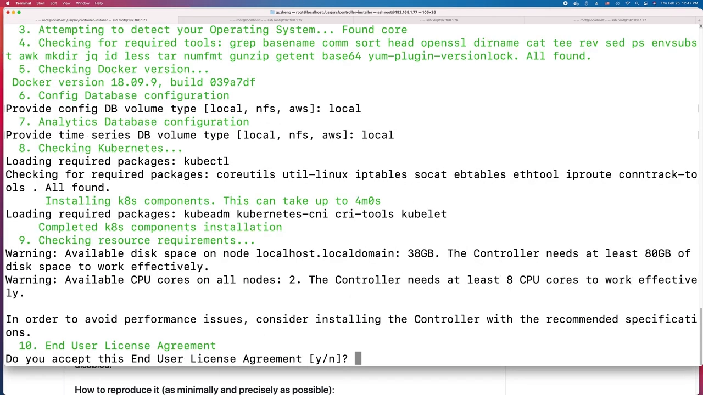

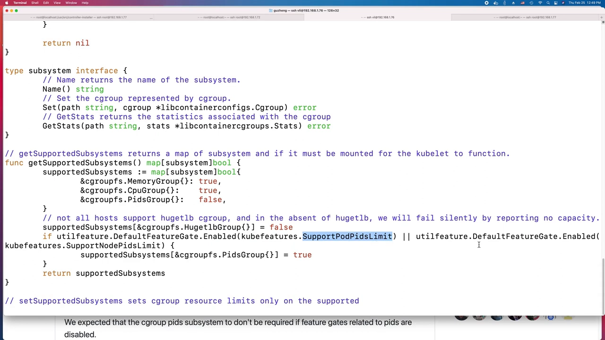

### 4.4 对照结论

- **演示者（1.15.5 + 禁 gate）**：pids 是"可选依赖"，绕过有效；
- **issue 作者（新版本 + 禁 gate）**：pids 已成硬性依赖，禁了也没用，用他的原话说，this person is out of luck [【跳转到 16:28】](https://www.youtube.com/watch?v=pgfB5G4XnMw&t=988)。

同一个报错、同一个"解决方案"，答案却因版本而异——这就是照抄 issue 不奏效的典型原因。

## 五、给我们的启示

- **装 Kubernetes / 容器运行时之前，先 `cat /proc/cgroups`** 确认 pids 子系统存在，比装完排障便宜得多。
- **内核能力缺失是机器级问题**：软件层的 feature gate 只能绕过"可选依赖"，绕不过"硬性依赖"。新版本绕不过去时，正路是升级/更换支持 pids 的内核，或改用默认开启该配置的发行版。
- **issue 的解法要核对版本**：feature gate 的行为随版本变化，1.15.5 的绕过姿势对新版无效。
- 这些 feature gate 控制的，正是 kubelet 对 pod/node 级进程数限制（podPidsLimit 等）的支持，其底层正是 pids 控制器——呼应本系列上一支视频：PID 限制是容器资源管控里与 CPU、内存、IO 并列的一等公民。
- 报错链的最后一行才是方向：从 container manager 一路收缩到 "required subsystems pids"，答案就藏在最内层。

## 小结

- 故障：NGINX Controller 安装过程中，kubelet 起不来，报 `failed to find a subsystem mount for required subsystems pids`。
- 根因：该虚拟机的内核没编译进 pids 子系统（`CONFIG_CGROUP_PIDS` 未启用），`/proc/cgroups` 里没有 pids 行。
- 新版 Kubernetes 默认必需 pids 子系统，feature gate 关不掉；1.15.5 中 pids 是否必需由 `SupportPodPidsLimit`/`SupportNodePidsLimit` 两个 feature gate 决定。
- 演示者用 1.15.5 + 禁 gate 完成安装；issue 作者用新版，禁 gate 无效。
- 排障路径值得复用：读全错误链 → 搜 issue → `/proc/cgroups` 验证子系统 → 对照内核配置 → 读源码核对版本行为。

## 关键术语速查

| 术语 | 一句话解释 |
| --- | --- |
| kubelet | Kubernetes 节点上的代理，负责容器与节点资源管理 |
| cgroup 子系统 | cpu、memory、pids 等按资源划分的控制器 |
| pids 控制器 | 限制任务（进程/线程）数的 cgroup 子系统 |
| `/proc/cgroups` | 列出内核支持与挂载情况的 cgroup 子系统清单 |
| `CONFIG_CGROUP_PIDS` | 内核编译选项，启用后才有 pids 控制器 |
| feature gate | Kubernetes 中按需开关某些特性的机制 |
| `SupportPodPidsLimit` / `SupportNodePidsLimit` | 控制 kubelet 是否支持 pod/node 级 PID 限制的 feature gate |
| kubeadm | Kubernetes 官方的集群引导工具 |
| QoS cgroup | kubelet 在顶层按服务质量等级划分的 cgroup 容器分组 |
