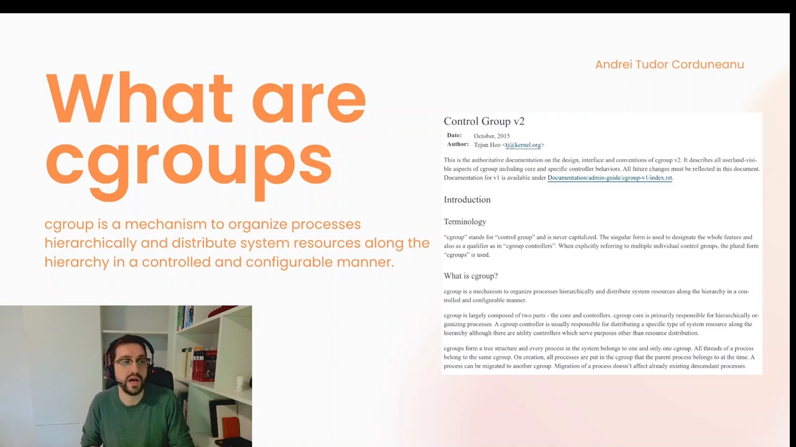
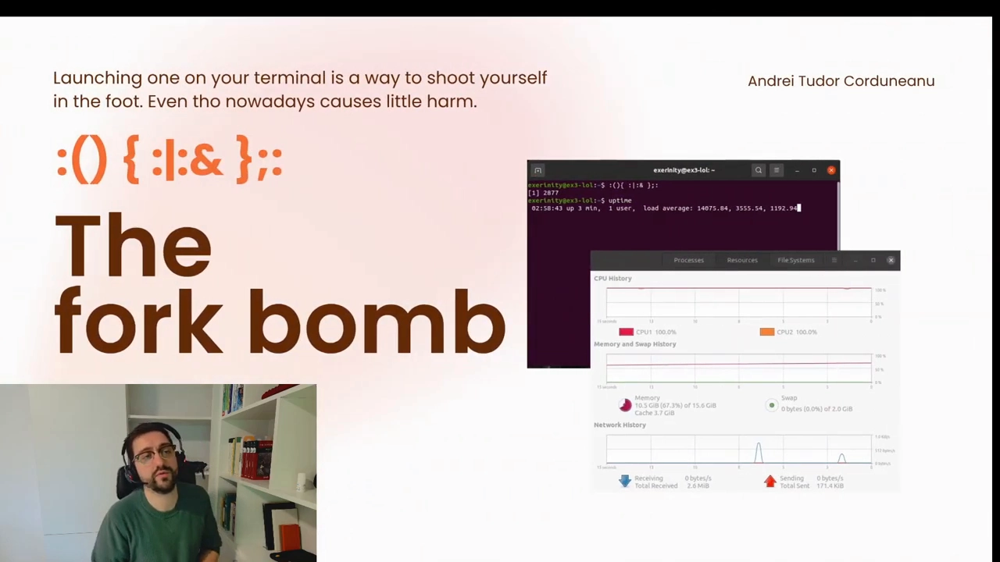
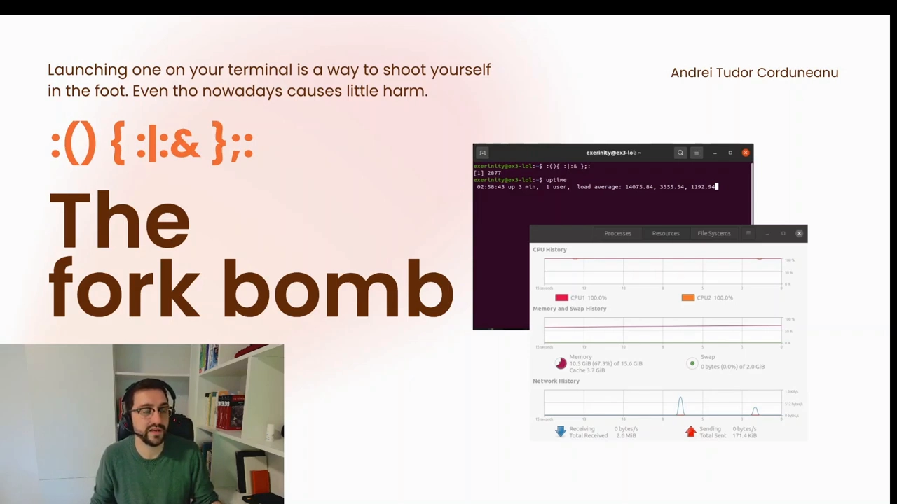
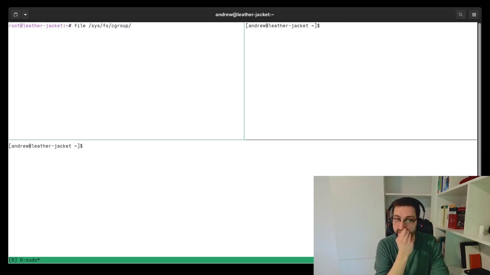
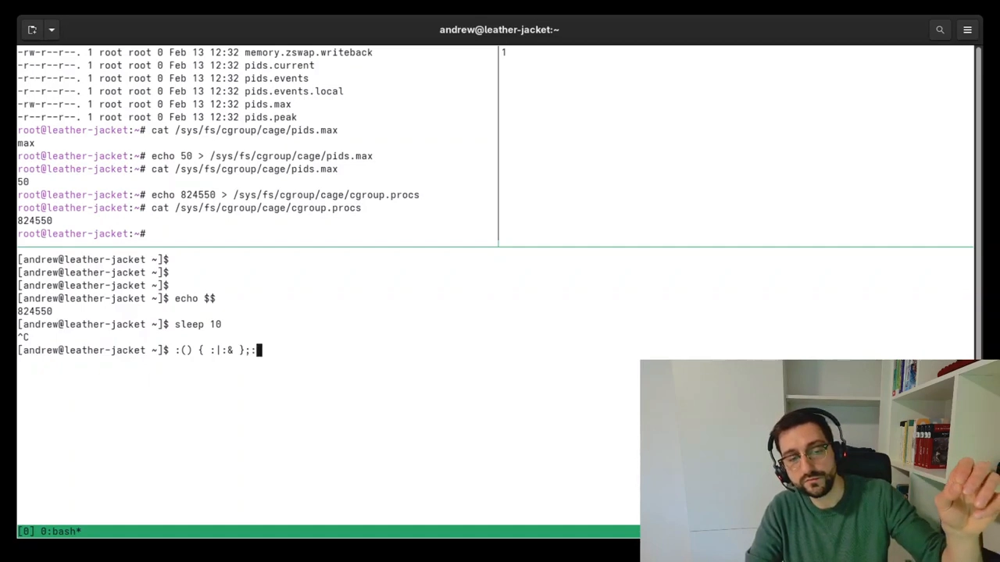
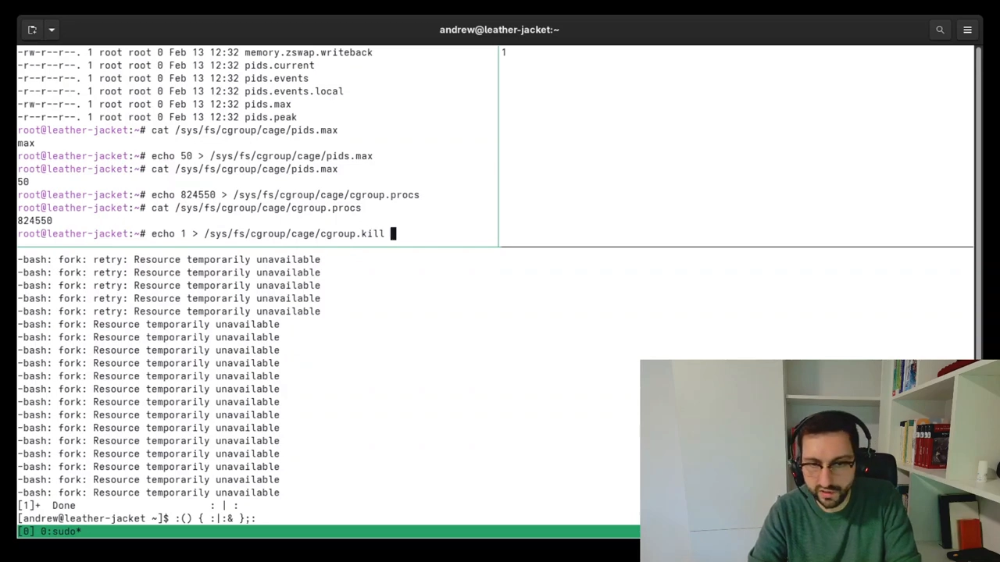
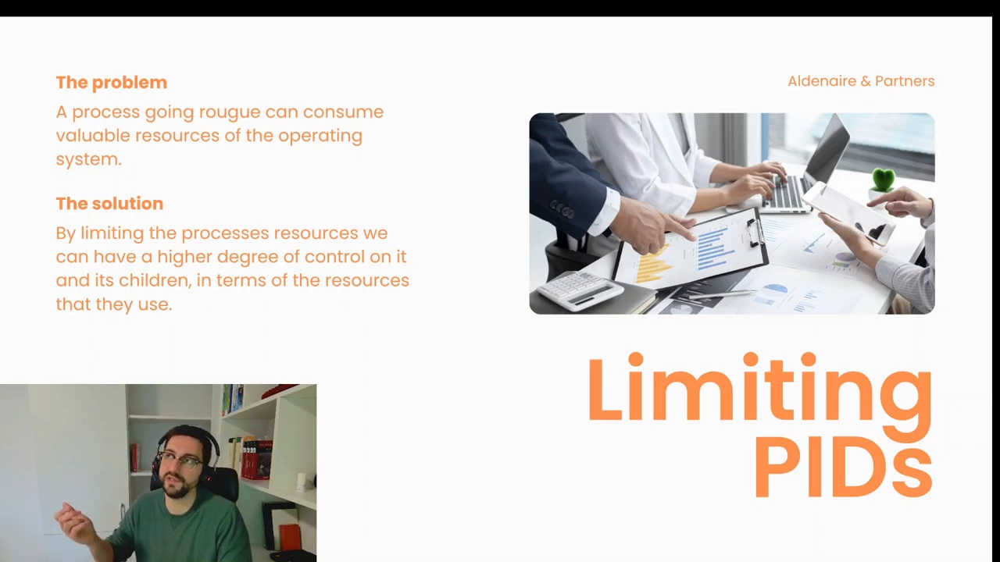

# cgroups_to_control_PID_consumption

> 视频源：[cgroups to control PID consumption](https://www.youtube.com/watch?v=NP-1PspAwYY)（YouTube @Andrei Tudor Corduneanu，20 分 07 秒）。本文基于视频演说图文稿整理，时间戳可跳转到原视频对应位置。

## 本讲要解决的核心问题（SCQA）

**背景**：每个 Linux 进程都有一个进程 ID（PID），内核靠这个编号追踪系统里正在运行的每一个进程。PID 看起来只是个编号，实际上是一种**有限资源**——内核能分配的 PID 数量有上限，用完就没有了 [【跳转到 00:20】](https://www.youtube.com/watch?v=NP-1PspAwYY&t=20)。

**冲突**：httpd、sshd 这类服务靠不断创建新进程来处理用户请求；一旦 PID 被耗尽，新进程无法创建，服务立刻整体停摆 [【跳转到 04:05】](https://www.youtube.com/watch?v=NP-1PspAwYY&t=245)。而一个只有十几个字符的 fork bomb，就能在几秒内把 PID 吃光。

**疑问**：能不能把一个进程"关进笼子"，硬性限制它最多占用多少个 PID？如果笼子里的程序失控孵化，又怎么收拾残局？

**回答（中心思想）**：用 cgroup 的 pids 控制器。把进程 PID 写进 `cgroup.procs` 关进笼子，往 `pids.max` 写入上限，用 `pids.current` 实时监控；若笼内程序失控，`cgroup.kill` 可以原子地清空笼内全部进程。本讲用 20 分钟实操，把「PID 是资源 → 模拟耗尽 → 限制与监控 → 一键清场」完整走了一遍。

## 一、PID：会被用完的内核资源

### 1.1 PID 为什么是一种资源

内核用 PID 追踪每一个正在运行的进程 [【跳转到 00:20】](https://www.youtube.com/watch?v=NP-1PspAwYY&t=20)。关键在于：**有可用 PID，才能创建新进程；没有，就创建不了** [【跳转到 00:45】](https://www.youtube.com/watch?v=NP-1PspAwYY&t=45)。


放到服务场景里看就明白了：httpd、sshd 这类服务，每来一个用户请求都要创建新进程去处理。PID 充足时一切正常；PID 耗尽时新进程创建不出来，**这些服务就停止正常工作** [【跳转到 04:05】](https://www.youtube.com/watch?v=NP-1PspAwYY&t=245)。

### 1.2 cgroup 是什么，谁在用它

cgroup 是 Linux 内核提供的机制，暴露给用户空间，让拥有足够权限的用户或进程**控制其它进程的资源消耗** [【跳转到 01:30】](https://www.youtube.com/watch?v=NP-1PspAwYY&t=90)。它很少作为独立话题出现在台前，却在大量现代技术里默默承担资源管控 [【跳转到 01:55】](https://www.youtube.com/watch?v=NP-1PspAwYY&t=115)。



两个最典型的使用者：

- **Linux 容器**：容器 = namespace + cgroup 两套机制叠加，都为了尽可能隔离进程，但分工不同——cgroup 管的是"可用资源"维度 [【跳转到 02:45】](https://www.youtube.com/watch?v=NP-1PspAwYY&t=165)。顺带解开一个常见疑惑：Windows/macOS 上也能用容器，是因为它们先起一个带 Linux 内核的小虚拟机，容器其实跑在虚拟机里——这两套机制都只属于 Linux 内核 [【跳转到 02:20】](https://www.youtube.com/watch?v=NP-1PspAwYY&t=140)。
- **systemd**：主流发行版的 init 系统，长期用 cgroup 控制并监控每个服务生命周期内的可用资源 [【跳转到 03:10】](https://www.youtube.com/watch?v=NP-1PspAwYY&t=190)。

## 二、fork bomb：几秒吃光 PID 的"兔子"

### 2.1 它是什么、怎么运作

fork bomb 在 Wikipedia 上也叫 **rabbit virus**（兔子病毒）——因为它像兔子一样疯狂自我繁殖 [【跳转到 03:40】](https://www.youtube.com/watch?v=NP-1PspAwYY&t=220)。每个副本都是独立进程、各占一个 PID，副本再复制副本，指数增长，直到耗尽内核可用的 PID。



它最经典的样子是一行 bash [【跳转到 13:25】](https://www.youtube.com/watch?v=NP-1PspAwYY&t=805)：

```bash
:(){ :|:& };:
```

逐段拆开 [【跳转到 13:50】](https://www.youtube.com/watch?v=NP-1PspAwYY&t=830)：

- `:(){ … }` —— 定义一个名字叫 `:` 的函数，花括号里是函数体；
- 函数体 `:|:&` —— 调用自身一次，把输出通过管道再喂给另一个自身实例，`&` 让它进后台执行；
- 结尾的 `;:` —— 函数定义完立刻调用一次，引爆繁殖循环。

于是每个实例都会变成两个，两个变四个……全部在后台同时孵化 [【跳转到 14:15】](https://www.youtube.com/watch?v=NP-1PspAwYY&t=855)。

### 2.2 破坏力与现代内核

演讲者给的 Ubuntu 演示截图里，fork bomb 之后 uptime 显示的 load average（1 分钟平均负载）高达 14000 量级 [【跳转到 05:20】](https://www.youtube.com/watch?v=NP-1PspAwYY&t=320)；图形监控里两颗 CPU 全部 100% [【跳转到 05:45】](https://www.youtube.com/watch?v=NP-1PspAwYY&t=345)。



两点重要背景 [【跳转到 04:30】](https://www.youtube.com/watch?v=NP-1PspAwYY&t=270)：

- 现代 Linux 已经内置多种缓解机制，fork bomb 的实际破坏力大不如前；放在 10~15 年前，它足以让一台运行中的系统瘫痪；
- 它**没有持久性**——不落盘、不留痕，重启之后一切如常。

另外一个忠告：千万别在自己的 shell 里跑它 [【跳转到 06:10】](https://www.youtube.com/watch?v=NP-1PspAwYY&t=370)。

## 三、实操：给进程建一个 pids"笼子"

### 3.1 准备工作

演讲者用终端复用器把三个终端装进同一个窗口 [【跳转到 07:10】](https://www.youtube.com/watch?v=NP-1PspAwYY&t=430)：一个创建并管理 cgroup（需要 root 权限，先 `sudo`），一个跑"笼中进程"，一个盯着数字看变化。

### 3.2 接口就是文件系统

cgroup 对用户的接口是一套文件系统（`/sys/fs/cgroup`）[【跳转到 07:35】](https://www.youtube.com/watch?v=NP-1PspAwYY&t=455)。管理它不需要任何专门命令，用的全是你天天在用的文件操作 [【跳转到 08:25】](https://www.youtube.com/watch?v=NP-1PspAwYY&t=505)：

- `mkdir` 创建一个 cgroup，`rm -r` 删除它；
- `echo` 往控制文件里写配置，`cat` 读当前值。

在 pids 控制器目录下 `mkdir cage`（名字随意）建一个 cgroup——**目录里的控制文件一个都不用手动建，全部由内核自动生成**，每一个都是一种管控手段 [【跳转到 08:50】](https://www.youtube.com/watch?v=NP-1PspAwYY&t=530)。



### 3.3 三个关键文件

| 文件 | 作用 | 演示动作 |
| --- | --- | --- |
| `pids.max` | 笼内允许的最大进程数 | 默认值 `max`（不限制）；`echo 50 > pids.max` 设为 50，再 `cat` 验证已生效 [【跳转到 09:40】](https://www.youtube.com/watch?v=NP-1PspAwYY&t=580) |
| `cgroup.procs` | 笼内进程名单 | `echo $$ > cgroup.procs` 把当前 bash 的 PID 写进去，bash 从此被"关进笼子" [【跳转到 11:20】](https://www.youtube.com/watch?v=NP-1PspAwYY&t=680) |
| `pids.current` | 笼内当前进程数 | 用 `watch` 每 3 秒刷新观察 [【跳转到 12:10】](https://www.youtube.com/watch?v=NP-1PspAwYY&t=730) |


补充一个视频未展开但值得知道的点：`pids.max`/`pids.current` 这组接口在 cgroup v1 与 v2 里都有；后文用到的 `cgroup.kill` 则是 cgroup v2 才提供的原子清场接口。

### 3.4 验证笼子：sleep 实验

bash 本身是命令解释器——你敲的每条命令，它都会 fork 一个子进程去执行 [【跳转到 13:00】](https://www.youtube.com/watch?v=NP-1PspAwYY&t=780)。于是在笼内 bash 里跑 `sleep 10`：`pids.current` 从 1 变成 2（bash 自己 + sleep）；Ctrl-C 结束后数字回落到 1 [【跳转到 12:35】](https://www.youtube.com/watch?v=NP-1PspAwYY&t=755)。笼子确实在实时统计笼内进程。

## 四、笼内跑 fork bomb：50 封顶

一切就绪，在笼内 bash 里按下 fork bomb 的回车 [【跳转到 14:40】](https://www.youtube.com/watch?v=NP-1PspAwYY&t=880)：

- `pids.current` 瞬间冲到 50，然后**卡死在 50**——正是 `pids.max` 设的上限；
- 终端刷出 `Resource temporarily unavailable`：内核的 fork 失败（返回 EAGAIN），意思是笼内已经没有多余的 PID 可分配；
- fork bomb 的副本们想继续繁殖，却再也 fork 不出新的孩子。



关键对照：**被限制的只有笼内世界**。笼子外的服务、其它用户毫发无伤——这正是资源隔离的价值所在。

阻断也只是暂时的：等这批进程跑完退出，`pids.current` 回落到 1，笼子恢复空旷 [【跳转到 15:37】](https://www.youtube.com/watch?v=NP-1PspAwYY&t=937)。

## 五、失控进程为什么难杀，cgroup.kill 怎么救场

### 5.1 手动 kill 的死循环

想象笼子里是一个**持续孵化、永不退出**的失控程序：你每 kill 掉一个进程，就腾出一个 PID 配额，这个空位立刻被其它副本的新 fork 填满 [【跳转到 15:42】](https://www.youtube.com/watch?v=NP-1PspAwYY&t=942)。结果就是越杀越多，手动清理几乎不可能赢。

### 5.2 cgroup.kill：一键原子清场

cgroup 还提供一个"总闸"：往 `cgroup.kill` 写入 1，内核会**同时**终止笼内所有进程及其子进程 [【跳转到 16:32】](https://www.youtube.com/watch?v=NP-1PspAwYY&t=992)。

演讲者又孵化了一轮 fork bomb——`pids.current` 到 50——然后 `echo 1 > cgroup.kill`：笼内 bash 与它孵化出的全部副本**同一瞬间**死亡，计数归 0 [【跳转到 16:57】](https://www.youtube.com/watch?v=NP-1PspAwYY&t=1017)。



"同时"是关键：不存在"杀掉一个、腾出配额、又被占用"的中间态，副本们没有喘息窗口——这正是它对手动 kill 的碾压之处。

## 六、同一思路管内存：把 OOM 的爆炸半径关进笼子

视频最后把思路推广到另一种资源——内存 [【跳转到 18:03】](https://www.youtube.com/watch?v=NP-1PspAwYY&t=1083)：

一个内存泄漏型进程（不断分配、从不回收）的结局是被内核的 OOM killer 杀掉。但顺序是残酷的：**它会先把整机可用内存耗掉大半，期间其它进程已经因为分不到内存而运行不良，内核最后才来砸它** [【跳转到 18:28】](https://www.youtube.com/watch?v=NP-1PspAwYY&t=1108)。

如果一开始就用 cgroup 把它的内存上限锁死：泄漏照旧，OOM 依然会来，但**被砸的只有笼内这一个进程**，对系统其它部分的连带伤害小得多 [【跳转到 18:53】](https://www.youtube.com/watch?v=NP-1PspAwYY&t=1133)。



限制的目的从来不是"不让用"，而是**把任何故障的爆炸半径，圈进你预先划定的笼子**。

## 小结

- PID 是内核里数量有限的资源：耗尽 = 无法创建任何新进程 = 服务停摆。
- pids 控制器用几个文件把 PID 变成可管理的配额：`pids.max`（上限）、`pids.current`（现值）、`cgroup.procs`（成员名单）、`cgroup.kill`（一键清场，v2 接口）。
- cgroup 的接口就是文件系统：`mkdir`/`rm`/`echo`/`cat` 全部搞定，控制文件由内核自动生成。
- fork bomb 是最直观的 PID 耗尽模拟器：一行 bash、指数繁殖，但现代内核下破坏力已大不如前，且无持久性。
- 笼内 fork 到 50 封顶并报 EAGAIN，笼外毫发无伤——隔离把故障限制在了笼子里。
- 失控进程手动杀不完（杀一个腾一个坑），`cgroup.kill` 原子清场才是正解。
- 同一思路推广到内存：提前限定上限，让 OOM 只砸笼内进程，缩小故障爆炸半径。

## 关键术语速查

| 术语 | 一句话解释 |
| --- | --- |
| PID | 内核为每个进程分配的编号，总量有限，是一种系统资源 |
| cgroup | Linux 内核的进程分组机制，对组内进程做资源限制与监控 |
| pids 控制器 | cgroup 中专门限制"任务数"的子系统 |
| `pids.max` | 笼内最大进程数；`max` 表示不限制 |
| `pids.current` | 笼内当前进程数 |
| `cgroup.procs` | 笼内进程 PID 名单；写入即收编进程 |
| `cgroup.kill` | 写 1 即原子终止笼内全部进程（cgroup v2 接口） |
| fork bomb | 自我 fork 指数繁殖、耗尽进程资源的程序，又称 rabbit virus |
| EAGAIN | "Resource temporarily unavailable"，fork 因资源不足失败的经典返回值 |
| OOM killer | 内存耗尽时由内核挑选并杀死进程的机制 |
