# 内核才是执行者：容器资源限制是如何在 cgroup 层被强制执行的

> 视频源：[How the Linux Kernel Actually Enforces Container Resource Limits](https://www.youtube.com/watch?v=Mf5FrDFALW8)（YouTube @MattOps | DevOps & SRE，33 分 25 秒，英文讲解）。本文基于视频演说图文稿整理（字幕为英文 ASR 原文，术语错拼已在本文纠正），时间戳可跳转到原视频对应位置。

## 本讲要解决的核心问题（SCQA）

**背景**：我们日常给容器设资源限制——Docker 的 `--memory 256M`、K8s 的 `resources.limits`——设完就不管了。

**冲突**：容器超限时被立刻杀死，退出码 137（SIGKILL）。是谁杀的？Docker？Kubernetes？containerd？很多人答不上来；答错了，排障方向就全错。

**疑问**：内核到底怎么知道并执行这些限制？cgroup v1 和 v2 的架构差异在哪里？K8s 的 Guaranteed/Burstable/BestEffort 三种 QoS 类，又是怎么落到 cgroup 配置和 OOM 优先级上的？

**回答（中心思想）**：**执行限制的从来都是 Linux 内核**。你在 Docker/K8s 里设的每一个资源限制，最终都是内核 cgroup 伪文件系统里的一个数字：内核在进程分配内存、申请 CPU 时间时逐次检查，超了就限流或杀进程。本讲从 cgroup 的数据结构讲到 v1/v2 架构，再用四个实操演示（CPU 限流、OOM 杀进程、memory.high 软限制、minikube 里查看 QoS 分层）把"YAML → 内核强制执行"这条链完整走一遍。

## 一、谁杀了我的容器？—— 先找到执行者

### 1.1 exit 137 之谜

[【跳转到 00:05】](https://www.youtube.com/watch?v=Mf5FrDFALW8&t=5) 开场就是一个经典场景：你给容器设了 256MB 内存限制，容器试图分配 300MB，然后立刻被杀——退出码 137（SIGKILL）。

问题来了：**谁杀的它？** Docker、Kubernetes 还是 containerd？答案都是否——**是 Linux 内核杀的**，具体说是内核里叫 control groups（cgroups）的子系统：它执行你设置的限制、发现违规、触发 OOM killer。你设过的每一个资源限制——CPU 限流、内存上限、IO 带宽——全都经过 cgroup。不理解 cgroup 在内核层怎么工作，排障就是在黑暗里摸索。

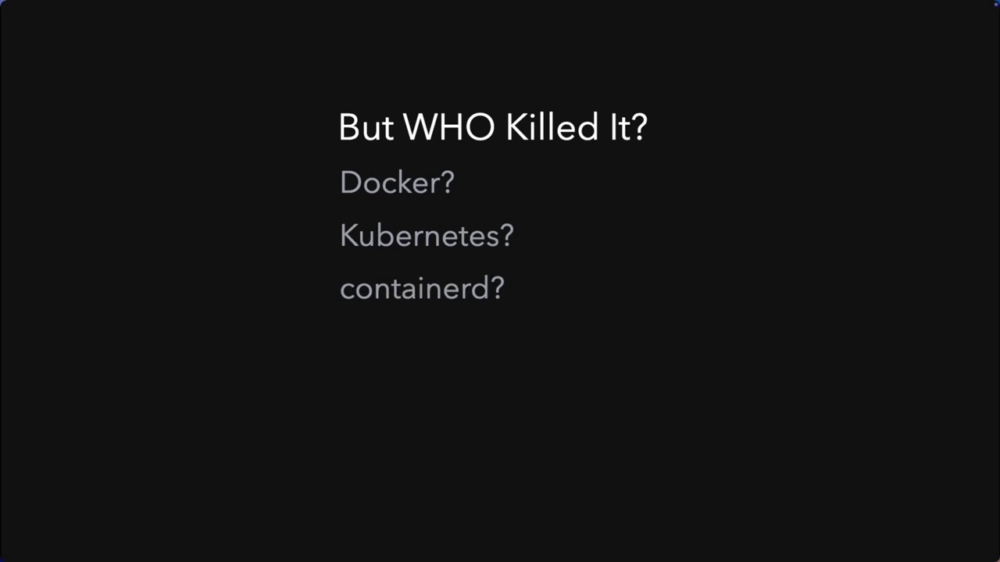

### 1.2 cgroup 的来历：解决"按组限制"的问题

[【跳转到 00:55】](https://www.youtube.com/watch?v=Mf5FrDFALW8&t=55) cgroup 在 2007 年进入 Linux 内核。它要解决的问题很简单：**如何限制一组进程能用的资源，而不用修改每一个应用程序？**

在 cgroup 之前只有单进程级的手段：ulimit、nice 值等，没有任何办法说"这 50 个进程作为一组，最多用 2 个 CPU 核和 4GB 内存"。

cgroup 的实现是一个**伪文件系统**：你往文件里写数字，内核读这些文件并执行限制。

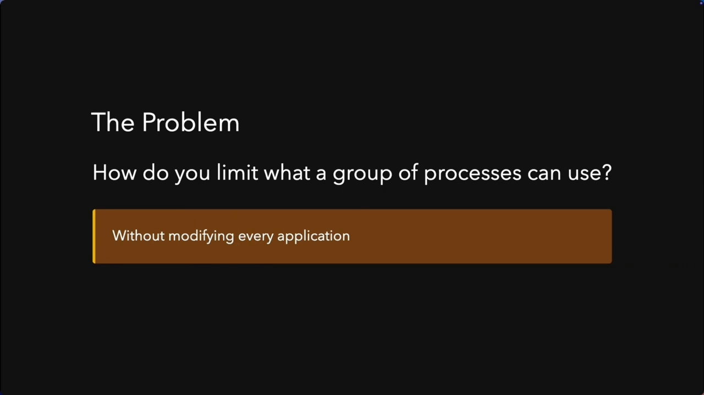

## 二、cgroup 的两种架构：v1 与 v2

### 2.1 v1 的设计问题：一个控制器一棵树

[【跳转到 02:10】](https://www.youtube.com/watch?v=Mf5FrDFALW8&t=130) v1 允许每种资源控制器（CPU、内存、块 IO）拥有**自己独立的层级树**。同一个进程可以在 CPU 树的一个位置、内存树的另一个位置、IO 树的又一个位置。这带来了管理混乱：这个 cgroup 归谁管？控制权怎么委托？迁移进程时要不要在所有树里都挪一遍？这个设计问题花了十年才修。

### 2.2 v2：统一层级

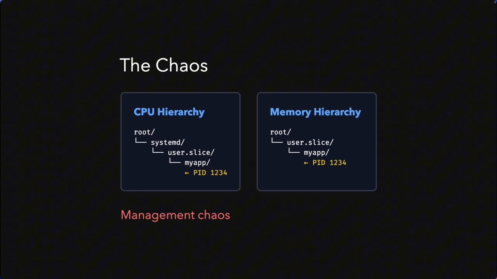

[【跳转到 03:00】](https://www.youtube.com/watch?v=Mf5FrDFALW8&t=180) v2 的答案：**只有一棵树，所有控制器都挂上去，一个进程只能在一个位置**。干净，但与 v1 根本不同。两者都要懂：v1 在旧内核和遗留系统上仍然普遍；v2 是未来——K8s 默认用它，现代发行版也都是它。

### 2.3 QoS 类直接映射到 cgroup 配置

[【跳转到 03:25】](https://www.youtube.com/watch?v=Mf5FrDFALW8&t=205) 对生产环境真正重要的是：K8s 的三种服务质量类 **Guaranteed、Burstable、BestEffort** 直接映射到 cgroup 配置。不理解 cgroup，就理解不了你的 Pod 为什么被驱逐（evicted）。

## 三、cgroup 是怎么工作的：数据结构与控制器

### 3.1 目录即内核对象，资源沿树下发

[【跳转到 03:50】](https://www.youtube.com/watch?v=Mf5FrDFALW8&t=230) cgroup 本质是一个**内核数据结构**。当你在 cgroup 文件系统里创建一个目录时，你不是在创建普通目录，而是请内核分配一个 `struct cgroup`，再把它以目录的形式暴露出来。除根之外每个 cgroup 都有父节点，于是形成一棵树：**父节点把自己的资源配额细分给子节点**，资源沿树下发。

### 3.2 控制器：控制文件与统计文件

[【跳转到 04:40】](https://www.youtube.com/watch?v=Mf5FrDFALW8&t=280) 内核通过**控制器**暴露能力，每个控制器管一种资源：CPU、内存、IO、pids、cpuset。每个控制器提供两类文件：

- **控制文件**：写进去就是设限；
- **统计文件**：读出来就是当前状态。

### 3.3 内核在哪一步执行限制？—— 内存分配路径

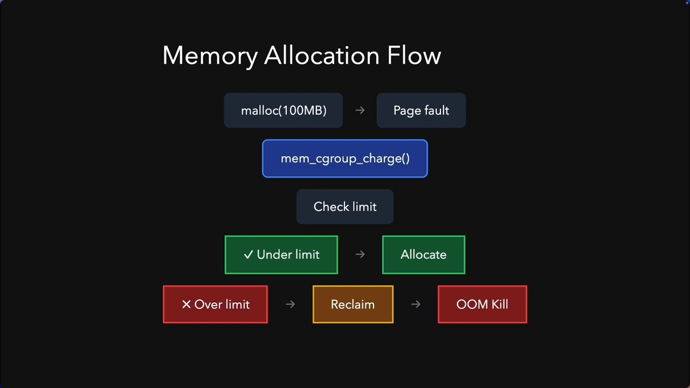

[【跳转到 05:05】](https://www.youtube.com/watch?v=Mf5FrDFALW8&t=305) 内核的强制执行发生在**分配时刻**。以内存为例，一次分配的完整轨迹是：

1. 进程调用 `malloc` 申请 100MB；
2. 内核处理缺页（page fault）；
3. 调用 memcg 的 charge 函数，问："这个 cgroup 还有余量吗？"——检查"当前用量 + 100MB"是否装得下 limit；
4. 装得下 → 分配；装不下 → 先尝试回收（reclamation）；回收失败 → OOM。

进程会一直阻塞，直到内核做出"分配或杀掉"的决定。**这就是为什么在 OOM 杀进程之前，内存压力会先表现为停顿（stall）**。

### 3.4 v2 的三条架构规则

[【跳转到 06:45】](https://www.youtube.com/watch?v=Mf5FrDFALW8&t=405) v2 用三条规则替代了 v1 的混乱：

- **规则一：统一层级**。所有控制器挂同一棵树，一个进程在所有控制器下只有唯一位置。
- **规则二：内部节点不放进程**。进程只能存在于叶子节点；中间节点专用于委托和控制。演示里把 PID 写进中间节点会被直接拒绝——v2 强制"中间节点管资源、叶子节点装进程"的清晰分工。
- **规则三：显式委托控制器**。子树要用某个控制器，必须通过 `cgroup.subtree_control` 显式启用（`+cpu` / `-cpu` 语法）。根节点说"我的孩子可以控制 CPU 和内存"，孩子还可以再说"我的孩子只能控制 CPU、不能控制内存"——委托可以逐层收窄。

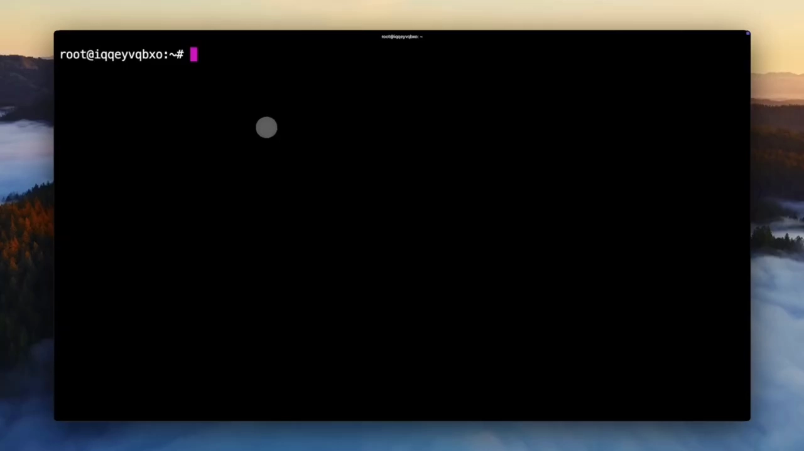

[【跳转到 07:59】](https://www.youtube.com/watch?v=Mf5FrDFALW8&t=479) v1 里只要层级存在，任何 cgroup 都能用任何控制器——没有安全边界。v2 里可以给非特权用户一个只带特定控制器的 cgroup 子树，这就是 rootless 容器能安全实现的基础。统一层级正是 K8s 偏爱 v2 的原因：更简单、更安全、更可预测。

## 四、CPU 限制的两种机制：份额与硬上限

### 4.1 先想清楚"CPU 控制"到底控制什么

[【跳转到 08:24】](https://www.youtube.com/watch?v=Mf5FrDFALW8&t=504) 应用处理一个 HTTP 请求（解析 JSON、查数据库）需要 CPU 时间。如果需要时立刻拿到，20ms 就能完成；如果被限制或推迟，就要等——**等待就是延迟**。关键认知：**cgroup 限制 CPU 时，你的进程不会拿到"更慢的 CPU"，而是"更少的 CPU 使用机会"**——它必须排队等，等待即延迟。

CPU 控制器与 Linux 完全公平调度器（CFS）协作，提供两种机制：

### 4.2 机制一：比例份额（软性）

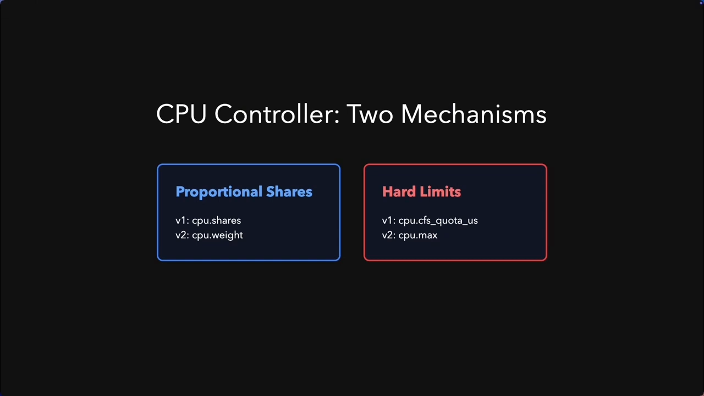

[【跳转到 09:37】](https://www.youtube.com/watch?v=Mf5FrDFALW8&t=577) **比例份额**：v1 里是 `cpu.shares`，v2 里是 `cpu.weight`。两个 cgroup 争抢 CPU 时按权重分配——份额不是"分到几颗核"，而是"抽奖的权重"：**没有争抢时，谁都可以冲到 100%**。

### 4.3 机制二：硬上限（严格）

[【跳转到 10:02】](https://www.youtube.com/watch?v=Mf5FrDFALW8&t=602) **硬上限**：v1 里是 `cpu.cfs_quota_us` + `cpu.cfs_period_us`，v2 里合并成一个文件 `cpu.max`（格式"配额 周期"，单位微秒）。

### 4.4 限流如何变成延迟

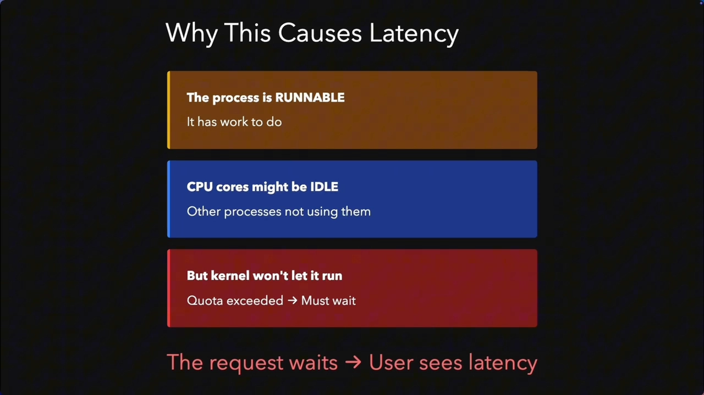

[【跳转到 10:39】](https://www.youtube.com/watch?v=Mf5FrDFALW8&t=639) 假设 API 服务器处理一个请求需要 18ms CPU 时间，而你设了 50% 的 CPU 限制（每 100ms 周期只能用 50ms）。进程明明在可运行状态、CPU 核甚至空着，内核也不让它跑——因为配额用完了。请求只能等，用户看到的就是延迟。

内核侧的执行点：CFS 调度器每个 tick 调用更新函数，检查该 cgroup 剩余运行时；配额耗尽就调用 `throttle_cfs_rq` 把进程挪进限流队列，直到周期边界由 `unthrottle_cfs_rq` 放出来。[【跳转到 11:04】](https://www.youtube.com/watch?v=Mf5FrDFALW8&t=664)

对延迟敏感型负载这是危险的：一个 Web 请求可能需要 10ms CPU、摊在 50ms 墙钟时间里，一旦撞上配额就得等——**平均 CPU 使用率看起来很低，P99 延迟却飙高**。[【跳转到 11:34】](https://www.youtube.com/watch?v=Mf5FrDFALW8&t=694)

**实践结论**：API 服务器、数据库这类延迟敏感负载，应该用 **CPU weight（份额）而不是 CPU max（硬上限）**；批处理/后台任务才用 CPU max，防止失控占用。[【跳转到 11:59】](https://www.youtube.com/watch?v=Mf5FrDFALW8&t=719)

### 4.5 实操演示：亲眼看 50% 限流

[【跳转到 17:51】](https://www.youtube.com/watch?v=Mf5FrDFALW8&t=1071) 演示：先确认系统在 v2（单一挂载点、类型 cgroup2）；用 `systemd-run` 创建一个带 CPU 配额与内存上限的 slice，systemd 会自动创建 cgroup、启用 CPU 和内存控制器并写入限制。读 `cpu.max`：

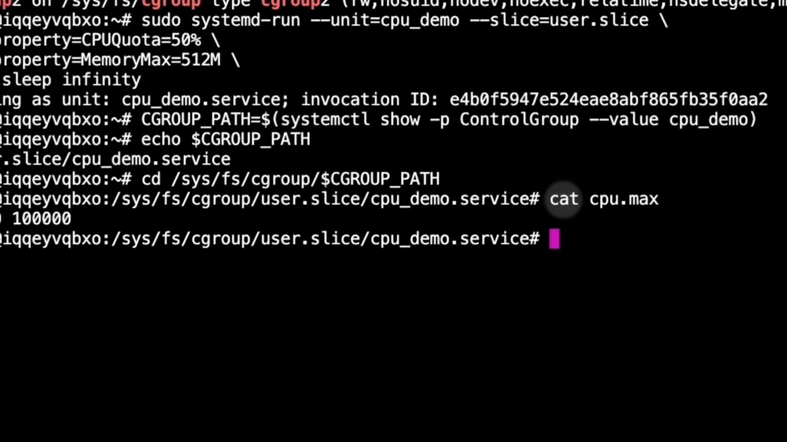

格式是"配额 周期"：50000/100000 = **一颗核的 50%**。把 stress-ng 塞进同一个 cgroup 跑起来：无论它怎么吃 CPU，使用率始终被压在 50%。

看限流统计：`nr_periods`（经历了多少个配额周期）、`nr_throttled`（多少个周期撞了配额——几乎每个周期都撞）、`throttled_usec`（累计被限流的时间，约占总时间 50%）。

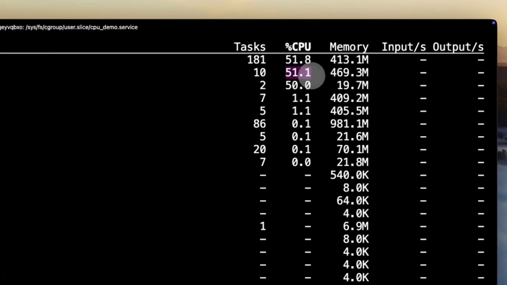

[【跳转到 19:06】](https://www.youtube.com/watch?v=Mf5FrDFALW8&t=1146) 内核视角：每 100ms 一个周期，进程在每周期前 50ms 用完 50ms 配额，然后被限流 50ms——跑 50ms、等 50ms，反复。**即使 CPU 全部空闲，它也必须等到下个周期**。`nr_throttled ≈ nr_periods` 恰恰证明限流在正确工作。这就是 CPU limit 造成延迟的机制：请求排队，哪怕节点有富余 CPU——严格限制的代价。

## 五、内存限制：硬上限与软上限

### 5.1 v1/v2 的对应关系

[【跳转到 12:24】](https://www.youtube.com/watch?v=Mf5FrDFALW8&t=744)

| 语义 | v1 | v2 |
| --- | --- | --- |
| 硬上限：超了就可能被 OOM 杀 | `memory.limit_in_bytes` | `memory.max` |
| 软限制：压力时回收、不杀 | `memory.soft_limit_in_bytes` | `memory.high`（超了会拖慢分配，不杀） |

### 5.2 分配、回收与 OOM killer 的选择

[【跳转到 12:49】](https://www.youtube.com/watch?v=Mf5FrDFALW8&t=769) 进程分配内存：`malloc` → 缺页 → memcg charge 检查"当前 + 申请量 ≤ limit？"——低于限额立即分配；超过就先回收；回收失败 → OOM kill。这个过程是**同步阻塞**的：申请进程等着内核回收，这就是 OOM 之前的性能劣化。

那么杀谁？内核为 cgroup 里每个进程计算 **oom_score**，分数越高越先被杀；root 进程有减分保护。进程还可以设置 **oom_score_adj**（-1000 到 +1000）。**K8s 正是按 QoS 类来设置 oom_score_adj**：BestEffort 先杀、Burstable 按内存请求成比例、Guaranteed 最后杀。

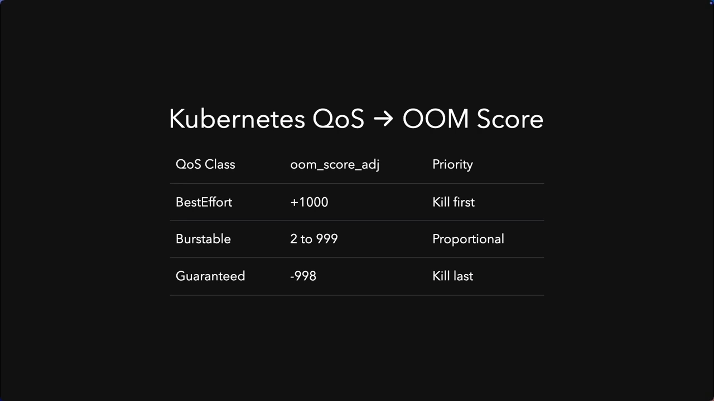

### 5.3 实操演示 1：OOM kill

[【跳转到 20:33】](https://www.youtube.com/watch?v=Mf5FrDFALW8&t=1233) Python 脚本用字节数组分块分配内存：每次分配都成功，直到总量触限；下一次分配时 charge 发现"当前 + 新申请 > limit"，内核尝试 memcg 回收——无匿名内存可换出、无 swap，回收失败 → memcg OOM → OOM killer 计算分数 → 杀掉 python3。进程死后 cgroup 被清理，dmesg 里留下 OOM 日志。

### 5.4 实操演示 2：memory.high——变慢而不是被杀

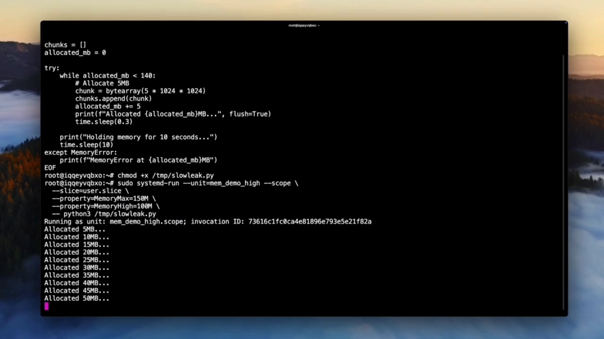

[【跳转到 22:17】](https://www.youtube.com/watch?v=Mf5FrDFALW8&t=1337) 改成软限制演示：脚本最多分配 150MB，`memory.high = 100MB`、`memory.max = 150MB`。现象：100MB 之前分配飞快，**过 100MB 后明显变慢但进程不死**——内核不杀进程，而是"拖慢"分配（reclaim + 节流），进程仍可继续分配到 memory.max 的 150MB，只是带性能惩罚。

对比：没有 memory.high 时，一路飞快到 150MB 然后瞬间被 OOM 杀；有 memory.high 时，快到 100MB → 100~150MB 之间被拖慢 → 150MB 才 OOM。**这是主动的压力管理，而不是被动的击杀**。

## 六、PSI：在事故发生前看到压力

### 6.1 反应式监控 vs 预测式信号

[【跳转到 14:26】](https://www.youtube.com/watch?v=Mf5FrDFALW8&t=866) v2 的杀手级特性之一：**PSI（Pressure Stall Information，压力停顿信息）**。传统监控是反应式的——OOM 已经发生、进程已经被限流，你才知道，损失已经造成。PSI 是预测式的：它告诉你**进程在撞上限制之前，花了多少时间在等待资源**。

需要注意：PSI 用于**监控**，不用于自动驱逐。PSI 指标由内核暴露，在 K8s 里可通过 cAdvisor 指标拿到；但 **kubelet 的驱逐决策并不使用 PSI**——它用的是 memory.available 这类传统指标。想让 PSI 参与决策，需要自定义控制器，超出 kubelet 开箱能力。[【跳转到 15:16】](https://www.youtube.com/watch?v=Mf5FrDFALW8&t=916)

### 6.2 读懂 PSI 的三个文件

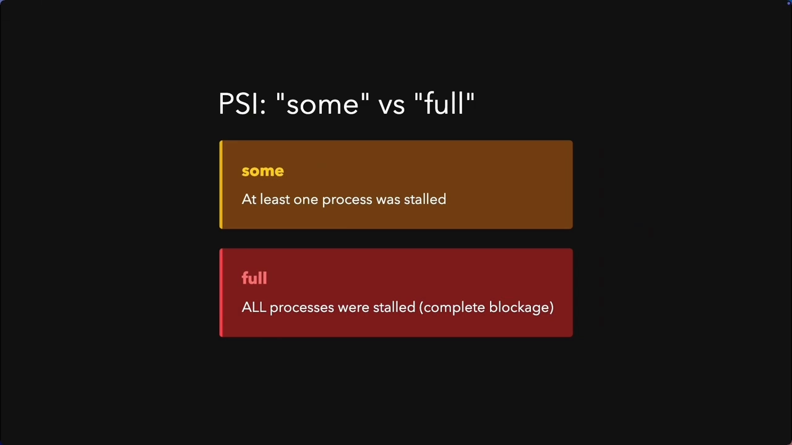

[【跳转到 15:41】](https://www.youtube.com/watch?v=Mf5FrDFALW8&t=941) 每类资源（CPU/内存/IO）各有一组 PSI 文件，内容格式：

- **some**：至少一个进程因该资源停顿（其他进程可能还在跑）；
- **full**：所有进程都停顿了——完全阻塞；
- **avg10 / avg60 / avg300**：过去 10 秒（短期尖峰）、60 秒（中期趋势）、300 秒（长期基线）的平均压力。

内核由调度器和内存管理代码累计停顿时间：只要进程"可运行但没在跑"（CPU 压力）、阻塞在内存回收上（内存压力）、或在等 IO（IO 压力），都会计入。

## 七、K8s 实战：Pod spec 如何直接变成 cgroup 配置

### 7.1 minikube + SSH 进 Linux 虚拟机

[【跳转到 23:33】](https://www.youtube.com/watch?v=Mf5FrDFALW8&t=1413) 把前面学的全部串起来：当你在 K8s 里写一个带 resource requests/limits 的 pod spec，它去了哪里？——**直接进了 cgroup**。

演示用 minikube（跑在 macOS 上）。注意：cgroup 是 **Linux 内核特性**，macOS 宿主机上没有——所以 minikube 在 Docker Desktop 的 Linux 虚拟机里跑，要 SSH 进那个虚拟机才能看到 cgroup。验证 cgroup 版本是 v2（类型 cgroup2，统一层级；v1 系统会看到多个类型为 cgroup 的挂载）。

### 7.2 三种 QoS 类的 cgroup 分层

[【跳转到 25:22】](https://www.youtube.com/watch?v=Mf5FrDFALW8&t=1522) 先创建三个 Pod 分别对应三种 QoS 类：**Guaranteed（requests == limits）**、**Burstable（requests < limits）**、**BestEffort（不设 requests 也不设 limits）**。

进到虚拟机里找 kube-pods 的 cgroup。minikube 用 cgroupfs 驱动，目录就是简单的 `/sys/fs/cgroup/kubepods`（没有 slice 后缀；用 systemd 驱动的系统会带 `.slice` 后缀）。kubelet 在 kubepods 下按 QoS 类建了三个层级：

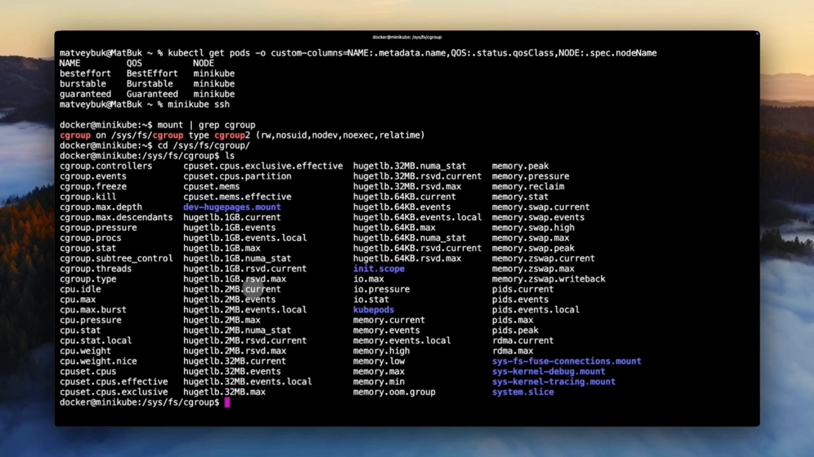

- `besteffort/`——最低优先级；
- `burstable/`——中等优先级；
- `pod<uid>/`——Guaranteed Pod，优先级最高，直接挂在 kubepods 下。

这个分层让**驱逐与资源分配可以差异化**：内核对每一层执行不同的资源限制。

### 7.3 Guaranteed Pod：yaml 数字直接出现在 cgroup 文件里

[【跳转到 26:12】](https://www.youtube.com/watch?v=Mf5FrDFALW8&t=1572) 检查 Guaranteed Pod 的 cgroup：它的 **cpu.max** 直接来自 pod spec 的 CPU 100m；**memory.max** 是 128Mi，直接来自 pod spec 的内存限制。**这就是内核强制执行的落点**。

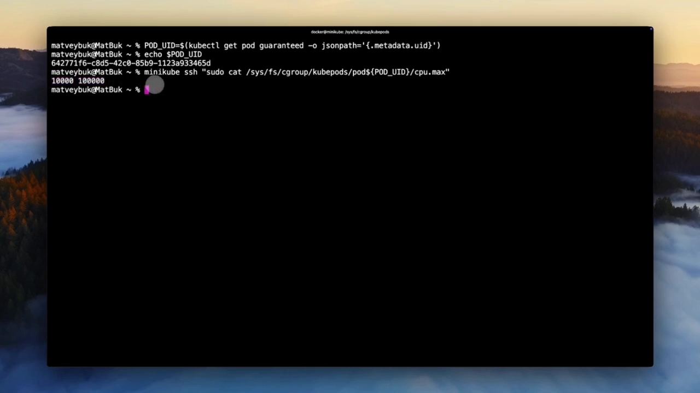

对比 Burstable Pod：requests < limits，**cpu.max 允许冲到 limit**——Burstable 能在系统空闲时用额外 CPU，而 Guaranteed 是严格封顶。[【跳转到 27:02】](https://www.youtube.com/watch?v=Mf5FrDFALW8&t=1622)

BestEffort Pod 的 cpu.max 显示 **max**——即没有限制：可以用满所有可用 CPU、内存可以一直长到节点内存耗尽；代价是**压力之下第一个被杀**。

### 7.4 OOM 优先级：-998 与 +1000

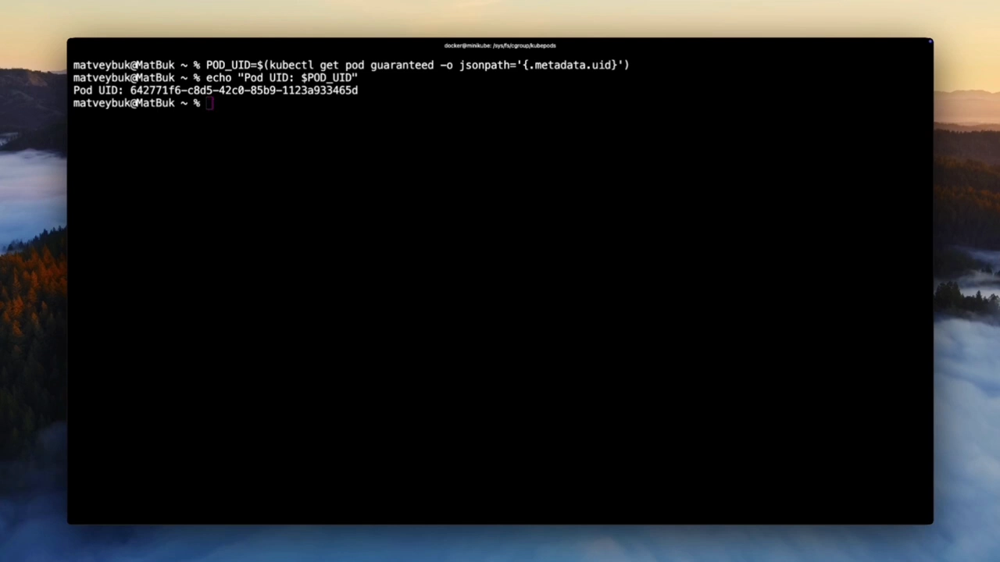

[【跳转到 28:17】](https://www.youtube.com/watch?v=Mf5FrDFALW8&t=1697) 找进程的 OOM 分数：路径是 Pod 层 cgroup → 容器层 cgroup → 从 `cgroup.procs` 里读 PID。实测：**Guaranteed Pod 的 oom_score_adj = -998**；BestEffort Pod 的 **= 1000**（上限）。

于是当节点内存耗尽时，内核 OOM killer 与 kubelet 驱逐管理器协同工作，顺序是：

1. **BestEffort 先被杀/驱逐**（adj = 1000）；
2. **Burstable 中超过 requests 的**随后；
3. **Guaranteed 只有超过自己的 limits 才会被杀**（adj = -998）。

[【跳转到 29:22】](https://www.youtube.com/watch?v=Mf5FrDFALW8&t=1762) 这就是 QoS 类在生产中的意义：**关键服务用 Guaranteed，后台任务可以用 BestEffort**——防止级联失败。

### 7.5 生产建议

[【跳转到 29:47】](https://www.youtube.com/watch?v=Mf5FrDFALW8&t=1787) 视频最后给了一组可以直接抄走的结论：

- 生产环境 **P99 延迟比平均值重要**，而 CPU 限流摧毁 P99；
- 面向用户的 API：**设 CPU requests（保底），不设 CPU limit**（允许冲高）；
- 批处理任务：**设 limit** 防止失控——没有限制时，一个被攻陷的容器可以把别人饿死，这是安全问题而不仅是运维问题；
- **内存限制必须设**：CPU limit 可选，memory limit 强制；
- 每个资源决策的背后都是 cgroup：关键服务 Guaranteed、标准负载 Burstable、批处理/后台任务 BestEffort。

### 7.6 排障方法：别停在 kubectl describe

[【跳转到 30:49】](https://www.youtube.com/watch?v=Mf5FrDFALW8&t=1849) 从 YAML 到内核强制的整条链路都是**可见、可调试**的。生产里遇到资源问题，不要停在 `kubectl describe`——**SSH 到节点，看 cgroup 文件**，看内核实际执行的是什么：检查限流统计、读 PSI 指标。那才是真相所在，比任何仪表盘都管用。

## 小结

- **内核是唯一的执行者**：Docker/K8s 里设的每个资源限制，最终都是 cgroup 控制文件里的一个数字；进程被杀（exit 137）时，动手的是内核 cgroup 子系统。
- **v1 每控制器一棵树**（复杂、遗留系统仍在用）；**v2 统一层级**：一个进程一个位置、内部节点不放进程、控制器显式委托——更简单安全，也是 K8s 默认。
- CPU 两种机制：**份额（cpu.shares / cpu.weight）是抢不到时的比例**，公平但不封顶；**硬上限（cfs_quota/period → cpu.max）严格限流**，代价是尾延迟。份额讲公平，硬上限讲严格。
- 内存双参数：`memory.max`（超限 OOM 杀）与 `memory.high`（超了先拖慢分配——主动压力管理）；OOM 杀谁由 oom_score/oom_score_adj 决定，K8s 按 QoS 类设置。
- **PSI 让压力可见于事故之前**（some/full × avg10/60/300）；K8s 里经 cAdvisor 用于监控，kubelet 驱逐暂不采用。
- K8s 的 QoS 类直接映射到 cgroup：kubepods 下 besteffort/burstable/pod\<uid\> 分层 + oom_score_adj（-998 → 1000），共同决定资源上限与驱逐顺序。

## 关键术语速查

| 术语 | 一句话解释 |
| --- | --- |
| OOM killer | 内核在内存耗尽且回收失败时，按 oom_score 选进程杀掉的机制；退出码 137 = SIGKILL |
| cgroup v1 / v2 | v1 每控制器一棵独立层级；v2 统一层级 + 进程只在叶子 + 显式委托 |
| cpu.shares / cpu.weight | CPU 份额（v1/v2 名称），争抢时的相对权重，无争抢时可冲满 |
| cpu.cfs_quota_us / cpu.cfs_period_us | v1 的 CPU 硬上限参数；v2 合并为 cpu.max（"配额 周期"，微秒） |
| memory.max / memory.high | v2 内存硬上限（超了 OOM 杀）/ 软上限（超了拖慢分配不杀） |
| oom_score_adj | 进程 OOM 调整分（-1000~1000）；K8s 按 QoS 类设置：Guaranteed -998，BestEffort 1000 |
| PSI | 压力停顿信息：内核暴露的 some/full 停顿比例（avg10/60/300），预测式压力信号 |
| QoS 类 | K8s 的 Guaranteed / Burstable / BestEffort，直接决定 cgroup 配置与 OOM/驱逐优先级 |
