# 一份 Pod Spec 的旅程：requests 用于规划，limits 用于执行

> 视频源：[Resource Requests and Limits Under the Hood: The Journey of a Pod Spec](https://www.youtube.com/watch?v=WB3_sV_EQrQ)（YouTube @CNCF [Cloud Native Computing Foundation]，KubeCon + CloudNativeCon EU 2021，演讲者 Kaslin Fields 与 Kohei Ota，24 分 19 秒，英文讲解）。本文基于视频演说图文稿整理（字幕为英文 ASR 原文，术语错拼已在本文纠正），时间戳可跳转到原视频对应位置。

## 本讲要解决的核心问题（SCQA）

**背景**：每个 K8s 用户都会在 Pod spec 里写 `resources.requests` 和 `resources.limits`：requests 是"我预计要多少"，limits 是"我最多用多少"。

**冲突**：这两个值写下去之后经历了什么？多数人只知道"会被调度、会被限制"，却说不清中间经过哪些组件、做了哪些转换——比如为什么 CPU 的 request 能存进 cgroup，而 memory 的 request 不行？`500m` 是怎么变成 `50ms` 的？

**疑问**：requests 和 limits 分别由哪些组件消费？在 cgroup 里各落到什么参数？调度和执行为什么用不同的值？

**回答（中心思想）**：**requests 用于规划，limits 用于执行**。一条完整的链路是：Pod spec 经 API server 记录到 etcd → 调度器按 requests 排名节点 → kubelet 把 CPU limit 的核数换算成 CFS 的 period/quota → 调用 CRI 运行时 → CRI 运行时执行 OCI 运行时二进制 → OCI 运行时调 cgroups API 写入限制。CPU 的 request 在 cgroup 里对应 `cpu.shares`（相对权重，可以超卖、忙时保底）；CPU 的 limit 对应 CFS 周期配额（500m = 每 100ms 周期可用 50ms）；内存只有 limit 进入 cgroup。

## 一、宠物乐园类比：为什么需要 requests 和 limits

[【跳转到 01:06】](https://www.youtube.com/watch?v=WB3_sV_EQrQ&t=66) 演讲用了一个贯穿全场的类比：**把你的应用想象成一只狗，K8s 就是一座宠物日托中心（doggy daycare）**。

应用被放进 K8s 后，会和大量其他应用一起以容器的形式运行——就像很多狗同时待在日托中心。目标当然是让每只"狗"都得到照看，但应用（狗）之间并不总是友好相处：会争抢资源（玩具和食物）。**resource requests 和 limits 的作用，就是保证每个应用都能拿到所需资源、同时互不妨碍**——就像给每只狗分配好属于自己的食物。

## 二、requests 的旅程：从 API server 到调度器

### 2.1 从一份普通的 Pod spec 说起

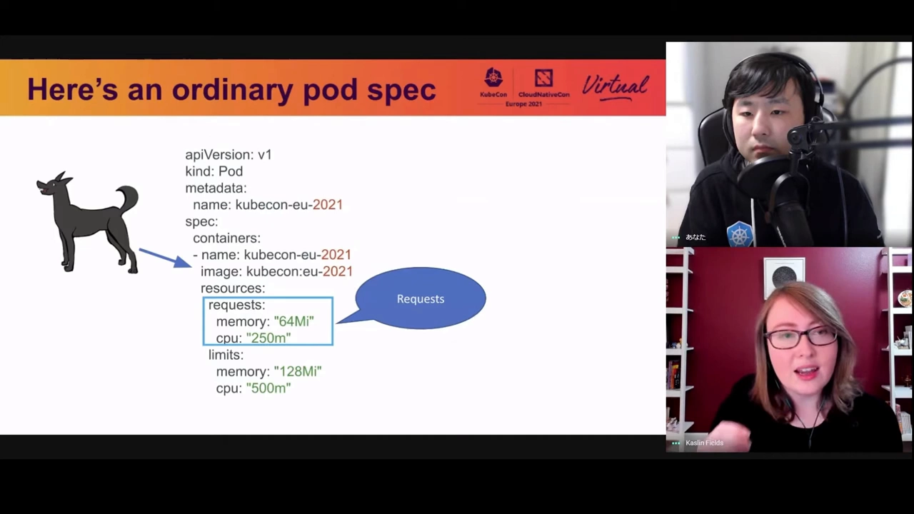

[【跳转到 02:31】](https://www.youtube.com/watch?v=WB3_sV_EQrQ&t=151) 一份普通的 Pod spec：容器镜像下方定义了 resource request 和 resource limit，例如 memory request 64Mi、CPU request 250m。当这份 spec 被提交给 K8s 运行时，request 会经历一段旅程。

**核心认知：requests 是被 K8s 用来"做规划（planning）"的**。类比里，这就是日托中心预先规划"要腾多少空间、备多少粮，才能照顾好你这只狗"。

### 2.2 第一站：API server 与 etcd

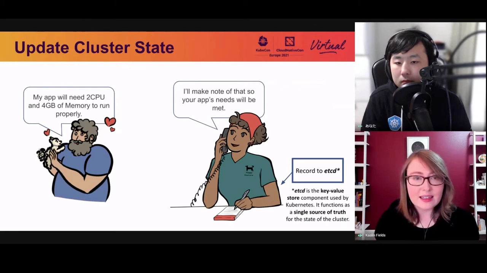

[【跳转到 04:33】](https://www.youtube.com/watch?v=WB3_sV_EQrQ&t=273) 开发者声明"我的应用需要 2 CPU、4GB 内存才能正常运行"，K8s 说"交给我们照顾"。这个"备注"被 API server **记录到 etcd**——etcd 是 K8s 使用的键值存储，是**整个集群的唯一事实来源（single source of truth）**：所有关于"如何照顾你的应用"的重要信息都必须反映在 etcd 里。

### 2.3 第二站：调度器按 requests 给节点排名

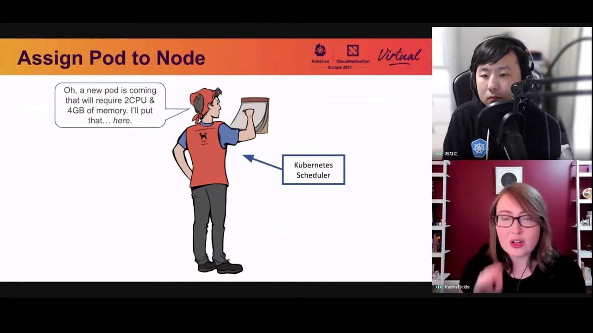

[【跳转到 04:47】](https://www.youtube.com/watch?v=WB3_sV_EQrQ&t=287) 接下来要决定这个 Pod 跑在哪个节点上。**调度器（kube-scheduler）评估各节点、为 Pod 分配节点；resource request 是它给候选节点排名时的参数之一**——节点资源不够，就不会把带着这个 request 的 Pod 分配过去。排查调度问题时，可以用 `kubectl describe node` 查看节点资源信息。

### 2.4 第三站：kubelet 接手把 Pod 变成现实

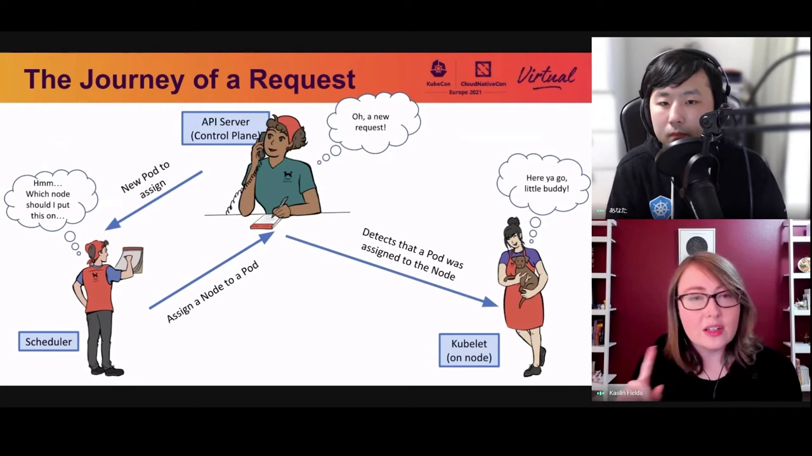

[【跳转到 06:24】](https://www.youtube.com/watch?v=WB3_sV_EQrQ&t=384) 选定节点后，Pod spec 被交给 **kubelet**——运行在节点上的 K8s 组件，由它真正把 Pod 跑起来。requests 的完整旅程：**API server（记账进 etcd）→ 调度器（按 request 选节点）→ kubelet（落地运行）**。

### 2.5 超用 request 的风险：驱逐与 QoS 类

[【跳转到 07:34】](https://www.youtube.com/watch?v=WB3_sV_EQrQ&t=454) requests 是规划值，不是硬约束——但如果 Pod 使用的资源**超过 request 值**、且节点资源快耗尽，就有**被驱逐（eviction）的风险**：Pod 可能被从节点上移除。想控制"先驱逐谁"，就要理解 **QoS 类**：每个 Pod 在创建和驱逐时都会被赋予一个 QoS 类，依据正是你设置的 request/limit 值——

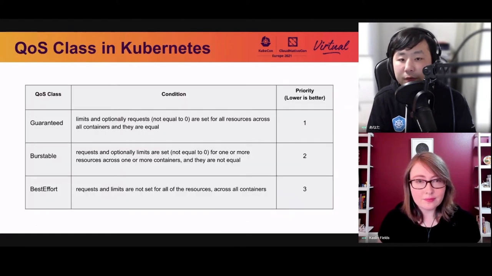

- Pod 里**所有容器都设置了 request 和 limit，且二者相等** → **Guaranteed**，最高优先级；
- **什么都没设** → 自动标记为 **BestEffort**，最低优先级；
- 介于两者之间 → Burstable。

当节点资源即将耗尽时，K8s 按优先级决定先移除谁。

## 三、limits 的旅程：为执行而生

### 3.1 limits 是"执法者"

[【跳转到 08:24】](https://www.youtube.com/watch?v=WB3_sV_EQrQ&t=504) 与 requests 相对，**limits 的使命是执行（enforcing）规则**："这个 Pod 不能超过这个资源上限"。它在 K8s 里走的是另一条路：开发者说"我要确保 Pod 消耗不超过 2 CPU、4GB 内存"，K8s 应允"我们可以限制它的用量"——

- 调度器仍然要选节点，但它会**确保节点知道这个 limit**，以便执行；
- Pod 落到节点后，kubelet 看到 limit，但它需要帮手：**kubelet 找容器运行时（container runtime）**，"有个 Pod 要来了，它的资源需要被限制"；运行时回答"我可以用 **cgroups** 来做到"。

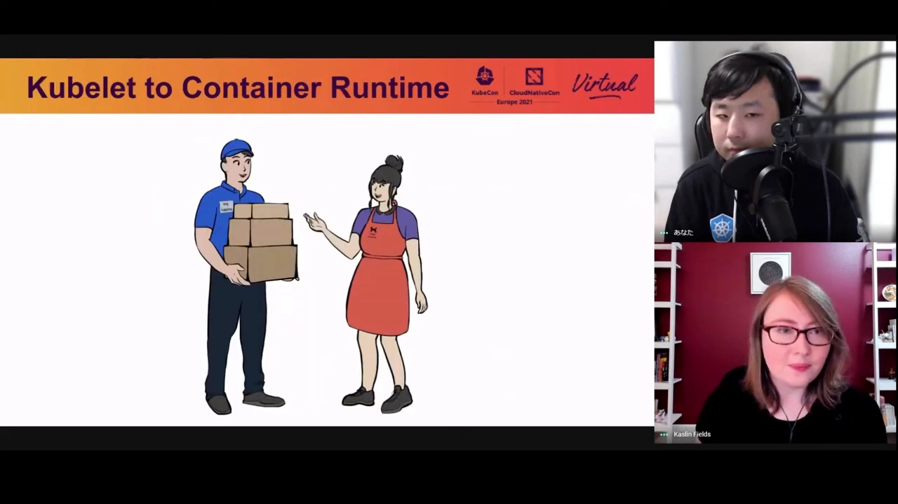

[【跳转到 10:15】](https://www.youtube.com/watch?v=WB3_sV_EQrQ&t=615) 一句话记住：**requests 用于规划（planning），limits 用于执行（enforcing）**。

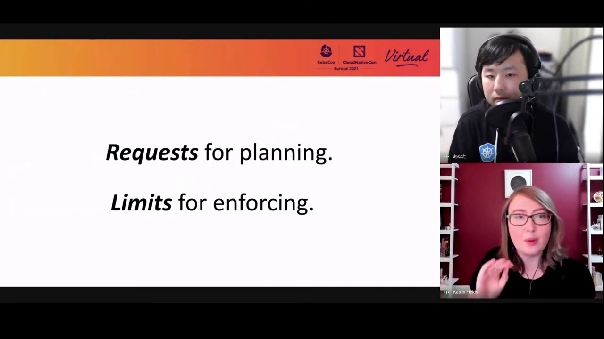

### 3.2 CPU 超限与内存超限：两种不同的下场

[【跳转到 11:10】](https://www.youtube.com/watch?v=WB3_sV_EQrQ&t=670) 资源限制落在 Pod 上，超限的后果分两种：

- **CPU 超过 limit** → 触发 **CPU 节流（throttling）**：Pod 不会被立刻删除，但进程会卡住，程序必须等待 CPU 资源就绪；
- **内存超过 limit** → 直接 **OOM（Out Of Memory）错误，容器被 OOM killer 杀掉**。

K8s 和容器技术正是用 Linux 内核的 **cgroups** 特性来实现容器资源限制的。

## 四、深入 cgroup：requests 和 limits 各自的落点

### 4.1 cgroup 与 namespace 的分工

[【跳转到 13:08】](https://www.youtube.com/watch?v=WB3_sV_EQrQ&t=788) 容器其实是由两个 Linux 内核特性实现的：**cgroups 和 namespaces**。namespace 负责在 Linux 宿主机上**隔离**进程（看见什么）；cgroups 负责限制资源（用多少）。本讲关注资源管理，所以聚焦 cgroups。

cgroups 是 Linux 内核特性，可以限制 CPU、内存、网络带宽等资源，也可以组合使用。

### 4.2 关键映射：request → cpu.shares，limit → CFS 周期配额

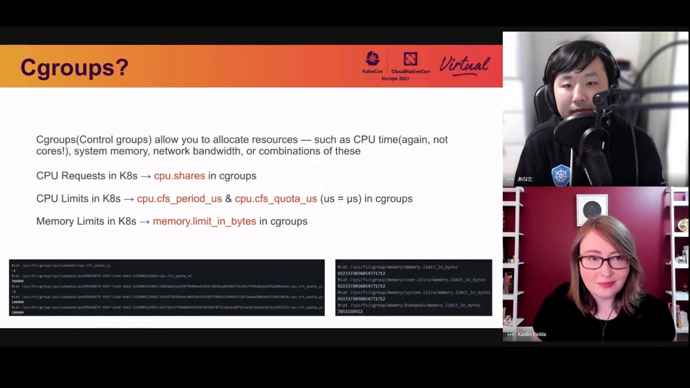

[【跳转到 13:55】](https://www.youtube.com/watch?v=WB3_sV_EQrQ&t=835) 这是全讲最核心的映射关系：

- 你在 K8s 里设置的 **CPU request 值，会被转换成 cgroup 世界里的 `cpu.shares`**；
- **CPU limit** 则从"核数"转换成 CFS 的 CPU 时间值，**以 `cfs period` 和 `cfs quota` 的形式存进 cgroup**；
- 这些 cgroup 值可以在每个节点上运行中的 Pod 对应目录里看到——就在 `/sys/fs/cgroup` 目录下的文件里；
- **内存 limit 同样存进 cgroup**。

### 4.3 一个容易困惑的点：为什么内存没有 request 落进 cgroup？

[【跳转到 14:45】](https://www.youtube.com/watch?v=WB3_sV_EQrQ&t=885) Kohei 分享了一个他第一次注意到时也很困惑的细节：**只有 CPU 才有 request 值存进 cgroup，内存没有**。

原因在于 `cpu.shares` 是一个**相对值**。举例：节点上已有四个容器，CPU limit 分别是 1.5、1、1、1 核——它们共享节点的全部可分配 CPU。此时还有富余、CPU 又没有 limit 上限，**CPU 资源是可以超卖（over-commit）的**；等 CPU 真正忙起来时，**CPU request 值就发挥作用：保证每个应用能拿到自己那份 CPU**。

如果又一个带 CPU request 的应用被调度到这个节点，K8s 会**重新计算这个百分比、重新分配"忙时"的资源份额**。而内存是"用多少占多少"的绝对量，没有这种相对份额语义，所以内存的 request 只用于调度规划，不进 cgroup。

### 4.4 CFS 周期与配额：500m = 每 100ms 用 50ms

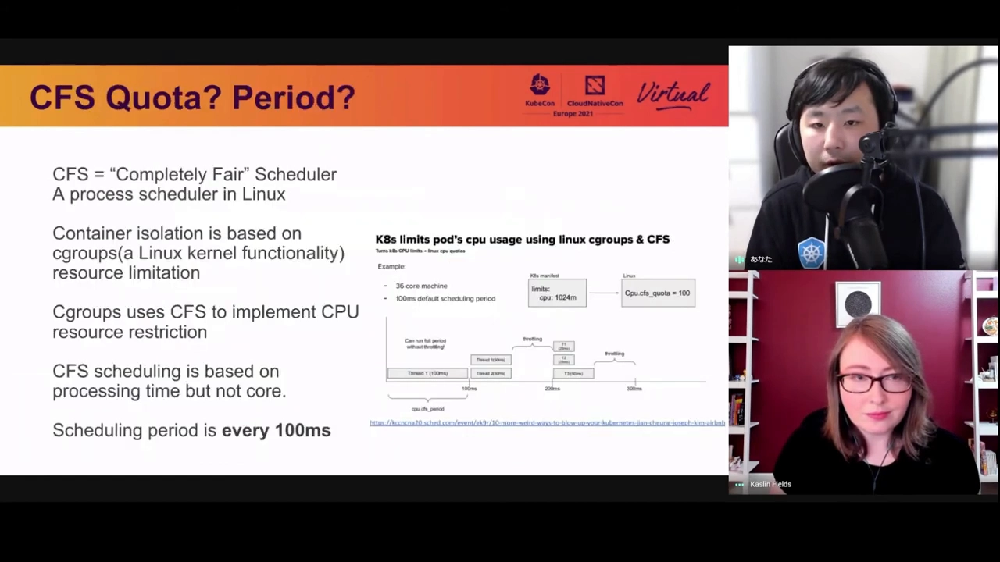

[【跳转到 15:54】](https://www.youtube.com/watch?v=WB3_sV_EQrQ&t=954) **CFS（Completely Fair Scheduler，完全公平调度器）是 Linux 的默认进程调度器**。容器隔离基于 cgroups，而 K8s 实际上用 CFS 来实现 CPU 资源限制。

CFS 以**周期（cycle）**为单位处理数据，默认周期 **100 毫秒**——也就是说，每 100ms 给应用分配一次"能用多久的 CPU"。换算规则：

- Pod spec 里 CPU limit 设 **500m**（半核）→ **CFS quota 变成 50 毫秒**：每个 100ms 周期里可以用 50ms 的 CPU 时间；
- 设 **2000m**（2 核）→ **CFS quota 变成 200 毫秒**：相当于每个周期用满两个核的时间片；
- **不设 CPU limit** → **CFS quota = -1，即不限制**。

### 4.5 kubelet 的转换点

[【跳转到 12:25】](https://www.youtube.com/watch?v=WB3_sV_EQrQ&t=745) 把视角收回到链路上：kubelet 从 Pod spec 里拿到 limit 值后，**把 CPU 核数换算成 CFS 的 period 和 quota（毫秒）**，然后调用 **CRI（Container Runtime Interface，容器运行时接口）** 在 Linux 宿主机上创建真正的容器——limit 的"内核化"就发生在这一步。

## 五、容器运行时的两层结构：CRI 运行时与 OCI 运行时

### 5.1 两类运行时各管一层

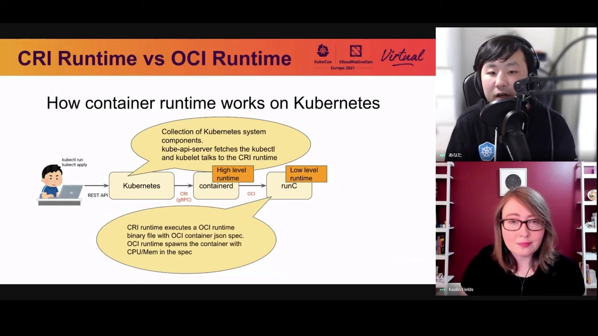

[【跳转到 17:39】](https://www.youtube.com/watch?v=WB3_sV_EQrQ&t=1059) K8s 的容器运行时分两类：**CRI 运行时**和 **OCI 运行时**。（顺带澄清：当初的 Docker 弃用风波针对的是 CRI 运行时层面，不是 OCI 运行时。）

创建容器时的调用链：

1. kubelet 向 CRI 运行时发起 **createContainer gRPC 调用**；
2. CRI 运行时收到创建请求后，**执行 OCI 运行时二进制**，并传入一份 JSON 文件，里面包含创建容器所需的全部信息——**cgroup limit 参数就在其中**；
3. 最终由 **OCI 运行时调用 cgroups API**——一个新的容器就跑起来了。

可以把 CRI 运行时理解为"跑在 **Kubernetes 层**的运行时"，OCI 运行时是"跑在 **Linux 内核层**的运行时"。想深入了解运行时底层，可以看 cri-o 和 containerd（都是 CNCF 项目）维护者的分享。

## 六、怎么把 requests/limits 设对：让 VPA 给建议

### 6.1 两种自动伸缩：HPA 管数量，VPA 管大小

[【跳转到 18:34】](https://www.youtube.com/watch?v=WB3_sV_EQrQ&t=1114) 讲完机制，演讲者留了一个实用工具来回答"到底该设多少"：**Pod 自动伸缩**。K8s 有两类自动伸缩器：

- **HPA（Horizontal Pod Autoscaler，水平）**：增减 Pod **副本数量**应对流量——流量尖峰时多起副本，低谷时缩容；
- **VPA（Vertical Pod Autoscaler，垂直）**：调整 Pod 的"大小"——所谓"大小"，就是**给出 requests/limits 该设多少的建议**。

### 6.2 VPA 的三种模式

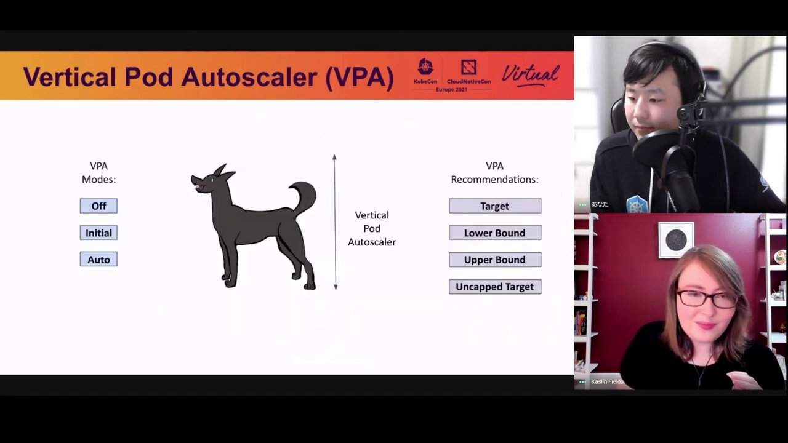

[【跳转到 19:42】](https://www.youtube.com/watch?v=WB3_sV_EQrQ&t=1182)

- **Off**：VPA 只观察 Pod 的资源使用并给出 CPU/内存 requests/limits 的**建议值**，不会替你改——你自己查看建议、手动落实；
- **Initial**：VPA 先观察一段时间、形成建议，并在 **Pod 创建时**应用它；之后想再调整，仍需查看建议、手动落实；
- **Auto**：持续监控、持续给出建议并**自动实施**——每次产生新建议时会**删除旧 Pod、按新大小创建新 Pod**。这可能带来中断，需要用 PodDisruptionBudget 之类的机制管理干扰。

### 6.3 四种推荐值

[【跳转到 21:22】](https://www.youtube.com/watch?v=WB3_sV_EQrQ&t=1282) VPA 的推荐值有四种：

- **target**：VPA 调整 Pod 大小时实际采用的值；
- **lower bound**：下限——Pod 利用率低于它时触发**向下**调整（auto 模式下 VPA 删除并缩小 Pod）；
- **upper bound**：上限——Pod 利用率高于它时触发**向上**调整；
- **uncapped target**：当没有给 VPA 设最小/最大容量约束时，直接采用的目标利用率。

## 七、全程回顾：一条链路图

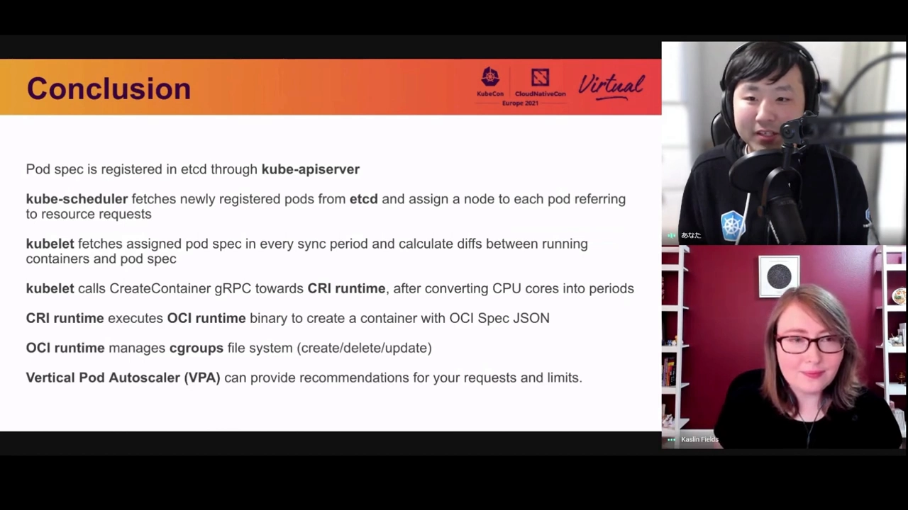

[【跳转到 22:12】](https://www.youtube.com/watch?v=WB3_sV_EQrQ&t=1332) 把整讲串成一条链：

1. 你 `apply` Pod manifest，**API server 把它注册进 etcd**；
2. **kube-scheduler** 从 etcd 取出新注册的 Pod，**参照 resource requests 为每个 Pod 分配节点**；
3. **kubelet** 每个同步周期取回分派给自己的 Pod，比对"运行中的容器"与 Pod spec 的差异；
4. kubelet **把 CPU 核数换算成 CFS 的 period/quota** 后，向 **CRI 运行时**发起 createContainer 调用；
5. **CRI 运行时执行 OCI 运行时二进制**，带上包含 cgroup limit 参数的 OCI spec JSON；
6. **OCI 运行时管理 cgroups 文件系统**，创建（或删除）容器——限制就此写入内核。

外加一个工具：**VPA 不只是自动伸缩，更是给 requests/limits 出建议的顾问**。

## 小结

- **requests 用于规划（planning），limits 用于执行（enforcing）**——这一句是全讲的钥匙。
- requests 的旅程：API server 记入 etcd（唯一事实来源）→ 调度器按 request 给候选节点排名 → kubelet 落地运行；超用 request 且节点吃紧时有被驱逐风险，优先级由 QoS 类决定。
- limits 的旅程：kubelet → CRI 运行时 → OCI 运行时 → **cgroups API**；CPU 超限被节流（等 CPU），内存超限被 OOM killer 杀掉。
- cgroup 落点：**CPU request → cpu.shares（相对权重）**；**CPU limit → CFS period/quota**（500m = 每 100ms 周期 50ms；不设 limit 则 quota = -1）；**内存 limit 进 cgroup，但内存没有 request 进 cgroup**——因为 shares 是相对值、可超卖，内存是绝对量。
- 运行时分两层：CRI 运行时在 K8s 层接 createContainer gRPC，OCI 运行时在内核层调 cgroups API。
- 设值没有把握时用 **VPA**：Off/Initial/Auto 三种模式，target/lower/upper/uncapped 四种推荐值。

## 关键术语速查

| 术语 | 一句话解释 |
| --- | --- |
| etcd | K8s 的键值存储、集群唯一事实来源；Pod spec 先记到这里 |
| kube-scheduler | 按 resource requests 等参数评估节点、为 Pod 挑节点的组件 |
| kubelet | 节点上的代理；同步 Pod 状态并把创建工作交给容器运行时 |
| CRI | Container Runtime Interface，kubelet 与容器运行时之间的 gRPC 接口 |
| OCI 运行时 | 在 Linux 内核层执行容器创建、调用 cgroups API 的运行时（如 runc） |
| cpu.shares | CPU request 的 cgroup 落点：相对权重，忙时保底、闲时可超 |
| cfs period / cfs quota | CFS 的调度周期（默认 100ms）与周期内可用 CPU 时间；CPU limit 的 cgroup 落点 |
| 节流（throttling） | CPU 超过 limit 后进程被迫等待到下个周期的现象 |
| 驱逐（eviction） | 节点资源吃紧时把 Pod 移出节点；顺序由 QoS 类决定 |
| HPA / VPA | 水平伸缩（增减副本数）/ 垂直伸缩（给出并应用 requests/limits 建议） |
