# k8s 的 requests 和 limits 是如何写进 cgroup 的：一次完整的映射追踪

> 视频源：[k8s resources requests 和 limits，及其在 cgroup 中的配置](https://www.bilibili.com/video/BV1VR4y1h7n8/)（Bilibili @timdcn，27 分 11 秒）。本文基于视频演说图文稿整理，时间戳可跳转到原视频对应位置。

## 本讲要解决的核心问题（SCQA）

**背景**：在 K8s 里给容器写 `resources.requests` 和 `resources.limits` 是日常操作——requests 声明"我要多少"，limits 声明"我最多用多少"，Pod 就能被妥善安置和限制。

**冲突**：这两个数字只是 YAML 字段，真正执行限制的是 Linux 内核的 cgroup。`0.2` 和 `1` 这样的数字，在内核里对应哪个文件里的什么值？中间经过哪些换算、哪些组件？很多人说不清这条链路。

**疑问**：requests 和 limits 分别被写进哪些 cgroup 参数？调度器用哪个值、容器运行时用哪个值？如果不用 K8s、直接操作最底层的 cgroup，能不能实现同样的限制？

**回答（中心思想）**：能，而且映射关系非常确定——**CPU 侧：`requests.cpu × 1024 → cpu.shares`（权重，0.2 → 204）；`limits.cpu × 100000 → cpu.cfs_quota_us`（period 固定 100000 微秒，1 核 → 100000/100000）**。K8s 调度器按 requests 做节点容量检查，kubelet 把两个值交给容器运行时，运行时把它们写进 cgroup，由内核 CFS 调度器落地执行。本讲沿着"Pod YAML → 节点上的容器 → cgroup 文件"的实际路径，把这条链走一遍。

## 一、实验设计：从一个技术群的问题说起

### 1.1 问题与解题思路

[【跳转到 00:00】](https://www.bilibili.com/video/BV1VR4y1h7n8/?t=0) 视频的起点是一个技术群里的问题：K8s 当中容器所使用的资源被限制在 `resources.requests` 和 `limits` 之间，这是怎么做到的？如果直接使用最底层的 cgroup，是否也能实现？要如何配置？

作者的推理链是：K8s 用来编排容器，而容器封装的核心就是 namespace 和 cgroup——

- **namespace 负责"隔离"**：隔离 PID（进程 ID）、用户、网络等系统资源，决定"能看到什么"；
- **cgroup（control group，控制组）负责"限制"**：对 CPU、内存等计算资源设置上限，决定"能用多少"。

既然 K8s 的资源限制最终由 cgroup 执行，那么从 K8s 一路深入到 cgroup，就一定能找到 requests/limits 的落脚点。本讲以 CPU 为例做完整追踪。

### 1.2 测试环境

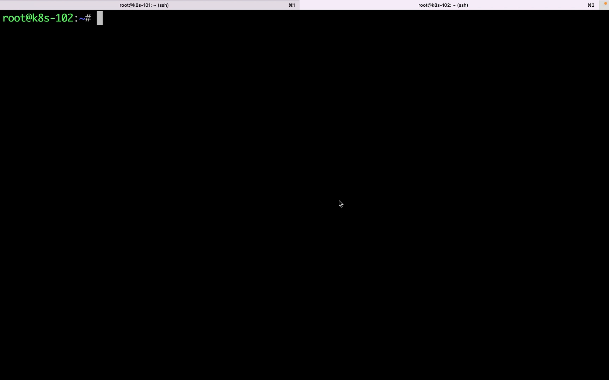

[【跳转到 01:15】](https://www.bilibili.com/video/BV1VR4y1h7n8/?t=75) 作者搭了一个两节点的小集群：

- 宿主机 macOS 12.6，Guest OS 为 Ubuntu 20.10；两台虚拟机各 4 核 CPU、3GB 内存，用 Vagrant 管理；
- `192.168.56.101` 是 K8s master，`192.168.56.102` 是 K8s node——集群里只有一个 master、一个 node；
- K8s 版本 1.23.1。

### 1.3 测试 Pod

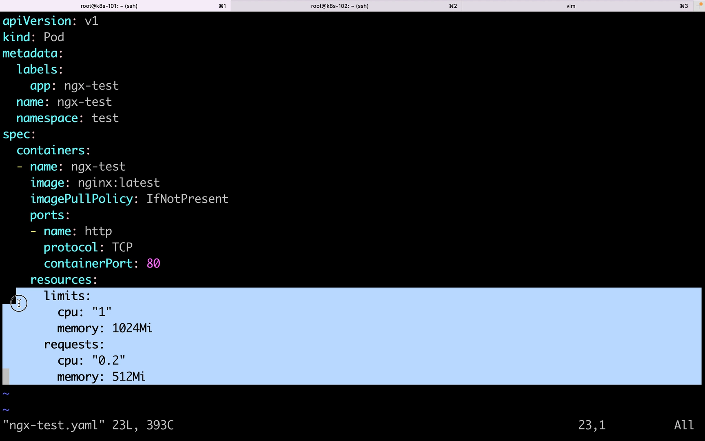

[【跳转到 03:01】](https://www.bilibili.com/video/BV1VR4y1h7n8/?t=181) 测试用最小化的 Pod YAML：`kind: Pod`，命名空间 `test`，镜像 `nginx:latest`，并且设置了 resources：

- `requests.cpu: 0.2`——请求 0.2 个 CPU；
- `limits.cpu: 1`——最多使用 1 个 CPU。

创建之后，nginx-test 这个 Pod 就带着"请求 0.2、上限 1"的设定跑起来了。下面所有的追踪都围绕这两个数字展开。

## 二、第一步：把 Pod 定位到节点上的容器

### 2.1 找到 Pod 运行的节点

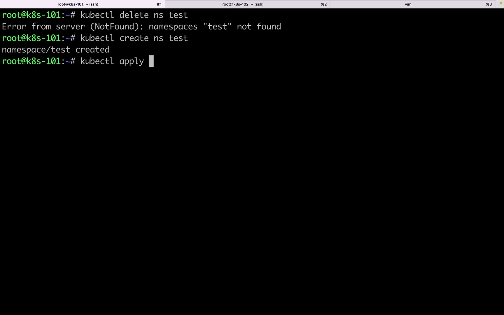

[【跳转到 03:31】](https://www.bilibili.com/video/BV1VR4y1h7n8/?t=211) `kubectl get pod -o wide` 可以看到 Pod 被调度到了哪个节点。集群里只有 102 这一个 node，所以 nginx-test 一定运行在 102 上。

### 2.2 一个 Pod 里有多个容器

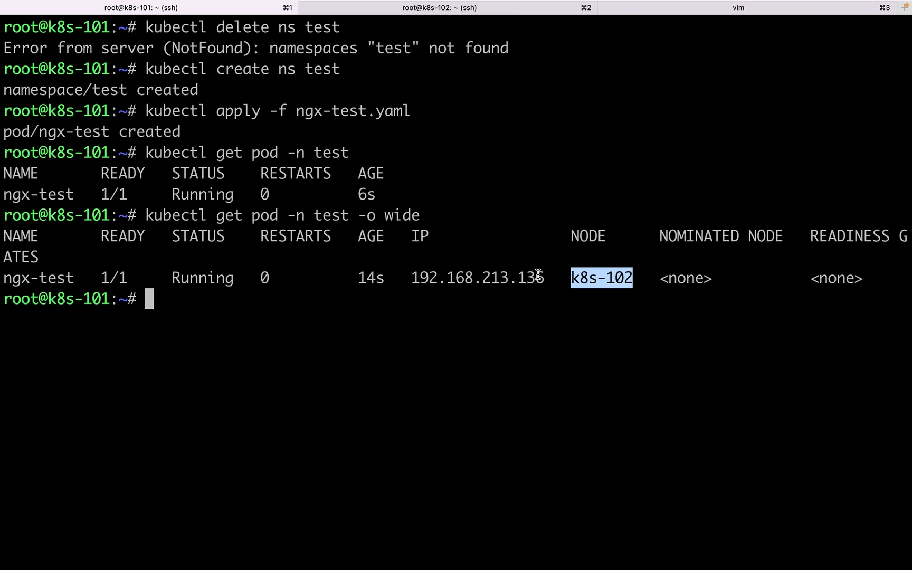

[【跳转到 04:28】](https://www.bilibili.com/video/BV1VR4y1h7n8/?t=268) 在 102 上用 docker 查看容器 ID，能看到这个 Pod 里有两个容器：一个是 K8s 自己嵌入的 **pause 容器**，另一个才是我们自己的业务容器 nginx-test。这也直观说明：K8s 当中所有 Pod 都是多容器的。

### 2.3 用 docker inspect 读取容器配置

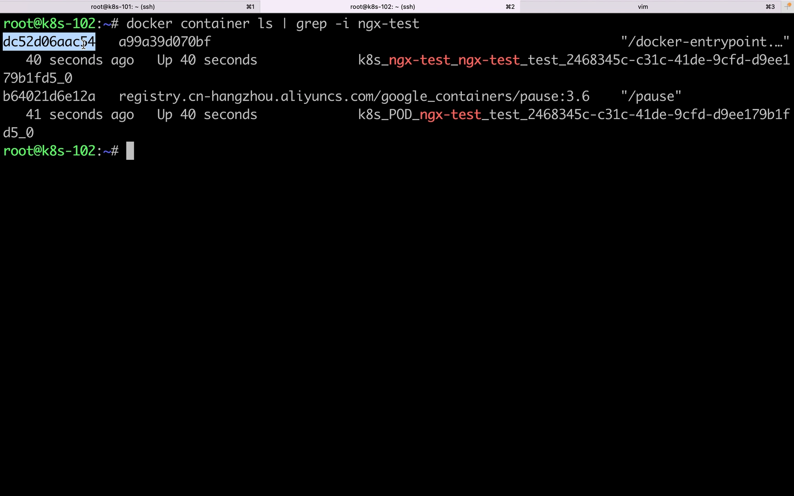

[【跳转到 04:38】](https://www.bilibili.com/video/BV1VR4y1h7n8/?t=278) 对业务容器执行 `docker inspect`，在 CPU 相关配置里能看到第一组关键数字：**CPUShares = 204**。这个 204 是从哪来的？

## 三、映射一：requests.cpu → cpu.shares（权重）

### 3.1 0.2 怎么变成 204

对照 YAML：`requests.cpu = 0.2`，而 0.2 × 1024 = 204.8，取整就是 204——与 docker inspect 看到的 CPUShares 完全一致。

也就是说，**requests.cpu 被换算成了 cgroup 的 `cpu.shares`**。`cpu.shares` 不是一个"核数"，而是一个相对比例值（权重）：它决定的是"当多个容器争抢 CPU 时，谁能分到多大的比例"。

### 3.2 到 cgroup 文件里验证

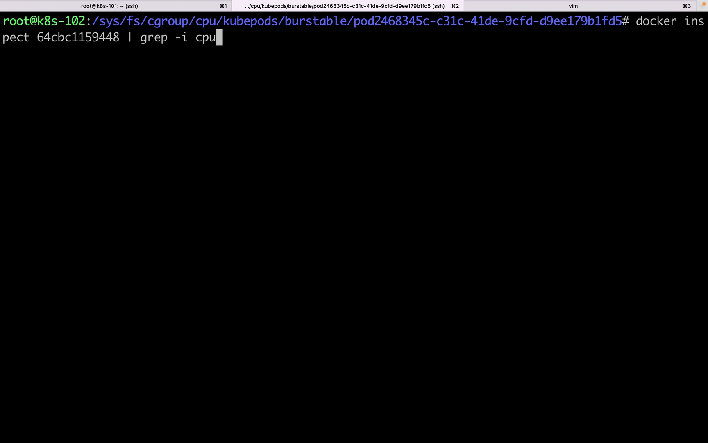

[【跳转到 06:21】](https://www.bilibili.com/video/BV1VR4y1h7n8/?t=381) 找到业务容器（容器 ID dc52）在 `/sys/fs/cgroup` 下对应的目录，可以看到三个关键文件：

- `cpu.shares` = 204（requests.cpu 0.2 × 1024）；
- `cpu.cfs_period_us` = 100000；
- `cpu.cfs_quota_us` = 100000。

requests 和 limits 在 cgroup 里各有着落：**requests 落在 `cpu.shares`，limits 落在 `cpu.cfs_period_us` + `cpu.cfs_quota_us` 这对文件上**。

## 四、映射二：limits.cpu → cfs_quota_us / cfs_period_us

### 4.1 1 核怎么变成 100000/100000

limits.cpu = 1，对应 `cpu.cfs_period_us = 100000`、`cpu.cfs_quota_us = 100000`。两者相除：100000 / 100000 = 1，正好等于 limits.cpu。

这两个文件的含义（Red Hat 文档口径）：

- `cpu.cfs_period_us`：调度周期的时长，单位微秒（100000 微秒 = 100 毫秒）；
- `cpu.cfs_quota_us`：一个周期内，该 cgroup 中所有任务可运行的 CPU 时间总量，单位微秒。

**可用 CPU 核数 = quota / period**。所以 200000/100000 是 2 核，50000/100000 是半核。

### 4.2 K8s 官方文档怎么定义 requests 和 limits

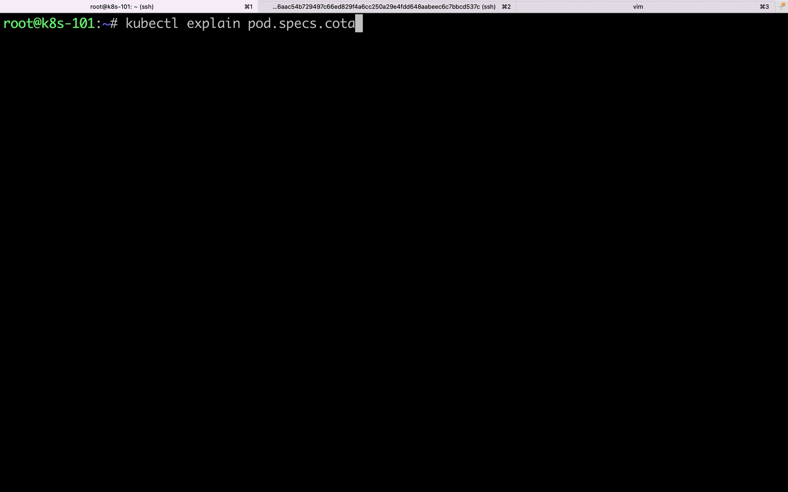

[【跳转到 07:11】](https://www.bilibili.com/video/BV1VR4y1h7n8/?t=431) 视频里读了 kubernetes.io 的 Pod spec 文档（container 的 resources 部分）：

- **limits**：允许的计算资源的**最大上限**；
- **requests**：**请求**的计算资源量。

两条重要的默认值规则：如果容器省略 requests 但显式指定了 limit，那么 requests 默认等于 limit；如果两者都省略，默认值"由实现定义"——也就是由节点上的底层隔离机制决定。

### 4.3 弹性区间 [requests, limits]：CPU 与内存的处理不同

[【跳转到 09:50】](https://www.bilibili.com/video/BV1VR4y1h7n8/?t=590) 文档的中文版把这段讲得很清楚：

- 节点资源充足时，容器**可能且被允许**使用超过 requests 的资源量；但**绝不能**超过 limits。也就是说，容器实际使用的资源落在 `[requests, limits]` 区间里，是弹性的。
- 内存例子：把 memory 请求量设为 256Mi，Pod 被调度到一台有 8GB 内存、没有其他 Pod 的节点上，容器就可以尝试使用更多内存；但如果 memory 限制是 4GB，K8s 和容器运行时会确保这个上限生效——容器运行时会禁止容器使用超出限制的资源。
- **CPU 与内存的关键差别**：进程申请的内存超过允许量时，系统内核会将该进程终止，引发 OOM 错误（容器异常退出的常见原因之一）；而 **CPU 用超了不会杀进程**，只会被"限流"（第六章细讲）。如果容器内存用量超过其申请值、且节点内存不足，Pod 还可能被逐出（evicted）。

## 五、两个值各管一段：调度看 requests，执行看 limits

### 5.1 调度器按 requests 做容量检查

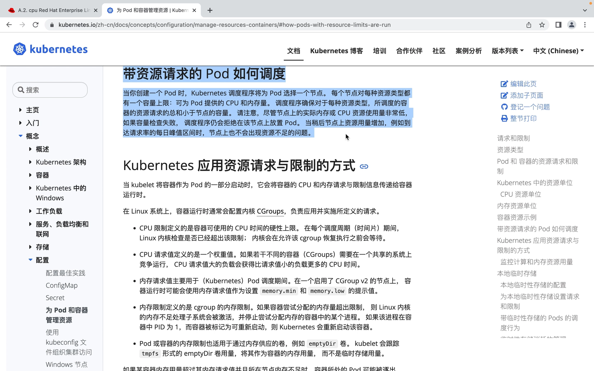

[【跳转到 10:40】](https://www.bilibili.com/video/BV1VR4y1h7n8/?t=640) 创建 Pod 时，K8s 调度器为它选节点，规则是：**对每种资源，已调度到该节点的容器的 requests 总和必须小于节点容量**。

注意：调度看的是 requests 而不是 limits，也不看节点的实际使用率——即使节点上实际的 CPU/内存占用非常低，只要 requests 累加的"账面容量"放不下新 Pod，调度器仍然会拒绝把它放上来。

这相当于 requests 给 Pod"占了一个坑"：即使自己暂时用不到这些资源，这部分容量也不能分配给其他 Pod。好处是：等负载涨到请求量的峰值时，节点上不会出现资源不足。当然，自己暂时不用的资源，同一节点上的其他 Pod 是可以借用的（cgroup 的全局池机制，第六章会讲到）。

### 5.2 CPU 单位：核与毫核

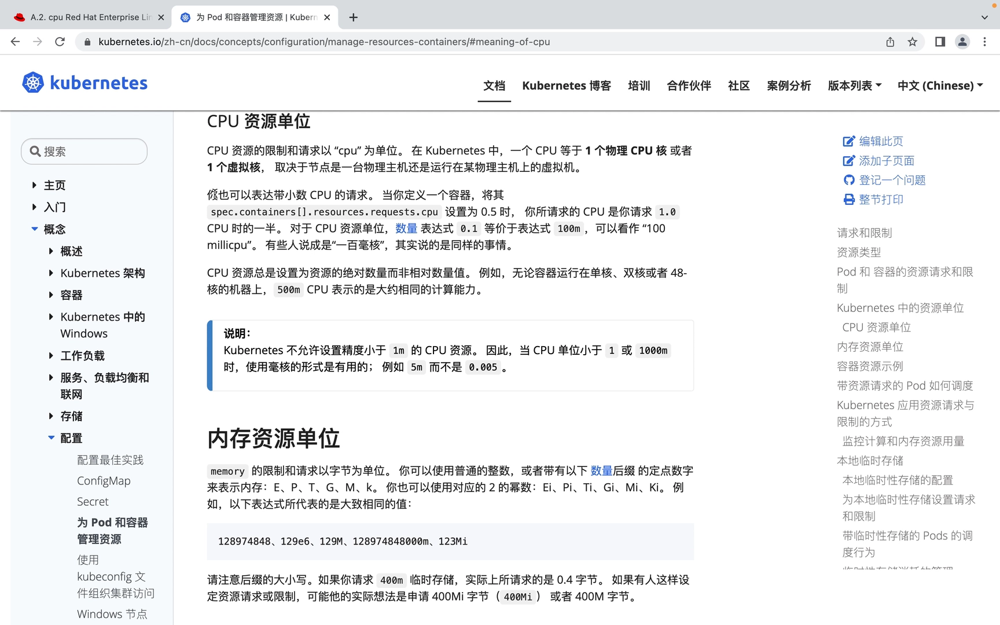

[【跳转到 13:10】](https://www.bilibili.com/video/BV1VR4y1h7n8/?t=790) 文档对 CPU 单位的说明：

- 1 CPU = 1 个物理核或 1 个虚拟核（取决于节点是物理机还是虚拟机）；
- 可以写小数：`requests.cpu = 0.5` 表示请求 1.0 的一半；
- 表达式 `0.1` 等价于 `100m`。资源申请的单位是 millicore（毫核）：0.1 CPU = 100 毫核；
- CPU 资源总是**绝对数量**而非相对数量：无论容器跑在单核、双核还是 48 核机器上，500m 表示大约相同的计算能力；
- 精度不能小于 1m，所以小于 1 核时用毫核表达更方便（如 `5m` 而不是 `0.005`）。

（视频里 `cpu.shares` 的换算基数是 1024：0.2 × 1024 = 204。这是 cgroup v1 `cpu.shares` 的经典约定——每 1 核对应 1024 份权重。）

### 5.3 传递链：kubelet → 容器运行时 → cgroup

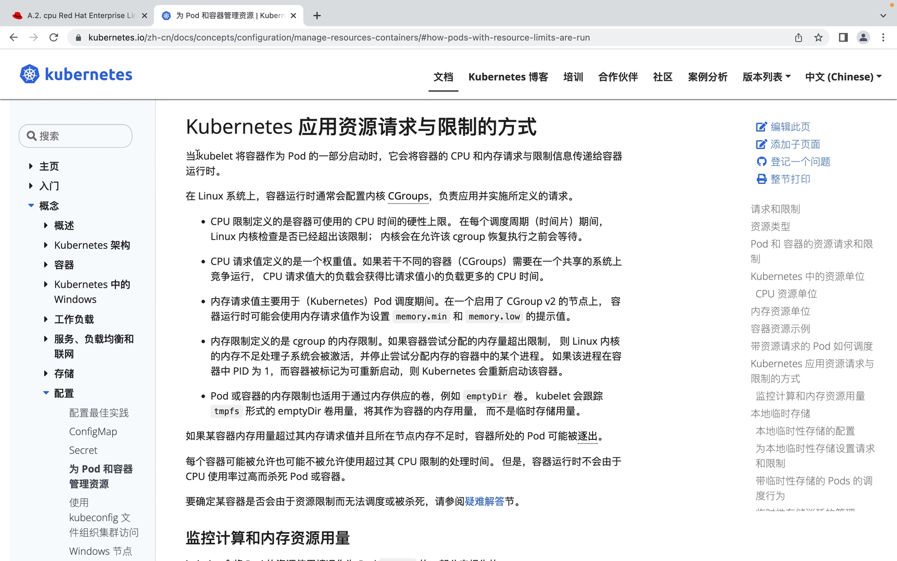

[【跳转到 14:50】](https://www.bilibili.com/video/BV1VR4y1h7n8/?t=890) K8s 文档里 kubelet 应用资源请求与限制的一节给出了完整链条：当 K8s 把容器作为 Pod 的一部分启动时，它会把容器的 CPU 和内存的 requests 与 limits**传给容器运行时**；在 Linux 上，容器运行时通过配置**内核 cgroup** 来应用并实施这些值。

具体到限制的执行方式：

- **limit（硬上限）**：在每个调度周期（`cfs_period_us`）里，内核检查是否已超出配额；超出了就等待，直到进入下一个周期才继续放行；
- **request（权重）**：若干容器在共享系统上竞争运行时，CPU 请求值大的负载获得比请求值小的负载更多的 CPU。

这也回应了开头的问题：K8s 自己并不直接写 cgroup 文件，它把值传给容器运行时（Docker/containerd 等），由运行时写 cgroup——这就是"映射"的完整路径。

## 六、深入 cgroup 侧：CFS 的份额与强制上限

为了说清 `cpu.shares` 和 `cfs_quota/period` 的语义，视频引用了 Red Hat 官网的 cgroup 文档（CPU 子系统）。

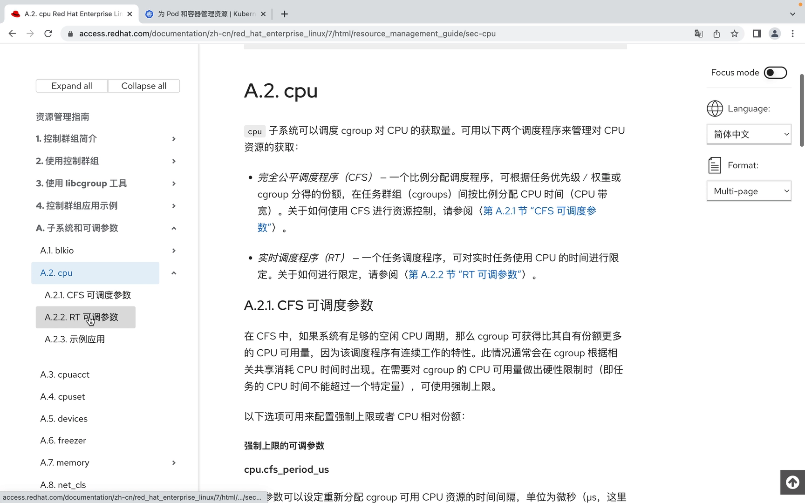

### 6.1 两种调度器：CFS 与 RT

[【跳转到 17:22】](https://www.bilibili.com/video/BV1VR4y1h7n8/?t=1042) Linux 有两种 CPU 调度程序：

- **CFS（Completely Fair Scheduler，完全公平调度器）**：基于时间片、支持优先级的调度器，按任务的优先级（也就是权重，或 cgroup 分得的份额）在任务群组中**按比例分配** CPU 时间——这就是 `cpu.shares` 的实现基础；
- **RT（实时调度程序）**：另一套可调参数。视频作者的 Ubuntu 里没有 RT 相关配置，所以只看 CFS。

### 6.2 shares 是"抢不到时的比例"，不是"封顶"

[【跳转到 19:10】](https://www.bilibili.com/video/BV1VR4y1h7n8/?t=1150) CFS 的份额语义有两个推论：

- **空闲时可超**：如果系统有足够的空闲 CPU 周期，cgroup 可以获得比自身份额更多的 CPU。比如份额对应 10%，但系统很空闲，实际用量就可能超过 10%；
- **需要封顶时用强制上限**：要硬性限制 cgroup 的 CPU 可用量，就用 `cfs_period_us` + `cfs_quota_us` 这对参数——K8s 的 limits 正是用它们实现的。

`quota/period` 的两个例子：

| 场景 | 换算 | quota（微秒） | period（微秒） |
| --- | --- | --- | --- |
| 每秒可用 0.2 秒单核 CPU | 0.2s / 1s | 200000 | 1000000 |
| 每秒可用 2 个 CPU | 2s / 1s | 200000 | 100000 |

### 6.3 shares 的相对性：同份额同时间，双份额双时间

[【跳转到 21:27】](https://www.bilibili.com/video/BV1VR4y1h7n8/?t=1287)

- 两个任务的 `cpu.shares` 都是 100：即使它们分属不同的 cgroup，获得的 CPU 时间也相同；
- `cpu.shares` 设为 200 的任务与设为 100 的任务相比：不管两者是否在同一个 cgroup 当中，前者使用的 CPU 时间都是后者的两倍。

### 6.4 多核系统里的份额：按所有核分配

[【跳转到 23:07】](https://www.bilibili.com/video/BV1VR4y1h7n8/?t=1387) 在多核系统中，CPU 时间比例是在**所有 CPU 核**上分配的。一台 4 核机器的 CPU 使用率上限是 400%（每核 100%）。

Red Hat 文档的例子：group A 可用 CPU 的 25%，group B 可用 75%；系统里启动 4 个消耗大量 CPU 的进程，1 个放进 A、3 个放进 B。结果是 A 里 PID 为 100 的进程**100% 占用了 CPU0**——A 虽然只能用总量的 25%，但它可以 100% 地用满某一个单独的核。受限的是"总量"，不是"单个核"。

### 6.5 全局池：闲置份额会被别人借走

[【跳转到 14:12 处的讲解】](https://www.bilibili.com/video/BV1VR4y1h7n8/?t=852) 用相对比例管理 CPU 时，有一个必须注意的行为：当一个 cgroup 中的任务闲置、不使用自己的 CPU 时间时，这些可用时间会进入一个**全局池**，其他 cgroup 可以从中借用 CPU 时间片——这提高了系统整体效率，但也意味着 cgroup 实际可用的 CPU 时间会随系统中 cgroup 数量的不同而变化，**很难精确预测**。

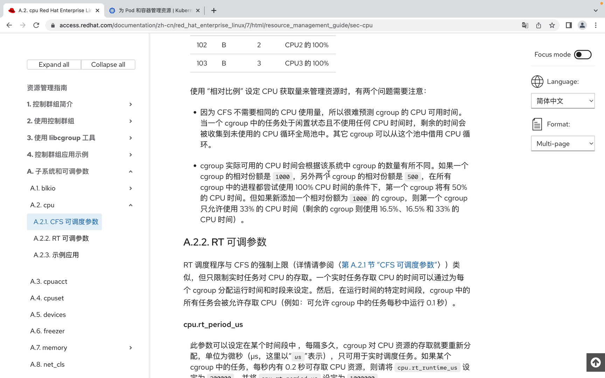

文档的数字例子：

- 三个 cgroup 份额分别是 1000、500、500，且所有进程都打满 CPU：第一个 cgroup 得 50%，另两个各 25%；
- 这时再新增一个份额 1000 的 cgroup：系统里共有四个 cgroup（1000/500/500/1000），于是变成 33% / 16.5% / 16.5% / 33%。[【跳转到 24:22】](https://www.bilibili.com/video/BV1VR4y1h7n8/?t=1462)

## 七、动手验证：改 YAML，再看 cgroup 文件

[【跳转到 25:07】](https://www.bilibili.com/video/BV1VR4y1h7n8/?t=1507) 最后把映射公式完整验证一遍：把测试 Pod 改成 `requests.cpu: 0.5`、`limits.cpu: 2`，用相同的方式重新创建。

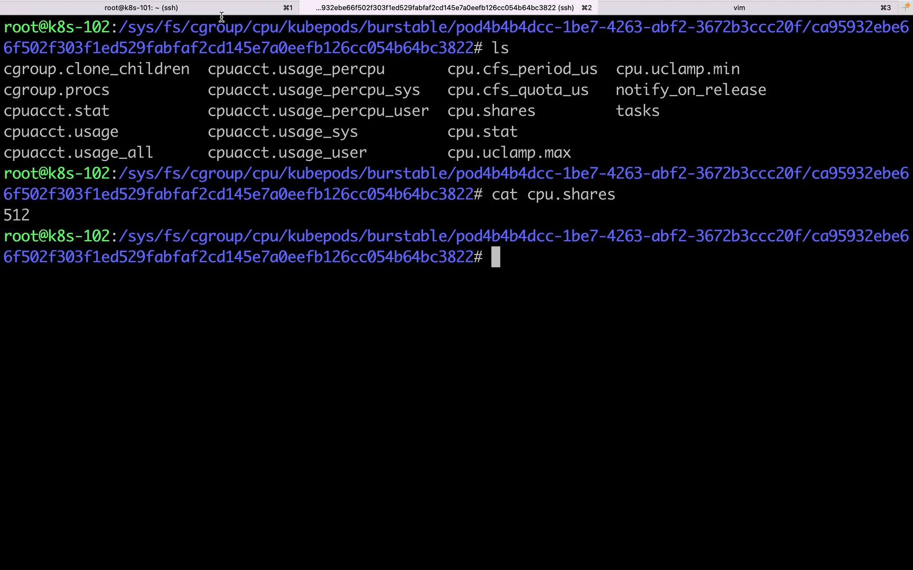

再到节点的 cgroup 目录里检查：requests 是 0.5，0.5 × 1024 = 512，所以 `cpu.shares` 应为 512；limits 是 2，所以 `cpu.cfs_quota_us` 除以 `cpu.cfs_period_us` 应等于 2——两个文件分别是 200000 和 100000。与映射公式完全一致。

| YAML | cgroup 文件 | 实测值 | 换算 |
| --- | --- | --- | --- |
| requests.cpu = 0.5 | `cpu.shares` | 512 | 0.5 × 1024 |
| limits.cpu = 2 | `cpu.cfs_quota_us` | 200000 | 2 × 100000 |
| limits.cpu = 2 | `cpu.cfs_period_us` | 100000 | 固定周期；200000/100000 = 2 |

至此，"requests/limits 如何映射到 cgroup"被完整实证了一遍：**YAML → kubelet → 容器运行时 → cgroup 文件 → 内核 CFS 执行**。

## 小结

- 容器 = namespace（隔离"看得见什么"）+ cgroup（限制"用得了多少"）；K8s 的资源限制最终都由 cgroup 执行。
- **requests.cpu × 1024 → `cpu.shares`**：它是权重/相对比例，决定争抢时的分配比例，不是封顶。
- **limits.cpu × 100000 → `cpu.cfs_quota_us`**，`cpu.cfs_period_us` 固定 100000 微秒；可用核数 = quota / period。
- 调度器按 **requests** 累加做节点容量检查（占坑不退、不看实际使用率）；容器实际用量是弹性的：≥ requests 且 ≤ limits。
- CPU 超限只会被限流（等下一个周期），不会杀进程；内存超限会触发内核 OOM 直接杀进程，还可能连累 Pod 被逐出。
- `cpu.shares` 有全局池行为：闲置份额可被其他 cgroup 借用，实际可用 CPU 随 cgroup 数量浮动；需要硬上限就靠 quota/period。

## 关键术语速查

| 术语 | 一句话解释 |
| --- | --- |
| cgroup | Linux 内核的控制组机制，对进程组的 CPU、内存等资源设置上限与权重 |
| cpu.shares | cgroup v1 的 CPU 权重参数，相对比例值；K8s 中 = requests.cpu × 1024 |
| cpu.cfs_period_us | CFS 调度周期长度（微秒），默认 100000（= 100ms） |
| cpu.cfs_quota_us | 一个周期内该 cgroup 可运行的 CPU 时间总量（微秒）；可用核数 = quota/period |
| requests | 容器声明的资源请求量；调度器按它做节点容量检查；CPU 侧对应 cpu.shares |
| limits | 容器资源使用的硬上限；CPU 侧对应 cfs_quota/cfs_period |
| OOM | Out Of Memory；进程申请内存超限且回收失败时，内核将其终止 |
| 毫核（m） | CPU 计量单位，1 核 = 1000m；0.2 核 = 200m |
