# cgroup v2 统一层级：设计动机与 systemd 委托

> 视频来源：[Brave new world of unified cgroup hierarchy - DevConf.CZ 2020](https://www.youtube.com/watch?v=8-F5IKB09gI)（Red Hat systemd 团队两位开发者主讲，47:34）。本文为该视频的中文整理稿，配图截自演讲幻灯片。

## 本篇要解决的核心问题（SCQA）

**背景**：演讲的缘起是 2019 年底的两件大事——systemd 把编译期默认切到 **cgroup v2**，Fedora 31 起默认运行 v2。cgroup v1 已在内核里跑了十多年，但连它的维护者都说它的设计是"随机漫步"。

**冲突**：v1 的老问题人尽皆知：每个控制器一棵树、接口约定不统一、控制器之间无法协作、向非特权进程委托子树不安全。可 v2 从 2012 年宣布到真正落地又拖了七年，卡点一个接一个。

**疑问**：v2 到底重新设计了什么？"把一部分控制组交给容器运行时/libvirt 去管"这种**委托（delegation）**，边界到底在哪？

**回答（中心思想）**：v2 用**单一层级 + 统一接口约定**替换了 v1 的多树模型，使**安全委托**第一次成为可能：systemd 通过 `Delegate=` 把子树的目录和控制文件所有权交给被委托方，但**兄弟节点仍归 systemd 领地**；资源分配则收敛为 weight / limit / protection / allocation 四种模型，且 systemd 在其上提供高层配置项。

## 一、先对齐术语：cgroup、controller、hierarchy

[【跳转到 02:10】](https://www.youtube.com/watch?v=8-F5IKB09gI&t=130)


- **cgroup**：把一组任务（进程）和一组参数关联起来的基本单元；
- **controller（控制器）**：调度某一类资源的实体，如 cpu、memory、io；
- **hierarchy（层级树）**：cgroup 组成的树；**系统上每个进程恰好属于一个 cgroup**。

### 接口就是文件系统

[【跳转到 03:00】](https://www.youtube.com/watch?v=8-F5IKB09gI&t=180)

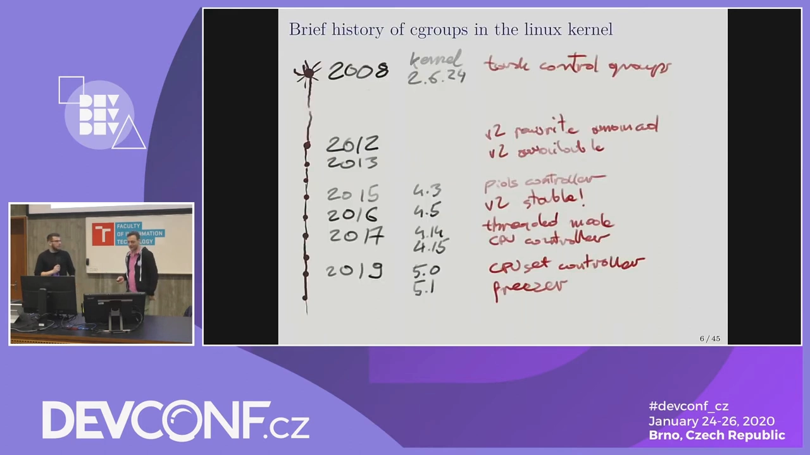

对系统管理员来说，cgroup 的接口**是一个文件系统**：内核把层级树表达为目录，通常挂载在 `/sys/fs/cgroup`（systemd 开机就挂好）。`ls /sys/fs/cgroup` 能看到所有控制组，`systemd-cgls` 则把树状层级打印得更直观。

## 二、v1 的十年：一场"随机漫步"

### 2.1 历史脉络

cgroup 起于 kernel 2.6.24（2008 年）的 "task control groups"，随后控制器雨后春笋般冒出来，很快就显出**原始设计需要返工**；2012 年 v2 被宣布，但此后"总还差最后一块拼图"——最大的争论是 v1 管线程、v2 管进程，CPU 调度器相关的控制器因此长期无法合并，直到 cgroup 社区妥协加入 threads 支持。

[【跳转到 06:18】](https://www.youtube.com/watch?v=8-F5IKB09gI&t=378)

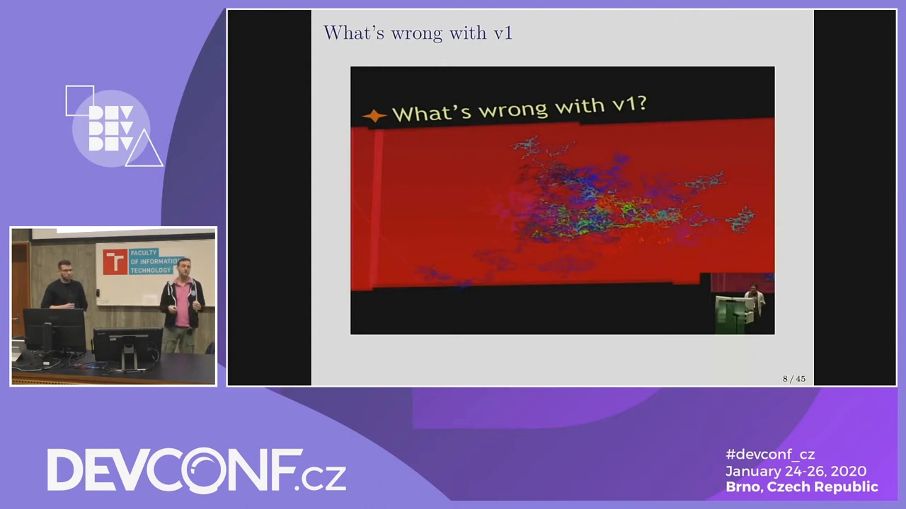

### 2.2 v1 的四宗罪（演讲者总结）

1. **接口反映内核内部细节**：没有总设计师，谁实现了什么就暴露什么，用户面对一堆"魔法数字"旋钮；
2. **过度灵活**：多资源可以完全正交地组合管理，特定场景很爽，理解成本极高；
3. **控制器不保证层级化**：有的控制器把整棵树当"一袋无序的组"看待，甚至允许"给子节点比父节点更多的资源"这类怪异配置；
4. **控制器之间无法协作**：内存受限要换出页 → 换出产生 IO → 压缩页又耗 CPU，可这三个资源分属三棵树，**根本没有机制把三者绑在同一个组上算账**。

[【跳转到 10:58】](https://www.youtube.com/watch?v=8-F5IKB09gI&t=658)

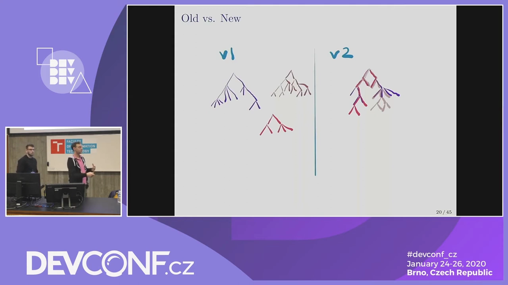

此外命名也混乱：cpu 的 `shares` 和 blkio 的 `weight` 是同一个概念却两套名字两套取值。演讲还演示了内存控制器 v1 的参数膨胀史：先是 `limit_in_bytes`，后来要算内核内存（kmem）加一个，TCP buffer 没算进去再加一个……

### 2.3 v1 的致命短板：委托不安全

多层级彼此独立 + 一些实现细节，导致**把子树交给低权限用户管理这件事在 v1 上做不安全**——这是 v2 重构最硬的动机之一。

## 三、v2 统一层级的关键决策

[【跳转到 11:23】](https://www.youtube.com/watch?v=8-F5IKB09gI&t=683)

- **只有一棵树**，每个控制器从根延伸到某一层为止——不允许"半截树"（同一控制器在同一路径上时而有效时而失效）；
- 在树的某处**关掉控制器**不只是省配置：资源记帐本身有开销，让不需要的分支不带控制器，整棵树更轻快；
- **接口约定先行**：所有控制器必须遵守同一套命名与语义，高级旋钮不暴露内核内部结构；
- **限制默认是软的**：超限先是"变慢/被回收"，而不是立刻杀进程（硬限除外，见第五节）。

### 3.1 迁移地图：哪些东西变了

[【跳转到 14:18】](https://www.youtube.com/watch?v=8-F5IKB09gI&t=858)

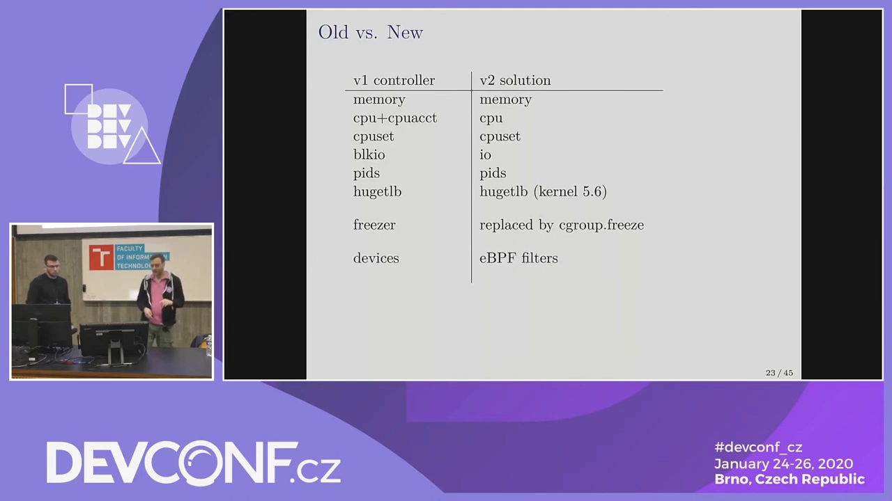

- 大部分控制器**一对一移植**，主要是命名差异（v2 的 CPU 记帐与限制合并为一个控制器；hugetlb 当时在 linux-next）；
- **freezer 控制器**没移植——它本就不是资源控制器，被 `cgroup.freeze` 属性取代；
- **devices、net_cls、net_prio** 这类"过滤"型控制器统一交给 **eBPF**：挂在 cgroup 上、更灵活地干同样的事；
- 用户态生态（2020 时点）：Red Hat 系（podman/crun/libvirt）已良好支持 v2，Docker/Kubernetes 当时还停留在 v1——Fedora 的切换却出奇地平稳。

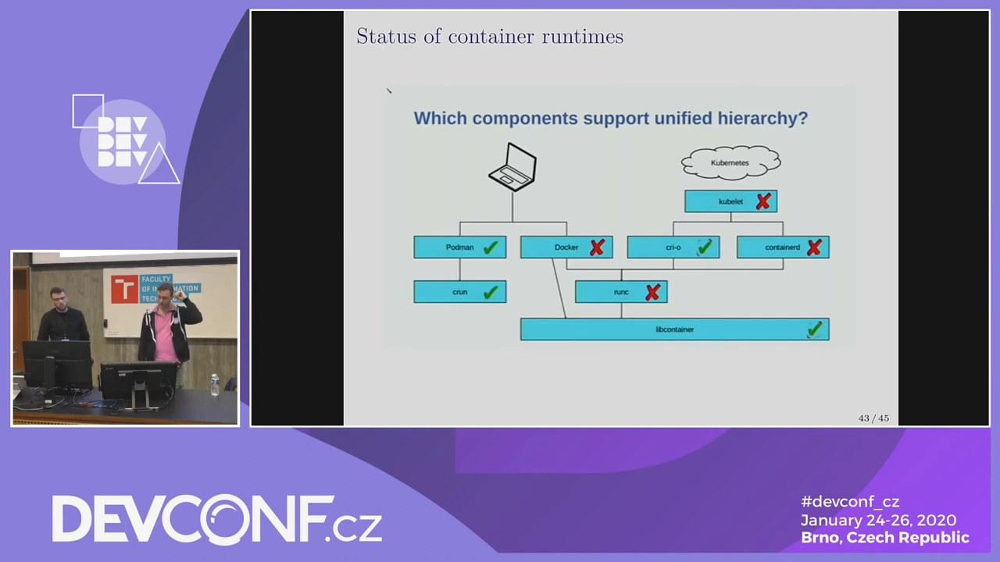

## 四、委托：把子树交给别人管

### 4.1 概念

[【跳转到 15:58】](https://www.youtube.com/watch?v=8-F5IKB09gI&t=958)

cgroup 管理者（通常就是 systemd）把**单一层级里的一个子树**让渡给另一个进程去管理——典型接收方是 libvirt 或容器运行时。接收方可以在被授予的子树里自由建组、设参数、再往下分资源。

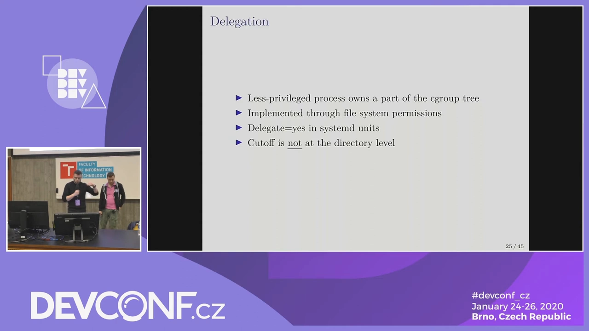

[【跳转到 17:13】](https://www.youtube.com/watch?v=8-F5IKB09gI&t=1033)

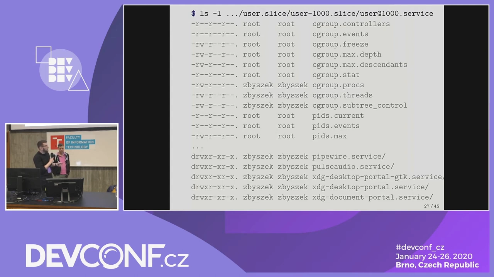

被委托目录里的 `cgroup.procs`、`cgroup.subtree_control`、`cgroup.threads` 等控制文件的**属主**改为被委托用户；于是它可以在里面建子 cgroup、把分到的资源再细分。

### 4.2 边界在哪：不是"整个目录都是你的"

[【跳转到 18:28】](https://www.youtube.com/watch?v=8-F5IKB09gI&t=1108)


演讲者特别强调这一点最常被误解：**委托的切分线并不在目录级**。子树根目录下仍有一些文件归 root/systemd 所有——因为若允许被委托方改写它们，就能影响**同层级的兄弟 cgroup**（比如改父节点的分配比例）。规则是：**你只能再细分"分给你的"那份资源，碰不到兄弟**。

有趣的是，即使被委托方也是 root（比如容器运行时），这些规则依然成立——只是文件权限没法强制，变成了**约定**。演讲者顺带分享了一个真实案例：libvirt 曾默认自己拥有整棵子树的完全控制权，结果踩到了"这里其实还是 systemd 领地"的坑。

### 4.3 systemd 的委托开关：Delegate=

[【跳转到 20:33】](https://www.youtube.com/watch?v=8-F5IKB09gI&t=1233)

```ini
[Service]
Delegate=yes                        # 全部可用控制器都延伸进子树
# 或自 systemd 236 起：
Delegate=cpu memory                 # 只把指定控制器延伸进子树
```

**委托可以嵌套**：容器里再跑一个 `systemd --user`，就是"委托的子树中再委托一部分"——资源沿树逐层细分。


### 4.4 threaded 模式：进程模型的星号例外

[【跳转到 22:13】](https://www.youtube.com/watch?v=8-F5IKB09gI&t=1333)

v2 "按进程分配资源"，但有一个大星号：**threaded cgroup**。cpu、cpuset 属于"线程化控制器"：把叶子节点的 `cgroup.type` 写成 `threaded` 后，可以在其下再建 threaded 子组，把 CPU 资源**按线程**逐层分配。这是当年阻塞 CPU 控制器合并的争议点，最终为 QEMU 这类用户保留——libvirt 用它把不同 vCPU 线程放进不同 threaded cgroup。


## 五、资源分配四模型：v2 终于有了统一语义

[【跳转到 24:43】](https://www.youtube.com/watch?v=8-F5IKB09gI&t=1483)

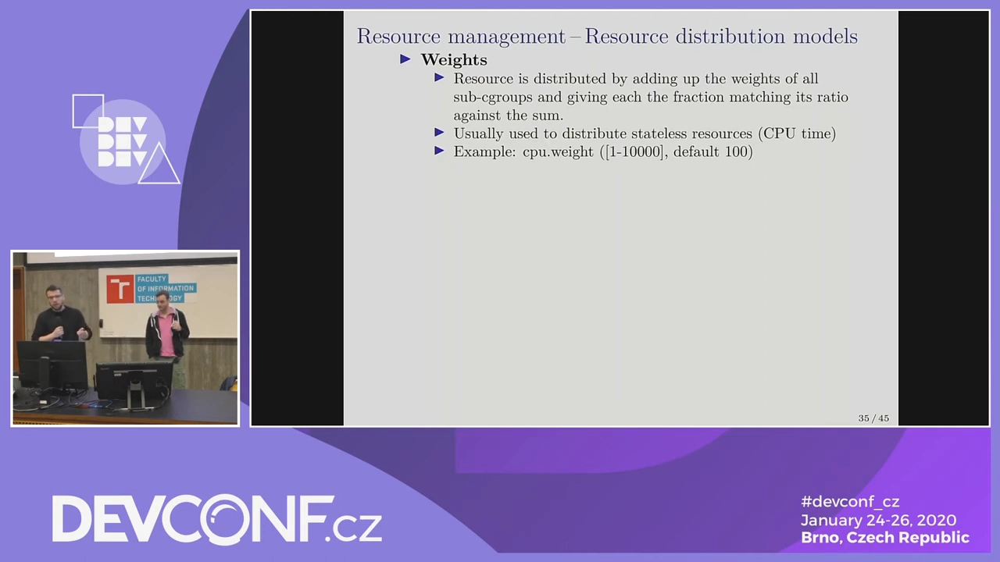

| 模型 | 语义 | 例子 | 可否超卖 |
| --- | --- | --- | --- |
| **weight（权重）** | 竞争时按比例分，空闲时不干预（work-conserving） | `cpu.weight`、`io.weight` | 允许 |
| **limit（限制）** | 硬限触顶即 enforcement；软限先"踩刹车" | `memory.max`（OOM kill）、`memory.high`（重回收/节流）、`io.max` | 允许 |
| **protection（保护）** | 用量低于保护线时内核优先保障，**惩罚别人**来兑现 | `memory.min`（绝不回收）、`memory.low`（尽量不回收）、`io.latency`/`io.cost` | 允许 |
| **allocation（分配）** | 把有限资源划块独占 | 实时任务预算（RT runtime） | **禁止**（不可超卖） |

**软限与硬限**（[【跳转到 27:13】](https://www.youtube.com/watch?v=8-F5IKB09gI&t=1633)）：limit 又分软硬——**软限是主要想设的那条线**（超了就把用量"劝"回线内，比如放慢、回收资源，但不至于灾难）；**硬限是保险丝**，对内存而言越过 `memory.max` 就触发 OOM killer。

[【跳转到 29:18】](https://www.youtube.com/watch?v=8-F5IKB09gI&t=1758)

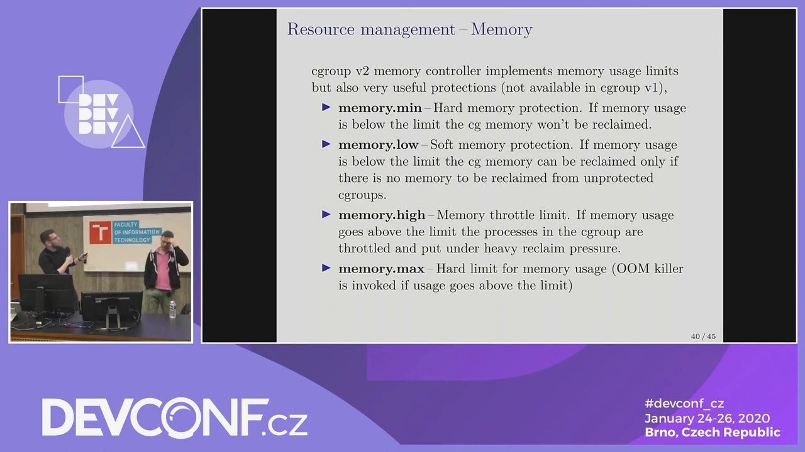

- **weight** 是 v1 里 shares/weight 的统一版：给某组 CPU 权重 1024、另一组 512，竞争时按 2:1 分，空闲时互不影响；
- **limit**：`memory.max` 触顶即触发 OOM killer；`memory.high` 是软限，超了会被重回收压力"顶回来"；

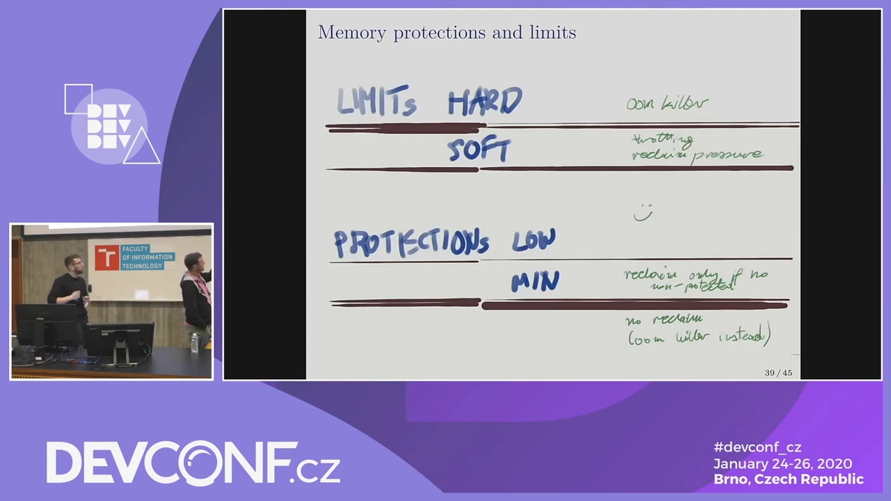

- **protection**：低于 `memory.min` 时内核**绝不去**回收该组内存；低于 `memory.low` 时优先回收别组、尽量不动它——这是 v1 没有的全新概念；
- **allocation**：唯一禁止超卖的模型（比如实时带宽就这么多，必须切分干净）。

## 六、别直接写底层文件：systemd 的高层选项

[【跳转到 33:03】](https://www.youtube.com/watch?v=8-F5IKB09gI&t=1983)

这些接口文件属于"低层旋钮"，**systemd 为它们全部提供了高层选项**：`man systemd.resource-control` 一览无遗——`CPUWeight=`、`MemoryMax=`、`IOWeight=`、`MemoryLow=`……systemd 负责映射到 v1/v2 两套底层接口，还能把文件路径解析成真正的块设备（沿设备栈下钻到有 IO 调度器的物理设备），普通用户完全不必记 major:minor。

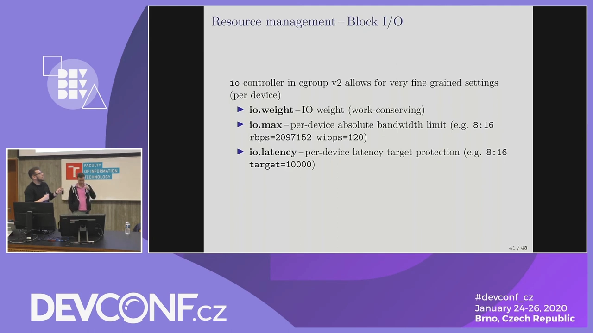

演讲者的建议很直白：除非你在写 libvirt/容器运行时这类系统软件，否则**用 systemd 的高层选项，忘掉底层细节**。

## 七、问答精选

- **IO 控制器只作用于有 IO 调度器（elevator）的块设备**；文件系统、dm-crypt/LVM 等伪设备没有。配置可以写文件系统路径，systemd 会沿栈找到底层真实设备（对某些复杂栈仍有局限）。
- **nice 和 cgroup weight 的关系**：nice 只影响**同一 cgroup 内**的兄弟进程（相当于树的叶子底下按进程再比一次权重）；进程 fork 后仍留在原 cgroup，资源约束随树继承——这正是比 nice 强的地方。
- **完全资源隔离还没到**：当前极端行为（狂吃内存带宽等）仍可能影响邻居；PSI（压力失速信息）等监控与持续的工作在逼近"流氓负载不影响他人"的目标。

## 小结

- v2 的三大支柱：**单一层级**（一棵树、控制器按需延伸、无半截树）、**统一接口约定**（高级旋钮、软限制优先）、**安全委托**（文件属主 + 明确边界）。
- **委托的切分线不在目录级**：兄弟节点永远归 systemd 领地，被委托方只能细分分到的份额；`Delegate=yes` 或控制器列表开启，可嵌套。
- 资源分配只有四种模型：**weight / limit / protection / allocation**，其中 allocation 禁止超卖。
- 日常使用走 `systemd.resource-control` 高层选项；直接写 `/sys/fs/cgroup` 留给系统软件开发者。
- 过滤类控制（devices、net 分类）统一让位给 eBPF；freezer 变成 `cgroup.freeze` 属性。

> 配套阅读：[cgroup v2 基础：目录树、控制器与 subtree_control](cgroup_v2_Basics_The_Tree_Controllers_and_subtree_control_part1.md)（本文提到的接口文件的逐个实操）；[systemd 如何管理 cgroup：slices、scopes 与 CPU 分配实战](Understanding_Systemd_Cgroups_LFCS_Video_Course_Sander_van_Vugt.md)（systemd 视角的树长什么样）。
