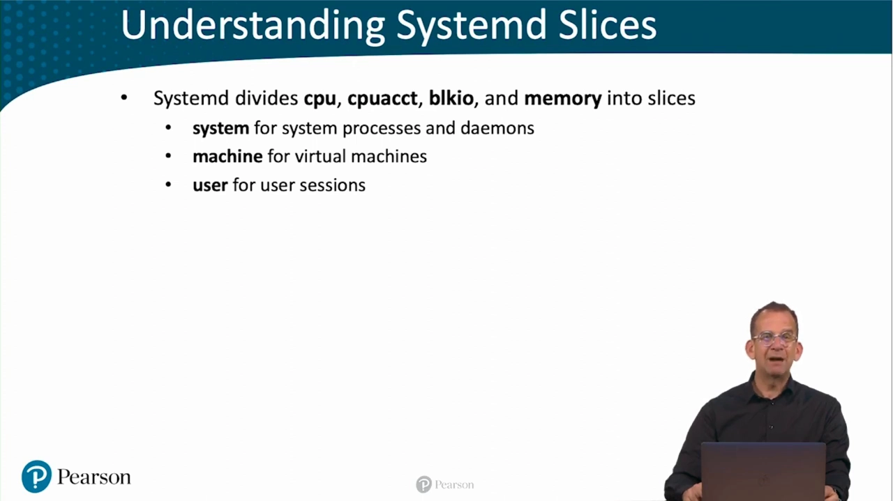
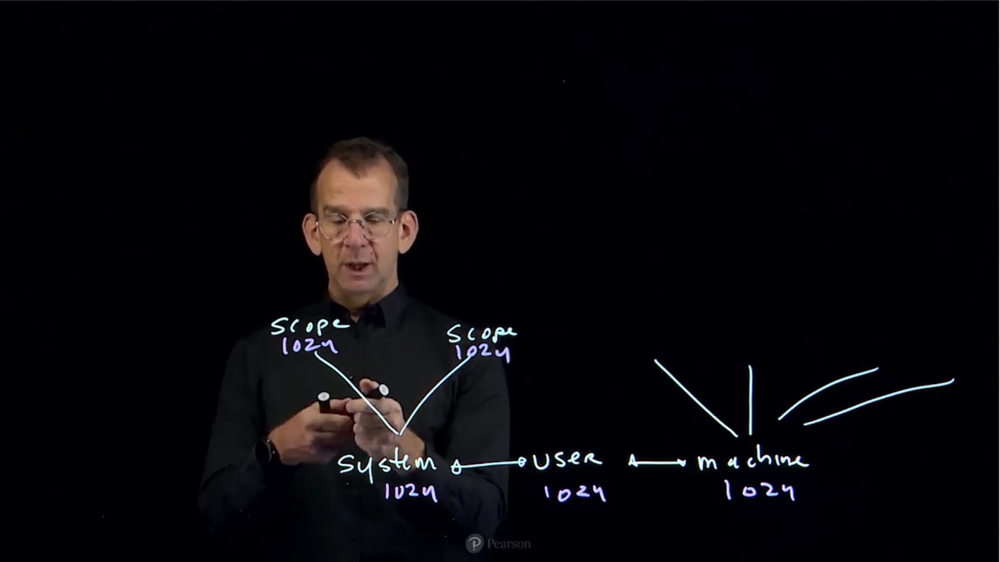
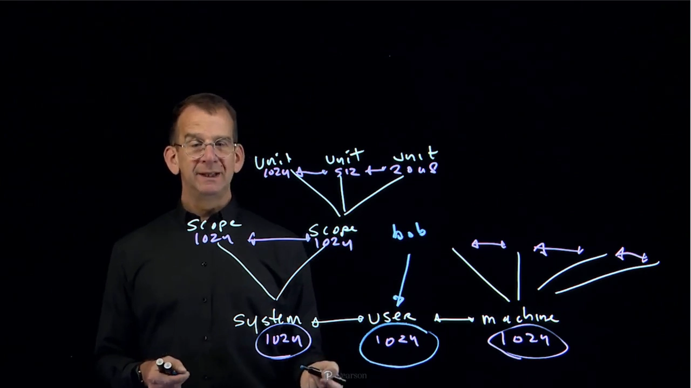
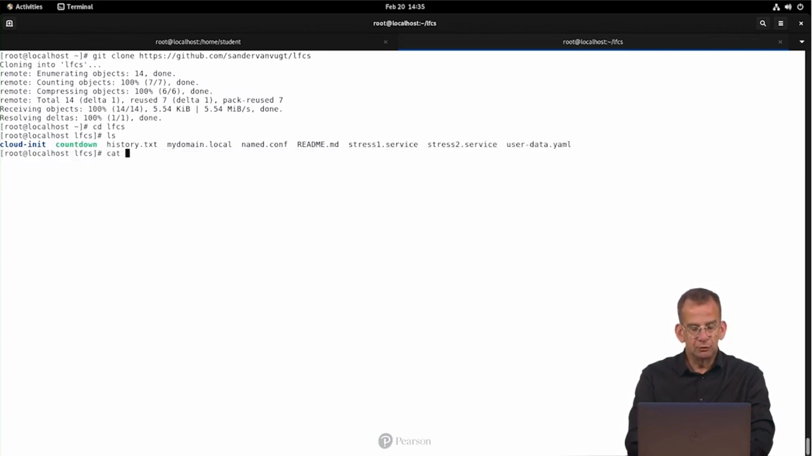
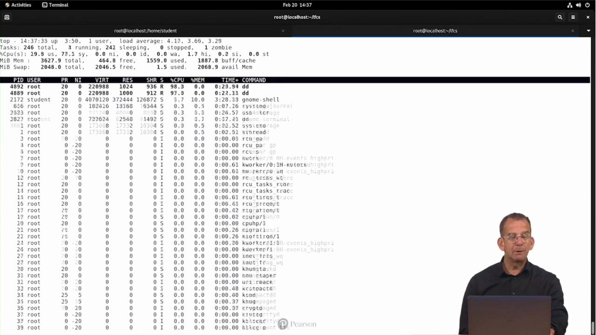
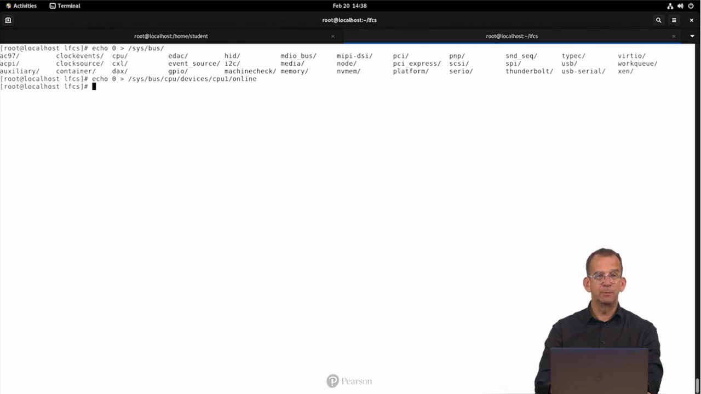
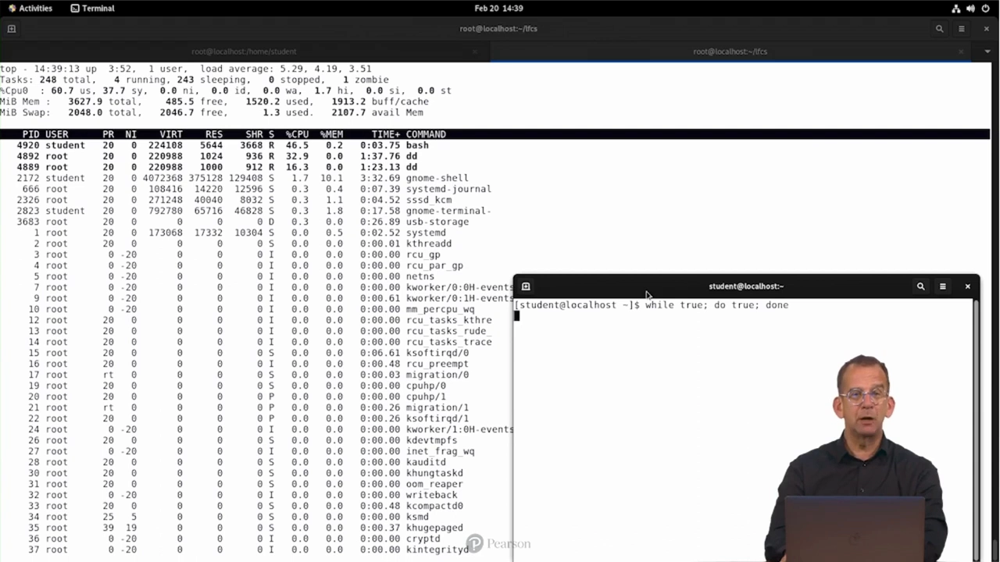

# systemd 如何管理 cgroup：slices、scopes 与 CPU 分配实战

> 视频来源：[Understanding Systemd Cgroups | LFCS Video Course](https://www.youtube.com/watch?v=FTHz3PktxTA)（Sander van Vugt，12:40）。本文为该视频的中文整理稿，配图截自视频演示画面。

## 本篇要解决的核心问题（SCQA）

**背景**：Linux 用 cgroup 做资源的分配、预留与限制，而现代发行版上**systemd 接管了 cgroup 树的日常管理**——它把 `/sys/fs/cgroup` 下的目录组织成 slice、scope、service 三类单元，CPU、内存、块 IO 的限制都通过它们下发。

**冲突**：直接操作 cgroup 接口文件太底层；而 systemd 的层级又有自己的规则——**CPU shares 是"同一层内的相对权重"**，slice/scope/service 三层嵌套之后，最终谁分到多少 CPU 并不直观，甚至会出现"一个普通用户的进程和整个 system slice 五五开"的反直觉结果。

**疑问**：systemd 的 cgroup 树到底怎么组织？CPUShares 在层级之间究竟怎么算？

**回答（中心思想）**：systemd 以 **system / machine / user 三个默认 slice** 为主干划分整机资源，**shares 只在同级比较**：slice 之间按各自权重分总量，slice 内部再由 scope/service 的权重瓜分本 slice 的份额。理解了"逐层先分总量、层内再比权重"，所有"惊喜"都能算得出来。

## 一、cgroup 与控制器：systemd 管什么

[【跳转到 00:10】](https://www.youtube.com/watch?v=FTHz3PktxTA&t=10)

cgroup 的三大默认控制器：**cpu、memory、block io**——分别对应 CPU 限制、内存限制、块 IO 限制。所有 cgroup 设置最终都写到 `/sys/fs/cgroup`（sysfs 类伪文件系统，想看 systemd 在底层干了什么就去那里）。在 systemd 出现前的远古年代，要靠 libcgroup 的 cgconfig/cgexec 手工建组；现在这些活儿 systemd 全包了。

## 二、三个默认 slice：整机资源的主干划分

[【跳转到 01:30】](https://www.youtube.com/watch?v=FTHz3PktxTA&t=90)



- **system.slice**：系统进程与守护进程（`systemctl start` 起的服务默认都落这里）；
- **machine.slice**：虚拟机与容器（machinectl 管理的对象）；
- **user.slice**：用户会话，**每个登录用户自动拥有自己的 user-<name>.slice**，天然把不同用户占用的资源隔离开。

三个默认 slice 之外也可以创建自定义 slice（`.slice` 单元）。

## 三、画张图：slice → scope → service 的权重层级

[【跳转到 02:16】](https://www.youtube.com/watch?v=FTHz3PktxTA&t=136)



视频边画边讲，模型如下（`CPUShares` 默认 1024，是**同级之间的相对权重**）：

[【跳转到 02:46】](https://www.youtube.com/watch?v=FTHz3PktxTA&t=166)



- 顶层：system.slice、user.slice、machine.slice **互为兄弟**，若三者都是默认 1024，满负载时各拿 1/3；
- slice 内部还有一层：**scope**（如 user 会话里的登录会话）与直接挂在 slice 下的 **service 单元**，它们再按各自的 CPUShares 瓜分**本 slice 已分到的份额**；
- 关键点：machine.slice 里哪怕有 4 个 scope、每个 1024，**它对外的总量仍是它的 slice 级权重**——scope 再多也改变不了 slice 之间的比例。

[【跳转到 04:51】](https://www.youtube.com/watch?v=FTHz3PktxTA&t=291)

### 一个必须警惕的"惊喜"

用户 bob 登录后产生 `user-bob.slice`；如果系统里只有他一个用户，他在自己会话里起一个吃满 CPU 的任务，**user-bob.slice 与 system.slice 是平级兄弟**——一个普通用户能抢到与全部系统服务之和相当的 CPU 份额。给多用户服务器做规划时，这一点要心里有数。

## 四、实操：CPUShares 1024 vs 2048

### 4.1 准备两个服务

[【跳转到 05:30】](https://www.youtube.com/watch?v=FTHz3PktxTA&t=330)

课程仓库里提供了两个单元文件（复制到 `/etc/systemd/system/` 后启动）：

```ini
# stress1.service                      # stress2.service
[Service]                              [Service]
Type=simple                            Type=simple
ExecStart=/usr/bin/dd if=/dev/zero of=/dev/null
CPUShares=1024                         CPUShares=2048
```

两者都跑一个烧满 CPU 的 `dd`，唯一区别是 CPUShares：**2048 的那个应拿 2 倍 CPU**。

[【跳转到 05:57】](https://www.youtube.com/watch?v=FTHz3PktxTA&t=357)



### 4.2 多核的迷惑：top 里看不出 1:2

[【跳转到 07:37】](https://www.youtube.com/watch?v=FTHz3PktxTA&t=457)

```bash
systemctl start stress1 stress2
top    # 两个 dd 都接近 100%？先按 1 展开每核视图
```



原因是演示机有 **2 个核**：两个 dd 各占一核，CPUShares 的比例根本体现不出来。为了让比例可见，演示直接下线一个核：

```bash
echo 0 > /sys/devices/system/cpu/cpu1/online   # 临时下线 CPU1（sysfs）
```

[【跳转到 08:27】](https://www.youtube.com/watch?v=FTHz3PktxTA&t=507)



单核之下 `top`（按 1）里清楚了：**stress2 的 dd 拿到约 2/3，stress1 的 dd 约 1/3**——1024:2048 的权重兑现了。

### 4.3 第二个惊喜：用户进程半路杀出

[【跳转到 09:15】](https://www.youtube.com/watch?v=FTHz3PktxTA&t=555)

再开一个普通用户终端跑死循环：

```bash
while true; do true; done
```



结果死循环拿走约 50%，两个 dd 合计只剩 50%——**它在 user.slice，两个 dd 在 system.slice，两个 slice 权重相同，顶层直接对半分**。这正好实证了第三节的模型：slice 之间是第一层分配，slice 内部的 CPUShares 管不到"隔壁 slice"。

### 4.4 观察 cgroup 树的两个工具

[【跳转到 09:54】](https://www.youtube.com/watch?v=FTHz3PktxTA&t=594)

```bash
systemd-cgtop   # 按资源占用实时排序，stress1/stress2 一眼可见
systemd-cgls    # 打印整棵 cgroup 树，看 slice/scope/service 的从属关系
```

`systemd-cgtop` 适合"现在谁最忙"，`systemd-cgls` 适合"树长什么样"。


## 五、收尾：单元文件里的资源限制与容器伏笔

[【跳转到 11:50】](https://www.youtube.com/watch?v=FTHz3PktxTA&t=710)

```ini
# 之前给 sshd 单元加过的另一处修改
MemoryMax=4M     # 内存硬上限，cgroup 的 memory.max 由 systemd 代写
```

容器（Docker/Kubernetes）之所以能限制每个容器的资源，靠的正是 cgroup——与 namespace 并列的**容器两大支柱**之一，这与本系列前面几篇的内容正好衔接。


## 小结

- systemd 把 cgroup 树组织成 **slice / scope / service**，三大默认 slice 是 system / machine / user；每用户一个 user slice，天然隔离。
- **CPUShares 是同级相对权重**：slice 之间先分总量（默认各 1024，即对等），slice 内部 scope/service 再瓜分本 slice 份额；子层再多，也改变不了 slice 级的比例。
- 单元文件里写 `CPUShares=`、`MemoryMax=` 等，systemd 负责落到 `/sys/fs/cgroup` 的接口文件；观察用 `systemd-cgtop` / `systemd-cgls`。
- 两个经典"惊喜"：多核看不出权重比例（先看每核占用）；普通用户的会话与 system.slice 对半分——规划资源时要显式调整 slice 权重。

> 配套阅读：[cgroup v2 基础：目录树、控制器与 subtree_control](cgroup_v2_Basics_The_Tree_Controllers_and_subtree_control_part1.md)（本文底层机制的逐文件实操）；[cgroup v2 统一层级：设计动机与 systemd 委托](Brave_new_world_of_unified_cgroup_hierarchy_DevConf.CZ_2020.md)（systemd 为什么要这样管理树，以及 Delegate= 的边界）。
