# cgroup v2 基础：目录树、控制器与 subtree_control

> 视频来源：[cgroup v2 Basics: The Tree, Controllers & subtree_control (part1)](https://www.youtube.com/watch?v=1ewh-xAdr_4)（Linux Under Pressure 频道，35:53）。本文为该视频的中文整理稿，配图截自视频演示画面。

## 本篇要解决的核心问题（SCQA）

**背景**：现代服务器又大又贵，一台物理机上往往通过虚拟机或容器跑着很多应用：数据库、Web 服务、批处理任务……大家共享同一份 CPU、内存和磁盘 IO。

**冲突**：共享就有竞争。一台虚拟机的主人跑个 `fio` 压测磁盘、或者程序"发疯"般吃光 CPU 和内存，同机的其他负载立刻遭殃——视频开头复盘的 PostgreSQL 案例就是这样：宿主机超卖，`mpstat -P ALL 1` 看到 steal time（被宿主机"偷走"的 CPU 时间占比）居高不下，等基础设施团队把虚拟机迁到负载更轻的硬件后，steal time 归零，同样的查询快了约 1.5 倍。

**疑问**：在共享硬件的前提下，怎么给每个负载划清资源边界，让"谁"最多用多少 CPU、内存、IO 变得可控？

**回答（中心思想）**：Linux 的答案是 **cgroup（control group，控制组）**。它把"允许一组进程用多少资源"这件事做成一个挂载在 `/sys/fs/cgroup` 的**内存文件系统**：目录就是控制组，接口文件就是旋钮。cgroup v2 用**单一目录树 + 按需启用控制器**的模型取代了 v1 的多棵树，本文跟着视频把 v2 的目录树、控制器和 `cgroup.subtree_control` 逐一实操一遍。

[【跳转到 03:41】](https://www.youtube.com/watch?v=1ewh-xAdr_4&t=221)

## 一、cgroup 是什么：与 namespace 的分工

### 1.1 两大机制各管一头

视频里给了一个很适合初学者的对比（讲 CKA 认证时也常用）：

- **namespace（命名空间）**：控制进程**能看到什么**——自己的 PID 空间、网卡、挂载表……
- **cgroup（控制组）**：控制进程**能用多少**——CPU 配额、内存上限、IO 带宽……

两者配合才构成容器的隔离框架，但 cgroup 并不只是为容器而生：不用 Docker/Kubernetes，在一台普通服务器上也可以用它来编排和管理工作负载。

[【跳转到 04:06】](https://www.youtube.com/watch?v=1ewh-xAdr_4&t=246)

### 1.2 cgroup 的三大能力

[【跳转到 04:31】](https://www.youtube.com/watch?v=1ewh-xAdr_4&t=271)

1. **记帐（accountability）**：搞清楚某个负载实际吃了多少 CPU、内存或其他资源。
2. **限制（throttling）**：设上限，让一个负载不能超出它被允许的份额。
3. **保护/优先级（protection & priority）**：在资源紧张（竞争）时按优先级分配，保证重要负载依然响应及时。

理解 Linux 性能不仅要看"系统有多少资源"，更要看"这些资源被谁用了多少、大家都想要更多时会发生什么"——这正是 cgroup 的用武之地。

## 二、v1 与 v2：从多棵树到一棵树

### 2.1 先确认系统用的是哪个版本

cgroup 有两个版本：v1 诞生于 2008 年前后（源自 Google 的实践），v2 是 2012 年前后开始重新设计的版本。视频给出了判别方法（Ubuntu 24.04 演示）：

```bash
# 看挂载类型：cgroup2fs 就是 v2，tmpfs 是 v1
stat -fc %T /sys/fs/cgroup/
grep cgroup /proc/filesystems
```

[【跳转到 06:11】](https://www.youtube.com/watch?v=1ewh-xAdr_4&t=371)

> 订正：视频口述里的 "sysfs Cgroup / tempfs" 是自动字幕对 **cgroup2fs / tmpfs** 的误拼——v2 的挂载类型显示为 `cgroup2fs`，v1 的各控制器挂载显示为 `tmpfs`。

### 2.2 v1 的问题：每个控制器一棵树

[【跳转到 08:04】](https://www.youtube.com/watch?v=1ewh-xAdr_4&t=484)

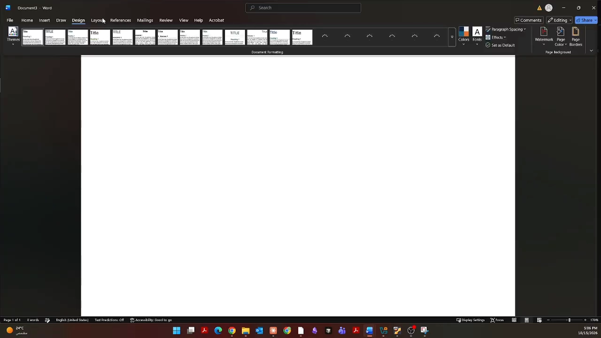

v1 里 cgroup 本质上是"通过文件系统暴露的 API"，但它**每个控制器挂一棵独立的树**：`/sys/fs/cgroup/cpu/`、`/sys/fs/cgroup/memory/`、`/sys/fs/cgroup/io/` 各自成 hierarchy（层级树）。想给进程 P1 同时管 CPU 和内存，就得在两棵树里各建一个同名组、写两份配置，还得自己保证两边的 PID 一致——讲者的原话是"一场噩梦（a real nightmare）"，连文件系统维护者都不喜欢它。

[【跳转到 08:54】](https://www.youtube.com/watch?v=1ewh-xAdr_4&t=534)

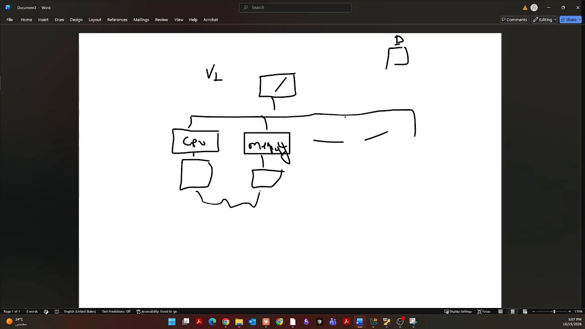

视频还举了一个 v1 的经典坑：**脏页写回**。进程写文件时数据先进内存页缓存（页面变"脏"），真正落盘是内核线程异步做的——而内核线程并不属于任何 cgroup，于是"进程在 A 组里产生的 IO 压力"无法归属到 A 组，v1 对这类流量基本失明。v2 重新设计了归属规则才解决。

### 2.3 v2 的统一层级：一棵树，控制器按需延伸

[【跳转到 11:49】](https://www.youtube.com/watch?v=1ewh-xAdr_4&t=709)

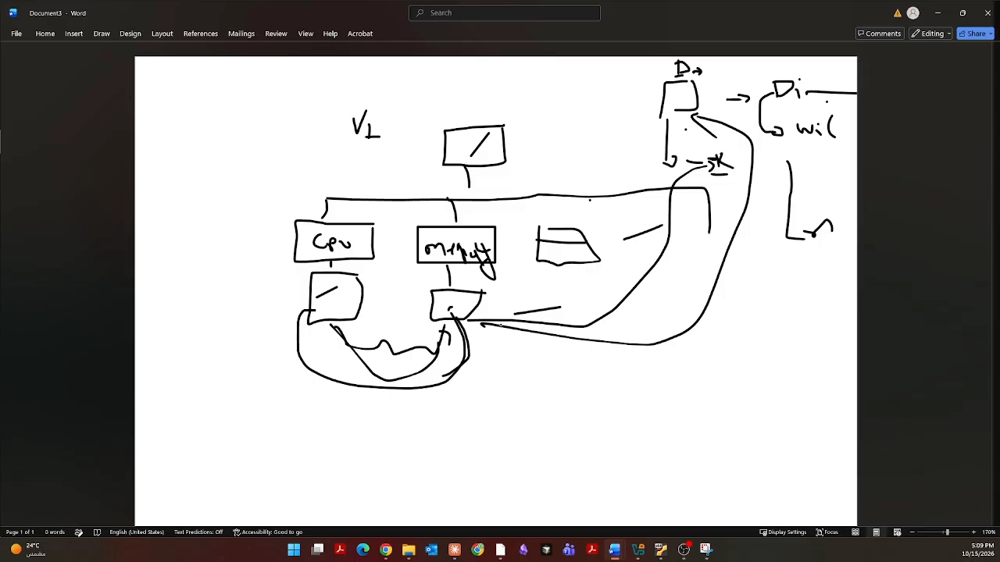

v2 只有一棵树：根下建的每个目录（如 P1、webapp、db）就是一个 cgroup，**控制器在需要它的节点上启用**——webapp 只开 CPU，db 只开 IO，互不干扰；对同一组进程的所有管理动作都发生在同一个目录里，不用再跨树对账。

## 三、v1 实机速览：为什么根下建组会被拒绝

视频在一台 RHEL 7.9（v1）测试机上做了对照演示：

[【跳转到 13:29】](https://www.youtube.com/watch?v=1ewh-xAdr_4&t=809)

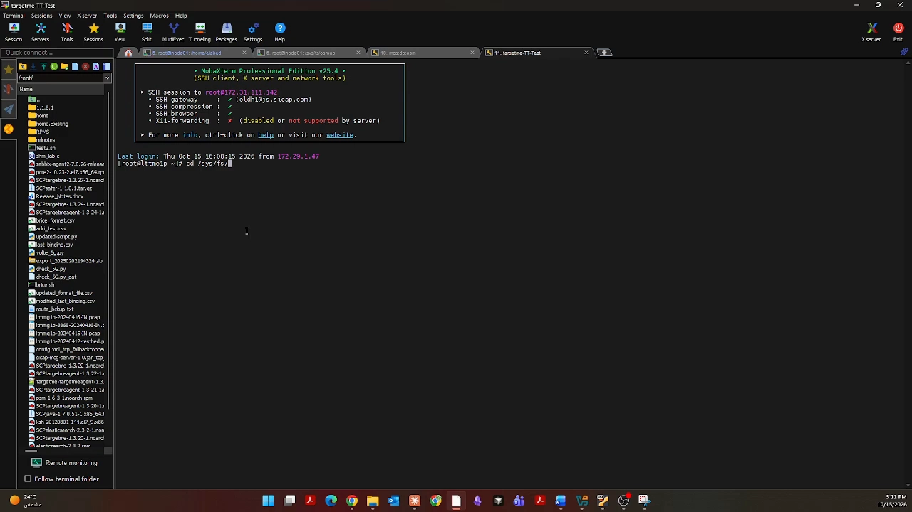

- 在 `/sys/fs/cgroup` 根目录直接 `mkdir webapp` 会被拒绝——因为 v1 根下只有控制器目录，**组必须建在某个控制器树里面**；
- 进入 `/sys/fs/cgroup/cpu/` 再 `mkdir cgroup1` 就可以，组内会自动出现一整套接口文件；
- 若还想用 memory 控制器管同一批进程，就得去 `/sys/fs/cgroup/memory/` 再建一次组，并保证 `tasks` 文件里是同一批 PID。

## 四、v2 接口文件逐一实操

回到 Ubuntu 24.04（v2）。视频说管理 cgroup 有三种方式：手写接口文件（本文这种，好理解但费手）、libcgroup 工具（如 `cgcreate`，半自动）、以及 systemd（下一节会用到）。先把三个最重要的接口文件过一遍。

### 4.1 cgroup.procs：组员名单

[【跳转到 16:01】](https://www.youtube.com/watch?v=1ewh-xAdr_4&t=961)

```bash
cd /sys/fs/cgroup
mkdir cgroup1          # v2 根下建组是合法的
ls cgroup1
cat cgroup1/cgroup.procs        # 组内进程列表，对应 v1 的 tasks
cat cgroup1/cgroup.controllers  # 本组已启用的控制器
```

`cgroup.procs` 是"把进程放进/移出控制组"的入口：`echo <PID> > cgroup.procs` 即可。新建的组里 `cgroup.controllers` 默认列出了从父目录继承下来的可用控制器（如 cpuset、cpu、io、memory、pids）——但**可用 ≠ 已启用**，这就引出了最关键的 `cgroup.subtree_control`。

[【跳转到 16:26】](https://www.youtube.com/watch?v=1ewh-xAdr_4&t=986)

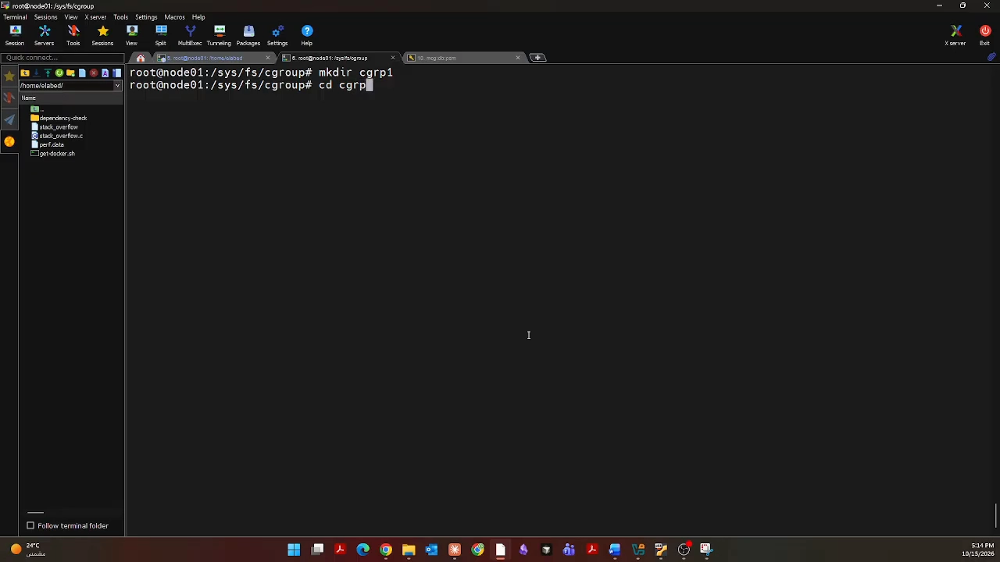

### 4.2 cgroup.subtree_control：给子树"通电"

关键规则：**控制器是在父节点的 `cgroup.subtree_control` 上启用，作用于它的子目录**。视频演示：

[【跳转到 20:21】](https://www.youtube.com/watch?v=1ewh-xAdr_4&t=1221)

```bash
mkdir f1                       # 子组
ls f1                          # 只有 memory.pressure、io.stat、cpu.stat 等记帐文件
cat cgroup.subtree_control     # 空 —— 没有任何控制器延伸到子目录

echo +cpu > cgroup.subtree_control   # 在父节点启用 cpu
ls f1                          # f1 里自动出现了 cpu.max 等 cpu 接口文件
```

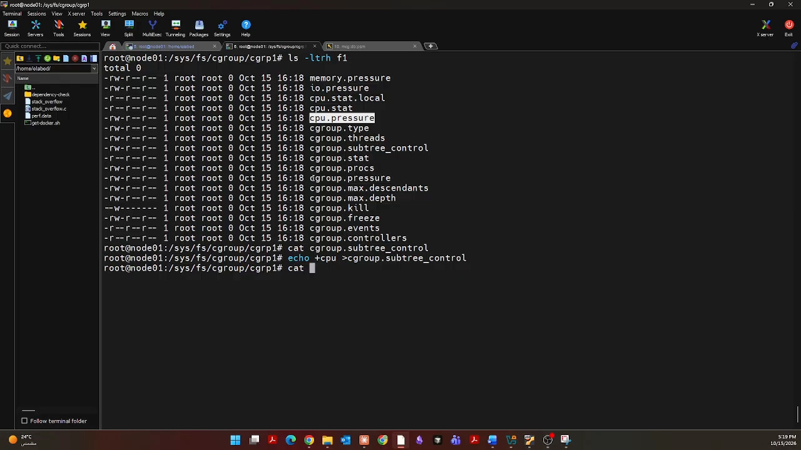

`+cpu` 是启用、`-cpu` 是关闭，也可以一次写多个（如 `+cpu +memory`）。**接口文件由内核自动生成**，你只管在父节点"通电"。

### 4.3 cgroup.events：组内有没有活人

[【跳转到 21:42】](https://www.youtube.com/watch?v=1ewh-xAdr_4&t=1302)

```bash
cat f1/cgroup.events
# populated 1    ← 组内至少有一个进程
# frozen 0       ← 组是否被冻结
```

`populated=1` 表示组里有进程在跑；把里面进程全移走后它会变 0。视频顺带演示了一个细节：在组里执行 `cat cgroup.procs` 时，列表里除了 bash（1500）还多了一个 800——那是 `cat` 命令本身，它作为 bash 的子进程同样落在这个组里。

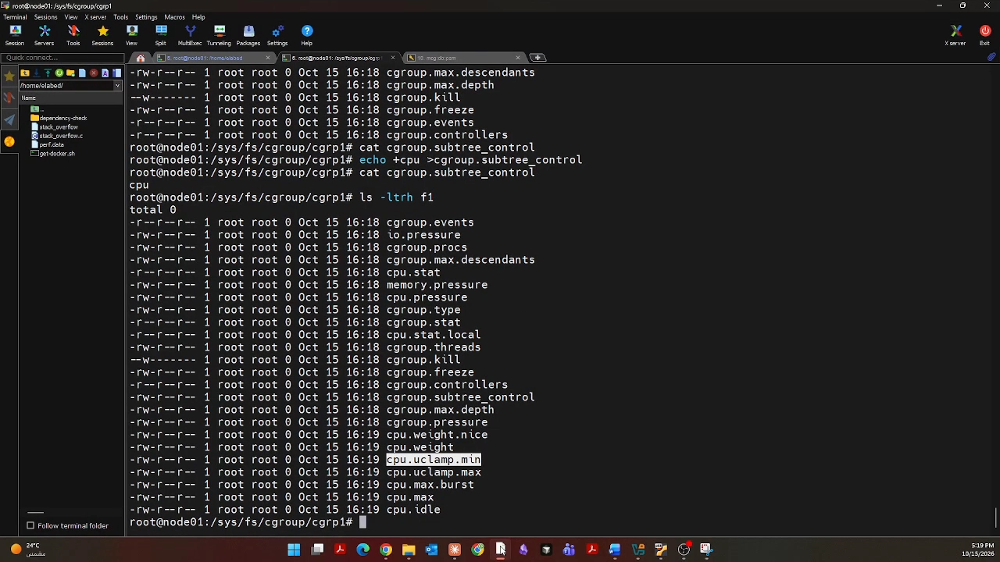

### 4.4 no-internal-process 约束：想"通电"，组里不能有进程

[【跳转到 23:53】](https://www.youtube.com/watch?v=1ewh-xAdr_4&t=1433)

v2 有一条新手最容易踩的规则：**要在某节点启用控制器，该节点自身的 `cgroup.procs` 必须为空**（进程只能住在"叶子"或无控制器的节点）。视频特意先往 F1 的父目录塞了进程再 `echo +memory > cgroup.subtree_control`，内核直接报错；把进程移走后再启用就成功了。

这是 v2 有意的取舍：进程和控制器不混居同一节点，资源从根到叶子的流向才清晰、可推导（后一篇 DevConf 演讲会从设计角度再解释这一点）。

### 4.5 cgroup.type：domain 与 threaded

[【跳转到 25:33】](https://www.youtube.com/watch?v=1ewh-xAdr_4&t=1533)

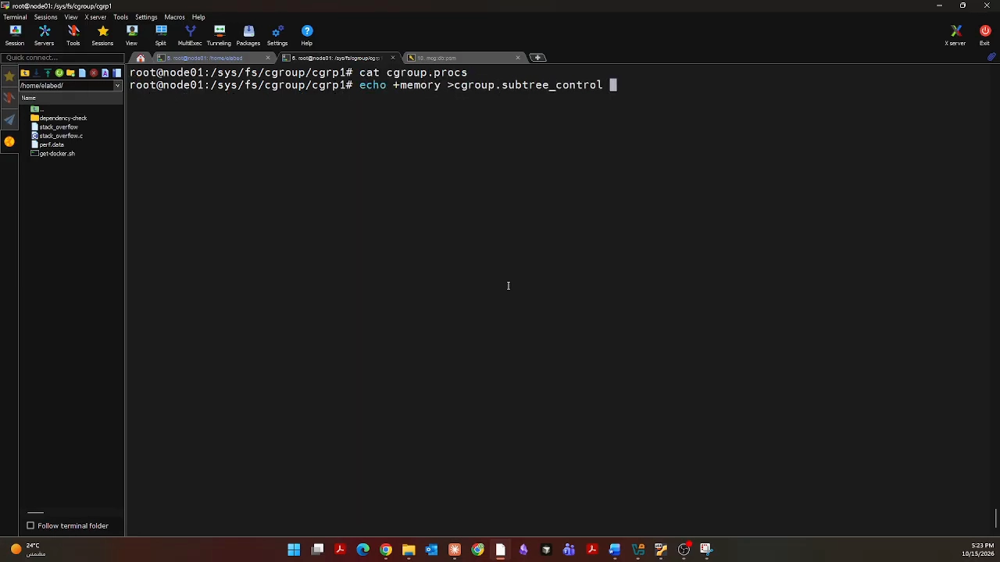

```bash
cat f1/cgroup.type     # domain
```

cgroup 分两类：**domain**（管进程）和 **threaded**（管线程）。视频借进程地址空间解释了为什么内存控制器不提供线程粒度：同一进程的多线程共享代码段、数据段和堆（同一批 VMA），只有栈各一份——你不可能"给这个线程 2GB 堆、那个线程 3GB 堆"，堆是共享的。所以：

- 已启用 **memory** 的组不能改成 threaded（`echo threaded > cgroup.type` 报 not supported）；
- 先 `-memory` 关掉内存控制器，只剩 cpu 时，就能成功切成 threaded：

[【跳转到 28:59】](https://www.youtube.com/watch?v=1ewh-xAdr_4&t=1739)

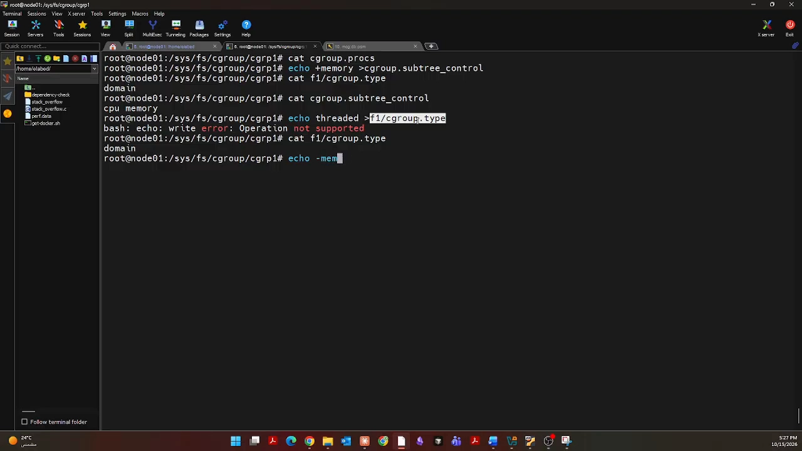

## 五、实战：把一个"烧 CPU"的进程摁到 20%

最后把接口串成一个完整闭环：

[【跳转到 30:40】](https://www.youtube.com/watch?v=1ewh-xAdr_4&t=1840)

```bash
# 1) 造一个吃满 CPU 的负载
dd if=/dev/zero of=/dev/null &
# 2) 把它放进 f1 组
echo <PID> > f1/cgroup.procs
# 3) 设置 CPU 配额：每 100000µs 周期里最多用 20000µs（= 20% 单核）
echo "20000 100000" > f1/cpu.max
```

[【跳转到 32:32】](https://www.youtube.com/watch?v=1ewh-xAdr_4&t=1952)

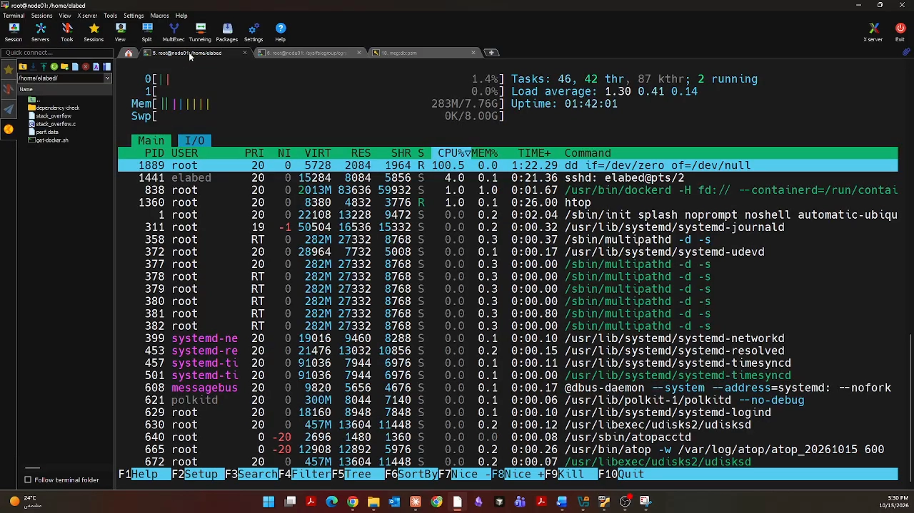

`top` 里原本 100% 的 dd 立刻被压到 20% 上下波动。再多开几个 dd 全放进同一个组，它们**共享**这 20% 的配额；如果放进不同的子组，则可以分别给不同配额——把进程归组、在组上设限，就是 cgroup 的全部工作方式。

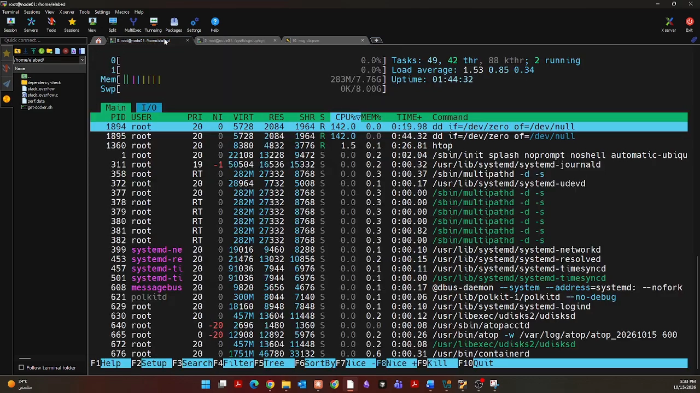

## 小结

- **cgroup 管"能用多少"，namespace 管"能看到什么"**；cgroup 的三大能力是记帐、限制、保护/优先级。
- **v1 每个控制器一棵树**，同一进程要在多棵树里重复建组、重复写配置，内核线程的脏页写回甚至无法归属；**v2 只有一棵树**，控制器通过父节点的 `cgroup.subtree_control` 按需延伸。
- v2 的核心接口文件：`cgroup.procs`（组员）、`cgroup.controllers`（可用控制器）、`cgroup.subtree_control`（给子树通电）、`cgroup.events`（populated/frozen）、`cgroup.type`（domain/threaded）。
- 记住 **no-internal-process 约束**：启用控制器前先把该节点里的进程清空；内存控制器永远不提供线程粒度，所以启用 memory 的组不能是 threaded。
- 用 `dd + cpu.max` 十行命令就能验证整条链路——cgroup 没有魔法，就是"目录 + 接口文件"。

> 下一篇配套阅读：[cgroup v2 统一层级：设计动机与 systemd 委托](Brave_new_world_of_unified_cgroup_hierarchy_DevConf.CZ_2020.md)——从 Red Hat systemd 团队的视角解释 v2 为什么这样设计，以及"委托"如何让容器运行时安全接管子树；还有一篇上手 systemd 视角的 [systemd 如何管理 cgroup：slices、scopes 与 CPU 分配实战](Understanding_Systemd_Cgroups_LFCS_Video_Course_Sander_van_Vugt.md)。
