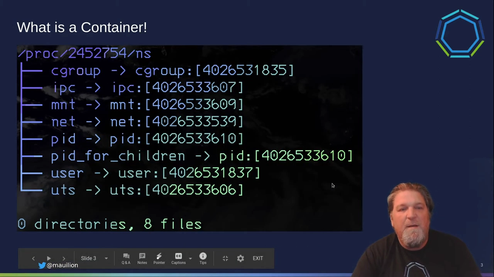
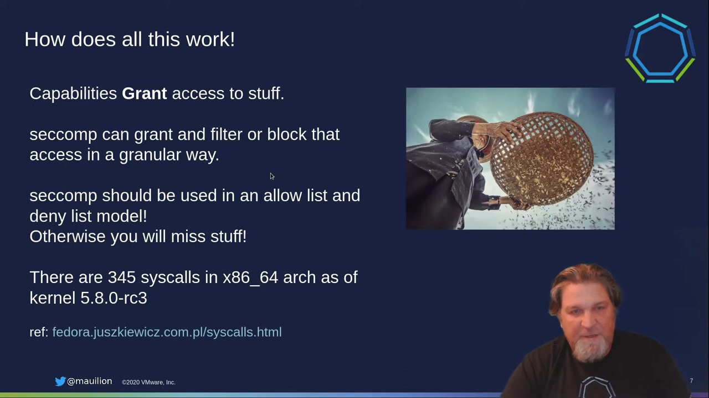
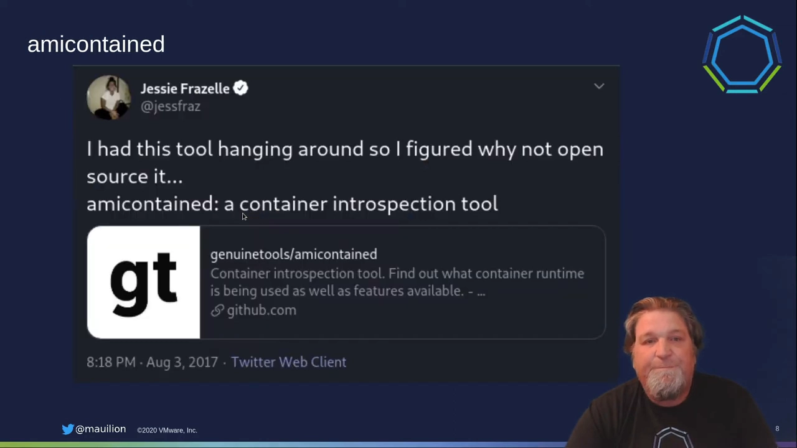
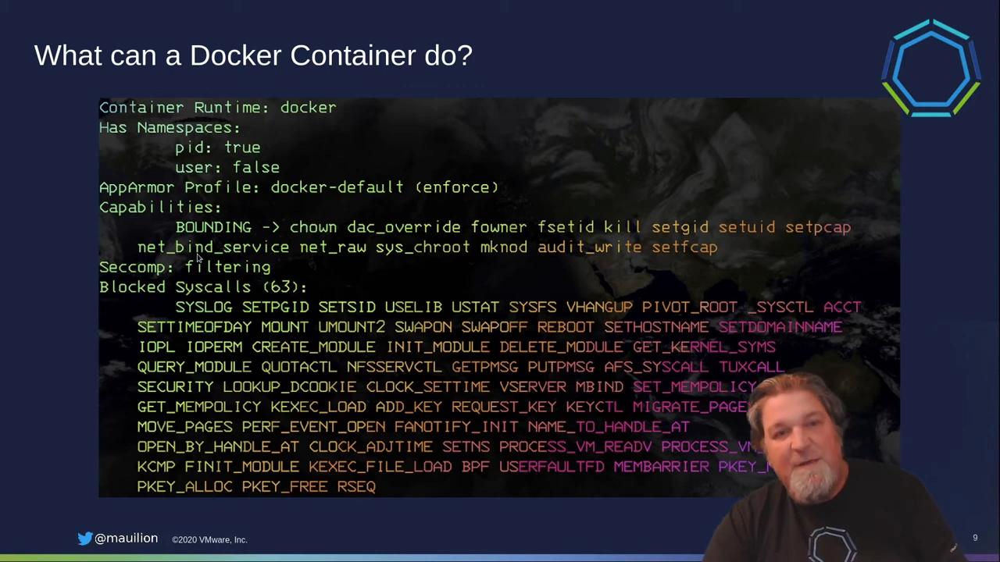
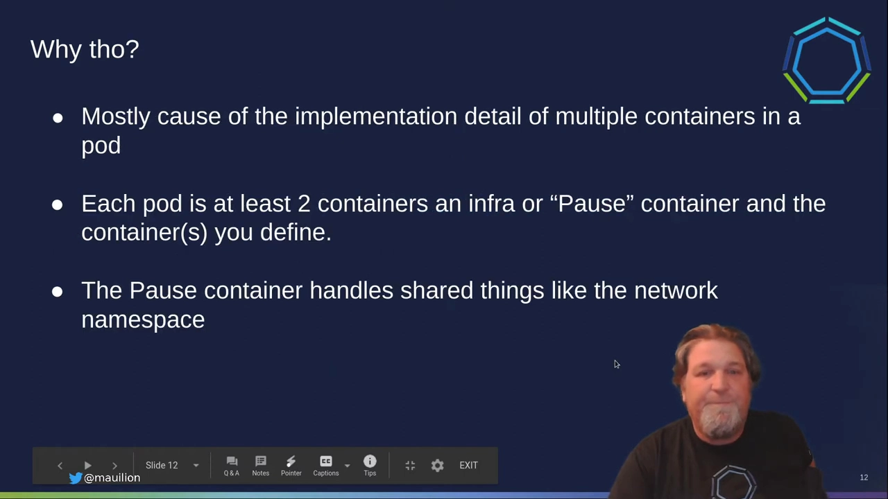
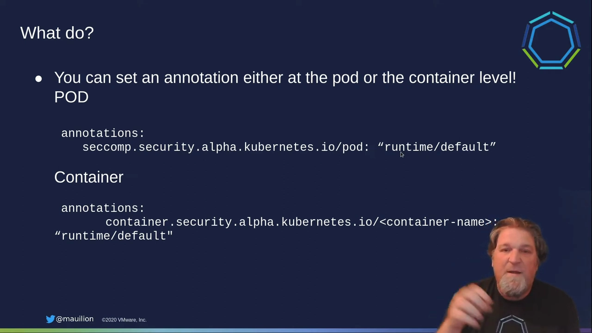
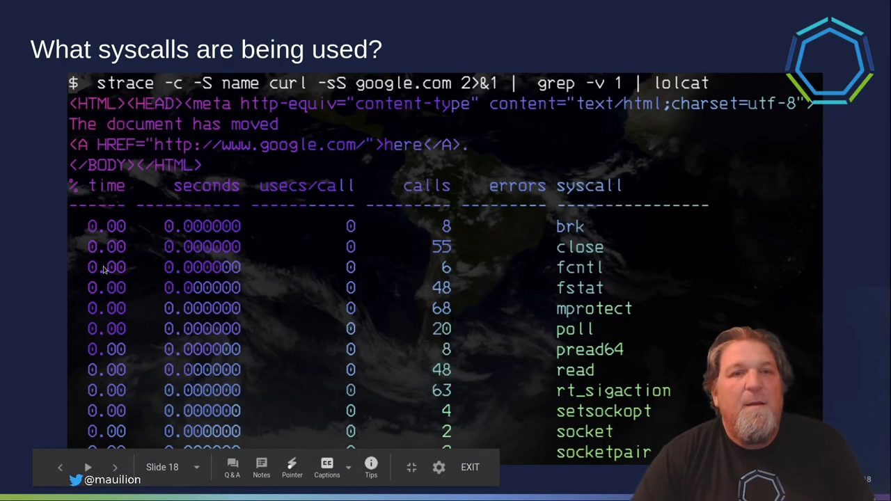
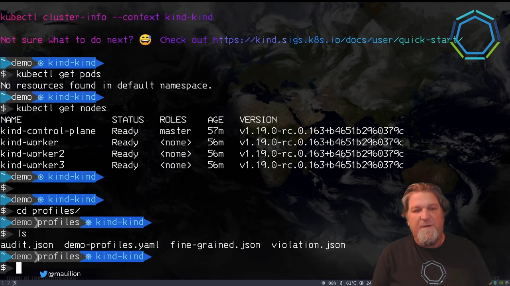
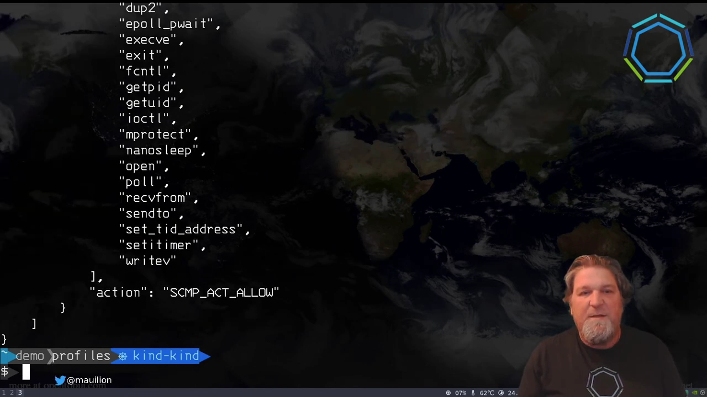
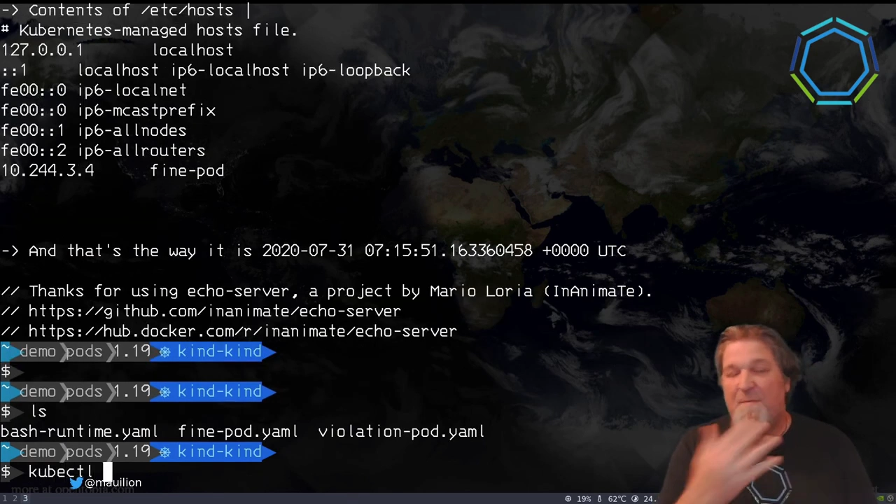

# Seccomp 安全配置文件实战：从 Docker 默认档到 Kubernetes RuntimeDefault

> 视频来源：[Seccomp Security Profiles and You: A Practical Guide — Duffie Cooley, KubeCon 2020](https://www.youtube.com/watch?v=OPuu8wsu2Zc)（28 分钟，英文字幕）
> 讲者时任 VMware Staff Cloud Native Architect，长期参与 Kubernetes 社区。本文基于该演讲的完整字幕与幻灯片整理，演示环境为 kind 集群 + Kubernetes v1.19。

## 本讲要解决的核心问题（SCQA）

**背景**：容器本质上是一个**进程**。把它"容器化"，靠的是 Linux 内核提供的两组原语：**cgroup** 限制它能用多少资源（内存、CPU、IO），**namespace** 决定它能看见什么（自己的网络栈、进程表……）。[【跳转到 01:14】](https://www.youtube.com/watch?v=OPuu8wsu2Zc&t=74)

**冲突**：可是无论怎么隔离，**所有容器共享同一个内核**。给进程的权限（capabilities、seccomp 规则）只作用于它看得见的 namespace，但系统调用可是直达内核的：一个容器里的进程若能发 `reboot()`，整个节点都得跟着重启。而 capabilities 的粒度又太粗——`NET_ADMIN` 管网络的一大片、`SYS_ADMIN` 更是"约等于 root"。供应链攻击、应用漏洞最终也都会落到系统调用这一层。[【跳转到 15:27】](https://www.youtube.com/watch?v=OPuu8wsu2Zc&t=927)

**疑问**：能不能把"容器能对内核做什么"限制到**单个系统调用**的粒度？

**回答（中心思想）**：能，工具就是 **seccomp profile（seccomp 安全配置文件）**：声明一个默认动作 + 一份系统调用名单，名单之外的调用一律拒绝。Docker 与 Kubernetes 都内置了默认档；理解它、打开它，是容器加固里性价比极高的一步。[【跳转到 07:06】](https://www.youtube.com/watch?v=OPuu8wsu2Zc&t=426)

## 一、容器 = 被约束的进程：先复习两组原语

讲者在展开 seccomp 之前先复习容器原语，因为**你给进程的权限，作用范围只限于它看得见的那些 namespace**。[【跳转到 02:04】](https://www.youtube.com/watch?v=OPuu8wsu2Zc&t=124)

以网络为例：`docker run` 起的容器 `exec` 进去看，它的 TCP 栈与宿主机不同——因为容器进程挂在自己的 net namespace 里。此时你若给它 `NET_ADMIN` 能力（操作网络设备、改路由表），它能折腾的**只有这个 namespace 里**的网络；但如果你同时开了 `hostNetwork`，`NET_ADMIN` 就等于在真网卡上动刀子了。[【跳转到 02:29】](https://www.youtube.com/watch?v=OPuu8wsu2Zc&t=149)

### 1.1 capabilities：一大块一大块的权限

传统 Unix 的权限模型是"全有或全无"：要么 root，要么不是；想在家目录之外建目录就得 `sudo` 提权。从内核 2.2 起，Linux 有了 **capabilities**：把 root 的特权拆成一大堆"能力块"，按线程授予进程。[【跳转到 03:19】](https://www.youtube.com/watch?v=OPuu8wsu2Zc&t=199)

几个有代表性的能力块：[【跳转到 04:59】](https://www.youtube.com/watch?v=OPuu8wsu2Zc&t=299)

- **NET_ADMIN**：操纵网络接口、路由表、iptables——容器场景里通常只作用于容器的 net namespace，但配合 hostNetwork 就危险了；
- **SYS_BOOT**：重启节点；
- **SYS_ADMIN**：讲者称之为"最吓人的一个"——它几乎涵盖所有事情，**约等于 root**，历史上围绕它出过好几个著名的容器逃逸漏洞。

在 Pod 的 `securityContext` 里可以给容器加能力（比如 `NET_ADMIN`），也可以"drop 全部、只加需要的"。但这些依然是**成块的粗粒度权限**。[【跳转到 06:49】](https://www.youtube.com/watch?v=OPuu8wsu2Zc&t=409)

## 二、seccomp profile：细到单个系统调用

seccomp 走的是另一条路：它可以工作在**白名单**模式、**黑名单**模式，或两者混合。最有意思的是白名单式写法：[【跳转到 07:06】](https://www.youtube.com/watch?v=OPuu8wsu2Zc&t=426)

- **默认动作设为"拒绝"**（如 `SCMP_ACT_ERRNO`）；
- 再列一份**允许的系统调用名单**，逐一放行。

这样能把应用对内核的接触面收得非常细。难点也摆在那里：**你得知道应用到底会发哪些系统调用**。x86-64 上（截至 kernel 5.8）一共有 **345 个**系统调用。[【跳转到 07:56】](https://www.youtube.com/watch?v=OPuu8wsu2Zc&t=476)

## 三、先看清现状：amicontained 与 Docker 默认档

想知道容器里的进程实际拿到了哪些权限，可以用 Jessie Frazelle 写的 **amicontained** 工具做内省。[【跳转到 08:34】](https://www.youtube.com/watch?v=OPuu8wsu2Zc&t=514)

Docker 团队（Jessie Frazelle 等人）做过大量研究，沉淀出一份**默认 seccomp profile**，设计目标是"足够宽松，让大多数应用能跑；又足够紧，拦下真正危险的系统调用"。配合它的还有一份默认 capabilities 集：`CHOWN`、`DAC_OVERRIDE`、`FOWNER`、`SETPCAP`、`NET_RAW`、`NET_BIND_SERVICE`……其中 `NET_BIND_SERVICE` 允许绑定 1024 以下的低端口——你 `docker run nginx` 能监听 80/443，靠的就是它。[【跳转到 09:22】](https://www.youtube.com/watch?v=OPuu8wsu2Zc&t=562)

seccomp 部分显示为"filtering mode，**63 个被禁系统调用**"。为什么要禁它们？看几个代表：[【跳转到 09:47】](https://www.youtube.com/watch?v=OPuu8wsu2Zc&t=587)

- **swapon/swapoff**：swap 是整机级的事，凭什么让一个容器说开就开、说关就关？[【跳转到 10:12】](https://www.youtube.com/watch?v=OPuu8wsu2Zc&t=612)
- **reboot**：你愿意让随便一个容器重启你的节点吗？
- 还有 `kexec_load` 之类经研究确认可用于攻击系统的调用。[【跳转到 10:37】](https://www.youtube.com/watch?v=OPuu8wsu2Zc&t=637)

## 四、Kubernetes 的默认档更宽松：只有 22 个

到了 Kubernetes，事情起了变化：默认只拦截 **22 个**系统调用（reboot、kexec_load、swap 开关这些"公认危险"的在内，但远少于 Docker 的 63 个）。**同一个应用，跑在 K8s Pod 里默认比跑在 Docker 里松弛得多**。[【跳转到 11:02】](https://www.youtube.com/watch?v=OPuu8wsu2Zc&t=662)

为什么不同？讲者的解释是：这多半是**实现细节**所致——每个 Pod 至少有一个 infra（pause）容器，负责持有共享的 net namespace 等基础设施；沿着旧路径走会不断给这个构造授予权限，不太妥当。于是 Kubernetes 弃用了 Docker 的默认档，自建了一份更保守的默认（相关研究背景见 docs.docker.com 的 seccomp 文章）。[【跳转到 12:22】](https://www.youtube.com/watch?v=OPuu8wsu2Zc&t=742)

## 五、在 K8s 里打开 seccomp：从 annotation 到 securityContext

Kubernetes 提供了一条近乎零成本的加固路径：[【跳转到 12:47】](https://www.youtube.com/watch?v=OPuu8wsu2Zc&t=767)

- **v1.19 之前**：给 Pod/容器加 annotation `seccomp.security.alpha.kubernetes.io/*: runtime/default`，即可启用容器运行时内置的 **RuntimeDefault** 档；[【跳转到 12:47】](https://www.youtube.com/watch?v=OPuu8wsu2Zc&t=767)
- **v1.19 起**：升格为 Pod/Container spec 里的一等公民——`securityContext.seccompProfile`，`type` 可取 `RuntimeDefault` 或 `Localhost`（引用节点上自定义的 profile 文件）。[【跳转到 13:12】](https://www.youtube.com/watch?v=OPuu8wsu2Zc&t=792)

效果立竿见影：同一个 Pod，未启用时只有 22 个被拦调用；启用 RuntimeDefault 后变成 **67 个**，而应用照常运行。[【跳转到 14:02】](https://www.youtube.com/watch?v=OPuu8wsu2Zc&t=842)

## 六、为什么值得做：三类攻击最终都汇到系统调用

讲者把容器面临的攻击归了三类：[【跳转到 14:32】](https://www.youtube.com/watch?v=OPuu8wsu2Zc&t=872)

1. **供应链攻击**：镜像从哪来？谁构建的？有没有对照漏洞库做过校验？对容器编排系统来说这是极其"多汁"的攻击面；
2. **应用漏洞**：应用暴露在互联网上被人打穿，若镜像里还留着 bash shell，攻击者就获得了一个探索内核、横向移动的落脚点；
3. **系统调用与共享内核**：这才是 seccomp 真正要防的——容器是进程级隔离，起的容器越多，对着**同一个内核**发系统调用的进程越多。举例：若容器与节点共享 PID namespace 又持有 `SYS_ADMIN`，它就能杀宿主机上的进程、为所欲为。[【跳转到 15:52】](https://www.youtube.com/watch?v=OPuu8wsu2Zc&t=952)

## 七、实操前提：搞清应用需要哪些系统调用

定制 profile 之前得先摸清家底。三个实用办法：

### 7.1 strace 直接观察

`strace -c curl -sS google.com` 一类的命令可以直接数出某条命令用到的系统调用集合。[【跳转到 16:29】](https://www.youtube.com/watch?v=OPuu8wsu2Zc&t=989)

### 7.2 docker-slim 等工具自动画像

**docker-slim** 本职是"瘦身镜像"（只保留实测用到的内容），同时也能**只做画像不做瘦身**：对容器跑一轮测试后，直接输出 seccomp、SELinux、AppArmor 三份 profile，是定制自定义档的好起点。[【跳转到 17:07】](https://www.youtube.com/watch?v=OPuu8wsu2Zc&t=1027)

### 7.3 audit 档：让内核替你记账

seccomp 还有一种特殊动作 `SCMP_ACT_LOG`：默认动作设为它，则**不拦任何调用，只把每个系统调用按编号记进日志**（audit log / syslog）。把它挂到进程上跑一段时间，就能从日志里"长"出一份真实的使用清单；排障时也很有用——虽然方式比较原始。[【跳转到 20:17】](https://www.youtube.com/watch?v=OPuu8wsu2Zc&t=1217)

## 八、现场演示：kind 集群 + seccomp operator

演示环境：本地 **kind** 集群（1 控制面 + 3 工作节点，跑 v1.19 发布分支的构建），配合 **seccomp operator**（sigs.k8s.io/seccomp-operator，当时是较新的项目）把自定义 profile 分发到所有节点。[【跳转到 18:22】](https://www.youtube.com/watch?v=OPuu8wsu2Zc&t=1102)

### 8.1 三份演示 profile

- **audit.json**：如上节所述，默认动作 `SCMP_ACT_LOG`，只记录不拦截；[【跳转到 20:17】](https://www.youtube.com/watch?v=OPuu8wsu2Zc&t=1217)
- **fine-grained.json**：默认动作 `SCMP_ACT_ERRNO`（**拒绝一切**），再列出一串系统调用名，对它们的动作设 `SCMP_ACT_ALLOW`。应用在名单范围内正常生活，越界即死；[【跳转到 21:27】](https://www.youtube.com/watch?v=OPuu8wsu2Zc&t=1287)
- **violation.json**：默认动作 `SCMP_ACT_ERRNO` 且**没有任何放行项**——彻头彻尾的全拒绝，用于演示"什么都会发生"的极端情况。[【跳转到 22:12】](https://www.youtube.com/watch?v=OPuu8wsu2Zc&t=1332)

### 8.2 部署与引用

部署 operator（创建 namespace、ServiceAccount、RoleBinding 等），再把三份 profile 装进一个 **ConfigMap**；operator 会把文件持久化到各节点的 **`/var/lib/kubelet/seccomp/`** 目录——这正是 Pod 引用 Localhost profile 的路径基础。[【跳转到 22:31】](https://www.youtube.com/watch?v=OPuu8wsu2Zc&t=1351)

引用写法在 1.18/1.19 之间有个切换：1.18 时代用 annotation 写 `localhost:var/lib/kubelet/seccomp/operator/demo-profile/fine-grained.json`；1.19 起 API 稳定，直接在 spec 里写 `seccompProfile.type: Localhost` + 文件路径即可。[【跳转到 24:03】](https://www.youtube.com/watch?v=OPuu8wsu2Zc&t=1443)

### 8.3 结果对比：正常、受限正常、当场阵亡

- **RuntimeDefault 的 bash pod**：正常创建运行，被拦调用从 22 → 67；[【跳转到 25:05】](https://www.youtube.com/watch?v=OPuu8wsu2Zc&t=1505)
- **fine-grained 的 echo pod**（用 Mario Lauria 写的 echo server 小工具）：只放行了一份精挑细选的系统调用名单。expose 到 8080 后用 `kubectl raw` 发请求，回显 IP、请求头、容器内环境变量与 resolv.conf，一切正常——**应用完全能活在定制的白名单里**；[【跳转到 25:30】](https://www.youtube.com/watch?v=OPuu8wsu2Zc&t=1530)
- **violation pod**：默认拒绝一切 → 容器反复重启，`kubectl get pods` 显示 **CrashLoopBackOff**；describe 只能看到进程"莫名其妙地死了"。讲者坦承这块的用户体验还不理想（错误信息不够友好），社区仍在改进。[【跳转到 26:43】](https://www.youtube.com/watch?v=OPuu8wsu2Zc&t=1603)

## 小结

- 容器 = 进程 + cgroup（资源）+ namespace（视图），但**内核始终只有一个**；
- capabilities 是"成块"的权限（NET_ADMIN、SYS_ADMIN……），粒度粗；seccomp profile 把限制做到**单个系统调用**粒度；
- Docker 默认档拦 63 个系统调用，Kubernetes 默认只拦 22 个——生产 Pod 值得显式开启 **RuntimeDefault**（1.19 前 annotation，1.19 起 `securityContext.seccompProfile`），拦截数可提升到 67；
- 摸底手段：strace 手数、docker-slim 自动画像、`SCMP_ACT_LOG` 审计档记账；
- 自定义 profile 三件套：audit（只记）、fine-grained（默认拒 + 白名单）、violation（全拒，用于理解故障表现——CrashLoopBackOff）；
- seccomp operator 一类组件负责把 profile 分发到各节点的 `/var/lib/kubelet/seccomp/`，Pod 用 Localhost 方式引用；
- 三类威胁（供应链、应用漏洞、系统调用直捣内核）中，seccomp 直接加固的是最后一类，也让前两类的爆炸半径变小。

## 关键术语速查

| 术语 | 一句话解释 |
| --- | --- |
| seccomp profile | 声明"默认动作 + 系统调用名单"的安全配置文件，交给运行时编译成过滤器装进内核 |
| RuntimeDefault | 容器运行时（containerd/CRI-O/Docker）内置的默认 seccomp 档 |
| Localhost | seccompProfile 类型之一，引用节点本地文件（如 `/var/lib/kubelet/seccomp/...json`） |
| `SCMP_ACT_ALLOW` | 放行该系统调用 |
| `SCMP_ACT_ERRNO` | 拒绝该系统调用、向调用方返回错误 |
| `SCMP_ACT_LOG` | 放行但把调用记录进审计日志，常用于摸底 |
| capabilities | Linux 把 root 特权拆分成的能力块，按线程授予；粒度远粗于 seccomp |
| amicontained | Jessie Frazelle 写的容器权限内省工具 |
| docker-slim | 镜像瘦身工具，兼可输出 seccomp/SELinux/AppArmor profile |
| pause / infra 容器 | Pod 中持有共享 namespace 的基础设施容器，K8s 默认档差异的由来之一 |
| seccomp operator | 把 seccomp profile 以 ConfigMap 分发并落盘到各节点的控制器 |
| CrashLoopBackOff | 容器反复崩溃重启的 K8s 状态；seccomp 全拒时的典型表现 |
