# 用 seccomp 限制 Linux 内核攻击面：原理、BPF 虚拟机与手写过滤器

> 视频来源：[Using seccomp to limit the Linux kernel attack surface — Michael Kerrisk, NDC Security 2023](https://www.youtube.com/watch?v=RT0PWBWp8wc)（62 分钟，英文字幕）
> 讲者 Michael Kerrisk 是《The Linux Programming Interface》的作者、Linux man-pages 项目的维护者。本文基于该演讲的完整字幕与幻灯片整理，所有结论均可在视频中对应的幻灯片处核对。

## 本讲要解决的核心问题（SCQA）

**背景**：程序自己不干活——打开文件、收发网络包、分配内存这些事，都要通过**系统调用（system call）**请内核代劳。Linux 内核提供了约 400 个系统调用。[【跳转到 00:58】](https://www.youtube.com/watch?v=RT0PWBWp8wc&t=58)

**冲突**：我们把系统调用看作"请内核办事的窗口"，攻击者眼里的它是另一回事：**每一条系统调用都是一条可以尝试攻击内核的入口**，而且一共有 400 条。再大的程序（比如 emacs）实际用到的系统调用也不到一成；一旦程序被攻击者接管、开始执行任意代码，那些"从不该出现"的系统调用就成了现成的攻击面。[【跳转到 01:23】](https://www.youtube.com/watch?v=RT0PWBWp8wc&t=83)

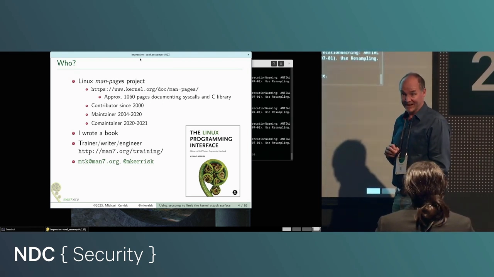

**疑问**：能不能让一个进程**只准使用它声明过的那一小撮系统调用**，其余的一律挡掉？

**回答（中心思想）**：能，这套机制就是 **seccomp（secure computing，安全计算）**。进程给自己装一个内核态的过滤程序，此后每一次系统调用都先经过它裁决——不该发生的直接拒绝。seccomp 是各类沙箱与容器框架的基础构件，它做的事情本质上只有一件：**把内核的攻击面砍小**。[【跳转到 03:03】](https://www.youtube.com/watch?v=RT0PWBWp8wc&t=183)

## 一、动机：一条意外的系统调用，往往意味着被入侵

seccomp 的判断逻辑很朴素：假设你了解自己的程序、知道它会做哪些系统调用；某天你观察到它发出一个**从未预料到的**系统调用——最可能的解释是代码被攻击者接管了，攻击者正让进程执行任意代码，试图攻陷系统。[【跳转到 02:13】](https://www.youtube.com/watch?v=RT0PWBWp8wc&t=133)

既然如此，就该阻止这种事发生：seccomp 让你禁止程序发出"计划外"的系统调用，从而**移除那些多余的攻击向量**——攻击者连调用它们的机会都没有。[【跳转到 02:38】](https://www.youtube.com/watch?v=RT0PWBWp8wc&t=158)

### 1.1 一段简史：2005 年的严格模式，2012 年的过滤模式

seccomp 早在 2005 年就进了内核，但当时是个非常简陋的东西：**一组固定的系统调用被放行，其余全部禁止**，用户没有任何选择余地。它真正变得有趣是在 2012 年：过滤功能大幅扩展，允许**自己挑选哪些系统调用放行、哪些禁止**。这次变化大到很多人干脆把它叫作 "seccomp 2"，它落在 Linux 3.5 内核里。[【跳转到 03:28】](https://www.youtube.com/watch?v=RT0PWBWp8wc&t=208)

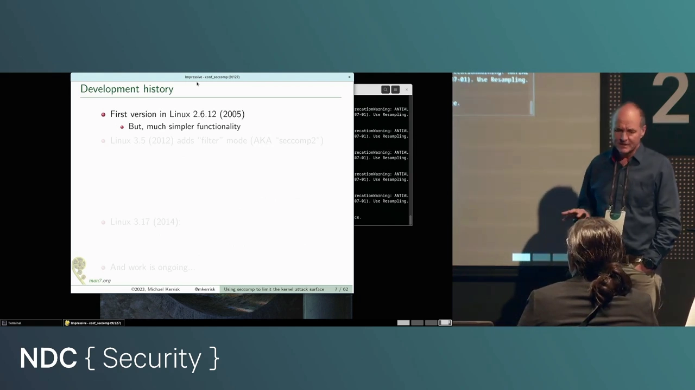

闸门一开，很多等这个功能很久的项目立刻接了上去。典型用户包括：浏览器（用沙箱包裹渲染进程）、各类容器框架；甚至 strace 也在用 seccomp 做一件聪明事——借助过滤器**加速**某些类型的系统调用追踪。[【跳转到 04:43】](https://www.youtube.com/watch?v=RT0PWBWp8wc&t=283)

### 1.2 2014 年：专用的 seccomp() 系统调用

2014 年之前，安装过滤器要靠 `prctl()` 系统调用；2014 年内核加入了专用的 **`seccomp()` 系统调用**，它提供了 prctl 的全部 seccomp 功能还额外多了一些能力，此后它就是首选接口。[【跳转到 05:33】](https://www.youtube.com/watch?v=RT0PWBWp8wc&t=333)

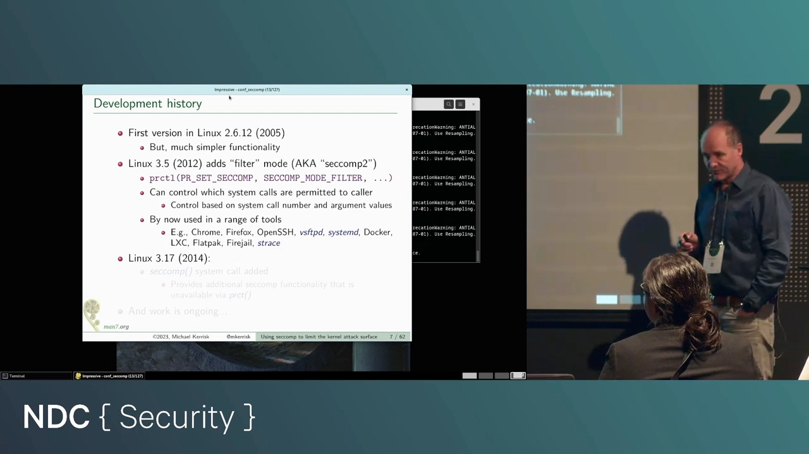

Kerrisk 还提醒：seccomp 至今仍是一个活跃开发区，内核里持续有新功能加进来。[【跳转到 05:58】](https://www.youtube.com/watch?v=RT0PWBWp8wc&t=358)

## 二、工作机制：三步装好一个"一去不回"的过滤器

seccomp 过滤器的使用分三步。[【跳转到 07:13】](https://www.youtube.com/watch?v=RT0PWBWp8wc&t=433)

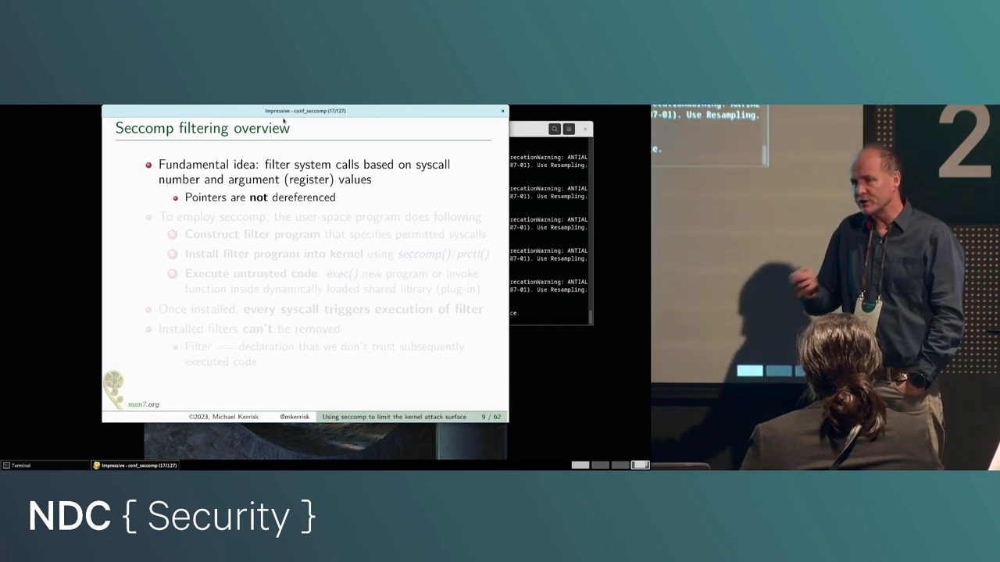

1. **构造一个过滤程序**——它负责对每个系统调用做"放行/拒绝"的裁决；
2. **把它装进内核**。注意主语：是**进程自己**调用 `seccomp()`（或 `prctl()`）给自己装过滤器；
3. **开始执行你不信任的代码**——比如即将 `exec` 一个不可信程序、即将调用某个来源可疑的动态库或插件。

从装上那一刻起，进程发出的**每一次**系统调用都会触发过滤程序执行，由它裁决放行还是拒绝。[【跳转到 08:03】](https://www.youtube.com/watch?v=RT0PWBWp8wc&t=483)

### 2.1 两条关键性质

**不可逆**。过滤器一旦安装就无法移除——安装即声明："我接下来要执行不可信代码，绝不能让那段代码反过来拆掉限制。"[【跳转到 08:53】](https://www.youtube.com/watch?v=RT0PWBWp8wc&t=533)

**只能看寄存器，不能解引用指针**。过滤器能依据的信息是**系统调用号**（内核只认数字，不认名字）和**寄存器里的参数值**。参数寄存器里可能放着指针，但过滤程序**不能顺着指针去看它指向的内容**——比如你没法根据"open 打开的路径名"来做过滤决策。这有技术与安全上的原因，但确实是个遗憾。[【跳转到 06:48】](https://www.youtube.com/watch?v=RT0PWBWp8wc&t=408)

### 2.2 拒绝的方式不止一种

过滤程序说"不"的时候，可选的处理有好几种：让这次系统调用**假装失败**（返回错误码）、或者直接**杀掉进程**等等，后文详述。[【跳转到 08:28】](https://www.youtube.com/watch?v=RT0PWBWp8wc&t=508)

## 三、过滤器的语言：BPF——一个被"废物利用"的内核虚拟机

seccomp 过滤器用 **BPF（Berkeley Packet Filter）**语法写成。它是一种字节码，内核里有一个虚拟机负责解释执行。[【跳转到 09:18】](https://www.youtube.com/watch?v=RT0PWBWp8wc&t=558)

### 3.1 BPF 的出身：为 tcpdump 而生

BPF 已经有三十多年历史，最初是为 **tcpdump** 服务的。tcpdump 想过滤网络流量，但网络包实在太多：如果简单粗暴地把所有包从内核搬到用户空间再挑选，光是跨越内核/用户态边界的数据搬运就会把系统压垮。BPF 的思路是：**在内核里放一个虚拟机，tcpdump 把"筛选程序"编译成字节码装进去**，程序在内核里检查每个包的头部，只把"感兴趣的"那一小撮包送到用户空间。[【跳转到 09:43】](https://www.youtube.com/watch?v=RT0PWBWp8wc&t=583)

### 3.2 seccomp 2 的聪明之处：复用现成的虚拟机

seccomp 2 的点睛之笔是：**既然内核里已经有一个"检查一堆字节、做放行决策"的虚拟机（BPF），那就把它重新征用**——这次让它检查的不是网络包头，而是"系统调用号 + 寄存器参数"这组字节。这个提案从动工到合入内核只花了一年左右，对大型内核特性来说快得惊人；维护者敢这么快点头，正是因为这不是发明新技术，而是复用一个在内核里跑了二十年、久经考验的虚拟机。[【跳转到 12:13】](https://www.youtube.com/watch?v=RT0PWBWp8wc&t=733)

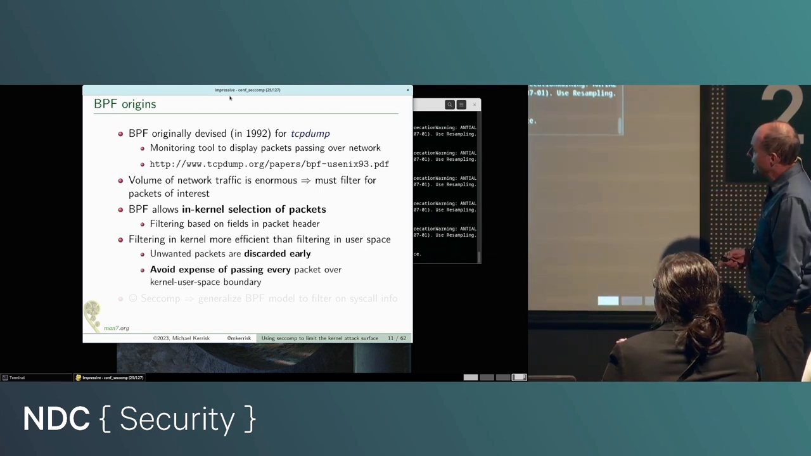

### 3.3 虚拟机的安全设计：能保证"总会停机"

这个虚拟机有几个刻意为之的特性，全部服务于"不能被内核里的程序拖死"这一目标。[【跳转到 13:03】](https://www.youtube.com/watch?v=RT0PWBWp8wc&t=783)

- **指令集非常小，所有指令等长**，实现简单、执行快；
- **只能向前跳转，没有循环**——所以每个 BPF 程序必然在有限步内结束，不可能在内核里死循环（否则就是拒绝服务攻击）；
- 内核在加载时做**多种验证**：验证操作码与参数、甚至能检测"死代码"（跳过了某段代码却没有任何跳转能到达它）——有这种毛病的程序会被直接拒绝加载；
- 程序规模上限 **4096 条指令**，对实际用途足够。[【跳转到 14:18】](https://www.youtube.com/watch?v=RT0PWBWp8wc&t=858)

### 3.4 指令长什么样

每条指令 64 位：一个 16 位**操作码**、一个 32 位**操作数**（习惯记作 `k`），跳转指令还有两个 8 位**跳转偏移**。这个格式可以直接表达成 C 结构体，内核头文件里就有定义。[【跳转到 14:43】](https://www.youtube.com/watch?v=RT0PWBWp8wc&t=883)

虚拟机有一个 32 位**累加器**（accumulator，做运算的工作区）和一个**数据区**——在 seccomp 场景下，数据区就是描述当前系统调用的那组字节（系统调用号 + 各参数的寄存器值）。[【跳转到 14:43】](https://www.youtube.com/watch?v=RT0PWBWp8wc&t=883)

指令种类是汇编程序员熟悉的那几样：**load**（把数据读进累加器）、**jump**（跳转）、**ALU**（加减乘除、左右移、异或），以及 seccomp 场景里最关键的 **return**——终止过滤程序、把裁决结果返回内核。[【跳转到 15:58】](https://www.youtube.com/watch?v=RT0PWBWp8wc&t=958)

条件跳转有点特别：**每条条件跳转带两个跳转目标**——条件为真跳到哪、为假跳到哪（偏移 0 表示顺序执行下一条）。常用的"jump if not equal"并不存在，因为它等价于 jump-equal 走"假"分支；指令集虽小但组合起来够用。[【跳转到 17:13】](https://www.youtube.com/watch?v=RT0PWBWp8wc&t=1033)

还有一个重要性质：**BPF 程序没有状态**。两次执行之间什么也留不下，所以你写不出"第三次调用 open 时做点别的事"这种过滤器。[【跳转到 15:33】](https://www.youtube.com/watch?v=RT0PWBWp8wc&t=933)

## 四、过滤器看到的数据：struct seccomp_data

过滤程序执行时能看到一个**只读**的数据区，它就是 `struct seccomp_data`（能用 seccomp 检查系统调用，但不能借过滤器**改**参数）。[【跳转到 18:53】](https://www.youtube.com/watch?v=RT0PWBWp8wc&t=1133)

![struct seccomp_data：nr、arch、instruction_pointer 与 args[6]](assets/Using_seccomp_to_limit_the_Linux_kernel_attack_surface/01158.webp)

- **nr**：系统调用号。Linux 上任何系统调用最多 **6 个参数**，所以参数区是 `args[6]`；每个系统调用实际用几个参数，由写过滤器的人自己决定要不要去读；[【跳转到 19:18】](https://www.youtube.com/watch?v=RT0PWBWp8wc&t=1158)
- **arch**：一个标识当前体系结构的数字（后文解释为什么它重要）；[【跳转到 20:08】](https://www.youtube.com/watch?v=RT0PWBWp8wc&t=1208)
- **instruction_pointer**：发起系统调用的那条指令的虚拟地址。Kerrisk 说他当初也好奇这个字段干嘛用的，后来专门问过 seccomp 的核心维护者，答案是"**因为我们能拿到**（because we could）"，并没有特定用例。[【跳转到 20:33】](https://www.youtube.com/watch?v=RT0PWBWp8wc&t=1233)

## 五、动手：手写一个 BPF 过滤器

### 5.1 宏与结构体：构造指令的原始方式

头文件提供了 `BPF_STMT` 和 `BPF_JUMP` 两个宏，用来手工拼指令。它们做的事其实很简单：**为 `struct sock_filter` 构造初始化器**——`BPF_STMT(操作码, k)` 填 opcode 和 k、跳转偏移置 0；`BPF_JUMP(操作码, k, jt, jf)` 多填真/假两个跳转偏移。（`sock_fprog` 这个名字也在提醒我们 BPF 的网络出身：socket filter。）[【跳转到 21:23】](https://www.youtube.com/watch?v=RT0PWBWp8wc&t=1283)

举例：下面这条指令把**体系结构字段**读进累加器。[【跳转到 23:30】](https://www.youtube.com/watch?v=RT0PWBWp8wc&t=1410)

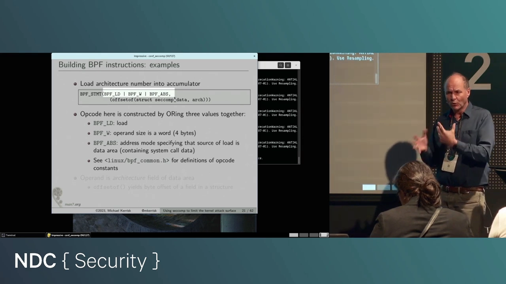

操作码由几个常量拼出来：`BPF_LD` 表示 load、`BPF_W` 表示读 4 字节（word）、`BPF_ABS` 表示从数据区按绝对偏移取。取哪个偏移？操作数 k 用 `offsetof(struct seccomp_data, arch)` 计算——`nr` 字段占 4 字节，所以 `arch` 的偏移是 4：**"从数据区偏移 4 开始读 4 字节"，读到的正是体系结构编号**。[【跳转到 24:29】](https://www.youtube.com/watch?v=RT0PWBWp8wc&t=1469)

再来两条感受一下风格：`BPF_JUMP(BPF_JMP|BPF_JEQ|BPF_K, AUDIT_ARCH_X86_64, 1, 0)`——把累加器与 x86-64 的体系结构常量比较，相等（真）向前跳 1 条，否则（假）跳 0 条、顺序执行。[【跳转到 25:37】](https://www.youtube.com/watch?v=RT0PWBWp8wc&t=1537) `BPF_STMT(BPF_RET|BPF_K, SECCOMP_RET_KILL_PROCESS)`——返回"杀掉进程"这个裁决。[【跳转到 26:38】](https://www.youtube.com/watch?v=RT0PWBWp8wc&t=1598)

### 5.2 裁决结果：32 位返回值，高 16 位是动作

过滤器每次执行返回一个 32 位值，分两部分：**高 16 位是动作**，**低 16 位是伴随数据**（不是所有动作都有）。常用的动作有：[【跳转到 28:18】](https://www.youtube.com/watch?v=RT0PWBWp8wc&t=1698)

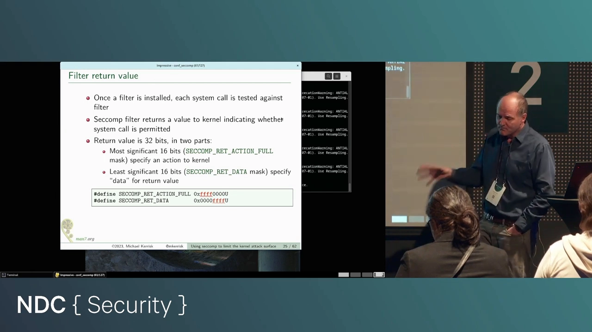

- **`SECCOMP_RET_ALLOW`**：放行，内核正常执行该系统调用；
- **`SECCOMP_RET_KILL_PROCESS`**：杀掉整个进程（多线程则全部线程一起死）。进程的死法像被 SIGSYS 信号杀掉——其实并没有真的发信号，但在父进程看来就是这样，shell 会打出 "Bad system call"；[【跳转到 28:43】](https://www.youtube.com/watch?v=RT0PWBWp8wc&t=1723)
- **`SECCOMP_RET_KILL_THREAD`**：只杀发起这次系统调用的那个线程。Kerrisk 点评：单杀一个线程、指望其余线程苟活，很多场景下这结果相当怪异；[【跳转到 29:08】](https://www.youtube.com/watch?v=RT0PWBWp8wc&t=1748)
- **`SECCOMP_RET_ERRNO`**：不执行系统调用，但**假装它执行过并失败了**，错误码（errno 值）就放在低 16 位里。[【跳转到 29:33】](https://www.youtube.com/watch?v=RT0PWBWp8wc&t=1773)

### 5.3 安装：seccomp() 与 struct sock_fprog

安装过滤器用 `seccomp()` 系统调用（老办法是 `prctl()`）。参数里有个 flags 用于修饰行为，最后一个参数指向 `struct sock_fprog`：两个字段，一是程序长度，二是指向 `struct sock_filter` 数组的指针——那串数组就是 BPF 程序本体。[【跳转到 30:23】](https://www.youtube.com/watch?v=RT0PWBWp8wc&t=1823)

### 5.4 一道防线：no_new_privs

先讲一个攻击场景再讲这防线。假设你是攻击者，你知道**特权程序（如 setuid root 程序）经常不检查系统调用返回值**——写程序的人心想"我是 root，系统调用怎么可能失败"。于是你的计划是：装一个 seccomp 过滤器 → 运行那个特权程序 → 过滤器让它"本该成功的"系统调用失败 → 程序不检查返回值、继续跑下去 → 落入攻击者预设的境地。[【跳转到 32:02】](https://www.youtube.com/watch?v=RT0PWBWp8wc&t=1927)

好消息是此路不通。内核规定：非特权进程要装 seccomp 过滤器，必须先通过 `prctl(PR_SET_NO_NEW_PRIVS)` 设置 **no_new_privs 属性**。它的效果是：此后该进程就算 exec 一个 setuid/setgid 程序或带文件 capability 的程序，**也不会获得提权**——原先"ID 变 root、拿到 capabilities"的路全部封死。没设这个属性又想装过滤器，内核直接报错。[【跳转到 33:01】](https://www.youtube.com/watch?v=RT0PWBWp8wc&t=1981)

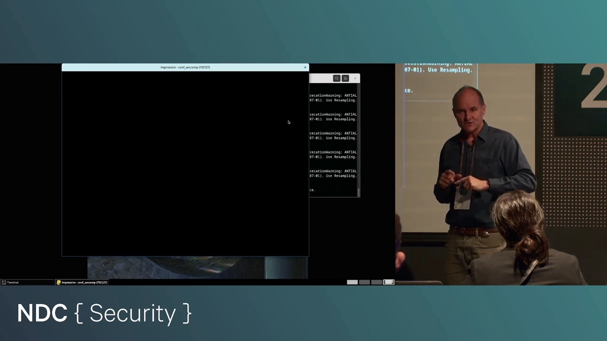

### 5.5 实例一：禁止 open/openat，其余放行

第一个例子：过滤器只做一件事——进程一旦调用 `open` 或 `openat`，**杀掉进程**；其余系统调用全部放行。[【跳转到 33:51】](https://www.youtube.com/watch?v=RT0PWBWp8wc&t=2031)

程序流程是：设置 no_new_privs → 安装过滤器 → 调用 `open()`（后面的 printf 永远执行不到）。[【跳转到 34:16】](https://www.youtube.com/watch?v=RT0PWBWp8wc&t=2056)

过滤器的控制流很直白：先 `load` 系统调用号进累加器；一条条件跳转问"累加器 == open 的调用号？"——相等就向前跳 2 条，落在"返回 KILL_PROCESS"；不等则顺序执行，再问一次"== openat 的调用号？"，相等向前跳 1 条同样去"杀进程"，不等则走到"返回 ALLOW"。其余系统调用统统放行。[【跳转到 35:34】](https://www.youtube.com/watch?v=RT0PWBWp8wc&t=2134)

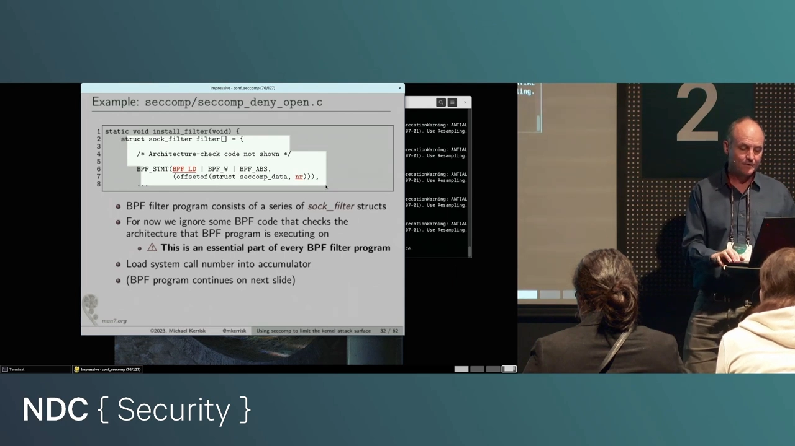

实际运行：先 `touch` 出程序要打开的文件，再跑 `seccomp_deny_open`——程序发起 open 时过滤器被触发，向内核返回 KILL_PROCESS，shell 报告子进程死于 SIGSYS，并把它的标准描述打出来：**"Bad system call"**。[【跳转到 37:55】](https://www.youtube.com/watch?v=RT0PWBWp8wc&t=2275)

### 5.6 实例二：不止看调用号，还要看参数

第二个例子升级了：过滤 `open`/`openat` 的 **flags 参数**。两个系统调用都在"打开文件"，flags 语义一致，但位置不同——`open` 是第 2 个参数（`args[1]`），`openat` 是第 3 个（`args[2]`）。规则：[【跳转到 38:27】](https://www.youtube.com/watch?v=RT0PWBWp8wc&t=2307)

- flags 里带 **O_CREAT**（想创建文件）→ 返回 **KILL_PROCESS**；
- flags 里带 **O_WRONLY 或 O_RDWR**（想写文件）→ 返回 **SECCOMP_RET_ERRNO**，错误码 **ENOTSUP**（Operation not supported）；
- 其余 open/openat → 放行。

控制流：先判调用号是否 open——是，就 load `args[1]` 进累加器，并用一条**无条件跳转**跳过 openat 分支的参数加载（跳 3 条）；不是 open，再判是否 openat——是，load `args[2]`。两条路殊途同归，汇合到对 flags 的位测试：`BPF_JSET`（按位与测试）问"O_CREAT 位置 1 了吗？"——置 1 则 KILL_PROCESS；再测 O_WRONLY/O_RDWR——命中则返回 ERRNO(ENOTSUP)；都没有则放行。[【跳转到 42:14】](https://www.youtube.com/watch?v=RT0PWBWp8wc&t=2534)

主程序连做四次 open 验证效果：只读 open 成功；只写、读写 open 各返回 ENOTSUP，程序打印 "Operation not supported"；最后一次带 O_CREAT 的 open 触发 KILL_PROCESS，shell 又一次打出 "Bad system call"。[【跳转到 44:21】](https://www.youtube.com/watch?v=RT0PWBWp8wc&t=2661)

### 5.7 必做的第一步：架构检查

Kerrisk 强调，他的示例为了简洁略掉了正式过滤器**本应有的第一条检查**：核对 `arch` 字段。[【跳转到 45:06】](https://www.youtube.com/watch?v=RT0PWBWp8wc&t=2706)

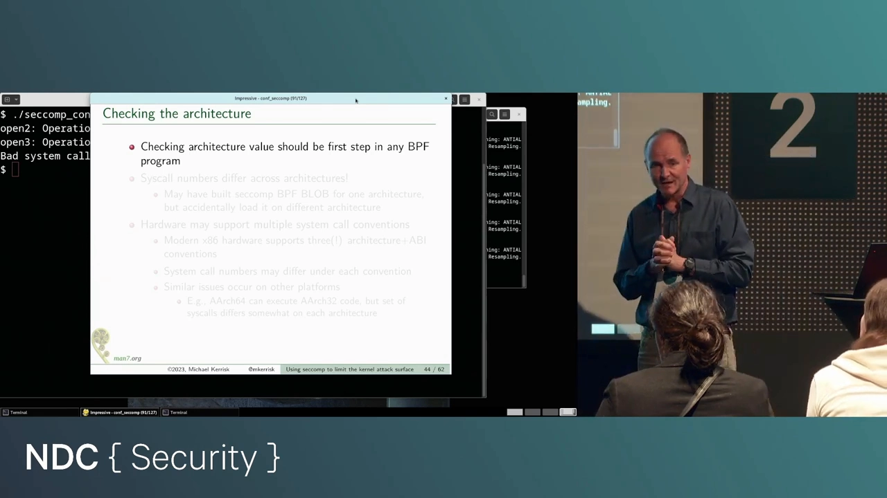

原因有二。其一，**系统调用号因体系结构而异**（历史原因）：你为 x86-64 生成的过滤器 BPF blob 存进配置管理系统，某天因为配置错误被装到 arm 程序上，过滤器就会按错误的调用号表做出错误决策——"我不会犯这种低级错误"？配置系统可不这么保证。[【跳转到 45:56】](https://www.youtube.com/watch?v=RT0PWBWp8wc&t=2756)

其二，**同一块硬件上可能并存多套 ABI**：现代 x86-64 之外还有古老的 i386，以及内核开发者约十年前发明的、介于两者之间的 x32。arm64 同样有 32 位兼容模式。这些 ABI 的系统调用号各不相同。[【跳转到 46:46】](https://www.youtube.com/watch?v=RT0PWBWp8wc&t=2806)

而过滤器的生命周期与进程一致、**装上就拆不掉**，进程却可能通过 `execve` 从 64 位程序换成 32 位程序（如果过滤器放行了 execve）——那一刻起，过滤器面对的就是另一套调用号。所以架构检查的标准写法是：load `arch` → 与 `AUDIT_ARCH_X86_64` 比较，不等直接 KILL_PROCESS；相等则继续。x86-64 上还有个附加检查：x32 ABI 的系统调用号在第 30 位（bit 30）置 1，因此调用号 ≥ 0x40000000 的一律杀掉，防止程序经由 x32 调用绕过按 64 位调用号写的规则。[【跳转到 49:16】](https://www.youtube.com/watch?v=RT0PWBWp8wc&t=2956) [【跳转到 50:33】](https://www.youtube.com/watch?v=RT0PWBWp8wc&t=3033)

## 六、生产环境别手写：libseccomp

手拼指令适合理解原理，写复杂过滤器就该用工具了。多年来的事实标准是 **libseccomp**——2012 年（正是 seccomp 2 诞生那年）就有人想到"这事该自动化"。它是个库 API：帮你生成 BPF 代码、代劳指令偏移计数、连架构检查都能替你生成；你还能给检查项设优先级，让重要的检查排在生成代码的前部。文档齐全、手册页带例子——"几乎让人以为写库的人真希望大家用它"。[【跳转到 52:09】](https://www.youtube.com/watch?v=RT0PWBWp8wc&t=3129)

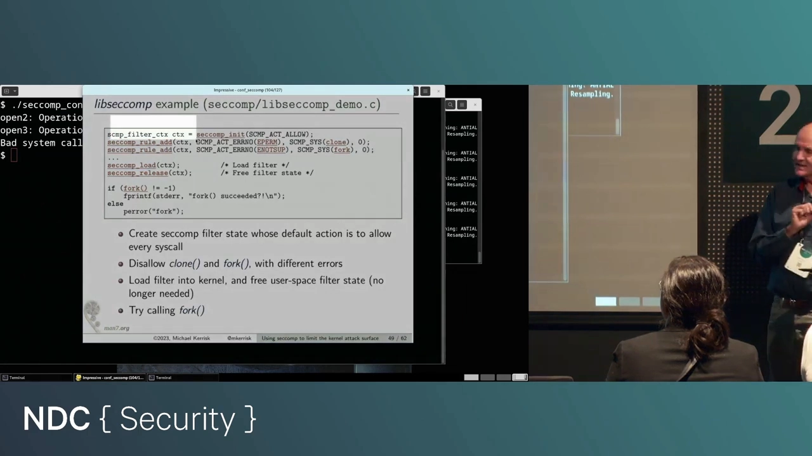

用法掠影：先建一个**过滤器上下文**（挂着规则清单的钩子），示例选择以"**默认放行**"初始化，然后加两条规则——`clone` 失败并返回 **EPERM**、`fork` 失败并返回 **ENOTSUP**；接着"生成代码、装入内核"，过滤器即生效；上下文用完就释放。此后进程调用 `fork()` 就会失败。[【跳转到 53:35】](https://www.youtube.com/watch?v=RT0PWBWp8wc&t=3215)

运行时有个小意外：fork 实际返回的错误是 **EPERM** 而不是预期的 ENOTSUP——因为 **glibc 的 fork 包装函数底层调用的是 clone**，先撞上了 clone 规则。这正是下一节告诫的活例子。[【跳转到 55:02】](https://www.youtube.com/watch?v=RT0PWBWp8wc&t=3302)

工具箱里还有两个名字：**easyseccomp**，一种用领域特定语言（DSL）写过滤器的尝试，发布一年多、最近提交不多，值得观望；还有一个 **BPF 编译器**，让你用类汇编记号写过滤器、支持标号（不用手工数偏移）。[【跳转到 55:27】](https://www.youtube.com/watch?v=RT0PWBWp8wc&t=3327)

## 七、代价与告诫：过滤器的真实成本

**性能**。装上过滤器后，进程的每一次系统调用都要先跑一遍 BPF 程序，显然有开销。Kerrisk 用一个较真的实验量化它：一个只有 6 条指令的过滤器，配一个死循环反复调用 `getppid()`（一个极廉价的系统调用）——结果程序慢了约 **20%**。[【跳转到 57:07】](https://www.youtube.com/watch?v=RT0PWBWp8wc&t=3427)

但别被这个数字吓到：内核里早就有 BPF 的 **JIT 编译器**（如今默认开启），把字节码翻成本机码执行，快得多；而且 `getppid` 太便宜、实验程序又刻意只做系统调用，真实程序的时间大头并不在系统调用上。他甚至写了个小测量程序放在自己网站上供读者复现实验。[【跳转到 57:32】](https://www.youtube.com/watch?v=RT0PWBWp8wc&t=3452)

**工程上的三个告诫**：[【跳转到 58:16】](https://www.youtube.com/watch?v=RT0PWBWp8wc&t=3496)

1. **"我的程序到底用哪些系统调用"并不好回答**。测试全通过不代表覆盖了所有路径——哪天生产环境走到一条没测过的路径、发出一个你没放行的系统调用，过滤器直接杀进程，等于你亲手用 seccomp 给应用注入了一个 bug；
2. **应用不直接发系统调用，而是经过 C 库包装函数**。包装函数与系统调用不是一一对应：fork 底层是 clone（上面刚踩过）；glibc 的行为还会随时间变化——曾几何时 `open()` 包装函数调用 open 系统调用，后来改成了 openat。写过滤器要对一族相关系统调用统一处理；
3. **BPF 过滤器也是代码，要像代码一样维护**：单元测试、持续集成、迁移新平台时全量回归——一样都不能少。Kerrisk 还链接了一篇"一个人试图认真做全套、最终因为太难而放弃"的战记，提醒这件事真实难度不低。

## 八、问答补充：过滤器按线程挂靠，但 fork 会带走它

演讲结尾的提问很有价值：**seccomp 过滤器会不会被子进程继承？** Kerrisk 的回答：更精确地说，过滤器是**按线程**（per-thread）挂靠的；但通过 `fork()` 创建的子进程会继承过滤器——所以**没法靠 fork 逃出过滤**。[【跳转到 61:36】](https://www.youtube.com/watch?v=RT0PWBWp8wc&t=3696)

## 小结

- seccomp 的目标是**收窄内核攻击面**：程序被入侵后能做的系统调用，被限制在声明过的白名单内；
- 现代形态（"seccomp 2"，Linux 3.5，2012）允许自定义过滤；2014 年加入专用 `seccomp()` 系统调用，成为首选接口；
- 过滤器 = **进程自装、不可移除**的 BPF 程序：每次系统调用都执行一遍，按"调用号 + 寄存器参数"裁决；能看指针值，不能解引用指针；
- BPF 虚拟机为 tcpdump 而生、被 seccomp 复用：定长指令、只许前跳（必然停机）、加载时验证、上限 4096 条、无状态；
- 裁决动作四种常用：`ALLOW` / `KILL_PROCESS` / `KILL_THREAD` / `ERRNO(errno)`；返回值高 16 位是动作、低 16 位是数据；
- 正式过滤器第一条永远是**架构检查**（ABI 之间调用号不同，x86-64 上还要防 x32 的 bit 30）；非特权进程装过滤器必须先设 **no_new_privs**，堵死"过滤器 + 特权程序"的组合攻击；
- 生产中用 **libseccomp** 而非手拼指令；性能开销存在但通常可接受（JIT 默认开启）；过滤器也是代码，需要测试与维护。

## 关键术语速查

| 术语 | 一句话解释 |
| --- | --- |
| seccomp | secure computing；进程自装的系统调用过滤器，拦截白名单外的系统调用 |
| 攻击面（attack surface） | 攻击者可以尝试利用的入口总和；seccomp 通过裁剪可用系统调用来收窄它 |
| BPF / cBPF | Berkeley Packet Filter，内核里的字节码虚拟机，源自 tcpdump 包过滤 |
| 累加器（accumulator） | BPF 虚拟机的 32 位工作寄存器，load/运算/比较都围绕它 |
| `struct seccomp_data` | 过滤器看到的只读数据：nr、arch、instruction_pointer、args[6] |
| `struct sock_fprog` | 安装过滤器时传入的结构：指令条数 + 指向 sock_filter 数组的指针 |
| `SECCOMP_RET_ALLOW` | 裁决动作：放行该系统调用 |
| `SECCOMP_RET_KILL_PROCESS` | 裁决动作：杀掉整个进程（表现为死于 SIGSYS） |
| `SECCOMP_RET_KILL_THREAD` | 裁决动作：只杀发起系统调用的线程 |
| `SECCOMP_RET_ERRNO` | 裁决动作：不执行调用、假装失败并返回指定 errno |
| no_new_privs | 进程属性：设为真后 exec 特权程序不再提权；非特权进程装 seccomp 的前置条件 |
| libseccomp | 生成与安装 seccomp BPF 程序的 C 库，生产环境的事实标准 |
| x32 ABI | 使用 64 位指令、4 字节指针/long 的混合 ABI，系统调用号以 bit 30 置 1 区分 |
