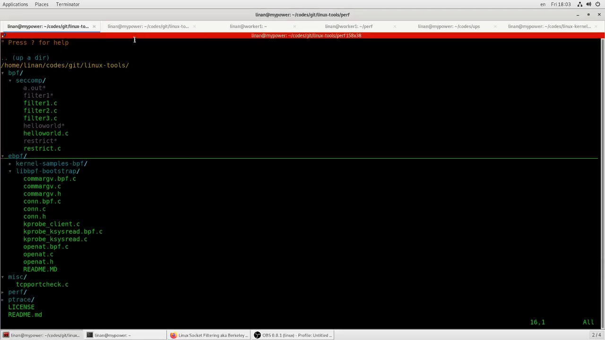
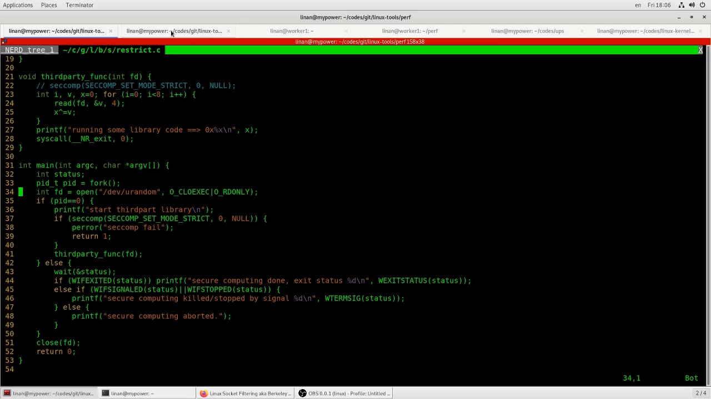
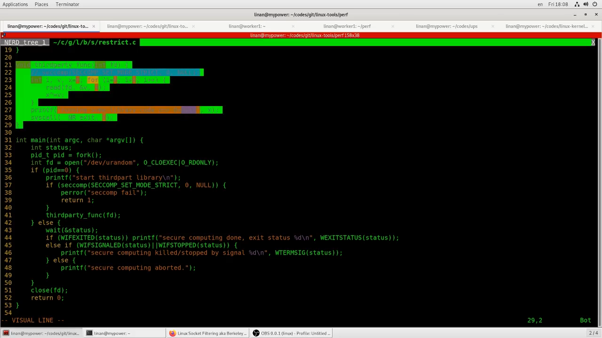
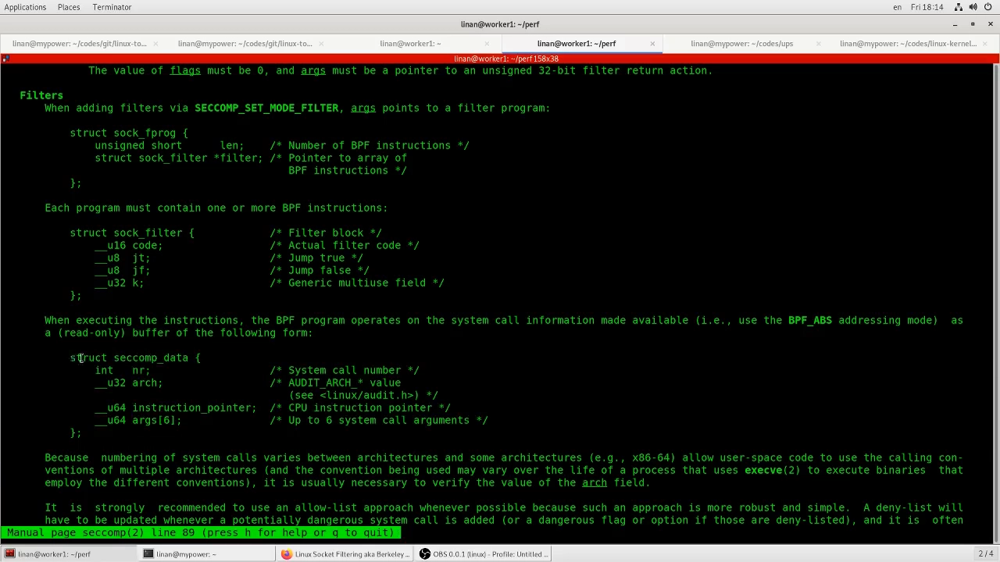
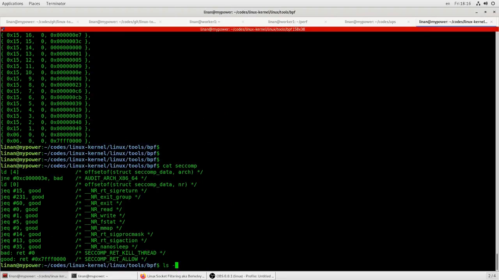
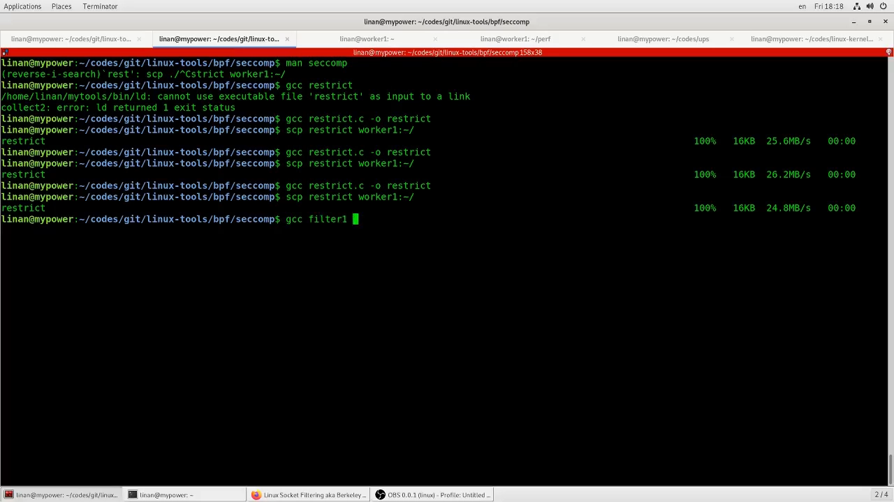
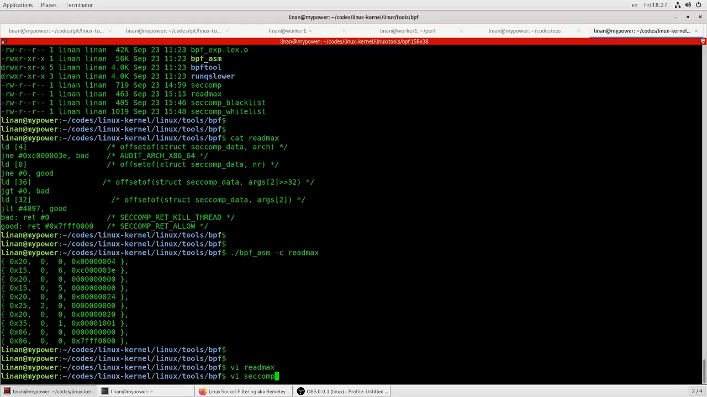
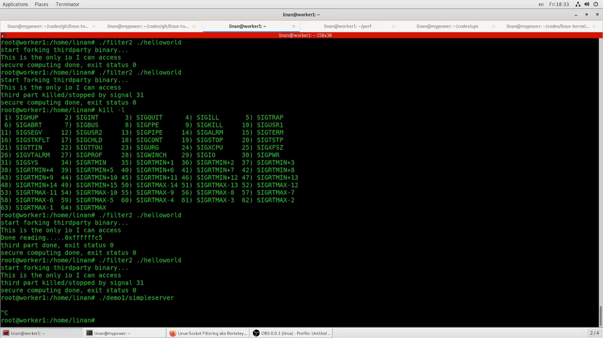
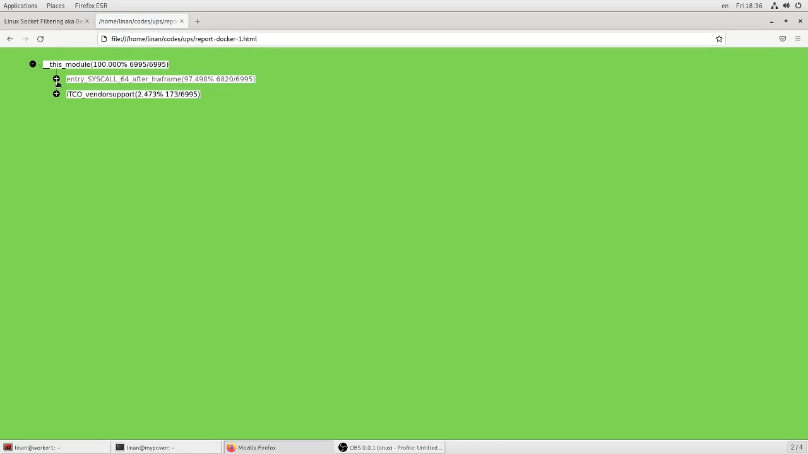
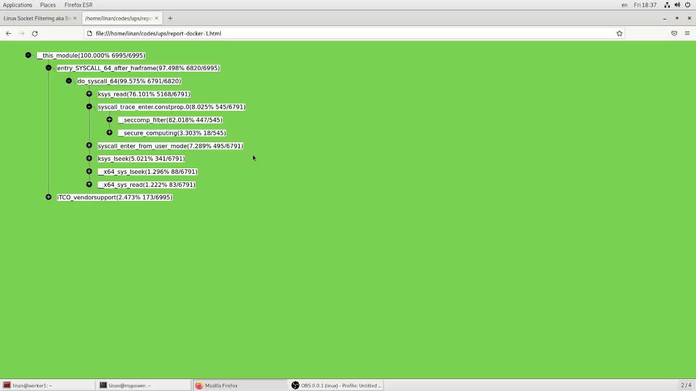

# 使用 Linux seccomp 接口写 cBPF 汇编：亲手限制进程的系统调用

> 视频来源：[使用Linux seccomp接口，换个姿势来限制进程对kernel的系统调用～来写写(c)bpf的汇编代码吧 — B 站 @lddlinan](https://www.bilibili.com/video/BV1ud4y1M7Nt)（37 分钟，中文）
> 本文基于该视频的完整字幕与画面整理。作者从"容器时代常听说的安全组件"讲起，用四个递进的动手实验（严格模式、白名单、read 限长、黑名单禁网）把 seccomp 的两种用法完整演示了一遍。

## 本讲要解决的核心问题（SCQA）

**背景**：我们经常要运行**第三方的东西**——第三方库（别人只给你一个函数）、第三方二进制（别人给你的工具）。对方宣称"我只做计算：读输入、算结果、写输出，别的什么都不干"。[【跳转到 02:29】](https://www.bilibili.com/video/BV1ud4y1M7Nt/?t=149)

**冲突**：你没法验证这句话。它要是偷偷连了网络把数据传出去、偷偷写了文件呢？直接运行它，安全风险不可控。[【跳转到 03:19】](https://www.bilibili.com/video/BV1ud4y1M7Nt/?t=199)

**疑问**：能不能把一个进程**能调用的系统调用**圈起来——它声称只做计算，那就只许它 read/write，其余一律禁止？

**回答（中心思想）**：能，这套接口就是 **seccomp（secure computing，安全计算）**。作者的核心体会是：seccomp 的本质就是**往内核挂一个 cBPF（经典 BPF）过滤程序**，对每个系统调用做裁决；只要你对 BPF 有点概念，seccomp 其实非常简单——比想象中简单得多。[【跳转到 00:05】](https://www.bilibili.com/video/BV1ud4y1M7Nt/?t=5)

## 一、seccomp 是什么：man 手册与一图看懂

`man seccomp` 里写得很全：它是一个**控制某个 PID 对应的应用能访问哪些系统调用**的接口——可以声明"这个进程不允许调用某某系统调用"。[【跳转到 00:49】](https://www.bilibili.com/video/BV1ud4y1M7Nt/?t=49)

怎么"过滤"？它允许你用 **BPF**——注意不是 eBPF，而是最古老的那种经典 BPF——写一个程序 hook 到内核里，在内核态完成过滤。作者把这个机制和自己玩过的 kprobes、ptrace、eBPF tracing 做了类比：都是"挂到内核里搞事情"，但有个关键差别——ptrace 的 hook 要**通知用户态**处理，性能差很多；而 seccomp 的过滤器就跑在内核里（一个很老的 cBPF 程序），开销小得多。[【跳转到 01:39】](https://www.bilibili.com/video/BV1ud4y1M7Nt/?t=99)

## 二、白名单还是黑名单：先想清楚场景

典型用例就是开头那个：第三方库说"我只做计算"，那我就把它能用的系统调用局限成 read/write，其余全部禁止——**给它制造一个"虚假空间"，让它以为面对的内核只有这点功能**。作者特意点了一句：这听起来是不是很像容器、像一种隔离环境？后文再展开这个联系。[【跳转到 03:44】](https://www.bilibili.com/video/BV1ud4y1M7Nt/?t=224)

- **白名单**：只允许访问列出的系统调用，其余全拒。更安全，但名单可能写得很长；
- **黑名单**：只禁掉危险的那几个，其余放行。更简单，但防不住没料到的调用。

## 三、第一种用法：严格模式（不用写一行过滤器）

seccomp 最省事的用法是**严格模式**：调用 `seccomp()` 时把模式参数设为 strict，不需要任何 BPF 程序，内核直接给当前进程套上最严格的限制。[【跳转到 04:09】](https://www.bilibili.com/video/BV1ud4y1M7Nt/?t=249)

严格模式下只允许 **read、write、exit（以及 sigreturn）**——连 `exit_group` 都不允许。[【跳转到 04:59】](https://www.bilibili.com/video/BV1ud4y1M7Nt/?t=299)

### 3.1 演示：程序算完了，却"走不了"

作者的实验：一个受限制的进程从文件读数据、算出一个值——计算部分完全正常。但程序结束时出了状况：**默认退出走的是 `exit_group`，而严格模式禁止它**，进程回不了家。[【跳转到 07:04】](https://www.bilibili.com/video/BV1ud4y1M7Nt/?t=424)

解决办法：在代码里**主动调用 `exit`**（而不是依赖默认的退出路径），整个程序就平滑跑完、退出状态 0。[【跳转到 07:29】](https://www.bilibili.com/video/BV1ud4y1M7Nt/?t=449)

实验还验证了另一面：假设这个"第三方库"偷偷调用 seccomp 相关接口想干什么，进程会**当场被杀**——限制是真实生效的。[【跳转到 08:19】](https://www.bilibili.com/video/BV1ud4y1M7Nt/?t=499)

严格模式的问题也明显：只能 read/write/exit，真实应用根本活不下去。所以要用**第二种用法——过滤模式**，自己写过滤程序。

## 四、过滤模式：写一个自己的 cBPF 程序

### 4.1 挑战与参考资料

过滤模式要自己写 BPF 程序，也就是要写 **BPF 汇编**。作者参考的是最原始的 BPF 文档：BPF 最初就是为**网络过滤（network filter）**设计的，也就是今天大家说的 **cBPF**。它的指令集比现在的 eBPF 少得多——指令越少越简单；寻址方式也简单，而且**寻址就是基于"hook 拿到的传入数据"**展开的。[【跳转到 09:34】](https://www.bilibili.com/video/BV1ud4y1M7Nt/?t=574)

### 4.2 传入数据：seccomp_data 的布局

cBPF 程序 hook 系统调用时，内核传给它的数据是 `struct seccomp_data`：[【跳转到 11:19】](https://www.bilibili.com/video/BV1ud4y1M7Nt/?t=679)

- 系统调用号（`nr`）、当前架构（`arch`）、指令指针，以及**前六个参数**（寄存器里的数值，`args[6]`）；
- 寻址方式是**按偏移**直接算：结构体开头 4 字节是 `nr`，接着 4 字节 `arch`、8 字节指令指针，**参数区从偏移 16 开始**，每个参数 8 字节——第 1 个参数在偏移 16，第 2 个在 24，第 3 个在 32……[【跳转到 12:00】](https://www.bilibili.com/video/BV1ud4y1M7Nt/?t=720)

### 4.3 怎么把程序交给内核

调用 seccomp 的过滤模式时，要准备一个 `sock_fprog` 结构：里面是一个 **`sock_filter` 指令数组**——一条条 BPF 指令，类似汇编指令。接口要求你把指令一条一条全部给它，内核会重新做编译/校验等工作。[【跳转到 12:15】](https://www.bilibili.com/video/BV1ud4y1M7Nt/?t=735)

指令从哪来？手工逐条写结构体太痛苦。文档推荐的办法：**先写 BPF 汇编代码，再用内核源码自带的 `bpf_asm` 小汇编器**把它转换成指令数组，把生成的数组拷贝到你的应用里即可。[【跳转到 13:06】](https://www.bilibili.com/video/BV1ud4y1M7Nt/?t=786)

整体流程一句话：**cBPF 汇编 → bpf_asm 转成数组 → 塞进 sock_fprog → seccomp() 挂到内核 → 在内核里对当前进程过滤**。[【跳转到 15:54】](https://www.bilibili.com/video/BV1ud4y1M7Nt/?t=954)

## 五、实战一：白名单放行（filter1）

第一个过滤器直接取自 man 页示例，思路是白名单：把系统调用号 load 进累加器，逐个与允许的调用号比较，命中放行，其余拒绝。名单里这次**特意加了 `exit_group`**。[【跳转到 13:46】](https://www.bilibili.com/video/BV1ud4y1M7Nt/?t=826)

用 `bpf_asm` 转换后把数组拷进驱动程序，运行第三方程序：它顺利执行、顺利退出——因为退出时调用的 `exit_group` 在白名单里。[【跳转到 15:29】](https://www.bilibili.com/video/BV1ud4y1M7Nt/?t=929)

对比第三节严格模式的"走不了"，你现在能体会到过滤模式的灵活：**想放行谁，名单里写谁**。

## 六、实战二：给 read 加 4KB 上限（filter2）

这才是展示 cBPF 过滤器真正威力的例子：**允许 read，但每次读的字节数不得超过 4K**——比"能不能调用"细到了**参数取值**层面。[【跳转到 17:34】](https://www.bilibili.com/video/BV1ud4y1M7Nt/?t=1054)

### 6.1 检查逻辑

汇编的逻辑分四步：[【跳转到 18:18】](https://www.bilibili.com/video/BV1ud4y1M7Nt/?t=1098)

1. 先校验 `arch` 字段（偏移 4）对不对；
2. load 系统调用号（偏移 0），判断是不是 **read（nr==0）**——不是 read 的调用直接放行，只管 read；
3. 是 read，就取**第 3 个参数**（`count`，偏移 32：参数区从 16 开始，第 3 个参数是 16 + 2×8）到累加器；
4. `count < 4097`（即 ≤ 4096）放行，否则拒绝。

![filter2 的检查逻辑：nr==0 → 取 args[2] → 与 4097 比较](assets/使用Linux_seccomp接口写cBPF汇编代码/01123.webp)

### 6.2 一个真实的坑：64 位数据塞不进 32 位 BPF

`count` 是 64 位的，而 **cBPF 的累加器是 32 位**。怎么比较？依赖系统字节序（作者跑的是小端系统）：**先取高 4 字节，必须全 0**——高 4 位只要有一个 1，数值就大到离谱，直接拒绝；**再取低 4 字节**与 4097 比较。[【跳转到 19:49】](https://www.bilibili.com/video/BV1ud4y1M7Nt/?t=1189)

### 6.3 踩坑二：只杀线程 vs 杀整个进程

第一版过滤器把"拒绝"写成返回 0——这只会 **kill 那个线程**（KILL_THREAD），整个进程还在。演示时主进程等子进程、拿到正常返回 0，误以为一切安好，其实数据根本没读完。[【跳转到 25:01】](https://www.bilibili.com/video/BV1ud4y1M7Nt/?t=1501)

把返回值改成"杀整个进程"后重新验证：第三方程序用 8K buffer 去 read，**被 SIGSYS（信号 31）当场杀掉**；在程序里加上信号处理代码后，能明确看到"被信号 31（SIGSYS）终止"这个事实；把 buffer 改小到 4096 再跑——顺利读入、算出结果。限制精确生效：多读不行，读 4K 以内随便。[【跳转到 27:57】](https://www.bilibili.com/video/BV1ud4y1M7Nt/?t=1677)

## 七、实战三：黑名单禁网（filter3）

换个思路用黑名单：**禁止 socket、connect、bind、listen、accept**——一个声称"只做客户端"的工具，若偷偷想当 server，直接杀。[【跳转到 29:12】](https://www.bilibili.com/video/BV1ud4y1M7Nt/?t=1752)

演示两连：一个简单的 HTTP server（监听 8080、`/hello` 返回数据），在 filter3 驱动下启动，尝试做 socket/bind/listen 时**被杀**；而一个只做客户端连接的 TCP 端口连通性测试工具，在同样的过滤器下**跑得好好的**——"你真的只做 client，就让你跑；偷偷起 server，就杀掉"。[【跳转到 30:52】](https://www.bilibili.com/video/BV1ud4y1M7Nt/?t=1852)

## 八、回到容器：性能账与"内核接口的隔离"

### 8.1 性能是有账的

作者分享了一个真实案例：一个高 IO 应用频繁发起系统调用，profiler 里能清楚看到 **seccomp filter 占了约 8%**（接近 10%）的耗时——过滤程序每次系统调用都要执行，开销真实存在。要不要开 seccomp，要权衡应用调用系统调用的频繁程度：高 IO 应用要掂量，一般应用影响不大。[【跳转到 33:54】](https://www.bilibili.com/video/BV1ud4y1M7Nt/?t=2034)

### 8.2 seccomp 是又一层"隔离"：让不同进程看到不同的内核

容器隔离我们熟悉的三件套是 namespace、cgroup、rootfs，但**每个容器看到的内核还是同一个**。seccomp 提供了另一种（更粗、更轻量的）隔离维度：**让不同的应用/容器看到"不同的内核接口子集"**——权限高的应用看完整内核接口，受限的应用只能看到并使用一个子集，想越过就报错。可以理解为**对内核接口的隔离**，虽然它比 namespace 简陋，但非常紧凑有效。[【跳转到 34:44】](https://www.bilibili.com/video/BV1ud4y1M7Nt/?t=2084)

### 8.3 落地姿势：写一次，存成 profile

白名单确实繁琐——作者本想给示例写一份完整白名单，越写越长。但好消息是：**写一次就够了，把它存成一个 profile**，哪个应用符合这个画像就用哪份。这件事通常由系统管理员、部署人员从安全角度来推动。[【跳转到 36:17】](https://www.bilibili.com/video/BV1ud4y1M7Nt/?t=2177)

## 小结

- seccomp = 控制进程能访问哪些系统调用的内核接口；本质是**往内核挂一个 cBPF 过滤程序**，与 kprobes/ptrace/eBPF tracing 一脉相承，但过滤器跑在内核态、开销远小于 ptrace 式通知；
- **严格模式**零成本上手：只放行 read/write/exit（及 sigreturn），注意连 `exit_group` 都被禁——程序要主动调 `exit` 才能正常退出；
- **过滤模式**按 `struct seccomp_data`（nr、arch、ip、args[6]）寻址：参数区从偏移 16 开始、每参 8 字节；用 `bpf_asm` 把 cBPF 汇编转成指令数组，塞进 `sock_fprog` 交给 `seccomp()`；
- 四个实验覆盖典型场景：白名单（加 exit_group 保正常退出）、read 限长 4K（64 位参数拆高低 4 字节比较；拒绝动作要用"杀进程"而非"杀线程"）、黑名单禁网（server 想监听即被杀，client 工具照常跑）；
- 性能要记账：高 IO 应用上 seccomp filter 可占约 8% 耗时；是否启用取决于系统调用频率；
- 放到容器视角：namespace/cgroup/rootfs 之外，seccomp 让不同容器看到**不同的内核接口子集**——又一层隔离；白名单写一次存成 profile 复用。

## 关键术语速查

| 术语 | 一句话解释 |
| --- | --- |
| seccomp | secure computing；限制进程可用系统调用的内核接口 |
| 严格模式（strict mode） | 不写过滤器即生效的最严限制：只放行 read/write/exit（及 sigreturn） |
| 过滤模式（filter mode） | 自带 cBPF 过滤程序的 seccomp 用法，可按调用号与参数精细裁决 |
| cBPF | classic BPF，最原始的 BPF 指令集（源自网络包过滤），指令少、32 位寄存器 |
| eBPF | 扩展 BPF，现代内核的跟踪/网络可编程框架，与 cBPF 指令集不同 |
| `struct seccomp_data` | 过滤器拿到的数据：nr（调用号）、arch、指令指针、args[6] |
| `sock_fprog` / `sock_filter` | 交给内核的过滤程序结构：指令条数 + BPF 指令数组 |
| bpf_asm | Linux 内核源码自带的 cBPF 汇编器，把汇编源码转成指令数组 |
| SIGSYS（信号 31） | 进程被 seccomp 拦截杀死时表现出的信号，shell 显示 "Bad system call" |
| 白名单/黑名单 | seccomp 两种策略：只许列表内的（更安全）/只禁列表内的（更简单） |
| profile | 写好并存档的过滤器配置，可复用于符合画像的应用 |
