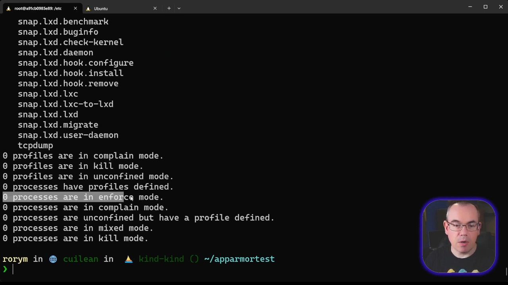
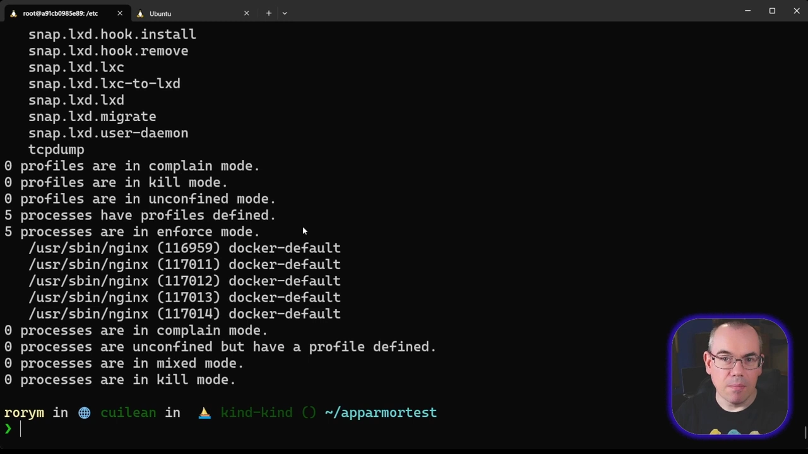
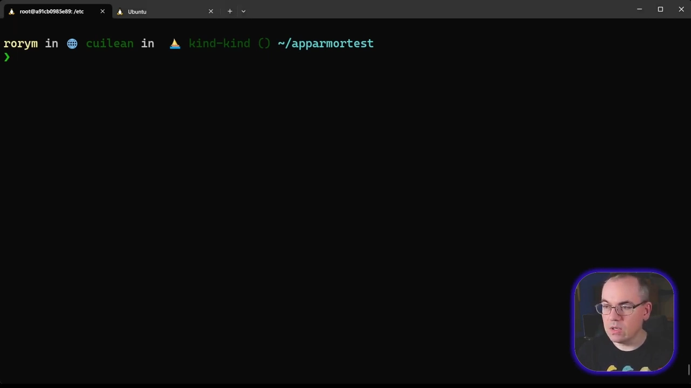

# 容器安全基础第 9 讲：AppArmor——给容器进程再上一道强制访问控制

> 视频来源：[Container Security Fundamentals - AppArmor — Datadog Security Labs](https://www.youtube.com/watch?v=_O1V57heEjY)（4 分 15 秒，英文字幕为 ASR 自动生成，术语已在本文中校正）
> 这是 Datadog「容器安全基础」系列的第 9 讲，上一讲主题是 cgroups（限制 CPU、内存等资源用量）。本文基于该视频的完整字幕整理，所有结论均可在视频对应画面处核对。

## 本讲要解决的核心问题（SCQA）

**背景**：上一讲的 cgroups 能限制容器能用多少 CPU、内存，防止某个进程把资源吃光、让邻居"挨饿"（noisy neighbor 问题）。[【跳转到 00:11】](https://www.youtube.com/watch?v=_O1V57heEjY&t=11)

**冲突**：资源限制管不住"行为"。容器里的进程就算只拿 1 核 1G，仍可以去改配置、删文件、发网络包——哪怕它以 root 身份运行，传统的自主访问控制（DAC，rwx 权限位那套）对 root 几乎全放行。[【跳转到 00:11】](https://www.youtube.com/watch?v=_O1V57heEjY&t=11)

**疑问**：能不能给宿主机上的进程（包括容器里的 root 进程）再加一道锁，只允许它做"声明过"的事？

**回答（中心思想）**：能，这套机制叫**强制访问控制（MAC，Mandatory Access Control）**：它在 DAC 之上再包一层，即使进程是 root，也只能做安全策略（profile）允许的事。Linux 上最常见的两个 MAC 实现是 **AppArmor**（Debian 系发行版）与 **SELinux**（Red Hat 系发行版），本讲聚焦 AppArmor。[【跳转到 00:36】](https://www.youtube.com/watch?v=_O1V57heEjY&t=36)

## 一、AppArmor 平时就在你的 Ubuntu/Debian 上跑着

AppArmor 不是容器专属组件。只要用 Ubuntu、Debian 这类发行版，即使完全不碰容器，AppArmor 也默认随系统运行——它保护的是宿主机上**所有**进程。[【跳转到 01:01】](https://www.youtube.com/watch?v=_O1V57heEjY&t=61)

查看状态用 `aa-status`（视频里是一台 Ubuntu 22.04 + Docker 的机器）：输出里有一长串已安装的 profile——每个 profile 都是针对特定应用定制的规则集；但此刻"enforce 模式下的进程数"是 **0**，说明这些规则还没有对任何进程生效。[【跳转到 01:15】](https://www.youtube.com/watch?v=_O1V57heEjY&t=75)

## 二、Docker 会自动给容器套上 docker-default

容器用户最该知道的一件事：**`docker run` 启动容器时，Docker 会自动为容器进程应用一个 AppArmor profile**，不需要你做任何配置。[【跳转到 01:40】](https://www.youtube.com/watch?v=_O1V57heEjY&t=100)

视频演示：`docker run -d nginx` 之后再跑 `aa-status`，enforce 模式下的进程从 0 变成 **5**——正好是 nginx 容器启动的 5 个进程，它们用的都是 **docker-default** 这个 profile。[【跳转到 01:40】](https://www.youtube.com/watch?v=_O1V57heEjY&t=100)

docker-default 的定位要说清楚：**它不是为严格限制而设计，而是为最大兼容性**——尽量不碍事，让绝大多数镜像开箱即用。所以别指望它挡住所有攻击；真要收紧，得自己写 profile。[【跳转到 02:05】](https://www.youtube.com/watch?v=_O1V57heEjY&t=125)

## 三、自定义 profile：连容器里的 root 也会被拒

自定义 profile 可以很小。视频给了一个只有一条规则的例子：**禁止向容器内的 /etc 目录写入**。写好 profile 后，用 `--security-opt apparmor=<profile名>` 把它挂到 `docker run` 命令上。[【跳转到 02:30】](https://www.youtube.com/watch?v=_O1V57heEjY&t=150)

效果如何？新容器里我们明明是 **root**，进到 /etc 下建文件，结果却是 `Permission denied`——注意，这次拒绝你的不是文件权限（DAC 层面 root 本来有全权），而是 **AppArmor** 在 MAC 层把它按住了。[【跳转到 02:55】](https://www.youtube.com/watch?v=_O1V57heEjY&t=175)

这就是 AppArmor 对容器的价值：**给"本该有权限"的进程再上一道锁**——即使攻击者拿下容器内 root，也做不成 profile 不允许的事。[【跳转到 03:20】](https://www.youtube.com/watch?v=_O1V57heEjY&t=200)

## 四、小结与系列的下一讲

- AppArmor 是 Debian/Ubuntu 系的 MAC 系统（Red Hat 系对应物是 SELinux），默认随系统运行；[【跳转到 00:36】](https://www.youtube.com/watch?v=_O1V57heEjY&t=36)
- Docker 默认给容器套上 **docker-default** profile——能用，但它是兼容优先、不是安全优先；[【跳转到 02:05】](https://www.youtube.com/watch?v=_O1V57heEjY&t=125)
- 想真正收紧：自定义 profile + `docker run --security-opt apparmor=...`；[【跳转到 02:30】](https://www.youtube.com/watch?v=_O1V57heEjY&t=150)
- MAC 生效时，连容器内 root 都会被拒绝。[【跳转到 02:55】](https://www.youtube.com/watch?v=_O1V57heEjY&t=175)

系列的下一讲转向 **seccomp 过滤器**——把限制从"能访问哪些文件"进一步收紧到"能发哪些系统调用"。[【跳转到 03:45】](https://www.youtube.com/watch?v=_O1V57heEjY&t=225)
