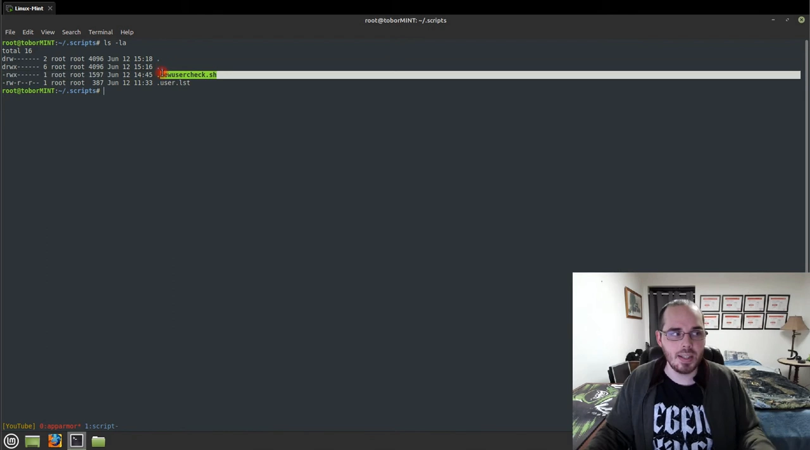
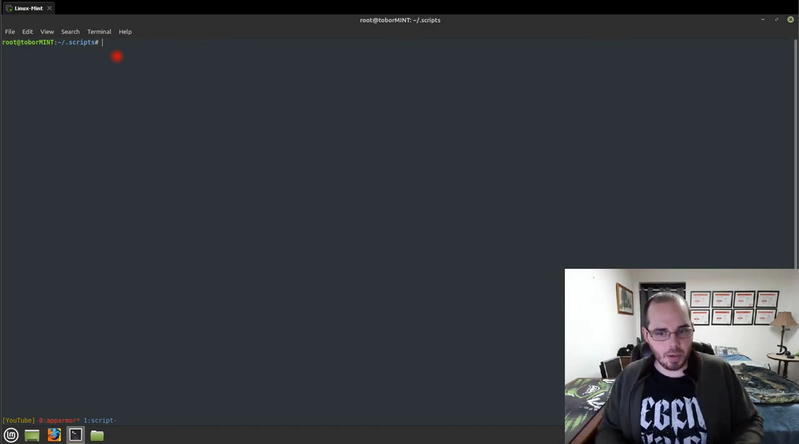
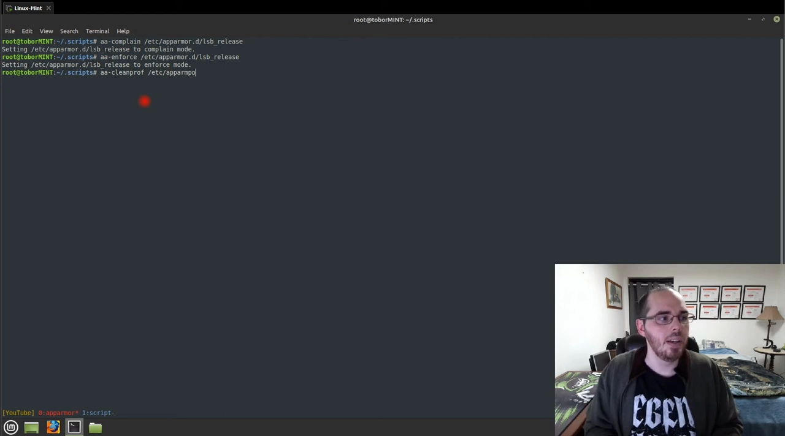
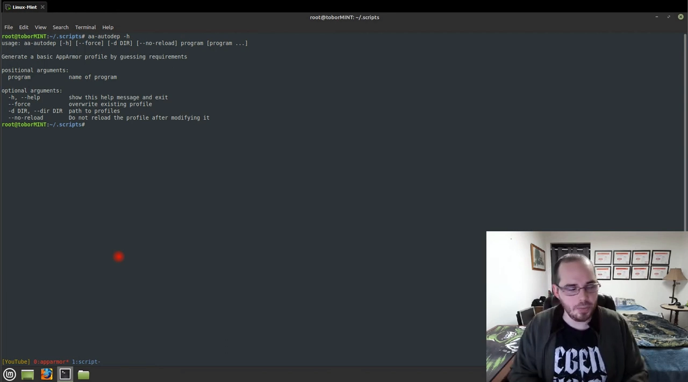
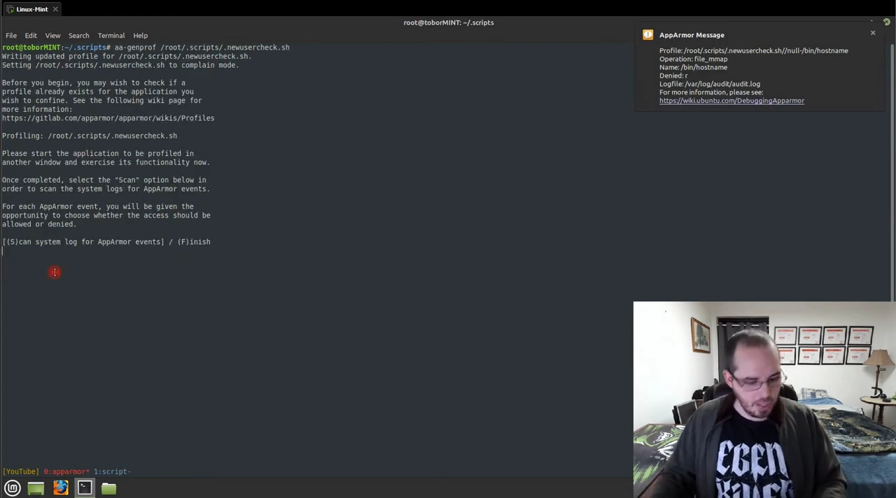
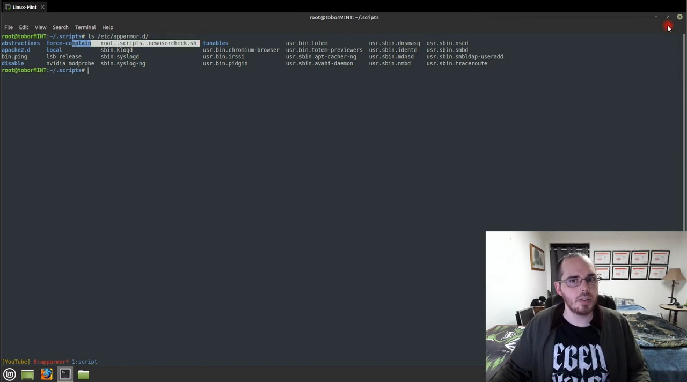
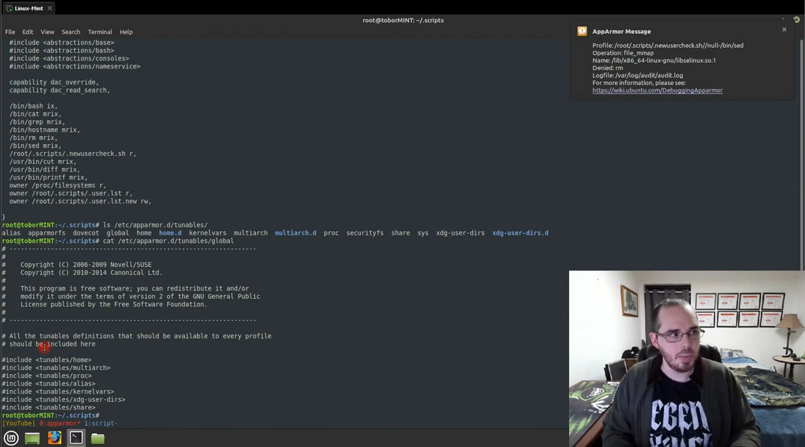

# AppArmor 入门：从安装到用 aa-genprof 生成第一个 profile

> 视频来源：[Getting Started with AppArmor (Debian Based Linux) — OsbornePro TV](https://www.youtube.com/watch?v=m2d_cm47Hwc)（26 分 14 秒，英文字幕为 ASR 自动生成，术语已在本文中校正）
> 本文基于该视频的完整字幕整理，所有命令与结论均可在视频对应画面处核对。

## 本讲要解决的核心问题（SCQA）

**背景**：Linux 对文件的保护依赖 DAC（自主访问控制）——也就是 `chmod` 那套 rwx 权限位：文件属主决定谁能读、写、执行。[【跳转到 00:30】](https://www.youtube.com/watch?v=m2d_cm47Hwc&t=30)

**冲突**：DAC 有个天生的弱点——**权限跟着"用户"走，不跟着"程序该干什么"走**。root 更是几乎全知全能：哪怕你写个只该比较两个文件的小脚本，一旦它被入侵或者自己写错了，root 身份能让它碰到机器上任何东西。[【跳转到 00:45】](https://www.youtube.com/watch?v=m2d_cm47Hwc&t=45)

**疑问**：能不能限制"这个程序"只能做"这类事"，而不是"这个用户"能做所有事？

**回答（中心思想）**：能，这就是 **AppArmor** 的用武之地：通过 **MAC（强制访问控制）** 把最小权限概念落到单个程序上——在 DAC 之上再包一层规则，即使执行者是 root，程序也做不了 profile（配置档案）没允许的事。[【跳转到 00:45】](https://www.youtube.com/watch?v=m2d_cm47Hwc&t=45)

## 一、先把工具装齐：6 个包 + auditd

AppArmor 本体在 Debian/Ubuntu 上通常已随内核启用，但要舒服地管理它，建议把这几个包装上（`apt install`）：[【跳转到 01:15】](https://www.youtube.com/watch?v=m2d_cm47Hwc&t=75)



| 包 | 作用 |
|---|---|
| `apparmor` | 服务本体 |
| `apparmor-profiles` / `apparmor-profiles-extra` | 预置的常用 profile，装好就有基础防护，落在 `/etc/apparmor.d/` |
| `apparmor-utils` | `aa-*` 系列管理命令（切换模式、生成 profile 等） |
| `apparmor-notify` | 桌面右上角的违规通知 |
| `easy-prof` | 一条命令输出 profile 模板，方便起步 |

另外强烈建议装 **auditd**：它把日志写到 `/var/log/audit/audit.log`，绕开内核对 syslog 的**限速**（`kernel.printk_rate_limit`，默认值 5，每秒最多几条，会丢 AppArmor 的拒绝记录）。不想装 auditd 的话，可以用 `sysctl` 把 `kernel.printk_rate_limit` 设为 0 关掉限速——生 profile 靠的就是这些日志，丢了记录就补不全规则。[【跳转到 02:00】](https://www.youtube.com/watch?v=m2d_cm47Hwc&t=120)

## 二、三种模式与日常管理命令

AppArmor 对一个程序的策略有三种形态：[【跳转到 05:51】](https://www.youtube.com/watch?v=m2d_cm47Hwc&t=351)


- **enforce（强制）**：按 profile 拦截越界行为——该拦的真的拦；
- **complain（抱怨）**：不拦，只把违规行为写进日志——**生成 profile 的主力工作模式**；
- **unconfined（不受限）**：既不拦也不记——等于没管。

日常检查与切换命令（都在 `apparmor-utils` 里）：[【跳转到 06:16】](https://www.youtube.com/watch?v=m2d_cm47Hwc&t=376)

```bash
aa-enabled                          # 普通用户就能查：AppArmor 是否启用（yes/no）
sudo aa-status                      # 加载了多少 profile、多少进程在 enforce/complain
sudo aa-enforce /etc/apparmor.d/lsb-release    # 把某 profile 切到 enforce
sudo aa-complain /etc/apparmor.d/lsb-release   # 切回 complain
sudo aa-cleanprof /etc/apparmor.d/xxx          # 清空 profile 内容，从零重写
sudo aa-teardown                    # 卸载当前所有 profile（演示用，慎在生产执行）
```

视频里实测：`aa-status` 显示 33 个 profile、32 个在 enforce、1 个在 complain；用 `aa-enforce` 把那个 complain 的切过去后再看，33 个全在 enforce。[【跳转到 06:41】](https://www.youtube.com/watch?v=m2d_cm47Hwc&t=401)



一个实用兜底：如果 `aa-teardown` 之后后悔了，`apt install --reinstall apparmor` 重装一遍，预置 profile 全部回来，什么都没丢。[【跳转到 08:21】](https://www.youtube.com/watch?v=m2d_cm47Hwc&t=501)



## 三、两条生成路径：aa-autodep 还是 aa-genprof？

给程序建 profile 有两条路，按程序形态选择：[【跳转到 10:51】](https://www.youtube.com/watch?v=m2d_cm47Hwc&t=651)



- **`aa-autodep`**：静态扫描系统文件、"猜"出程序需要什么，适合**长驻系统服务**这类跨重启、一跑几个月的进程；
- **`aa-genprof`**：交互式引导，适合**独立脚本/程序**——你运行一次程序，它把期间发生的每次访问记录下来逐条问你"允许吗"，生成的规则与真实行为一一对应。

另有 `aa-easyprof` 可以直接输出一份 profile 模板文本（重定向到文件或复制粘贴都行），适合先有骨架再手工改。生成的 profile 统一放在 `/etc/apparmor.d/`，**文件名按可执行文件的绝对路径转换**（斜杠换成点）：脚本在 `/root/scripts/new_user_check.sh`，profile 文件就叫 `root.scripts.new_user_check.sh`。[【跳转到 11:16】](https://www.youtube.com/watch?v=m2d_cm47Hwc&t=676)

## 四、实例：给 new_user_check.sh 生成 profile

视频用一个真实脚本走完整流程：`new_user_check.sh` 监控 `/etc/passwd`，一旦出现新用户就发邮件告警，并在隐藏文件 `.user.list` 里维护用户快照（每次对比新旧、有差异就更新）。[【跳转到 08:46】](https://www.youtube.com/watch?v=m2d_cm47Hwc&t=526)

分析这个脚本要"吃"哪些东西：执行 `hostname`、`cat`、`printf`、`cut`、`diff`、`sed`、`grep` 等命令，读 `/etc/passwd`，读写 `.user.list`。这些都要在 profile 里逐条放行。[【跳转到 09:21】](https://www.youtube.com/watch?v=m2d_cm47Hwc&t=921)

`aa-genprof /root/scripts/new_user_check.sh` 的引导流程：[【跳转到 12:26】](https://www.youtube.com/watch?v=m2d_cm47Hwc&t=746)

1. 先把 profile 放进 **complain 模式**（只记录不拦截）；
2. 你去**执行一次脚本**，让它真实地跑一遍；
3. 回到 aa-genprof 按 **S** 扫描系统日志，逐条弹出访问记录让你裁决；
4. 全部过完按 **F** 完成，profile 写入 `/etc/apparmor.d/`。

### 4.1 执行权限：inherit / ix / px / unconfined

第一个弹出的子命令是 `hostname`，严重度"未知"（因为它的风险本来就低），选 **i（inherit，继承）**——子命令继承父进程（bash）的权限上下文。[【跳转到 13:41】](https://www.youtube.com/watch?v=m2d_cm47Hwc&t=821)

| 选项 | 含义 |
|---|---|
| `i` (inherit) | 继承父进程权限——绝大多数场景都选它（视频里 printf、cat、cut、diff、grep、sed 一路 inherit） |
| `ix` | 执行并继承（作用与 inherit 相近，显式写法） |
| `px` | 进入独立 profile 执行——相当于另开一个受管环境，适合要单独限权的子命令 |
| unconfined | 完全不受限不记录——**别选** |



### 4.2 能力（capability）与文件规则

接下来弹出的是 **capability** 类请求，如 `dac_read_search`、`dac_override`——这是 root 读写"不属于自己"的文件时需要的内核能力，按需放行。[【跳转到 16:11】](https://www.youtube.com/watch?v=m2d_cm47Hwc&t=971)

然后是文件规则逐条确认：`/etc/passwd` 只读；`.user.list` 要**读写**（首次运行文件还不存在，得允许创建；之后有新用户还得允许更新）；`user.list.new` 读写；文件系统与 `/proc` 只读。对目录类规则还可以用 **glob**：通配符放行整个目录、按扩展名放行（比如只放行 `*.sh`）。[【跳转到 16:11】](https://www.youtube.com/watch?v=m2d_cm47Hwc&t=971)

### 4.3 生成的 profile 长什么样

按 F 完成后，`cat /etc/apparmor.d/root.scripts.new_user_check.sh`，能看到这样几层结构：[【跳转到 20:21】](https://www.youtube.com/watch?v=m2d_cm47Hwc&t=1221)



```apparmor
#include <tunables/global>          # 变量等公共定义
root.scripts.new_user_check.sh {
  #include <abstractions/bash>      # bash 的基础抽象
  capability dac_override,
  capability dac_read_search,
  /usr/bin/cat ix,                  # 可执行文件：ix = 执行并继承本 profile
  ...
  /etc/passwd r,                    # 只读
  owner /root/.user.list rw,        # 属主读写
}
```

- `#include` 引入**抽象层**（abstractions）：`tunables/global` 是全局变量定义，`abstractions/bash` 打包了 bash 的常用规则，避免每个 profile 从零写起；[【跳转到 21:07】](https://www.youtube.com/watch?v=m2d_cm47Hwc&t=1267)
- `capability` 行对应刚才交互时放行的内核能力；[【跳转到 21:32】](https://www.youtube.com/watch?v=m2d_cm47Hwc&t=1292)
- 可执行文件带 `ix`——它们继承本 profile 的上下文被放行执行；[【跳转到 21:32】](https://www.youtube.com/watch?v=m2d_cm47Hwc&t=1292)
- 文件规则里 `r`、`w`、`owner` 前缀分别表示只读、写、仅属主。[【跳转到 21:32】](https://www.youtube.com/watch?v=m2d_cm47Hwc&t=1292)



## 五、把 profile 装进内核与善后

profile 文件只是磁盘上的文本，**要重新装载进内核才生效**：[【跳转到 22:51】](https://www.youtube.com/watch?v=m2d_cm47Hwc&t=1371)

```bash
sudo apparmor_parser -r /etc/apparmor.d/root.scripts.new_user_check.sh  # -r 重载
sudo systemctl restart apparmor      # 或重启服务整体重载
sudo aa-logprof                      # 复查：有无漏掉的新访问记录
sudo aa-status                       # 确认新 profile 已出现在 enforce 列表
```

反向操作（删掉一个 profile）分三步：[【跳转到 24:56】](https://www.youtube.com/watch?v=m2d_cm47Hwc&t=1496)

```bash
sudo apparmor_parser -R /etc/apparmor.d/root.scripts.new_user_check.sh  # -R 从内核卸载
rm /etc/apparmor.d/root.scripts.new_user_check.sh                        # 删文件
sudo aa-remove-unknown                                                   # 清掉残留
sudo systemctl restart apparmor
```


## 六、小结

- AppArmor 用 **MAC** 在 DAC 之上给"单个程序"加最小权限，root 也会被拦；[【跳转到 00:45】](https://www.youtube.com/watch?v=m2d_cm47Hwc&t=45)
- 三种模式：**enforce 拦截 / complain 只记日志 / unconfined 不设防**；生 profile 靠 complain 模式攒日志；[【跳转到 05:51】](https://www.youtube.com/watch?v=m2d_cm47Hwc&t=351)
- 长驻服务用 `aa-autodep` 静态生成，独立脚本用 `aa-genprof` 交互式生成，`aa-easyprof` 出模板；[【跳转到 10:51】](https://www.youtube.com/watch?v=m2d_cm47Hwc&t=651)
- profile 放 `/etc/apparmor.d/`、文件名按路径转点；改完要 `apparmor_parser -r` 重载进内核；[【跳转到 22:51】](https://www.youtube.com/watch?v=m2d_cm47Hwc&t=1371)
- 删除走"parser -R 卸载 → 删文件 → aa-remove-unknown 清残留"。[【跳转到 24:56】](https://www.youtube.com/watch?v=m2d_cm47Hwc&t=1496)

下一讲将把视角切到容器：Docker 如何默认给容器套上 AppArmor profile、以及 K8s 里怎么给 Pod 挂 profile。
