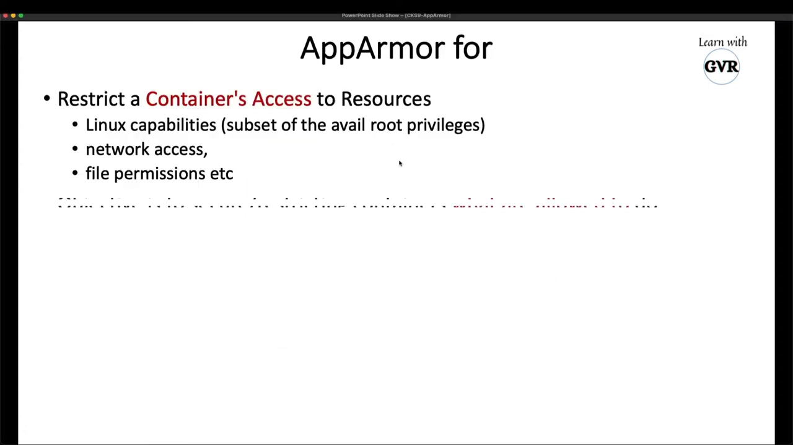
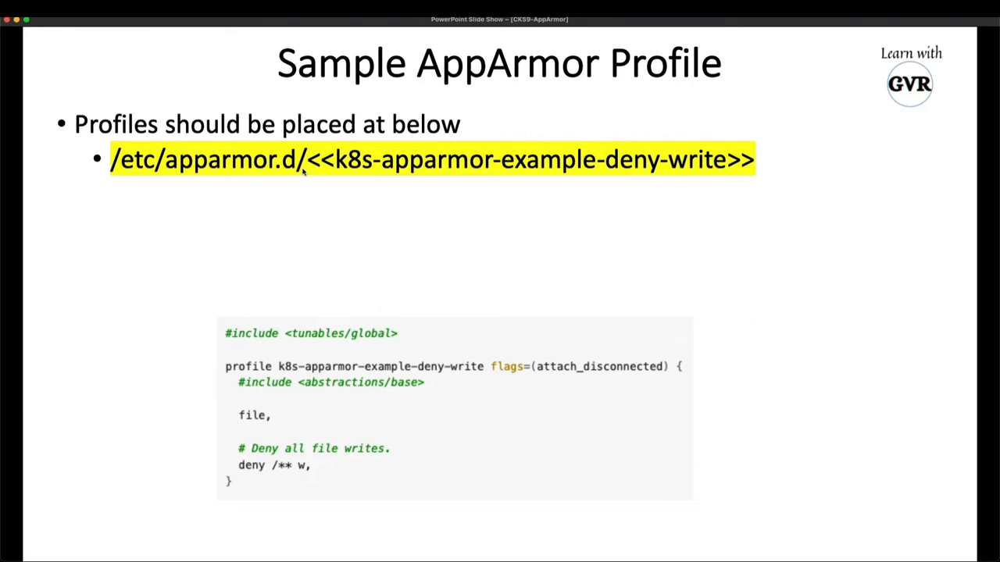
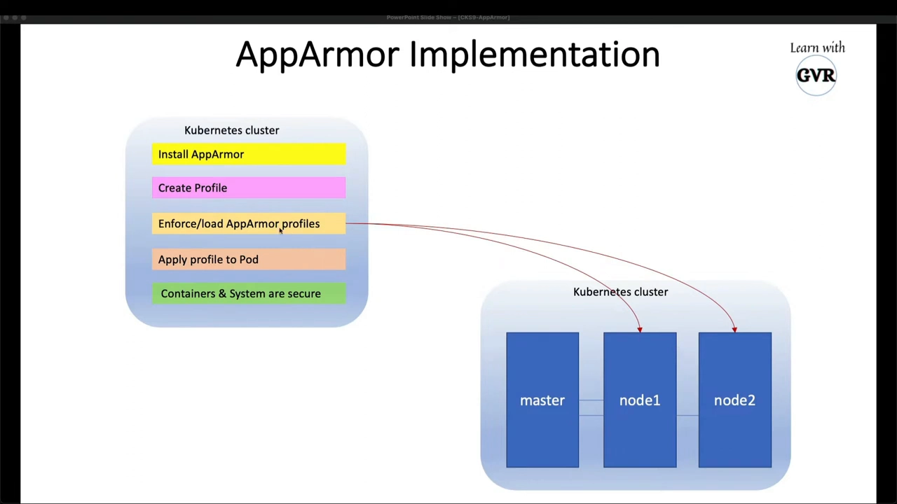
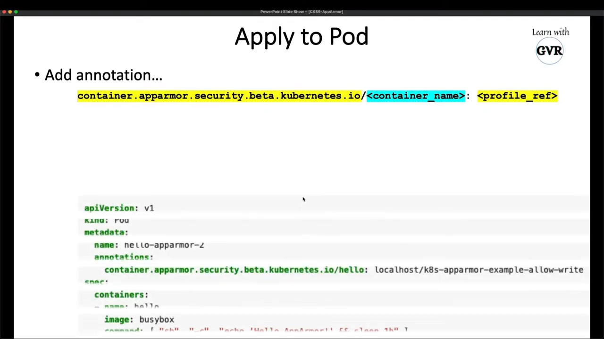
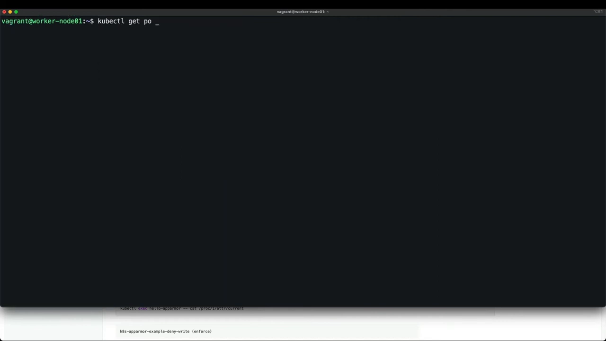
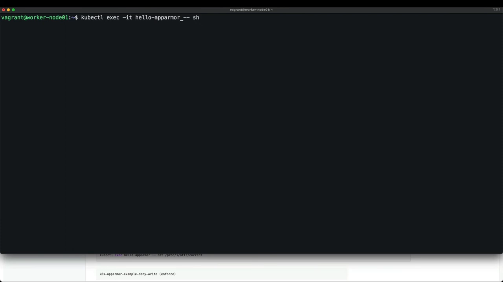
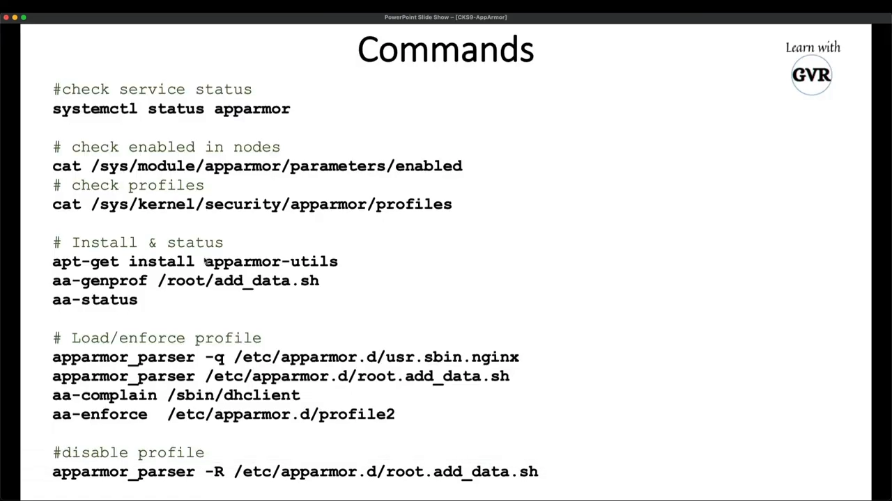

# 用 AppArmor 限制容器能做什么：内核 profile 与 K8s Pod 注解实操

> 视频来源：[Kubernetes Security - Restrict Container Access with AppArmor — Learn with GVR（CKS 备考系列第 9 讲）](https://www.youtube.com/watch?v=Eo4qHuhod10)（32 分 48 秒，英文字幕为 ASR 自动生成，术语已在本文中校正）
> 本文基于该视频的完整字幕整理，所有命令与结论均可在视频对应画面处核对。

## 本讲要解决的核心问题（SCQA）

**背景**：CKS（Certified Kubernetes Security Specialist）考纲在 System Hardening（系统加固）下明确要求：**会使用内核加固工具，例如 AppArmor**。[【跳转到 00:14】](https://www.youtube.com/watch?v=Eo4qHuhod10&t=14)

**冲突**：任何 Linux 宿主机都分**内核空间**与**用户空间**，用户空间的应用（Tomcat、Docker、以及跑在 Docker 里的所有容器）都要通过**系统调用**请内核代劳——touch 建文件、open/close 读写文件、收发网络包，全是系统调用。一个拿到 root 或高危 capability 的容器进程，可以借这些调用把宿主机搅得天翻地覆。[【跳转到 01:20】](https://www.youtube.com/watch?v=Eo4qHuhod10&t=80)

**疑问**：能不能在内核层面规定"这个容器只准做这些事"，越界的一律拒绝？

**回答（中心思想）**：能。按 K8s 官方文档的定义，**AppArmor 是一个内核安全模块**，它限制容器对资源的访问——具体限制三类东西：**Linux capabilities**（root 特权的子集）、**文件访问（MAC 文件权限）**、**网络访问**。用法上，你把限制写成 **profile**（一组规则）加载进内核，再让 Pod 通过注解引用它。[【跳转到 03:47】](https://www.youtube.com/watch?v=Eo4qHuhod10&t=227)



## 一、profile 与两种模式

**profile 就是一组规则的集合**（比如"拒绝写某个目录"），写好后**加载进内核**才生效。加载时有两种模式：[【跳转到 10:11】](https://www.youtube.com/watch?v=Eo4qHuhod10&t=611)

- **enforce（强制）**：默认模式，不指定就是它——规则真的拦截，禁写就真的写不进去；
- **complain（抱怨）**：只把违规记录写进系统日志，不拦截——用来"试跑"一个新 profile，观察它会拦什么。



落地到 K8s 集群是固定四步（讲者强调第 1、3 步要在**每个节点**上做——新节点加入也得补，通常用 Ansible 之类的工具自动化）：[【跳转到 08:00】](https://www.youtube.com/watch?v=Eo4qHuhod10&t=480)

1. 在节点上安装 AppArmor（Ubuntu 20.04 之类的主流发行版默认已装好）；
2. 编写 profile；
3. 用 `apparmor_parser` 把 profile 加载进**每个节点的内核**；
4. 在 Pod 上加注解引用该 profile。

## 二、示例 profile 与注解写法

示例 profile 取自 K8s 官方文档（CKS 指南 System Hardening 一节），取名 `k8s-apparmor-example`，规则是一条**拒绝文件写**的 deny 规则；文件放在默认目录 `/etc/apparmor.d/`（也可以放别处，但推荐用默认路径，免得加载时要额外处理）：[【跳转到 08:24】](https://www.youtube.com/watch?v=Eo4qHuhod10&t=504)



Pod 侧用**注解**引用 profile，格式是 `container.apparmor.security.beta.kubernetes.io/<容器名>: <profile引用>`——注意键里填的是**容器名**（演示里是 `hello`），不是 Pod 名；值有三种写法：[【跳转到 11:59】](https://www.youtube.com/watch?v=Eo4qHuhod10&t=719)

| profile 引用 | 含义 |
|---|---|
| `runtime/default` | 容器运行时（Docker、containerd、CRI-O 等）自带的默认 profile |
| `localhost/<profile名>` | 本节点已加载的 profile（就是上面放进 `/etc/apparmor.d/` 并加载的那个） |
| `unconfined` | 不套任何 profile——**生产环境不推荐**，等于对容器行为完全不设防 |



## 三、实操：同一个 Pod，加注解前后对比

讲者在两节点集群上完整走了一遍（工作节点是 Ubuntu 20.04）。先在节点上确认 AppArmor 就绪：[【跳转到 19:12】](https://www.youtube.com/watch?v=Eo4qHuhod10&t=1152)

```bash
sudo systemctl status apparmor                       # 默认已安装、active (exited)
cat /sys/module/apparmor/parameters/enabled          # 内核模块开关，Y
sudo apparmor_parser /etc/apparmor.d/k8s-apparmor-example   # 加载 profile 进内核
sudo aa-status                                       # 输出里能看到 k8s-apparmor-example
```

profile 加载成功后，先建一个**不带注解**的普通 Pod（容器名 `hello`），进去验证一切写操作畅通：[【跳转到 21:22】](https://www.youtube.com/watch?v=Eo4qHuhod10&t=1282)

```bash
kubectl apply -f pod.yaml && kubectl exec -it <pod> -- sh
touch test                     # 成功
echo 123 > test2.txt           # 成功
mkdir gvr                      # 成功
```



然后给同一个 Pod 加上注解 `container.apparmor.security.beta.kubernetes.io/hello: localhost/k8s-apparmor-example`，**删除旧 Pod 重新 apply**（注解不可热改，必须重建），`kubectl describe pod` 里能看到 AppArmor profile 已启用。[【跳转到 24:19】](https://www.youtube.com/watch?v=Eo4qHuhod10&t=1459)

再次进去测试，同一个人、同样的 root 上下文，所有写操作全部被拒：[【跳转到 25:09】](https://www.youtube.com/watch?v=Eo4qHuhod10&t=1509)

```bash
touch test            # Permission denied
echo hello > t.txt    # Permission denied
mkdir gvr             # Permission denied
rmdir /tmp/x          # Permission denied
```



原因正是本讲开头那张图：touch、mkdir 这些操作本质是**系统调用**，AppArmor 在内核层面按 profile 把它们挡住了。假设这个 `hello` 容器是个 Web 服务，即使被攻破，攻击者也写不了文件、建不了目录——这就是"内核加固"对容器的意义。按用例微调也很直观：比如只允许写 /tmp，就在 profile 里对 /tmp 加 allow 规则、对其余目录保持 deny。[【跳转到 25:59】](https://www.youtube.com/watch?v=Eo4qHuhod10&t=1559)

## 四、profile 的卸载与抱怨模式

从内核卸载（删除）profile 用 `apparmor_parser -R`，之后 `aa-status` 里就查不到了：[【跳转到 27:29】](https://www.youtube.com/watch?v=Eo4qHuhod10&t=1649)

```bash
sudo apparmor_parser -R /etc/apparmor.d/k8s-apparmor-example
sudo aa-status
```



两个补充要点：[【跳转到 28:10】](https://www.youtube.com/watch?v=Eo4qHuhod10&t=1690)

- profile 文件其实可以放在任意位置（比如系统的 snapd profile 就分布在 `/usr/lib/...` 各处），关键是**加载时传入正确路径**；
- 要切抱怨模式：`aa-complain /etc/apparmor.d/<profile名>`（enforce 是默认，无需额外动作）。

进阶规则（网络规则、按扩展名拒绝如 `*.jpg`、`*.png` 等）在 AppArmor 官方文档的 profiles 章节都有详细说明，按需查阅即可。[【跳转到 29:00】](https://www.youtube.com/watch?v=Eo4qHuhod10&t=1740)

## 五、小结

- AppArmor 是**内核安全模块**，限制容器的 capabilities、文件访问与网络访问；[【跳转到 03:47】](https://www.youtube.com/watch?v=Eo4qHuhod10&t=227)
- 限制内容写成 **profile**，`apparmor_parser` 加载进内核；**每个节点都要加载**；[【跳转到 08:00】](https://www.youtube.com/watch?v=Eo4qHuhod10&t=480)
- Pod 通过注解 `container.apparmor.security.beta.kubernetes.io/<容器名>` 引用 profile；引用三态：`runtime/default`、`localhost/<名字>`、`unconfined`（生产不推荐）；[【跳转到 11:59】](https://www.youtube.com/watch?v=Eo4qHuhod10&t=719)
- 实测对比：无注解时写操作畅通；挂上 deny 写的 profile 后，容器内 touch/echo/mkdir/rmdir 全部 Permission denied；[【跳转到 25:09】](https://www.youtube.com/watch?v=Eo4qHuhod10&t=1509)
- 管理命令：`apparmor_parser` 加载、`-R` 卸载、`aa-complain` 切抱怨模式、`aa-status` 验证。[【跳转到 28:10】](https://www.youtube.com/watch?v=Eo4qHuhod10&t=1690)
