# SELinux 在容器化世界：容器如何被"关住"，卷挂载为什么会咬人

> 本文整理自 DevConf.CZ 2024 演讲 **《SELinux in the containerized world》**（Red Hat OpenShift 存储团队工程师）。原视频：[SELinux in the containerized world - DevConf.CZ 2024](https://www.youtube.com/watch?v=sRcwwuoyY5E)。

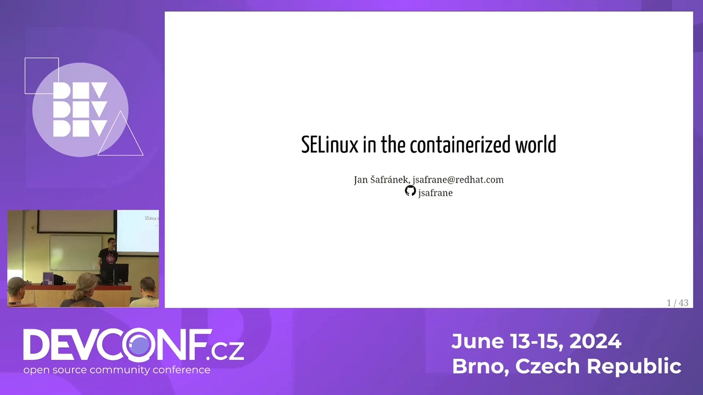

## 本讲要解决的核心问题（SCQA）

**背景**：容器已经是日常——`podman run` / `docker run` 一敲，应用就跑在一个"隔离的小世界"里。很多人把容器当作便宜的虚拟机来用。

**冲突**：容器并不总是"关得住"——历史上多次出现容器逃逸漏洞；而另一方面，想在容器里挂载宿主机目录存数据时，又经常被 SELinux 拦住，或者容器明明没坏却启动得奇慢无比，怎么排查都查不到原因。

**疑问**：SELinux 到底怎么保护容器？为什么挂个卷这么多讲究？Kubernetes / OpenShift 环境下又是什么玩法？

**回答（中心思想）**：容器场景下 SELinux 的默认玩法是 `container_t` 进程标签 + `container_file_t` 文件标签 + **MCS 双分类**——每个容器随机拿一对分类，分类不匹配就拒绝，做到"容器里发生的事，留在容器里"。真正的坑集中在**卷挂载的重打标签（relabel）**上：理解 `:Z` / `:z` 选项、K8s 的"一律私有标签"、OpenShift SCC 的标签注入，以及 Kubernetes 1.29 的 context mount，才能既享受保护又不被咬。

## 一、没有 SELinux 的世界：root 被拿下，权限位形同虚设

Linux 原生安全模型由三件套构成：**用户 ID / 组 ID、文件属主、权限位**。内核每次放行访问都在查这张表：Web 服务器以 `apache` 用户运行，读静态页面——进程属主、文件属主、权限位，对得上，放行[【跳转到 01:40】](https://www.youtube.com/watch?v=sRcwwuoyY5E&t=100)。这套机制每天被使用数百万次，平时工作得很好。

问题出在**漏洞**上：一旦攻击者拿下 Web 服务的漏洞并成功提权到 root，同一张权限表立刻反过来为攻击者服务——root 对所有文件都有权限，`/etc/shadow`（密码哈希）想读就读。

**SELinux 补的就是这一层**：它与用户、权限位完全独立。每个进程领到一个标签（如 Web 服务器进程是 `httpd_t`），每个文件也有标签（如网页文件是 `httpd_sys_content_t`），内核里的策略规定"什么标签的进程可以碰什么标签的文件"[【跳转到 02:55】](https://www.youtube.com/watch?v=sRcwwuoyY5E&t=175)。于是：即使 Web 服务器以 root 身份运行，策略里没有"`httpd_t` → `shadow_t`"这条规则，访问照样被拒——**SELinux 能拦住 root 干坏事**。

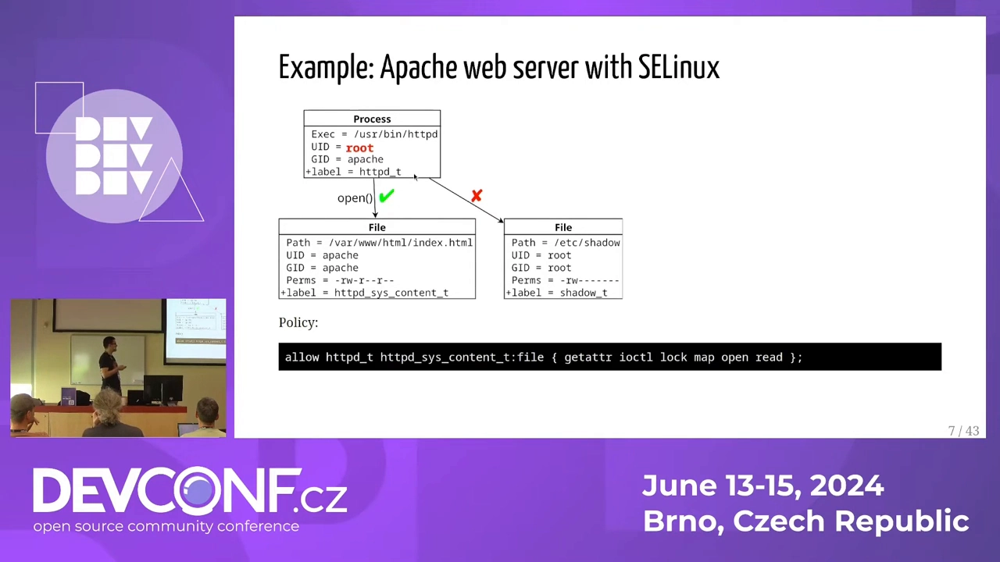

## 二、容器里的 SELinux：container_t、container_file_t 与 MCS 双分类

### 2.1 默认标签：一套极简策略

大多数容器运行时（Podman、CRI-O 默认开启；Docker / containerd 需要显式开启）会给容器进程打上 **`container_t`** 标签，给容器内所有文件打上 **`container_file_t`** 标签[【跳转到 04:00】](https://www.youtube.com/watch?v=sRcwwuoyY5E&t=240)。默认策略只有一句话：

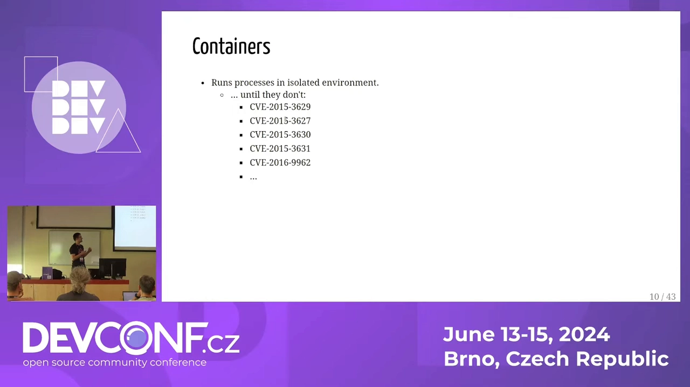

> `container_t` 对 `container_file_t` 可以做任何事；除此之外一律不行。

### 2.2 MCS：让 100 万个容器互不串门

如果所有容器都共享同一对标签，那容器之间就没有隔离了。解决方案是 **MCS（Multi-Category Security，多类安全）**：给每个容器**随机分配两个分类（category）**，比如 `c53,c79`，同时把这对接到该容器所有文件的标签上。访问规则加一条：**进程的分类必须与文件的分类匹配**[【跳转到 05:00】](https://www.youtube.com/watch?v=sRcwwuoyY5E&t=300)。

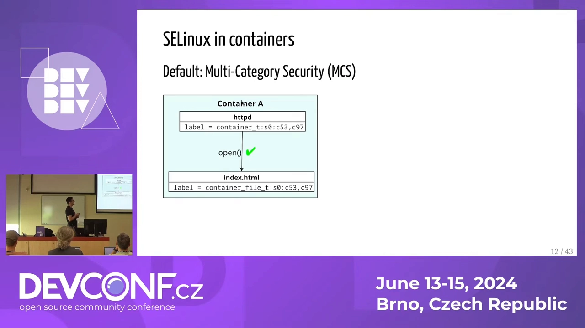

为什么是两个分类？每个分类取值 0–1023：

- 一个分类：只有 1024 种组合，一台机器最多 1024 个容器，不够用；
- 两个分类：约 **50 万**种组合，单机足够；
- 三个分类：没必要。

于是隔离效果是双层的：容器 A 被攻破后想读容器 B 的文件——分类不匹配，拒绝；想读宿主机文件——`container_t` 碰不了 `shadow_t` 等宿主标签，拒绝。讲者的总结是这句顺口溜[【跳转到 06:15】](https://www.youtube.com/watch?v=sRcwwuoyY5E&t=375)：**"What happens in a container stays in the container"**——攻击者可以在容器里挖矿、搞僵尸网络，随便折腾，但宿主机和其它容器是安全的。（注意：保护的是"外面"，容器自己内部并不安全。）

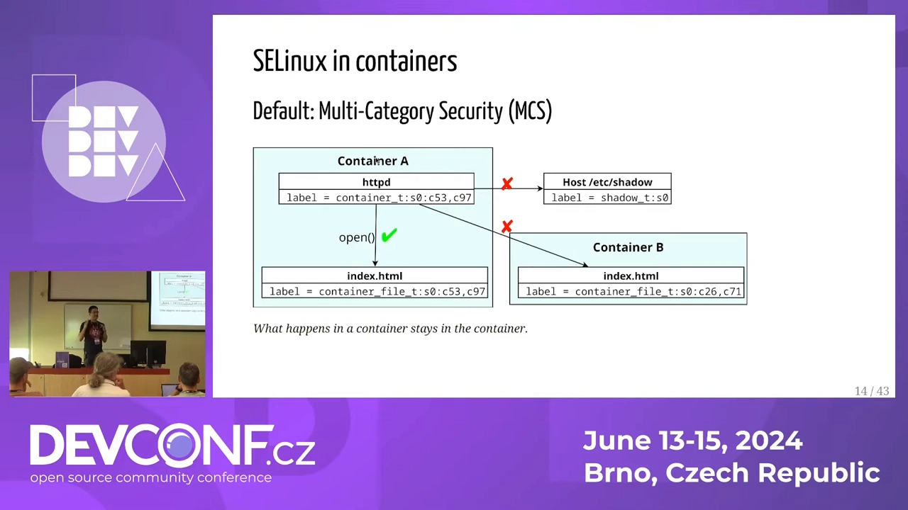

## 三、卷挂载：`:Z` 与 `:z`，以及每次启动都全量重打标签

### 3.1 数据要持久，目录在宿主，冲突就来了

容器是临时的：在容器里跑 MongoDB，容器一停数据就没了。于是有了**容器卷（volume）**——把宿主机目录（比如挂了持久盘的 `/mnt/my`）映射进容器（如容器的 `/data/db`），数据落盘、重启不丢[【跳转到 07:53】](https://www.youtube.com/watch?v=sRcwwuoyY5E&t=473)。

但矛盾紧接着出现：上一节刚说过"容器不能访问宿主机的东西"，而 `/mnt/my` 恰恰是宿主机目录。SELinux 检查标签：容器进程是 `container_t`，目录是宿主标签（如 `var_t`），不匹配——**Permission denied**。

### 3.2 `:Z` 与 `:z`：让运行时帮你改标签

Podman / Docker 的 `-v` 参数在冒号后支持选项[【跳转到 08:30】](https://www.youtube.com/watch?v=sRcwwuoyY5E&t=510)：

```bash
podman run -v /mnt/my:/data/db:Z ...   # 私有标签
podman run -v /mnt/my:/data/db:z ...   # 共享标签
```

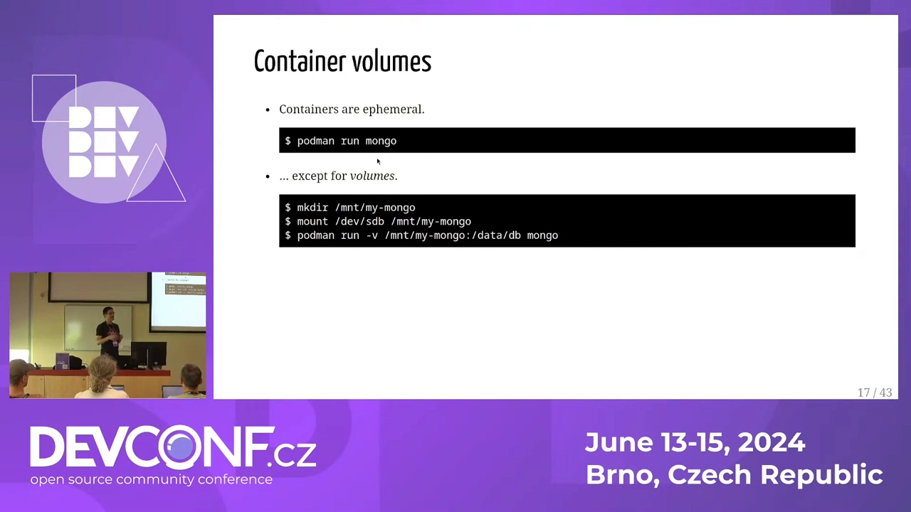

- **`:Z`（大写）**：运行时递归遍历整个卷，把所有文件重打标签为**带该容器分类的** `container_file_t`——只有这个容器能访问；
- **`:z`（小写）**：打上**不带分类的共享标签**——任何容器都能访问，适合多个容器共享一份数据；
- **不带选项**：只做 bind mount，标签问题自己解决（自己 relabel，或写自定义策略）。

### 3.3 被忽视的代价：每次启动都从头 relabel

`:Z` 的隐藏成本常被忽略。容器每次启动时[【跳转到 10:33】](https://www.youtube.com/watch?v=sRcwwuoyY5E&t=633)：

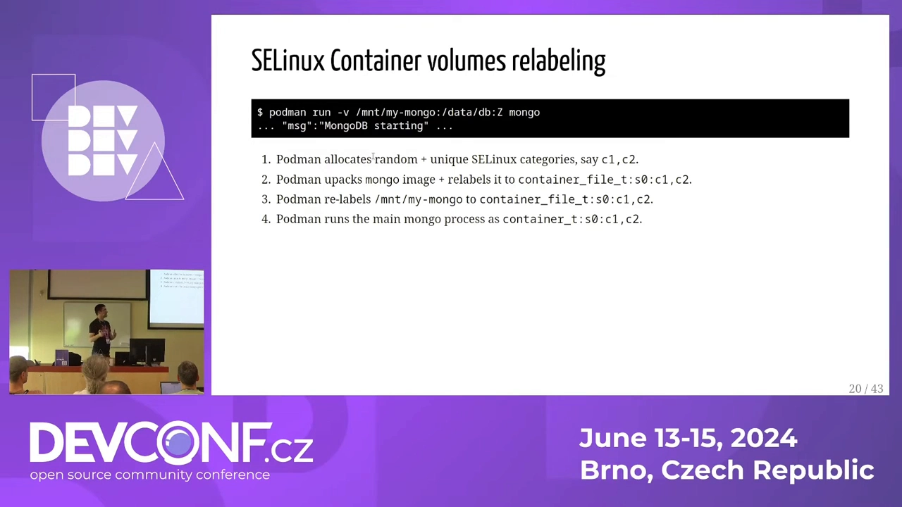

1. 运行时给容器分配**新的随机分类**（每次重启都不同）；
2. 镜像解包到本地存储并重打标签——这在 SSD 上很快，不用太担心；
3. **卷里的每一个文件**都被遍历、重打标签——目录里有几百万个文件、或者卷在网络存储（NFS 之类，元数据操作慢）上时，容器会**启动得非常慢**，而且**每次重启都重来一遍**[【跳转到 12:06】](https://www.youtube.com/watch?v=sRcwwuoyY5E&t=726)。

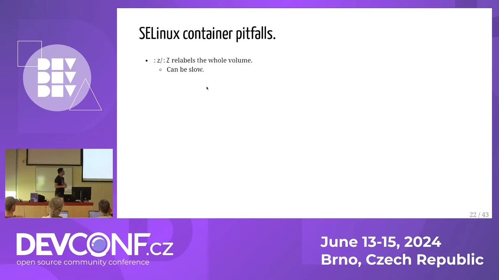

## 四、Docker socket 与"好心"的 relabel：真正的安全坑

`docker` 客户端拿着 socket 就能让守护进程"贴心地"帮你解决一切标签问题[【跳转到 13:00】](https://www.youtube.com/watch?v=sRcwwuoyY5E&t=780)：你想把宿主机的 `/etc/shadow` 挂进容器？docker 不仅挂，还会顺手 relabel 让你能读（演示中 `/etc/shadow` 其实有特殊保护改不了标签，但把例子换成 SSH 私钥等敏感文件，效果完全一样）；把宿主机根目录整个挂进去？docker 也很乐意把**整个宿主机**重新打标签给你。

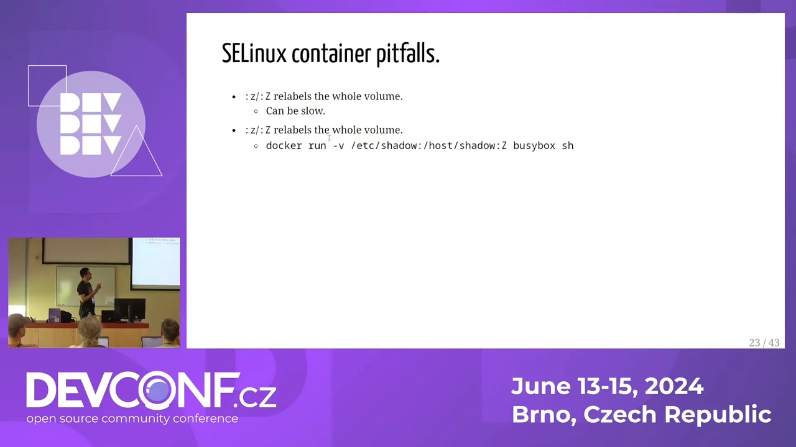

结论只有两条：

- **绝不要把 Docker socket 交给不可信的一方**（挂载 `-v /var/run/docker.sock` 等于送出宿主机 root 级能力）；
- rootless 模式的 Docker / Podman 因为没有权限改标签，反而没有这个坑。

## 五、比 relabel 更好的路：自定义策略与 udica

`:Z` 的本质是"把宿主目录变成容器私有的"，代价大还破坏宿主标签。**更正确的姿势是：不动宿主机标签，写一条 SELinux 策略**，允许"某容器的标签可以读写 `/mnt/my`"[【跳转到 13:46】](https://www.youtube.com/watch?v=sRcwwuoyY5E&t=826)。Podman 生态里有 **udica** 工具，可以根据容器配置自动生成这样的策略模块；Kubernetes / OpenShift 侧没有全自动工具，但也有向系统注入策略的辅助手段。原则一句话：**relabel 是给宿主"动刀"，自定义策略是给规则"加行"——后者才是正解**。

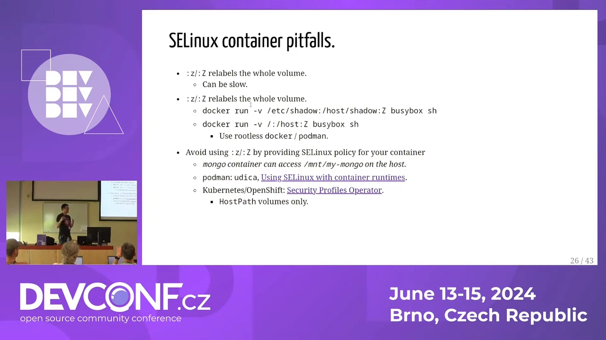

## 六、Kubernetes 与 OpenShift：随机 MCS、私有标签与 SCC

### 6.1 原生 Kubernetes：能用，但"没人这么用"

Pod 规约里其实有字段可以显式指定容器的 SELinux 标签和 MCS 分类（`securityContext.seLinuxOptions`），Kubernetes 会原样传给容器运行时[【跳转到 15:11】](https://www.youtube.com/watch?v=sRcwwuoyY5E&t=911)。但现实中**几乎没有人设置**——结果就是每个 Pod 拿到随机 MCS 分类。

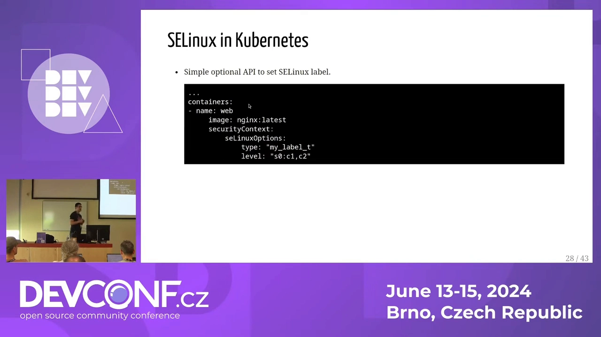

卷的行为也是定死的：**所有卷一律打私有标签**——没有 `:z` 的共享标签 API，也没有退出 relabel 的 API。于是"两个 Pod 共享一个卷"变得很麻烦：必须手工给两个 Pod 设置相同的 SELinux 标签（还得自己跟踪维护），或者指望策略引擎（Gatekeeper 之类——但它们大多不认识 SELinux）。

### 6.2 OpenShift：CRI-O + enforcing + SCC 注入

OpenShift 的做法激进得多：只支持 CRI-O 作为容器引擎，并且 **SELinux enforcing 是强制开启**的（讲者称这可能是唯一默认 enforcing 的企业级 Kubernetes 发行版）。

它有一层策略引擎叫 **SCC（Security Context Constraints，安全上下文约束）**[【跳转到 18:12】](https://www.youtube.com/watch?v=sRcwwuoyY5E&t=1092)。默认的 `restricted-v2` SCC 会在创建命名空间时给该 namespace 分配一组固定的 MCS 分类，并**自动注入到其中所有 Pod 的 SELinux 标签里**。效果：

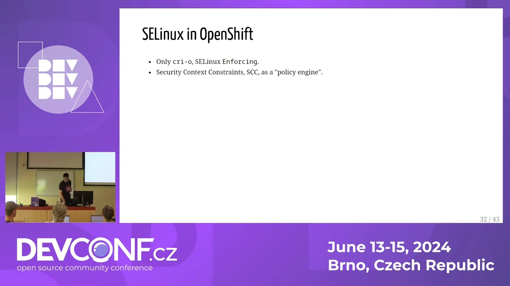

- 同一命名空间内的所有 Pod 共享同一对分类 → **共享卷变得很容易**（不需要手工对齐标签）；
- 隔离边界从"容器"上移到"命名空间"：**"What happens in a namespace stays in the namespace"**——容器逃逸后能祸害同 namespace 的邻居，但出不了 namespace；
- `privileged` SCC 则撤掉所有护栏，Pod 可以自带标签或让 CRI-O 随机分配；把 restricted 和 privileged 的 Pod 混在同一个 namespace 时要小心标签不匹配导致互相读不了数据。

## 七、relabel 咬人的故事：Jenkins 与 170 万个文件

讲者用一个真实感十足的案例说明 relabel 的杀伤力[【跳转到 22:24】](https://www.youtube.com/watch?v=sRcwwuoyY5E&t=1344)：


1. 运维工程师 Alice 用 Jenkins 跑 CI，配了一个持久卷存测试产物（日志、测试结果、dump）；
2. 卷刚建好是空的，relabel 瞬间完成，一切正常；每个 job 每次留 20 个文件、每小时 20 个 job，文件继承父目录标签，写入毫无感知；
3. **半年后**，卷上积累了 **170 万个文件**。Alice 升级 Jenkins——新容器一启动，运行时开始全量 relabel 170 万个文件（还是在便宜慢速的存储上）……Jenkins 迟迟起不来[【跳转到 24:04】](https://www.youtube.com/watch?v=sRcwwuoyY5E&t=1444)；

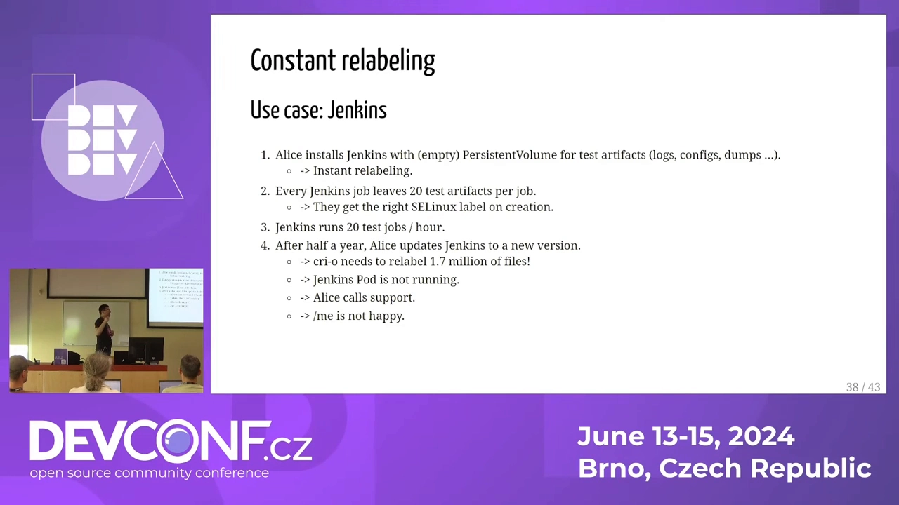

4. Alice 以为是升级搞坏了，**回滚**——停新容器、起旧容器，relabel **从头再来一遍**。还是起不来；
5. 她重启节点、重启 Pod，每次重启 relabel 都从零开始。没人怀疑 SELinux——平时运行根本看不到它的存在，只有启动新 Pod 时才出问题；最后是支持团队查了半天才定位到 SELinux。

这个故事的教训：**relabel 的成本 = 文件数量 × 存储元数据速度，与文件总大小基本无关**（几个大文件瞬间完成；千万个小文件能拖死人）；而且它只在"启动/重启容器"的瞬间发作，非常不直观。

## 八、三条出路：spc_t、CRI-O 跳过 relabel、context mount

针对"卷太大导致 relabel 慢"，讲者给出递进的三种解法：

1. **放弃该 Pod 的 SELinux 保护**：给 Pod 打 `spc_t`（super privileged container）标签，等于对该 Pod 关闭 SELinux——不 relabel，启动飞快。但代价明确：Jenkins 一旦被攻破可以直接祸害宿主机和其它容器。要不要换，由业务自己权衡；
2. **CRI-O 的跳过 relabel 注解**（仅 CRI-O）：配置较繁琐——给 Pod 打上特定注解后，CRI-O 启动时会检查卷的顶层目录标签：符合预期就**跳过 relabel**，不符合才整卷重打。相当于"卷只打一次标签，之后启动都很快"；
3. **context mount（挂载时打标签）**：存储工程师的正解——挂载卷时在挂载选项里直接指定 SELinux 标签，**所有文件"看起来"就带着这个标签**。标签不落在磁盘、不写进存储后端，只是内核里的元数据[【跳转到 27:24】](https://www.youtube.com/watch?v=sRcwwuoyY5E&t=1644)。实现花了数年（边界情况很多）：

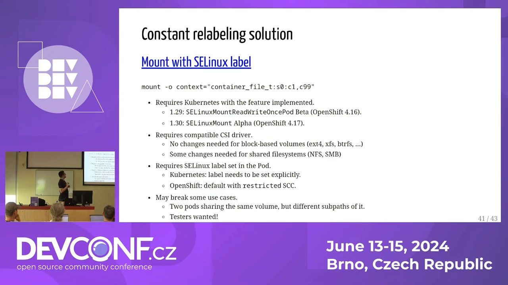

   - 需要 Kubernetes 1.29+，且最初只支持 **RWOP（Read-Write-Once-Pod）** 卷——同一时刻只能被一个 Pod 使用的卷[【跳转到 28:20】](https://www.youtube.com/watch?v=sRcwwuoyY5E&t=1700)；
   - OpenShift 4.16 作为 dev preview，讲者又为其余卷类型做了实现（Kubernetes 1.30 alpha / OpenShift 4.17 dev preview）；
   - 需要兼容的 CSI 驱动（多数不用改代码，只改 YAML；NFS/SMB 类驱动可能要额外挂载选项）；
   - 关键前提：**Pod 里必须显式写好 SELinux 标签**——原生 K8s 要手工写，OpenShift 由 SCC 自动注入。如果等容器运行时随机分配就晚了：那时卷已经挂载完了。


设计者也明说了取舍：context mount 会破坏"两个不同 SELinux 上下文的 Pod 共享同一个卷、各自用不同子目录"这种特殊用法（整卷只能有一个标签）。如果你在用，讲者非常想找你做测试。

## 小结

- SELinux 在容器里的默认玩法：`container_t` + `container_file_t` + **MCS 双分类**（每个容器随机一对，约 50 万种组合），分类不匹配即拒绝；
- 它保护的是**宿主机和其它容器**，不保护容器内部——"容器里发生的事留在容器里"[【跳转到 34:04】](https://www.youtube.com/watch?v=sRcwwuoyY5E&t=2044)；
- Podman / CRI-O 默认启用；Docker / containerd 要显式开启；**Docker socket 是最大的坑**——它会热心地帮你 relabel 任何东西，包括整个宿主机；
- 卷挂载的 `:Z`（私有）/ `:z`（共享）解决"容器读宿主目录"，但 `:Z` 的代价是**每次启动全量 relabel**，文件数一多启动巨慢；
- 原生 K8s：卷一律私有标签、Pod 标签几乎没人设、共享靠手工对齐；OpenShift：SCC 自动注入 namespace 级标签，namespace 内共享容易、namespace 之间依旧严格；
- 大卷 + relabel 慢的三条出路：`spc_t` 放弃保护 / CRI-O 跳过 relabel 注解 / **K8s 1.29+ context mount**（挂载时打标签，标签存内核元数据，成本与文件数无关）；
- 排障提示：容器启动奇慢、重启就复发、日志里却没有明显报错——先想想 SELinux relabel。

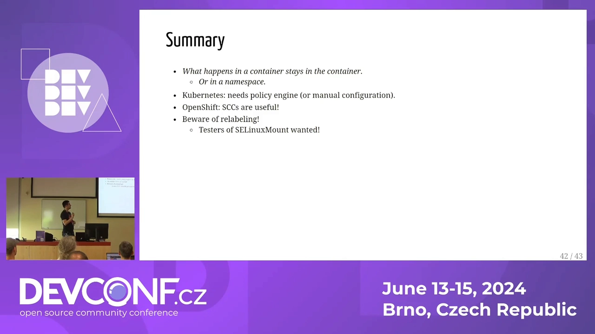

## 关键术语速查

| 术语 | 一句话解释 |
| --- | --- |
| `container_t` / `container_file_t` | 容器进程 / 容器文件的默认 SELinux 类型 |
| MCS 双分类 | 每容器随机两个 0–1023 的分类，进程与文件分类必须匹配才能访问 |
| `:Z` / `:z` | 卷挂载选项：私有标签（仅本容器可读）/ 共享标签（所有容器可读） |
| relabel | 遍历目录逐文件重写 SELinux 标签；成本取决于文件数量，每次容器启动可能重来 |
| `spc_t` | 超级特权容器标签，等效于对该容器关闭 SELinux |
| udica | 根据容器配置自动生成 SELinux 策略模块的工具 |
| SCC | OpenShift 安全上下文约束；`restricted-v2` 会给 namespace 分配 MCS 并注入 Pod 标签 |
| RWOP | Read-Write-Once-Pod 卷：同一时刻只能被一个 Pod 挂载，context mount 的适用范围 |
| context mount | 挂载时指定 SELinux 标签的机制；标签只存内核元数据，不写磁盘 |
| CRI-O / Podman | 默认开启 SELinux 的容器引擎；Docker / containerd 需显式开启 |
