# SELinux 入门：普通人也学得会的强制访问控制

> 本文整理自 Red Hat Summit 演讲 **《Security-Enhanced Linux for mere mortals》**（Thomas Cameron）。原视频：[Security-Enhanced Linux for mere mortals](https://www.youtube.com/watch?v=_WOKRaM-HI4)。

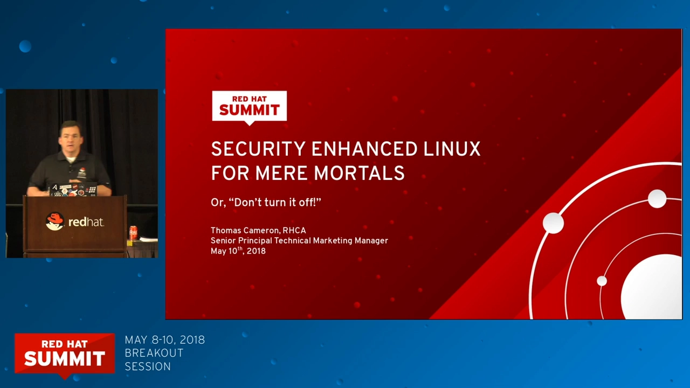

## 本讲要解决的核心问题（SCQA）

**背景**：Linux 的传统权限模型（属主 / 属组 / 其他人 + rwx 权限位）人人都会用，管理员每天都在 `chmod`、`chown`。root 用户更是"无所不能"。

**冲突**：很多发行版默认开启的 SELinux 却经常"莫名其妙"地拦下操作——明明权限位都对，服务就是报 Permission denied，日志里还看不出所以然。于是一个流传甚广的"解决方案"是：把 SELinux 关掉。

**疑问**：SELinux 到底在管什么？被它拦截时，正确的处理姿势是什么？

**回答（中心思想）**：SELinux 是内核中的**强制访问控制（MAC）**层——它给每个进程、每个文件打上**标签**，再用**类型强制**规则决定"谁能碰谁"，连被劫持的 root 都拦得住。理解「标签 + 类型强制」两个概念，掌握「看日志 → 改布尔 / 恢复标签 / 生成策略模块」的排错三板斧，SELinux 就不再是拦路虎，而是系统被攻破前的最后一道保险。

## 一、SELinux 从哪来：NSA 写的代码，Red Hat 养大的项目

SELinux（Security-Enhanced Linux，安全增强 Linux）最初由美国国家安全局（NSA）作为 Linux 内核补丁系列开发，借助 Linux 安全模块（LSM）框架接入内核，2000 年开源，[【跳转到 02:23】](https://www.youtube.com/watch?v=_WOKRaM-HI4&t=143) 2003 年进入内核主线。这是一套非常成熟、久经沙场的技术——不是实验品。

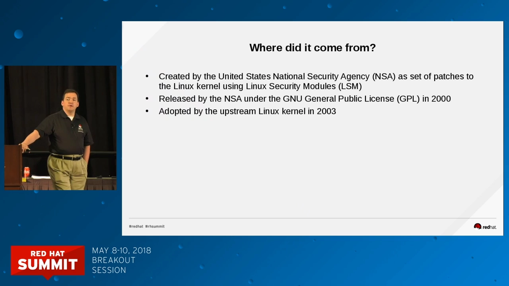

Red Hat 长期主导它的开发，多位 Red Hat 工程师被 NSA 点名致谢。讲者 Thomas Cameron 说，自己 12 年前在银行做 RHEL 4 部署时被 SELinux 折磨得很惨——**当年的难用是真的**：工具少、策略逻辑不完善，SELinux 因此落下了"恶霸"的名声。但如今工具链已经完全不同，本讲的目标就是把它讲成人人能懂的东西。

## 二、DAC 与 MAC：为什么需要第二道锁

### 2.1 传统 Unix 权限（DAC）的三个软肋

传统 Unix 用的是**自主访问控制（DAC，Discretionary Access Control）**：

- 每个文件有**属主、属组、其他人**三组身份，配 rwx 权限位；
- 文件的主人对自己的文件有完全的处置权（`chmod 777` 没有任何机制能拦住）；
- **root 无所不能**——拿到 root 就能读任何人的任何文件。

用讲者的比喻：传统 Unix 会"把枪递给你，还告诉你枪口往哪指"[【跳转到 03:50】](https://www.youtube.com/watch?v=_WOKRaM-HI4&t=230)。灵活性是够的，但进程一旦被攻击者控制（尤其是被提权到 root），一切防线都形同虚设。

### 2.2 MAC：管理员定的规矩，连 root 也要遵守

SELinux 提供的是**强制访问控制（MAC，Mandatory Access Control）**：系统里有一套**管理员设定、普通手段改不掉的策略**。哪怕 DAC 层面权限全对，只要策略不允许，访问照样被拒绝；反过来，哪怕文件被 `chmod 777`，策略不允许也进不去。

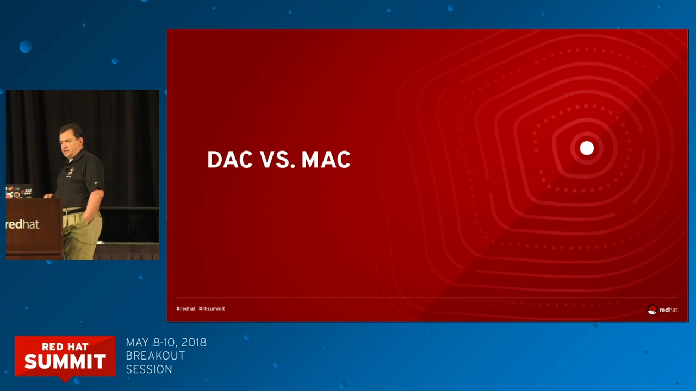

MAC 能管的东西非常细：用户与文件、进程、目录、内存地址、TCP/UDP 套接字……都可以被策略约束。它是架在 DAC 之上的**第二道锁**（belt-and-suspenders，腰带加背带）：DAC 依然有效，SELinux 再加一层。

## 三、两种策略与三种状态

### 3.1 策略：targeted 是默认，MLS 是军工

SELinux 的规则集叫**策略（policy）**。RHEL / Fedora / CentOS 等发行版默认使用 **targeted（目标）策略**：只对"有策略覆盖"的服务 enforcing，几百个常见服务（Web 服务器、邮件服务器，甚至浏览器、邮件客户端）都在保护范围内；没被覆盖的进程则几乎不受限（unconfined）。

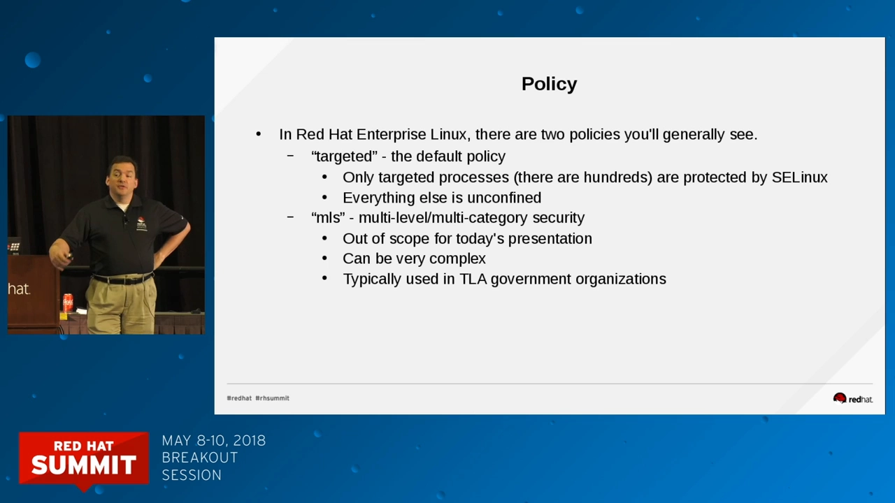

另一种是 **MLS（多级多类安全）**，多见于政府、军方场景，复杂度高，日常运维基本碰不到，本讲不展开。

### 3.2 状态：enforcing / permissive / disabled

三个查看入口：

- 配置文件 `/etc/selinux/config`（软链接到 `/etc/sysconfig/selinux`），`SELINUX=enforcing` 决定**开机后**的状态；
- `sestatus`：看整体状态（是否启用、当前策略、当前模式）；
- `getenforce`：只回答一个问题——当前是 `Enforcing`（强制）、`Permissive`（宽容，只记日志不拦截）还是 `Disabled`（关闭）。

## 四、核心概念一：标签——万物皆有身份

理解 SELinux 只需要吃透两个概念：**标签（labeling）**和**类型强制（type enforcement）**[【跳转到 08:14】](https://www.youtube.com/watch?v=_WOKRaM-HI4&t=494)。


SELinux 世界里，**每个进程、每个文件、每个端口都有一个标签（label，也叫安全上下文 / context）**，格式是四段：

```
user(用户):role(角色):type(类型):level(级别)
```


- 文件的标签存在**文件系统的扩展属性（xattr）**里，跟着文件走；
- 进程、端口、网卡等内存对象的标签由**内核**在启动和运行时维护；
- 日常 targeted 策略下，**真正起作用的是第三段 type（类型）**，user/role/level 是高级玩法，可以先忽略。

以 Web 服务器 httpd 为例，一整套东西各有各的类型（用 `ls -Z` 查看）[【跳转到 09:33】](https://www.youtube.com/watch?v=_WOKRaM-HI4&t=573)：


| 对象 | 类型（标签） |
| --- | --- |
| 二进制 `/usr/sbin/httpd` | `httpd_exec_t` |
| 配置目录 `/etc/httpd` | `httpd_config_t` |
| 日志目录 `/var/log/httpd` | `httpd_log_t` |
| 网页内容 | `httpd_sys_content_t` |
| systemd 单元文件 | `httpd_unit_t` |
| 运行中的进程（`ps -Z`） | `httpd_t` |
| 监听端口 80/443（`semanage port -l`） | `http_port_t` |


对比一下：`/etc/shadow` 的类型是 `shadow_t`。

## 五、核心概念二：类型强制——策略说了算

有了标签，策略就能写出这样的规则：**允许 `httpd_t` 读取 `httpd_config_t`**——进程读自己服务的配置，天经地义。

但策略里**没有**"允许 `httpd_t` 读 `shadow_t`"这一条。于是：

- Web 服务正常读配置、读网页内容：放行；
- 攻击者拿下 Web 服务器进程，指着 `/etc/shadow` 说"把密码给我"：**拒绝**——哪怕管理员犯傻把 shadow 文件 `chmod 777`，DAC 层面全放行了，SELinux 照样拦[【跳转到 12:53】](https://www.youtube.com/watch?v=_WOKRaM-HI4&t=773)。

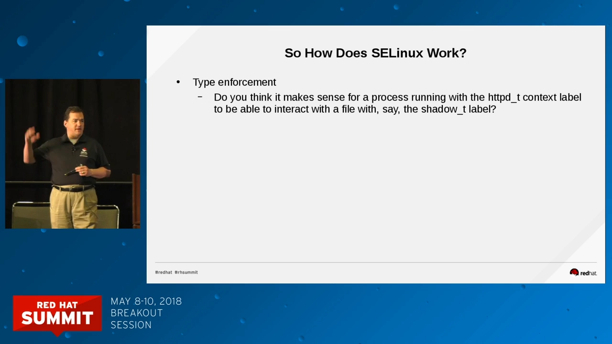

这就是**类型强制（Type Enforcement，TE）**：不是"谁的文件谁做主"，而是"策略清单里写了才能做"。SELinux 拦截的决定性因素是**标签对不匹配**，与 Unix 权限位、属主是谁完全正交。

## 六、标签从哪来、怎么改

### 6.1 标签的来源

- **继承**：新建文件的标签默认从父目录继承；
- **打包**：RPM 包可以（也应该）内置 SELinux 上下文，安装时自动打标签；
- **登录**：登录进程会给用户会话设置默认上下文（targeted 下普通用户默认是 unconfined）；
- **文件转换（file transition）**：策略可以规定特殊规则[【跳转到 15:33】](https://www.youtube.com/watch?v=_WOKRaM-HI4&t=933)。典型例子是 DHCP 客户端重写 `/etc/resolv.conf`：虽然文件在 `/etc` 下，但策略规定这类文件生成为 `net_conf_t` 而不是继承父目录。

### 6.2 万能查看与三种改法

- **查看**：`-Z` 是几乎万能的开关——`ls -Z`、`ps -Z`、`id -Z`、`netstat -Z` 都能看标签[【跳转到 13:53】](https://www.youtube.com/watch?v=_WOKRaM-HI4&t=833)；

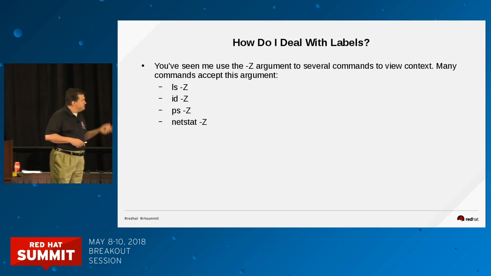

- **`chcon`**：手工改文件的上下文（完整格式 `chcon -u user -r role -t type 文件`，targeted 下通常只写 `-t 类型`；还支持 `--reference 正确的文件` 照抄别人的标签）；
- **`restorecon`**：把文件**恢复成"策略认为它该有的"标签**。`restorecon -Rv 目录` 递归处理并显示改动，是最常用的修复手段。它的依据是 `/etc/selinux/targeted/contexts/files/file_contexts`——约 4000 条正则规则，包更新时会被覆盖，所以别手改这个文件，但可以拿它"抄答案"[【跳转到 29:53】](https://www.youtube.com/watch?v=_WOKRaM-HI4&t=1793)；
- **`semanage`**：把"以后这类路径该是什么标签"写成**持久规则**（`semanage fcontext`），还能管端口、登录、布尔值等一大家子。要点：**semanage 只改规则，不动文件系统**，改完要跑一次 `restorecon` 才落地。

`chcon` 与 `semanage + restorecon` 的区别在实战里非常关键，下一节的案例三会看到。

## 七、SELinux 报错了：四种可能，别急着关

遇到 SELinux 拦截，讲者给的比喻是：**车有异响，你把收音机开到最大——问题并没有消失**。关 SELinux 掩耳盗铃，正确姿势是搞清它为什么响[【跳转到 16:45】](https://www.youtube.com/watch?v=_WOKRaM-HI4&t=1005)。拦截通常意味着以下四种情况之一：

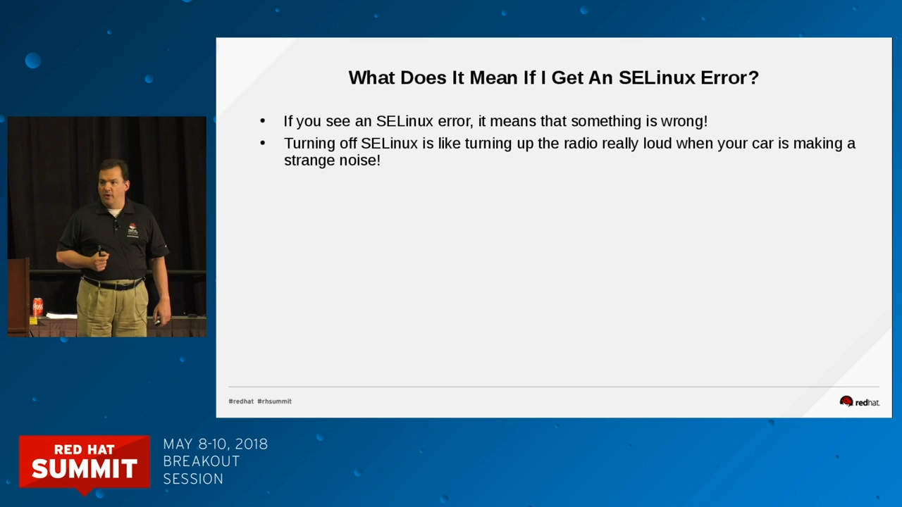

1. **标签错了**（最常见）：文件被移动、被打错标签，`restorecon` 修好即可；
2. **策略需要微调**：合法的新用法没被默认策略覆盖，用**布尔开关**或**自定义策略模块**解决；
3. **策略 bug**：确实存在，提工单反馈；
4. **你正在被入侵**：突然出现莫名的 AVC 拒绝，值得警惕。

### 7.1 排错工具链

- 安装 `setroubleshoot` 与 `setroubleshoot-server` 两个包（开发环境建议常备），装完重启 auditd 服务（`service auditd restart`；用 `systemctl` 会被转手，这是预期行为）；
- 之后 `journalctl -b -0` 里会出现**人话版**红色提示：谁想访问谁、为什么被拒，甚至**直接给出建议执行的命令**（按可能性排序）；
- `sealert` 工具会把这些拒绝事件整理成带解决方案的报告。

有了这套工具，"SELinux 报错看不懂"基本成为历史。

## 八、三个实战案例：布尔、移动文件、非标准目录

### 8.1 案例一：用户主页 403——一个布尔开关的事

给用户 Fred 开个人主页：`/etc/httpd/conf.d/userdir.conf` 里启用 `userdir`，`chmod a+x /home/fred` 放行进入权限，Fred 建好 `~/public_html/index.html`，重启 Apache——403 Forbidden。权限位、属主全对，error log 只说"cannot read directory"。

`journalctl` 里 SELinux 直接给出建议[【跳转到 23:00】](https://www.youtube.com/watch?v=_WOKRaM-HI4&t=1380)：**放开布尔开关**：

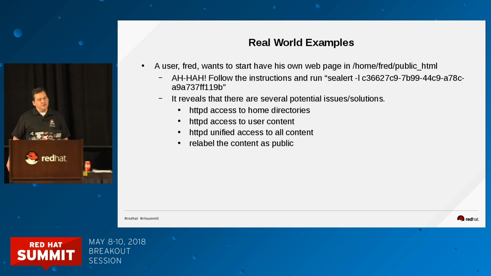

```bash
setsebool -P httpd_enable_homedirs 1
```

`-P` 表示持久化（重启后仍生效）。几秒后主页可访问。

**布尔（boolean）**就是策略里的预置开关，`getsebool -a` 能列出几百个[【跳转到 17:43】](https://www.youtube.com/watch?v=_WOKRaM-HI4&t=1063)：比如允许 Web 服务器连 Sendmail 发信、允许认证 Windows 域……默认值通常合理，特殊需求时翻一翻，多数"合理但被拒"的需求一个布尔就能解决。

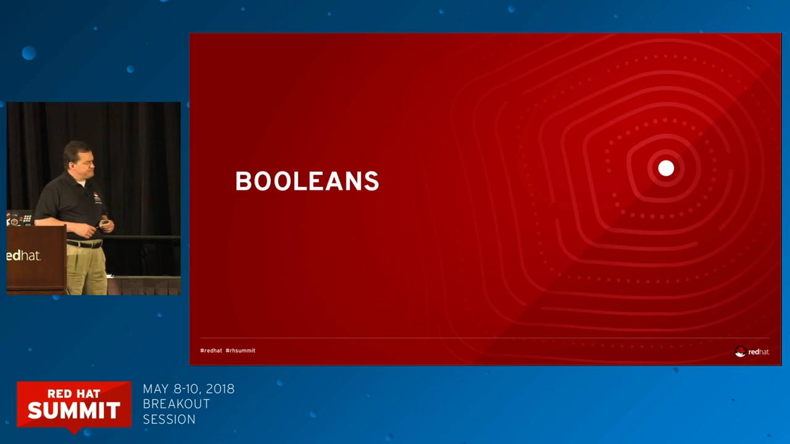

顺带的坑：`/etc/selinux/targeted/modules/active/` 下的布尔本地文件标着 **auto-generated, do not edit**——`setsebool -P` 会重建整个目录，手工改的值下次就被冲掉。讲者用 marker 文件实验验证过：执行一次带 `-P` 的命令，该目录全部文件被重新生成。

### 8.2 案例二：mv 过去的网页打不开——移动文件会带着旧标签

开发者 Wilma 让管理员把她 home 目录里的网页内容"搬"到 `/var/www/html`。管理员用 `mv` 搬过去、顺手 `chown` 修好属主——还是打不开。

关键点：**`mv` 是同一文件系统内的改名，inode 不变，标签也不变**。文件从 home 目录搬过来，标签还是"用户家目录内容"（`user_home_t`），而 Apache 无权读它；`cp` 则是新建文件，会继承目标目录的标签[【跳转到 28:21】](https://www.youtube.com/watch?v=_WOKRaM-HI4&t=1701)。

修复：先 `ls -Z` 确认现状，再选一种方式——

```bash
chcon -t httpd_sys_content_t /var/www/html/index.html   # 手工指定
chcon --reference /var/www/html/某个正常的文件 目标文件    # 照抄正确样例
restorecon -Rv /var/www/html                             # 推荐：恢复默认标签
```

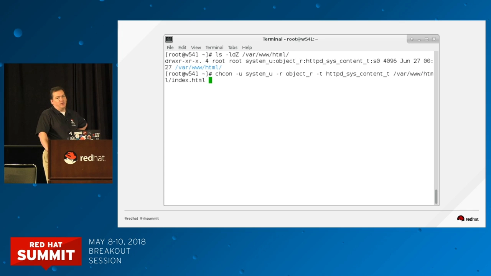

`restorecon` 是讲者的"懒人最爱"：不用记类型，一条命令全修好。它 relies 的规则库就是下面这个文件：

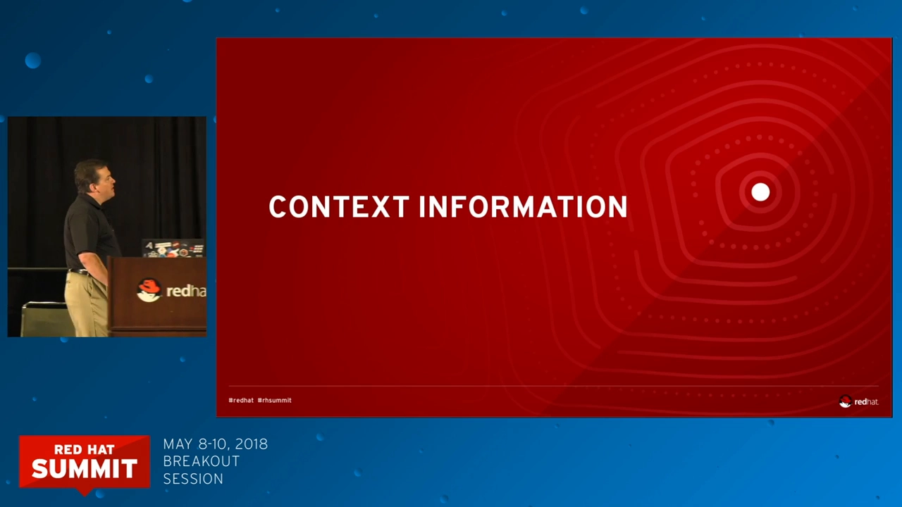

### 8.3 案例三：网页放 `/foo/bar`——要 semanage，不能只 chcon

公司要求把网站放在非标准目录 `/foo/bar`。目录建好、权限正确、虚拟主机配好、`index.html` 放好，重启 Apache——访问看到的却是 RHEL 默认测试页，而不是我们的页面。

SELinux 提示一大串，最后其实就一句：把这个目录**纳入策略认知**。因为 `/foo/bar` 不在 file_contexts 的规则里，SELinux 不知道它"应该"是网页内容。正确姿势[【跳转到 33:26】](https://www.youtube.com/watch?v=_WOKRaM-HI4&t=2006)：

```bash
semanage fcontext -a -e /var/www/html /foo/bar   # 声明：/foo/bar 的标签规则与 /var/www/html 一致
restorecon -R /foo/bar                           # 按新规则实际打标签
```

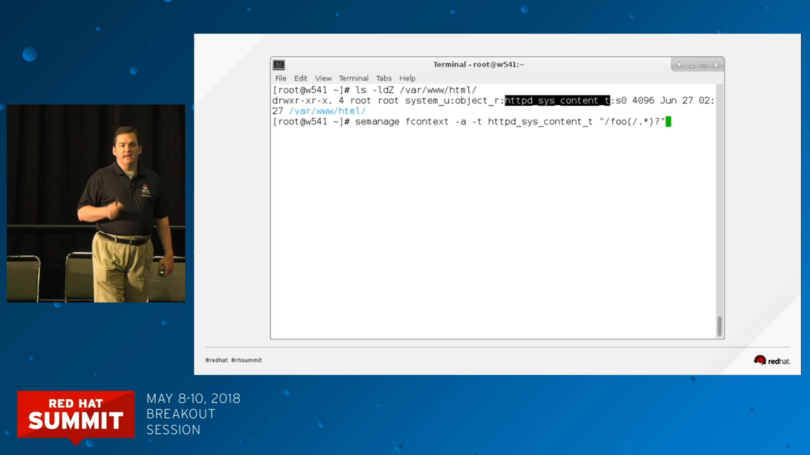

为什么不用 `chcon`？听众当场问了这个问题，答案是：`chcon` 改的标签**撑不过一次全盘重打标签（relabel）**——哪天系统重新打标签，`/foo/bar` 又被打回"未知目录"。`semanage fcontext` 写进规则库，才是持久正解。**先 semanage 告诉 SELinux 规则，再 restorecon 落地文件系统**，是这个场景的标准两步。

## 九、audit2allow：生成自定义策略模块

当布尔开关和标签修复都解决不了（比如让某个服务做一件默认策略完全没涵盖的事），就要**生成自定义策略模块**。流程出奇地简单[【跳转到 37:46】](https://www.youtube.com/watch?v=_WOKRaM-HI4&t=2266)：

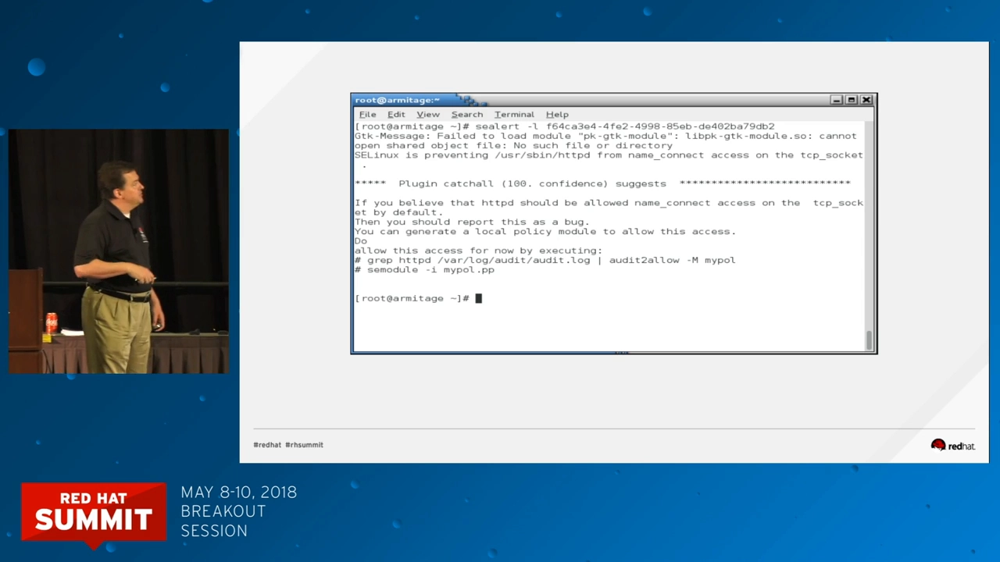

```bash
setenforce 0                      # 先切 permissive，只记日志不拦截
# ……把应用完整跑一遍，让它触发所有需要的访问……
grep httpd /var/log/audit/audit.log > myapp.local   # 捞出相关拒绝记录
audit2allow -M myapplocal < myapp.local             # 生成策略模块
semodule -i myapplocal.pp                           # 安装模块
setenforce 1                      # 恢复 enforcing
```

讲者的两个技巧：先切 permissive 跑全流程，**一次性收集所有拒绝**（否则修一个暴露下一个，来回折腾）；给自建的模块名带个 `local` 后缀，好区分"系统自带"和"我自建的"。

## 十、从零开启 SELinux：先 permissive，再打标签

如果系统当初是被关掉（Disabled）的，想重新启用，**千万别直接改成 enforcing 就重启**——大量文件没有标签，系统会挂掉。正确顺序[【跳转到 39:11】](https://www.youtube.com/watch?v=_WOKRaM-HI4&t=2351)：

1. `/etc/selinux/config` 里先设 `SELINUX=permissive`；
2. 在根目录创建 `/.autorelabel` 空文件（`touch /.autorelabel`），重启；开机时会全盘重打标签（进度条类似 fsck）；
3. 打完标签后 `setenforce 1` 切回强制模式。

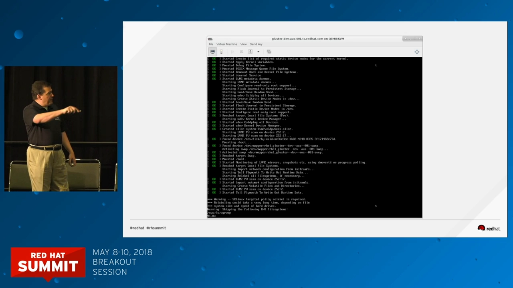

也可以用 `fixfiles onboot` 达到同样的重启重打标签效果——但别在图形界面（runlevel 5）下干这事，重打标签会清掉 `/tmp`，X 窗口的字体文件没了会很暴躁。这一切也都有图形界面（`system-config-selinux`，配合 SSH X 转发），布尔、端口、模块、重打标签按钮俱全。

## 小结

- SELinux 是内核里的**强制访问控制（MAC）**层，NSA 起源、Red Hat 主力维护，成熟且默认随 RHEL 系发行版启用[【跳转到 41:49】](https://www.youtube.com/watch?v=_WOKRaM-HI4&t=2509)；
- 传统 DAC 管不住被劫持的进程和 root；MAC 用**标签 + 类型强制**补上这一层，连 `chmod 777` 都救不了攻击者；
- 日常只需吃透 targeted 策略下的**类型**（`httpd_t`、`httpd_sys_content_t`、`shadow_t`……）；
- 排错三板斧：**journalctl/sealert 看人话 → 布尔开关 / restorecon 修标签 / audit2allow 造模块**；
- 标签修复口诀：普通文件 `restorecon -Rv`；非标准目录 **先 `semanage fcontext` 再 `restorecon`**；`chcon` 只做临时验证；
- 别关它：关掉 SELinux 不是修车，是把报警器拆了。

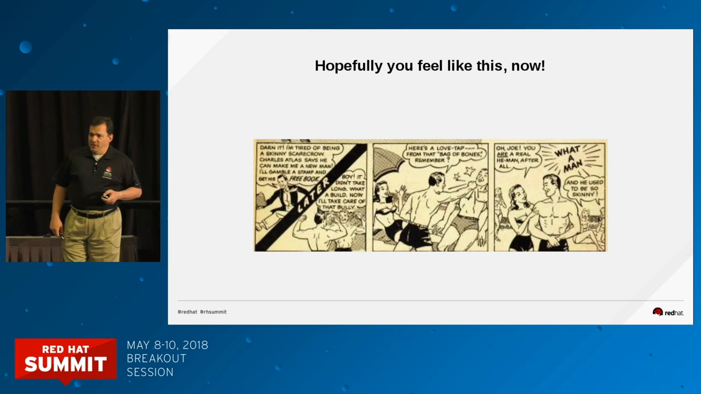

## 关键术语速查

| 术语 | 一句话解释 |
| --- | --- |
| DAC / MAC | 自主访问控制（传统权限位）/ 强制访问控制（管理员策略，SELinux） |
| 标签（context） | `user:role:type:level` 四段安全标签，文件的存扩展属性，进程/端口的由内核管理 |
| 类型强制（TE） | 策略规则按"进程类型 × 对象类型"决定放行与否，SELinux 的核心机制 |
| targeted 策略 | RHEL 默认策略：只强制管理有策略覆盖的服务，其余进程不受限 |
| Enforcing / Permissive / Disabled | 强制拦截 / 只记日志不拦截 / 完全关闭 |
| 布尔（boolean） | 策略里的预置开关，`getsebool -a` 查看、`setsebool -P` 永久修改 |
| `chcon` / `restorecon` / `semanage fcontext` | 临时改标签 / 恢复默认标签 / 声明持久标签规则（三者常配套） |
| AVC | Access Vector Cache 拒绝记录，SELinux 拦截行为的日志条目 |
| audit2allow / semodule | 把拒绝日志转成策略模块 / 安装策略模块 |
| relabel | 全盘按规则重打标签（`/.autorelabel` 或 `fixfiles onboot` 触发） |
