# K8s SecurityContext：声明 Pod 与容器的身份、能力与提权边界

> 本文整理自 Learn with GVR 的 Kubernetes 安全系列第 13 集 **《Kubernetes Security - Security Context for a Pod or Container》**（基于 Linux Foundation 培训课程，含 4 个可复现演示）。原视频：[Kubernetes Security - Security Context for a Pod or Container](https://www.youtube.com/watch?v=i8wfvoVf2xs)。

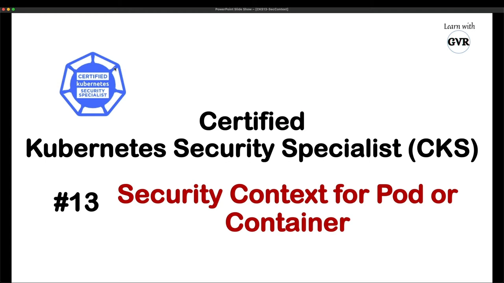

## 本讲要解决的核心问题（SCQA）

**背景**：Pod 里跑的应用说到底是普通 Linux 进程——它通过**系统调用**与内核打交道，最终使用宿主机的硬件。本系列前面的课程已经讲过用 PSP / OPA 等手段配置 OS 级安全域，这一集讲最后一块拼图：SecurityContext。

**冲突**：如果不显式声明，容器里的进程往往默认以 root 身份、带着一大把内核能力运行。「这个容器以什么用户运行、属于哪个组、能不能在运行中提权、能用哪些内核能力」，全都被默认值悄悄决定了。

**疑问**：在 Kubernetes 里，应该在哪里、用哪些字段来声明「以什么身份运行、带哪些能力、能否提权」？

**回答（中心思想）**：用 **SecurityContext**。它分 **Pod 级**与**容器级**两层：`runAsUser` / `runAsGroup` / `fsGroup` 定身份，`allowPrivilegeEscalation` 关闭提权通道，`capabilities` / `seccompProfile` / AppArmor / SELinux 细化行为约束；容器级未设置的字段**继承** Pod 级设置。讲完概念后，本讲用四个演示逐一验证。

## 一、SecurityContext 是什么：访问内核的「通行证」

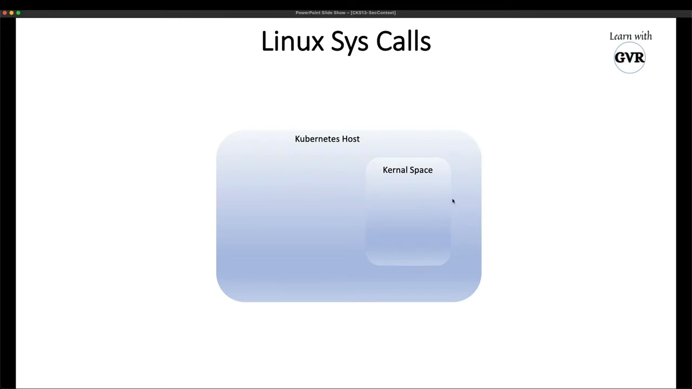

任何 Kubernetes 节点（host）都分两层：底下的**内核空间**（kernel space，架在硬件之上）和上面的**用户空间**（user space）。部署的应用以 Pod 形态跑在用户空间里，它执行业务逻辑时要发起系统调用，与内核交互、使用底层硬件 [【跳转到 00:44】](https://www.youtube.com/watch?v=i8wfvoVf2xs&t=44)。

而 Pod 凭什么去发起这些调用？讲者给出的类比是：**SecurityContext 就是 Pod 访问内核的通行证（gate pass）**——没有它，Pod 无法与内核交互、什么也做不了 [【跳转到 01:09】](https://www.youtube.com/watch?v=i8wfvoVf2xs&t=69)。

更正式的定义：SecurityContext 为 Pod 或容器定义**特权（privilege）与访问控制（access control）设置** [【跳转到 01:59】](https://www.youtube.com/watch?v=i8wfvoVf2xs&t=119)。比如「这个 Pod 有权调用某条管理员内核命令」——能不能调、以什么身份调，都由它声明。

## 二、它管哪些东西：一张约束面清单

SecurityContext 不是单一开关，而是一组字段的集合。视频里列举了它的典型用例 [【跳转到 02:24】](https://www.youtube.com/watch?v=i8wfvoVf2xs&t=144)：

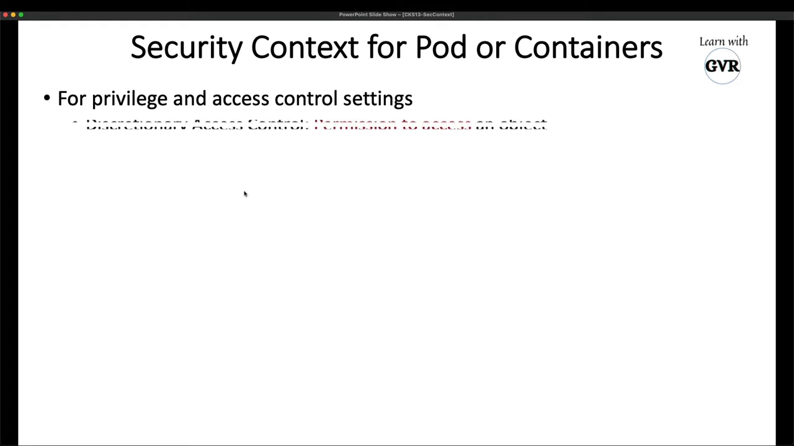

- **访问对象的权限**：内核空间里的系统对象，Pod 要访问就得凭 SecurityContext 授权 [【跳转到 02:31】](https://www.youtube.com/watch?v=i8wfvoVf2xs&t=151)；
- **SELinux**：给对象打安全标签（即前几讲的主题，可设置 `seLinuxOptions`）[【跳转到 02:36】](https://www.youtube.com/watch?v=i8wfvoVf2xs&t=156)；
- **privileged / unprivileged**：同一个 Pod 里的两个容器，可以一个特权、一个非特权 [【跳转到 02:45】](https://www.youtube.com/watch?v=i8wfvoVf2xs&t=165)；
- **Linux capabilities** 与 **AppArmor profile**：AppArmor 限制容器能**访问**什么，seccomp 过滤能发**哪些系统调用**——两者都是 SecurityContext 的一部分 [【跳转到 03:10】](https://www.youtube.com/watch?v=i8wfvoVf2xs&t=190)；

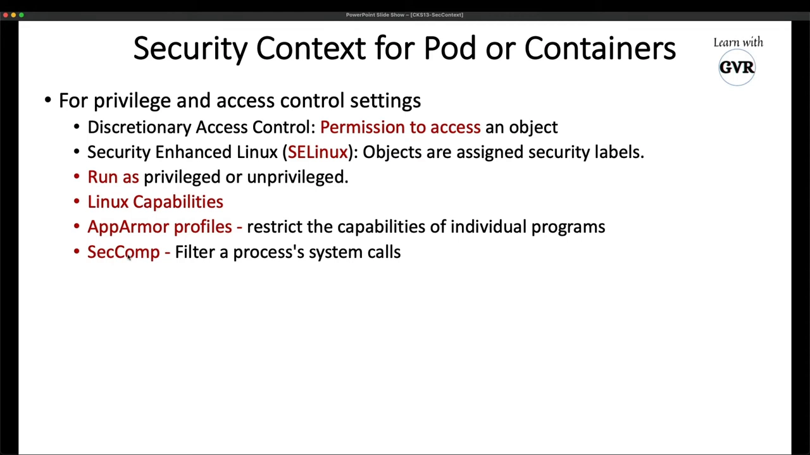

- **allowPrivilegeEscalation**：控制容器进程能否比父进程获得更多特权。讲者用公司打比方：「有人任命我当老板，我就能再雇 100 个人、把公司搞垮」——提权就是这种权力的自我扩张，所以要明确声明允不允许 [【跳转到 03:35】](https://www.youtube.com/watch?v=i8wfvoVf2xs&t=215)；
- **readOnlyRootFilesystem**：把容器的根文件系统挂成只读 [【跳转到 04:00】](https://www.youtube.com/watch?v=i8wfvoVf2xs&t=240)；
- **runAsUser / runAsGroup / fsGroup**：以哪个 Linux UID/GID 运行（下一节展开）[【跳转到 05:05】](https://www.youtube.com/watch?v=i8wfvoVf2xs&t=305)。

## 三、继承规则：Pod 级定基调，容器级可覆盖

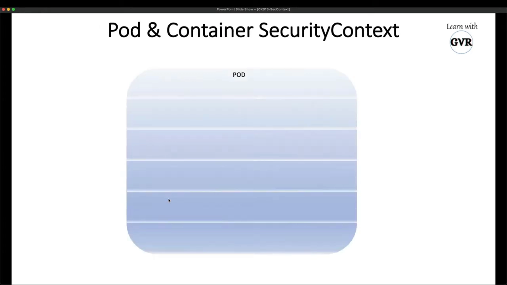

Pod 是一个或多个容器的集合，SecurityContext 因此有两个层级，规则很简单：

- **Pod 级**设置的是「基线」。比如 Pod 级设 `runAsUser: 1000`，则**所有未单独设置的容器**都以 UID 1000 运行；
- **容器级**可以**覆盖**基线。比如容器 1 覆盖为 2000，它就以 2000 运行；容器 2 什么都不设，就继承 Pod 级的 1000 [【跳转到 04:15】](https://www.youtube.com/watch?v=i8wfvoVf2xs&t=255)；也可以再把容器 2 设成 3000，各容器互不影响 [【跳转到 04:40】](https://www.youtube.com/watch?v=i8wfvoVf2xs&t=280)。

这套「父定基调、子可覆盖」的逻辑同样适用于 `allowPrivilegeEscalation` 等其它字段 [【跳转到 05:05】](https://www.youtube.com/watch?v=i8wfvoVf2xs&t=305)。

## 四、Pod 级 YAML 示例与 kubectl explain

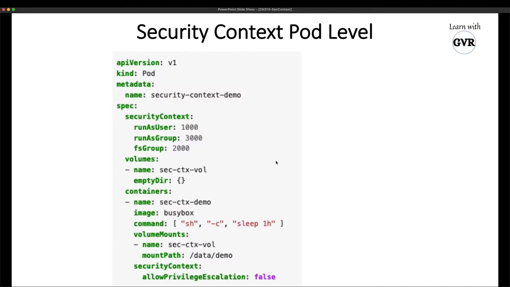

讲者取自 Kubernetes 官方文档的示例（文档里搜 "security context" 即可找到）[【跳转到 05:41】](https://www.youtube.com/watch?v=i8wfvoVf2xs&t=341)：

```yaml
apiVersion: v1
kind: Pod
metadata:
  name: security-context-demo
spec:
  securityContext:            # ← Pod 级
    runAsUser: 1000
    runAsGroup: 3000
    fsGroup: 2000
  volumes:
    - name: sec-demo-vol
      emptyDir: {}
  containers:
    - name: busybox
      image: busybox
      command: ["sh", "-c", "sleep 3600"]
      volumeMounts:
        - name: sec-demo-vol
          mountPath: /data/demo
      securityContext:        # ← 容器级
        allowPrivilegeEscalation: false   # 未设 runAsUser → 继承 Pod 级 1000
```

Pod 级声明了三个身份字段；容器里只写了一条 `allowPrivilegeEscalation: false`，没有设用户——所以身份**全部继承** Pod 级 [【跳转到 06:33】](https://www.youtube.com/watch?v=i8wfvoVf2xs&t=393)。如果 Pod 里有多个容器，只要不覆盖，就都继承这套基线 [【跳转到 06:58】](https://www.youtube.com/watch?v=i8wfvoVf2xs&t=418)。

对 `allowPrivilegeEscalation` 这个字段，讲者的态度很明确：它决定「要不要允许这个容器在运行中提升特权」——能设 true，但**最好别（better do not）** [【跳转到 07:23】](https://www.youtube.com/watch?v=i8wfvoVf2xs&t=443)。

想弄清某个字段的准确含义，不必猜：用 `kubectl explain` 直接查内置文档 [【跳转到 07:40】](https://www.youtube.com/watch?v=i8wfvoVf2xs&t=460)：

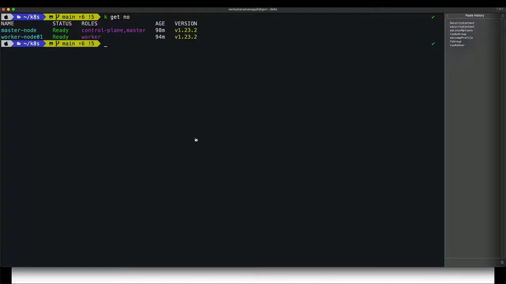

```bash
kubectl explain pod.spec.securityContext          # Pod 级有哪些设置
kubectl explain pod.spec.containers.securityContext.allowPrivilegeEscalation
```

第二条会返回该字段的官方定义与默认值说明 [【跳转到 08:11】](https://www.youtube.com/watch?v=i8wfvoVf2xs&t=491)。

## 五、capabilities 与 seccomp/AppArmor 的挂载点

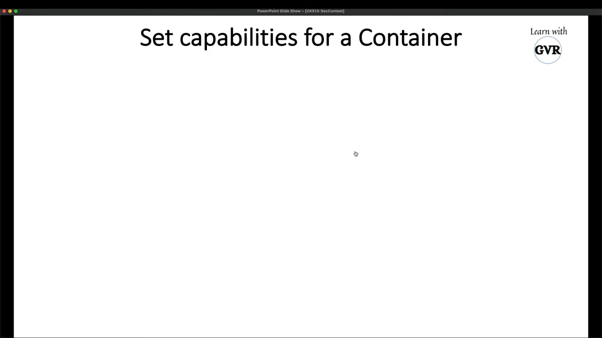

**capabilities（能力）**是本讲的另一个重点。场景：某个容器不想以 root 运行，但业务确实需要一两项特权能力——比如改系统时间（`SYS_TIME`）和网络管理（`NET_ADMIN`）。这时不需要给它整个 root，只要在容器级 SecurityContext 的 `capabilities.add` 里点名这两项即可 [【跳转到 09:00】](https://www.youtube.com/watch?v=i8wfvoVf2xs&t=540)：

```yaml
securityContext:
  capabilities:
    add: ["NET_ADMIN", "SYS_TIME"]
```

`capabilities` 下既能 `add`（加）也能 `drop`（丢）[【跳转到 09:53】](https://www.youtube.com/watch?v=i8wfvoVf2xs&t=593)。同层还可以设置 **seccompProfile**（选 `RuntimeDefault` 或 `Localhost` 的本地 profile）[【跳转到 10:04】](https://www.youtube.com/watch?v=i8wfvoVf2xs&t=604) 和 **seLinuxOptions**（给容器打 SELinux 标签）[【跳转到 10:29】](https://www.youtube.com/watch?v=i8wfvoVf2xs&t=629)。一句话：从「以谁的身份」到「能干什么」，SecurityContext 把容器安全的声明点都集中到了一起 [【跳转到 11:29】](https://www.youtube.com/watch?v=i8wfvoVf2xs&t=689)。

## 六、四个演示：把声明变成看得见的事实

### 6.1 演示 1：Pod 级身份 + fsGroup 的实际效果

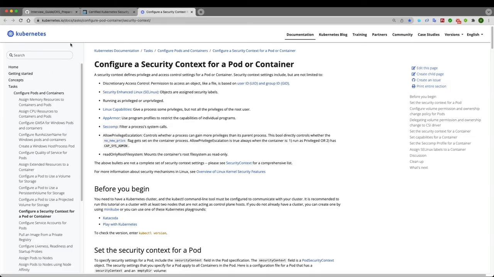

把上面的 YAML `kubectl apply -f` 后 Pod 正常运行 [【跳转到 12:23】](https://www.youtube.com/watch?v=i8wfvoVf2xs&t=743)。进容器验证：

```bash
kubectl exec -it security-context-demo -- sh
ps aux      # 所有进程都以 UID 1000 运行（Pod 级 runAsUser 生效）
id          # uid=1000 gid=3000 → runAsUser/runAsGroup；groups 里是 2000 → fsGroup
```

`ps aux` 显示容器里**所有进程都是 UID 1000**——因为 Pod 级配置了 `runAsUser: 1000` [【跳转到 12:52】](https://www.youtube.com/watch?v=i8wfvoVf2xs&t=772)。`id` 则一次看清三个字段的分工：`uid=1000`（runAsUser）、`gid=3000`（runAsGroup）、补充组 `2000`（fsGroup）[【跳转到 14:27】](https://www.youtube.com/watch?v=i8wfvoVf2xs&t=867)。

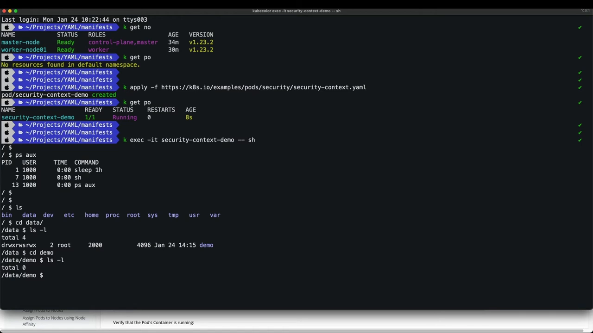

fsGroup 的作用在挂载卷上最直观：Pod 挂了 `emptyDir` 卷到 `/data/demo`，在里面 `echo hello > test` 建一个文件，`ls -l` 显示文件属主是 **1000**、属组是 **2000**——正是 fsGroup 把卷内文件的组所有权设成了 2000，进程（组 3000/补充组 2000）因此可以正常读写 [【跳转到 13:59】](https://www.youtube.com/watch?v=i8wfvoVf2xs&t=839)。

### 6.2 演示 2：容器级覆盖与继承

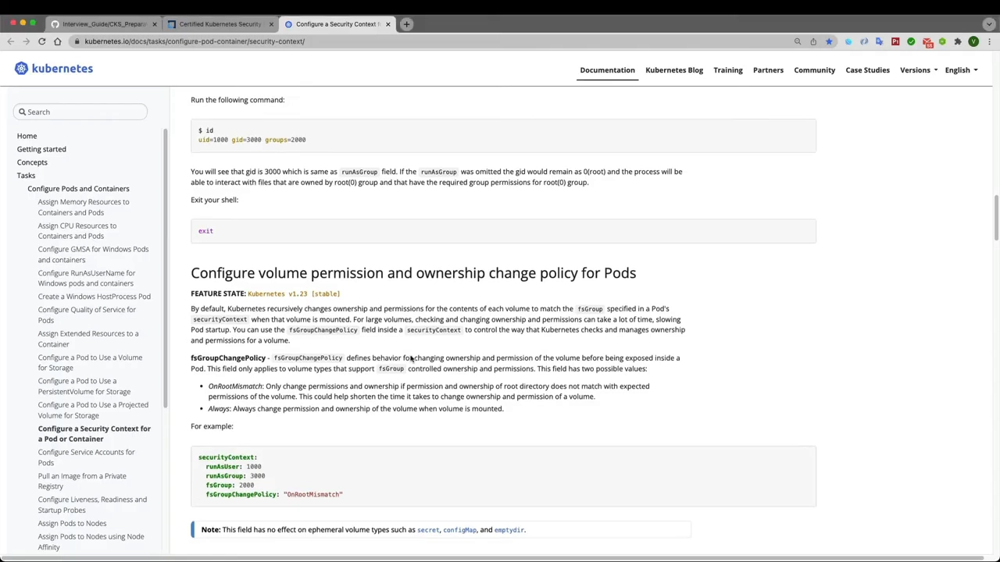

第二个示例验证继承规则：Pod 级 `runAsUser: 1000`，容器 1 覆盖为 `2000`，容器 2（busybox）什么都不设 [【跳转到 15:04】](https://www.youtube.com/watch?v=i8wfvoVf2xs&t=904)。分别进入两个容器：

```bash
kubectl exec -it demo2 -c <容器1> -- sh   # ps aux → 2000（覆盖生效）
kubectl exec -it demo2 -c busybox -- sh   # ps aux → 1000（继承 Pod 级）
```

容器 1 的进程以 **2000** 运行；容器 2 没写任何设置，进程以 **1000** 运行——继承自 Pod 级 [【跳转到 18:14】](https://www.youtube.com/watch?v=i8wfvoVf2xs&t=1094)。

### 6.3 演示 3：看默认 root 容器的能力位

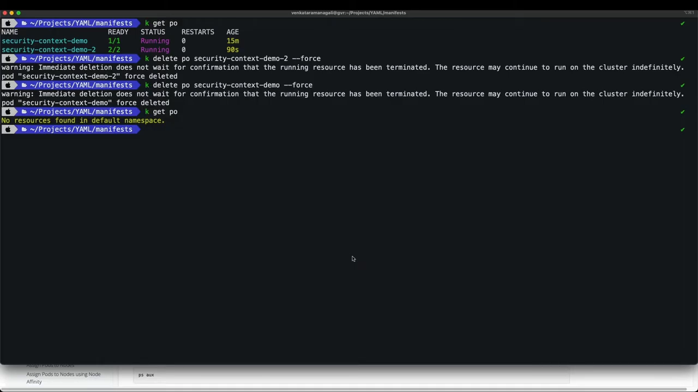

第三个示例是一个**没做任何 SecurityContext 设置**的 Pod：进容器 `ps aux`，进程以 **root** 运行 [【跳转到 19:32】](https://www.youtube.com/watch?v=i8wfvoVf2xs&t=1172)。要看这个进程带了哪些内核能力，去查它的进程状态文件：

```bash
cat /proc/1/status | grep Cap
# CapPrm: 00000000a80425fb
# CapEff: 00000000a80425fb
```

`/proc/<pid>/status` 是内核为每个进程维护的状态文件（关机即消失），其中的 `CapPrm`（允许的能力集）、`CapEff`（生效的能力集）等字段以十六进制位掩码记录能力 [【跳转到 20:02】](https://www.youtube.com/watch?v=i8wfvoVf2xs&t=1202)。这个默认容器的能力掩码是 `00000000a80425fb` [【跳转到 20:30】](https://www.youtube.com/watch?v=i8wfvoVf2xs&t=1230)。

### 6.4 演示 4：加一项 capability，掩码差一位

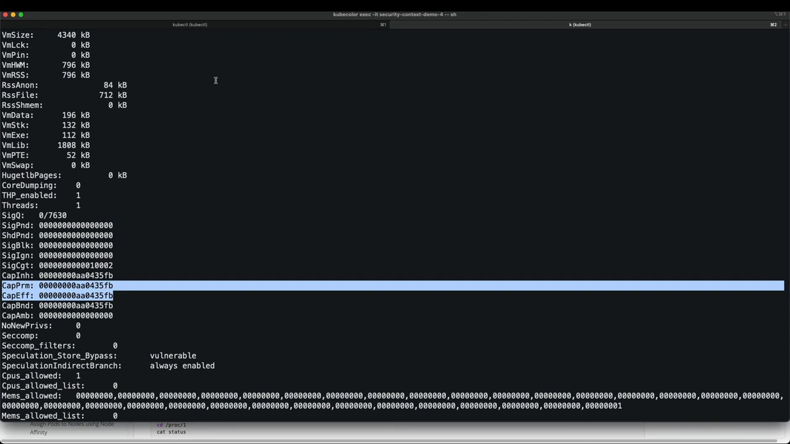

第四个示例与演示 3 完全相同，只多了一条 `capabilities.add: ["NET_ADMIN"]` [【跳转到 20:36】](https://www.youtube.com/watch?v=i8wfvoVf2xs&t=1236)。同样进容器看 `/proc/1/status`：`CapEff` 变成了 `00000000a80435fb` [【跳转到 22:09】](https://www.youtube.com/watch?v=i8wfvoVf2xs&t=1329)。

对比两个掩码：`a80425fb` → `a80435fb`，**只有第 12 位从 0 变 1（差值 0x1000）**——那正是 `CAP_NET_ADMIN` 在能力位表中的位置。声明里加的能力，精确地落在能力掩码上 [【跳转到 22:19】](https://www.youtube.com/watch?v=i8wfvoVf2xs&t=1339)。

讲者最后总结：把这些设置写进 SecurityContext，Kubernetes 就会替你把它们落实到 Pod 的安全属性上；seccomp profile 等也照此挂载 [【跳转到 22:24】](https://www.youtube.com/watch?v=i8wfvoVf2xs&t=1344)。

## 小结

- SecurityContext 是 Pod 访问内核的「通行证」：定义 Pod/容器的**特权与访问控制设置**，位于 Pod 级与容器级两层；
- 约束面覆盖：访问对象、SELinux 标签、privileged 与否、capabilities、AppArmor（限制访问）、seccomp（过滤系统调用）、allowPrivilegeEscalation、readOnlyRootFilesystem、runAsUser/runAsGroup/fsGroup；
- 继承规则：容器级未设置的字段**继承 Pod 级**，设置了就覆盖——Pod 级定基调，容器级做例外；
- `allowPrivilegeEscalation: false` 应作为默认姿态：它切断容器进程在运行中获得比父进程更多特权的通道（对应内核的 no_new_privs 机制，见本条目另一篇：[Setuid-Root_Binaries_Why_USER_1000_Wont_Stop_Root_In_Your_Container](Setuid-Root_Binaries_Why_USER_1000_Wont_Stop_Root_In_Your_Container.md)）；
- 需要「一点点特权」时用 `capabilities.add` 点名，而不是整体 root——演示 4 显示加 NET_ADMIN 后能力掩码恰好多出 0x1000 位；
- `kubectl explain pod.spec.securityContext` 随时可查字段定义；fsGroup 会把挂载卷内文件的属组设为指定 GID，是多容器共享卷权限的常用手段。

## 关键术语速查

| 术语 | 一句话解释 |
| --- | --- |
| SecurityContext | Pod/容器级的特权与访问控制设置集合，K8s 里声明「以谁的身份、带什么能力、能否提权」的地方 |
| `runAsUser` / `runAsGroup` | 容器进程运行所用的 Linux UID / 主 GID；容器级未设置时继承 Pod 级 |
| `fsGroup` | 为 Pod 的挂载卷设置属组（GID），让组内进程可读写卷内文件；出现在补充组里 |
| `allowPrivilegeEscalation` | 是否允许进程在运行中获得比父进程更多特权（对应内核 `no_new_privs`）；安全基线应设为 false |
| capabilities | 把 root 特权拆成细粒度能力的机制；`capabilities.add/drop` 按需加减 |
| seccompProfile | 限制容器可发起哪些系统调用的过滤器，可选 `RuntimeDefault` 或 `Localhost` |
| AppArmor / SELinux | 基于配置文件 / 安全标签的强制访问控制，分别经 AppArmorProfile 与 seLinuxOptions 挂载 |
| `/proc/<pid>/status` | 内核维护的进程状态文件；`CapPrm`/`CapEff` 等字段以十六进制掩码显示进程能力 |
