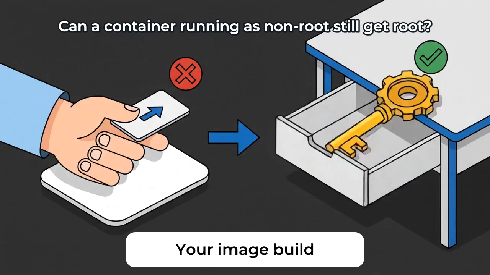
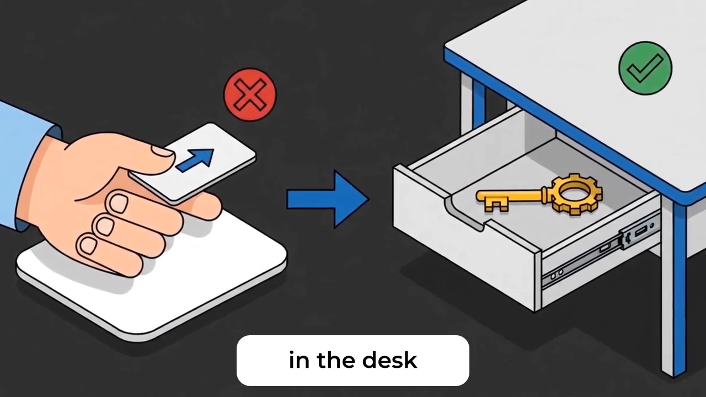
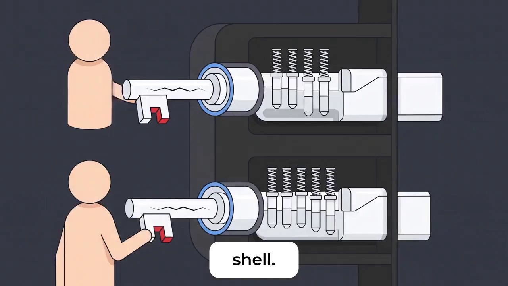
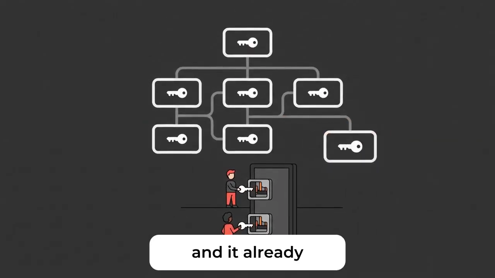

# 容器里 USER 1000 挡不住 root：setuid 位与 no_new_privs

> 本文整理自 Zero CVE Club 的短讲 **《Setuid-Root Binaries: Why USER 1000 Won't Stop Root In Your Container》**（约 2 分钟动画讲解）。原视频：[Setuid-Root Binaries: Why USER 1000 Won't Stop Root In Your Container](https://www.youtube.com/watch?v=pGOs0A6y4Uo)。

## 本讲要解决的核心问题（SCQA）

**背景**：容器安全基线里最常见的一条就是「别用 root 跑容器」——在 Dockerfile 里写上 `USER 1000`，镜像扫描与准入策略检查都会变绿，团队皆大欢喜。

**冲突**：但就算容器以非 root 身份运行，镜像里**自带的 setuid-root 二进制**仍然可能让普通用户直接拿到 root shell。经典案例就是 pkexec 的 PwnKit 漏洞：Qualys 在 2022 年 1 月披露，任意本地用户可借此获得 root 权限。漏洞扫描器不报、只读文件系统也拦不住。

**疑问**：明明不是 root，为什么还能变成 root？运行时有没有一刀切断这条路的开关？

**回答（中心思想）**：setuid 位让内核**按文件而不是按你**来授予权限；`no_new_privs` 则让内核在程序启动时**拒绝授予任何新权限**，从机制上关闭这条路。再配合构建期清理 setuid/setgid 文件，把「抽屉里的万能钥匙」彻底清空，才是完整的解法。

## 一、写着 USER 1000 的镜像，为什么仍能变 root

Dockerfile 里写 `USER 1000`，只保证容器进程**启动时**是普通用户。它管不了镜像里文件系统上那些带 setuid 位的程序——它们是编进镜像里的「root 开关」。

讲者把 setuid-root 程序比作**酒店客房里留在抽屉中的万能钥匙（master key）**：你入住时（启动容器时）只是个普通客人，但只要你知道抽屉在哪，拿钥匙开门就行。视频里给出了直接答案：容器以非 root 运行**仍可能拿到 root**——只要镜像里有 setuid-root 二进制，即被标记为「无论谁启动都以 root 身份运行」的程序 [【跳转到 00:16】](https://www.youtube.com/watch?v=pGOs0A6y4Uo&t=16)。

其中一个就是 `pkexec`——它携带的漏洞被称为 **PwnKit**，由安全公司 Qualys 于 2022 年 1 月披露：任何本地用户都能借此拿到 root shell [【跳转到 00:26】](https://www.youtube.com/watch?v=pGOs0A6y4Uo&t=26)。这正是 setuid 位值得认真对待的原因。

## 二、内核只认文件，不认「你」

为什么 `USER 1000` 拦不住它？因为 setuid 的裁决者是**内核**：进程启动（execve）时，内核读取**文件**上的 setuid 位，而不是看你启动它时是什么身份。

文件的含义就是「以 root 运行这个程序，不管启动者是谁」[【跳转到 00:38】](https://www.youtube.com/watch?v=pGOs0A6y4Uo&t=38)。用万能钥匙的比喻来说：**门锁并不关心钥匙是哪位客人从抽屉里拿出来的**——它只认钥匙本身 [【跳转到 00:43】](https://www.youtube.com/watch?v=pGOs0A6y4Uo&t=43)。所以「进程不是 root」这道门，根本挡不住 setuid 这把钥匙。

## 三、你的「万能钥匙」是从哪来的

这些 setuid-root 程序不是你主动安装的——**拉一个标准的 Debian 基础镜像，它们已经在里面了**。

常见的基础镜像自带 `su`、`mount`、`umount`、`passwd`、`chsh`、`newgrp` 等 setuid-root 程序 [【跳转到 00:53】](https://www.youtube.com/watch?v=pGOs0A6y4Uo&t=53)；如果再装上依赖 polkit 权限服务的软件包，还会带上 `pkexec`——就是那个有 PwnKit 漏洞的程序。用讲者的话说：这是**抽屉里六把你从没检查过的万能钥匙** [【跳转到 01:03】](https://www.youtube.com/watch?v=pGOs0A6y4Uo&t=63)。

## 四、为什么常规防线全都看不见它们

你可能会想：不是有镜像扫描和策略检查吗？视频里点破了三层防线的盲区 [【跳转到 01:08】](https://www.youtube.com/watch?v=pGOs0A6y4Uo&t=68)：

- **漏洞扫描器**：报告的是软件包的**已知 CVE**，不会去盘点文件的 setuid 位；
- **策略门（policy gate）**：检查的是**运行时用户 ID**（比如必须非 root），同样不看 setuid 位；
- **只读根文件系统**：也救不了你——二进制**已经在磁盘上**，它只需要被运行，不需要写任何东西。

三层防线各管一段，没有一个回答「镜像里有多少个 setuid 文件」这个问题。

## 五、运行时一刀切：no_new_privs

真正在机制上关掉这条路的是**运行时开关 `no_new_privs`** [【跳转到 01:31】](https://www.youtube.com/watch?v=pGOs0A6y4Uo&t=91)。

打开这个开关、并丢弃多余的内核能力（capabilities）之后，**内核在程序启动时拒绝授予任何新增权限**——setuid 位被直接忽略。用比喻说：**锁不再接受万能钥匙**，抽屉里还剩几把都无所谓了。

代价是真实存在的：`sudo` 和某些 `ping` 的实现会因此失效 [【跳转到 01:31】](https://www.youtube.com/watch?v=pGOs0A6y4Uo&t=91)。但在生产环境里，「容器内不需要 setuid 提权」通常正是你想要的行为——所以这代价往往是个 feature 而不是 bug。

> 在 Kubernetes 里对应的开关就是 `securityContext.allowPrivilegeEscalation: false`，Docker 对应 `--security-opt no-new-privileges`；K8s 侧的完整实操见本条目的另一篇：[Kubernetes_Security_Security_Context_for_a_Pod_or_Container_13](Kubernetes_Security_Security_Context_for_a_Pod_or_Container_13.md)。

## 六、治本：构建期就把抽屉清空

运行时开关还有最后一个问题：**flag 是可以被人删掉的**。所以视频强调要双管齐下，在构建期也做修复 [【跳转到 01:36】](https://www.youtube.com/watch?v=pGOs0A6y4Uo&t=96)：

1. **搜索**文件系统里所有带 setuid/setgid 位的文件；
2. **删除**用不到的那些（多数基础镜像里的 setuid 程序，容器化应用并不需要）；
3. 或者**换用天生不带这些文件的极简基础镜像**（如 distroless 类）；
4. 在 CI 里**让构建失败**：setuid/setgid 文件计数不为零就不过关。

一句话总结这步的比喻：**把抽屉清空（Empty the drawer）** [【跳转到 02:01】](https://www.youtube.com/watch?v=pGOs0A6y4Uo&t=121)。

## 小结

- `USER 1000` 只决定进程**启动时**的身份，管不住镜像里文件系统上的 setuid 位；
- setuid 的裁决者是**内核**：按**文件**授予特权，不看启动者是谁——门锁只认钥匙，不认拿钥匙的人；
- 标准 Debian 基础镜像自带 `su`/`mount`/`passwd` 等多个 setuid-root 程序，polkit 还会带上 `pkexec`（PwnKit，Qualys 2022 年 1 月披露）；
- 常规防线各有盲区：扫描器只报包级 CVE、策略门只看运行时 UID、只读文件系统拦不住「只需要被运行」的二进制；
- 运行时开关 **`no_new_privs`** 让内核在 execve 时拒绝授予任何新权限，setuid 从此失效；代价是 sudo、部分 ping 失效——生产上通常是可接受的；
- 治本在构建期：清点并删除不需要的 setuid/setgid 文件、改用极简基础镜像、CI 计数不为零即失败。

## 关键术语速查

| 术语 | 一句话解释 |
| --- | --- |
| setuid / setgid 位 | 文件上的特殊权限位：执行该文件的进程临时获得**文件属主/属组**的身份（若属主是 root，即提权到 root） |
| `USER 1000` | Dockerfile 指令，指定容器进程启动时使用的用户；不影响文件系统上的 setuid 位 |
| PwnKit（CVE-2021-4034） | pkexec（polkit 组件）的本地提权漏洞，Qualys 于 2022 年 1 月披露，任意本地用户可获 root shell |
| `no_new_privs` | 进程级开关（内核 `PR_SET_NO_NEW_PRIVS`）：开启后 execve 不再给进程授予任何新权限，setuid/文件能力全部失效 |
| capabilities | 把 root 的特权拆分成细粒度能力的内核机制；`no_new_privs` 通常与「丢弃多余能力」配合使用 |
| 策略门（policy gate） | 部署前的准入检查；本视频指它只校验运行时 UID，不盘点 setuid 位 |
