# Docker 核心组件全景：从 dockerd 到 runc，容器进程链为什么要绕这么多层

> 本文整理自「K8S 云原生加油站」系列第 9 讲 **《Docker 核心组件介绍以及 runc 容器运行时》**。讲师先逐个拆解二进制安装 Docker 时的每一个组件，再用 runc 脱离 Docker 裸启了一个容器，最后回答了「为什么容器进程链要设计得这么绕」。原视频：[009-Docker核心组件介绍以及runc容器运行时](https://www.bilibili.com/video/BV18Ti7eUEmV/)。

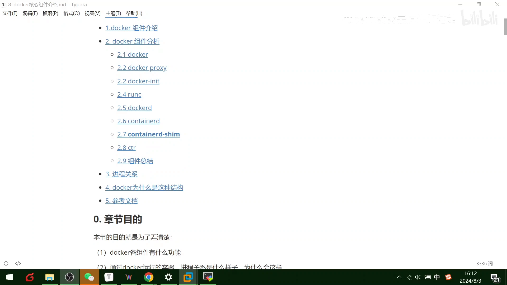

## 本讲要解决的核心问题（SCQA）

**背景**：上一课我们用过 `docker run`，会启动容器、会看进程了。很多教程到这里就结束了，仿佛 `docker run` 是一个黑盒魔法。

**冲突**：可当你做一次二进制安装，或者敲一条 `ps -ef` 看进程树时，会发现冒出一大堆陌生的名字：`dockerd`、`containerd`、`containerd-shim`、`runc`、`docker-proxy`、`docker-init`……「我只是想跑一个容器，为什么要这么多组件？容器进程的父进程为什么不是 dockerd？」

**疑问**：这些组件各自负责什么？从 `docker run` 到容器里那个进程，中间到底经过了谁？为什么 Docker 要把一条简单的路拆成五六段？

**回答（中心思想）**：**Docker 的容器进程链是一条逐层解耦的流水线**：`docker` 客户端发请求 → `dockerd` 调度 → `containerd` 管理生命周期 → `containerd-shim` 当容器的父进程 → `runc` 按 OCI 标准真正创建容器进程。每多一层，都是为了「某一环挂掉/升级时不连累别人」：runc 创建完就退出、由 shim 收尸防僵尸进程，containerd 重启也不影响已运行的容器。本讲末尾的 runc 实验还会证明：**不用 Docker，一个 runc + 一个 rootfs 也能跑起容器**——Docker 本质上是在 runc 之上做了一层封装。

## 一、二进制安装的 Docker，到底装了哪几个程序

进行二进制安装时可以发现，Docker 其实由一组二进制组成 [【跳转到 00:25】](https://www.bilibili.com/video/BV18Ti7eUEmV/?t=25)：

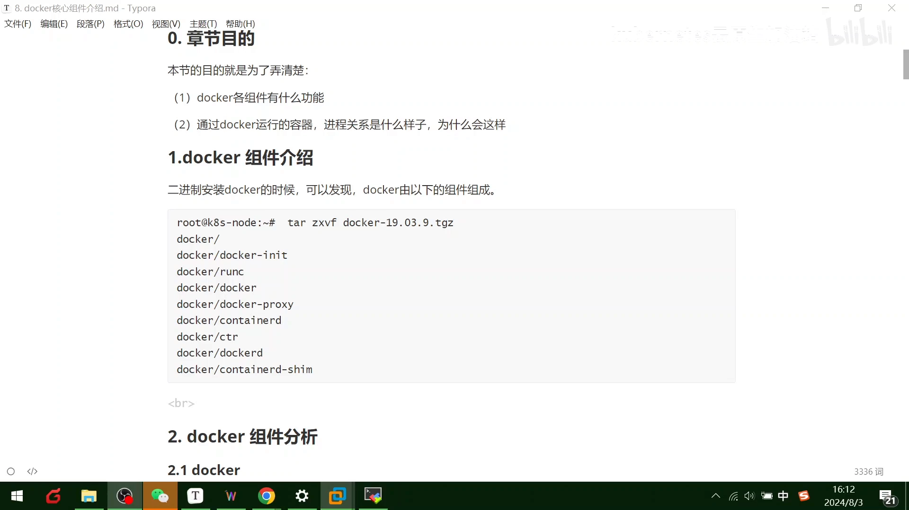

- `docker` —— 客户端 CLI
- `dockerd` —— 服务端守护进程
- `containerd` —— 容器运行时管理器
- `containerd-shim` —— 容器进程的「垫片」
- `runc` —— 真正创建容器的 OCI 运行时
- `docker-proxy` —— 端口映射
- `docker-init` —— 容器的 1 号进程

本讲的任务就是把它们挨个讲清楚，最后串成一条进程链。

## 二、docker 与 docker-proxy：客户端发请求，端口映射走 iptables

**`docker` 是客户端的完整实现**，一个二进制文件，用户可见的操作形式就是 `docker` 命令。它的工作模式是标准的客户端-服务端通信：客户端向服务端发送请求，服务端执行具体动作并把结果返回，客户端解析后通过标准输出展示给用户 [【跳转到 00:50】](https://www.bilibili.com/video/BV18Ti7eUEmV/?t=50)。上节课讲的 `docker run`，就是客户端发给服务端的一条请求。

**`docker-proxy` 专职端口映射** [【跳转到 01:15】](https://www.bilibili.com/video/BV18Ti7eUEmV/?t=75)。`docker run` 加上 `-p` 参数时，docker-proxy 就会把容器相应端口映射到主机上，底层基于 **iptables** 实现。视频里的例子：`docker run` 起一个 nginx 并把 8080 端口映射进容器，之后在宿主机上访问 8080 就能通，直接看到容器里的 nginx 页面 [【跳转到 02:00】](https://www.bilibili.com/video/BV18Ti7eUEmV/?t=120)。

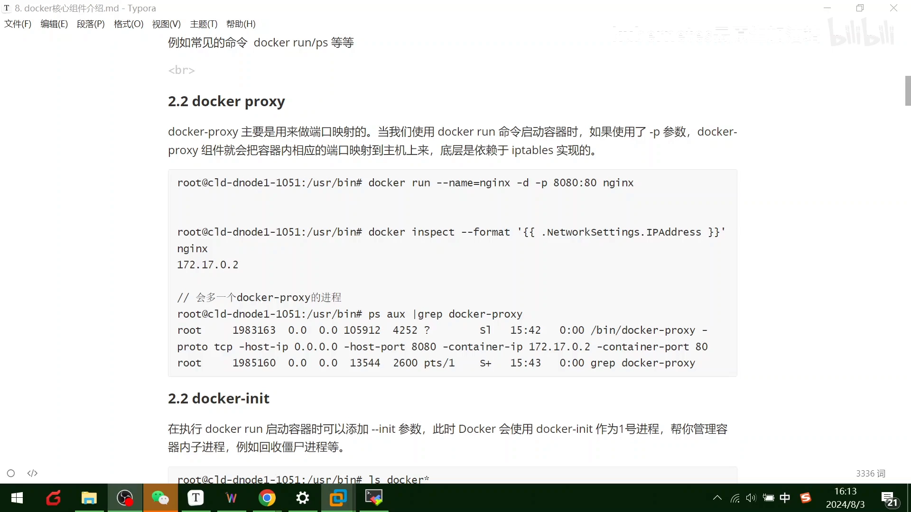

## 三、docker-init：给容器配一个会「收尸」的 1 号进程

`docker run` 时可以加 `--init` 参数 [【跳转到 02:35】](https://www.bilibili.com/video/BV18Ti7eUEmV/?t=155)。此时 Docker 会用 **docker-init** 作为容器的 **1 号进程**，由它来管理容器里进入的子进程——例如**回收僵尸进程**。在安装目录下能看到 `docker-init` 这个二进制 [【跳转到 03:00】](https://www.bilibili.com/video/BV18Ti7eUEmV/?t=180)。

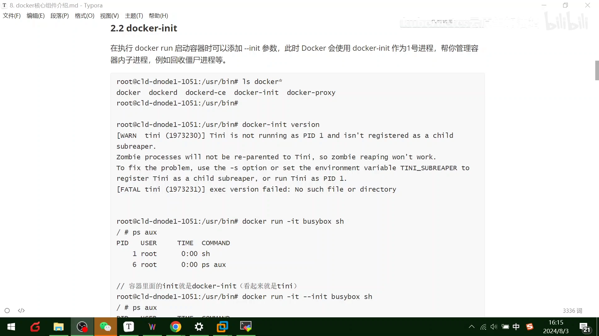

演示：`docker run --init busybox` 进到容器里，`ps` 一看，**容器里的 1 号进程已经是 docker-init** 了 [【跳转到 03:25】](https://www.bilibili.com/video/BV18Ti7eUEmV/?t=205)。为什么需要它？因为普通进程当 1 号进程时常常「只管生不管收」——子进程退出后留下的僵尸进程没人回收。让 docker-init 当 1 号进程，它就有责任替所有子进程「收尸」。这一点和容器单进程模型、信号处理的恩怨，我们这一小节的姊妹篇（PID 1 专题）还会细讲。

## 四、runc 裸启容器实验：不用 Docker 也能跑容器

这是本讲的重头戏。`runc` 是**标准 OCI 容器运行时的一个实现**，一个命令行工具，可以**直接**用来创建和运行容器 [【跳转到 03:50】](https://www.bilibili.com/video/BV18Ti7eUEmV/?t=230)。装完 Docker 它就顺带装好了。

实验步骤 [【跳转到 04:15】](https://www.bilibili.com/video/BV18Ti7eUEmV/?t=255)：


1. 进到 `/root`，创建一个 `runc` 目录，里面建 `rootfs` 子目录；
2. 把 **busybox 的 rootfs**（docker 官方镜像的根文件系统）下载/导出到 `rootfs` 里；
3. 准备配置文件：用 **`runc spec`** 根据 rootfs 生成对应的 **`config.json`**，里面的参数和环境（比如 `root` 路径）可以直接用 [【跳转到 04:40】](https://www.bilibili.com/video/BV18Ti7eUEmV/?t=280)。

`config.json` 里都有什么？讲师逐项浏览 [【跳转到 07:13】](https://www.bilibili.com/video/BV18Ti7eUEmV/?t=433)：

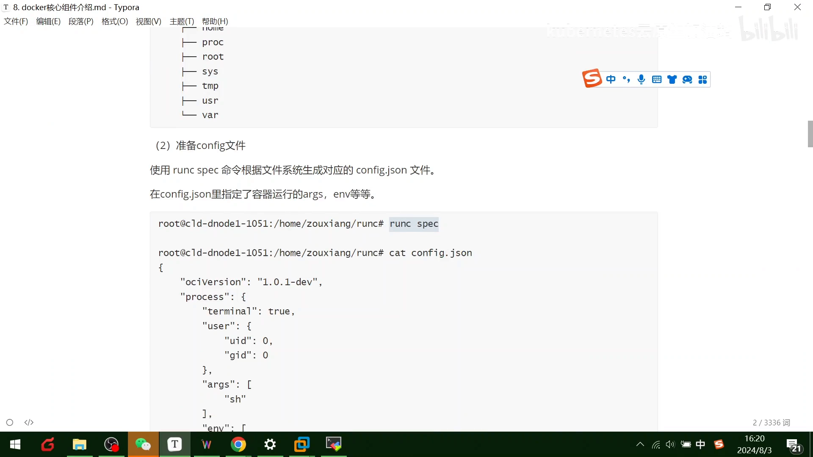

有 OCI 的规范版本、根目录（rootfs）的路径、容器的名称（hostname）等。此时目录下就两样东西：**`config.json` 和 `rootfs`** [【跳转到 07:35】](https://www.bilibili.com/video/BV18Ti7eUEmV/?t=455)——一个声明「容器长什么样」，一个提供「容器里的文件」。

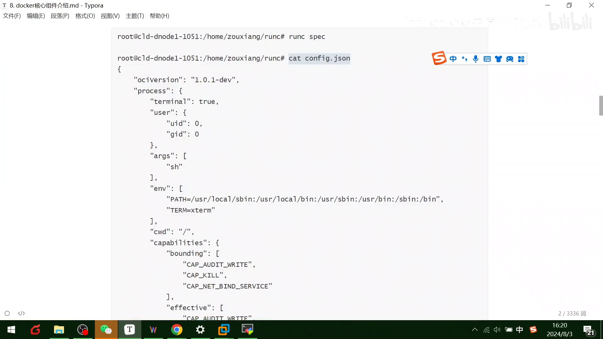

然后 `runc run`，直接就「进来了」——讲师用世界上最著名的 runc 起了一个容器 [【跳转到 07:59】](https://www.bilibili.com/video/BV18Ti7eUEmV/?t=479)。容器里 `ps aux` 一看：**除了 shell 什么进程都没有**，干干净净 [【跳转到 08:11】](https://www.bilibili.com/video/BV18Ti7eUEmV/?t=491)。另开一个窗口执行 `runc list`，能看到刚才起的这个 runc 容器 [【跳转到 08:24】](https://www.bilibili.com/video/BV18Ti7eUEmV/?t=504)：

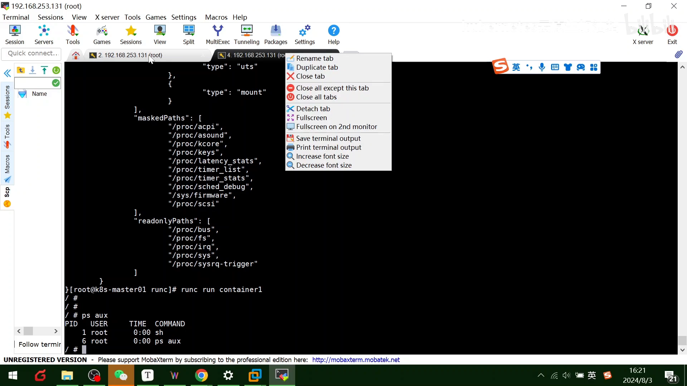

结论 [【跳转到 08:29】](https://www.bilibili.com/video/BV18Ti7eUEmV/?t=509)：**Docker 也是基于 runc 这个组件做了一层封装来启动容器进程的**——这就是著名的 runc。没有 Docker，runc + rootfs + config.json 三件套照样能跑容器。

## 五、dockerd 与 containerd：指挥者与实干家

**`dockerd` 是 Docker 服务端后台常驻的守护进程**，用来接收客户端发送的请求并执行命令 [【跳转到 08:59】](https://www.bilibili.com/video/BV18Ti7eUEmV/?t=539)。`docker run`、`docker ps` 都是客户端命令，dockerd 是服务端。**但 dockerd 并不是真正干活的**——真正干活的是 **containerd**。

**containerd** 是目前最著名的容器运行时，设计得比较迷你化 [【跳转到 09:24】](https://www.bilibili.com/video/BV18Ti7eUEmV/?t=564)。它从 Docker 1.11 的架构拆分中正式独立出来，诞生起就完全遵循 **OCI** 容器运行时标准，被业界广泛采用 [【跳转到 09:49】](https://www.bilibili.com/video/BV18Ti7eUEmV/?t=589)。containerd 不仅负责容器生命周期管理，还负责镜像管理（存储等）。它是后台常驻进程，默认通过 **gRPC** 通信；dockerd 通过 UNIX 套接字向 containerd 发送请求，containerd 收到请求后负责相关动作并返回结果 [【跳转到 10:14】](https://www.bilibili.com/video/BV18Ti7eUEmV/?t=614)。

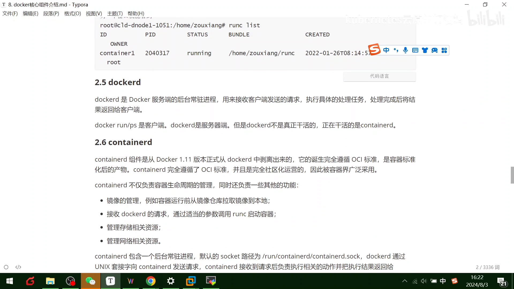

一个重要推论：**不用 Docker 也可以直接用 containerd 管理容器**，因为它更简单、更轻量——这也是后来 Kubernetes 移除 dockershim、直接用 containerd 管理容器的原因。

## 六、containerd-shim：一颗「垫片」的良苦用心

**shim 的作用，讲师用拧螺丝作比**：拧螺丝时，螺丝和螺母之间可以加一个垫片。containerd-shim 就是 containerd 与真正容器之间的垫片，**主要作用是把 containerd 和真正的容器进程解耦** [【跳转到 10:39】](https://www.bilibili.com/video/BV18Ti7eUEmV/?t=639)。

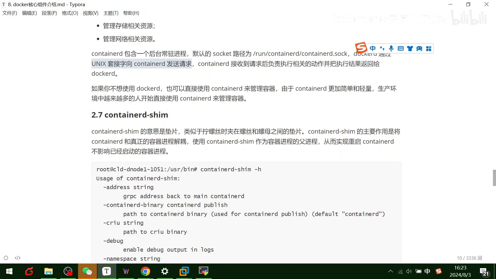

怎么解耦？**让 shim 当容器进程的父进程**，而不是让 containerd 直接当。这里有两层用意：

1. **容器进程需要一个父进程**来收集状态、维持标准输入输出等文件描述符的打开 [【跳转到 15:04】](https://www.bilibili.com/video/BV18Ti7eUEmV/?t=904)；
2. 假如容器进程直接挂在 containerd 名下，那么 **containerd 每次挂掉或升级，所有容器都得跟着退出**。引入垫片后，containerd 和容器进程不再有父子关系，containerd 重启/升级就不影响已启动的容器了 [【跳转到 15:29】](https://www.bilibili.com/video/BV18Ti7eUEmV/?t=929)。

配合 runc 还有一个精妙细节：**runc 启动完容器后会直接退出**，此时 containerd-shim 就成为容器进程的父进程，负责收集进程状态并上报给 containerd；容器进程退出后，由 shim 接管容器的后续管理，**确保不会出现僵尸进程** [【跳转到 16:53】](https://www.bilibili.com/video/BV18Ti7eUEmV/?t=1013)。

## 七、ctr：containerd 自带的客户端

**`ctr` 是 containerd 的客户端**，主要用于开发和调试；在没有 Docker 的环境里，ctr 就充当了客户端的角色 [【跳转到 11:29】](https://www.bilibili.com/video/BV18Ti7eUEmV/?t=689)。讲师现场演示：`ctr images list`、`ctr containers list` 等指令一应俱全 [【跳转到 11:44】](https://www.bilibili.com/video/BV18Ti7eUEmV/?t=704)——和 docker 命令长得很像，毕竟 **docker 封装了它**。

## 八、一张进程树看懂全部：从 kubelet 到容器进程

组件都认全了，现在看**进程之间的关系** [【跳转到 12:59】](https://www.bilibili.com/video/BV18Ti7eUEmV/?t=779)。查看进程树可以看到 [【跳转到 13:24】](https://www.bilibili.com/video/BV18Ti7eUEmV/?t=804)：

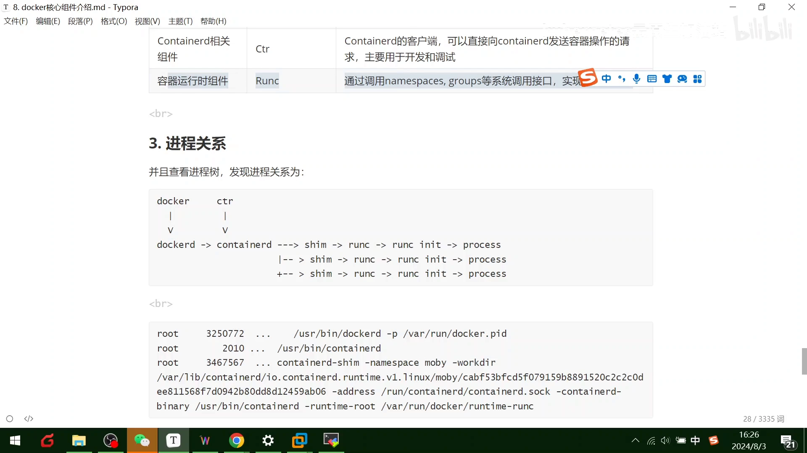

`dockerd` 下面挂着 `containerd`，containerd 通过 `containerd-shim` 调用 `runc`，最终到达容器里的进程。讲师同时给出组件总结表 [【跳转到 12:34】](https://www.bilibili.com/video/BV18Ti7eUEmV/?t=754)：

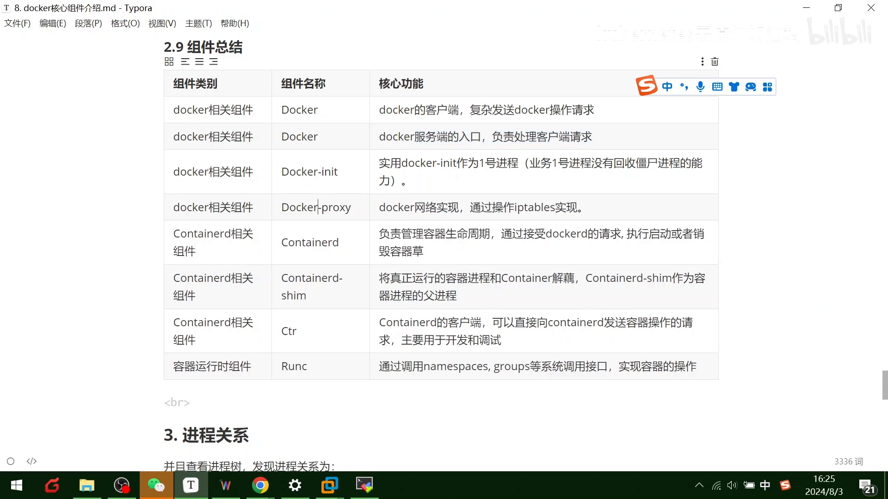

| 组件 | 职责 |
| --- | --- |
| `docker` | 客户端，负责发送 docker 操作请求 |
| `dockerd` | 服务端守护进程，接收客户端请求并调度 |
| `docker-init` | 可选的容器 1 号进程，负责回收僵尸进程 |
| `docker-proxy` | 网络端口映射（底层 iptables） |
| `containerd` | 负责容器生命周期与镜像管理；接收 dockerd 的请求执行启动/销毁容器 |
| `containerd-shim` | 容器进程的父进程（垫片），与 containerd 解耦 |
| `ctr` | containerd 的客户端，用于开发与调试 |
| `runc` | 通过 namespace、cgroups 等系统调用接口实现容器的创建与运行 |

## 九、为什么是这种结构？从 kubelet 说起

本讲最后回答「为什么」。以 K8s 里最典型的创建容器场景为例 [【跳转到 13:49】](https://www.bilibili.com/video/BV18Ti7eUEmV/?t=829)：

**kubelet 是容器生命周期管理工具**。当 kubelet 想创建一个容器时（以早期的 dockershim 架构为例）：

1. kubelet 通过 **CRI（gRPC）调用 dockershim**，请求创建容器。kubelet 可以视为一个简单的 CRI client，dockershim 是接收请求的 server；dockershim 的代码内嵌在 kubelet 里 [【跳转到 14:14】](https://www.bilibili.com/video/BV18Ti7eUEmV/?t=854)；
2. dockershim 收到请求后，转化为 dockerd 能听懂的请求，发送给 dockerd 守护进程去创建容器 [【跳转到 14:39】](https://www.bilibili.com/video/BV18Ti7eUEmV/?t=879)；
3. 而 dockerd 在早期版本的架构拆分中，就已经把容器的具体管理移交给了 containerd，所以 dockerd 自己仍然创建不了容器，还得往下交给 containerd；
4. containerd 收到请求后也**不直接操作系统**，而是创建一个叫 **containerd-shim** 的垫片进程，让垫片去操作容器——因为容器进程需要一个父进程来收集状态、维持标准输入输出等 fd 的打开 [【跳转到 15:04】](https://www.bilibili.com/video/BV18Ti7eUEmV/?t=904)；

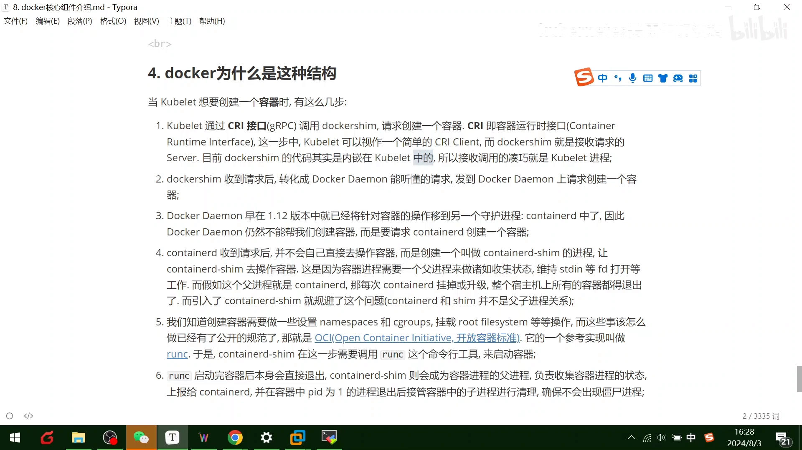

完整调用链就是 [【跳转到 17:18】](https://www.bilibili.com/video/BV18Ti7eUEmV/?t=1038)：

```
kubelet → dockershim → dockerd → containerd → containerd-shim → runc → 容器进程
```

runc 按 OCI 标准创建容器后立即退出，shim 成了容器进程的父进程——这样容器进程与 dockerd、containerd 都解耦了，谁挂掉、谁升级都不连累容器。

## 十、为什么底层是 runc？OCI 标准与一段历史

创建容器需要设置 namespace、cgroups、准备 rootfs 等一堆操作。这些操作「怎么做」早已被规范化——就是 **OCI（开放容器标准）的运行时标准**，而它的参考实现正是 runc [【跳转到 15:54】](https://www.bilibili.com/video/BV18Ti7eUEmV/?t=954)。runc 的子指令很多（`runc list`、`runc create`、`runc exec`……其中 `runc exec` 和 `docker exec` 的语义基本一致）[【跳转到 16:16】](https://www.bilibili.com/video/BV18Ti7eUEmV/?t=976)。

为什么要搞这套标准？讲师给了一段「发展历史」：K8s 最开始的运行时架构没那么复杂——想创建容器，直接跟 docker 守护进程说一声就行。但为了**不让容器标准被 Docker 一家控制**，大佬们推动了开放容器标准（OCI）；Docker 则把自己内部的 **libcontainer** 库封装捐出，演变成了 **runc** [【跳转到 17:43】](https://www.bilibili.com/video/BV18Ti7eUEmV/?t=1063)——把「怎么用底层内核特性启动容器」封装成了一个标准的容器实现。后来还有 Kata Containers 等生态 [【跳转到 18:08】](https://www.bilibili.com/video/BV18Ti7eUEmV/?t=1088)。

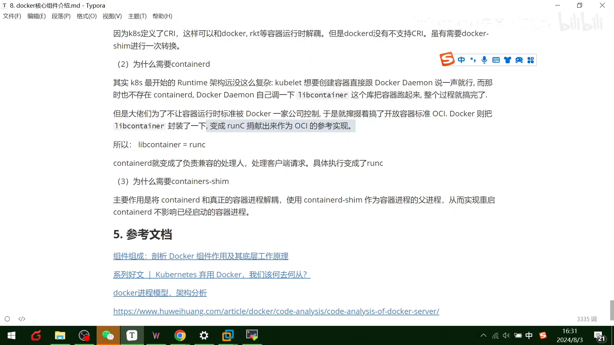

讲师给了一个类比帮助记忆：**libcontainer 之于 runc，就好比 OpenStack 底层的 libvirt 之于 KVM**——上层的编排框架千千万，底层真正干活的实现是同一个。在这套新架构里，**containerd 成了负责监护的管理者**（处理客户端请求），具体创建容器则交给 runc [【跳转到 18:33】](https://www.bilibili.com/video/BV18Ti7eUEmV/?t=1113)。于是容器标准掌握在了开放容器组织（OCI）手中，而不是任何一家公司手里。

最后再强调一遍 shim 的意义：**将 containerd 和真正的容器进程解耦，用 shim 作为容器的父进程，从而实现 containerd 的重启/升级不影响已启动的容器** [【跳转到 18:58】](https://www.bilibili.com/video/BV18Ti7eUEmV/?t=1138)。

## 小结

- 二进制安装的 Docker 是一组组件：`docker`、`dockerd`、`containerd`、`containerd-shim`、`runc`、`docker-proxy`、`docker-init`。
- `docker` 是客户端，`dockerd` 是服务端；但 dockerd 不真正干活，容器生命周期由 **containerd** 管理（gRPC/UNIX socket 通信），镜像管理也在 containerd。
- **runc 是 OCI 运行时标准的实现**：rootfs + `runc spec` 生成的 `config.json` 就能裸启一个容器——Docker 本质是 runc 之上的封装。
- **containerd-shim 是容器进程的父进程**：runc 创建完容器就退出，shim 收养容器进程、收集状态、防止僵尸进程；正因为 shim 与 containerd 没有父子关系，containerd 升级/重启不影响运行中的容器。
- `-p` 端口映射由 **docker-proxy** 基于iptables实现；`--init` 让 **docker-init** 当容器 1 号进程回收僵尸进程。
- 完整进程链：`kubelet → dockershim → dockerd → containerd → containerd-shim → runc → 容器进程`，每一环都是为「解耦」服务。

## 关键术语速查

| 术语 | 一句话解释 |
| --- | --- |
| docker | Docker 的客户端 CLI，把用户命令发给 dockerd |
| dockerd | Docker 服务端守护进程，接收请求并调度，但自己不直接创建容器 |
| containerd | 容器运行时管理器，负责容器生命周期与镜像管理；从 Docker 1.11 架构拆分独立，遵循 OCI 标准 |
| containerd-shim | 「垫片」进程，作为容器进程的父进程，解耦 containerd 与容器，防僵尸进程 |
| runc | OCI 运行时标准的参考实现，用 namespace/cgroups 等系统调用直接创建容器，启动完即退出 |
| docker-init | 加 `--init` 时充当容器 1 号进程的程序（即 tini），负责回收僵尸进程 |
| docker-proxy | 端口映射组件，`-p` 参数时把容器端口映射到宿主机，底层用 iptables |
| ctr | containerd 自带客户端，用于开发调试（images/containers list 等） |
| CRI / dockershim | Kubernetes 的容器运行时接口；dockershim 是内嵌在 kubelet 里、把 CRI 请求转成 dockerd 请求的适配层（后被移除） |
| OCI | 开放容器标准（运行时标准 + 镜像标准），保证容器实现不被单一厂商绑定 |
| config.json | `runc spec` 生成的容器规格文件（OCI 版本、root 路径、hostname 等），与 rootfs 搭配即可裸启容器 |
