# 管好容器的一生：PID 1、信号处理、探针与生命周期钩子（KubeCon 实录）

> 本文整理自 KubeCon 演讲 **《PID 1, SIG Handling, Hooks & Probes: Managing Container Lifecycle Correctly》**，讲者是 OLX Group 的站点可靠性工程师 Anmol Krishan Sachdeva。演讲用六个章节回答同一个问题：怎样才算「正确地」管理容器生命周期。原视频：[PID 1, SIG Handling, Hooks & Probes: Managing Container Lifecycle Correctly](https://www.youtube.com/watch?v=Orrwfu1lvS8)。

讲者先介绍了自己所在的 OLX Group：一个覆盖 45 国、月活约 3.5 亿人的在线交易平台，背后是数百个跑在 Kubernetes 集群里的微服务，基础设施几乎全部来自 CNCF 版图 [【跳转到 00:16】](https://www.youtube.com/watch?v=Orrwfu1lvS8&t=16)。大规模生产环境对「容器怎么生、怎么病、怎么死」的要求，正是本讲的主题。

## 本讲要解决的核心问题（SCQA）

**背景**：我们已经知道容器就是进程：容器里由镜像 ENTRYPOINT 指定的主进程就是 **PID 1**，主进程退出，容器就结束。Kubernetes 的 kubelet 负责「把容器拉起来、崩了就重启」，看似已经够用了。

**冲突**：PID 1 在 Unix 世界里本该承担两项职责——**回收僵尸进程**和**转发信号**，可普通业务应用压根没写这些逻辑。于是僵尸进程在容器里悄悄堆积；应用主进程没崩、却因死锁/内存泄漏而「假活」，流量照常打进来；强杀容器又让事务和数据连接处于中间状态。仅靠「崩溃重启」，这些都管不了。

**疑问**：要让容器进程模型在生产环境被正确管理，需要补齐哪些机制？

**回答（中心思想）**：四件套，各管一段——①给容器配一个轻量 **init 系统（tini）** 当 PID 1，负责收尸和转发信号；②理解 **SIGTERM/SIGKILL** 与 Pod 的优雅终止流程；③用 **liveness / readiness / startup** 三种探针让 kubelet 定期为容器「把脉」；④用 **postStart / preStop 钩子**与 **init 容器**把生命周期动作挂到正确的时间点。下面按演讲的顺序逐一展开。

## 一、容器里的 Unix 进程树：PID 1、僵尸与孤儿

Unix 进程是运行中应用的一个实例，进程按父子关系组成**进程树**；每个进程都可以派生子进程。树最顶端的进程叫 **init 进程（PID 1）**，由内核在系统启动时创建，负责拉起其余系统进程 [【跳转到 02:13】](https://www.youtube.com/watch?v=Orrwfu1lvS8&t=133)。

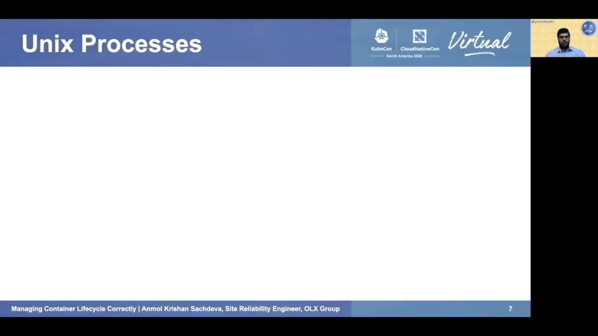

示例树里，PID 1（init）有两个孩子：PID 2 跑 sshd、PID 3 跑 nginx；PID 2 又创建了 PID 4 跑 bash。接下来是两个经典角色：

**僵尸进程（zombie）**：以 PID 4 为例，它终止之后就成为 defunct/僵尸进程——**已终止、但还没有被父进程 wait 过** [【跳转到 02:38】](https://www.youtube.com/watch?v=Orrwfu1lvS8&t=158)。「wait」指父进程等待子进程返回退出码/退出状态，从而释放子进程占用的资源，这个动作叫 **reaping（收尸）** [【跳转到 03:03】](https://www.youtube.com/watch?v=Orrwfu1lvS8&t=183)。流程是：子进程终止时产生 **SIGCHLD** 信号发给父进程，父进程调用 **waitpid** 系统调用，收尸开始 [【跳转到 03:28】](https://www.youtube.com/watch?v=Orrwfu1lvS8&t=208)。

**孤儿进程（orphan）**：如果父进程（PID 2）先终止，还活着的 PID 4 就成了孤儿。Unix 里 **PID 1 负责重新认领（re-parenting）**——孤儿会被过继给 PID 1 [【跳转到 04:18】](https://www.youtube.com/watch?v=Orrwfu1lvS8&t=258)。

## 二、僵尸为什么在容器里更危险：你的应用就是 PID 1

僵尸进程本身不占多少 CPU，但**每个僵尸都在进程表里占一个条目、持续占用内核资源**；僵尸一多，新进程可能都创建不出来（资源饥饿）[【跳转到 04:43】](https://www.youtube.com/watch?v=Orrwfu1lvS8&t=283)。

而容器把这个问题放大了：**一般每个容器只跑一个主应用进程，它就是 PID 1**——ENTRYPOINT 里写什么，什么就是 PID 1 [【跳转到 04:43】](https://www.youtube.com/watch?v=Orrwfu1lvS8&t=283)。

矛盾在于：你的应用是为解决业务问题写的，**并不具备 init 系统的功能**。一旦容器里僵尸进程变多，这个「业余 PID 1」根本不会去收尸。用第三方托管镜像时更悬——你甚至不知道人家的主进程有没有 init 能力 [【跳转到 05:08】](https://www.youtube.com/watch?v=Orrwfu1lvS8&t=308)。

常见的取巧办法是拿 **bash** 当 PID 1，但 bash 只能算半吊子：它能做一部分收尸，却**不能正确处理信号**——操作系统发给它的信号，不会被转发给子进程 [【跳转到 05:33】](https://www.youtube.com/watch?v=Orrwfu1lvS8&t=333)。也就是说，容器需要的是一个真正合格的 init 系统。

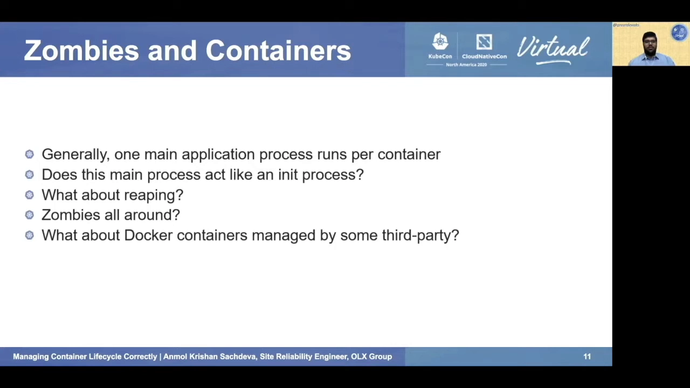

## 三、给容器配一个 init 系统：tini

成熟 init 系统（upstart、systemd）太重；容器要的是轻量级选项：**tini** 和 **dumb-init**。本讲选 tini [【跳转到 05:58】](https://www.youtube.com/watch?v=Orrwfu1lvS8&t=358)：开源、适合 Docker 容器与生产环境、简单轻量、**既能收僵尸又能正确转发信号**，加上或移除都没有副作用。

接入方式非常简单——改 Dockerfile 即可 [【跳转到 06:23】](https://www.youtube.com/watch?v=Orrwfu1lvS8&t=383)：

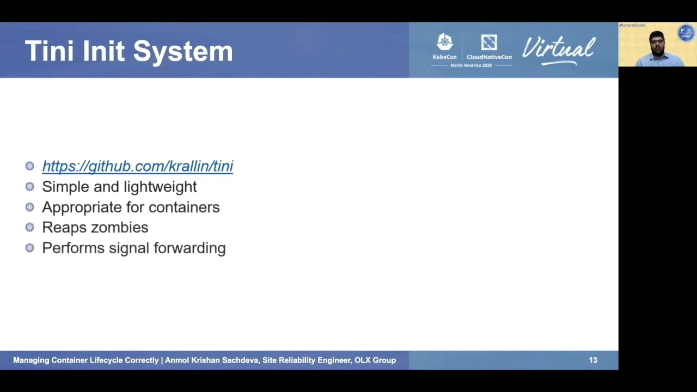

1. 指定 tini 版本与发布包的远程 URL，下载二进制；
2. 给二进制加执行权限；
3. 把 **ENTRYPOINT 写成 `tini -- <原命令>`**（tini 后跟两个连字符，再接原命令）。

讲者用一段 `defunct.py` 演示程序（专门制造僵尸进程）做了对比实验 [【跳转到 06:48】](https://www.youtube.com/watch?v=Orrwfu1lvS8&t=408)：两个 Pod 跑同一段脚本，一个不带 tini、一个带 tini [【跳转到 07:24】](https://www.youtube.com/watch?v=Orrwfu1lvS8&t=444)。这些短命容器会不断崩溃重启（CrashLoopBackOff），看日志即可分辨 [【跳转到 07:54】](https://www.youtube.com/watch?v=Orrwfu1lvS8&t=474)：

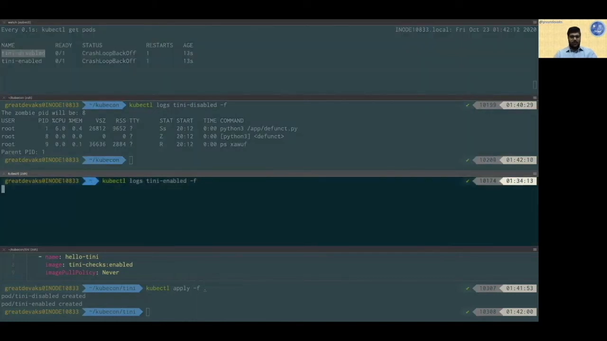

- 第一个容器：进程被标记为 **defunct**，日志明说 PID 8 是僵尸进程——没人收尸；
- 第二个容器：PID 8 同样成了僵尸，但 **tini 把它收掉了**，日志里没有 defunct 标记。

再补两个 tini 的细节 [【跳转到 08:39】](https://www.youtube.com/watch?v=Orrwfu1lvS8&t=519)：tini 必须以 PID 1 运行才能收尸；若当不了 PID 1，可以加 `-s` 参数（`tini -s -- …`）以 **subreaper** 身份运行——subreaper 指不在 PID 1 位置、但能行使收尸职责的进程。另外 tini 会**以子进程的退出码退出**，退出码还可以重映射 [【跳转到 09:04】](https://www.youtube.com/watch?v=Orrwfu1lvS8&t=544)。

## 四、Pod 与容器的生命周期：状态先分清

管好「生老病死」，先得有状态模型。**Pod 生命周期有 5 个阶段** [【跳转到 09:34】](https://www.youtube.com/watch?v=Orrwfu1lvS8&t=574)：

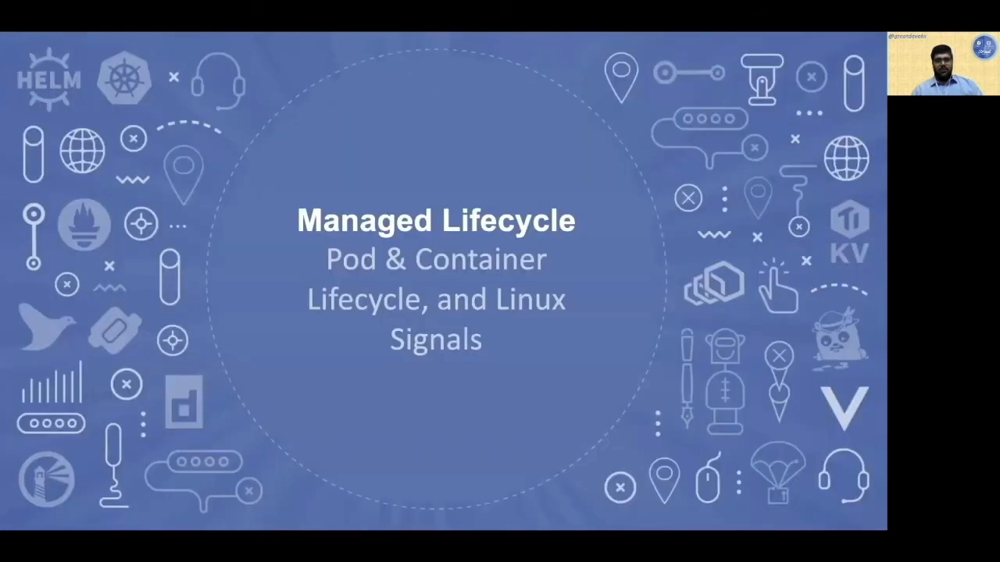

| 阶段 | 含义 |
| --- | --- |
| Pending | Pod 已通过 API 创建，正在等节点调度 |
| Running | Pod 正常运行中 |
| Unknown | 罕见；集群内部故障，无法与 Pod 通信 |
| Succeeded | Pod 正常结束（常见于 CronJob） |
| Failed | Pod 崩溃了（同样常见于 CronJob） |

Kubernetes 同时盯着每个**容器**的状态，容器有 3 个状态 [【跳转到 09:46】](https://www.youtube.com/watch?v=Orrwfu1lvS8&t=586)：**Waiting**（启动前的准备工作，如拉镜像、注入 secrets）、**Running**（正常运行）、**Terminated**（失败或正常结束）。想知道容器终止的确切原因，用 `kubectl describe pod` 查看 [【跳转到 10:11】](https://www.youtube.com/watch?v=Orrwfu1lvS8&t=611)。

## 五、优雅终止：SIGTERM 是敲门，SIGKILL 是断电

接下来是本讲最实用的一节：**优雅终止（graceful termination）**。应用被终止时，往往需要清理：删临时文件、释放连接、提交事务……不做这些，轻则性能受损，重则直接故障——**强杀（forceful termination）是最大的威胁**，应用可能停在「不上不下」的坏状态里 [【跳转到 10:36】](https://www.youtube.com/watch?v=Orrwfu1lvS8&t=636) [【跳转到 11:01】](https://www.youtube.com/watch?v=Orrwfu1lvS8&t=661)。

Pod 终止过程涉及两个关键 Linux 信号 [【跳转到 11:26】](https://www.youtube.com/watch?v=Orrwfu1lvS8&t=686)：

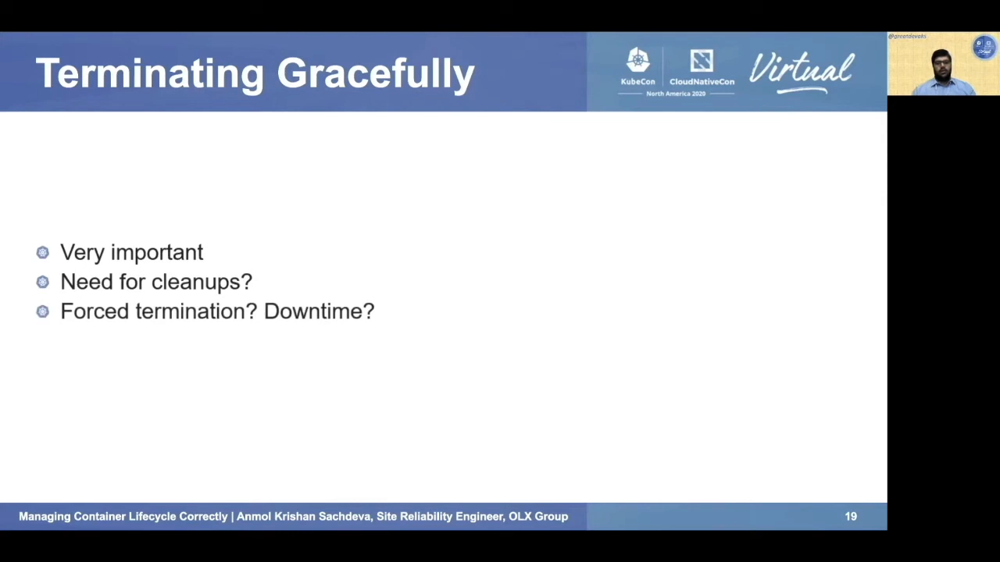

- **SIGTERM**：对容器的「温柔一戳」，请求进程退出；不会立即生效，**进程可以处理甚至忽略它**；
- **SIGKILL**：硬杀，等价于 `kill -9`，**无法被处理**——就像直接把机器电源拔了。

完整的终止流程是一条时间线 [【跳转到 11:51】](https://www.youtube.com/watch?v=Orrwfu1lvS8&t=711)：

1. 设定**宽限期（grace period）**，默认 30 秒；Pod 进入 Terminating 状态，**停止接收任何流量**；
2. 执行 **preStop 钩子**（如果定义了）；
3. 向 Pod 里**每个容器的 PID 1 发送 SIGTERM**——这里正是前面 init 系统的用武之地：有 tini 这类 init 系统才能保证信号被正确转发；但应用自己能不能处理信号，仍取决于应用代码 [【跳转到 12:21】](https://www.youtube.com/watch?v=Orrwfu1lvS8&t=741)；
4. 宽限期一到，**SIGKILL 发出**，API server 删除 Pod 对象，Pod 彻底终止 [【跳转到 12:46】](https://www.youtube.com/watch?v=Orrwfu1lvS8&t=766)。

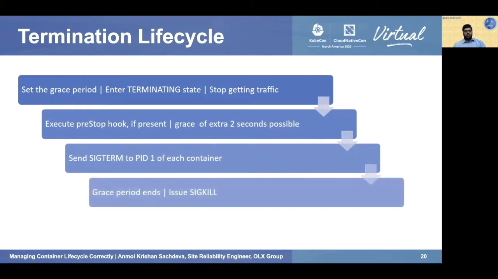

## 六、探针：让 kubelet 定期给容器把脉

Kubernetes 需要知道 Pod 的健康状态，才能决定要不要把请求发过去。最基础的是**进程健康检查**：kubelet 跑在每个节点上，负责把容器拉起来、崩了就重启 [【跳转到 13:31】](https://www.youtube.com/watch?v=Orrwfu1lvS8&t=811)。

但「主进程活着」不等于「应用活着」：**死锁、内存泄漏、死循环、颠簸（thrashing）**……应用完全可能不崩溃却停止工作 [【跳转到 13:56】](https://www.youtube.com/watch?v=Orrwfu1lvS8&t=836)。别指望每个应用都自己写复杂的自检逻辑——我们需要一种可靠又简单的通用机制，这就是**探针（probe）** [【跳转到 14:21】](https://www.youtube.com/watch?v=Orrwfu1lvS8&t=861)。

**探针是 kubelet 对容器做的周期性诊断**：不健康的容器要么被重启，要么被摘出流量，从而实现自愈、更合理的负载均衡和及时的请求响应 [【跳转到 14:46】](https://www.youtube.com/watch?v=Orrwfu1lvS8&t=886)。

探针通过容器实现的 **handler** 来执行，有三种 [【跳转到 15:11】](https://www.youtube.com/watch?v=Orrwfu1lvS8&t=911)：

- **exec**：执行一段命令，退出码为 0 即健康；
- **tcpSocket**：对指定端口做 TCP 连接检查；
- **httpGet**：对指定 IP:port+路径发 GET 请求，**响应码在 200–399 之间**才算成功。

每次探测的结果有三种：Success、Failure、Unknown。

## 七、Liveness 与 Readiness：一个杀进程，一个断流量

三种探针里，本讲重点演示前两种 [【跳转到 15:36】](https://www.youtube.com/watch?v=Orrwfu1lvS8&t=936)：

**Liveness（存活探针）**：判断容器「活着还是死了」。探测失败时，**kubelet 会杀掉容器并重启**（是否真的重启取决于重启策略：Always / Never / OnFailure）。

讲者给出三条生产建议 [【跳转到 16:01】](https://www.youtube.com/watch?v=Orrwfu1lvS8&t=961)：①**生产 Pod 一定要配 liveness 探针**；②应用要暴露健康检查 API（如 `/health`），**不要加鉴权**——否则探针永远失败；③健康检查逻辑要**轻**——探针消耗的 CPU 计入容器的 CPU 配额，别在里面跑复杂逻辑 [【跳转到 16:26】](https://www.youtube.com/watch?v=Orrwfu1lvS8&t=986)。

**Readiness（就绪探针）**：信号化地回答「容器现在能不能接新连接」[【跳转到 16:51】](https://www.youtube.com/watch?v=Orrwfu1lvS8&t=1011)。典型场景：启动期预热需要时间，就绪探针可以让流量晚一点进来；容器过载时，也可以把就绪探针打失败，让流量暂时绕开。注意两点：**Pod 里所有容器都就绪，Pod 才算就绪**；与 liveness 不同，**readiness 失败不会杀容器**，只是摘流量。还有一个细节：容器收到 SIGTERM 之后，即使 readiness 检查还能通过，Kubernetes 也不再给它发新请求。

## 八、探针实战：一个 Flask 应用的生死演示

讲者写了一个小型 Flask 应用来演示 [【跳转到 17:40】](https://www.youtube.com/watch?v=Orrwfu1lvS8&t=1060)。Pod 清单里同时定义 liveness 与 readiness 探针，都用 httpGet，路径分别为 `/health/live` 与 `/health/ready`，端口 5000（Flask 监听端口）[【跳转到 18:05】](https://www.youtube.com/watch?v=Orrwfu1lvS8&t=1085)：

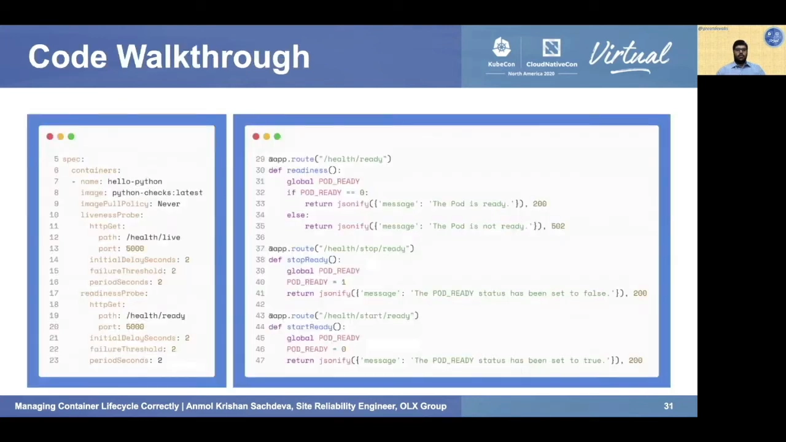

三个新参数 [【跳转到 18:30】](https://www.youtube.com/watch?v=Orrwfu1lvS8&t=1110)：

- **initialDelaySeconds**：容器启动后延迟多久才开始探测（本例 2 秒）；
- **failureThreshold**：允许连续失败几次才判死（本例 2 次）；
- **periodSeconds**：探测频率（本例每 2 秒一次）。

应用侧用两个开关接口切换就绪状态：`/health/stop/ready` 把就绪标志关闭、`/health/start/ready` 重新打开；`/health/ready` 据此返回 200（就绪）或 502（未就绪）[【跳转到 19:20】](https://www.youtube.com/watch?v=Orrwfu1lvS8&t=1160)。

实验过程 [【跳转到 20:26】](https://www.youtube.com/watch?v=Orrwfu1lvS8&t=1226)：

1. 部署后 `kubectl logs -f`：日志里不断出现 `live`、`ready`——这就是探针在周期性探测 [【跳转到 20:38】](https://www.youtube.com/watch?v=Orrwfu1lvS8&t=1238)；
2. 端口转发到 8989，浏览器访问正常；`/health/live` 返回 200；
3. 访问 `/health/stop/ready` 关闭就绪 → `/health/ready` 立刻返回 **502** [【跳转到 22:16】](https://www.youtube.com/watch?v=Orrwfu1lvS8&t=1336)；
4. readiness 探针开始失败，Pod 从 `1/1 Running` 变成 **`0/1`**（未就绪）——**流量不再路由进来，但容器没被杀**；
5. 访问 `/health/start/ready` 恢复就绪，Pod 回到 `1/1` [【跳转到 22:42】](https://www.youtube.com/watch?v=Orrwfu1lvS8&t=1362)；
6. 然后关闭 liveness（探针返回 502）：日志显示 **liveness probe failed**，kubelet 杀掉容器，`describe` 里 **restart 计数 +1** [【跳转到 23:22】](https://www.youtube.com/watch?v=Orrwfu1lvS8&t=1402)。

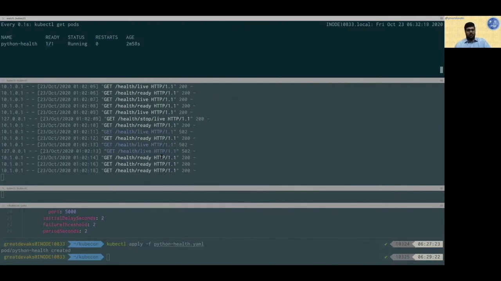

一个断流量、一个杀容器——两种探针的行为差异，在同一个应用里看得清清楚楚。

## 九、Startup 探针：给慢启动容器留足时间

第三种探针是 **startup（启动探针）**：指示容器里的应用「是否已经启动完成」[【跳转到 24:05】](https://www.youtube.com/watch?v=Orrwfu1lvS8&t=1445)。**在 startup 探针成功之前，其它探针全部禁用** [【跳转到 24:10】](https://www.youtube.com/watch?v=Orrwfu1lvS8&t=1450)。

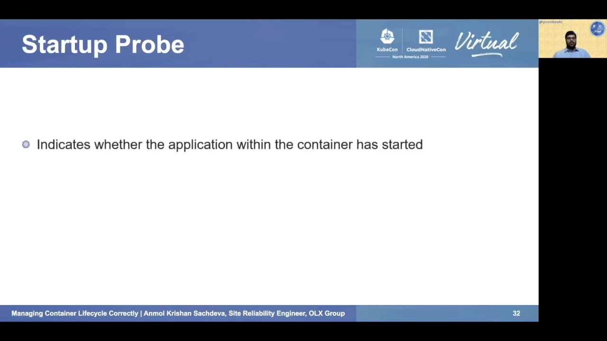

- 它**只在启动阶段执行**，不像其它探针周期性运行；
- 主要面向**慢启动容器**，failureThreshold 要给足（比如 10–15 次）；
- 可以与 liveness/readiness 用同一种探测机制、甚至同一路径（httpGet），但三者的**行为**完全不同。

## 十、生命周期钩子：postStart 与 preStop

光有信号处理还不够，Kubernetes 提供了两个**生命周期钩子**，把自定义动作挂到容器生命的头尾 [【跳转到 24:47】](https://www.youtube.com/watch?v=Orrwfu1lvS8&t=1487)：

**postStart**：容器启动后立即执行，与主进程**并行**运行 [【跳转到 24:52】](https://www.youtube.com/watch?v=Orrwfu1lvS8&t=1492)。可用于预热逻辑、通知外部监听者「应用要启动了」、前置条件检查等。但要注意：**它没有运行保证**；钩子执行完之前容器一直停在 Waiting 状态（Pod 停在 Pending）；钩子可能比主进程更早执行完；钩子失败（不返回）时，容器按重启策略重启。

**preStop**：容器终止**之前**发送给容器的调用，**触发优雅终止流程** [【跳转到 25:17】](https://www.youtube.com/watch?v=Orrwfu1lvS8&t=1517)。可以在应用之外执行清理逻辑，也可以调用应用自身提供的关闭端点——对第三方托管的容器镜像尤其好用。讲者举例：OLX 内部一个由 Azure Bot 驱动的聊天服务，就用 preStop 在 Pod 终止时**清理 Redis 连接与条目** [【跳转到 25:42】](https://www.youtube.com/watch?v=Orrwfu1lvS8&t=1542)。

把 preStop 放回终止时间轴上看：**宽限期一开始就立即调用 preStop，它在 SIGTERM 发出之前结束** [【跳转到 26:07】](https://www.youtube.com/watch?v=Orrwfu1lvS8&t=1567)——所以即使应用自身完全不支持优雅退出，也可以靠 preStop 补上优雅终止。

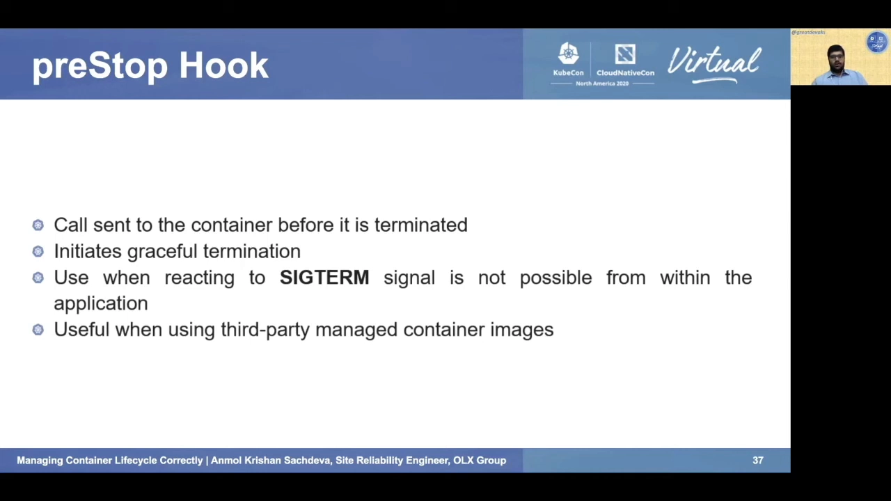

实现演示 [【跳转到 26:32】](https://www.youtube.com/watch?v=Orrwfu1lvS8&t=1592)：nginx 镜像 + `lifecycle` 字段，postStart 与 preStop 各挂一条 exec 命令（往 index.html 里追加一行标记），postStart 里额外 `sleep 20` 秒：

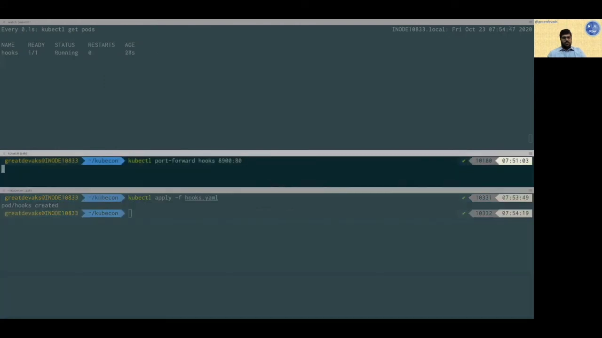

- 部署后 Pod 因 postStart 的 20 秒 sleep 迟迟不就绪；端口转发后能看到 postStart 写下的标记；
- `kubectl delete` 删除 Pod：日志里立刻出现 preStop 的标记，Pod 进入宽限期，随后 nginx 进程被清理 [【跳转到 27:32】](https://www.youtube.com/watch?v=Orrwfu1lvS8&t=1652)。

## 十一、Init 容器：主容器之前的专用容器

**Init 容器是「先于应用容器运行」的特殊容器** [【跳转到 27:43】](https://www.youtube.com/watch?v=Orrwfu1lvS8&t=1663)：

- 它与主应用容器**相互独立，用各自的镜像**，可以包含主镜像里没有的安装/配置步骤；
- 一个 Pod 里可以有**多个** init 容器，它们**按清单里的顺序串行执行、且必须全部成功**，应用容器才会启动；
- init 容器**不支持前面讲的钩子和探针**；失败后是否重启取决于 Pod 的重启策略（Always 则总是重启）[【跳转到 27:48】](https://www.youtube.com/watch?v=Orrwfu1lvS8&t=1668)；
- init 容器可以与应用容器**共享卷**；修改 init 容器的代码会导致 Pod 重启 [【跳转到 28:13】](https://www.youtube.com/watch?v=Orrwfu1lvS8&t=1693)。

演示 [【跳转到 28:31】](https://www.youtube.com/watch?v=Orrwfu1lvS8&t=1711)：nginx 应用容器 + busybox init 容器共享同一个 emptyDir 卷，init 容器负责改写 nginx 的 index.html。部署后 Pod 先显示 **`Init:0/1`**（1 个 init 容器尚未完成），初始化完成后进入 Running；打开 nginx 页面，显示的是 **init 容器写入的内容**：

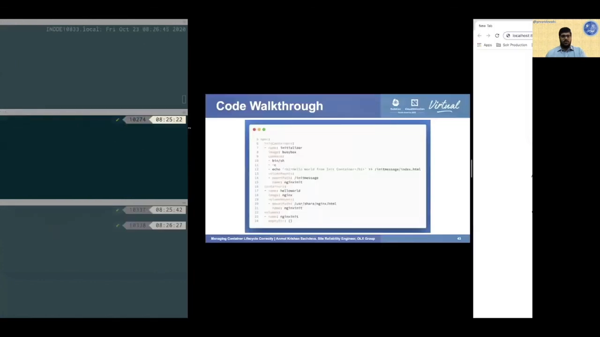

init 容器的典型用途 [【跳转到 29:18】](https://www.youtube.com/watch?v=Orrwfu1lvS8&t=1758)：延迟应用容器启动、前置条件检查、运行主镜像之外的实用工具、在应用启动前向数据库灌数据、运行时配置并**等待某个依赖（数据库/服务）可用**、数据库 schema 迁移与准备、创建用户账号等等。

**资源账怎么算** [【跳转到 29:48】](https://www.youtube.com/watch?v=Orrwfu1lvS8&t=1788)：init 容器与应用容器共存于一个 Pod，Pod 的有效 request/limit 取「**所有应用容器之和**」与「**init 容器的有效值**」二者的较大者；而 init 容器的有效值是**单个 init 容器中最高的那份 request/limit**（因为它们串行执行，不会同时跑）。

## 十二、三种方案对决：init 容器 vs startup 探针 vs postStart 钩子

三个「启动期」手段经常被混为一谈，讲者给出逐项对比 [【跳转到 30:42】](https://www.youtube.com/watch?v=Orrwfu1lvS8&t=1842)：

| 维度 | postStart 钩子 | startup 探针 | init 容器 |
| --- | --- | --- | --- |
| 运行位置 | 应用容器**内部** | 应用容器**内部** | **独立容器** |
| 作用范围 | 单个容器 | 单个容器 | **整个 Pod**（不绑定某个应用容器） |
| 镜像 | 与应用同镜像 | 与应用同镜像 | 可同可不同，**自由选择** |
| 运行保证 | **没有任何保证** | 必须成功才能继续 | 必须成功才能继续 |
| 失败阈值/重启 | 无阈值；失败则容器失败并按重启策略重启 | 可指定阈值（要给得足够大） | 按 Pod 重启策略重启 |
| 典型用途 | 通知外部监听者、前置检查、引入延迟 | **慢启动容器** | 各种初始化（等待依赖、灌数据、schema 迁移） |
| 数量 | 一个（可选探测机制） | 一个（可选探测机制） | **可多个**，串行执行 |

最后一句话总结三者定位：postStart 用于「应用即将启动」时打招呼/做前置检查/拖时间；init 容器承担各种初始化任务；startup 探针专为慢启动容器而生——记得把 failureThreshold 给足 [【跳转到 32:13】](https://www.youtube.com/watch?v=Orrwfu1lvS8&t=1933) [【跳转到 32:38】](https://www.youtube.com/watch?v=Orrwfu1lvS8&t=1958)。

## 小结

- 容器的主进程就是 PID 1，但普通应用既不收僵尸也不转发信号——**给容器配 tini 这类轻量 init 系统**，僵尸实验证明它真的把 defunct 收掉了。
- 终止流程的时间线：**宽限期（默认 30s）→ preStop 钩子 → 向每个容器的 PID 1 发 SIGTERM → 超时 SIGKILL**。SIGTERM 可以处理，SIGKILL 无法处理。
- 探针是 kubelet 的周期性诊断，handler 有 **exec / tcpSocket / httpGet** 三种；**liveness 失败杀容器重启，readiness 失败只摘流量**，startup 探针成功前其它探针禁用。
- 生产建议：必配 liveness、健康 API 不加鉴权、探针逻辑要轻。
- 钩子把动作挂到对的时间：**postStart 与主进程并行且无保证**；**preStop 在宽限期开始时执行、先于 SIGTERM**，是给不支持优雅退出的应用兜底的利器。
- **init 容器**串行先行、必须成功、可与主容器共享卷，负责等待依赖、准备数据等初始化任务；它的资源按「单个最大值」计入 Pod。
- 三者对比一句话：**postStart 无保证、startup 为慢启动、init 容器管初始化**。

## 关键术语速查

| 术语 | 一句话解释 |
| --- | --- |
| PID 1 / init 进程 | 进程树根，内核启动时创建；容器里 ENTRYPOINT 的主进程即 PID 1，本应负责收尸与转发信号 |
| 僵尸进程（zombie） | 已终止但未被父进程 wait 的进程，占进程表条目 |
| 孤儿进程（orphan） | 父进程先终止的活进程，会被 PID 1 收养 |
| SIGCHLD / waitpid / reaping | 子进程终止发信号 → 父进程 waitpid → 释放资源，即「收尸」 |
| tini / dumb-init | 轻量容器 init 系统；tini 可用 `-s` 以 subreaper 身份运行，按子进程退出码退出 |
| subreaper | 不在 PID 1 位置、但可收领孤儿并收尸的进程 |
| Pod 状态 | Pending / Running / Unknown / Succeeded / Failed 五阶段 |
| 容器状态 | Waiting / Running / Terminated；`kubectl describe pod` 查终止原因 |
| SIGTERM / SIGKILL | 温和的终止请求（可处理/忽略）与不可处理的硬杀（相当于 `kill -9`） |
| 宽限期（grace period） | 终止时留给应用善后的时间，默认 30 秒，超时发 SIGKILL |
| 探针（probe） | kubelet 对容器的周期性诊断；结果 Success/Failure/Unknown |
| exec / tcpSocket / httpGet | 三种探测 handler：退出码 0 / 端口可连 / 返回码 200–399 |
| liveness / readiness / startup | 存活（失败杀容器）、就绪（失败摘流量）、启动（成功前禁用其它探针） |
| initialDelaySeconds / failureThreshold / periodSeconds | 探测的启动延迟、允许失败次数、探测周期 |
| postStart / preStop | 生命周期钩子：启动后与主进程并行（无保证）；终止前触发，宽限期一开始就执行 |
| init 容器 | 先于应用容器串行运行的独立容器，必须全部成功；不支持钩子与探针，可与主容器共享卷 |
