# 容器的本质是进程：一次 docker run 背后的进程真相

> 本文整理自《深入理解 docker 和 kubernetes》系列第 1 课 **《容器的本质是进程》**。讲师不讲抽象概念，而是用一套人人可复现的终端实验，把「容器到底是什么」拆开给你看。原视频：[深入理解docker和kubernetes（k8s）-1. 容器的本质是进程](https://www.bilibili.com/video/BV1a5L4zQEBC/)。

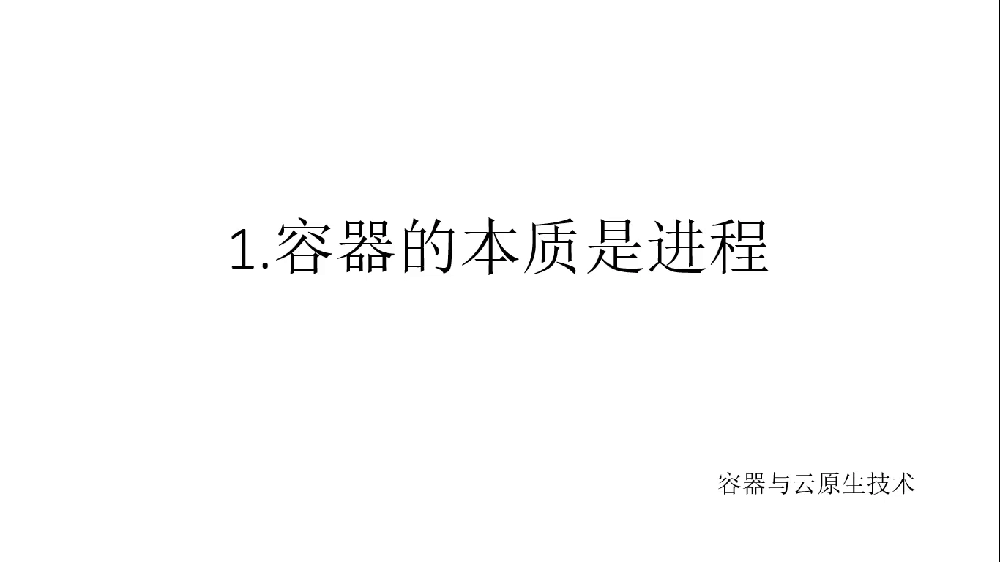

## 本讲要解决的核心问题（SCQA）

**背景**：很多人入门容器技术，是从「Docker 是轻量级虚拟机」这句话开始的。装上 Docker，`docker run` 一下，提示符一变，就以为「进了一台小虚拟机」。

**冲突**：容器真的像虚拟机那样「虚拟」出了一台机器吗？如果是，那它理应有自己的内核、自己的进程表。可是内存只有 1.24MB 的 busybox 镜像里，显然塞不进一个操作系统内核——那容器里跑着的到底是什么？

**疑问**：当 `docker run` 执行完、提示符变化的那一刻，系统里真实发生的事情是什么？容器和宿主机上的进程，到底是什么关系？

**回答（中心思想）**：**容器的本质就是一个进程**。它跑在宿主机的 Linux 系统里，是进程树上的普通一员：由镜像里的 `Cmd` 配置决定启动哪个程序，被 containerd-shim/runc 拉起，挂在这棵进程树上；你在容器里开的每一个「应用」，都只是这棵子树上的子进程。容器没有自己的内核，也没有独立于宿主机的「机器」——这一讲全部用实验来证明。

## 一、实验准备：1.24MB 的 busybox 和一条 docker run

讲师事先准备了几个镜像 [【跳转到 00:14】](https://www.bilibili.com/video/BV1a5L4zQEBC/?t=14)：

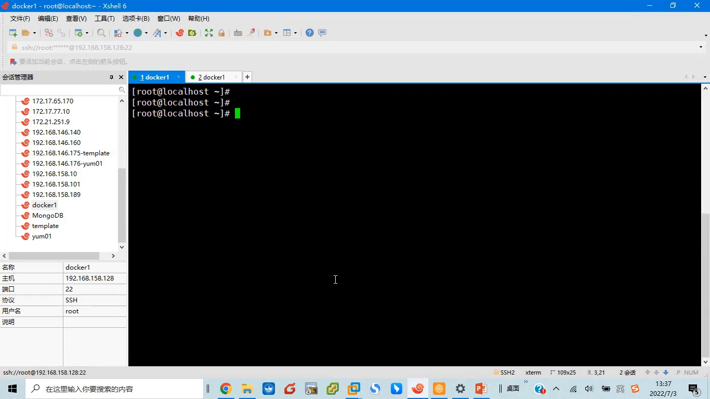

- **busybox**：学习容器时的经典镜像。它小到只有 **1.24MB**，却打包了 `ls`、`vi`、`sh` 这些最常用的 Linux 命令，非常适合做实验。本讲只用它。
- 两个 **CentOS** 镜像，留到后续课程使用。

这里先埋一个伏笔：**1.24MB 装不下一个操作系统内核**。如果容器真是「小虚拟机」，这个尺寸根本不可能——记住这个疑点，后面揭晓答案。

然后启动容器 [【跳转到 00:39】](https://www.bilibili.com/video/BV1a5L4zQEBC/?t=39)：

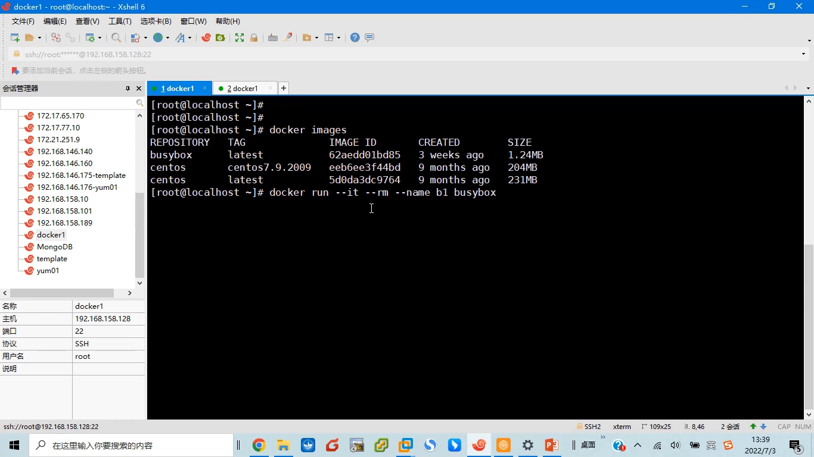

```bash
docker run -it --rm --name b1 busybox
```

逐个解释参数 [【跳转到 01:04】](https://www.bilibili.com/video/BV1a5L4zQEBC/?t=64)：

| 参数 | 含义 |
| --- | --- |
| `-i`（interactive） | 打开标准输入，让容器「听得进」我们敲的命令 |
| `-t`（terminal） | 分配一个伪终端，让交互有一个终端的样子 |
| `--rm` | 容器停止后自动删除，不留尸体 |
| `--name b1` | 给容器取名 `b1`，方便后面引用 |
| `busybox` | 用的镜像名；没写 tag 就默认 `latest` |

## 二、提示符一变：容器里跑着的其实是一个 sh

回车之后，现象很简单：**提示符变了** [【跳转到 01:54】](https://www.bilibili.com/video/BV1a5L4zQEBC/?t=114)。敲一个 `ls`，能看到一套目录结构——「我们其实已经进入了容器的内部」。

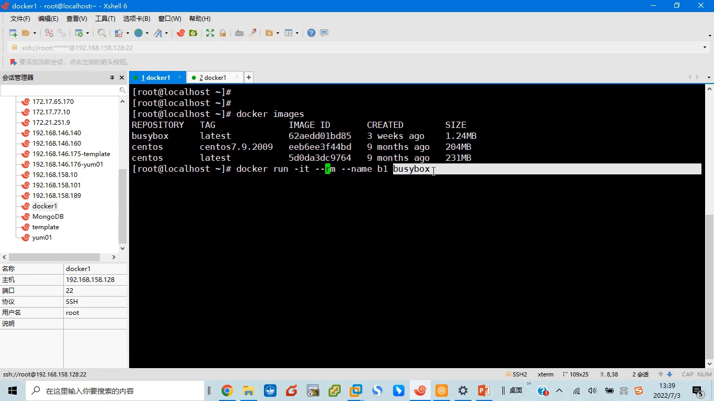

但容器启动时怎么知道要跑什么程序？讲师卖了个关子，随即揭晓：**答案写在镜像里**。换一个窗口执行 [【跳转到 02:44】](https://www.bilibili.com/video/BV1a5L4zQEBC/?t=164)：

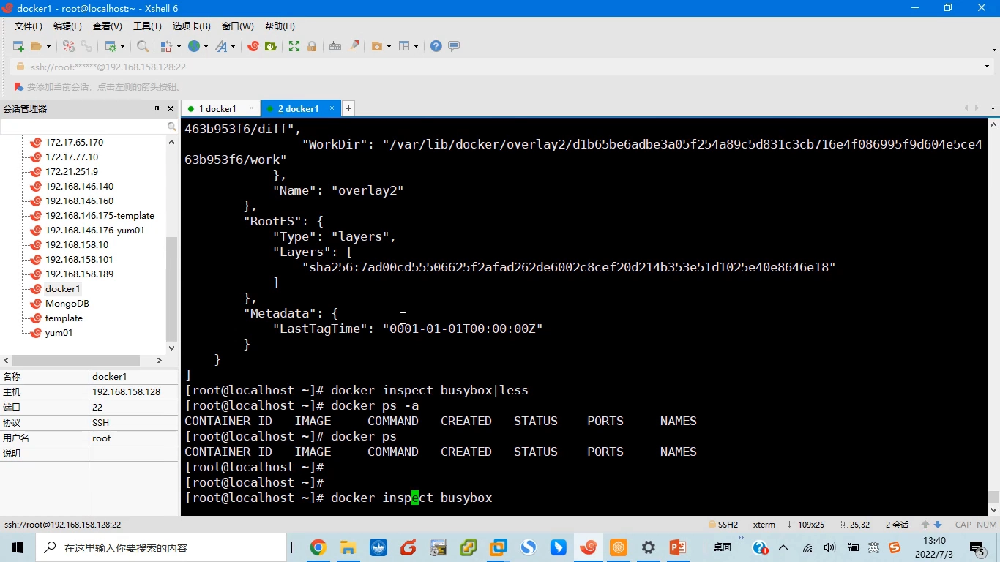

```bash
docker inspect busybox
```

在输出的配置里，关键字段是 **`Cmd`**：容器启动时要运行的命令。busybox 镜像里写的是 `["sh"]`——所以刚才一进容器，跑起来的就是一个 shell。配置里还有 **`Env`**（环境变量，比如 `PATH`），这样 `sh` 运行时才知道去哪些目录找命令。

`docker ps` 也能印证这一点 [【跳转到 03:34】](https://www.bilibili.com/video/BV1a5L4zQEBC/?t=214)：

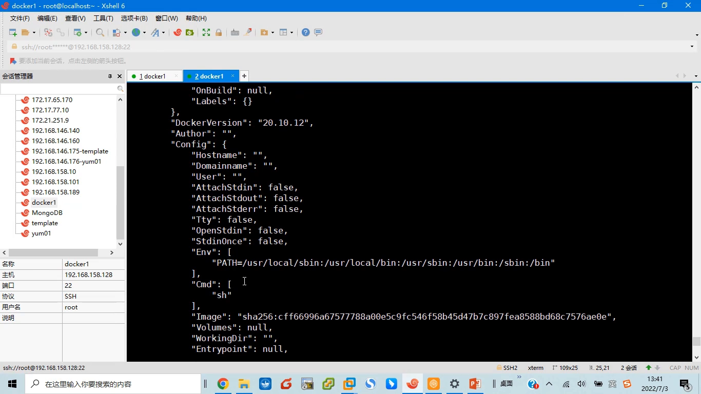

容器 b1 的 COMMAND 一栏明明白白写着 `sh`。这个 `sh` 不是「虚拟机里的系统程序」，它就是一个普普通通的可执行文件，躺在容器的 `/bin` 目录里。

## 三、是进程就该有进程号：docker inspect 找 Pid

回到主题——既然说「容器的本质是进程」，那它就该有进程号（PID）。怎么找？还是 `docker inspect`，这次跟的是容器名 [【跳转到 04:24】](https://www.bilibili.com/video/BV1a5L4zQEBC/?t=264)：

```bash
docker inspect b1
```

inspect 的输出非常长，要找的信息只有一个：**`State.Pid`**。过滤一下就能看到 [【跳转到 05:14】](https://www.bilibili.com/video/BV1a5L4zQEBC/?t=314)：

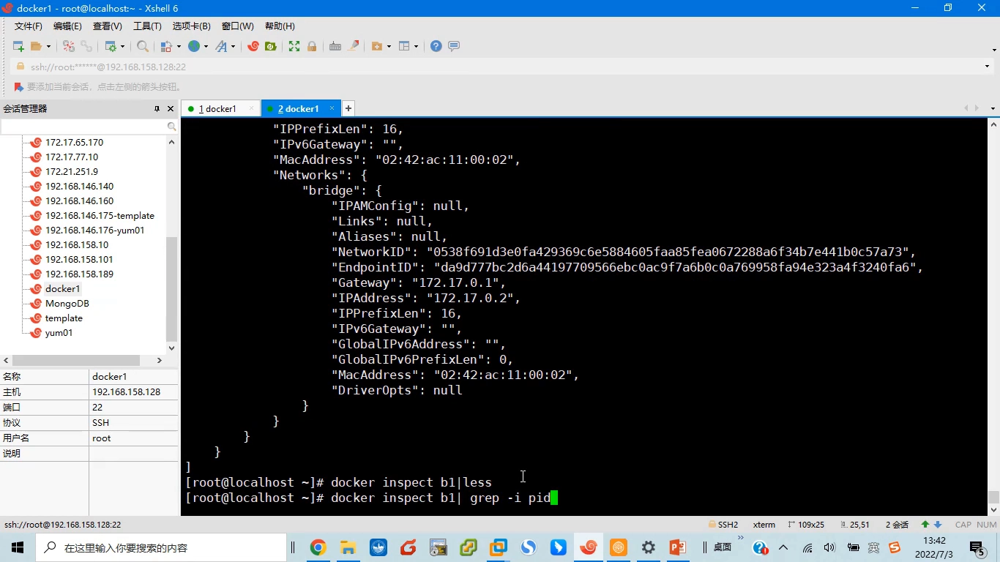

**这个容器 b1 在宿主机上的进程号是 16095。**

## 四、在宿主机上找到它：容器进程就挂在 Linux 进程树上

拿到 PID，就可以到宿主机上验货了。`ps` 查 16095 [【跳转到 05:39】](https://www.bilibili.com/video/BV1a5L4zQEBC/?t=339)：

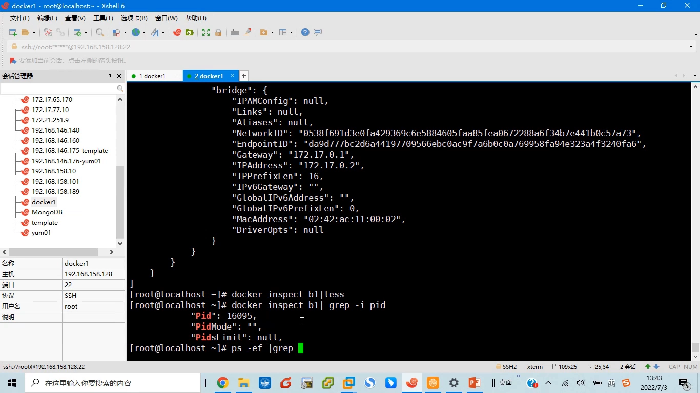

结果一目了然：**16095 对应的正是 `sh`**。「容器启动以后，就体现为我们这台宿主机里的一个进程」——它的 PID 是 16095，**父进程（PPID）是 16076**。

顺着父进程往上爬，看看 16076 是何方神圣 [【跳转到 06:04】](https://www.bilibili.com/video/BV1a5L4zQEBC/?t=364)：

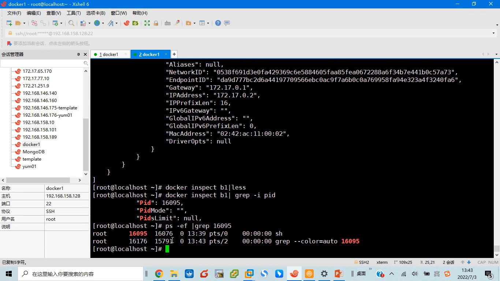

16076 的程序是 `/usr/bin` 下面的 **containerd-shim-runc**——这是 containerd 的「垫片」（shim）进程，名字里的 runc 表明它用 runc 这个运行时来创建容器。也就是说，**容器里的 sh 是被 shim/runc 这条链路启动起来的**。

再往上追一层：这个 shim 进程的父进程号是 **1**。`ps` 查一下 1 号进程是谁 [【跳转到 06:54】](https://www.bilibili.com/video/BV1a5L4zQEBC/?t=414)：

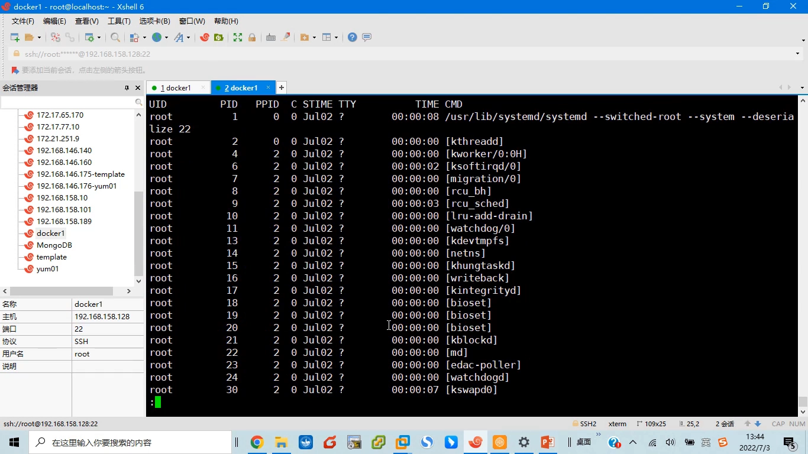

是 **systemd**——整个 Linux 系统启动后的第一个进程。把这条链画出来就是：

```
systemd (PID 1)
└─ containerd-shim-runc (16076)
   └─ sh (16095)   ← 容器 b1
```

结论水到渠成：**容器进程就是 Linux 进程树上的普通一员**。它没有被「虚拟」到另一个世界，而是实打实地长在宿主机的进程树上，往上数几层就回到了 systemd。

## 五、再玩一把：容器里的 vi，也是这棵树上的子进程

还在容器里的时候，讲师做了一个更有意思的实验。busybox 自带 `vi`，在容器里输入 `vi` 并且**不要退出**，然后回宿主机再看 `ps` [【跳转到 07:19】](https://www.bilibili.com/video/BV1a5L4zQEBC/?t=439)：

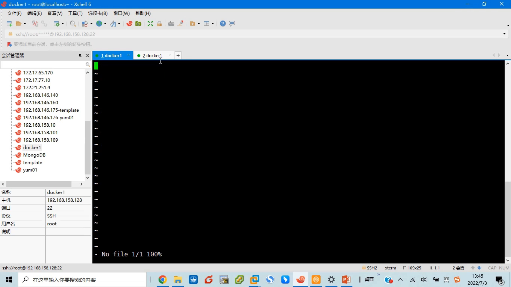

宿主机上多了一个进程：**vi，PID 16200，父进程 16095**——而 16095 正是容器 b1 的主进程 `sh`。也就是说，你在容器里启动的每个「应用」，在宿主机看来都只是 `sh` 底下的普通子进程：

```
systemd (PID 1)
└─ containerd-shim-runc (16076)
   └─ sh (16095)        ← 容器主进程
      └─ vi (16200)     ← 容器里开的「应用」
```

退出 `vi`，这个进程立刻消失；这些进程有生有灭，和宿主机上任何进程没有本质区别。

## 六、退出 sh：主进程一死，容器就结束

最后一步实验，也是本讲的点睛之笔：退出容器里的 `sh`（也就是 `exit` 离开那个提示符）。

再回宿主机查 16095 [【跳转到 08:29】](https://www.bilibili.com/video/BV1a5L4zQEBC/?t=509)：

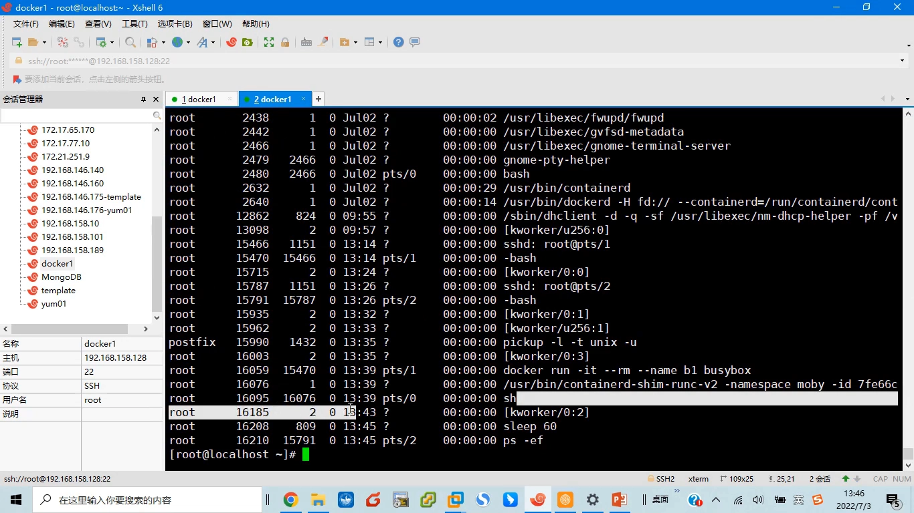

**没了。** 进程号 16095 已经不存在，因为 `sh` 退出了——而这也意味着 **容器 b1 的运行结束了，它的生命周期结束了**。

这就是容器世界里的一条铁律：**容器活着 = 容器的主进程活着**。主进程一退出，容器就停止；不夸张地说，「停止容器」和「杀死主进程」是同一件事的两个名字。至于镜像里写的是什么程序，各容器可以不同——busybox 里是 `sh`，换成 Nginx 镜像就是 Nginx 进程，一切由镜像的 `Cmd`（或运行时的 `docker run` 参数）定义 [【跳转到 09:04】](https://www.bilibili.com/video/BV1a5L4zQEBC/?t=544)。

## 小结

- **容器的本质是进程**：它不是轻量级虚拟机，而是宿主机 Linux 进程树上的普通成员。
- 容器启动时运行哪个程序，由**镜像里的 `Cmd`** 决定（busybox 是 `sh`），也可以被 `docker run` 的参数覆盖。
- `docker inspect <容器>` 的 **`State.Pid`** 能查到容器主进程在**宿主机**上的真实 PID。
- 实验中观察到的进程链：`systemd(1) ← containerd-shim-runc(16076) ← sh(16095)`，容器是被 containerd 的 shim/runc 链路拉起的。
- 容器里再启动的应用（如 `vi`）只是主进程的**子进程**，同样出现在宿主机的进程表里。
- **主进程退出 = 容器停止**：容器的生命周期与其主进程完全绑定。
- 1.24MB 的 busybox 装不下内核——因为容器根本不需要内核，它直接用宿主机的。

## 关键术语速查

| 术语 | 一句话解释 |
| --- | --- |
| `docker run` | 用某个镜像启动一个容器；`-it` 提供交互终端，`--rm` 停止即删除，`--name` 指定容器名 |
| `Cmd` | 镜像配置里声明的「容器启动时运行哪个命令」，busybox 里是 `["sh"]` |
| `docker inspect` | 查看镜像或容器的详细配置；对容器看 `State.Pid` 可拿到宿主机侧的真实进程号 |
| Pid（`State.Pid`） | 容器主进程在宿主机命名空间里的进程号，实验中为 16095 |
| containerd-shim | containerd 的「垫片」进程，负责接管并看护容器进程；本例中是 sh 的父进程（16076） |
| runc | OCI 运行时，真正负责创建容器进程的程序；shim 的名字 `containerd-shim-runc` 即表明使用它 |
| systemd | Linux 启动后的 1 号进程，进程树的根；shim 的父进程 |
| 进程树 | Linux 中进程按父子关系组成的树；容器主进程与应用进程都是这棵树上的节点 |
| 容器生命周期 | 与容器主进程同生共死：主进程退出，容器即停止 |
