# Cgroups, namespaces, and beyond：容器到底是由什么构成的？

> 视频源：[Cgroups, namespaces, and beyond: what are containers made from?（YouTube，Jérôme Petazzoni，54 分钟）](https://www.youtube.com/watch?v=sK5i-N34im8) ｜ [【跳转到 00:00】](https://www.youtube.com/watch?v=sK5i-N34im8&t=0)
>
> 本文基于视频演说图文稿整理；YouTube 英文自动字幕保留于文稿，人名/术语错拼已在本文纠正，时间戳可跳转回视频对应位置。

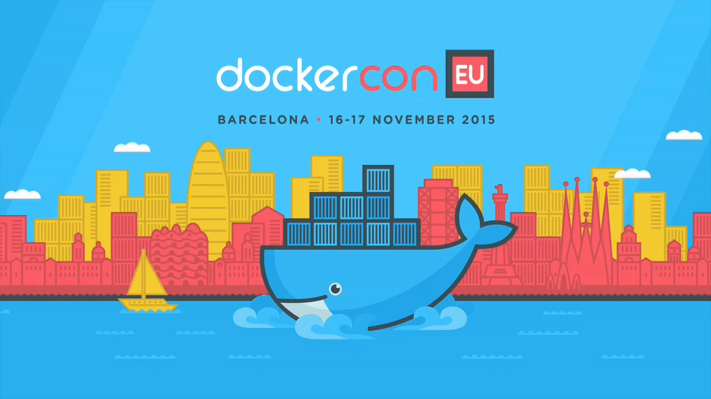

## 本讲要解决的核心问题

**背景**：容器技术已经无处不在，`docker run` 一条命令就能得到一个"感觉像虚拟机"的环境：可以进去拿 shell、可以 SSH，甚至有人用"小 shell 脚本"替换整套部署系统 [【跳转到 02:00】](https://www.youtube.com/watch?v=sK5i-N34im8&t=120)。

**冲突**：但容器感觉像虚拟机，却不是虚拟机；说它"只是被束缚的进程"，又解释不了为什么它互相看不见、资源互不侵占、还能安全地把 root 权力交出去。大多数人天天用容器，却说不清它到底是什么。

**疑问**：容器究竟是由什么构成的？

**回答（中心思想）**：容器是几块 Linux 内核"积木"的组合——**cgroups 提供"限制"**（按组记账和限额：内存、CPU、块 IO、设备访问），**namespaces 提供"隔离"**（六种视角：PID、网络、挂载、IPC、用户、主机名），再加**写时复制文件系统**与**capabilities"约束"**（把 root 拆成一组可单独授予的权力）。限制给配额，隔离给视角，约束给权力边界——三者各司其职，缺一不可；这场演讲把它们逐一拆开，并现场徒手组装出一个容器。

## 一、容器"感觉像虚拟机"，但它不是虚拟机

[【跳转到 03:00】](https://www.youtube.com/watch?v=sK5i-N34im8&t=180)

Petazzoni 先讲自己两年前学 Docker 时的困惑：容器用起来"像个 VM"——可以进去拿 shell、可以 SSH；但当他深挖实现时发现"我一开始找错了地方"（I was looking in the wrong place）[【跳转到 05:00】](https://www.youtube.com/watch?v=sK5i-N34im8&t=300)。容器不是某种新发明的虚拟化技术，而是把内核里已有的几样机制组合起来：

- **namespaces**：让每个进程住在自己的"小世界"里，只能看见自己的环境，看不见系统其他部分 [【跳转到 04:00】](https://www.youtube.com/watch?v=sK5i-N34im8&t=240)；
- **cgroups**：让这批进程能被记账、被限额；
- **copy-on-write 文件系统**：让成百上千个容器共享基础镜像而互不污染；
- **capabilities**：把"全知全能的 root"拆解成细粒度权力。

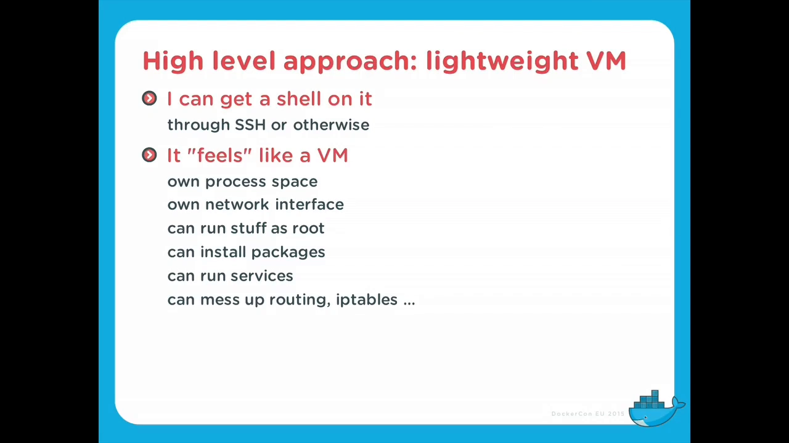

这个"组合拳"的视角，正是本章条目要回答的问题：隔离、限制、约束如何拼成一个容器。

## 二、cgroups：一棵按"子系统"组织的资源树

[【跳转到 05:30】](https://www.youtube.com/watch?v=sK5i-N34im8&t=330)

cgroups 不是单一的开关，而是**每个子系统一棵树**：一个进程在 CPU 子系统树上位于某个节点，同时在内存子系统树上位于另一个节点，在块 IO 子系统树上又各有一个位置 [【跳转到 06:00】](https://www.youtube.com/watch?v=sK5i-N34im8&t=360)。树上每个节点就是一个"组"（group），组里可以再挂子组；把进程 PID 写进组的 `tasks` 文件，它就归这个组管 [【跳转到 24:00】](https://www.youtube.com/watch?v=sK5i-N34im8&t=1440)。

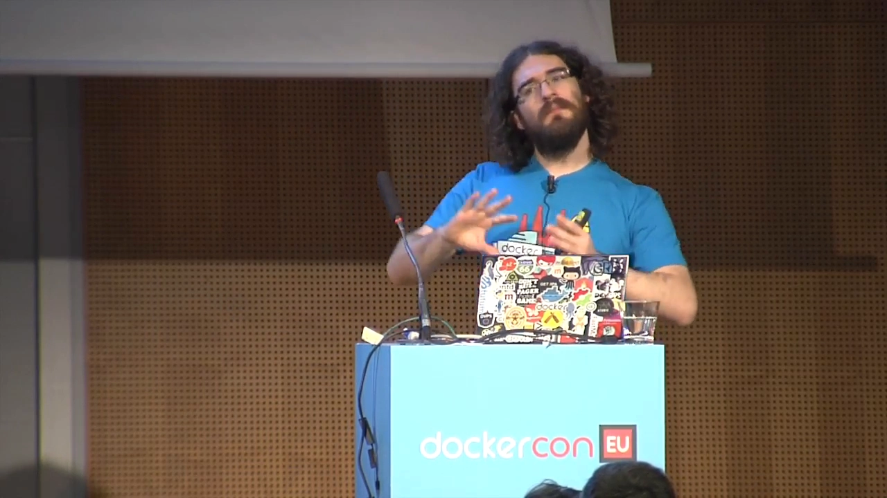

## 三、memory cgroup：记账、页缓存、硬限制与软限制

[【跳转到 07:30】](https://www.youtube.com/watch?v=sK5i-N34im8&t=450)

memory cgroup 是讲得最细的一个子系统：

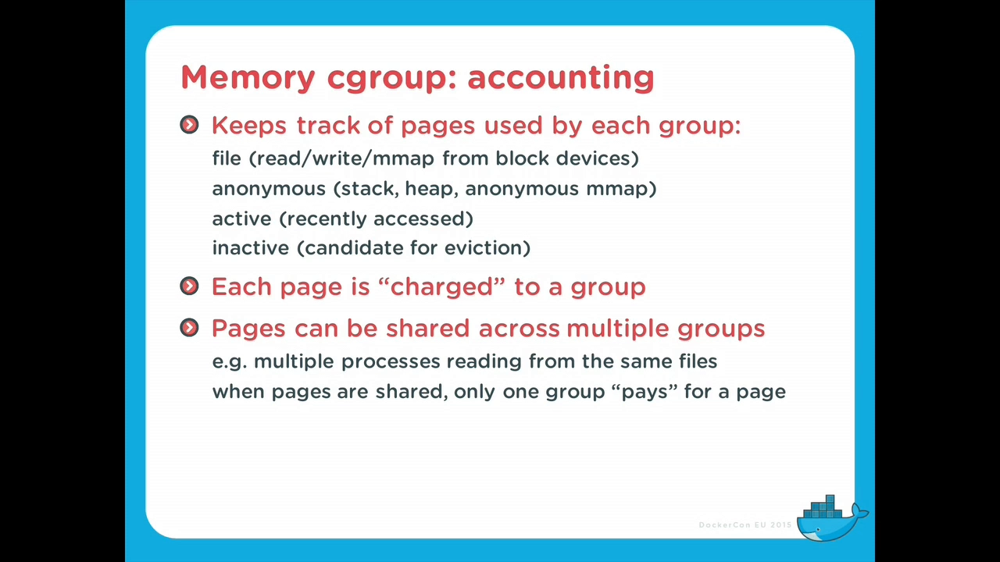

- **记账（accounting）**：组内进程用的每一页内存都记在组名下，包括 page cache——内核急用内存时可以先回收这些页 [【跳转到 08:00】](https://www.youtube.com/watch?v=sK5i-N34im8&t=480)；
- **活跃/非活跃链表**：经常被访问的页进入 active 集合，长期不动的页先被回收 [【跳转到 09:00】](https://www.youtube.com/watch?v=sK5i-N34im8&t=540)；
- **硬限制（hard limit）**：到线就触发回收/阻塞分配，"严格强制执行"，实现上也更简单 [【跳转到 10:00】](https://www.youtube.com/watch?v=sK5i-N34im8&t=600)；
- **软限制（soft limit）**：平时可以超 [【跳转到 11:00】](https://www.youtube.com/watch?v=sK5i-N34im8&t=660)，它的意义在系统内存吃紧时体现——回收器优先盯"超出软限额最多"的组下手；
- **swap 与 OOM**：memory cgroup 还能单独限制 swap；对 OOM killer 的行为改进了很多 [【跳转到 12:00】](https://www.youtube.com/watch?v=sK5i-N34im8&t=720)；
- **代价与特例**：页面在组间移动有一定性能开销 [【跳转到 13:00】](https://www.youtube.com/watch?v=sK5i-N34im8&t=780)；hugepages 也有专门的 cgroup，让多个进程共享大页配额而不是被一个进程独占 [【跳转到 14:00】](https://www.youtube.com/watch?v=sK5i-N34im8&t=840)。

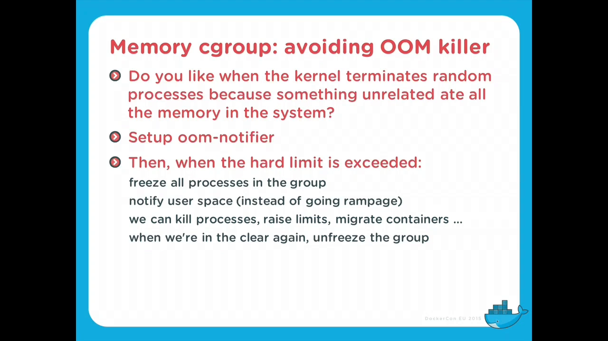

## 四、CPU：按"份额"分配，而不是百分比

[【跳转到 15:00】](https://www.youtube.com/watch?v=sK5i-N34im8&t=900)

CPU cgroup 有个反直觉之处：你不能直接说"给这个组 10% 的 CPU"——你设置的是**份额（shares）/权重**，由内核调度器（CFS）按权重比例分配实际运行时间。演讲者还提醒：CPU 限额在某些体系结构下还要考虑底层差异，以及多 CPU 系统上内存与 CPU 的拓扑关系。

**cpuset** 则在 NUMA 系统（多路 CPU、内存分节点）上非常有用：它不仅能限定内存节点，还能把一组进程**钉在指定的 CPU 集合**上运行 [【跳转到 17:00】](https://www.youtube.com/watch?v=sK5i-N34im8&t=1020)，这对缓存亲和与多插槽机器上的性能隔离都很关键。

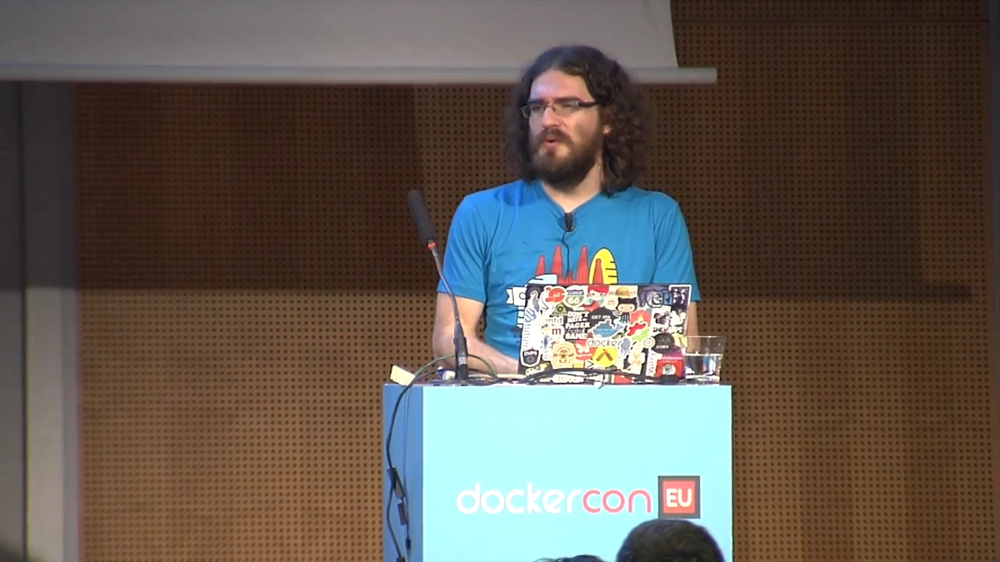

## 五、Block IO：限速 + 设备访问控制

[【跳转到 18:00】](https://www.youtube.com/watch?v=sK5i-N34im8&t=1080)

块 IO 子系统按"组 × 块设备"记账，读与写分开、同步与异步分开 [【跳转到 18:00】](https://www.youtube.com/watch?v=sK5i-N34im8&t=1080)，可以直接做 IO 的进程也能单独设限。它能给每个容器设定读写速率上限（throttle），防止单个容器占满磁盘带宽。

配套的 **device controller（设备控制器）**则更偏"约束"：它规定哪个容器能读/写哪个设备 [【跳转到 20:00】](https://www.youtube.com/watch?v=sK5i-N34im8&t=1200)——一个普通容器不能随便碰磁盘裸设备。这条防线把"资源限额"延伸成了"访问权限"，是容器安全的组成部分。

另一个实用组件是 **freezer**：把整个容器瞬间冻结、之后再解冻 [【跳转到 23:00】](https://www.youtube.com/watch?v=sK5i-N34im8&t=1380)，可用于检查点、迁移或"暂停现场"排查。

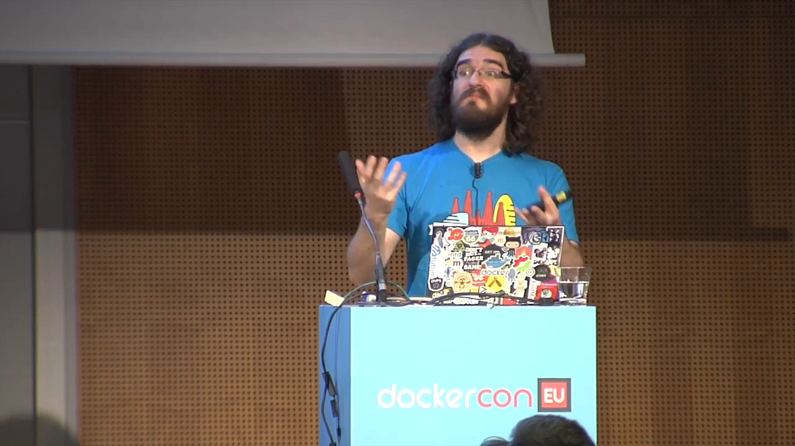

## 六、namespaces：一个进程，六种视角

[【跳转到 25:00】](https://www.youtube.com/watch?v=sK5i-N34im8&t=1500)

namespaces 与 cgroups 互补：cgroups 管"能用多少"，namespaces 管"能看见什么"。内核提供多种 namespace——**PID、network、mount、IPC、user、UTS**——而**每个进程在每一种 namespace 里都恰好位于一个实例**中 [【跳转到 25:00】](https://www.youtube.com/watch?v=sK5i-N34im8&t=1500)。它们还能嵌套：容器里再跑容器，同一进程在不同层级有不同的 PID [【跳转到 26:00】](https://www.youtube.com/watch?v=sK5i-N34im8&t=1560)。

- **network namespace + veth**：容器要联网，靠的是一对"虚拟交叉网线"（veth pair）——把其中一头塞进容器 [【跳转到 27:00】](https://www.youtube.com/watch?v=sK5i-N34im8&t=1620)，另一头留在宿主机接入网桥，容器内就成了自己的独立网络栈；
- **UTS namespace**：让容器有自己的主机名（hostname）[【跳转到 28:00】](https://www.youtube.com/watch?v=sK5i-N34im8&t=1680)；
- **user namespace**：容器内的 UID 与宿主机真实 UID 做映射——容器内"看似 root"，映射到外面可能只是普通用户 [【跳转到 29:00】](https://www.youtube.com/watch?v=sK5i-N34im8&t=1740)。

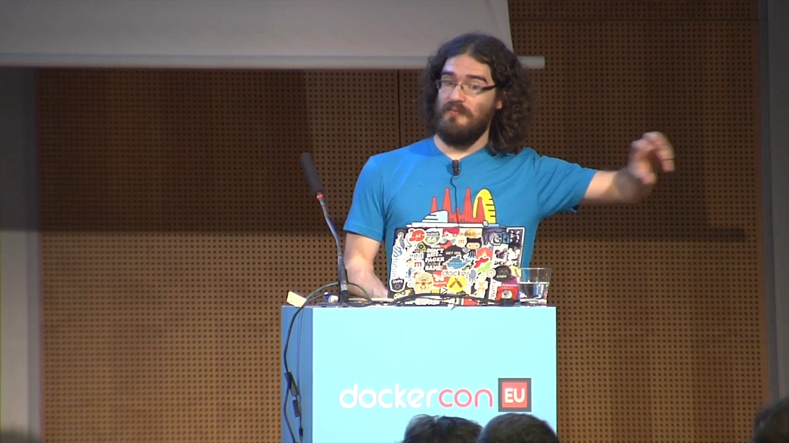

关于安全，演讲者转述了一个尖锐的观点：曾有一场安全演讲直白地说"那些 Docker 人搞的东西不行"——因为**容器内是 root，映射出去也是 root**（在没有 user namespace 的年代），逃逸后果与宿主机 root 无异 [【跳转到 30:00】](https://www.youtube.com/watch?v=sK5i-N34im8&t=1800)。这正是 user namespace 与下一节 capabilities 要解决的问题。

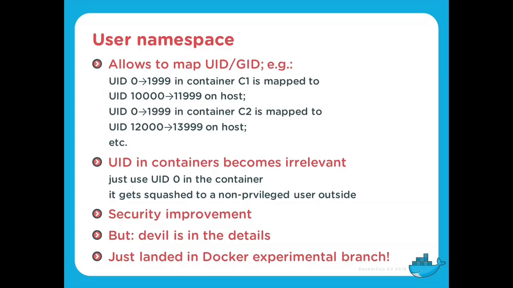

## 七、capabilities：把 root 这个"全能权力"拆开

[【跳转到 34:00】](https://www.youtube.com/watch?v=sK5i-N34im8&t=2040)

Unix 的传统是二元权力：**要么是 root，要么不是**。capabilities 机制把 root 拆成一组可单独授予/回收的细粒度能力（绑低于 1024 的端口、加载内核模块、改挂载……）。演讲者强调：想要"**真正装得下（contain）的容器**"，就必须用它——让容器内进程即便以 root 身份运行，也拿不到全部能力；配合丢弃不必要的能力、只保留必需项，才能把"约束"做实。

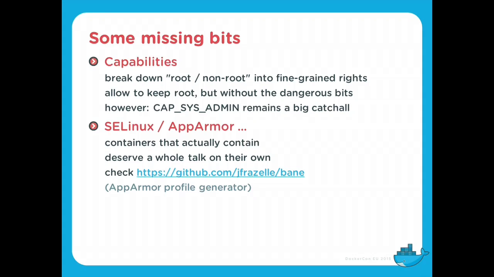

## 八、积木怎么拼：clone/unshare 与写时复制文件系统

[【跳转到 31:00】](https://www.youtube.com/watch?v=sK5i-N34im8&t=1860)

namespace 是在**创建新进程的那一刻**产生的：`clone()` 带上相应标志（如 `CLONE_NEWPID`、`CLONE_NEWNET`），新进程就落在新 namespace 里；`unshare()` 则让调用者把自己挪进新视角，已存在的 namespace 也可以在稍后"加入"复用 [【跳转到 31:00】](https://www.youtube.com/watch?v=sK5i-N34im8&t=1860)。

最后一块积木是**写时复制（copy-on-write）文件系统**——演讲者笑称它"本身就能讲满 45 分钟"：AUFS、OverlayFS、btrfs、ZFS、device mapper 都是可选项 [【跳转到 33:00】](https://www.youtube.com/watch?v=sK5i-N34im8&t=1980)。有了它，成百上千个容器才能共享同一个只读基础镜像，各自的可写层互不污染——这正是本系列第 3 章（镜像与分层）的主题。

## 九、实现版图：所有运行时都在重复这几块积木

[【跳转到 36:00】](https://www.youtube.com/watch?v=sK5i-N34im8&t=2160)

- **LXC**：最早的一批，"就是一堆用户态工具"，底层同样是 cgroups + namespaces；
- **systemd-nspawn**："有点像 chroot，但强大得多"，实现了容器接口，与 systemd 生态一体 [【跳转到 37:00】](https://www.youtube.com/watch?v=sK5i-N34im8&t=2220)；
- **rkt**：有人觉得"Docker 管得太多"，想要一个更小、能嵌进自己系统的东西 [【跳转到 38:00】](https://www.youtube.com/watch?v=sK5i-N34im8&t=2280)；
- **OpenVZ**：更早的容器实现，它的许多特性后来慢慢"渗透"进了主线内核与其他容器技术；
- **Linux 之外**：FreeBSD 的 jails、Solaris 的 zones 是同思想的先辈 [【跳转到 40:00】](https://www.youtube.com/watch?v=sK5i-N34im8&t=2400)。

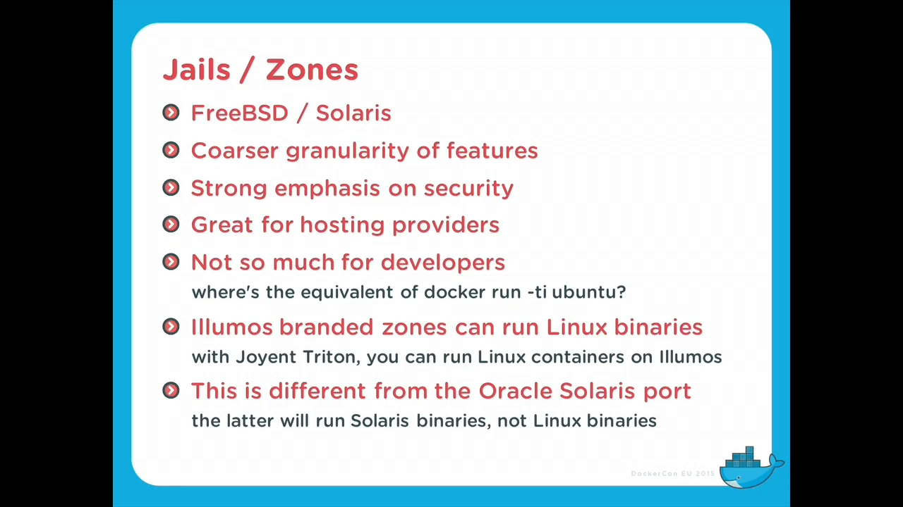

## 十、现场演示：徒手把一个容器"攒"出来

[【跳转到 41:00】](https://www.youtube.com/watch?v=sK5i-N34im8&t=2460)

演讲的后半段是全场高潮：不用任何容器工具，现场手工组装容器。他先用 Docker 拉一个 Alpine 基础镜像（只是借它获取 rootfs），然后：

1. **换根**：进入镜像的文件系统，chroot 进去；处理 /proc 等挂载点、卸载宿主机残留时遇到 "busy"，用 lazy umount 的"魔法旗标"解决 [【跳转到 45:00】](https://www.youtube.com/watch?v=sK5i-N34im8&t=2700)、[【跳转到 47:00】](https://www.youtube.com/watch?v=sK5i-N34im8&t=2820)。这些"小怪癖"正是 LXC/Docker 等实现不简单的原因——到处都是这种细节；
2. **配网络**：创建一对 veth 虚拟接口，把一头移进容器的网络 namespace，改名 `eth0` 并拉起，宿主机一侧接网桥——容器立刻"有网了"，能 ping 通宿主机 [【跳转到 48:00】](https://www.youtube.com/watch?v=sK5i-N34im8&t=2880)、[【跳转到 50:00】](https://www.youtube.com/watch?v=sK5i-N34im8&t=3000)；
3. **关键洞察**：容器里最后还跑着 bash——**namespace 里最后一个进程退出，这个 namespace 就消失了**；所以手工搭容器时，"最后那个进程"（将来就是 PID 1/init）必须持续运行 [【跳转到 51:00】](https://www.youtube.com/watch?v=sK5i-N34im8&t=3060)。

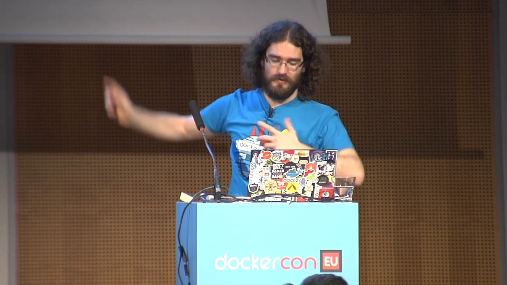

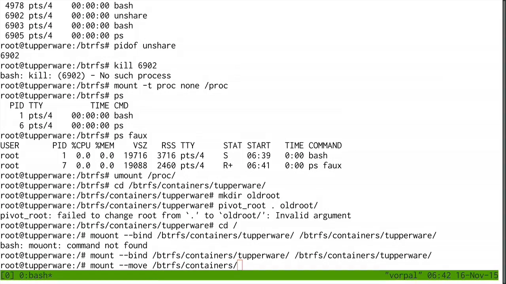

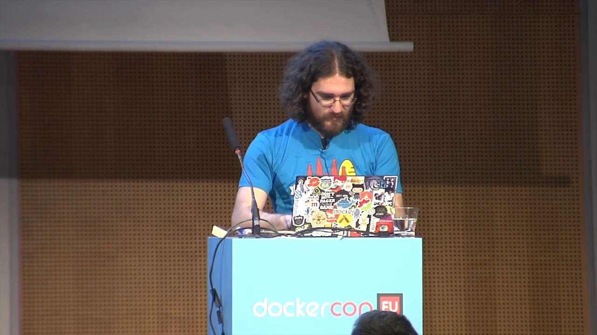

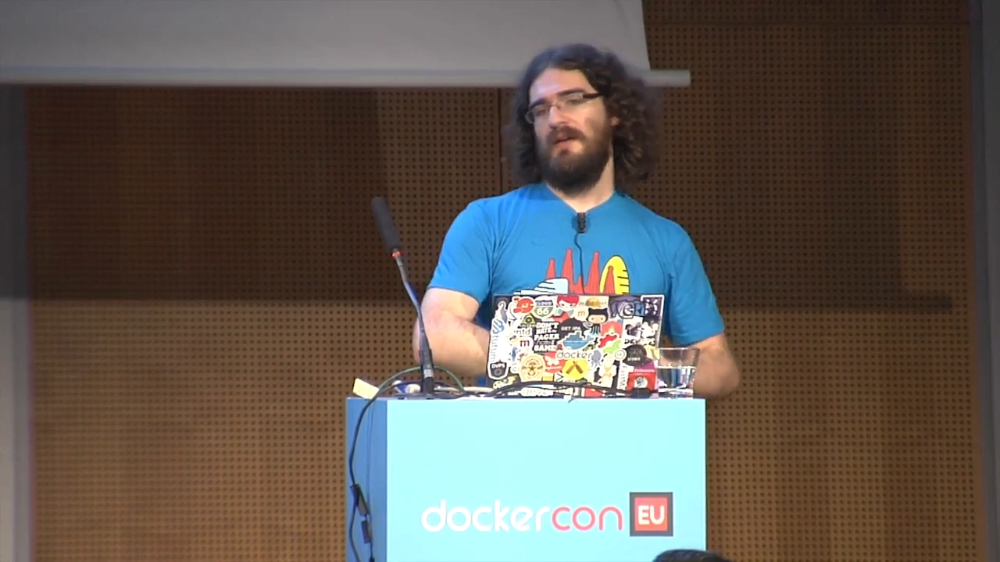

演讲收尾点题：这些底层机制单用起来细节繁多，所以后来的运行时（Docker 等）把它们封装起来；甚至有项目权衡后认为"直接采用 Docker 项目比自己重新实现更省事" [【跳转到 53:00】](https://www.youtube.com/watch?v=sK5i-N34im8&t=3180)——但理解这几块积木，是理解一切容器运行时的前提。

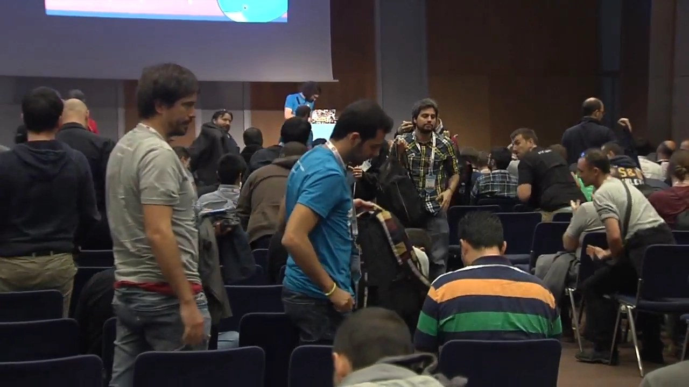

## 小结

- 容器 = 内核积木的组合：**cgroups（限制）+ namespaces（隔离）+ 写时复制文件系统 + capabilities（约束）**，没有魔法；
- cgroups 按子系统各成一棵树：memory 记账与软/硬限制、CPU 按份额分配（配 cpuset 绑核）、块 IO 限速加设备访问控制、freezer 可整体冻结；
- memory 子系统的精髓是"记账先行"：页缓存、活跃/非活跃回收、软限制在内存压力下的回收顺序、swap 与 OOM 行为都可组级控制；
- namespaces 是六种视角：PID（含嵌套）、网络（veth 接入）、挂载、IPC、用户（UID 映射）、UTS（主机名）；每种视角每个进程各占一个实例；
- capabilities 把 root 拆成细粒度权力：要"真正装得下的容器"，就靠它与 user namespace 一起收权；
- 徒手造容器的演示证明：chroot/挂载 + veth + 保持"最后一个进程"运行，就是容器的最小骨架——运行时只是把这些细节封装好。

## 关键术语速查

| 术语 | 一句话解释 |
| --- | --- |
| cgroup 层级 | 每个子系统（memory/cpu/blkio/…）一棵树，进程在各树上各占一个节点 |
| page cache 记账 | 容器读写文件产生的页缓存也计入其 cgroup，急时优先回收 |
| 硬限制 / 软限制 | hard limit 到线即强制回收；soft limit 平时可超、内存吃紧时优先被回收 |
| CFS shares | CPU 按权重"份额"分配运行时间，而非直接给定百分比 |
| cpuset | 把进程绑定到指定 CPU 与内存节点，NUMA 多路机器上的隔离利器 |
| device controller | 规定容器可读/写哪些设备，把资源限额延伸为访问权限 |
| freezer | 一键冻结/解冻整组进程，用于检查点、迁移或现场排查 |
| veth pair | 一对虚拟"交叉网线"，一头进容器网络栈、一头接宿主机网桥 |
| user namespace | 容器内 UID 与宿主机真实 UID 做映射，"容器内 root"可不等于宿主机 root |
| UTS namespace | 隔离主机名，让容器有自己的 hostname |
| capabilities | 把 root 权力拆成可单独授予的能力集合，收掉不必要权力以收缩攻击面 |
| copy-on-write | 多容器共享只读镜像、写入时才复制的分层文件系统（OverlayFS 等） |
| PID 1 / 最后一个进程 | namespace 中最后一个进程退出则 namespace 消失，容器主进程因此必须常驻 |
