# 把 root 的权力拆开管：Linux Capabilities 的五个集合与三大用例

> 本文整理自 YouTube 视频《[Practical use of Linux capabilities](https://www.youtube.com/watch?v=WYC6DHzWzFQ)》（约 46 分钟，Gerlof Langeveld 在 ORNL CentOS Dojo 的完整讲座）。讲者长期做 Linux 咨询与培训，也是性能工具 atop 的作者。本系列此前在《[Root 也不再是万能钥匙](https://www.youtube.com/watch?v=cdo63IGyeKI)》里已经回答了"为什么需要 capabilities"；这一讲则用一整套现场演示把**机制**讲全：五个能力集合各自管什么、fork/exec 时集合怎么变，以及 systemd、Docker、可执行文件三个"修改能力"的实战场景——容器技术正是这三个场景里的最后一个的重度用户。

## 本讲要解决的核心问题（SCQA）

**背景**：传统 Unix 用一个二元标准判断特权：UID 0（root）什么特权操作都能做，非 0 用户一项特权都没有。

**冲突**：可是视频里的 crond 明明以 UID 0 运行，身上却只挂着两项特权；Docker 容器里的 root 同样是 UID 0，执行 `nice -n -20` 提升优先级却被拒绝。

**疑问**：内核判定"这个操作允不允许做"时，看的究竟是什么？

**回答（中心思想）**：看的是**能力位（capabilities）**。内核从不问"你是不是 root"，只问"你的线程上有没有这一位"。UID 0 只是在默认情况下把所有位都点亮而已——既然是位图，就能逐位授予、逐位收回。理解了五个集合与 exec 时的换算规则，systemd、Docker 和 setuid 程序的行为就都能解释了。

## 一、传统模型的困境：特权只有"全有"和"全无"

传统 Unix 的特权方案非常简单粗暴：UID 0 的进程可以重启系统、修改系统时钟、做一切特权动作；非 0 用户的进程则没有任何特权动作可用。

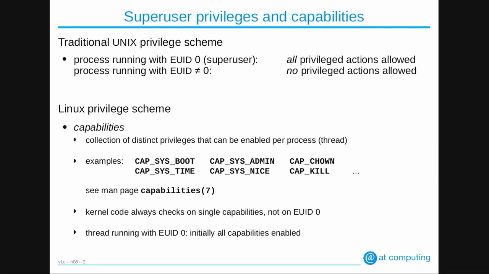

[【跳转到 00:35】](https://www.youtube.com/watch?v=WYC6DHzWzFQ&t=35)

问题在于"全有"太粗：一个只需要改系统时钟的服务，被迫拿到重启系统、读写所有文件的权力。能力机制就是为了把这个"整包授权"拆开。

## 二、能力位：内核检查的不是 UID，而是位图

Linux 内核为每个进程——准确说，**进程里的每一个线程**——维护一组可开关的特权。视频演示的 CentOS 7（内核 3.10）上共有 **37 项**，每一项对应一类特权动作：重启系统、改系统时间、用负 nice 值提升优先级、改文件属主、杀掉不属于你的进程、挂载文件系统……完整清单在 `capabilities` 手册页里逐项可查。

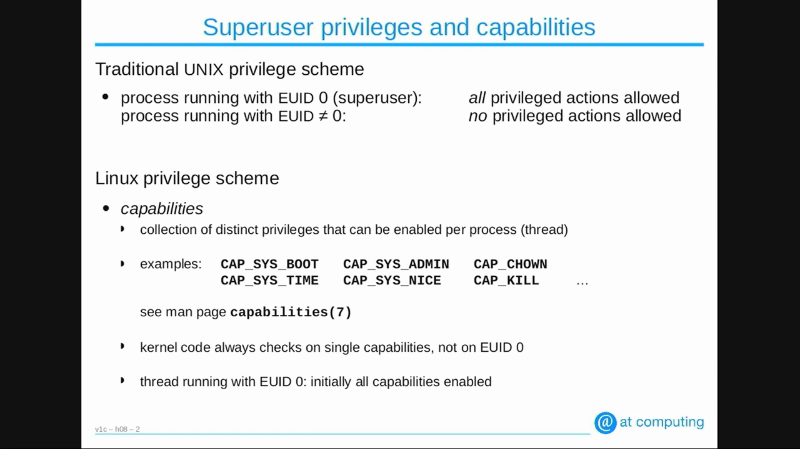

[【跳转到 01:25】](https://www.youtube.com/watch?v=WYC6DHzWzFQ&t=85)

关键的一点是：讲者翻过内核代码——**内核检查的永远是能力位，从不检查"有效 UID 是否为 0"**。为了兼容旧程序，UID 0 的进程默认拥有全部能力位；但这只是默认值，不是特权判断的依据。这解释了开头的冲突：crond 是 UID 0，能力位却只挂了两项。

## 三、五个集合：/proc 里的能力账本

怎么看一个进程挂了哪些能力？打开 `/proc/<PID>/status`（多线程进程在 `/proc/<PID>/task/<TID>/status`），里面有五行 `Cap*`，就是**五个能力集合**，以十六进制位图表示：

- **CapEff（effective，有效）**：内核在做特权动作的**那一刻**检查的就是它。普通用户的进程这里全是 0；
- **CapPrm（permitted，许可）**：进程"可用的上限池"。effective 里没有的位，只要 permitted 里还有，进程就能用系统调用把它提升为有效；可一旦主动从 permitted 里丢弃某位，就再也找不回来了；
- **CapInh（inheritable，可继承）**：与 exec 换算有关，见第五节；
- **CapAmb（ambient，环境）**：exec 时唯一能"活下来"的集合，见第五节；
- **CapBnd（bounding，边界）**：**限制性的超集**——其它任何集合里都不允许出现 bounding 之外的位。收窄 bounding，等于把所有集合一起封了顶。

[【跳转到 03:35】](https://www.youtube.com/watch?v=WYC6DHzWzFQ&t=215)

讲者用自写的小工具 `capshow`（作用与 `capsh` 相同）演示了几个典型进程：PID 1 的 systemd 是 UID 0，effective、permitted、bounding 全量点亮；root 的 shell 同样全量；普通用户的 shell 则 bounding 全有、其余全 0。最有意思的是 **crond**：它以 UID 0 运行，effective 与 permitted 里却只有两位——`CAP_SYS_TIME`（它要校准系统时钟）和 `CAP_NET_BIND_SERVICE`（它要打开 1024 以下的端口）。讲者反问：为什么给它更多？它又不需要。

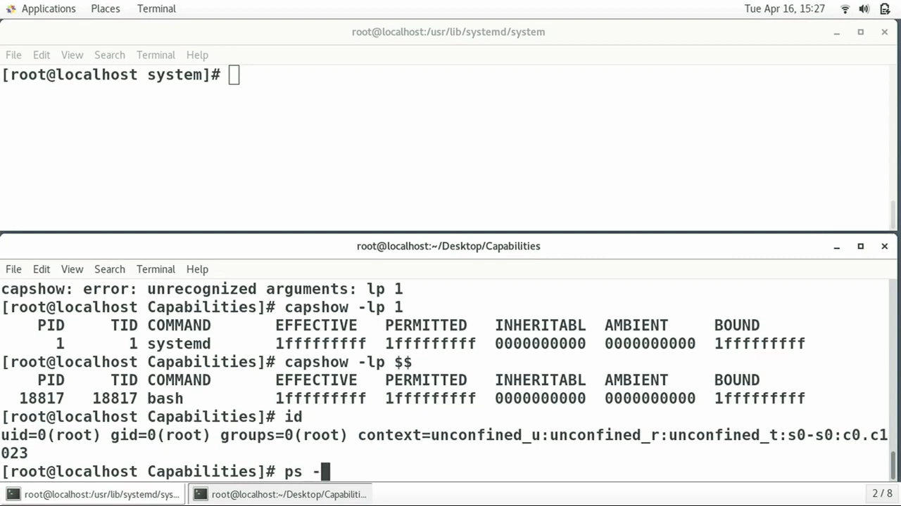

[【跳转到 07:39】](https://www.youtube.com/watch?v=WYC6DHzWzFQ&t=459)

## 四、两类程序：会不会自己管能力

按对能力的"自觉程度"，应用分两类：

- **capability-unaware（不自觉）**：从不调用任何能力相关的系统调用，只是"躺平"假设 effective 位已经替它备好。传统工具多属此类；
- **capability-aware（自觉）**：会用 `capset` 系统调用主动管理：闲时把 effective 清零（减少被攻破后的可滥用面），需要时再从 permitted 里把某位提上来；甚至可以收缩 permitted 自我设限。

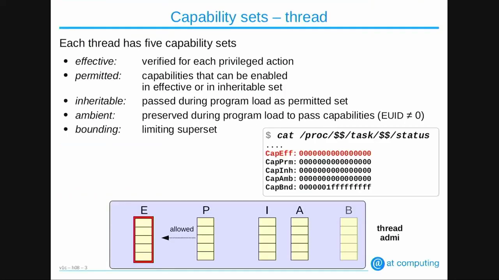

[【跳转到 09:43】](https://www.youtube.com/watch?v=WYC6DHzWzFQ&t=583)

这个区分在第八节会变得非常重要——它决定了文件能力上要不要置那个 effective 位。

## 五、fork 原样复制，exec 重新洗牌

进程创建的常规路径是 `fork()` + `exec()`，两个调用对能力集合的处理完全不同：

- **fork**：子进程是父进程的完整副本，五个集合**一对一原样复制**，没有任何变化；
- **exec**：还是同一个进程（同一个 PID、同样的文件描述符），只是加载了新程序的代码与数据。此时五个集合会被**重新计算**。

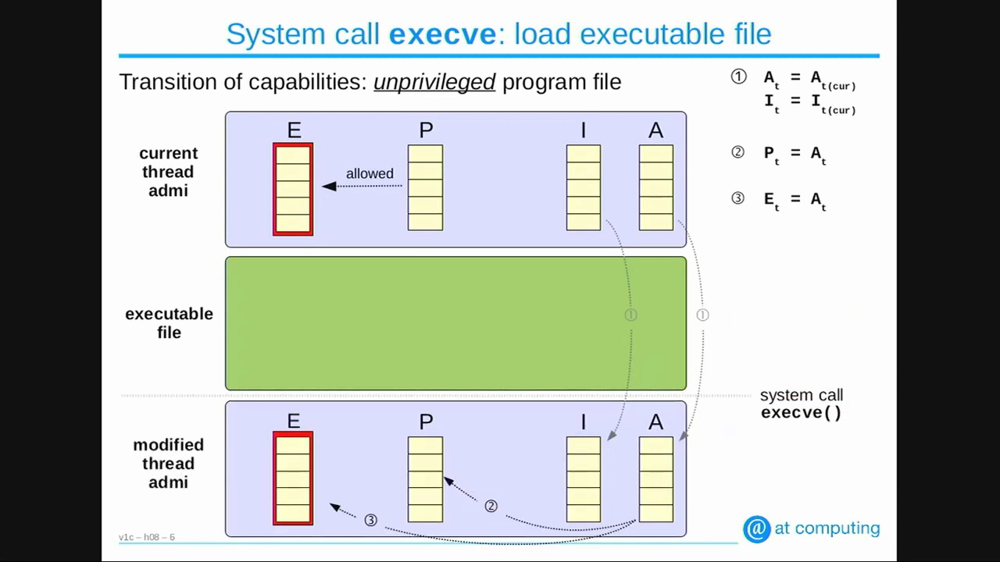

[【跳转到 11:53】](https://www.youtube.com/watch?v=WYC6DHzWzFQ&t=713)

对**不带文件能力**的普通可执行文件（如 `ls`、`vim`），exec 后的换算规则是：**新的 effective 与新的 permitted 都等于 ambient**。换句话说，五个集合里只有 ambient 能"穿越"exec：

- 原进程 effective/permitted 再多，只要 ambient 是 0，exec 之后统统清零——普通程序不会把父进程的特权带进新程序；
- 若进程设法把某位置进了 ambient，exec 后这一位就会成为新程序的 permitted 与 effective——这是把特权"递"给新程序的唯一通道。

[【跳转到 15:22】](https://www.youtube.com/watch?v=WYC6DHzWzFQ&t=922)

另有一个兼容性特例：exec 的收尾处内核再查一次 UID——若仍是 0，就把 permitted 与 effective 全部置位，维持旧 Unix "root 全能"的行为。

## 六、用例一：systemd——给普通用户服务"发一张单项特权"

systemd 自己是 PID 1、UID 0、全量能力，它启动的服务默认继承这一切。讲者准备了三个渐进的服务单元：

**capdemo1（默认）**：服务程序 fork 出子进程再 exec `sleep`。查看 `sleep` 进程：effective 与 permitted 全量点亮——默认情况就是"root 全能"。

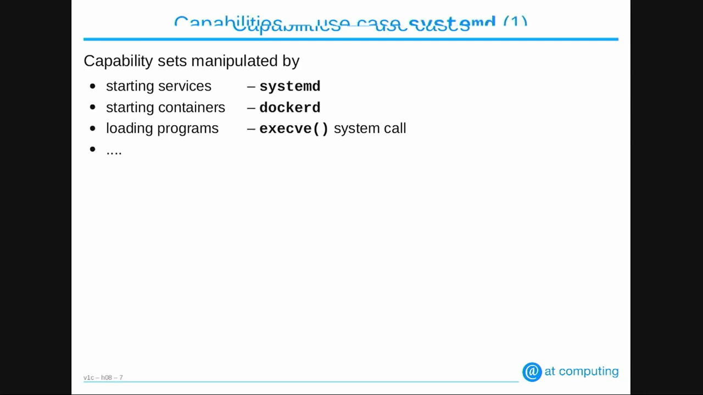

[【跳转到 17:10】](https://www.youtube.com/watch?v=WYC6DHzWzFQ&t=1030)

**capdemo2（`User=`）**：单元里指定以普通用户运行。同样的程序、同样的 exec `sleep`，这次 `sleep` **一个能力都没有**——普通用户进程的 effective/permitted 全 0，父进程也没能力可传。

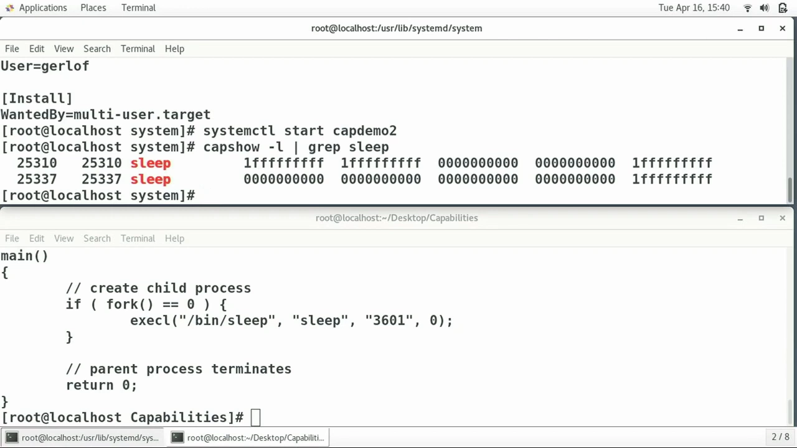

[【跳转到 20:18】](https://www.youtube.com/watch?v=WYC6DHzWzFQ&t=1218)

**capdemo3（`AmbientCapabilities=`）**：仍是普通用户，但单元里加上 `AmbientCapabilities=CAP_SYS_NICE`。程序 fork 后要给子进程降 nice 值（提升优先级），这正需要这一位。查看结果：ambient 里先被置上这一位，exec `sleep` 之后，它如约成为新 permitted 与新 effective——**普通用户的服务，只拿到一项特权，不多不少**。这就是第五节"ambient 穿越 exec"的教科书式应用。

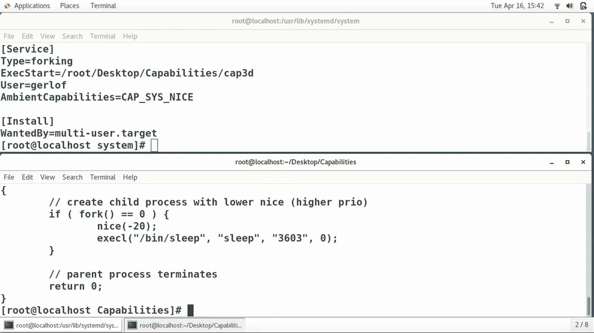

[【跳转到 21:58】](https://www.youtube.com/watch?v=WYC6DHzWzFQ&t=1318)

**capdemo5（`CapabilityBoundingSet=`）**：这次不换用户，服务仍以 UID 0 运行，但 bounding 被收窄到只剩 `CAP_SYS_NICE` 一位。结果：即便 UID 0 理应全量点亮，effective 与 permitted 也被 bounding **封了顶**，只剩这一位。systemd 服务文件里最重要的两个能力参数由此齐了：`AmbientCapabilities` 往上"发牌"，`CapabilityBoundingSet` 往上"封顶"。

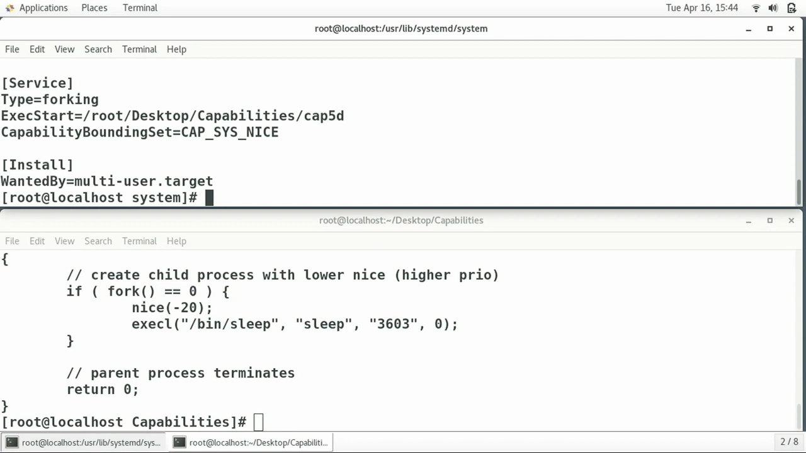

[【跳转到 24:07】](https://www.youtube.com/watch?v=WYC6DHzWzFQ&t=1447)

## 七、用例二：Docker——容器里的 root 为什么这么"弱"

`docker run -it --rm centos` 进容器，拿到的是 root shell（EUID 0）。但在里面执行 `nice -n -20` 提升优先级，直接 `Operation not permitted`。

用 capsh 看这个 bash 进程（PID 11652）：它**确实**在宿主机内核上原样运行，也是 UID 0，但 bounding 不是全 F——容器拿到的是一份**受限的默认能力集**。这份默认集里没有 `CAP_SYS_NICE`，所以 nice 被拒；却含有 `CAP_CHOWN`，所以在容器里 `chown` 改文件属主照样能成。

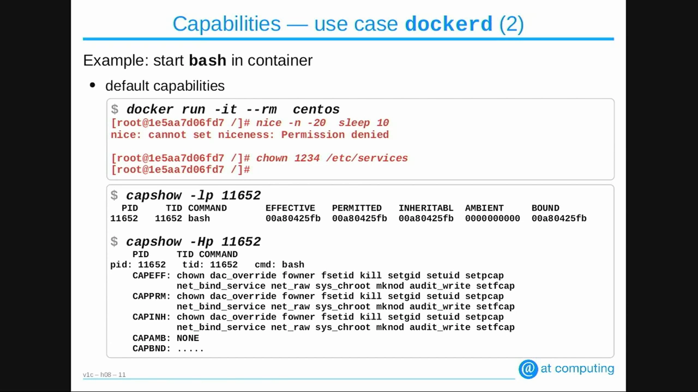

[【跳转到 26:07】](https://www.youtube.com/watch?v=WYC6DHzWzFQ&t=1567)

能力集既然是参数，就能调：`docker run --cap-add CAP_SYS_NICE --cap-drop CAP_CHOWN ...` 再进容器——`chown` 被拒了，`nice -n -20` 却成功了；capsh 确认该进程"少了 CHOWN、多了 SYS_NICE"。`--cap-add`/`--cap-drop` 就是在这份默认集上做加减法。

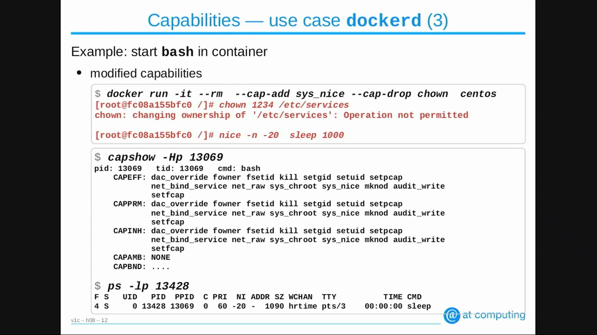

[【跳转到 27:47】](https://www.youtube.com/watch?v=WYC6DHzWzFQ&t=1647)

最后一个细节：加 `--user`（以非 root 用户运行容器内进程），该进程的**全部能力被丢弃**，而且此时 `--cap-add` 也无法把能力还给它——视频演示里它就是"一个能力都没有"。想让非 root 容器进程持有单项能力，靠的正是第六节的 ambient 思路，而不是 cap-add。

## 八、用例三：文件能力——把特权写在程序文件上

前两节改的都是**进程**的能力；能力还可以写在**可执行文件**上。

**旧世界的问题**：传统做法是给程序文件加 setuid 位并属主设为 root，比如多年前的 `/bin/ping`。普通用户执行它时，exec 会把有效 UID 切成 root——于是进程拿到**全部** 37 项能力。可 ping 只需要收发原始网络包一两项特权，凭什么给它重启系统的权力？

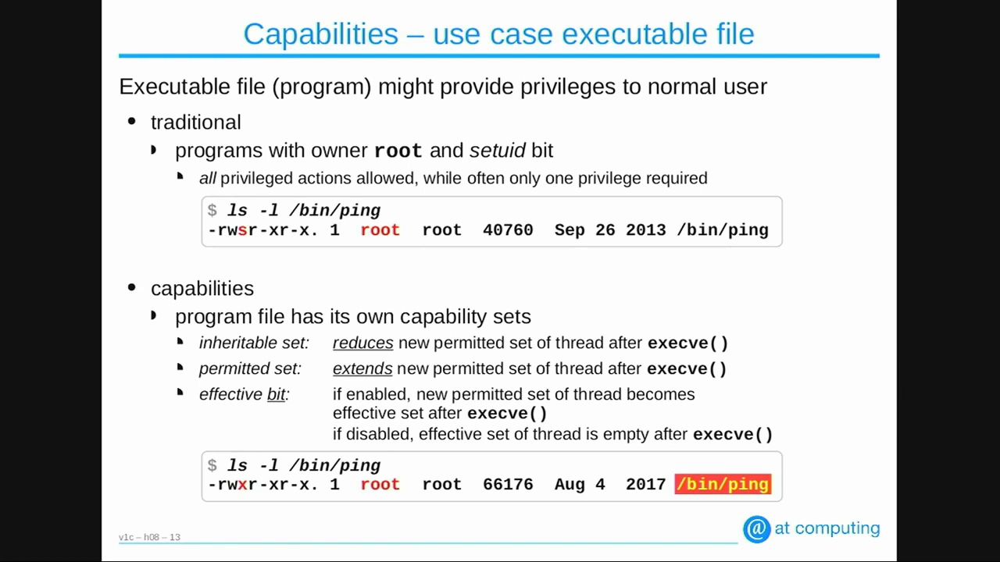

[【跳转到 30:07】](https://www.youtube.com/watch?v=WYC6DHzWzFQ&t=1807)

**文件能力**是更细的方案：可执行文件自身可以携带一个 inheritable 集合、一个 permitted 集合，以及一个 effective **位**（注意文件上没有 effective 集合，只有一个开关位）。exec 时的换算分三步：

1. 新 permitted 的初值取自**进程的 inheritable** 集合；
2. 与**文件的 inheritable** 按位与——文件的这一项通常是全 0，于是把第 1 步的结果整个清空；
3. 把**文件的 permitted** 按位或回来——这才是真正"发给"新程序的能力；若文件的 effective 位为 1，这些 permitted 位在 exec 时被自动提升为 effective。

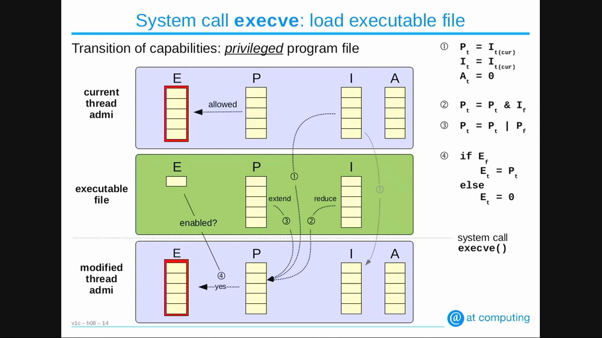

[【跳转到 32:57】](https://www.youtube.com/watch?v=WYC6DHzWzFQ&t=1977)

effective 位为谁而设？为**能力不自觉**的程序：它们不会自己把 permitted 提成 effective，必须 exec 时"已经点亮"。而能力自觉的程序不需要这个位。

**CentOS 7 的 ping 就是活例子**：它早已去掉 setuid 位，`getcap` 显示文件上带 `cap_net_admin` 与 `cap_net_raw` 两项（置于文件的 permitted 集合）。ping 是能力自觉的：用 strace 观察，它启动后**自己调用 `capset` 把 effective 全部清零**，只保留 permitted 里的这两项、清空 inheritable；等真正要发 ICMP 时，再把 `CAP_NET_RAW` 临时提为 effective，打开一个直连 IP 层的 raw socket，成功后**立刻又降回去**。全程最小化暴露。

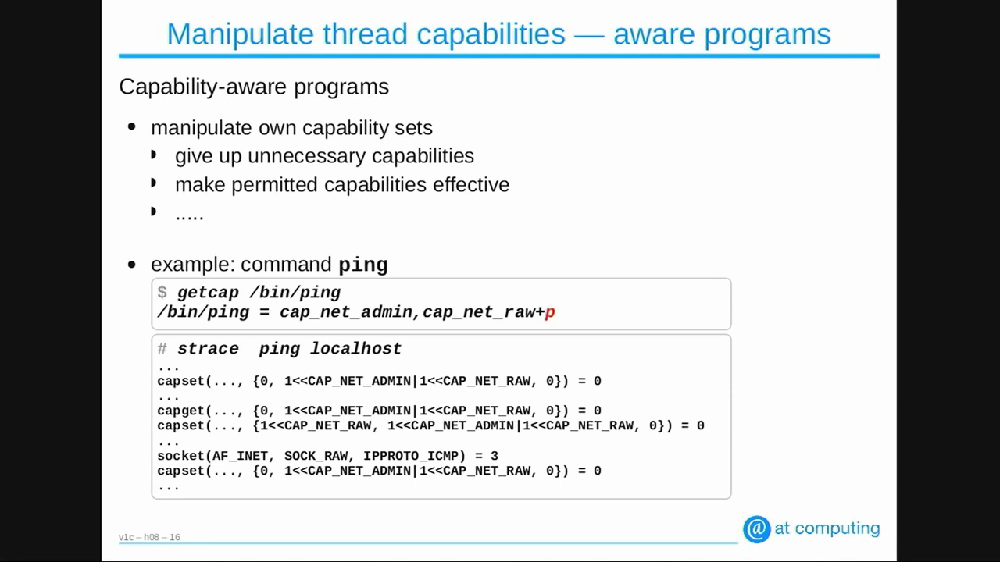

[【跳转到 37:45】](https://www.youtube.com/watch?v=WYC6DHzWzFQ&t=2265)

**自己动手**：把 `nice` 复制为 `not-nice`，`setcap cap_sys_nice=ep not-nice`——此后普通用户也能用 `not-nice` 提升进程优先级（这是原版 nice 不允许的）。因为 nice 属于能力不自觉程序，所以这里要 `=ep`：p 位把它放进 permitted，e 位保证 exec 后直接有效。

## 九、实战：atop 作者给自家工具做"精确授权"

压轴案例来自讲者本人：性能工具 atop 长期 setuid root 运行，因为它要开内核进程记账、读 `/proc/<PID>/io` 等等。但 setuid root 给了它**全部**能力，远超所需。

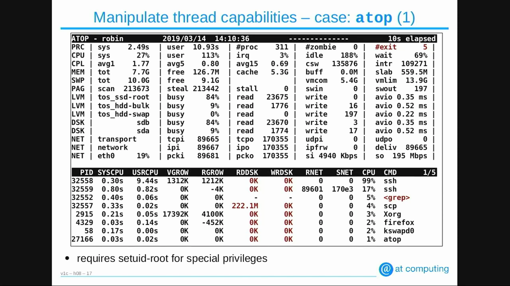

[【跳转到 40:10】](https://www.youtube.com/watch?v=WYC6DHzWzFQ&t=2410)

讲者逐项核对 atop 真正需要的能力：开进程记账要 `CAP_SYS_PACCT`；读写任意文件要 `CAP_DAC_OVERRIDE`；高优先级运行要 `CAP_SYS_NICE`；把自身锁进内存（分析系统换页时不让监控工具自己被换出去）要 `CAP_IPC_LOCK` 与 `CAP_SYS_RESOURCE`；读 CPU 性能计数器要 `CAP_SYS_ADMIN`；读 `/proc/<PID>/io` 还要 `CAP_DAC_READ_SEARCH` 与 `CAP_SYS_PTRACE`——最后这项他是翻了内核源码才确认的。清单确定后，一条 `setcap` 把这些位以 `=ep` 写到 atop 可执行文件上，**然后撤掉 setuid root**。特权从"整包 root"变成"一张逐项核过的清单"。

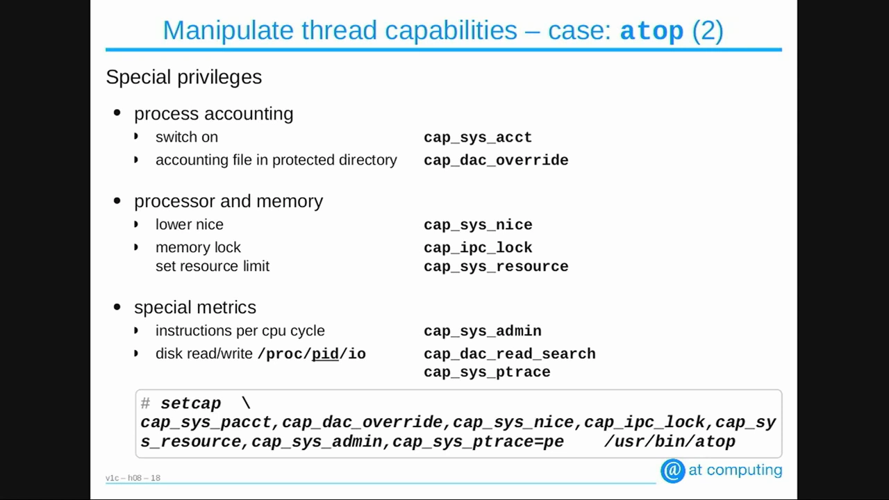

[【跳转到 42:23】](https://www.youtube.com/watch?v=WYC6DHzWzFQ&t=2543)

## 十、问答里的三个关键结论

讲座末尾的问答补了三块拼图：

1. **能力与命名空间无关**。能力存在内核的线程管理结构里，不随任何 namespace 变化——命名空间改变的是"你能看见什么"，能力约束的是"你能做什么"；
2. **容器的能力就是宿主机的能力**。`--cap-add` 之后在容器里查到的能力，在宿主机上查看同一进程完全相同；容器里 `nice` 提升的优先级，会实打实地影响宿主机的调度——容器没有独立的能力账本；
3. **bounding set 永远封顶**。无论 UID 是否为 0、无论文件能力怎么配，bounding 之外的位谁也拿不到——它是最上层的硬闸门。另外文件能力本身存储在文件的 inode 扩展属性里，随文件走。

---

回到容器视角收个尾：Docker 默认能力集是一张"白名单"，`--cap-add/--cap-drop` 在白名单上增删，`--user` 一刀切清空——本讲把这三个动作背后的机制全部摊开了。后续小节会看到，能力之外容器还有 seccomp、no_new_privs 等其它行为约束手段，它们与能力集合各管一段，共同构成容器的权限边界。
