# 拆解容器镜像：OCI 镜像格式里到底装了什么

> 视频来源：[Unpacking Container Images — Beyond the README](https://www.youtube.com/watch?v=k5ZbTPlTHjg)（约 18 分钟，英文字幕）
> 本文基于该视频的完整字幕与画面整理；讲者在 Fedora 36 + Podman 4.3.1 环境里构建了一个故意"删目录"的镜像，用 `podman image save` 导出 OCI archive，再把 index、manifest、config、层文件逐一拆开验证。所有结论都可在对应时间戳处核对。

## 本讲要解决的核心问题（SCQA）

**背景**：你大概听过"容器镜像就是一堆文件系统层"这种说法，也用 Docker 或 Podman 构建过镜像。当容器运行时说"正在拉取镜像"时，我们多半不会多想。[【跳转到 00:24】](https://www.youtube.com/watch?v=k5ZbTPlTHjg&t=24)

**冲突**：可它到底在下载什么？镜像文件里面长什么样？构建时的"删除一个目录""加一个环境变量"，在镜像文件里又是怎么表示的？容器不是魔法——背后是标准、规范和软件，理解底层技术对在生产环境运维容器很重要。[【跳转到 00:24】](https://www.youtube.com/watch?v=k5ZbTPlTHjg&t=24)

**疑问**：一个容器镜像文件的内部结构到底是什么？能否逐字节拆开、对上规范、验证每一部分？

**回答（中心思想）**：能。OCI 镜像规范给出了确定答案：**镜像由 manifest、一组文件系统层和一份 config 组成（多平台镜像再加一个 index）**；全部内容按内容哈希（digest）寻址存放。本讲把一个真实镜像完全拆开，每一部分都能与规范原文对上号。[【跳转到 01:49】](https://www.youtube.com/watch?v=k5ZbTPlTHjg&t=109)

## 一、先立规矩：OCI 镜像规范的四大组成

OCI（开放容器计划）致力于为容器、容器镜像格式与运行时制定标准，推动标准做法的落地，让工具之间可以互操作——比如用 Podman 构建的镜像，之后可以用 Docker 或别的工具来运行。镜像格式不止一种（最常见的还有 Docker image manifest），本讲以 **OCI 镜像格式**为准。[【跳转到 01:14】](https://www.youtube.com/watch?v=k5ZbTPlTHjg&t=74) [【跳转到 01:24】](https://www.youtube.com/watch?v=k5ZbTPlTHjg&t=84)

规范原文写明：**OCI 镜像由一个 image manifest、一个（可选的）index、一组文件系统层和一个配置（config）组成**。所以拆开镜像文件时，应该能找到这四样东西。[【跳转到 01:49】](https://www.youtube.com/watch?v=k5ZbTPlTHjg&t=109)

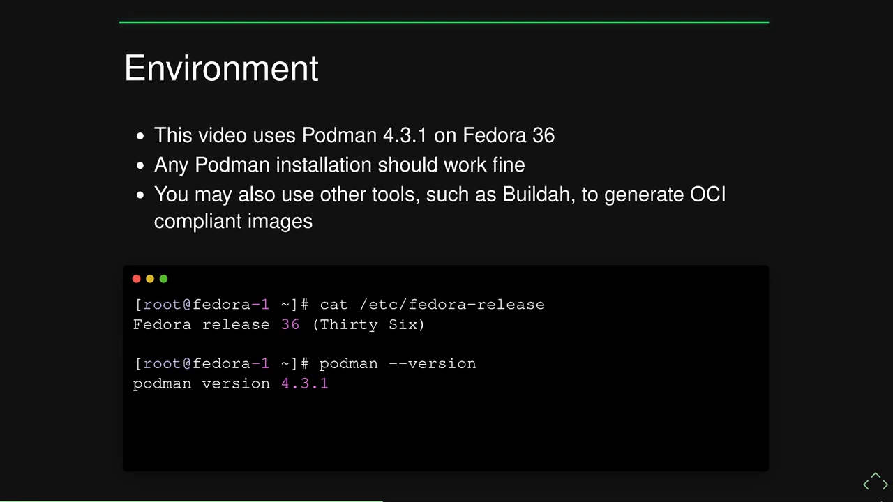

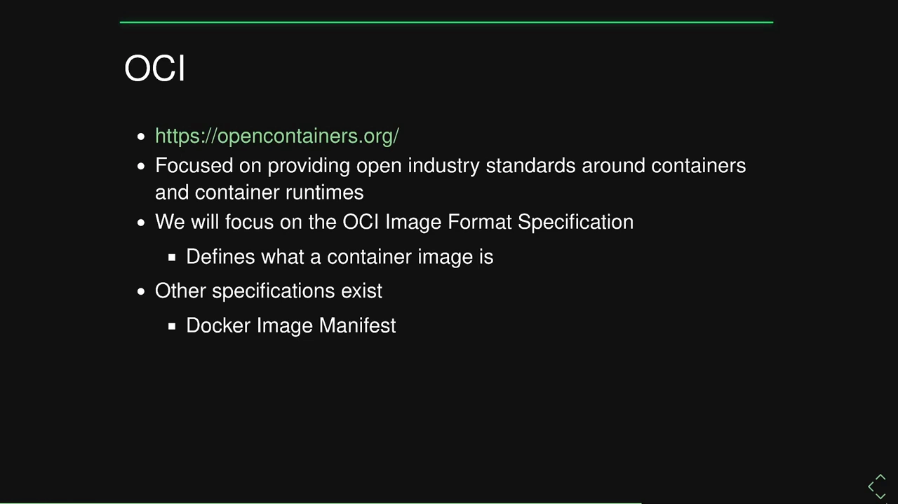

## 二、造一个"可以拆"的镜像

理解规范的最好办法是：**构建一个镜像、把它下载下来、拆开看**。

实验用的 Dockerfile 很简单：基于 `alpine` 基础镜像；把一个入口脚本 `COPY` 到文件系统里；**故意 `rm -rf /var` 删掉整个目录**——就是为了看看"删除"在镜像标准里长什么样；最后定义 `sleep infinity` 之类的入口命令，让容器有事可做（入口本身与本次实验无关）。[【跳转到 02:32】](https://www.youtube.com/watch?v=k5ZbTPlTHjg&t=152)

用 Podman 构建出名为 `btr-alpine` 的镜像后，用 `podman image save` 把它**以 OCI archive 格式**保存为 `btr-alpine.tar`——这就是平时运行时从远端仓库下载到本地的东西。[【跳转到 03:22】](https://www.youtube.com/watch?v=k5ZbTPlTHjg&t=202) [【跳转到 03:47】](https://www.youtube.com/watch?v=k5ZbTPlTHjg&t=227)

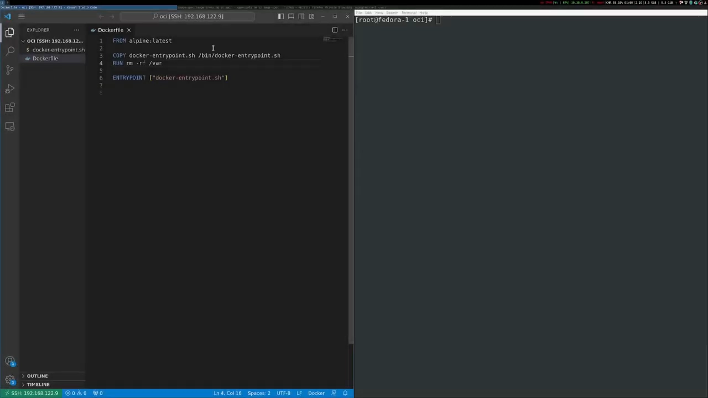

## 三、解包第一层：archive 里的三样东西

`file` 命令确认 tar 是 POSIX 兼容归档；解开后看到三个东西：

- **`oci-layout`**：一个小 JSON，标记这份镜像布局使用的标准版本；[【跳转到 04:12】](https://www.youtube.com/watch?v=k5ZbTPlTHjg&t=252)
- **`index.json`**：理解整个镜像的**入口**；[【跳转到 04:37】](https://www.youtube.com/watch?v=k5ZbTPlTHjg&t=277)
- **`blobs/`**：一堆**没有扩展名**的文件——不打开看根本不知道是什么。它们按内容哈希寻址，藏在 `blobs/sha256/` 下。[【跳转到 06:22】](https://www.youtube.com/watch?v=k5ZbTPlTHjg&t=382)

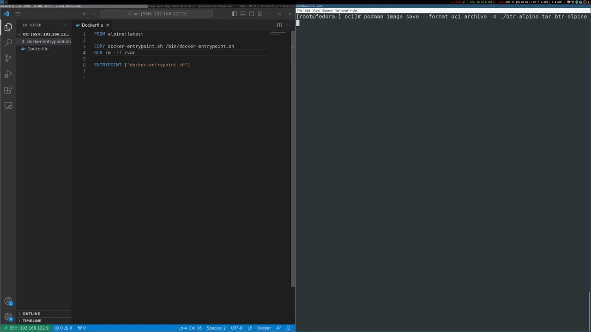

## 四、index.json：镜像的"目录页"

打开 `index.json`，对照规范逐字段看：

- **`schemaVersion`**：必填，当前**必须是 2**；[【跳转到 05:07】](https://www.youtube.com/watch?v=k5ZbTPlTHjg&t=307)
- **`manifests`**：一个数组，列出这份镜像包含的 manifest——**多平台镜像每个平台一条**，这正是 index 的用处：告诉你下一步该去哪找 manifest；[【跳转到 05:07】](https://www.youtube.com/watch?v=k5ZbTPlTHjg&t=307)
- **`mediaType`**：规范要求支持两种实现——`oci.image.manifest` 与 `oci.artifact.manifest`，本例是镜像；[【跳转到 05:32】](https://www.youtube.com/watch?v=k5ZbTPlTHjg&t=332)
- **descriptor 属性**：还有 `digest`（目标内容的 sha256 哈希）、`size`（原始内容的字节数）和可选的 `annotations` 元数据。这些字段是规范里的"描述符"标准属性，在别处也会反复出现，所以只在规范里定义一次。[【跳转到 05:57】](https://www.youtube.com/watch?v=k5ZbTPlTHjg&t=357)

复制 index 指向的 digest，进入 `blobs/sha256/` 找到同名文件，`file` 一查是 JSON 文本——这就是 **manifest**。[【跳转到 06:47】](https://www.youtube.com/watch?v=k5ZbTPlTHjg&t=407)

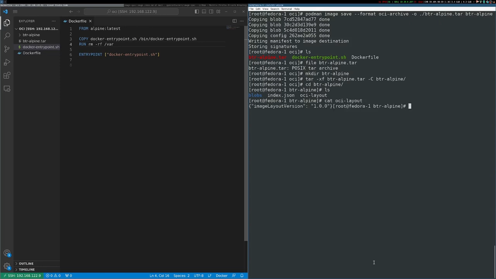

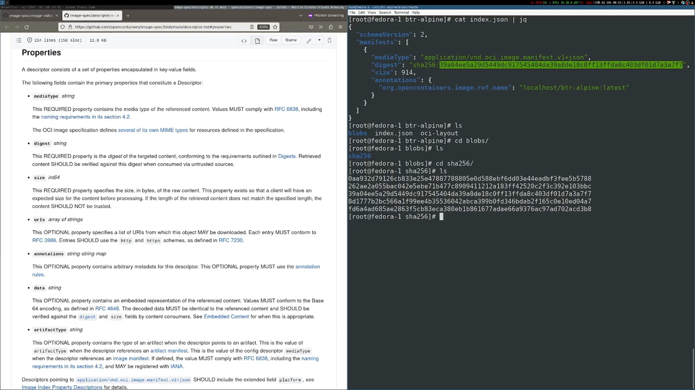

## 五、manifest：三大目标，两个关键字段

规范给 image manifest 定了**三个主要目标**：让镜像**可按内容寻址（content addressable）**、支持**多架构镜像**、以及能**转译为 OCI 运行时规范**（从而能被 OCI 兼容的运行时真正跑起来）。[【跳转到 07:12】](https://www.youtube.com/watch?v=k5ZbTPlTHjg&t=432)

manifest 里有两个重要字段：

- **`config`**：一个描述容器配置的对象，稍后细看；[【跳转到 07:37】](https://www.youtube.com/watch?v=k5ZbTPlTHjg&t=457)
- **`layers`**：一个 descriptor 数组，**每个对象描述一层**；**基底层（base layer）必须在下标 0**，后续层依次叠在其上。这些层就是容器镜像的**文件系统变更集（changeset）**。[【跳转到 07:37】](https://www.youtube.com/watch?v=k5ZbTPlTHjg&t=457)

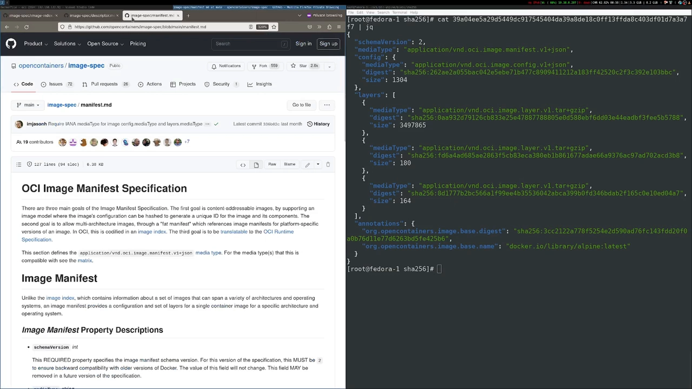

## 六、层 = 文件系统变更集："应用"，而非"堆叠"

现在把 layers 数组里的三个 digest 逐一从 blobs 里找出来拆开。

**层 0：就是 rootfs。**层文件是 gzip 压缩数据（相当于 `.tar.gz`），解开后看到的正是**容器的根文件系统**：查 `/etc/os-release`，是 Alpine Linux——与我们用的基础镜像一致。**容器镜像按层构建，每一层都叠在前一层之上**，规范要求最终文件系统布局必须是"把各层应用到空目录"的结果。[【跳转到 08:27】](https://www.youtube.com/watch?v=k5ZbTPlTHjg&t=507) [【跳转到 08:52】](https://www.youtube.com/watch?v=k5ZbTPlTHjg&t=532) [【跳转到 09:17】](https://www.youtube.com/watch?v=k5ZbTPlTHjg&t=557)

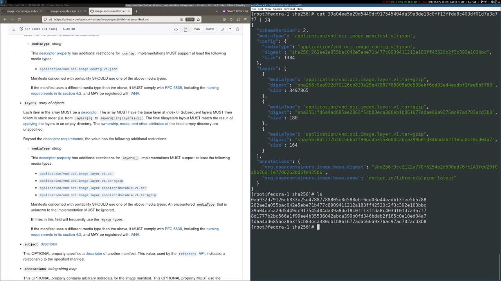

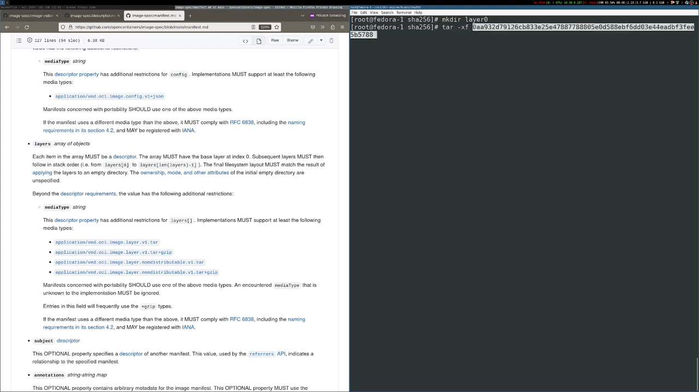

**层 1：纯新增。**层 1 里只有一个 `bin` 目录，装着构建时 `COPY` 进去的入口脚本——把文件"加进"根文件系统，就是这种最普通的新增。[【跳转到 09:42】](https://www.youtube.com/watch?v=k5ZbTPlTHjg&t=582)

**层 2：删除要用 whiteout 文件。**层 2 里有个 `/etc/resolv.conf`（构建时跑命令的副产物），真正值得注意的是一个叫 **`.wh.var`** 的特殊文件：**在 OCI 镜像标准里，whiteout 是一种特殊的空文件，以 `.wh.` 开头的文件名表示"该路径应当被删除"**。我们 Dockerfile 里那句 `rm -rf /var`，在镜像里就是这样表示的。[【跳转到 10:42】](https://www.youtube.com/watch?v=k5ZbTPlTHjg&t=642) [【跳转到 11:07】](https://www.youtube.com/watch?v=k5ZbTPlTHjg&t=667)

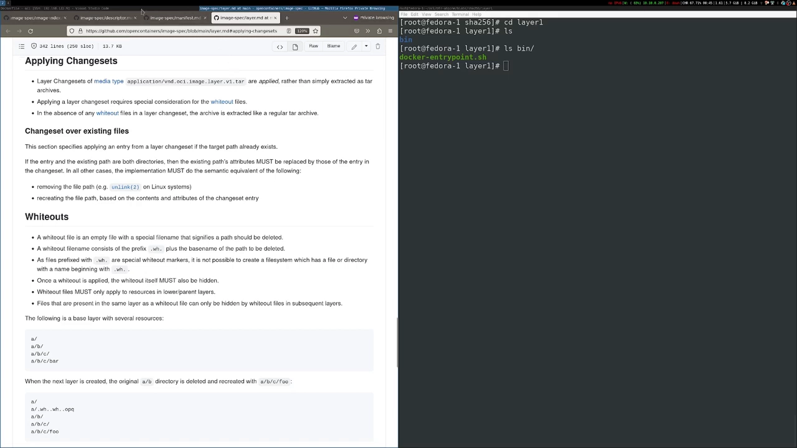

**"应用"而不是"解压"。**运行时解包镜像时：先解层 0 得到基础文件系统；解层 1 时把入口脚本加上去（普通新增）；解层 2 时看到一个新增文件，以及那个 whiteout 文件——它指示**删除整个 /var 目录**。关键在于：**这些变更集是被"应用（apply）"的，不是简单地把 tar 逐层叠上去**。如果只是原样解压叠加，`/var` 目录会一直存在，`.wh.var` 也只是个普通空文件，什么都不会发生。所以**容器运行时必须专门理解 whiteout**，在解包时执行删除。[【跳转到 11:32】](https://www.youtube.com/watch?v=k5ZbTPlTHjg&t=692) [【跳转到 11:57】](https://www.youtube.com/watch?v=k5ZbTPlTHjg&t=717)

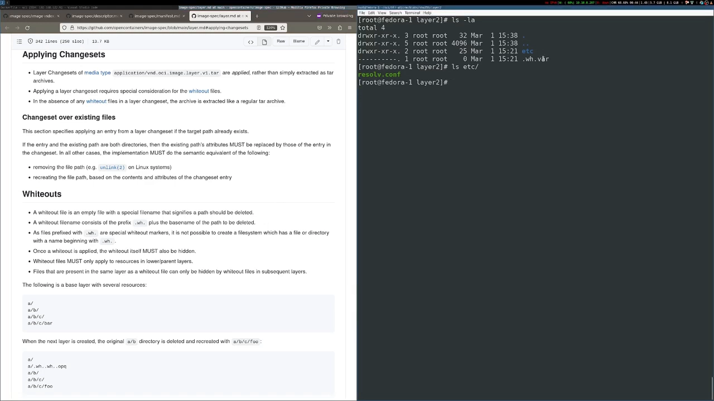

现在再听人说"容器镜像就是一堆层"，你就知道这句话的准确含义了：**层是文件系统变更集，说明了如何一步步搭出容器最终使用的那个文件系统**。[【跳转到 12:22】](https://www.youtube.com/watch?v=k5ZbTPlTHjg&t=742)

## 七、config：镜像"怎么被运行"的说明书

回到 manifest，里面还有 config 对象。顺着 digest 在 blobs 里找到它，同样是一段 JSON，mediaType 表明它是配置。config 规定了一种特殊的 JSON 格式：**描述这个镜像将如何被容器运行时（和工具）执行，以及它与前面那些层的关系**。[【跳转到 12:47】](https://www.youtube.com/watch?v=k5ZbTPlTHjg&t=767)

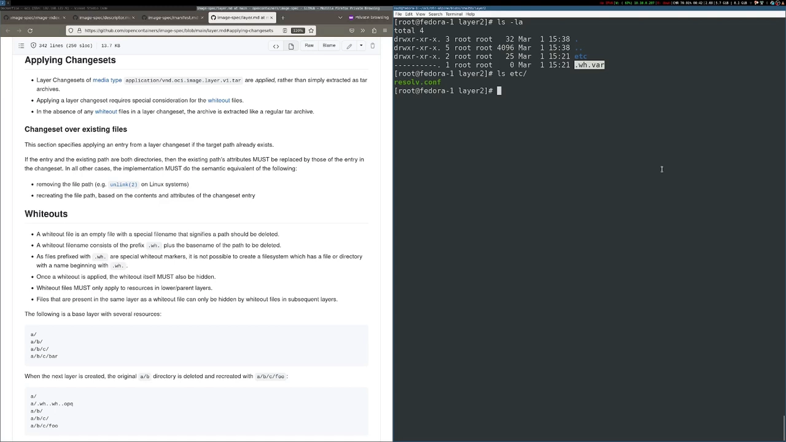

往上翻就能看到熟悉的**运行时属性**：比如 **entrypoint**——运行时要把镜像跑起来，靠的就是它；还有**环境变量**：Dockerfile 里定义的 ENV 会出现在这里。[【跳转到 13:12】](https://www.youtube.com/watch?v=k5ZbTPlTHjg&t=792)

**实验：加一个环境变量会怎样？**讲者在 Dockerfile 里新增一个 ENV 并重建镜像，重新下载解包后注意到：**manifest 的 digest 变了**（镜像内容变了，理所应当）；再仔细看会发现**所有层的 digest 一个都没变**（文件系统层没有任何改动），**唯一变化的是 config 的 digest**。打开新 config，新的环境变量已经出现在环境变量列表里。Dockerfile 的修改就是这样直接反映到镜像的运行时配置上的。[【跳转到 13:53】](https://www.youtube.com/watch?v=k5ZbTPlTHjg&t=833) [【跳转到 14:18】](https://www.youtube.com/watch?v=k5ZbTPlTHjg&t=858) [【跳转到 14:43】](https://www.youtube.com/watch?v=k5ZbTPlTHjg&t=883)

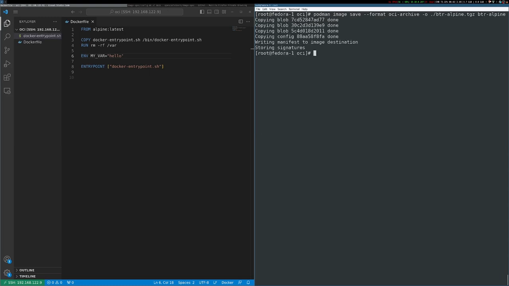

config 里还有两块值得注意的内容：

- **`history`**：记录生成该镜像的构建步骤——能看到"删除 /var"、"设置环境变量"等操作；[【跳转到 15:08】](https://www.youtube.com/watch?v=k5ZbTPlTHjg&t=908)
- **`rootfs`**：它引用了镜像各层的**内容哈希**，把文件系统和 config 绑在一起——**config 的哈希依赖文件系统各层的哈希**：文件系统一变，config 必然跟着变，config 的哈希也就不同。其中 `diff_ids` 是一个数组，按**从第一层到最后一层**的顺序列出每层的内容哈希。[【跳转到 15:29】](https://www.youtube.com/watch?v=k5ZbTPlTHjg&t=929)

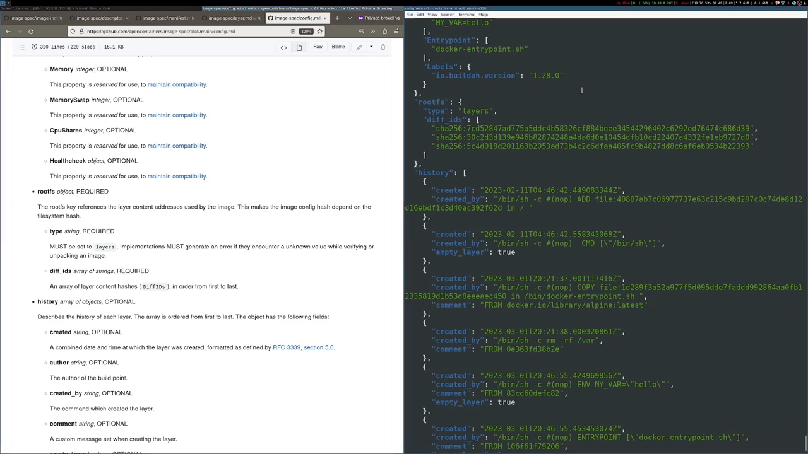

细心的话会发现：**diff_ids 和 manifest 里那些层的 digest 不一样**。查规范里 layer diff_id 的定义：**diff_id 是对该层"未压缩 tar 归档"计算的 digest**——manifest 里的层 digest 对应 blobs 里 gzip 压缩后的文件，而 diff_id 对应解压后的内容。

**验证实验**：把层 0 的文件复制成 `layerzero.gz`，`gunzip` 解压，再对未压缩数据计算 `sha256sum`——算出来的值与 config 里 rootfs 的第一个 diff_id **完全一致**。运行时就是靠 diff_ids 知道**各层应该按什么顺序应用**的。[【跳转到 16:19】](https://www.youtube.com/watch?v=k5ZbTPlTHjg&t=979)

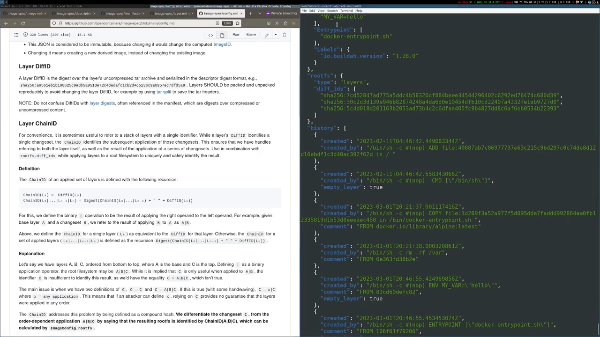

## 八、为什么值得拆：它不是魔法

OCI 镜像规范远不止本文覆盖的这些，这只是一个常见部分的快速导览。但核心态度是：**运行容器时发生的不是随机魔法**——文件系统如何布局、层如何叠加、删除如何表示、配置如何携带，全部写在白纸黑字的规范里。把镜像逐层剥开看清底层，最终会在运行、排障和维护容器化环境时给你回报。[【跳转到 17:02】](https://www.youtube.com/watch?v=k5ZbTPlTHjg&t=1022)

## 小结

- **OCI 镜像 = manifest + 文件系统层 + config**（多平台再加 index），规范原文一锤定音。
- **archive 三件套**：`oci-layout`（版本标记）、`index.json`（入口/目录）、`blobs/sha256/`（按内容哈希寻址的无扩展名文件）。
- **寻址链**：index.json（manifests 数组，多平台每平台一条）→ digest → manifest（config + layers）→ 逐层 digest → blobs 里的层文件。
- **manifest 三目标**：内容可寻址、多架构、可转译为运行时规范；基底层必须在 layers 下标 0。
- **层是变更集，"应用"而非"堆叠"**：层 0 是 rootfs；新增是普通文件；**删除用 whiteout 文件（`.wh.` 前缀）表示，运行时解包时负责执行**。
- **config 是运行说明书**：entrypoint、环境变量等；改 Dockerfile 的 ENV 只会改变 config 的 digest，层 digest 不动。
- **diff_id ≠ 层 digest**：diff_id 是**未压缩** tar 的 sha256（gunzip 后 sha256sum 可验证）；它同时把 config 与文件系统绑定，并决定层的应用顺序。

## 关键术语速查

| 术语 | 一句话解释 |
| --- | --- |
| OCI image | 符合 OCI 镜像规范的容器镜像：manifest + 层 + config（+ index） |
| oci-layout | archive 里的标记文件，说明镜像布局遵循的规范版本 |
| index.json | 镜像入口：schemaVersion=2，manifests 数组按平台列出 manifest |
| manifest | 清单：媒体类型区分 image/artifact，含 config 与 layers 两个 descriptor |
| descriptor | 描述符：digest、size、mediaType、annotations 等标准属性，指向某个 blob |
| digest | 内容哈希（如 sha256）：内容不变则 digest 不变，按内容寻址的基础 |
| blob | blobs/sha256/ 下按 digest 命名的无扩展名文件：manifest、config、层都存这里 |
| layer | 层：gzip 压缩的 tar 归档，是文件系统变更集；基底层在 layers[0] |
| changeset | 变更集：一层对文件系统的全部改动（新增、修改、删除） |
| whiteout | whiteout 文件：`.wh.` 前缀的特殊空文件，指示运行时删除对应路径 |
| apply | 应用：运行时按顺序把各层变更集作用到空目录上，而不是简单解压叠加 |
| config | 配置 JSON：entrypoint、env 等运行时属性，附 rootfs 与 history |
| rootfs.diff_ids | 各层未压缩 tar 的 sha256，按应用顺序排列；把 config 与文件系统绑定 |
| history | 构建历史：生成该镜像的各步骤记录 |
