# OCI 是什么：让容器"到处能跑"的开放标准

> 视频来源：[What is the Open Container Initiative? — Canonical Ubuntu](https://www.youtube.com/watch?v=RBAQyqgFl4w)（约 11 分钟，英文字幕）
> 本文基于该视频的完整字幕与画面整理；讲者 Chris 先讲清 OCI 的定位与三大支柱，再动手把一个多架构镜像导出成 OCI archive，从 `index.json` 一路拆到 config 与层文件。所有结论都可在对应时间戳处核对。

## 本讲要解决的核心问题（SCQA）

**背景**：你多半用过容器：`docker build` 构建一个镜像，`docker pull` 从仓库拉下来，`docker run` 跑起来。换一台机器、换一套工具，同一个镜像照样能跑。[【跳转到 00:00】](https://www.youtube.com/watch?v=RBAQyqgFl4w&t=0)

**冲突**：这种"到处能跑"并不是巧合。构建镜像的工具（Docker、Podman、Skopeo……）、运行镜像的运行时、存放镜像的仓库各不相同，它们凭什么互相认识对方的文件？[【跳转到 00:11】](https://www.youtube.com/watch?v=RBAQyqgFl4w&t=11)

**疑问**：容器镜像的**格式**、运行时的**行为**、镜像的**分发方式**，有没有一个大家都认账的统一标准？

**回答（中心思想）**：有，它就是 OCI（Open Container Initiative，开放容器计划）——Linux 基金会下的**厂商中立**开放标准项目，用三大规范（镜像、运行时、分发）把容器生态连起来：一个 OCI 合规镜像，可以用任何合规工具构建、推到任何合规仓库、再由任何合规运行时执行。[【跳转到 00:36】](https://www.youtube.com/watch?v=RBAQyqgFl4w&t=36)

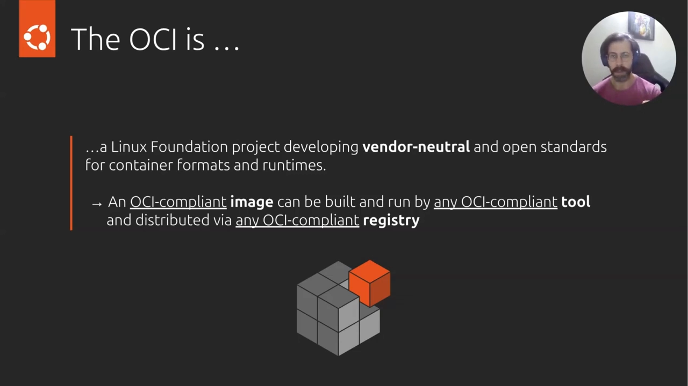

## 一、OCI：Linux 基金会下的容器标准项目

**是什么**：OCI 是 Linux 基金会旗下的一个项目，核心目标是制定一套**厂商中立（vendor neutral）**的开放标准，规定**容器镜像长什么样（格式）、运行时怎么跑容器**。讲者特意强调"vendor neutral"非常关键——整套标准不依赖任何一家公司或一组工具。[【跳转到 00:36】](https://www.youtube.com/watch?v=RBAQyqgFl4w&t=36)

**为什么需要**：如果每家工具都有自己的私有格式，镜像就只能在自家工具链里转。有了共同标准，"构建—分发—运行"三段可以由不同厂商的工具自由组合，容器的可移植性才成立。

**它从哪来**：OCI 大约在 2015 年由 Docker 与其他容器行业领导者共同创立，初衷是给出一个**共同基线**：先把最基础的东西标准化，再在基线之上持续扩展与增强。[【跳转到 01:51】](https://www.youtube.com/watch?v=RBAQyqgFl4w&t=111)

## 二、三大支柱与一条典型工作流

OCI 有三根支柱：**images（镜像规范）、runtimes（运行时规范）、distribution（分发规范）**。[【跳转到 01:01】](https://www.youtube.com/watch?v=RBAQyqgFl4w&t=61)

用一句话串起来就是一条典型工作流：用任何一个 OCI 合规工具**构建**出合规镜像 → 把镜像**分发**到任何一个合规 registry → 再从仓库**拉取**镜像，用任何一个合规运行时跑起来。[【跳转到 01:26】](https://www.youtube.com/watch?v=RBAQyqgFl4w&t=86)

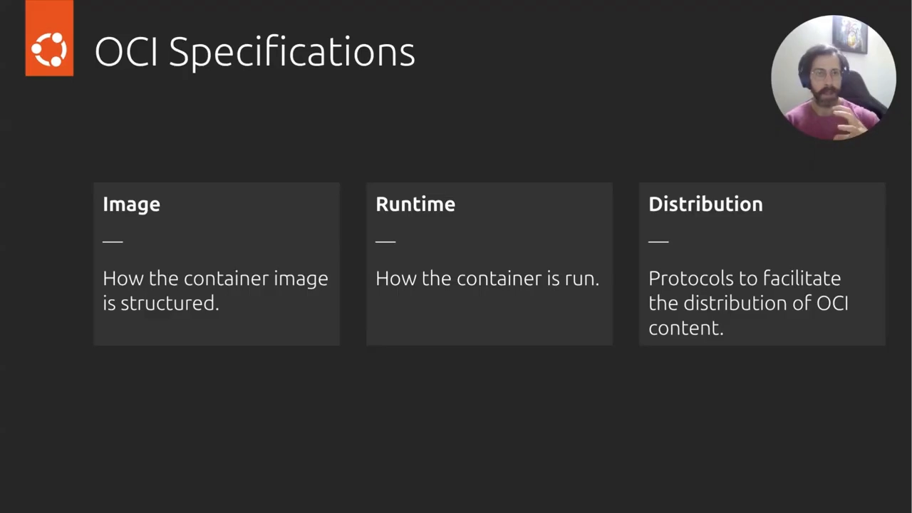

标准的重点始终是**核心互操作性（core interoperability）**：它相当于一份"共同语言"，让所有工具都明白——容器镜像应该长什么样、如何分发、如何执行。正因为是基线而非天花板，标准之上还在继续生长：如今我们常把容器镜像称为一种 **OCI artifact**，因为还有其他类型的 OCI artifact 也能走同一条仓库分发通道；这也让 Docker、Podman、Skopeo、ORAS 等工具都按同一套规则"看得懂"容器。[【跳转到 02:16】](https://www.youtube.com/watch?v=RBAQyqgFl4w&t=136)

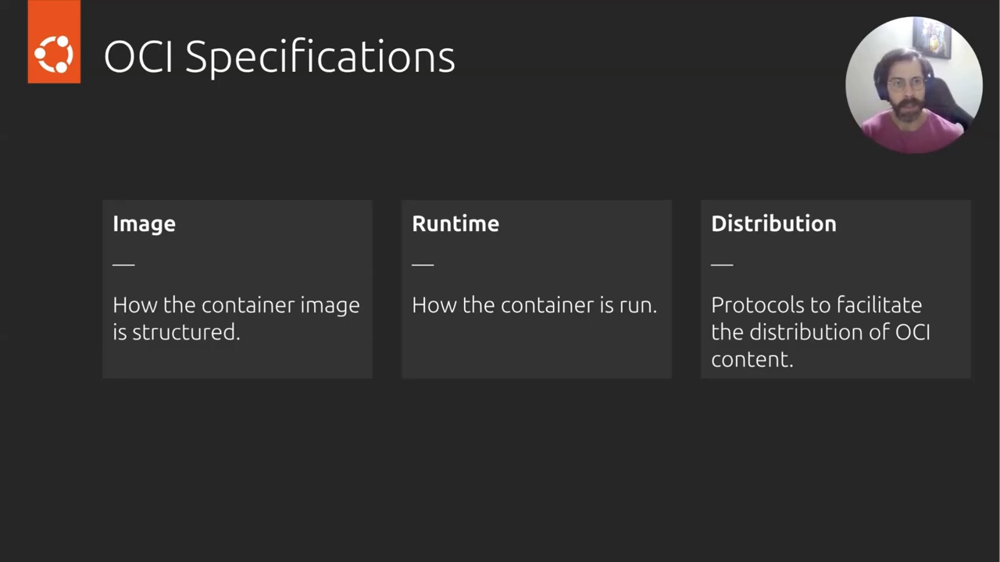

## 三、镜像规范骨架：tar 的 tar，加一组 JSON 元数据

对初学者来说，镜像规范是三大规范里最合适的切入点。OCI 对镜像的定义可以讲得很朴素：**一个容器镜像就是"压缩包套压缩包"（a tar of tars）**——最外层是一个压缩文件，你打包进镜像的内容按**层（layer）**组织，每一层同样是被压缩的。[【跳转到 03:06】](https://www.youtube.com/watch?v=RBAQyqgFl4w&t=186)

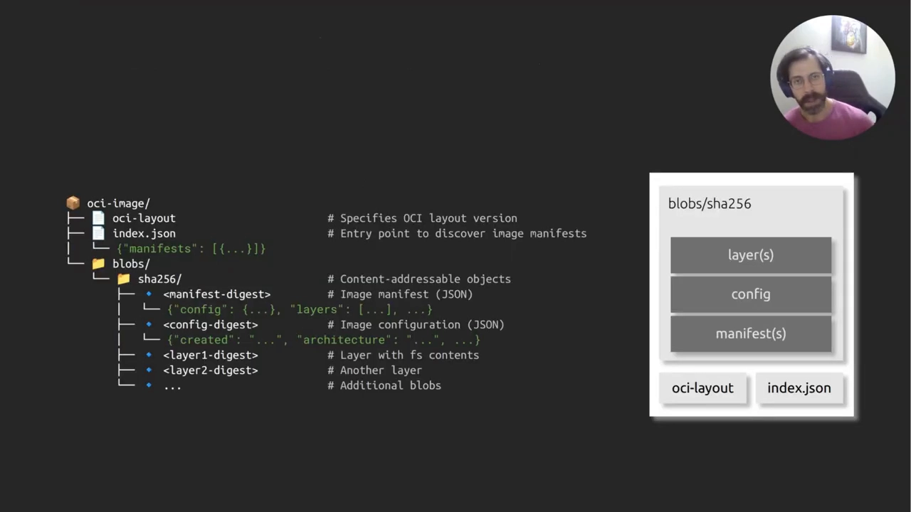

在层之上还有一组**元数据 JSON 文件**：

- **manifest（清单）**：告诉你"这个架构的镜像有哪些层"；[【跳转到 03:31】](https://www.youtube.com/watch?v=RBAQyqgFl4w&t=211)
- **config（配置）**：记录镜像的其他信息，比如入口命令（entrypoint）、默认命令、标签（labels）等。

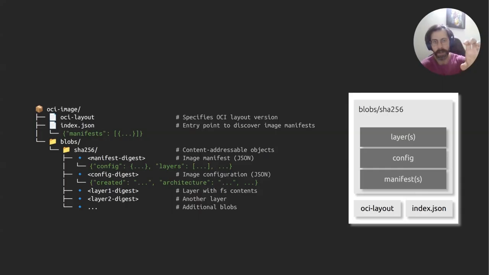

这组文件整体构成规范幻灯片里的那棵**目录树**，规定了镜像应该如何组织。这一点很重要：**运行时正是根据这个结构，才知道怎么把镜像解包并跑成一个容器**。[【跳转到 03:56】](https://www.youtube.com/watch?v=RBAQyqgFl4w&t=236)

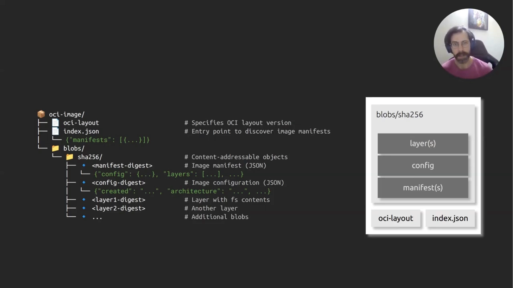

## 四、动手拆镜像：从 registry 一路拆到层文件

讲者随后用真实工具把上面这套结构完整走了一遍。

**第 1 步，与仓库对话。**用工具列出 Docker Hub 上 python 镜像的所有 tags；同样一条命令换成 Amazon ECR 的地址也能列——因为**两个仓库都是 OCI 兼容的**，标准让"和仓库说话"这件事与具体厂商无关。[【跳转到 04:25】](https://www.youtube.com/watch?v=RBAQyqgFl4w&t=265)

**第 2 步，导出成 OCI archive。**把镜像保存为 OCI 格式的归档文件后解开，看到的正是规范里那棵目录树：一个 `index.json`、一个 layout 文件，外加一堆初看很"神秘"的 blob 文件。**`index.json` 就是整个镜像的入口**：从它出发能找到 manifest，再找到各层。 [【跳转到 05:15】](https://www.youtube.com/watch?v=RBAQyqgFl4w&t=315)

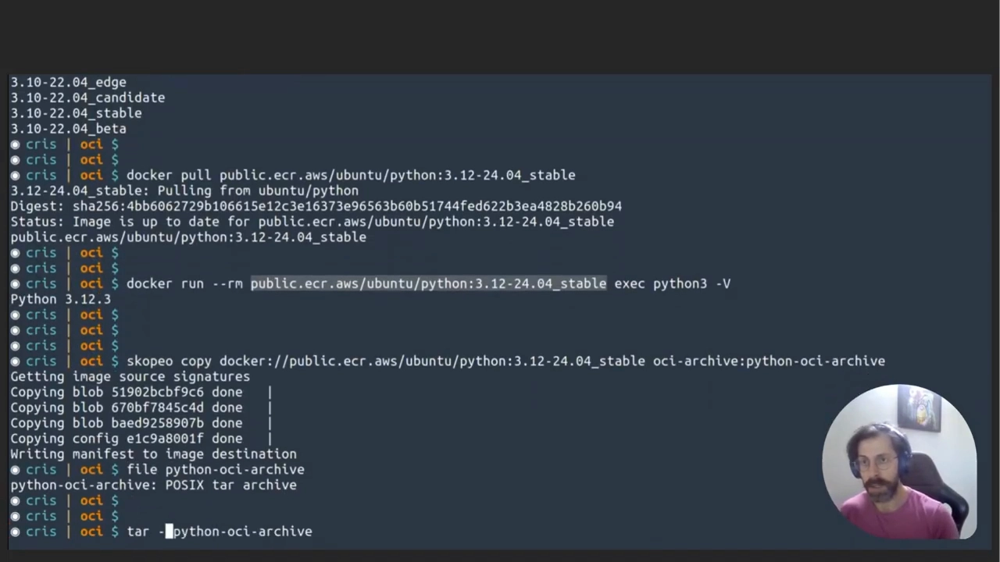

**第 3 步，看懂多架构。**刚才拉取时选择了多架构，于是同一个 archive 里其实装着**两个镜像**，但仍然只有一个 `index.json`；架构越多，这个列表越长。[【跳转到 05:40】](https://www.youtube.com/watch?v=RBAQyqgFl4w&t=340)打开 `index.json` 能看到它指向的是**index（清单列表）**而不是单个 manifest——media type 表明这是一个 multi-arch 的 manifest list，里面是一个**含两条记录的数组**：分别对应 amd64 与 arm64 两套层。多架构就是这么实现的：不同架构通常各用各的层。[【跳转到 06:58】](https://www.youtube.com/watch?v=RBAQyqgFl4w&t=418)

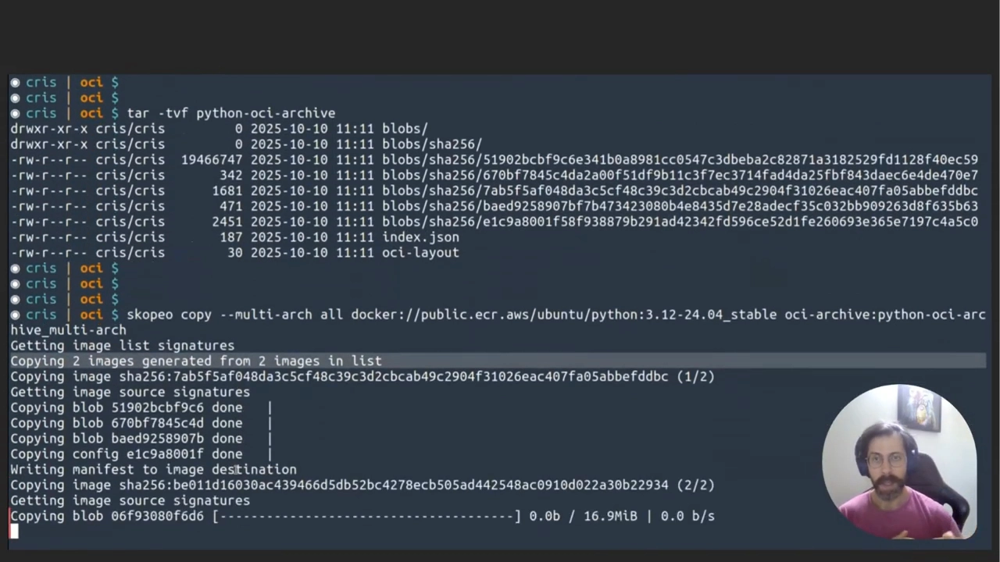

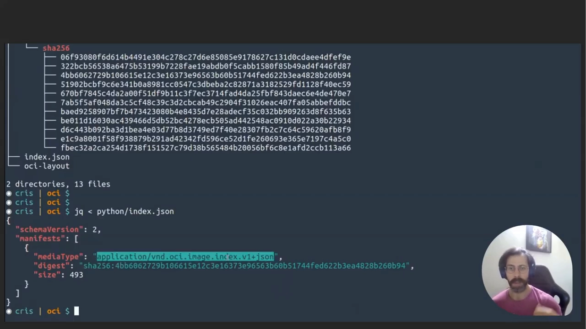

**第 4 步，顺着 digest 往下走。**选中 amd64 那条 manifest 后，它告诉我们两件事：**镜像 config 在哪、属于这个架构的层有哪些**——这就是从 index 到 config 与层的完整寻址路径。[【跳转到 07:48】](https://www.youtube.com/watch?v=RBAQyqgFl4w&t=468)

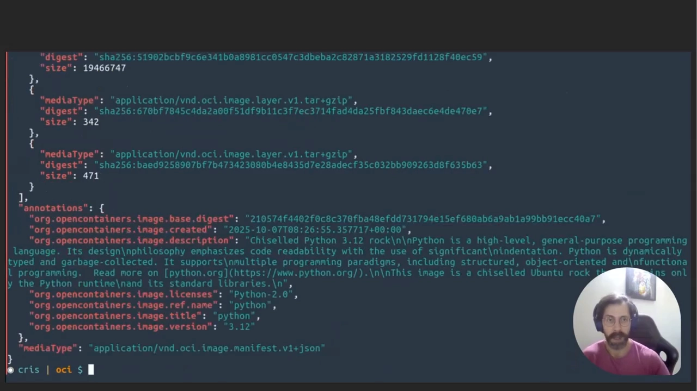

**第 5 步，看 config。**顺着 manifest 给的 digest 打开镜像 config，内容可能让你觉得眼熟：entrypoint、labels 等一大堆配置属性。眼熟就对了——**`docker inspect` 等检查命令输出的，正是这些字段**：工具只是把镜像 config 里的内容换了个更可读的方式展示给你。[【跳转到 08:13】](https://www.youtube.com/watch?v=RBAQyqgFl4w&t=493)

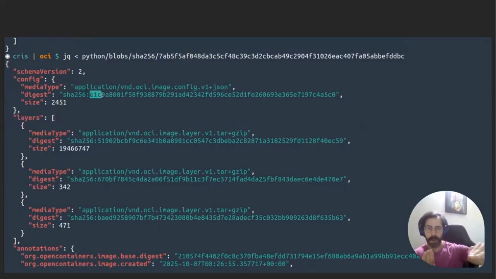

**第 6 步，看层。**回到 manifest，amd64 版的 python 镜像共有**三个层**，每层都能看到大小；它们是 tar 加 gzip 的压缩文件，而且**文件名就是内容的 digest**——按内容寻址。随便解开一层，里面正如规范所说，是镜像文件系统的一部分：能看到 Python 相关的文件与入口内容。[【跳转到 09:28】](https://www.youtube.com/watch?v=RBAQyqgFl4w&t=568) [【跳转到 09:53】](https://www.youtube.com/watch?v=RBAQyqgFl4w&t=593)

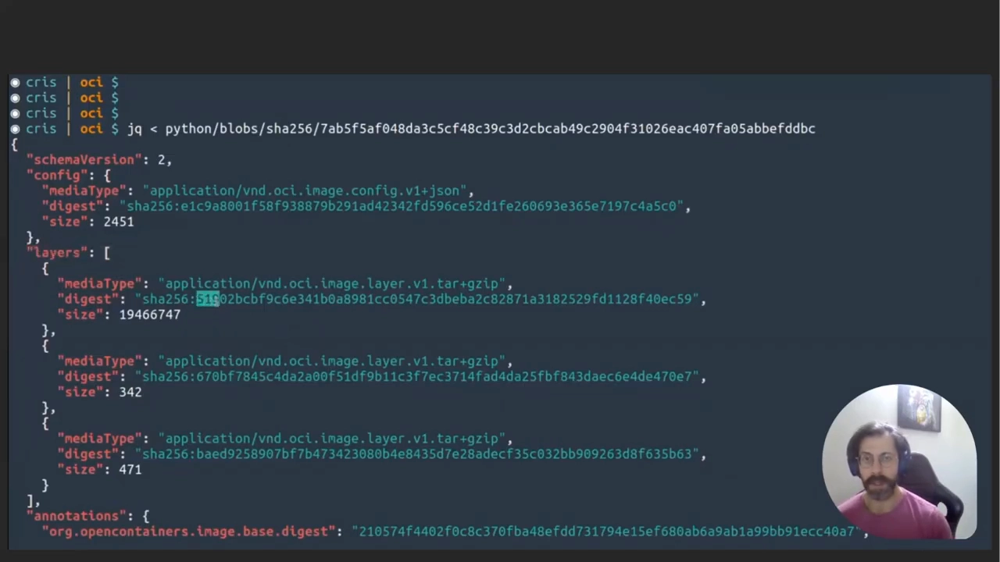

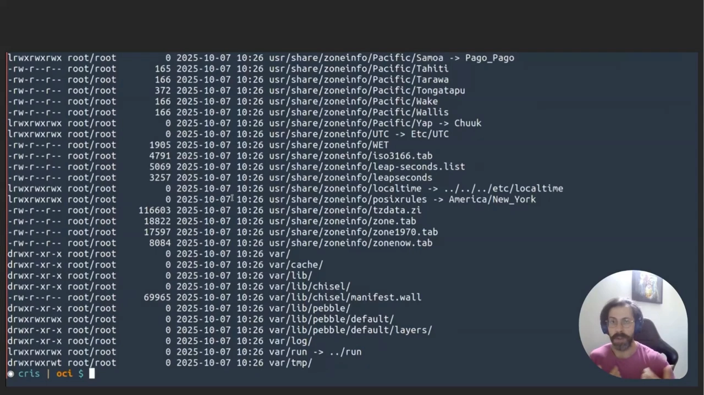

## 五、收尾：把标准"装"回 Docker

最后一组演示：把这份 OCI archive 导入 Docker daemon，照样能正常使用——因为**一切都 OCI 兼容**。这就是标准带来的互操作性：整套流程是厂商中立的，换用任何其他合规工具，结论都一样；对运行时与仓库，同理成立。[【跳转到 10:29】](https://www.youtube.com/watch?v=RBAQyqgFl4w&t=629)

想继续深入，可以到 opencontainers.org 查看全部规范原文与相关工具。[【跳转到 10:54】](https://www.youtube.com/watch?v=RBAQyqgFl4w&t=654)

## 小结

- **OCI = 开放容器计划**：Linux 基金会下的厂商中立标准项目，2015 年前后由 Docker 等行业领导者创立。
- **三大支柱**：镜像规范（格式）、运行时规范（怎么跑）、分发规范（怎么传）。
- **一条链**：合规工具构建 → 合规仓库分发 → 合规运行时执行，链上每一环都可替换。
- **镜像的骨架**："tar 的 tar"：内容按层组织；层之上是 manifest（各架构有哪些层）与 config（入口、标签等元数据）。
- **一张寻址图**：`index.json`（入口，兼容多架构 manifest list）→ manifest → config + layers；层是 tar+gzip，文件名即 digest。
- **多架构**：同一个 archive、一个 index，按架构分流到不同 manifest，各架构层不同。
- **互操作性可验证**：OCI archive 可以导入 Docker daemon；检查命令（如 docker inspect）读的就是 config。

## 关键术语速查

| 术语 | 一句话解释 |
| --- | --- |
| OCI | 开放容器计划：Linux 基金会下制定容器格式、运行时、分发开放标准的项目 |
| vendor neutral | 厂商中立：标准不依赖任何一家公司或工具集 |
| image spec | 镜像规范：规定容器镜像的结构（manifest、config、层） |
| runtime spec | 运行时规范：规定如何运行容器 |
| distribution spec | 分发规范：规定镜像如何在仓库间推拉 |
| OCI artifact | 走 OCI 分发通道的制品统称，容器镜像是其中最常见的一种 |
| manifest | 清单：说明某个架构的镜像由哪些层组成、config 在哪 |
| index | 清单列表：index.json 的内容，多架构镜像的分流入口 |
| config | 镜像配置：entrypoint、标签等运行时元数据，`docker inspect` 展示的源头 |
| layer | 层：tar+gzip 的文件系统片段，文件名即内容 digest |
| digest | 内容哈希（如 sha256）：按内容寻址，内容不变则 digest 不变 |
| registry | 镜像仓库：OCI 分发规范的落地，如 Docker Hub、Amazon ECR |
