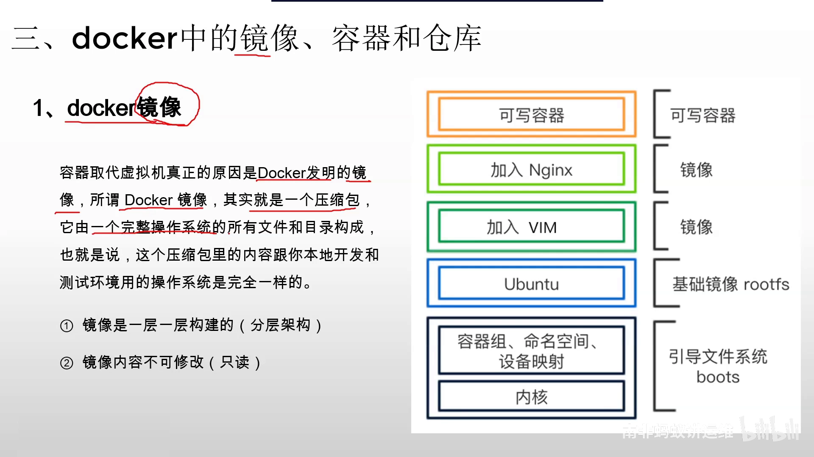
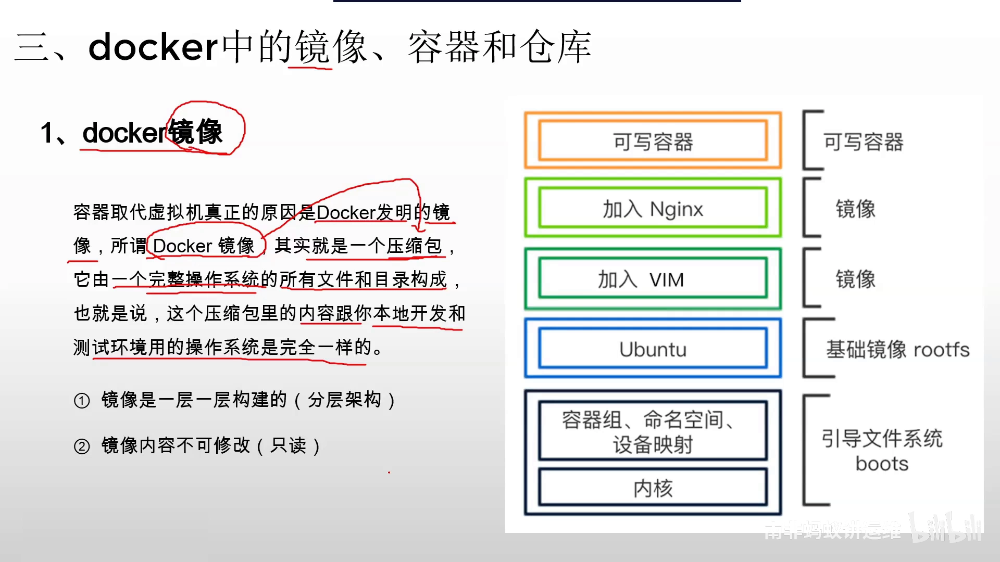
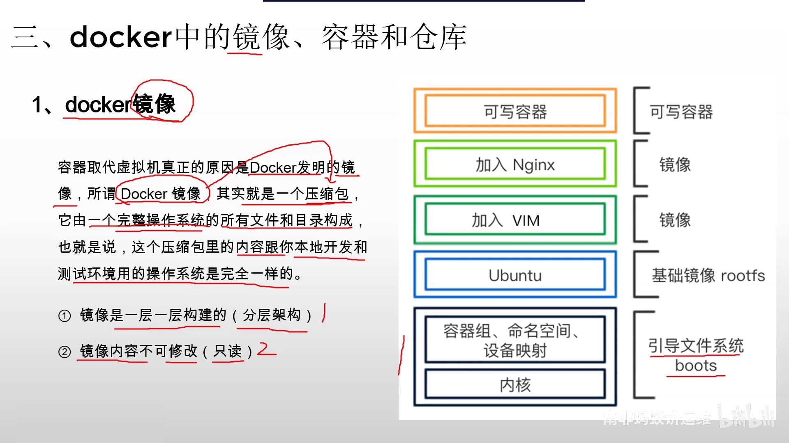
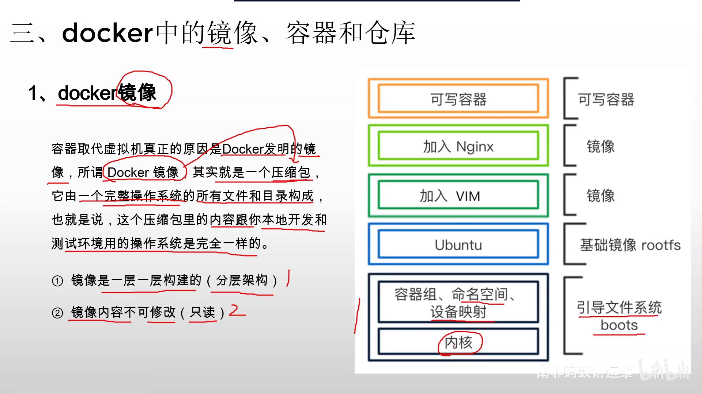
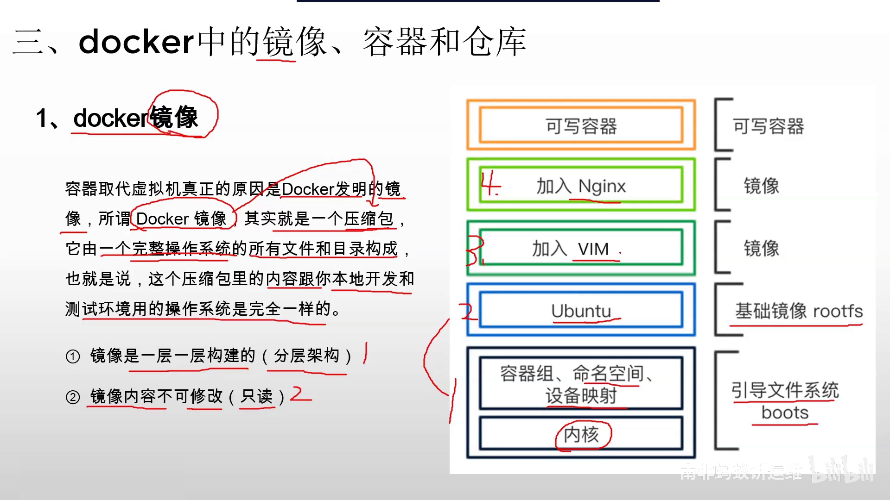
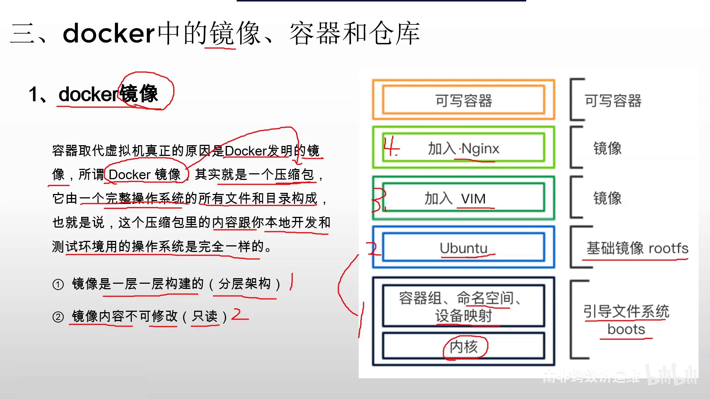
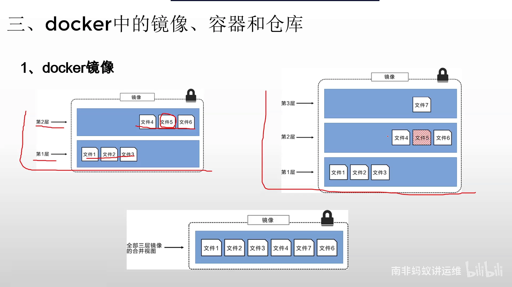
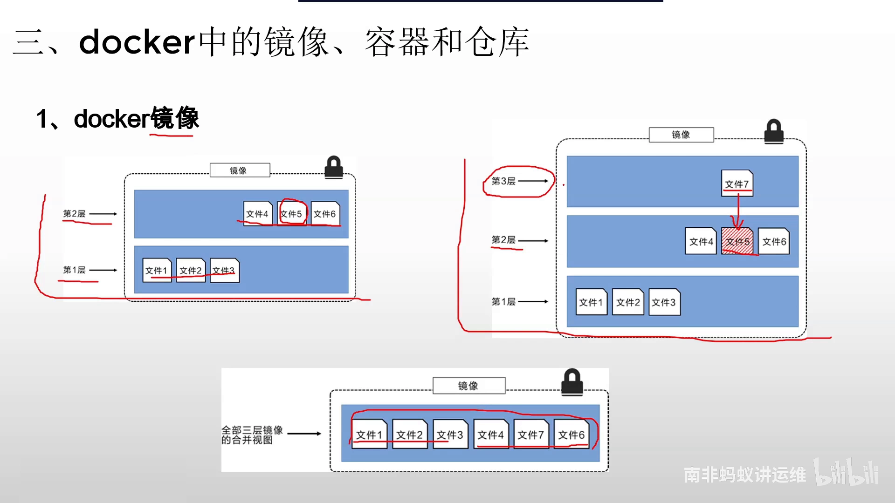

# 10分钟深度讲解docker镜像技术

> 来源：[B站《10分钟深度讲解docker镜像技术》（高老师Linux云计算）](https://www.bilibili.com/video/BV1hY41167HL/?t=0) · 本文基于视频演说图文稿整理，时间戳可跳转到对应讲解。

## 本讲要解决的核心问题（SCQA）

**背景**：使用 Docker 容器的时间里，大约 80% 都在和镜像打交道——下载镜像、制作镜像。可以说，掌握了镜像，Docker 就掌握了八九十。

**冲突**：但很多人对镜像的理解停留在"会 pull、会 run"。Docker 之所以能取代虚拟机，最根本的原因就是它发明了镜像技术——如果说不清镜像里装了什么、它为什么这样组织，后面的一切（构建优化、存储、分发）都是黑盒。

**疑问**：镜像到底是什么？它内部是怎么构成的？为什么"一旦做好就不能改"？

**回答（中心思想）**：Docker 镜像本质是一个压缩包，里面装着"精简的 Linux 操作系统 + 应用软件 + 依赖库"；它在制作时**一层一层构建**，且**内容只读**——这两条特性是理解镜像一切行为的钥匙：分层靠"叠层"扩充，修改靠"新层覆盖旧文件"，真要升级就重新构建一个新镜像。

## 一、镜像是什么：一个包含完整运行环境的压缩包

### 1.1 镜像里装了什么

理解镜像，先记住一句大白话：**Docker 镜像就是一个压缩包**。里面完整地装着一个操作系统及其上层的软件环境，整体分三部分：

1. **一个完整的底层操作系统**——它是 Linux 的，但会非常非常小；
2. **应用软件**——你要运行的程序；
3. **软件依赖的库文件等环境**。

[【跳转到 01:15】](https://www.bilibili.com/video/BV1hY41167HL/?t=75)

### 1.2 为什么它能取代虚拟机

这三部分打包在一起之后，镜像里的内容跟物理机上的开发和测试环境**一模一样**——相当于把整个操作系统做成了压缩包。所以把它放到任何地方都能正常运行，"一次构建、到处运行"就是这么来的，这也是 Docker 取代虚拟机的根本原因。

## 二、镜像的两个核心特性

[【跳转到 02:30】](https://www.bilibili.com/video/BV1hY41167HL/?t=150)

从本质上理解 Docker 镜像，必须掌握两个知识点：

1. **镜像在制作时是一层一层构建的**——它是一个分层的架构，压缩包是一层一层叠上去的，不是一次成型的；
2. **镜像的内容是不可修改的**——一旦制作完成，里面的内容只能读、不能改，即镜像是只读的。

这两条特性贯穿后面所有内容：分层模型（第三章）解释"层怎么叠"，只读特性（第四章）解释"内容怎么改"。

## 三、镜像的分层模型：bootfs、rootfs 与软件层

视频用一张分层图从下往上讲解 Docker 内部的构成。

### 3.1 第一层：bootfs 引导文件系统

[【跳转到 03:45】](https://www.bilibili.com/video/BV1hY41167HL/?t=225)

最底层对应**引导文件系统（bootfs）**，是底层操作系统的启动层——有了它系统才能启动。它类似于 Linux 里的引导部分：`/boot` 目录里有很多文件，专门供操作系统启动时使用。这一层里对应的主要就是**系统内核**，还包括控制组、命名空间、设备映射等等。

关键点：**这个内核一般不放进镜像，而是直接使用宿主机的内核**。所以镜像才会那么小——很多文件（尤其内核）根本不打包进去，所有容器共享宿主机内核。

### 3.2 第二层：rootfs 根文件系统

[【跳转到 04:35】](https://www.bilibili.com/video/BV1hY41167HL/?t=275)

引导文件系统之上是**基础镜像层 rootfs（根文件系统）**。操作系统由两部分构成：内核 + 根文件系统。**内核不管哪个发行版都一样**，而根文件系统各不相同——Ubuntu、CentOS、Debian 等发行版的区别就在 rootfs 上。假定第二层是 Ubuntu，整个镜像的基础部分就是 Ubuntu 发行版。这两层合起来，构成了镜像里的"完整底层操作系统"。

### 3.3 第三层起：按安装顺序叠软件

[【跳转到 06:40】](https://www.bilibili.com/video/BV1hY41167HL/?t=400)

有了操作系统，从第三层开始就可以装软件了。比如第三层装 vim 编辑器，第四层装 Nginx，第五层装 Tomcat，第六层装 MySQL——**层次按软件安装的先后顺序区分**，每一层装什么由你自己决定。

## 四、分层的实践建议与"只读"带来的修改方式

### 4.1 层数建议：十层以下，合并安装

[【跳转到 07:05】](https://www.bilibili.com/video/BV1hY41167HL/?t=425)

镜像可以分层，但不建议层次太多——没有意义还影响性能。一般建议**十层以下**。减少层次的办法：装软件时把多个安装动作合并成一条命令同时执行，它们就会变成一层。这就是 Docker 镜像优化的一个技术点。

### 4.2 层一旦构建，内容不可变

[【跳转到 08:20】](https://www.bilibili.com/video/BV1hY41167HL/?t=500)

第四层装完 Nginx 后发现版本老了，能不能把这层删掉重装新版本？**不行**。每一层一旦构建过，里面的内容就不会再变化，既不能修改、也不能删除。（当然，重新构建一个新镜像没有任何问题，这里说的是在既有镜像之上。）

### 4.3 只读层的"修改"方法：新层覆盖旧文件

那想让 Nginx 升级怎么办？其实有方法——用文件视图来演示：

[【跳转到 08:41】](https://www.bilibili.com/video/BV1hY41167HL/?t=521)

假设镜像第一层里有文件 1、2、3，第二层里有文件 4、5、6。现在发现文件 5 的内容写错了，想修改它——但第二层已经完成，文件 5 不能改也不能删。

办法是：**新增第三层，在里面放一个文件 7**——它是文件 5 内容的升级改进版本，用来**覆盖**文件 5。

[【跳转到 09:31】](https://www.bilibili.com/video/BV1hY41167HL/?t=571)

覆盖之后，镜像里看到的内容就变成了文件 1、2、3、4、6、7——文件 5 被文件 7 挡住了。这就是在 Docker 镜像里"修改"某一层内容的方式：**旧的层不动，用新层覆盖**。

### 4.4 真要升级，不如重新构建

[【跳转到 10:21】](https://www.bilibili.com/video/BV1hY41167HL/?t=621)

上面这种覆盖操作只是用来演示"只读"特性，实际中如果发现某层内容要升级，更合理的做法是**重新构建一个新镜像**，不需要做这么多步骤。理解"每一层内容不可修改"这个特性即可。

## 小结

- Docker 镜像 = 压缩包，内含**精简 Linux 操作系统 + 应用软件 + 依赖库**，与物理机环境一致，所以"一次构建、到处运行"；
- 镜像**分层构建**：bootfs（引导，内核来自宿主机）→ rootfs（根文件系统，区分发行版）→ 软件层（按安装顺序叠加）；
- 镜像**内容只读**：层构建完成后不可修改、不可删除；
- "修改"的本质是**新层覆盖旧文件**；真正的升级应重新构建镜像；
- 实践上建议层数十层以下，用合并安装来减少层数。

## 关键术语速查

| 术语 | 一句话解释 |
| --- | --- |
| 镜像（image） | 包含操作系统、软件与依赖的压缩包，是容器的静态模板 |
| 分层（layer） | 镜像一层层构建而成，每层装一部分内容，按顺序叠加 |
| bootfs | 引导文件系统，最底层，负责系统启动；内核来自宿主机 |
| rootfs | 根文件系统，第二层，是不同 Linux 发行版的差异所在 |
| 只读 | 镜像构建完成后内容不可修改、不可删除 |
| 覆盖修改 | 在上层放一个新文件来"遮住"旧层的同名文件 |
