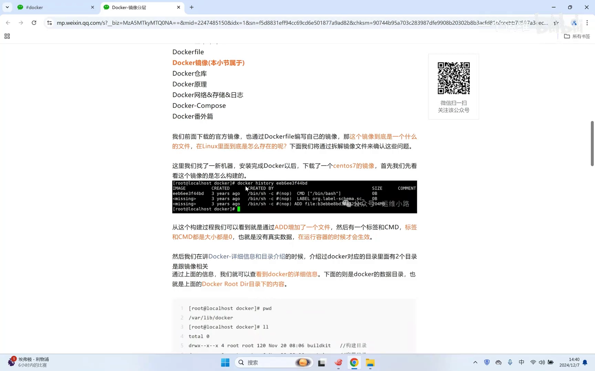
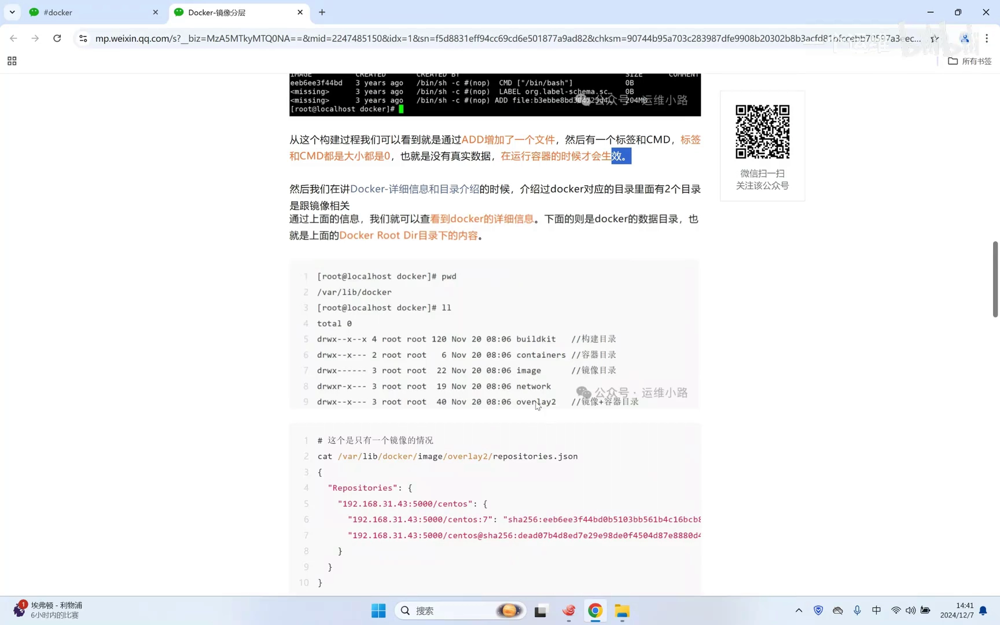
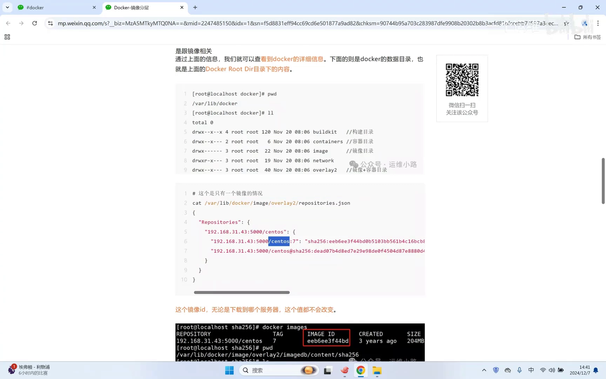
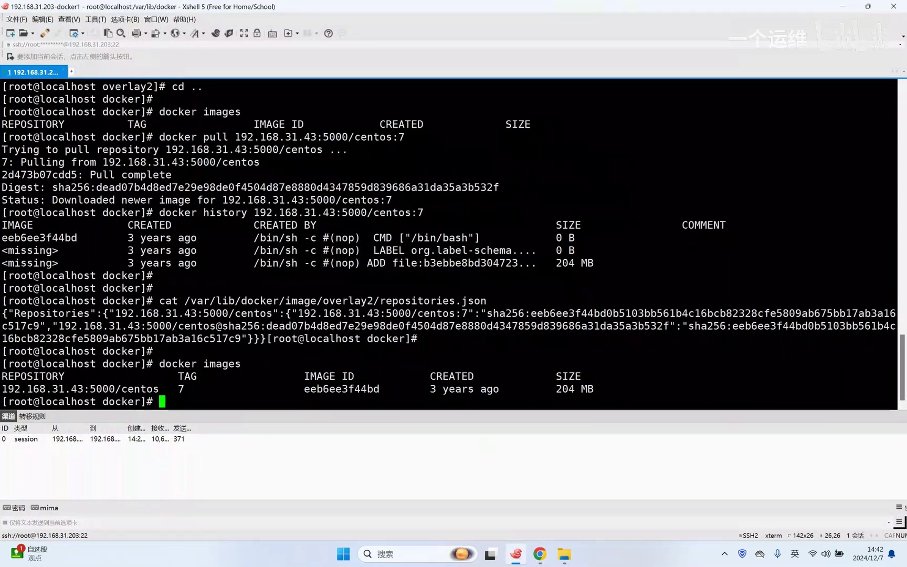
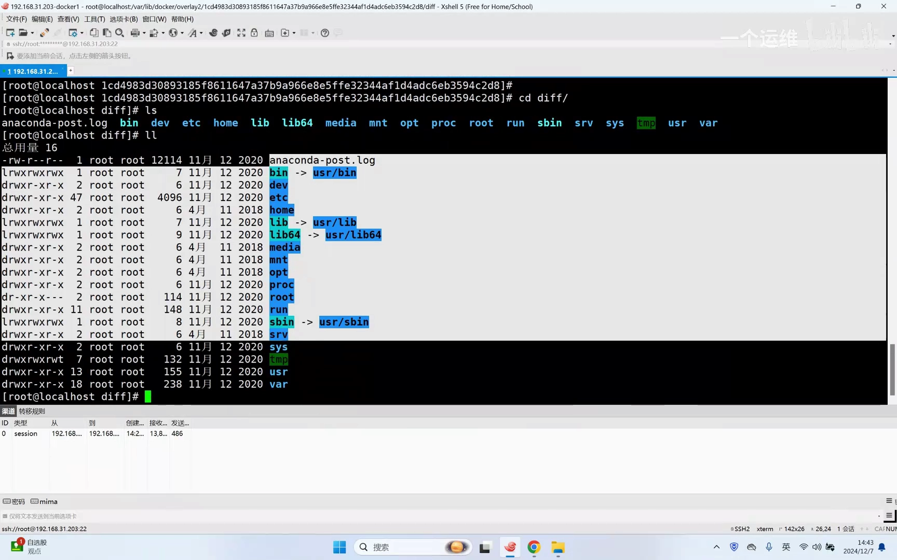
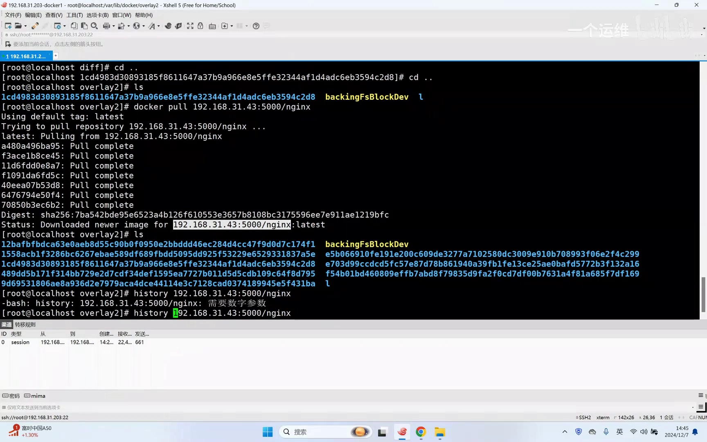
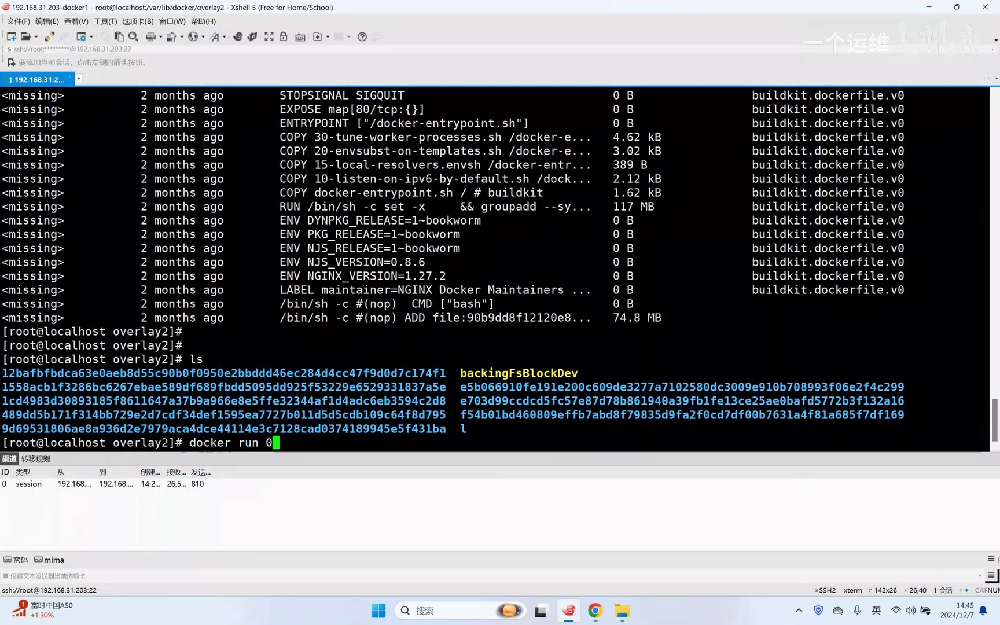
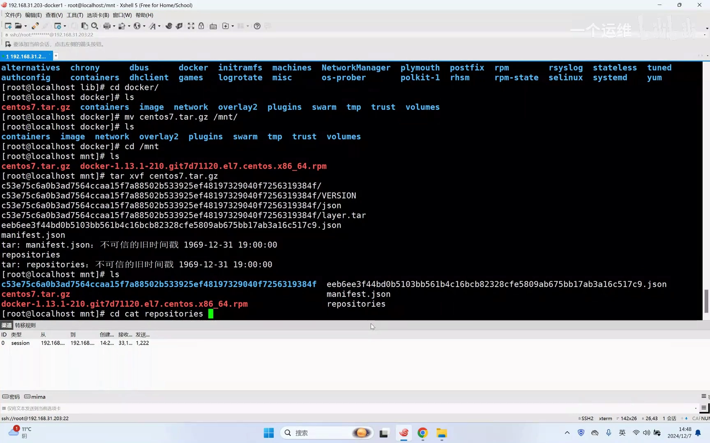
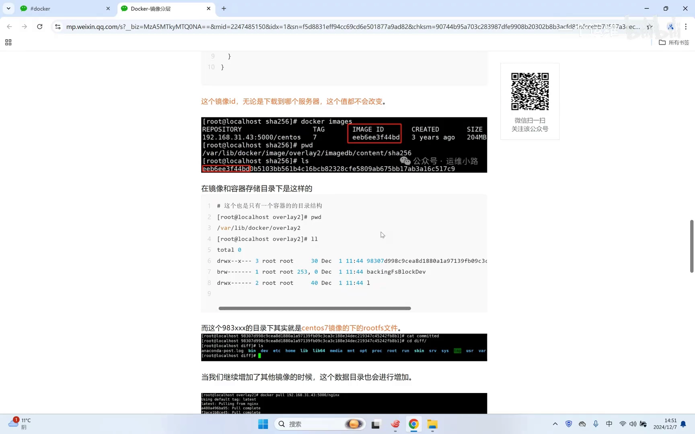
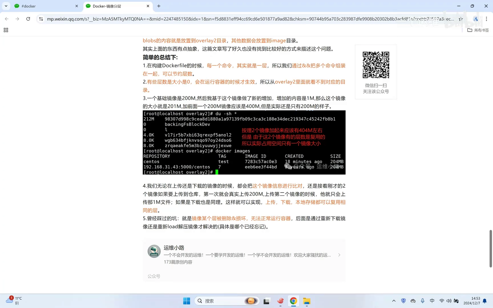

# Docker-镜像分层

> 来源：[B站《Docker-镜像分层》（运维小路）](https://www.bilibili.com/video/BV1nwkdYMEaF/?t=0) · 本文基于视频演说图文稿整理，时间戳可跳转到对应讲解。

## 本讲要解决的核心问题（SCQA）

**背景**：前面已经会下载官方镜像，也会用 Dockerfile 自己编排镜像。

**冲突**：但镜像到底是一个什么样的文件？在磁盘上长什么样？不借助 Docker 直接看这个文件，能看出什么？

**疑问**：常说的镜像"分层"，是真实存在的文件结构，还是抽象概念？

**回答（中心思想）**：把镜像放到一台干净的机器上动手拆解就能验证——镜像在磁盘上以 overlay2 目录里的"层目录"形式存在，`docker history` 里每条"有大小"的记录都对应一个真实目录；运行容器只是额外增加很小的可写目录；多个镜像共享相同的层，因此存储、上传、下载都被"增量"加速。

## 一、从 docker history 看分层

### 1.1 history 里能看出什么

[【跳转到 00:47】](https://www.bilibili.com/video/BV1nwkdYMEaF/?t=47)

在一台没有任何镜像的新机器上，先下载一个镜像，然后用 `docker history` 查看它是怎么构建的。history 显示这个镜像只有几层：一条条记录把文件追加进去、放一个 lib、再加上 systemd 的启动……下载前后对比，history 显示的内容一模一样。

### 1.2 大小为 0 的"层"

[【跳转到 01:29】](https://www.bilibili.com/video/BV1nwkdYMEaF/?t=89)

history 里有的记录大小是 0，比如 LABEL 和 CMD——它们没有真实数据，只有在容器启动的时候才会生效，相当于运行时才把这部分"加进去"。

## 二、镜像在磁盘上长什么样

### 2.1 与镜像有关的目录

[【跳转到 01:58】](https://www.bilibili.com/video/BV1nwkdYMEaF/?t=118)

Docker 有两个跟镜像有关的目录：`containers` 和 `image`；另外因为文件系统用的是 overlay2，下载镜像后会在 overlay2 下面生成对应的文件。

### 2.2 tag 与 ID：换台机器也不变

[【跳转到 02:23】](https://www.bilibili.com/video/BV1nwkdYMEaF/?t=143)

image 目录下记录着镜像和它的 tag，还有一个 ID——这个 ID 无论把镜像下载到哪个地方，信息都不会变。

### 2.3 overlay2 里存的是真实数据

[【跳转到 03:06】](https://www.bilibili.com/video/BV1nwkdYMEaF/?t=186)

镜像的真实数据都存在 overlay2 里，运行容器的数据也在这里面。其中一层数据约 200~210 兆；另外还有一些元数据，所以目录会稍微大一点，但数据量基本一致。

## 三、层数与目录一一对应

### 3.1 解压出来的层：标准 Linux 目录树

[【跳转到 04:13】](https://www.bilibili.com/video/BV1nwkdYMEaF/?t=253)

进入层目录看：解压出来的目录名字每次都不一样（上次九八开头、这次 ECD 开头），但内容就是一个标准的 Linux 系统目录。如果我们要运行一个容器，容器里面的东西其实就是这些了。

### 3.2 多下一个镜像，多一层目录

再下载一个其他镜像，overlay2 下就会多出更多的层。新镜像的 history 显示 7 层，实际目录从 1 个变成 8 个（这边 5 个、那边 3 个），正好增加了 7 个目录。

### 3.3 有大小才有目录

[【跳转到 05:28】](https://www.bilibili.com/video/BV1nwkdYMEaF/?t=328)

由此得到一个结论：镜像 history 里有多少"有大小"的层，就有多少个目录；大小为 0 的层（如 LABEL/CMD）不会形成目录。前面那个镜像 history 里看到的是几层，实际上只有一层有东西；而这个新镜像有 7 层有东西、一层没有，下载的时候也正好下载了这 7 层——这就是镜像的分层。

## 四、容器层：运行时多出的两个小目录

[【跳转到 06:12】](https://www.bilibili.com/video/BV1nwkdYMEaF/?t=372)

用 `-it` 跑起来一个容器之后再看这个目录，立马增加两个目录——这就是**容器的目录**。容器的目录和镜像的目录都存放在 overlay2 下面。这两个目录目前大小很小：[【跳转到 06:54】](https://www.bilibili.com/video/BV1nwkdYMEaF/?t=414) 第一个只有 **8K**——因为容器里还没有写入任何东西；另一个是 **200 多兆**，就是容器里那份原始数据（镜像内容）。可以把小的那个理解为容器的"运行目录"。这个目录的具体机制比较抽象，UP 主留到"联合文件系统"那一讲展开（对应本系列的 3.3 节内容）。

## 五、把镜像当普通文件拆开看

### 5.1 docker load 与 tar 解压的区别

[【跳转到 08:47】](https://www.bilibili.com/video/BV1nwkdYMEaF/?t=527)

把镜像文件打包再解压会怎么样？如果用 `docker load` 来解压，出来的是一个镜像；而如果用普通 Linux 的 tar 命令去解压，出来就是一个普通文件，不再是个镜像。解压出来的一些文件，信息跟前面看过的内容类似，但也有区别——这些都是**元数据**。

### 5.2 元数据与层数据的归宿

那个 200 多兆的文件就在目录下面，把它解压出来，就是我们刚刚看到的那些内容——这就是镜像的分层，和前面讲的一样。**rootfs** 就是一个操作系统最核心的那些文件（目录树）：除了内核以外都在这里面；换一个内核，加上这些文件，就是一个独立的操作系统。

镜像数据解压出来放在 overlay2；其他元数据则会被组装后放到 image 目录里——不是直接复制过去，中间有转换过程（细节不展开）。

## 六、分层的价值：复用

### 6.1 Dockerfile 每条命令就是一层

[【跳转到 11:26】](https://www.bilibili.com/video/BV1nwkdYMEaF/?t=686)

编 Dockerfile 打镜像时，**每一条命令其实就是每一层**：history 里有大小就会形成真实目录，没有大小就不会。用 `&&` 把多条命令组装成一条，就能减少层数。UP 主提到早期版本对层数有上限（他记忆中约 256 层），一般人达不到这个上限；合并命令第一个作用是节约层数，第二个作用是把同样功能归到一起，看起来更整洁。

### 6.2 两个镜像 400 兆？实际还是 200 兆

[【跳转到 11:45】](https://www.bilibili.com/video/BV1nwkdYMEaF/?t=705)

一个基础镜像 200 兆，基于它增加 1 兆文件得到 201 兆的新镜像。两个镜像"加起来"应该是 400 兆？实际上 overlay2 目录还是 200 兆左右——没有翻倍。因为新镜像是基于旧镜像做的，相同的那部分两个镜像**复用同一层**，只有各自新增的那层会新生成目录。

简单说：200 兆的基础镜像，A 基于它做镜像增加 10 兆，B 再基于它做镜像增加 10 兆，磁盘总共只多 20 兆。无论多少人做多少次镜像，只要都是基于这个基础镜像，磁盘里就只新增各自增加的那部分内容。

### 6.3 上传/下载只传增量

[【跳转到 13:25】](https://www.bilibili.com/video/BV1nwkdYMEaF/?t=805)

上传镜像时只上传你增加的那一部分，200 兆的基础部分不会重复上传；下载也一样——本地已经有这层了，再去下载基于它做的镜像，只需要下载变化的那部分，不变的那 200 兆不会重新下载，速度很快。总结：**存储是节约空间，上传下载是加速**。

### 6.4 踩坑故事：层损坏了怎么排查

UP 主分享了一个踩过的坑：镜像里有一层不知道被删除还是被破坏了，容器就无法运行。难点在于：层的目录名是算法生成的，换台服务器目录名就不一样；几十个镜像、几十个容器，层数可能有几百个，肉眼根本识别不出哪一层有问题。最后的解决办法是把镜像重新下载一遍、重新解压恢复。这也从反面说明：层是镜像的基本单元，一旦损坏很难手工修复。

## 小结

- 镜像在磁盘上 = overlay2 下的层目录 + image 下的元数据；`docker history` 里"有大小"的每层对应一个真实目录，大小为 0 的层（LABEL/CMD）没有目录；
- 运行容器只是在 overlay2 下多出很小的可写目录（初始 8K），200 多兆的镜像数据原样复用；
- 用 `docker load` 解开是镜像，用 tar 解开是普通文件；层数据放在 overlay2，元数据组装进 image；
- 分层的价值是**复用**：多人基于同一基础镜像构建，磁盘只增加各自增量；上传/下载只传增量，存储省空间、传输提速；
- 层目录名由哈希算法生成、难以人工排查，层损坏时重新拉取镜像是恢复手段。

## 关键术语速查

| 术语 | 一句话解释 |
| --- | --- |
| docker history | 查看镜像的构建分层记录，每条"有大小"的记录对应一个真实层目录 |
| overlay2 | Docker 默认的存储目录/文件系统，镜像层与容器数据都存放在这里 |
| 层（layer） | 镜像的基本组成单元，一条有数据量的构建命令对应一个真实目录 |
| 可写层 | 容器运行时新增的目录，还没写入时只有几 KB |
| tag / ID | 镜像的标签与唯一标识，ID 无论下载到哪台机器都不变 |
| 增量传输 | 上传/下载镜像时只传输本地没有的层 |
