# Building a Container Image - Pt 1 - OCI, UnionFs, Overlay

> 来源：YouTube @Ryan Hay「What exactly is a container」系列第 3 部，时长 17:27。
> 本文基于该视频的演说图文稿整理，关键处附视频时间戳，可点击跳转观看原始演示。

## 本讲要解决的核心问题（SCQA）

**背景**：日常使用容器时，`docker build`、`docker pull` 顺手得像魔法，很少人打开看镜像内部。

**冲突**：一旦出了问题（镜像拉不下来、层对不上、磁盘暴涨），不理解镜像结构就无从下手。

**疑问**：一个「OCI 合规镜像」到底由哪些文件组成？"层"又是怎么叠成容器看到的完整文件系统的？

**回答（中心思想）**：一个 OCI 合规镜像在磁盘上就是一套 **OCI image layout**：`index.json` 是入口，指向一个 **manifest**；manifest 又指向一个 **config** 和一组 **layers**——config 描述镜像配置，layers 是一层层压缩的 tar 文件系统。运行时，容器引擎用 **overlay2 联合文件系统**把这些层叠挂在一起：下层只读、上层可写，新增/修改/删除各有固定规则。本讲把一套真实镜像解包逐文件讲解，再亲手搭一个 OverlayFS 验证这些规则。

## 一、先分清三个词：image、container、Docker

### 1.1 未运行的"容器"，其实是一种打包格式

"容器"是个 overloaded（ overloaded/多义的）词，需要区分运行与未运行两种形态：

- **未运行时**：容器就是文件系统上的一种**应用打包格式**——一个 tar 包，里面装着其它 tar 和一些元数据。这个包就叫**容器镜像（container image）**。
- **运行时**：容器是容器镜像的一个**运行实例**，表面上像一台轻量独立机器，本质上是宿主机上一个**资源受限的隔离进程**。

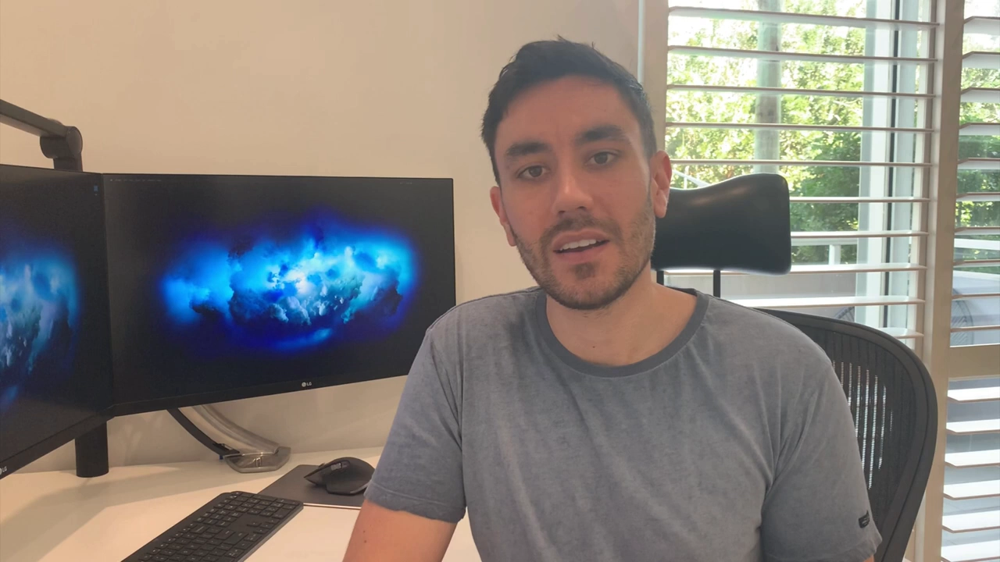

作者强调，镜像标准化带来的直接好处：不再需要为 rpm、deb、jar 各种格式分别做包——**OCI 合规的镜像在哪都一样**，"build once, run anywhere"。

### 1.2 Docker 的历史角色：让容器流行，但不等于容器技术本身

很多公司入场后，Docker 一家难以满足社区全部需求，于是各家开始自己造轮子；为改进兼容性、鼓励创新，社区成立了标准组织 **OCI（Open Container Initiative，开放容器倡议）**，其中部分标准由 Docker 捐赠。这些标准带来了 OCI 工具链之间极好的互操作性。作者的要点：**Docker 对容器的普及功不可没，但让容器成为可能的并不是 Docker**，而是内核里那些基础技术（后续视频展开）。

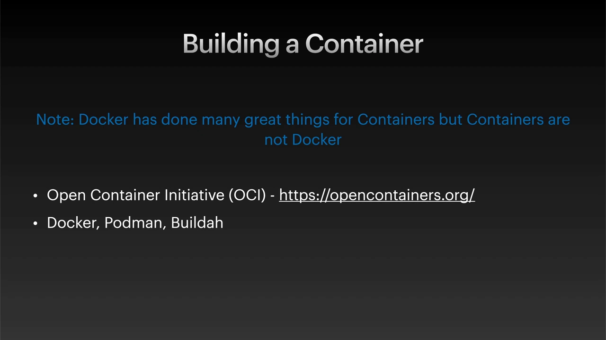

本次系列的工作流：构建镜像（本视频）→ 推送到仓库 → 拉取运行。演示将把同一个应用构建两次：一次用 Mac 上的 Docker，一次用 OCI 合规构建工具 **Buildah**（Podman/Buildah 当时还不支持 Mac，所以在 CentOS 构建机上跑）。

## 二、动手拆解：一个 OCI 合规镜像长什么样

[【跳转到 05:27】](https://www.youtube.com/watch?v=hhQ6uc2bp2s&t=327) 作者提前把演示应用构建成镜像并按 OCI 格式解包到文件系统，对照 OCI 镜像规范逐个文件讲解。构建工具（Docker、Buildah）会自动产出这些结构——亲手看一遍，才知道它们替你做了什么。

### 2.1 OCI image layout 的三要素

解包后的镜像目录里能看到：**blobs 文件夹**和 **oci-layout 文件**：

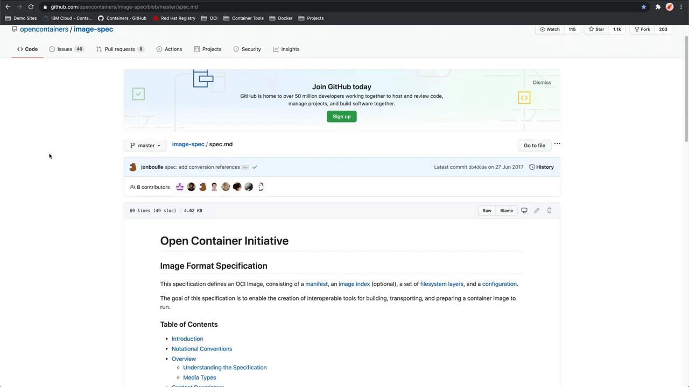

对照规范页的 image layout 定义：一个合规的 OCI 镜像布局必须包含：

- `blobs/` 目录——存放所有内容寻址的文件（按 sha256 摘要命名）；
- `oci-layout` 文件——标记"这是镜像布局的根"，带 layout 版本；
- `index.json`——镜像的**入口**。

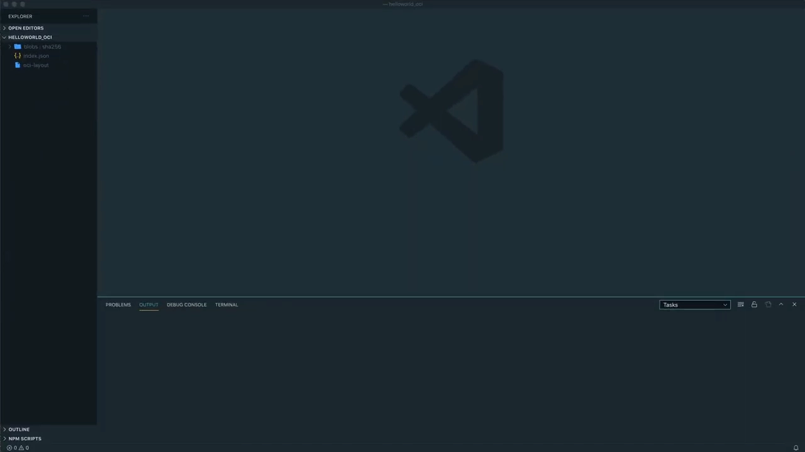

### 2.2 index.json：入口 → manifest

把 `index.json` 格式化后，它代表整个镜像的入口，顺着它提到的 digest（一个以 `6b` 开头的 sha-256）到 `blobs/sha256/` 里找到同名文件，把它当作 JSON 打开——**这就是 manifest（清单）文件**：

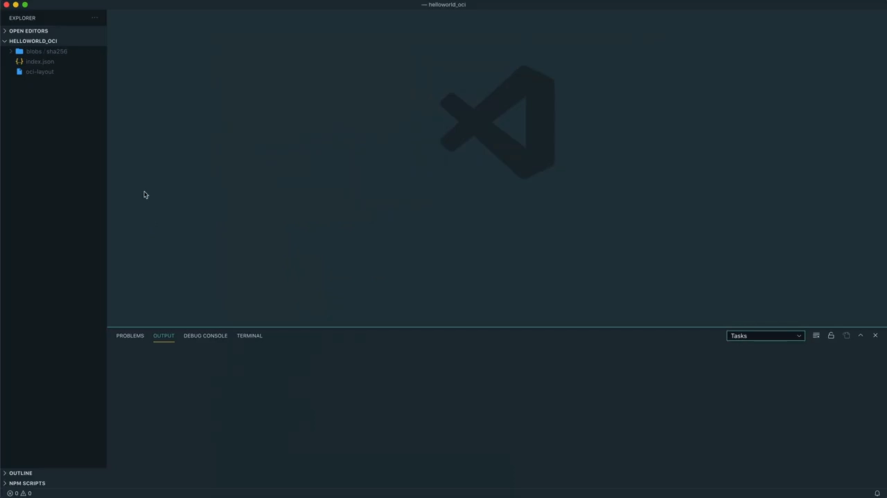

manifest 的内容非常简洁：**指向一个 configuration（配置）和一个 layers 数组**。

### 2.3 manifest 与 config：镜像的说明书

顺着 manifest 里 config 的 digest（以 `1d` 开头）打开 config JSON——内容与对已下载镜像执行 `docker inspect` 看到的非常相似：

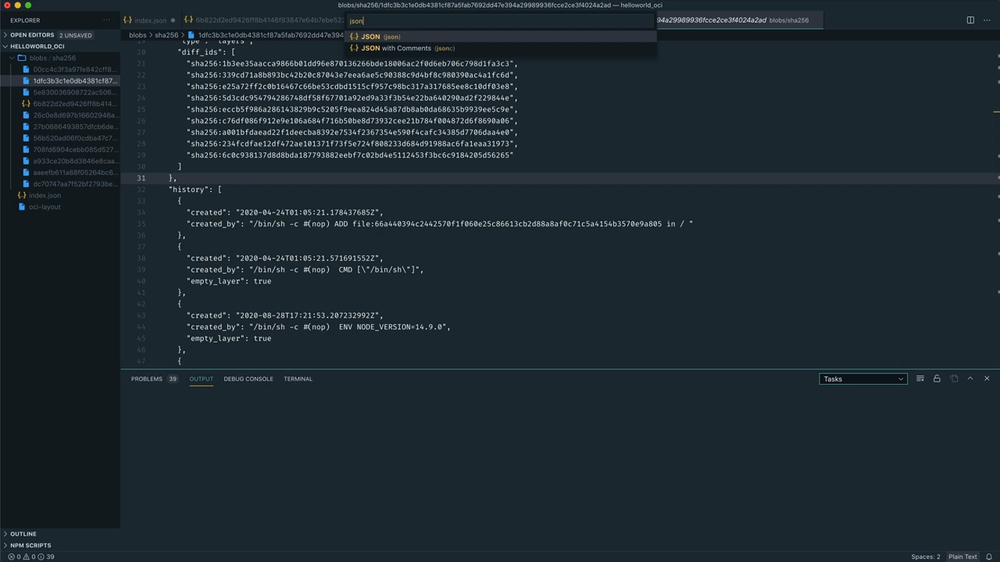

- **architecture / os**：镜像的 CPU 架构与操作系统；
- **env**：环境变量；**entrypoint**：启动命令（这是 Next.js 应用，用 `next start` 启动）；**working directory**：工作目录（构建相关，后文讲）；
- **rootfs.diff_ids**：各**未压缩**层的 sha256 哈希列表；
- **history**：镜像的构建历史（每条 Dockerfile 指令一条记录）。

### 2.4 layers：压缩 tar，解压就是文件系统

manifest 的 layers 数组对应左侧一堆"编辑器都显示不了"的文件——因为它们是**压缩过的 tar**。关键区别：**blobs 目录里的哈希是压缩内容的哈希，config 里 diff_ids 是解压后内容的哈希**，二者一一对应但值不同。

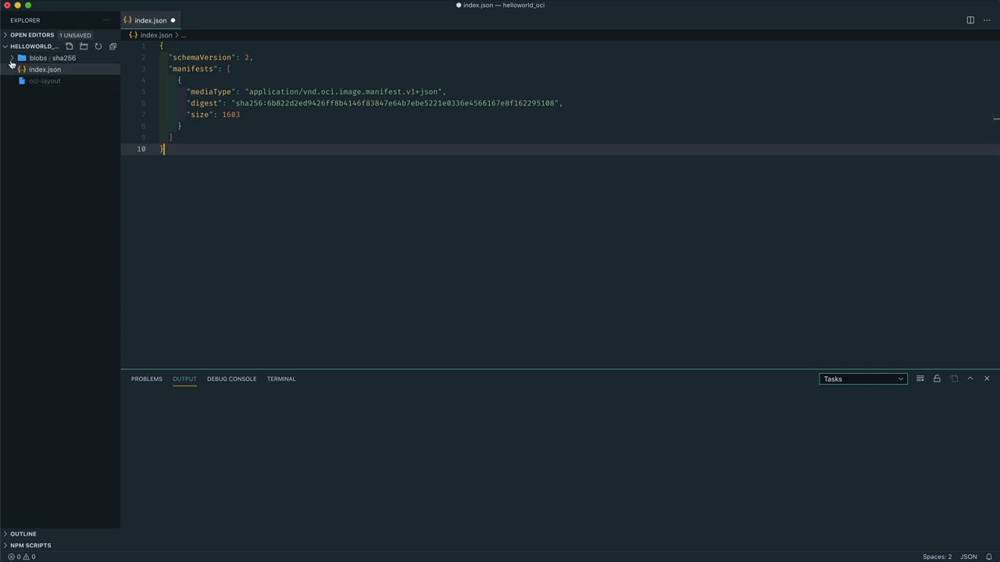

把其中一层解压到临时目录，就能看到：**层的内容其实就是一个文件系统**。另一层里是 `app` 目录——主要是 `.next` 文件夹，即 hello world 应用的编译产物。

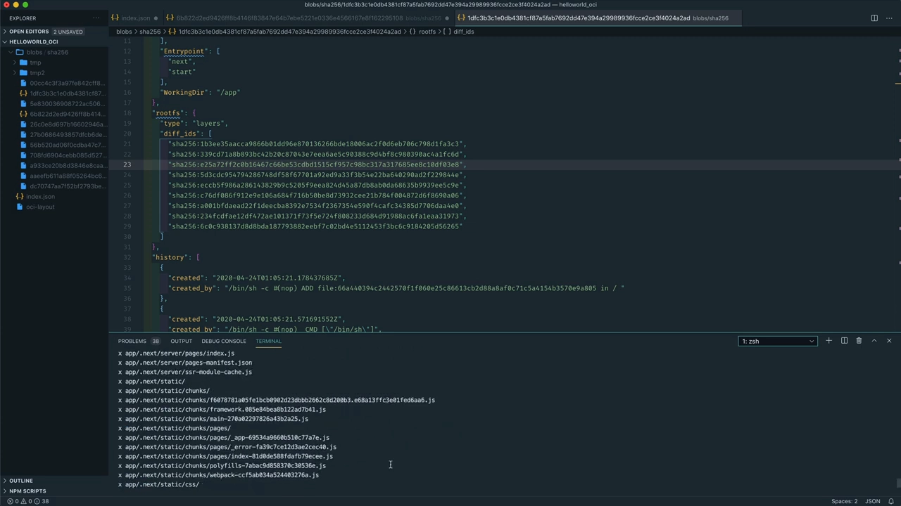

## 三、Union File System：层如何叠成一个文件系统

拆完结构还剩一个疑问：这么多层文件系统，是怎么"叠"成容器看到的那一个文件系统的？这就是**联合文件系统（Union File System）**。

### 3.1 什么是联合文件系统

联合文件系统是一种把**多个文件系统按层叠加、合并呈现为一个文件系统**的技术——上层内容覆盖（supersede）下层同名内容。本讲聚焦 **overlay2** 存储驱动实现——它是 Docker、Buildah、Podman、CRI-O 等容器引擎目前最常用的存储驱动。

[【跳转到 11:01】](https://www.youtube.com/watch?v=hhQ6uc2bp2s&t=661) 作者在构建机上亲手搭了一个 OverlayFS。它由**四个目录**组成：

- **base（lowerdir）**：底层目录，放"烤进文件系统"的文件——相当于 OCI 镜像里的那些层；
- **overlay（merged）**：最上层的合并视图，是容器真正"看得见、用得着"的唯一文件系统；
- **diff（upperdir）**：改动集——base 与 overlay 之间的一切差异都记录在这里；
- **workdir**：base 与 diff 之间的中转站，日常几乎看不到动静（除非大文件操作）；改动一旦落入 diff，overlay 立即可见。

### 3.2 mount：把层挂起来

先往 base 目录拷了三个测试文件，然后执行 `mount -t overlay` 挂载（`-o` 指定 lowerdir/upperdir/workdir，挂载点为 overlay 目录）：

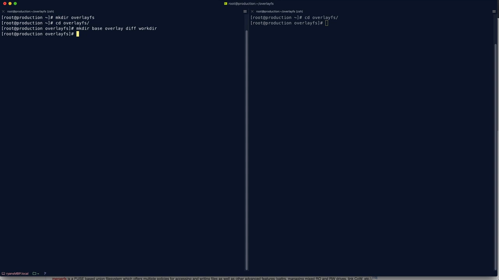

挂载成功后，两侧终端分别盯着文件系统，每三秒刷新，接下来观察它的特性。

### 3.3 新增、修改、删除在层中的表现

实验得出的规则非常清晰：

- **base 里的所有文件**立即出现在 overlay 中；
- **往 overlay 新增文件**，会作为 diff 出现；
- **删除文件**：文件从 overlay 视图中"消失"，但它其实还在原来的层里（base 层原文件仍在），只是在 diff 里出现一条删除记录——[【跳转到 12:55】](https://www.youtube.com/watch?v=hhQ6uc2bp2s&t=775) 演示删除 `van dijk` 后 overlay 中不可见、base 中仍在；
- **修改文件**：base 里原文件保持不变，overlay 里是更新后的内容，diff 里也多了一条修改记录。

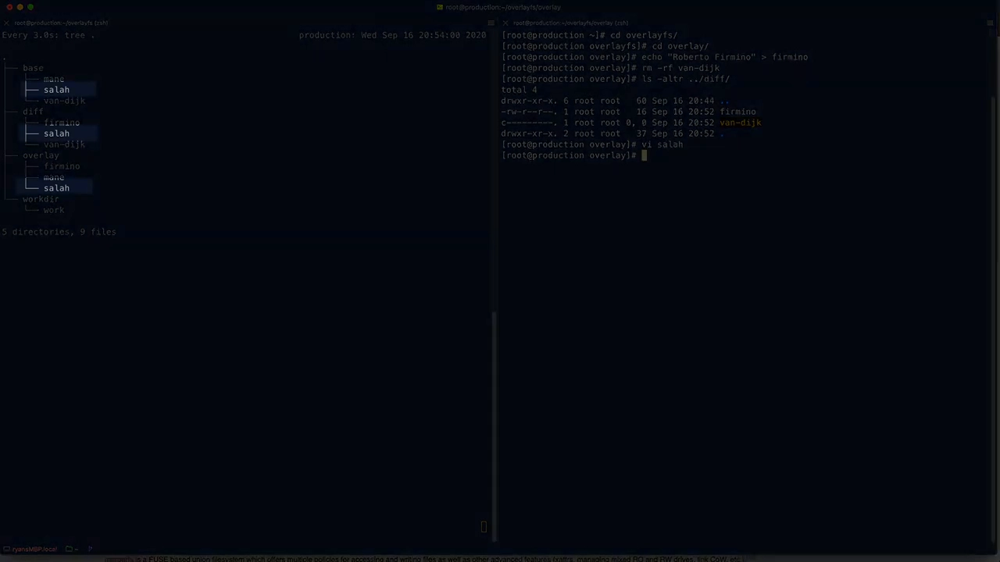

## 四、这些规则如何成就容器

### 4.1 容器镜像 = 打包好的多层文件系统 + 元数据

回到镜像：容器镜像本质上就是"来自不同来源的文件系统层的打包 + 用于正确重组它们的元数据"。存储驱动（graph driver）负责实现，overlay2 是当前默认，历史上还有 aufs、device mapper 等——实现不同，效果基本一致。与实验最大的差别是：容器引擎要管理的**base 目录有多个**——就是 blobs 目录里的那些层。

把实验规则映射到镜像上：

- **新文件只写在最顶层**；
- **修改文件 = 复制到顶层并遮住（mask）下层的同名文件**，下层文件并没有被删除；
- **读取文件 = 从它最初所在的那层读**；
- **删除文件 = 视图上隐藏**，但它在镜像层里从未真正消失；
- **目录会被合并**。

### 4.2 不可变镜像、可写容器、层共享与秒级启动

还有几点推论，正是容器优势的来源：

- **持久化边界**：容器是不可变的——以上所有改动在容器重启后全部丢失。需要长期存在的文件应在构建时"烤进"镜像；数据库这类需要持久存储的，应使用外部 volume（后续视频主题）。
- **继承与复用**：可以站在别人镜像的层上再加自己的层，系统更新、打补丁只需在构建时换掉一层，非常轻松。
- **不可变性红利**：文件系统挂载后只有最上层的临时层可写，容器销毁即丢弃——镜像本身永远不会被"顺手改坏"，显著减少意外变更与"在我机器上是好的"这类环境漂移问题。
- **存储去重**：有公共层的镜像**共享同一份层数据**，不重复占用存储，环境之间也更一致。
- **启动快**：新容器只是**引用**底下的层，运行时只需创建最上层那个可写层，所以容器启停非常廉价，实时扩缩容也很跟手。

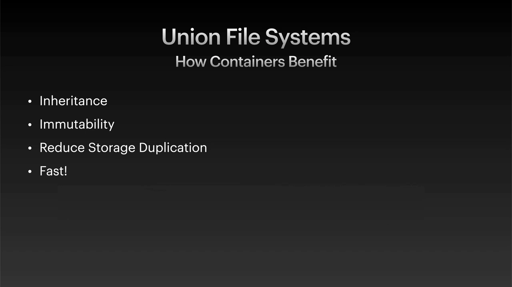

视频因为内容较长拆成了上下两部：本集讲清了 OCI 镜像结构与联合文件系统原理，下一集将分别用 Docker 和 Buildah 把 hello world 应用真正构建成镜像。

## 小结

- 未运行的容器=**打包格式**（tar 套 tar + 元数据，即容器镜像）；运行的容器=**资源受限的隔离进程**。
- OCI 镜像布局三要素：**blobs/、oci-layout、index.json**；index.json → manifest → **config + layers**。
- **config** 记录架构/OS/env/entrypoint/working dir/**未压缩层哈希 diff_ids**/history；**layers** 是压缩 tar，blob 里的哈希对应压缩内容，diff_ids 对应解压内容。
- **overlay2 联合文件系统**用 lowerdir/upperdir/workdir/merged 把层叠成一个文件系统：新增在顶层、修改复制上顶遮旧、删除只是隐藏、目录合并。
- 镜像不可变 + 层共享 + 只建顶层可写层 = 省存储、防漂移、秒级启动。

## 关键术语速查

| 术语 | 一句话解释 |
| --- | --- |
| OCI image layout | OCI 规定的镜像磁盘布局：blobs/ + oci-layout + index.json |
| index.json | 镜像入口文件，指向 manifest |
| manifest | 清单文件，指向一个 config 和一组 layers |
| config | 镜像配置：架构、OS、环境变量、entrypoint、diff_ids、history |
| diff_ids | 各层**解压后**内容的 sha256；blob 哈希是压缩内容的 |
| layer | 一层文件系统（压缩 tar），解压后就是目录树 |
| Union File System | 把多个文件系统叠加合并为一个视图的技术 |
| overlay2 | 最常用的联合文件系统存储驱动（Docker/Buildah/Podman/CRI-O） |
| lowerdir / upperdir / workdir / merged | OverlayFS 四目录：底层、顶层（改动集）、中转、合并视图 |
| Buildah / Podman | OCI 合规的开源构建/运行工具，Docker 之外的社区实现 |
