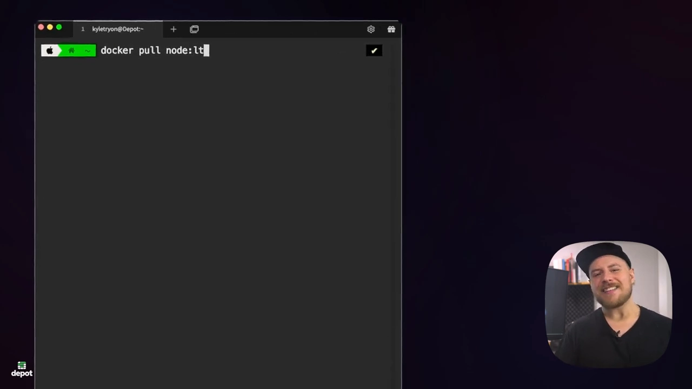
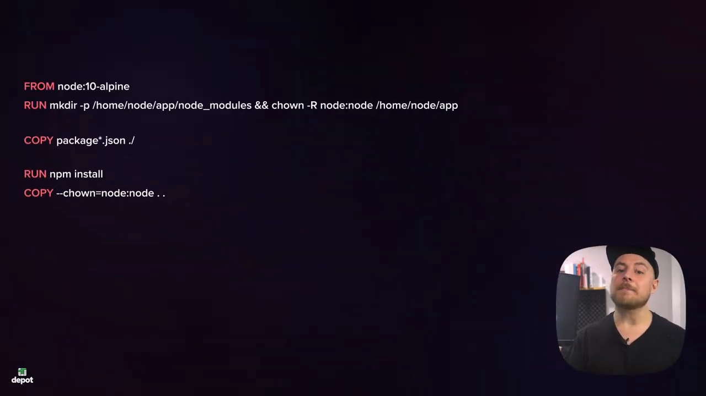
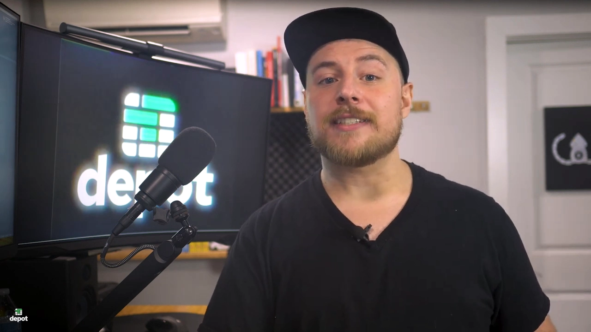
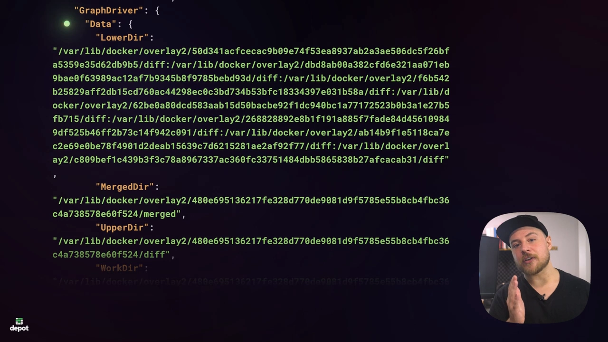
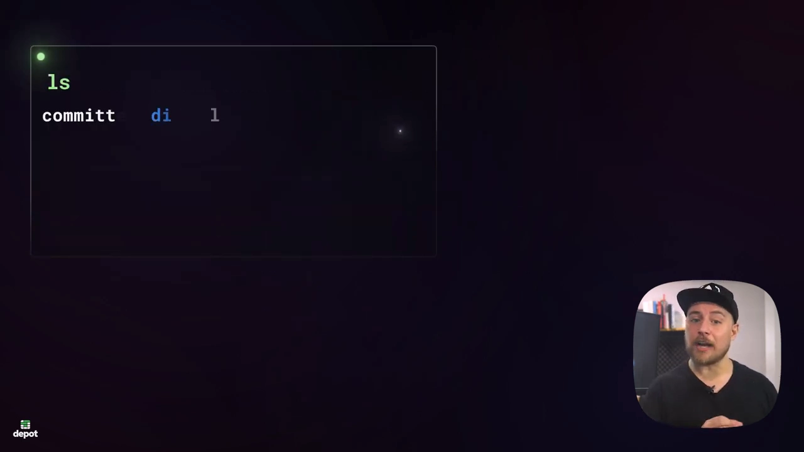
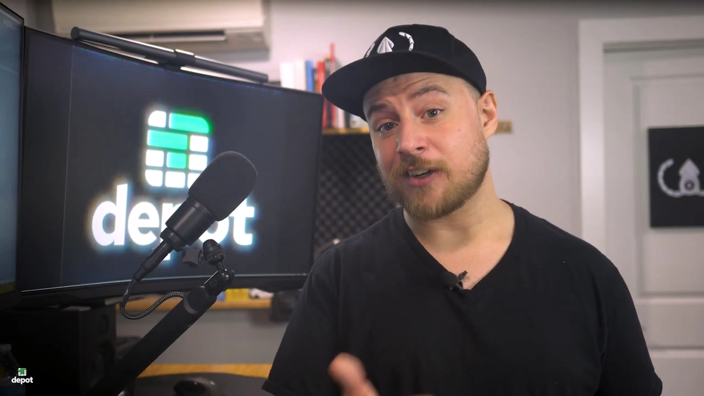
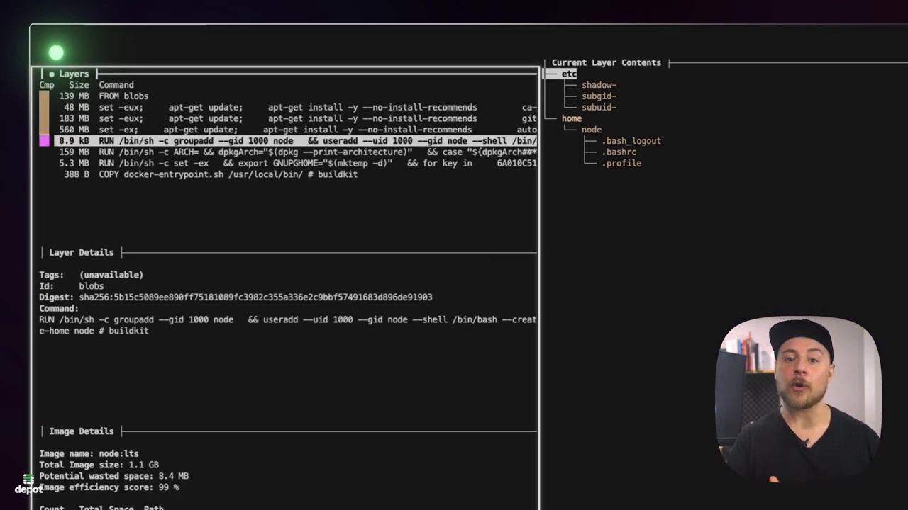
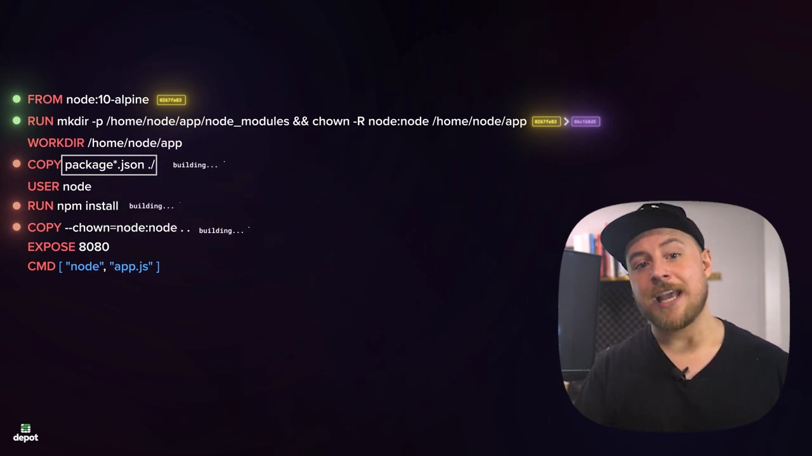

# What Are Docker Layers Anyway?

> 来源：YouTube Depot 官方频道，Kyle 讲解，时长 6:36。
> 本文基于该视频的演说图文稿整理，关键处附视频时间戳，可点击跳转观看原始演示。

## 本讲要解决的核心问题（SCQA）

**背景**：`docker pull` 一个镜像时，终端上刷出的不是一条下载进度，而是**一层一层**的下载。

**冲突**：这些"层"到底是什么？存在磁盘哪里？为什么两个不同的镜像能共用同一批层？

**疑问**：能不能把一个真实镜像（node:lts）逐层解剖，把层的存储、共享与缓存机制一次讲清？

**回答（中心思想）**：镜像 = 一份**元数据** + 一串**只读层（layer）**；每层是对文件系统的一组改动（diff），堆叠起来就是镜像的文件系统。层以 overlay2 目录形式存放在 `/var/lib/docker/overlay2`；**只读**特性让层可以被多个镜像安全共享，pull 增量下载、构建缓存都建立在它之上。

## 一、镜像不是单个文件：元数据 + 只读层

[【跳转到 00:21】](https://www.youtube.com/watch?v=tQgpBRfr5EY&t=21) 从 registry 拉镜像时可以看到它在下载多个层：

Docker 镜像由两部分组成：

- 一份**元数据**：镜像名、tag 等；
- 一串**只读层（read-only layers）**。

**每一层包含的是"该层对应的 Dockerfile 指令造成的文件系统改动（diff）"**。创建容器时，这些层自底向上堆叠、逐层应用，形成容器的文件系统；容器启动后，再在栈顶加一个**可写层**，容器内程序产生的日志、缓存等数据都写在这里：

## 二、`docker inspect`：一张元数据地图

[【跳转到 01:00】](https://www.youtube.com/watch?v=tQgpBRfr5EY&t=60) `docker inspect node:lts` 返回一个详细的 JSON 对象，值得逐个字段看：

- **RepoTags**：tag 数组，包括拉取时用的 `node:lts`；
- **RepoDigests**：镜像的**唯一标识（digest）**。为保证拉到的镜像分毫不差，CI 里常用 digest 引用镜像；因为镜像可能是多平台（multi-platform）的，所以它是个数组；
- **Cmd**：容器启动时的默认命令，与 Dockerfile 里写的 `CMD` 一致；
- **Architecture / Os**：本例从 Mac 拉取，显示 `arm64` / `linux`；
- **GraphDriver**：进入与"层"直接相关的部分——**graph driver 就是容器运行时用来存储和管理镜像层的存储驱动**，这里名称是 **overlay2**，Docker 的默认驱动；它借助 OverlayFS 这个联合文件系统完成层的大部分"魔法"。

## 三、层在磁盘上的家：`/var/lib/docker/overlay2`

### 3.1 lowerdir：一串目录就是一串层

[【跳转到 02:39】](https://www.youtube.com/watch?v=tQgpBRfr5EY&t=159) 看 GraphDriver.Data 的 **lowerdir** 字段：冒号分隔的一串目录，**每一个目录就是镜像的一层**。多数系统上，这些层存放在本机的 `/var/lib/docker/overlay2` 目录：

### 3.2 层目录里的两个关键成员

进入任一层目录，可以看到：

- **`lower` 文件**：记录**该层的父层**（上一层的引用），把所有层串成一条链；
- **`diff` 目录**：**该层对应的 Dockerfile 指令造成的文件系统改动**就放在这里。

## 四、用 dive 把每一层看清楚

[【跳转到 03:25】](https://www.youtube.com/watch?v=tQgpBRfr5EY&t=205) 用 CLI 工具 **dive**（`dive node:lts`）可以直观可视化：左侧是**层列表，附创建每层的命令**，右侧是"到这一层为止"的文件系统树。按 Tab 切到文件树视图、只显示新增文件后，逐层往下翻：第一个 `RUN` 指令创建了名为 `node` 的组和用户（GID/UID 都是 1000），并在文件系统里新增了 `/home/node` 目录——**这正是磁盘上该层 diff 目录里的内容**，两种视角完全对得上。

## 五、层设计的三重红利

### 5.1 只读层可跨镜像共享

[【跳转到 04:13】](https://www.youtube.com/watch?v=tQgpBRfr5EY&t=253) 为什么要按层存储？**因为层是只读的**，相似的多个镜像可以**引用同一份层**，既省磁盘又省下载。

### 5.2 pull 增量下载

实验：已拉过 `node:lts` 后再拉 `node:18`——**大部分层本机已经有了，只需下载最后 3 层**。

### 5.3 构建缓存：指令级复用

构建镜像时，Docker 会**缓存每条指令的结果**：指令及其引用的文件没变，就直接复用缓存结果；一旦某条指令变了，**它及其后所有指令的缓存全部失效**、重新构建。想提高缓存命中（cache hit）率，可以把 Dockerfile 里**最不容易变的指令排在前面**：

（视频结尾为出品方 Depot 的推广内容：其远程构建服务以持久缓存加速 CI 构建，本博客不展开。）

## 小结

- 镜像 = **元数据 + 一串只读层**；每层 = 该层 Dockerfile 指令造成的**文件系统 diff**；堆叠后构成镜像文件系统，容器启动再加**可写层**。
- `docker inspect` 能看到 RepoTags、RepoDigests、Cmd、Architecture/Os 与 **GraphDriver（overlay2）**。
- 层存放在 **`/var/lib/docker/overlay2`**：**lowerdir** 列出全部层目录，每个层目录里 **lower 文件**指向父层、**diff 目录**装着该层的改动。
- **dive** 把每层的命令与文件树可视化，与磁盘上的 diff 目录一一对应。
- 只读层 → **跨镜像共享**（省磁盘）、**pull 增量下载**（省带宽）、**构建缓存**（省时间）。

## 关键术语速查

| 术语 | 一句话解释 |
| --- | --- |
| layer（层） | 一组文件系统改动（diff），只读，可堆叠、可共享 |
| 可写层 | 容器启动时加在层栈顶部的读写层，容器数据写在此时 |
| RepoDigests | 镜像内容摘要数组，多平台镜像可有多个；CI 中用来锁定版本 |
| GraphDriver | 存储驱动的 inspect 视图，Docker 默认 overlay2 |
| OverlayFS | 联合文件系统：把多层目录挂载合并为一个视图 |
| lowerdir | overlay 配置中自底向上的层目录列表 |
| lower 文件 | 层目录内记录"父层是谁"的文件 |
| diff 目录 | 层目录内存放该层文件系统改动的地方 |
| dive | 终端 UI 工具：按层浏览镜像命令与文件树 |
| cache hit | 构建/拉取时发现所需的层已存在，直接复用 |
