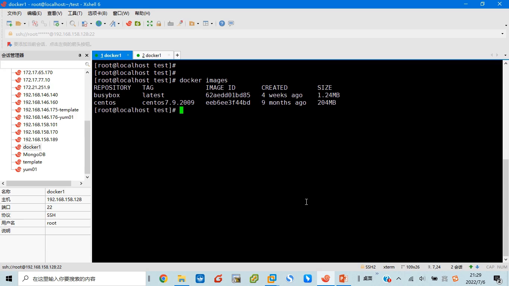
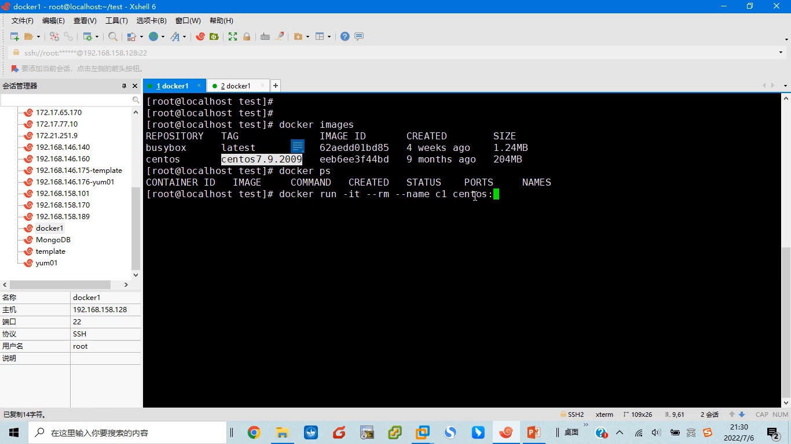
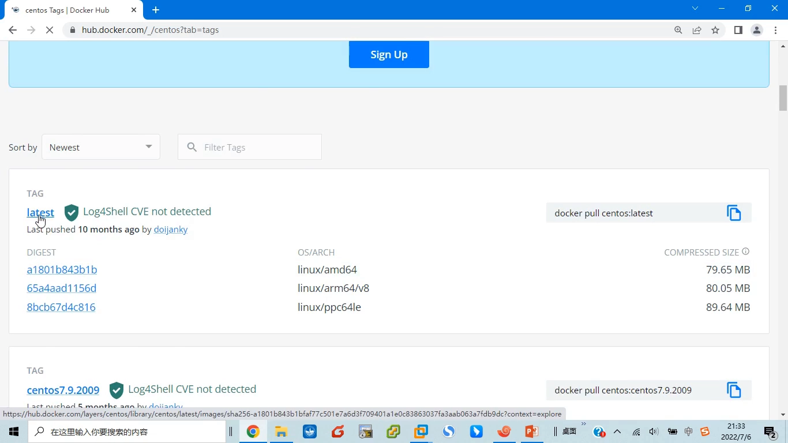
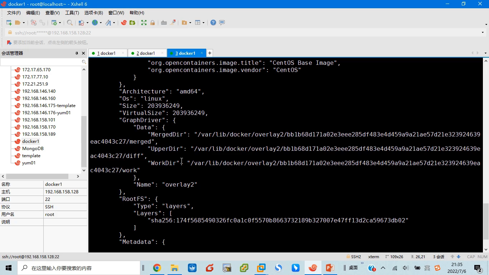
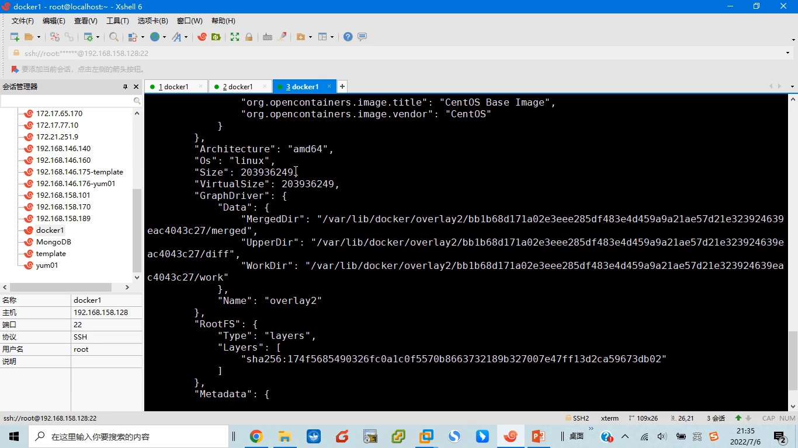
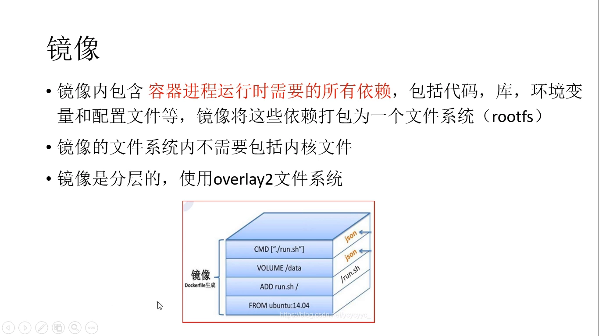
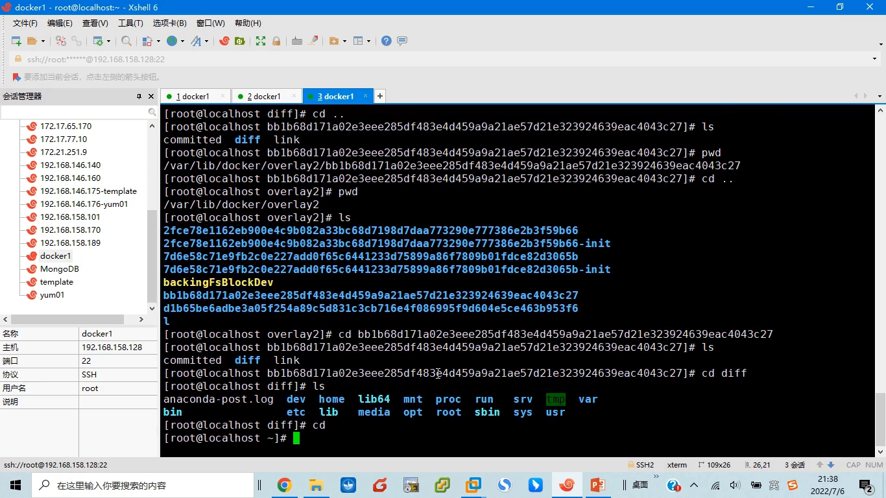
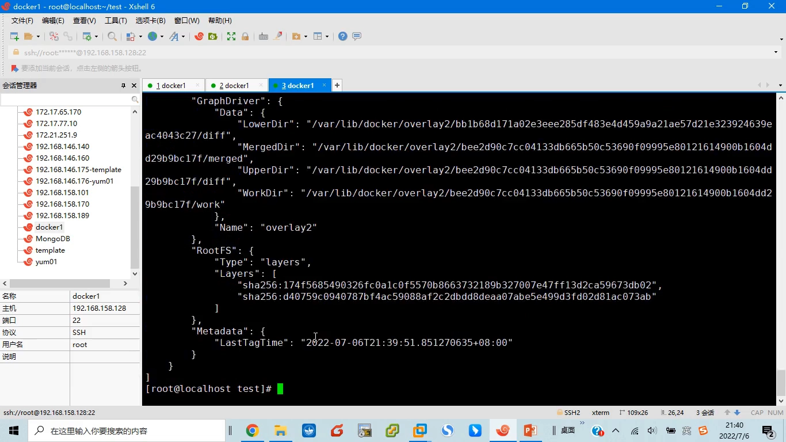
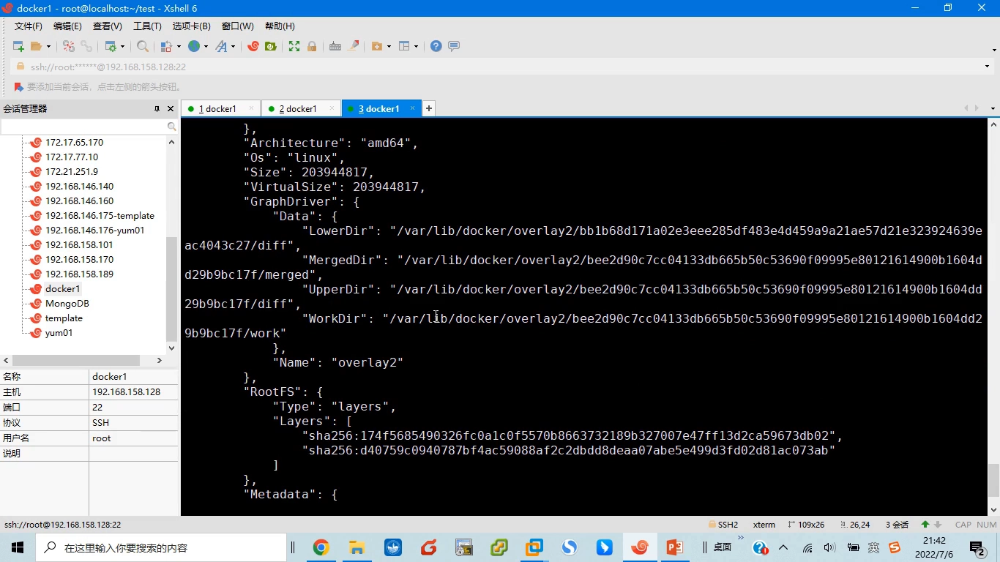
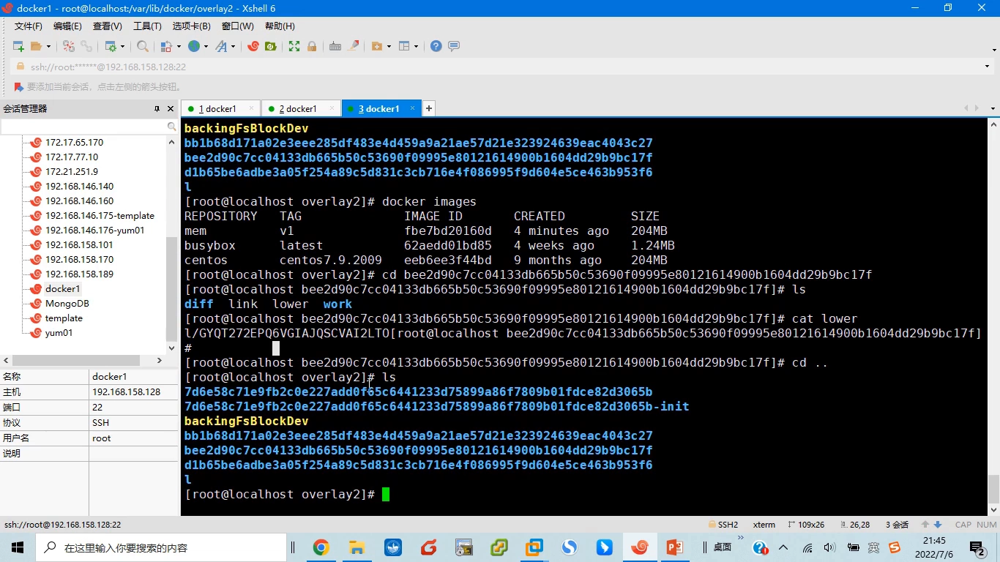

# 深入理解docker和kubernetes（k8s）-6.容器镜像解析

> 来源：B 站课程《深入理解docker和kubernetes（k8s）》第 6 节「容器镜像解析」，时长 17:43。
> 本文基于该视频的演说图文稿整理，关键处附视频时间戳，可点击跳转观看原始演示。

## 本讲要解决的核心问题（SCQA）

**背景**：学容器的人第一天就会敲 `docker run`，"镜像"这个词无处不在：拉镜像、建镜像、删镜像。

**冲突**：但很多人说不清——镜像到底是什么？它放在磁盘的哪个目录里？为什么 pull 一个镜像时是"一层一层"下载的？

**疑问**：能不能亲手把镜像的存储结构拆开看一遍，把"分层"从一句口号变成看得见、摸得着的东西？

**回答（中心思想）**：镜像是把容器进程运行所需的全部依赖文件打包成的**静态文件系统包（rootfs）**，在磁盘上以**分层**结构存储（overlay 类联合文件系统）；**容器是镜像的运行实例，本质是一个进程**。分层可以被复用与共享，因此构建快、磁盘省。本讲用 `docker inspect`、`/var/lib/docker` 目录和一个亲手 build 的镜像，把这套结构完整验证一遍。

## 一、镜像与容器：静态模板与动态进程

### 1.1 `docker images` 列出来的就是镜像

课程先给两个概念划清边界：**容器和镜像是两个不同但相关的基本概念**。

镜像指**静态的文件**。具体而言，`docker images` 命令看到的结果都是镜像。演示环境里有两个镜像：

- `busybox:latest`，只有 1.24MB；
- `CentOS 7.9.2009`，204MB。

它们呈现为静态文件，有大有小——这就是镜像给我们的直观感受。

### 1.2 容器 = 用镜像跑起来的进程

容器则是指**用 `docker run` 命令执行"镜像中预先设置好的程序"而生成的进程**。前面课程已分析过：容器本质上就是一个进程，`docker ps` 看到的就是它。

演示里执行 `docker run -it --name c1 centos`：参数 `-it` 让容器能与用户交互（有输入输出）。启动后提示符立刻变化——不再是宿主机的 `localhost`，而是一串新的主机名，说明**已经进入容器内部**：

此时看到的是"容器里边的世界"——它的文件系统。而这一切的背后，容器就是一个进程。

### 1.3 镜像 : 容器 ≈ 程序 : 进程

从演示可以总结出二者的关系：

- **镜像是容器的基石**，没有镜像就不可能生成容器；
- 镜像是**静态的一堆文件**，容器是**镜像的运行实例**，是动态的；
- 二者关系类似**程序与进程**：一个镜像可以创建很多个容器。演示中再用 `docker run --name c2 …` 起一个容器，`docker ps` 里就有 C1、C2 两个容器，都来自同一个镜像。

一句话：**镜像是容器的模板**。

## 二、镜像从哪里来：官方仓库与三个命令

### 2.1 Docker Hub 与官方镜像、tag

镜像要去哪里下载？Docker 有官方镜像仓库 **Docker Hub**（hub.docker.com）。在网站上可以搜索镜像，比如搜 CentOS，能看到很多同名镜像，其中带官方（Official）标识的是**官方镜像**；点开它的标签（tag）列表，有 `latest`（最新）以及 `7.9.2009` 这类版本 tag——课程环境用的就是 CentOS 7.9.2009。

### 2.2 pull / run / build 的分工

三个最常用的命令，各管一段：

- **`docker pull`**：仅仅把镜像从仓库拉取到本地；
- **`docker run`**：先检查本地镜像仓库有没有这个镜像——有就直接用它启动容器；没有，就自己去 Docker Hub 上把镜像拉下来再启动；
- **`docker build`**：基于已有的镜像生成新的镜像。

## 三、镜像的本质：打包好的 rootfs，而且不含内核

### 3.1 镜像内装的是什么

镜像到底装了什么？**它包含容器进程运行时需要的所有依赖文件**——代码库、环境变量、配置文件等等，并把这些依赖打包成一个文件系统，叫做 **rootfs**（根文件系统）：

### 3.2 用 `docker inspect` 看存储：overlay2 与层目录

先 `docker images`，再 `docker inspect centos` 查看镜像详情。课程重点看**这些文件到底存储在哪里**——inspect 结果里的 GraphDriver 部分有几个目录：`upper`、`merged`、`work`，存储驱动名称是 **overlay2**：

overlay2 是 Docker 使用的基本文件系统（存储驱动）。这里有个细节：inspect 里**没看到 lower 层**——因为 CentOS 是一个**基础镜像**，它本身只有一层。这一层的文件就在对应层的 `diff` 目录里，进去能看到一堆文件；和刚才在容器里看到的文件对比，**完全一样**——这正是镜像运行时所需的代码库、环境变量等。基础镜像文件很多，所以有 200 多 MB。

### 3.3 为什么镜像里没有内核

还有一个反直觉的事实：**镜像里不包含内核文件**。原因很简单——容器实际上是一个**进程**。通过镜像启动容器时，Linux 系统已经启动、宿主机内核早已加载；容器需要的仅仅是"外面那层壳"（运行所需的文件），内核是被所有进程共享的。所以镜像不需要、也不会带内核。

此外，**镜像是分层的**，使用 overlay 这类联合文件系统。通过 Dockerfile 可以在基础镜像上不断叠层——例如以 Ubuntu 为基础镜像，再写三条指令，就会在基础镜像上再叠加三层：

## 四、动手验证：用 Dockerfile 给镜像叠一层

### 4.1 写一个最小的 Dockerfile

课程在 CentOS 基础镜像之上做实验：写一个简单的 Dockerfile——基础镜像用 `centos:7`，然后"加一层"：把 `mem` 这个文件拷贝到 `bin` 目录里去。

### 4.2 docker build 出 mem:v1

执行 `docker build -t mem:v1 .` 构建完成后，再 `docker images`：列表里多了一个 `mem:v1`，大小同样是 204MB（因为它复用了 CentOS 的 200 多 MB）。这时用 `docker inspect mem:v1` 看它的存储情况。

## 五、观察分层存储：lower / upper / merged 与层复用

### 5.1 GraphDriver 数据的变化

对比基础镜像，`mem:v1` 的 GraphDriver 数据部分明显不一样了：**多了一个 `lower`**，再加上 `upper`、`merged`、`workdir`。按照 overlay 文件系统的规则，**lower 和 upper 会合并形成 merged**——merged 目录里看到的就是 lower 和 upper 的合集。

### 5.2 lower 指向基础镜像，upper 是新加的那层

退出容器、用 `docker inspect` 对照：mem:v1 的 lower 指向的目录 ID（`blob1b68…`）与刚才 CentOS 基础镜像的层目录**完全一致**——说明 mem:v1 的**底层（lower）就是 CentOS 基础镜像那一层**；而 upper 是我们新添加的 mem 程序所在的那层。

进入 upper 那层目录：依次进入 `usr`、`bin`，`ls` 一下就能看到 `mem` 文件——它在 `usr/bin` 下。这里有个小问题值得注意：当时 Dockerfile 里明明是拷贝到根目录下的 `bin`，为什么层里是 `usr/bin`？原因是 **CentOS 基础镜像里的 `/bin` 本身就是一个符号链接，指向 `usr/bin`**，所以 COPY 到 `/bin/` 实际落在了 `/usr/bin/`。

于是结构就清楚了：每个层的 `diff` 目录就是一个 **layer（层）**；"CentOS 基础镜像层 + 新加的 mem 层"两层合起来，就是 `mem:v1` 这个镜像。

### 5.3 层复用：两个 204MB 实际只占 200 多 MB

`docker images` 里 CentOS 和 mem:v1 各显示 204MB，但**实际磁盘占用并不是 400 多 MB**：底层那 200 多 MB 是共用的一份，新加的层实际只有几十 KB。通过这种**层复用**的方式，可以节省大量磁盘空间。

### 5.4 lower 文件与 l 符号链接：层与层如何挂钩

再深入一层看目录结构：新加层的目录里有一个 `lower` 文件，`cat lower` 输出 `l` 加一长串 ID。这里目录里的 `l` 目录代表 **link**：那串 ID 是一个符号链接，**指向 CentOS 基础镜像所在的层**。

说白了，**lower 文件记录了"当前这一层的下一层是谁"**——overlay 正是靠这一串引用把所有层串成一条链，最终合并出容器看到的完整文件系统。

## 小结

- 镜像是**静态文件**，`docker images` 看到的就是镜像；容器是**用镜像跑起来的进程**，二者类似程序与进程。
- 镜像内打包了容器运行所需的全部依赖（代码库、环境变量、配置文件），即 **rootfs**；但**不含内核**——内核由宿主机提供。
- 镜像在磁盘上**分层**存储：Docker 默认使用 **overlay2** 存储驱动；`docker inspect` 的 GraphDriver 部分能看到 `lower/upper/merged/work` 目录。
- 基础镜像本身只有一层；用 Dockerfile 可以在其上叠加新层，`COPY` 指令产生的新层放在 upper，`lower` 记录下一层。
- **层可复用**：多个镜像共享同一份底层，磁盘占用远小于各镜像大小之和。

## 关键术语速查

| 术语 | 一句话解释 |
| --- | --- |
| 镜像（image） | 容器运行所需依赖的静态打包文件，分多层存储 |
| 容器（container） | 镜像的运行实例，本质是一个进程 |
| rootfs | 镜像把运行时依赖打包成的根文件系统 |
| overlay2 | Docker 默认的存储驱动（联合文件系统实现） |
| lower / upper / merged | overlay 的下层层、上层层、二者合并后的视图目录 |
| layer（层） | 镜像分层的基本单位，对应磁盘上该层的 diff 目录 |
| lower 文件 | 层目录中记录"下一层是谁"的文件，把层串成链 |
| Dockerfile | 描述如何基于基础镜像逐条指令叠加新层的构建脚本 |
| Docker Hub | Docker 官方镜像仓库，镜像从这里 pull/push |
