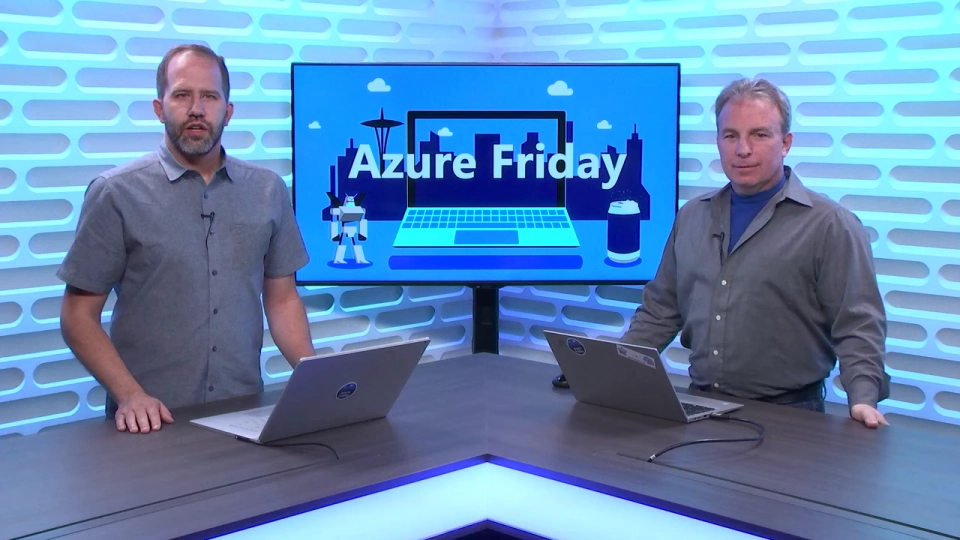
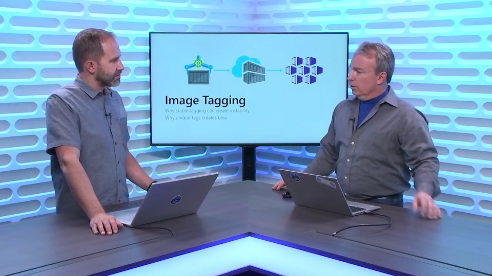
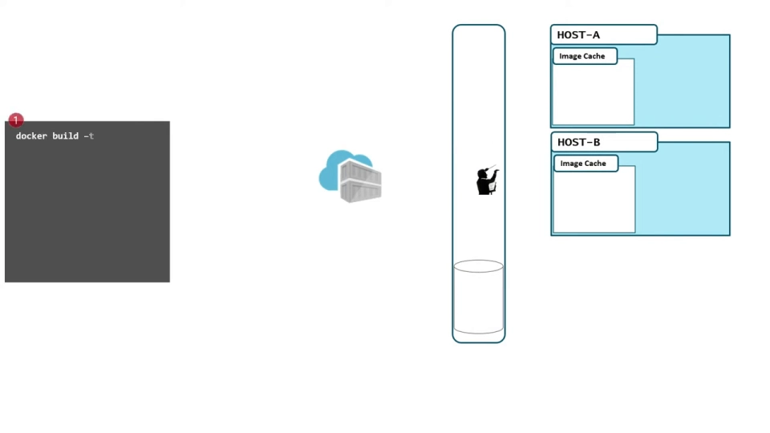
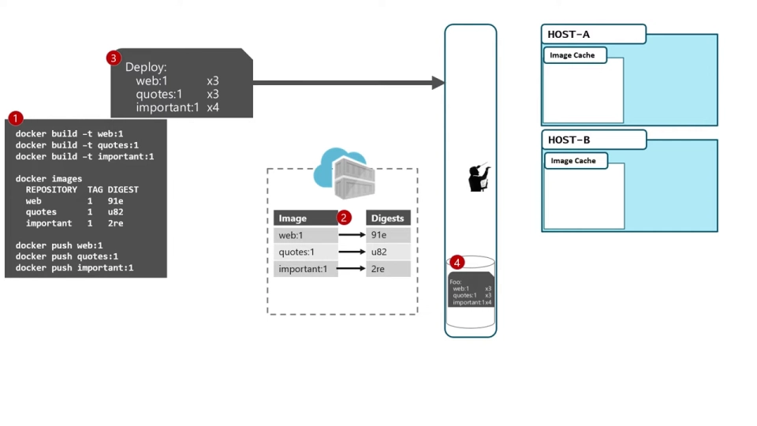
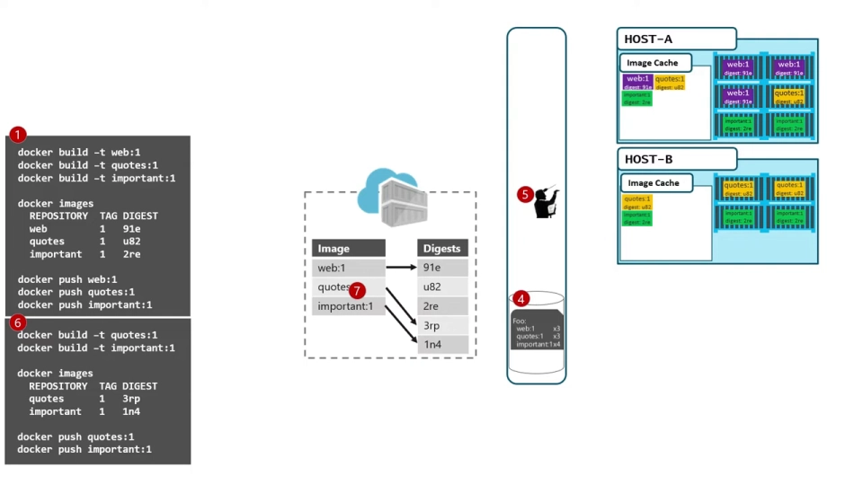
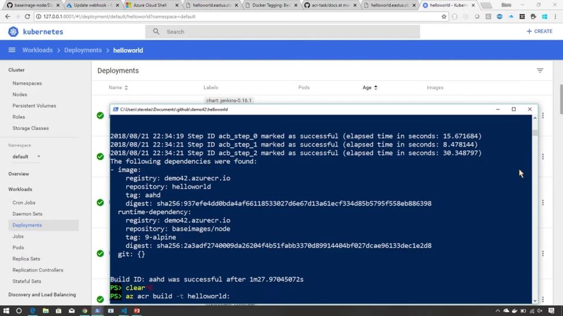
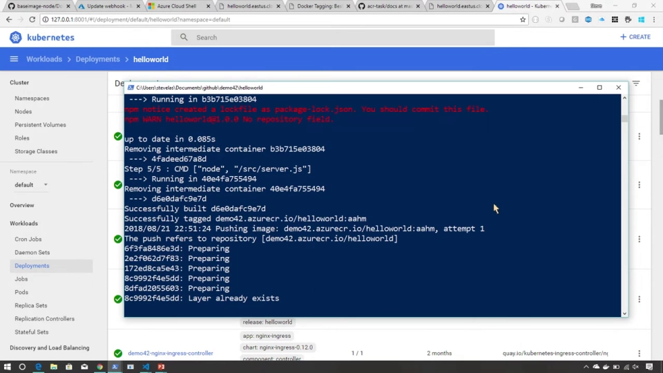
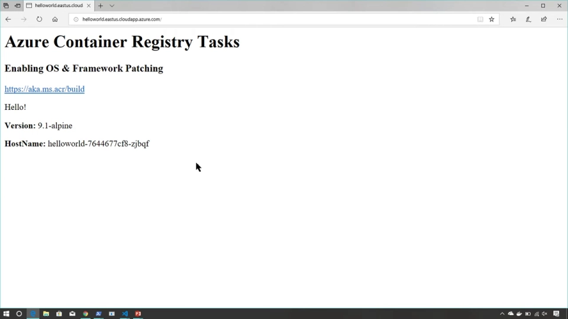
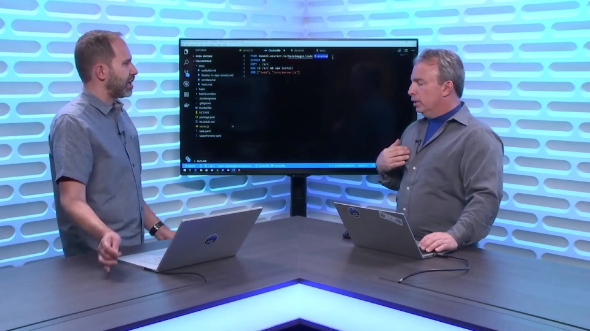
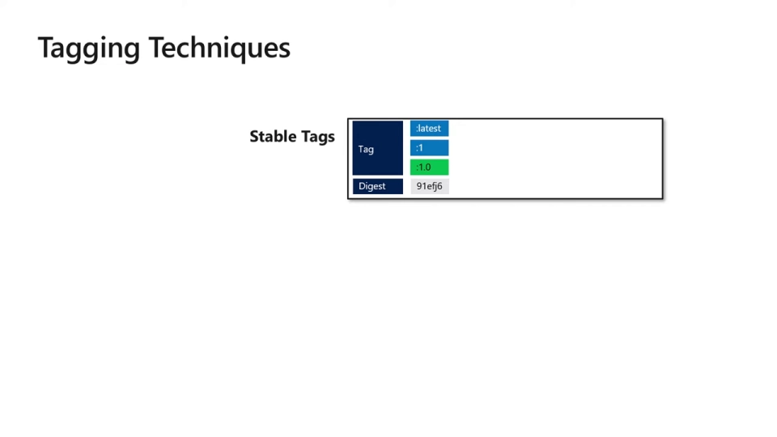

# 稳定标签 vs 唯一标签：一次"同 tag 不同镜像"的生产翻车演示

> 视频来源：[Pros and cons of stable and unique tags in Docker image tagging | Azure Friday — Scott Hanselman & Steve Lasker](https://www.youtube.com/watch?v=qEIu-nb-Yc0)（约 14 分钟，英文字幕）
> 本文基于该视频的完整字幕与画面整理：Steve Lasker 先用动画演示"复用 tag + 编排器自愈"如何让同一个 tag 在集群里跑出两个不同版本，再用真机（ACR 构建 + K8s 缩扩容）完整复现翻车过程，最后给出标签策略的结论——**FROM 用稳定标签收补丁，部署用唯一标签防漂移，`latest` 只留给 demo**。所有结论都可在对应时间戳处核对。

## 本讲要解决的核心问题（SCQA）

**背景**：给镜像打 tag（版本标签）是容器工作流的基本动作，但"怎么打 tag"一直有两派争论：一派主张**稳定标签（stable tags，如语义化版本 `1.0`，指向可以向前滚动）**，另一派主张**唯一标签（unique tags，每个 tag 只对应一次构建、永不复用）**。[【跳转到 00:00】](https://www.youtube.com/watch?v=qEIu-nb-Yc0&t=0)

**冲突**：云上托管镜像仓库的大量客户工单，最后都追到同一个根因——**集群里部署了不一致的镜像**：同一个 tag 名下，不同节点上运行的却是不同版本。究其本质，就是标签策略没想清楚：稳定标签、唯一标签，还是干脆用 digest 钉死？[【跳转到 00:57】](https://www.youtube.com/watch?v=qEIu-nb-Yc0&t=57)

**疑问**：两种标签到底谁对？digest 又该在什么场景使用？为什么"复用 tag"在本地没事，到了编排器手里就成了事故？

**回答（中心思想）**：**两派都对，取决于你在给"谁"打标签**：给 `FROM` 用的基础镜像要稳定标签（自动收非破坏性补丁）；用于部署的应用镜像要唯一标签（每个 tag 都是新构建，杜绝漂移）；digest 钉得最死，但代价是上游发布补丁你永远收不到。[【跳转到 00:57】](https://www.youtube.com/watch?v=qEIu-nb-Yc0&t=57)

主持 Hanselman 先自曝踩坑史：`.NET` 团队曾有一批 tag，他用 `aspnetcore sdk build` 却从不写明确版本——"周一还能构建，周二就挂了"，回头一看是自己没显式指定想要的版本；本地用 `latest` 也把自己绕晕过，最后只能清掉整个本地镜像缓存重来。[【跳转到 01:33】](https://www.youtube.com/watch?v=qEIu-nb-Yc0&t=93)

## 一、tag 与 digest 的真实关系：指针与被指向者

动画演示里有三个容器镜像（web、quotes、important）。构建后批量 `docker push` 时仔细看：镜像写的是 `web:1`——镜像名 + tag；但这个 tag 实际**指向一个 digest**，它才是"代表这组内容的 manifest"的**唯一标识**。记住这一点，后面的一切事故都从这里发生。[【跳转到 02:20】](https://www.youtube.com/watch?v=qEIu-nb-Yc0&t=140)

Hanselman 用 Git 做类比：tag 像 Git 的 label，digest 像 commit 的 SHA-1 哈希——同一个 label 可以指向不同提交。他随即问出关键问题："我能把这个 tag 挪到另一个 digest 上吗？"答案是能——**这正是整场演示的核心机制**。[【跳转到 02:45】](https://www.youtube.com/watch?v=qEIu-nb-Yc0&t=165)

## 二、翻车演示：复用 tag 如何让集群新旧混跑

### 2.1 第一幕：一切正常

按 tag 部署：3 份 web、若干 quotes、4 份 important。编排器（这里刻意做得通用，不绑定 Kubernetes）把这些副本登记进自己的数据库，职责就是"让这些副本一直活着"。部署完成后一切正常。[【跳转到 03:13】](https://www.youtube.com/watch?v=qEIu-nb-Yc0&t=193)

### 2.2 第二幕：有人复用了 tag

另一位开发者做了些随机改动，构建后**没有换 tag**，直接推进仓库——可能是有意，也可能是无心。无所谓哪种：现在 `quotes` 和 `important` 的 tag **指向了新的 digest**。tag 是指针，重新指向只是寻常操作。[【跳转到 03:38】](https://www.youtube.com/watch?v=qEIu-nb-Yc0&t=218)

### 2.3 第三幕：节点挂了，编排器"忠实"地拉了新镜像

此时干掉一个节点，编排器发现副本数不够，它的反应完全符合职责：**用被告知的那个 tag 重新部署**。注意，集群自己并不保存镜像——它去仓库**重新拉取**，于是拉到的是 tag 新指向的 digest。[【跳转到 04:03】](https://www.youtube.com/watch?v=qEIu-nb-Yc0&t=243)

结果：同一个 `web:1`（以及 quotes、important），集群里同时跑着**新旧两个版本**。Hanselman 的吐槽很传神："这不就是你们当初承诺容器编排要消灭的问题吗？说好的魔法呢？"——而 Steve 的回答是：编排器没有错，它只是尽忠职守；**错的是我们改了指针还指望别人不知道**。[【跳转到 04:28】](https://www.youtube.com/watch?v=qEIu-nb-Yc0&t=268)

### 2.4 真机复现：紫色页面从哪来

真机演示：站点跑着两个容器，刷新页面主机名在两个副本间轮换。[【跳转到 05:15】](https://www.youtube.com/watch?v=qEIu-nb-Yc0&t=315)

现在 Steve 改代码——把颜色从环境变量改成硬编码的紫色，然后用 `az acr build` 构建，并且**故意复用原有 tag**："新代码、旧 tag。我喜欢稳定标签嘛——这只是个小修复，总不至于为它把整个系统的版本都顶上去吧？"这正是很多团队的真实心态。[【跳转到 06:38】](https://www.youtube.com/watch?v=qEIu-nb-Yc0&t=398)

干掉一个节点——集群不会留镜像，新副本必须重新拉取。刷新页面：**紫色出现了**，和旧版本并肩运行。Hanselman 总结得很准："你**解引用（de-reference）了那个指针**。"[【跳转到 07:32】](https://www.youtube.com/watch?v=qEIu-nb-Yc0&t=452)

再扩容一个副本，同样拉到新 digest——新旧混跑的范围随自愈行为扩大。Steve 强调：这里的"紫色"可以换成任何业务逻辑——税率、折扣数字、产品目录。他讲了那个著名段子：为什么 sometimes 光盘会以折扣价上架？"因为有人把产品目录滚动部署错了。"[【跳转到 09:23】](https://www.youtube.com/watch?v=qEIu-nb-Yc0&t=563)

## 三、标签策略结论：谁来用哪种标签

回到白板复盘，策略分角色给出：

### 3.1 `FROM` 基础镜像 → 稳定标签

Dockerfile 里的基础镜像写 `node:9` 这样的大版本稳定标签：社区给 node 9 发布**非破坏性更新**（OS 补丁、安全修复、框架补丁）时，你希望自动跟上——要的是"修订（revision）"而不是"新版本（version）"。所以 `FROM` 语句应该用稳定标签。[【跳转到 09:40】](https://www.youtube.com/watch?v=qEIu-nb-Yc0&t=580)

### 3.2 稳定标签的管理方式：多级标签 + 向前滚动

稳定标签不是"钉死"，而是**受控滚动**：`1` 指向当前最新的 `1.2`；`latest` 也一直向前滚；`2.0` 出来时开新支线，`2` 指向它；`1.1` 拿到 OS 补丁后同样可以把 `1.1` 向前移。这套打标签的活儿应该由**框架提供方**（公司内建框架的团队、发布框架的社区）来做，让下游用得安心。[【跳转到 10:31】](https://www.youtube.com/watch?v=qEIu-nb-Yc0&t=631)

### 3.3 部署镜像 → 唯一标签

轮到**自己部署自己的应用**时，规则反过来：每个 tag 都应该是**新的东西**——唯一标签，永不复用。总结成一句话：**基础镜像的 `FROM` 用稳定标签；`run`/部署（以及滚动更新等）用唯一标签**。[【跳转到 12:13】](https://www.youtube.com/watch?v=qEIu-nb-Yc0&t=733)

### 3.4 两个补充：latest 只留给 demo；digest 钉死的代价

- **`latest` 永远在漂移**，除 demo 外不要用在任何地方；稳定标签指的是 `1.0`、`2.0` 这类，而不是 `latest`。
- **用 digest 钉死在技术上完全合法**，但如果你把构建钉在某个 digest 上，当框架或 OS 发布更新时**你收不到**——而且"永远不知道有更新"，等发现时可能已经被利用了。这是 digest 与稳定标签的本质取舍：一个防漂移，一个收补丁，按用途选。[【跳转到 12:33】](https://www.youtube.com/watch?v=qEIu-nb-Yc0&t=753)

## 小结

- **tag 是指针，digest 是内容**：tag 可以随时改指向，"同一个 tag"在不同时刻可以代表不同镜像——翻车演示的全部机理。
- **复用 tag + 编排自愈 = 新旧混跑**：集群不存镜像，节点重建时按 tag 重新拉取；tag 被复用后，自愈行为会自动"扩散"新版本。
- **编排器无罪**：它以"硬件会故障"为前提设计，按被告知的 tag 恢复副本正是它的职责；错在复用了指针。
- **标签策略**：`FROM` 基础镜像用稳定标签（自动收非破坏性补丁），由框架提供方维护多级滚动（`1`→`1.2`、`latest`、`2.0`）；部署镜像用唯一标签，每个 tag 都是新构建。
- **`latest` 只留给 demo**；digest 钉死最稳但收不到上游补丁——理解各自取舍后按场景选择。

## 关键术语速查

| 术语 | 一句话解释 |
| --- | --- |
| 稳定标签（stable tag） | 指向可受控向前滚动的版本标签（如 `1`、`1.2`），用于基础镜像收补丁 |
| 唯一标签（unique tag） | 一次构建对应一个新标签、永不复用，用于部署防漂移 |
| digest | manifest 的内容哈希（`sha256:…`），tag 实际指向的对象 |
| manifest | 描述镜像构成的元数据，digest 的计算对象 |
| 编排器（orchestrator） | 维持期望副本数的组件，节点故障时按记录的 tag 重新拉取部署 |
| 滚动更新（rolling update） | 逐步替换旧副本的部署方式，依赖明确、不复用的镜像引用 |
| `az acr build` | Azure 托管镜像仓库（ACR）的云上构建命令，构建完成直接推送 |
