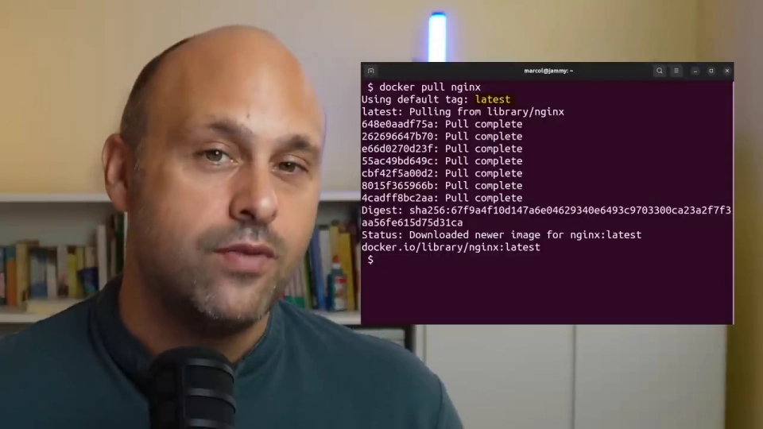
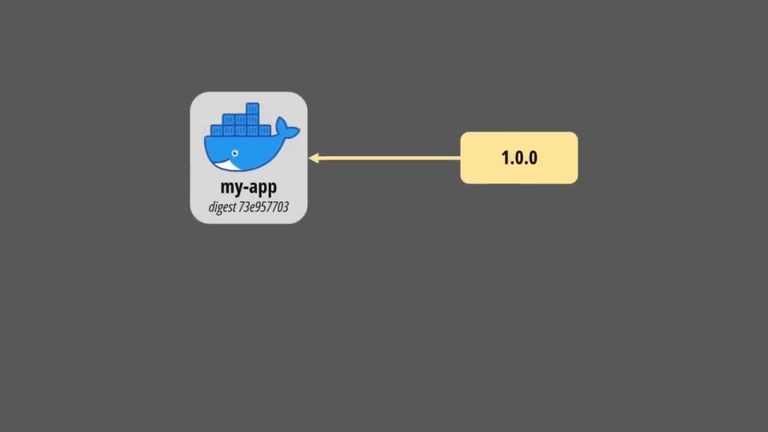
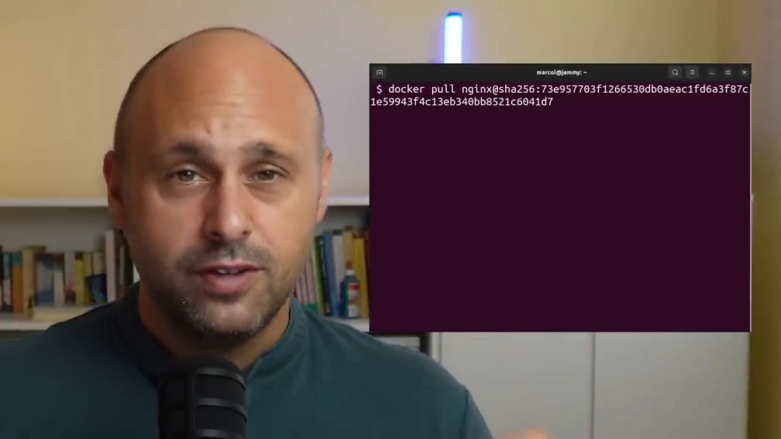
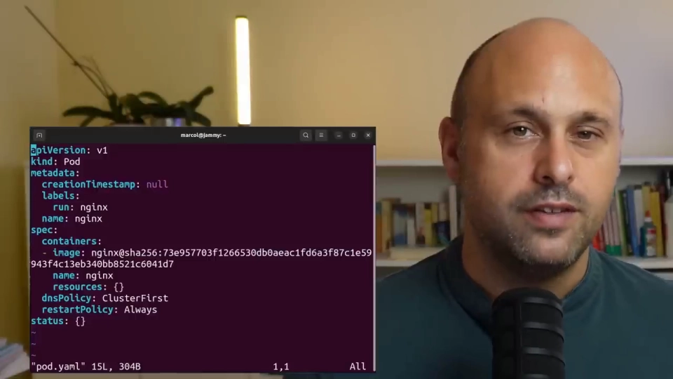
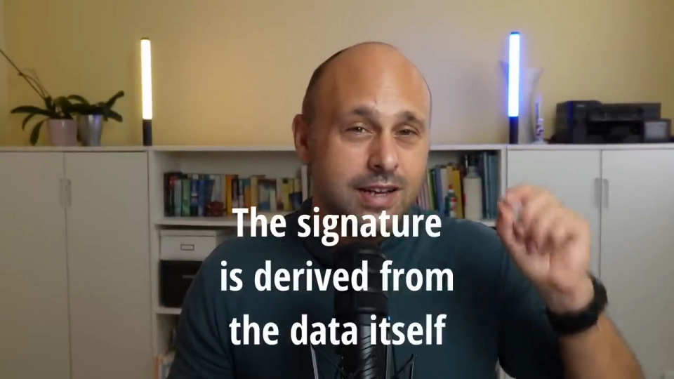
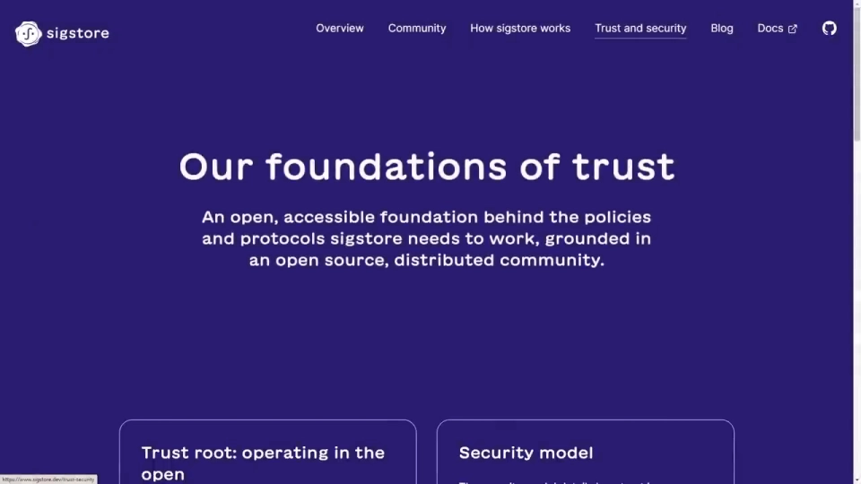
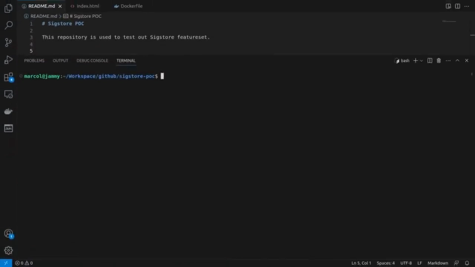
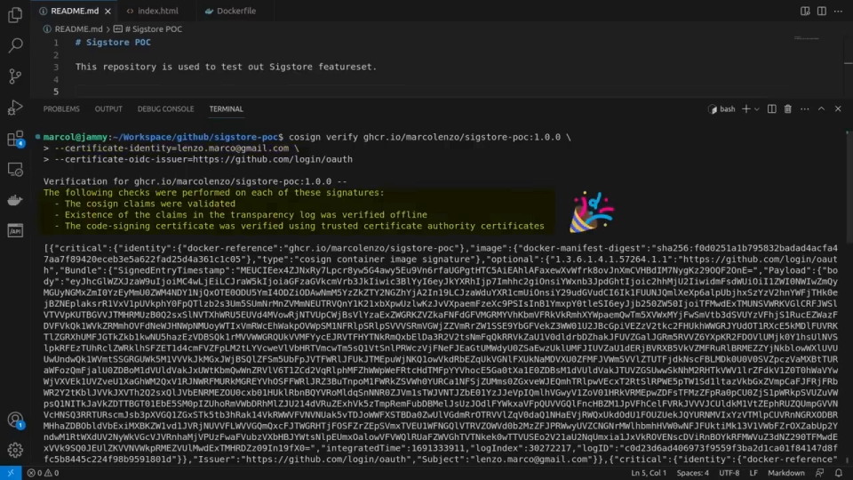

# 别再只用 tag 引用镜像：digest 与数字签名才是供应链的保险

> 视频来源：[STOP using Docker Image TAGS | Digests and Digital Signatures explained — Marco Lenzo](https://www.youtube.com/watch?v=x_45c58BRZ0)（约 9 分钟，英文字幕）
> 本文基于该视频的完整字幕与画面整理：讲者先拆解 tag 为什么天然不可靠（`latest` 陷阱、版本 tag 也会被悄悄改写），再给出两层递进的加固手段——用 digest 钉死内容、用数字签名确认来源，并演示 Sigstore/cosign 如何把签名简化成一条命令。所有结论都可在对应时间戳处核对。

## 本讲要解决的核心问题（SCQA）

**背景**：部署容器时，绝大多数人都在写 `docker run nginx` 或 `docker run nginx:1.25`——用名字，最多加个 tag。[【跳转到 00:00】](https://www.youtube.com/watch?v=x_45c58BRZ0&t=0)

**冲突**：tag 本质上是一个**可变指针**：`latest` 未必是最新版本，即使写死了版本号，镜像仓库的维护者也可以在**同名同 tag 下悄悄替换镜像内容**。软件供应链攻击越来越频繁、后果严重，这正是一个现成的攻击入口。[【跳转到 00:05】](https://www.youtube.com/watch?v=x_45c58BRZ0&t=5)

**疑问**：怎么才能保证"我部署的镜像，就是我以为的那个镜像"——甚至在攻击者能改仓库的情况下？

**回答（中心思想）**：分两步加固。第一步，把引用从 tag 换成 **digest**——由容器引擎对镜像 manifest 做哈希得到的不可变标识，改动一个字节都会让引用失效；第二步，再进一步用**数字签名**确认镜像的**来源**，借助 Sigstore/cosign，签名与验证已经简化到各一条命令。[【跳转到 00:15】](https://www.youtube.com/watch?v=x_45c58BRZ0&t=15)

## 一、tag 的两个坑：latest 不可信，版本号也不保险

### 1.1 `latest` 是个普通标签，不是"最新版"

只写镜像名（如 `nginx`）时，Docker 会自动补上 `latest` tag。这带来两个问题：第一，你根本不知道实际下载到的是哪个版本，可能是 v1、v2、v3 中的任何一个；第二，`latest` 并**不保证**是最新版本——它只是一个和其它 tag 地位相同的普通标签，完全可以指向一个旧版本。[【跳转到 00:38】](https://www.youtube.com/watch?v=x_45c58BRZ0&t=38)

### 1.2 写死版本号，问题只解决了一半

于是常见建议是：始终明确指定版本 tag，比如 `nginx:1.25.1`。讲者指出，"你以为问题解决了，但这恰恰就是问题所在"：即使使用版本 tag，也**没有任何机制**保证每次拉到的都是同一个镜像。[【跳转到 01:27】](https://www.youtube.com/watch?v=x_45c58BRZ0&t=87)

原因很简单——**tag 是可以更新的**。我可以构建一个镜像、打上 `1.0.0`；然后修改镜像内容，但保持名字和 tag 完全不变；这个过程可以无限重复。tag 从头到尾都只是一个"指针"，指到哪里全凭推送者。[【跳转到 01:52】](https://www.youtube.com/watch?v=x_45c58BRZ0&t=112)

### 1.3 这正是供应链攻击的完美入口

在不同时间、向不同环境部署应用时，同一个"名字+tag"可能拉到**不同内容的镜像实例**——这是供应链攻击的理想通道。举例：拿到仓库权限的攻击者，把某个 tag 指向的镜像替换成被植入恶意代码的版本；一旦部署进环境，这个镜像就能窃取敏感数据。整个替换过程对使用方完全不可见。[【跳转到 02:23】](https://www.youtube.com/watch?v=x_45c58BRZ0&t=143)

## 二、digest：按内容寻址的不可变引用

### 2.1 digest 是什么

解法是镜像 digest：一个**不会变化的标识符**，指向镜像的某个特定版本。[【跳转到 02:48】](https://www.youtube.com/watch?v=x_45c58BRZ0&t=168)

它与 tag 有两点本质区别：

- tag 由**人定义**、可以随意改；digest 由**容器引擎计算**——对镜像的 manifest 做哈希，任何人无法伪造或篡改；
- digest 描述的是**内容**而不是名字，镜像内容一变，digest 必然变化。

### 2.2 用 digest 拉镜像 = 内容寻址存储

可以用 digest 代替 tag 来加载镜像。这套机制就是**内容寻址存储（content-addressable storage）**：数据按照"内容本身"而不是"名字或位置"来存取——你拿到的永远是哈希对应的那个字节序列，不多不少。[【跳转到 03:17】](https://www.youtube.com/watch?v=x_45c58BRZ0&t=197)

### 2.3 在 Compose 与 Kubernetes 里同样适用

这个改法不限于 `docker run`：Docker Compose 的 manifest、Kubernetes 的 deployment manifest 里都可以直接用 digest 引用镜像。改成 digest 后，攻击者无法再"愚弄"我们的部署机制——镜像有自己唯一的 digest，不可能被悄悄替换成另一个版本。[【跳转到 03:37】](https://www.youtube.com/watch?v=x_45c58BRZ0&t=217)

讲者强调：这是一个非常简单的改动，却显著改善了软件供应链的安全姿态。[【跳转到 03:55】](https://www.youtube.com/watch?v=x_45c58BRZ0&t=235)

## 三、digest 的盲区：只回答"是不是那个"，不回答"是谁的"

如果再想深一层：使用 digest 后，我们只是把引用**钉死**在某个特定版本上，攻击者没法替换它；但我们对这个镜像的**来源**依然一无所知——这个镜像到底是谁创建的？是真实用户、正常工作负载，还是攻击者？[【跳转到 04:28】](https://www.youtube.com/watch?v=x_45c58BRZ0&t=268)

需要更强的保证时，就要引入数字签名。

## 四、数字签名：真实性、不可抵赖、完整性

**数字签名**的概念与合同上的物理签名非常相似，它同时提供三重保证：[【跳转到 04:54】](https://www.youtube.com/watch?v=x_45c58BRZ0&t=294)

1. **真实性（authenticity）**：能保证数据确实由签名它的那个用户或进程创建；
2. **不可抵赖（non-repudiation）**：签名者无法否认"这是我创建并签名的数据"；
3. **完整性（integrity）**：签名直接从数据本身推导而来，哪怕只改动一个字节，最终签名都会变化，校验立即失败。[【跳转到 05:31】](https://www.youtube.com/watch?v=x_45c58BRZ0&t=331)

**为什么大家没用**：既然签名这么强，为什么软件供应链还没有全面用上？因为一套数字签名体系非常难落地——你需要搭建负责**密钥管理、签名、验证**的整套基础设施，这是极高的门槛。[【跳转到 06:01】](https://www.youtube.com/watch?v=x_45c58BRZ0&t=361)

## 五、Sigstore：把签名简化成一条命令

### 5.1 Sigstore 是什么

希望来自 **Sigstore**：它是"密钥管理 + 签名 + 验证"三种技术的组合，一个开源项目，由 Open Source Security Foundation 以及 Red Hat、Google 等公司支持。它的使命是成为"TLS 界的 Let's Encrypt"——把软件供应链中的数字签名**民主化**：让签名和验证 artifact 变得非常容易。[【跳转到 06:24】](https://www.youtube.com/watch?v=x_45c58BRZ0&t=384)

### 5.2 用 cosign 签名与验证

使用 Sigstore 的 `cosign` 工具，**一条简单命令**就能给容器镜像签名——无需创建或管理任何密钥对，这些全部自动完成；再用另一条命令即可验证镜像来源。比如可以要求"只用我本人通过 OpenID Connect（Google、GitHub、GitLab 等身份源）签名过的镜像"。[【跳转到 06:52】](https://www.youtube.com/watch?v=x_45c58BRZ0&t=412)

### 5.3 在 Kubernetes 里强制执行

同样的策略可以下沉到 Kubernetes 集群：借助 **Sigstore policy controller**，为集群定义镜像策略，限制命名空间里能运行哪些镜像。演示中，一个**未签名的 nginx 镜像**因为不包含署名者信息，直接被集群拒绝运行。[【跳转到 07:27】](https://www.youtube.com/watch?v=x_45c58BRZ0&t=447)

cosign 还能轻松接入现有 CI/CD 工具（GitHub Actions、GitLab CI 等）。Sigstore 底层架构其实相当复杂，但这部分复杂度被 cosign 完全抽象掉了——这正是该项目的使命所在。[【跳转到 08:09】](https://www.youtube.com/watch?v=x_45c58BRZ0&t=489)

## 小结

- **tag 是可变指针**：`latest` 不代表最新，版本 tag 也能在同名同 tag 下被替换；这是软件供应链攻击的现成入口。
- **digest = 内容寻址的不可变引用**：由容器引擎对 manifest 做哈希得出，内容变则 digest 变；在 `docker run`、Compose、Kubernetes manifest 中把 tag 换成 digest，是一个改动极小、收益极大的加固。
- **digest 的盲区是"来源"**：它保证内容未被替换，但不回答镜像是谁做的。
- **数字签名补上来源保证**：真实性、不可抵赖、完整性三重属性；过去难在基础设施，现在 Sigstore/cosign 把签名与验证简化为各一条命令，还能通过 policy controller 在 K8s 里强制"未签名不运行"。
- 讲者判断：数字签名将在未来几年成为事实标准——与其等待，不如现在就开始。

## 关键术语速查

| 术语 | 一句话解释 |
| --- | --- |
| tag | 人定义的镜像"别名"，可随时重新指向别的内容 |
| `latest` | 缺省 tag，只是普通标签，不保证是最新版本 |
| digest | 对镜像 manifest 做哈希得到的不可变标识，形如 `sha256:…` |
| manifest | 描述镜像由哪些层组成的元数据文件，digest 的计算对象 |
| 内容寻址存储 | 按"内容本身"（哈希）而非名字/位置来存取数据的机制 |
| 数字签名 | 提供真实性、不可抵赖、完整性三重保证的密码学手段 |
| Sigstore / cosign | 开源签名体系与配套 CLI，把镜像签名/验证简化成一条命令 |
| policy controller | Sigstore 在 Kubernetes 中按策略放行/拒绝镜像准入的组件 |
