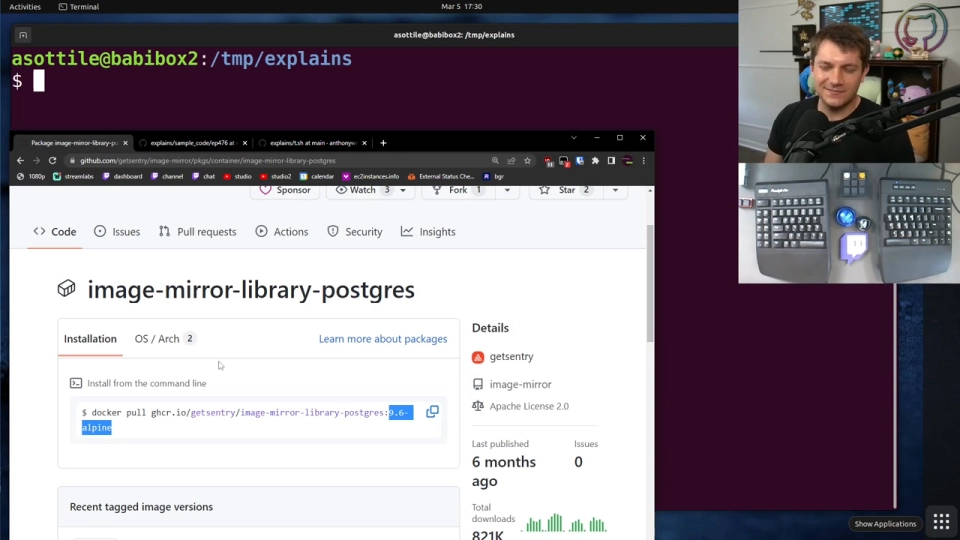
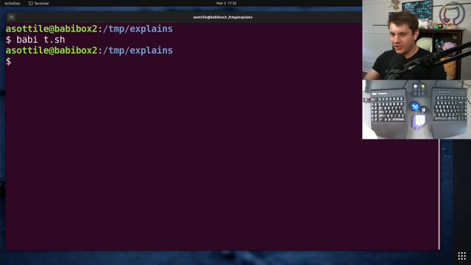
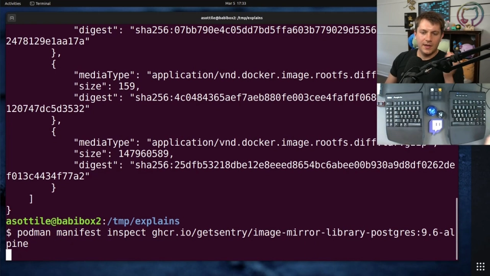
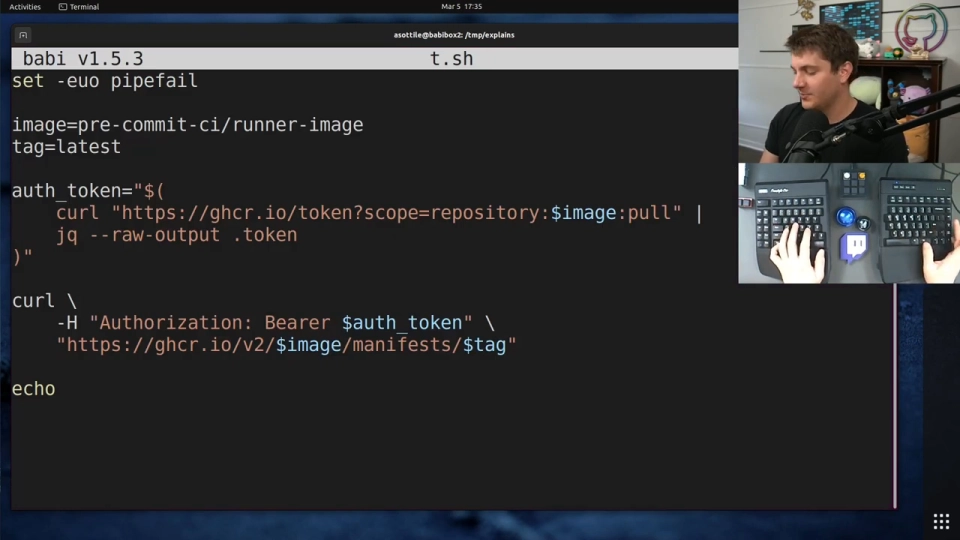
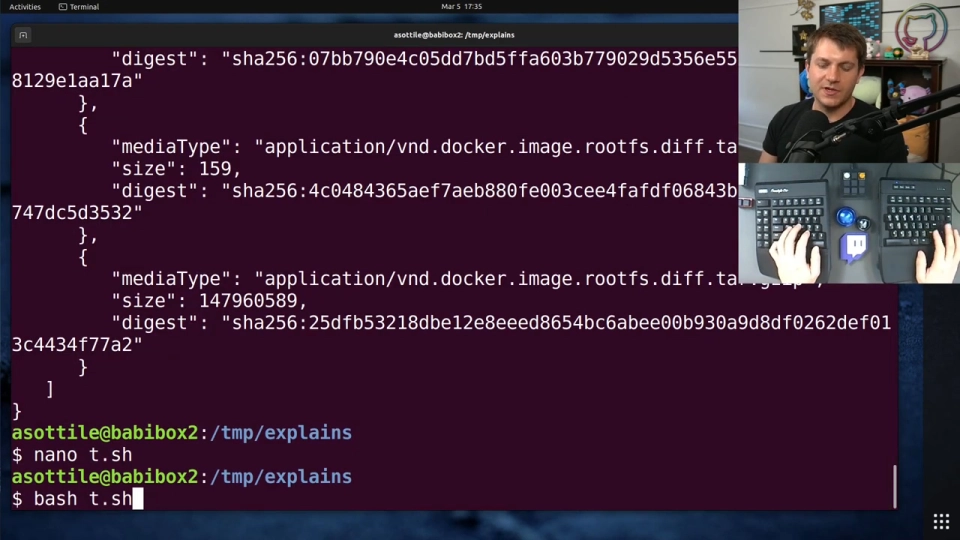
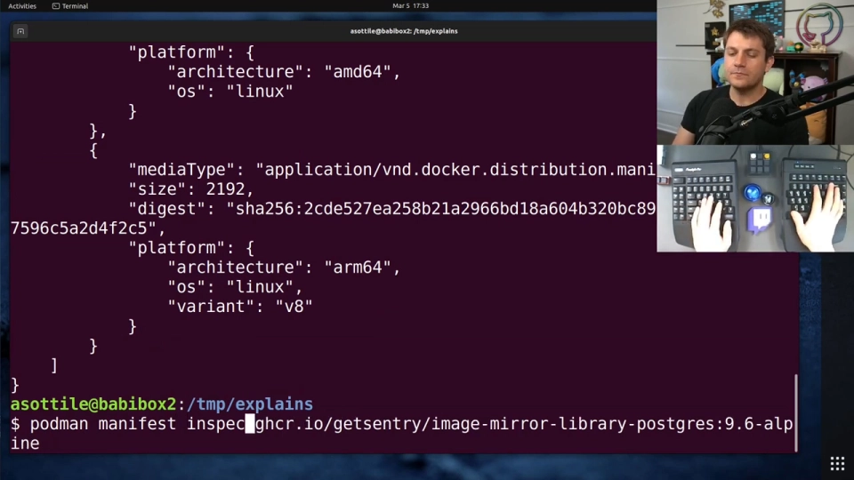
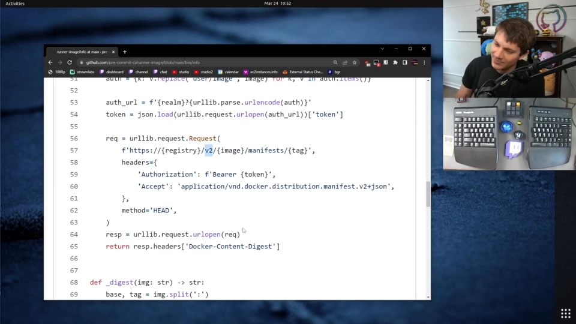
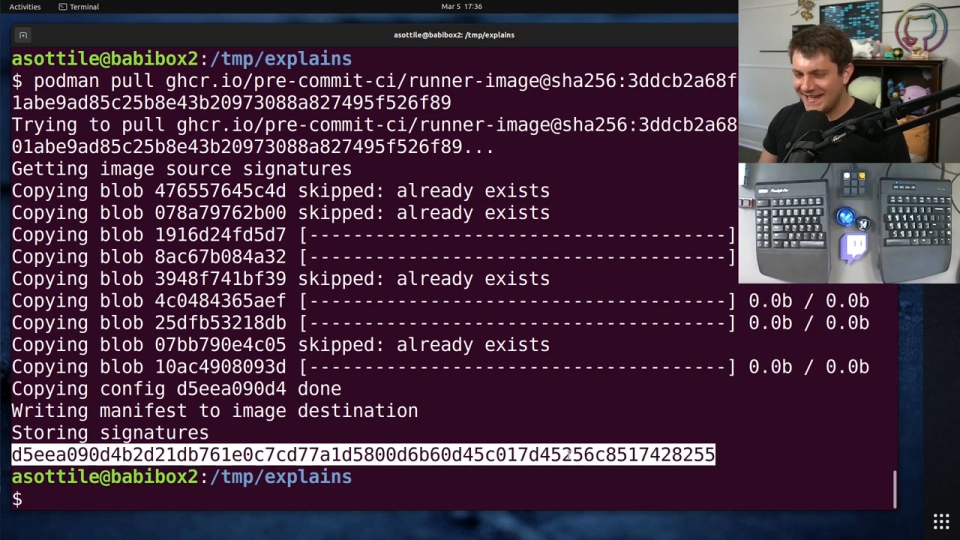
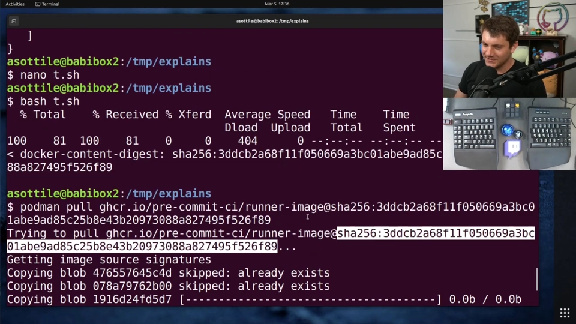

# 按 digest 拉取镜像：把"可变的 tag"钉成"不可变的坐标"

> 视频来源：[docker pull by sha256 digest (advanced) — anthony explains #537](https://www.youtube.com/watch?v=AiAU7wnPCrQ)（约 9 分钟，英文字幕）
> 本文基于该视频的完整字幕与画面整理：讲者 anthony 从"tag 可变"这一根本问题出发，演示如何拿到镜像的 digest，并用 `镜像@sha256:…` 语法拉取一个永远不会"变心"的版本。两条获取 digest 的路径——多架构镜像直接读 manifest list、单架构镜像查 API 响应头——以及三个容易踩的坑（ECR 的 HEAD 方法、digest ≠ image ID、跨仓库 digest 不一致）全部涵盖。所有结论都可在对应时间戳处核对。

## 本讲要解决的核心问题（SCQA）

**背景**：日常拉镜像的标准动作是 `docker pull 镜像名:tag`，例如 `postgres:9.6-alpine`，不写仓库地址时默认从 Docker Hub（`docker.io`）拉取。本片以 GitHub Container Registry（ghcr.io）为例，方法适用于任何 Docker registry。[【跳转到 00:17】](https://www.youtube.com/watch?v=AiAU7wnPCrQ&t=17)

**冲突**：tag 是**可变的**——它随时可能被改指向，最典型的就是 `latest`，通常指向"最新版"且随时间不断移动。你想把系统钉在一个**不再变化**的版本上，但你无法保证远端仓库如何设置它的 tag，也没法要求上游永远维护一个含义不变的 tag。[【跳转到 00:53】](https://www.youtube.com/watch?v=AiAU7wnPCrQ&t=53)

**疑问**：有没有一个由内容本身决定、任何人（包括仓库维护者）都无法篡改的镜像引用方式？

**回答（中心思想）**：有。推送到 registry 的每个镜像都有一个 **digest**——该镜像的校验和。用 `镜像名@sha256:…` 代替 `镜像名:tag` 来拉取，得到的就是一个固定的、由内容哈希保证的版本。本片演示两条获取 digest 的路径，以及使用中的几个坑。[【跳转到 01:18】](https://www.youtube.com/watch?v=AiAU7wnPCrQ&t=78)

## 一、tag 的问题与 digest 的本质

拉镜像时我们习惯写"镜像名:tag"，比如 `…:9.6-alpine`。但 tag 的最大短板是**可变性**：改 tag 指向是家常便饭，`latest` 更是随时间漂移。如果系统里需要的是"钉死的、不随时间变化的版本"，tag 给不了这个保证。[【跳转到 00:28】](https://www.youtube.com/watch?v=AiAU7wnPCrQ&t=28)

而推送到 registry 的每个镜像都带有 **digest**——它就是**这个镜像内容的校验和（checksum）**。校验和由内容算出，内容不变则校验和不变，因此用 digest 引用镜像天然不可变。[【跳转到 01:18】](https://www.youtube.com/watch?v=AiAU7wnPCrQ&t=78)

## 二、容易的路：多架构镜像，manifest list 里直接读

如果镜像是**多架构（manifest list / image index）格式**，获取 digest 非常简单：`podman manifest inspect 镜像名:tag` 会从 registry 拉下 manifest 并打印——里面每个平台的条目都直接带着 `sha256:…` digest。选一个（比如 linux/amd64/x86_64 对应的那个），这个 digest 就可以直接用于拉取。[【跳转到 02:43】](https://www.youtube.com/watch?v=AiAU7wnPCrQ&t=163)

讲者用 `docker.io/library/postgres:9.6-alpine` 演示：这种镜像的 manifest 是一个 platforms 列表，digest 就明晃晃地写在输出里。[【跳转到 04:05】](https://www.youtube.com/watch?v=AiAU7wnPCrQ&t=245)

## 三、麻烦的路：单架构镜像，digest 藏在响应头里

大量镜像并非多架构格式，`manifest inspect` 的输出里**找不到镜像本身的 digest**——输出中出现的 `sha256:…` 都属于**单独的层或 config**，而不是整个镜像；对单架构镜像，命令行工具帮不上忙，因为镜像 digest 只随 API 响应的**HTTP 头**返回（podman 会给个提示，Docker 连提示都没有）。[【跳转到 03:13】](https://www.youtube.com/watch?v=AiAU7wnPCrQ&t=193)

这时就得直接调 registry API，步骤等价于 `manifest inspect` 在背后做的事：

1. 拿一个 auth token；
2. 带着 Accept 头去 GET manifest。[【跳转到 02:25】](https://www.youtube.com/watch?v=AiAU7wnPCrQ&t=145)

把 curl 切到 verbose 模式（`curl -v`）让它打印响应头，再用大小写不敏感的方式过滤 `Docker-Content-Digest` 头——这个值才是**整个镜像**的 digest。注意它与 manifest 体内的 config digest、各层 digest 都不相同。[【跳转到 06:06】](https://www.youtube.com/watch?v=AiAU7wnPCrQ&t=366)

## 四、用 digest 拉取，以及怎么让它好用

### 4.1 拉取语法：把 `:tag` 换成 `@sha256:…`

从 tag 改为 digest，语法上就是把结尾的 `冒号+tag` 换成 **`@` + digest**：`podman pull ghcr.io/…/runner-image@sha256:3ddcb…`。这样拉到的就是那个特定校验和对应的镜像——**永远一致**，不用担心哪天被悄悄换掉，因为你引用的是镜像内容本身的哈希。[【跳转到 04:25】](https://www.youtube.com/watch?v=AiAU7wnPCrQ&t=265)

### 4.2 给 digest 起个友好名字

digest 又长又丑，不适合天天敲。常见做法是拉下来后用 `podman tag` 把它改回原来的 tag 名（如 `…:9.6-alpine`），之后就能用这个好记的名字引用——本地名字随你起，内容已被 digest 锁死。[【跳转到 04:44】](https://www.youtube.com/watch?v=AiAU7wnPCrQ&t=284)

## 五、三个容易踩的坑

### 5.1 请求头与 HTTP 方法：ECR 要用 HEAD

讲者在适配另一个 registry 后补充了两处修正：请求时要带**特定的 Accept 头**（V2 manifest 类型），否则服务器可能返回 V1 响应；对 **Amazon ECR**，还必须用 **HEAD 方法**发请求——用 GET 的话，ECR 不会在响应头里返回 digest。[【跳转到 07:17】](https://www.youtube.com/watch?v=AiAU7wnPCrQ&t=437)

### 5.2 digest ≠ image ID

镜像有**三种指代**：tag、digest、image ID——digest 是 registry 侧对 manifest 的哈希，image ID 是本地镜像的 ID，两者是不同的东西，别混用。[【跳转到 07:39】](https://www.youtube.com/watch?v=AiAU7wnPCrQ&t=459)

### 5.3 同一镜像，不同仓库，digest 可能不同

一个坑：把**完全相同的镜像**推到两个不同的 registry，digest 可能对不上——因为 registry 常会**重写 JSON**（调整空白、字段顺序等），manifest 字节变了，哈希自然变了。所以如果你的系统有"多仓库回退"的场景（主用 GitHub、备用 Docker Hub、再备用 ECR），需要**逐个仓库查询 digest**，不能想当然地复用。[【跳转到 08:04】](https://www.youtube.com/watch?v=AiAU7wnPCrQ&t=484)

## 小结

- **tag 可变、digest 不变**：要"钉死版本"，用 `镜像名@sha256:…` 拉取，引用的是内容校验和。
- **digest 的两条获取路径**：多架构镜像在 `podman manifest inspect`（或 `docker manifest inspect`）输出里直接读；单架构镜像走 registry API，从响应头 `Docker-Content-Digest` 里取——manifest 正文里的 digest 都只是层和 config 的。
- **语法**：把 `:tag` 换成 `@digest`；嫌名字长可以本地重新 `tag` 成友好名称。
- **三个坑**：ECR 需要 HEAD 方法与 V2 Accept 头；digest ≠ image ID；registry 会重写 JSON，同一镜像跨仓库 digest 可能不同，回退场景要逐仓库查询。

## 关键术语速查

| 术语 | 一句话解释 |
| --- | --- |
| tag | 镜像的可变别名，随时可被改指向 |
| digest | 镜像 manifest 的校验和（`sha256:…`），内容寻址、不可变 |
| manifest | 描述镜像构成（config + 各层）的 JSON 元数据 |
| manifest list / image index | 多架构镜像的"清单的清单"，每个平台条目各带 digest |
| `Docker-Content-Digest` | registry API 响应头，单架构镜像获取 digest 的唯一位置 |
| image ID | 本地镜像的 ID，与 registry 侧的 digest 是两套标识 |
| `podman tag` / `docker tag` | 给本地镜像起别名，可为 digest 镜像恢复友好名称 |
