# 什么是容器镜像仓库：为什么企业要在内部自建私有 Registry

> 视频来源：[Container Registry — VMware Cloud Native Apps](https://www.youtube.com/watch?v=76rX4s73MrM)（约 9.5 分钟，英文字幕）
> 讲者是 Harbor（开源企业级镜像仓库）项目的创建者，来自 VMware 中国。本文基于该视频的完整字幕与画面整理：先用"容器的快照"讲清镜像是什么，再说明镜像是如何靠 registry 完成 push/pull 分发的，最后系统回答"为什么大多数组织宁可自建私有仓库"——知识产权保护、恶意/漏洞镜像拦截、基于角色的访问控制、与 LDAP/AD 打通、以及内容签名信任。所有结论都可在对应时间戳处核对。

## 本讲要解决的核心问题（SCQA）

**背景**：我们已经习惯写 `docker run nginx`、`docker pull python`。镜像从哪里来、又到哪里去，似乎理所当然。[【跳转到 00:00】](https://www.youtube.com/watch?v=76rX4s73MrM&t=0)

**冲突**：镜像终归要**从一台机器搬到另一台机器**、从开发机搬到生产集群。这个"搬运"过程必须有一个中转站——这就是 registry。而公开的 registry（如 Docker Hub）人人可用，企业的私有代码和敏感配置却未必能让所有人看见。[【跳转到 00:11】](https://www.youtube.com/watch?v=76rX4s73MrM&t=11)

**疑问**：registry 到底承担什么角色？为什么绝大多数组织不满足于 Docker Hub，而要在自己内部搭一套私有仓库？

**回答（中心思想）**：registry 是镜像分发的"中转站"。公共仓库图省事，但一旦涉及**知识产权、安全合规、权限管理与统一身份**，组织就需要一个**私有 registry**——它把镜像的存储、分发、扫描、授权与签名集中在自己可控的边界之内。[【跳转到 08:20】](https://www.youtube.com/watch?v=76rX4s73MrM&t=500)

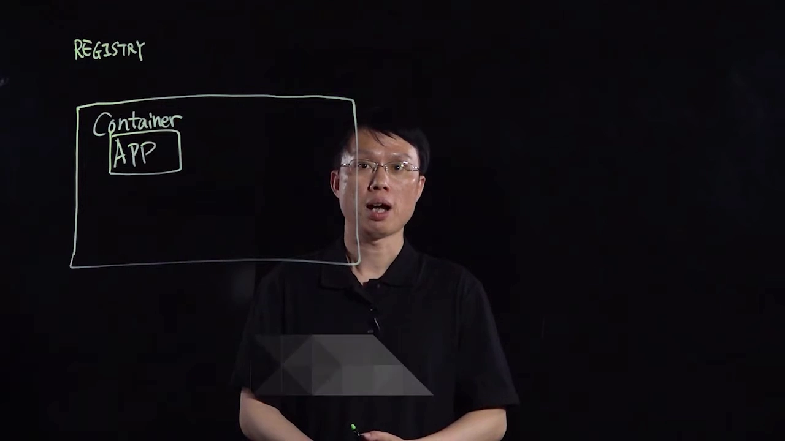

## 一、先把两个概念钉死：容器镜像与它的"分发"

### 1.1 镜像是容器的"快照模板"

**容器**是操作系统为运行某个应用而创建的**隔离环境**。如果对这个容器的**文件系统**打一个快照，就得到一个**容器镜像**——它本质上就是磁盘上的一堆静态文件。[【跳转到 00:11】](https://www.youtube.com/watch?v=76rX4s73MrM&t=11) [【跳转到 00:36】](https://www.youtube.com/watch?v=76rX4s73MrM&t=36)

关键在于：镜像是**模板**。拿到一个镜像，可以据此**启动任意多个**容器实例，而这些实例和原始环境**完全一致**。因此镜像是"快速横向扩容"的基础——你不需要在新机器上重新装一遍环境，直接拿模板起实例即可。[【跳转到 00:36】](https://www.youtube.com/watch?v=76rX4s73MrM&t=36) [【跳转到 01:01】](https://www.youtube.com/watch?v=76rX4s73MrM&t=61)

### 1.2 "分发"：push 与 pull

镜像的第二个用途，是把应用**从一台机器搬到另一台机器**。完成这件事的方式，就是使用 **registry 服务**。registry 本质上是一个**仓库（repository）**，可以帮你保管镜像。[【跳转到 01:26】](https://www.youtube.com/watch?v=76rX4s73MrM&t=86)

它对应两个动作：

- **push（推送）**：把本地的镜像**上传**到 registry，存一份副本在那里。[【跳转到 01:47】](https://www.youtube.com/watch?v=76rX4s73MrM&t=107)
- **pull（拉取）**：在另一台机器上把镜像**下载**下来，于是那台机器也有一份副本。[【跳转到 02:12】](https://www.youtube.com/watch?v=76rX4s73MrM&t=132)

镜像到了新机器后，就能用容器跑起**一模一样的应用**——正如画面所示，这些容器运行的 app 与源主机上的**完全相同**。[【跳转到 02:31】](https://www.youtube.com/watch?v=76rX4s73MrM&t=151)

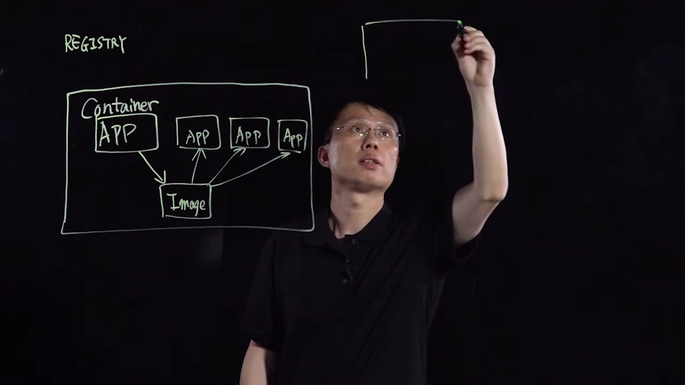

### 1.3 registry 是分发的中转站

把上面两步连起来看：registry 扮演的正是**系统之间共享镜像的中介（intermediary）**。一端 push 上来，另一端 pull 下去，中间不需要两台机器直接相连。[【跳转到 02:55】](https://www.youtube.com/watch?v=76rX4s73MrM&t=175)

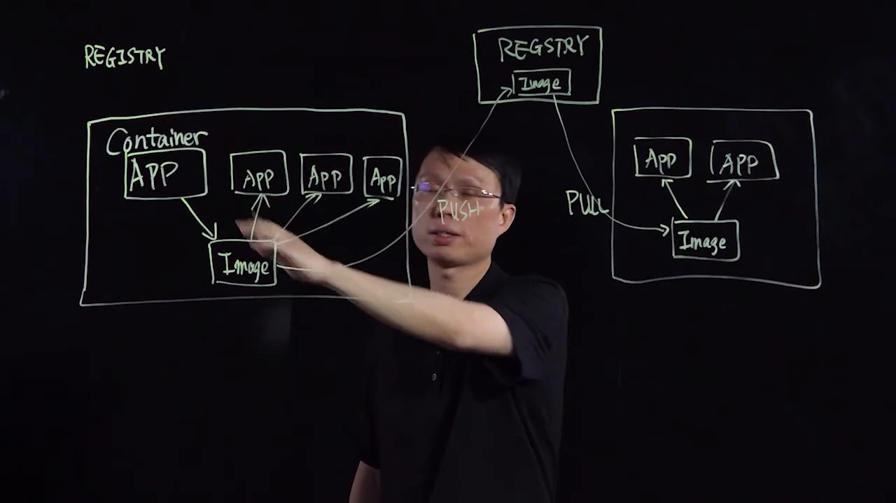

## 二、去哪里找 registry：公共仓库与私有仓库

### 2.1 公共仓库：最省事的选择是 Docker Hub

最省事的做法是使用**公共 registry 服务**，比如 **Docker Hub**。只要机器连得上互联网，就可以直接向它 push、从它 pull。[【跳转到 03:20】](https://www.youtube.com/watch?v=76rX4s73MrM&t=200)

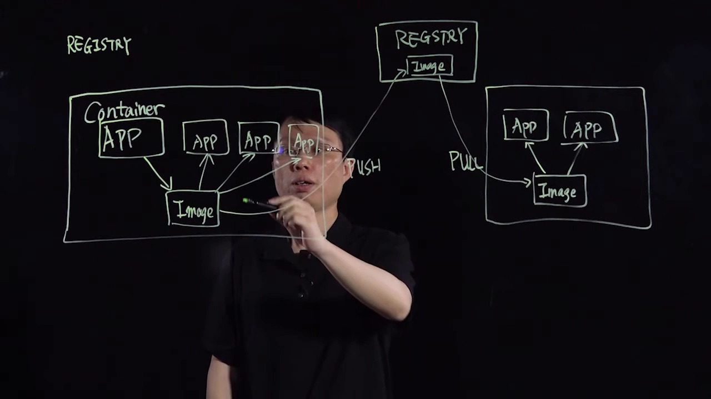

### 2.2 私有仓库：大多数组织的实际选择

但现实中，**大多数用户更倾向在组织内部搭建自己的 registry 实例**。原因很直接：并非所有计算机/系统都能访问互联网，它们需要一个**本地（局域网）registry**。[【跳转到 03:45】](https://www.youtube.com/watch?v=76rX4s73MrM&t=225)

## 三、为什么要私有仓库：四个考量

讲者把"自建私有仓库"的理由归为几条，我们逐条展开。

### 3.1 保护知识产权与敏感信息

有些组织被要求把**知识产权（IP）留在组织内部**。镜像里可能含有**非常敏感的信息**，这些内容不应该被放进公共 registry。私有仓库把镜像圈在内部，就避免了外泄。[【跳转到 04:10】](https://www.youtube.com/watch?v=76rX4s73MrM&t=250)

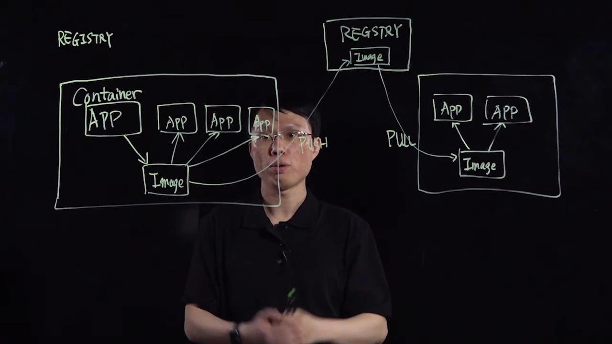

### 3.2 把有漏洞或恶意的镜像挡在门外

私有仓库可以**阻止带有恶意软件或漏洞的镜像进入组织**。更进一步，还能对本地镜像做**定期扫描**，发现漏洞后**及时打补丁**。[【跳转到 04:35】](https://www.youtube.com/watch?v=76rX4s73MrM&t=275)

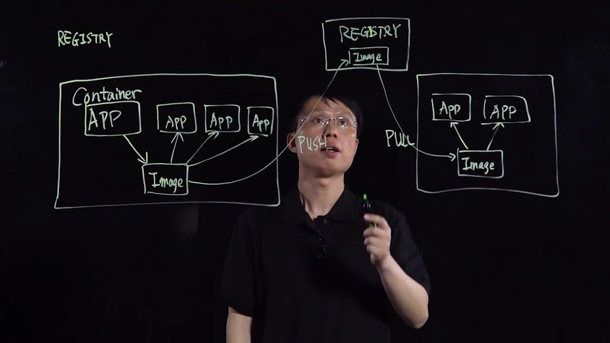

### 3.3 基于角色的访问控制（RBAC）

组织里的人员角色不同，对仓库中镜像的**访问权限也应该不同**。私有仓库可以对所有镜像操作施加**基于角色的访问控制（RBAC）**来落实规则。[【跳转到 05:00】](https://www.youtube.com/watch?v=76rX4s73MrM&t=300)

举两个例子：拥有 **developer** 角色的人可以 push 也能 pull；而某些人根本不需要 push，就**只给 pull 权限**，不给 push 权限。[【跳转到 05:25】](https://www.youtube.com/watch?v=76rX4s73MrM&t=325)

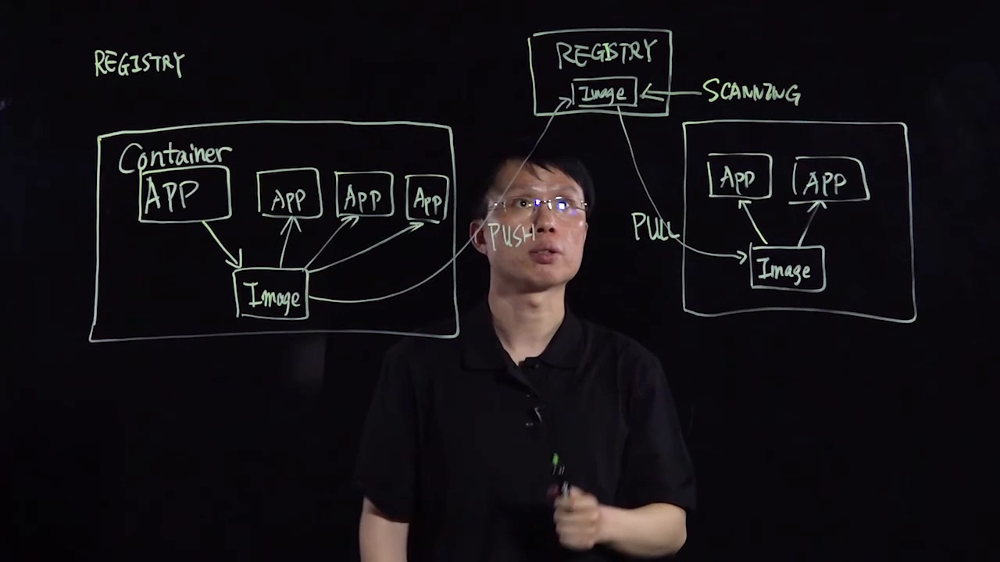

### 3.4 与中央用户体系（LDAP / AD）打通

大多数组织都有**中央用户管理系统**，例如 **LDAP** 或 **Active Directory（AD）**。私有仓库可以把用户身份**直接接入**这套体系，再用它来做基于角色的访问控制。[【跳转到 05:50】](https://www.youtube.com/watch?v=76rX4s73MrM&t=350)

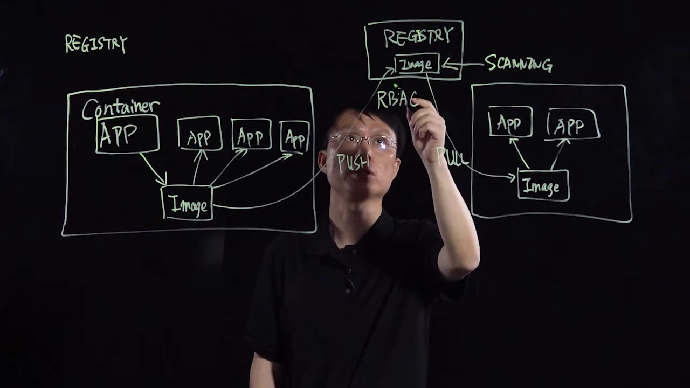

### 3.5 补充：内容信任与镜像签名

还有一个考量是**内容信任**。可以在组织内部署一个本地的 **Notary** 服务：push 镜像时，推送者可以对镜像做**数字签名**，并把签名存到 Notary；在另一台机器 pull 镜像时，会**校验签名**——如果签名来自**不受信任的一方**，或者**根本没有签名**，那么这次 pull 就会**失败**。[【跳转到 06:15】](https://www.youtube.com/watch?v=76rX4s73MrM&t=375) [【跳转到 06:40】](https://www.youtube.com/watch?v=76rX4s73MrM&t=400) [【跳转到 07:05】](https://www.youtube.com/watch?v=76rX4s73MrM&t=425)

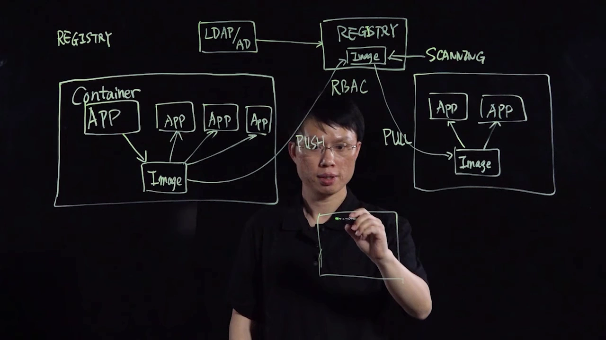

## 四、私有仓库还能显著省时间

最后一个但同样重要的理由来自现代应用的形态：现代应用通常由**许多容器**组成，在开发过程中，容器镜像往往被**拉取几十次甚至上百次**。把镜像放在**本地 registry**，这些 push/pull 就不用每次都走公网，从而节省**大量时间**。[【跳转到 07:30】](https://www.youtube.com/watch?v=76rX4s73MrM&t=450)

正是出于这些原因，组织需要在自己的内部署一套私有 registry，以便**安全、高效地使用**自己的容器镜像。[【跳转到 07:55】](https://www.youtube.com/watch?v=76rX4s73MrM&t=475)

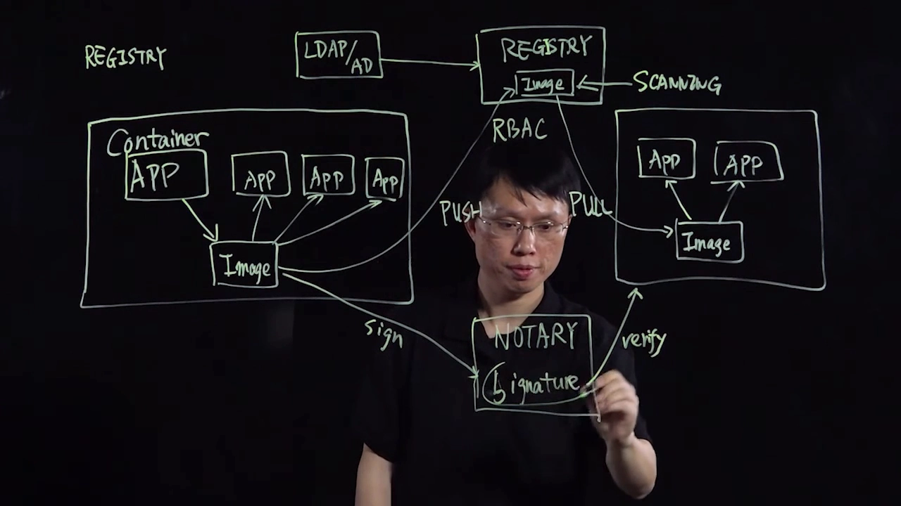

## 五、Harbor：一个企业级私有 Registry

讲者所在团队维护的开源项目 **Harbor**，正是面向企业的私有 registry。它的目标是帮组织**安全、高效地管理容器镜像**，也是 VMware **vSphere Integrated Containers** 方案的一部分；其开源版本可以在 GitHub 上下载。[【跳转到 08:20】](https://www.youtube.com/watch?v=76rX4s73MrM&t=500) [【跳转到 08:45】](https://www.youtube.com/watch?v=76rX4s73MrM&t=525)

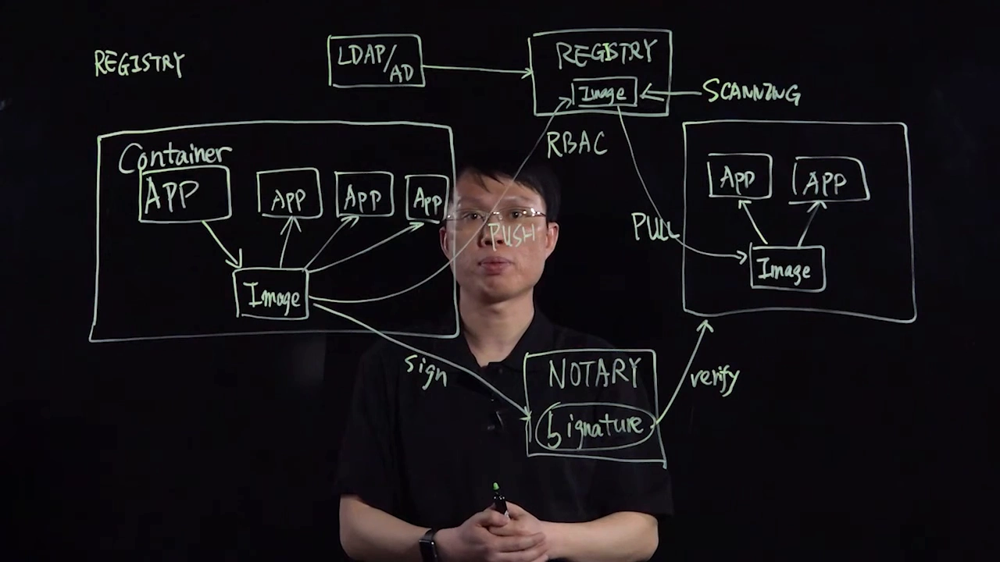

## 小结

- **容器**是操作系统为运行应用创建的隔离环境；给它打**快照**就得到**镜像**，镜像是磁盘上的静态文件，也是可反复起实例的**模板**。
- **registry** 是镜像分发的**中转站**：一端 **push** 上传、另一端 **pull** 下载，两台机器无需直连。
- 公共仓库（如 **Docker Hub**）省事；但**大多数组织选择自建私有 registry**。
- 私有仓库的价值有四条：**保护知识产权/敏感信息**、**拦截带漏洞或恶意的镜像并定期扫描**、**基于角色的访问控制（RBAC）**、**与 LDAP/AD 中央用户体系打通**。
- 再进一步，可用 **Notary** 做**内容信任**：push 时签名、pull 时验证，签不上就拒绝拉取。
- 现代应用由许多容器组成、镜像被高频拉取，**本地 registry** 能省下大量时间。
- **Harbor** 是其中的代表：一个面向企业的开源私有 registry。

## 关键术语速查

| 术语 | 一句话解释 |
| --- | --- |
| 容器（container） | 操作系统为运行某应用而创建的隔离环境 |
| 容器镜像（container image） | 对容器文件系统的快照，本质是磁盘上的静态文件；可反复派生实例的模板 |
| registry | 存储与分发镜像的服务；镜像 push/pull 的中转站 |
| repository（仓库） | registry 中存放镜像的逻辑单元 |
| push / pull | 向 registry 上传镜像 / 从 registry 下载镜像 |
| Docker Hub | 最流行的公共 registry，人人可用 |
| 私有 registry | 部署在组织内部、只对内部开放的镜像仓库 |
| RBAC | 基于角色的访问控制，按角色分配 push/pull 等权限 |
| LDAP / AD | 组织的中央用户目录，可接入 registry 做统一身份与授权 |
| Notary / 内容信任 | 对镜像做数字签名并在拉取时校验来源的机制，签名不可信则拒绝拉取 |
| Harbor | 面向企业的开源私有 registry 项目 |
