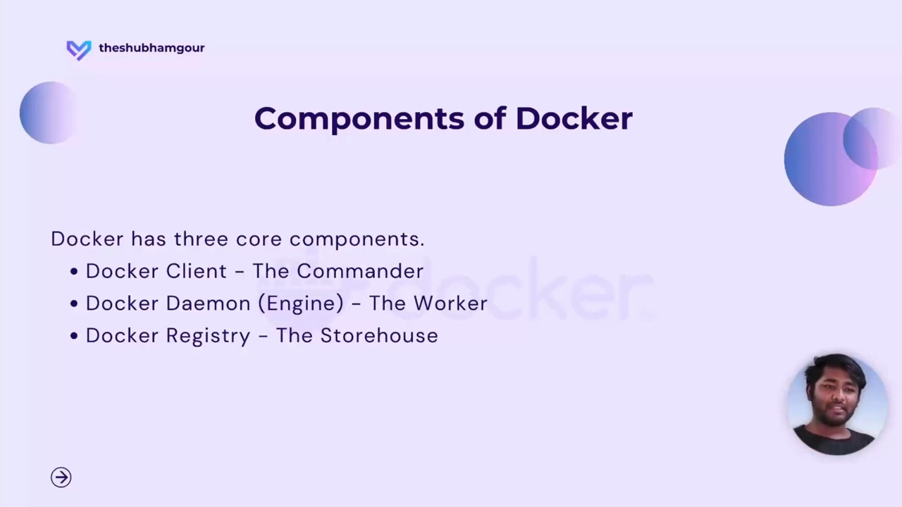
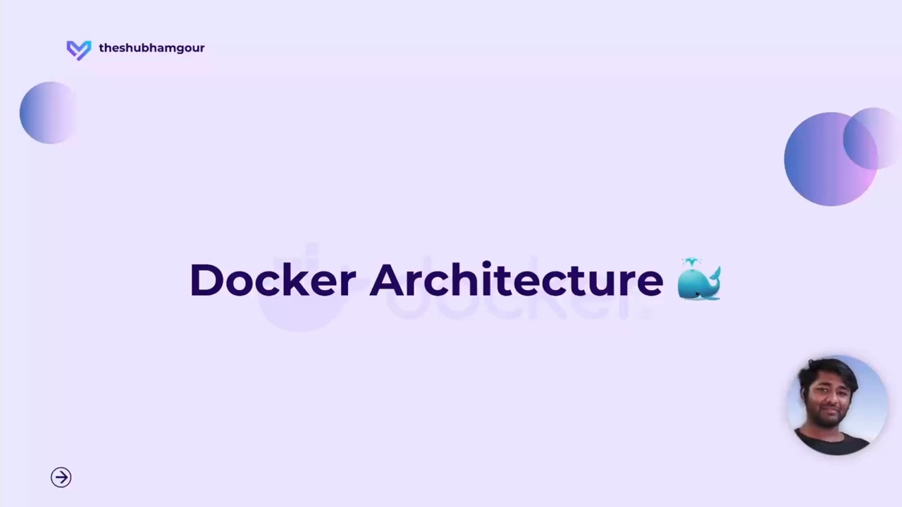
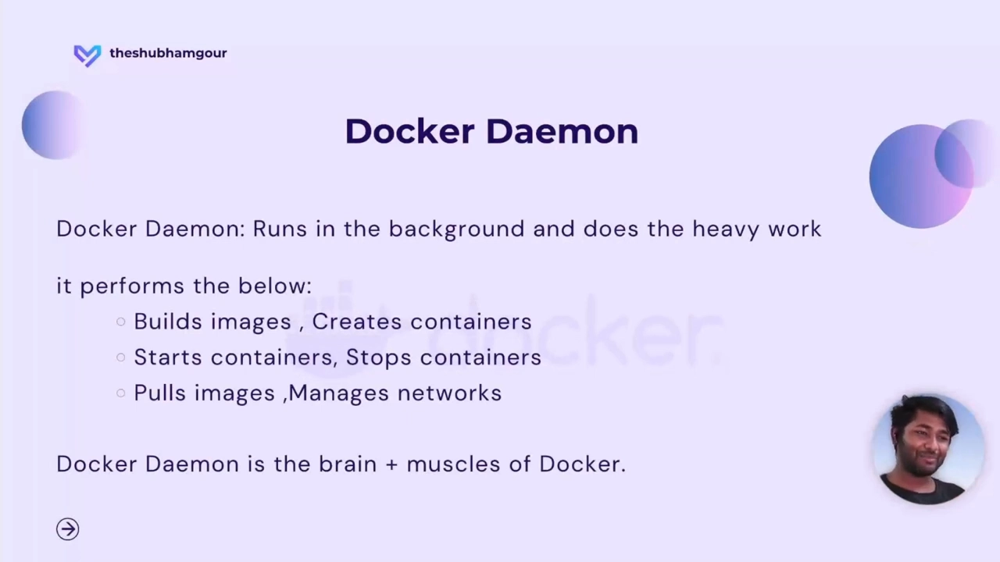
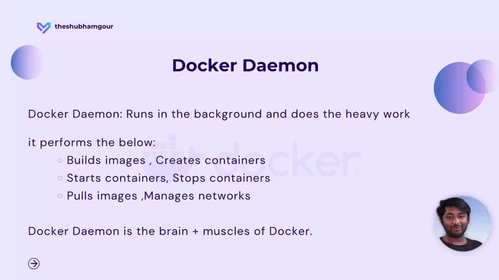
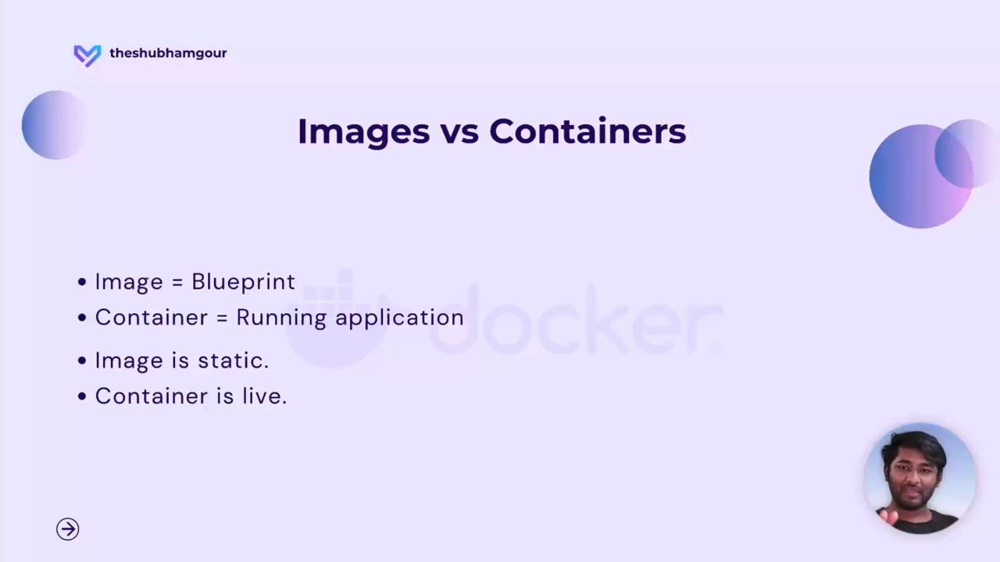
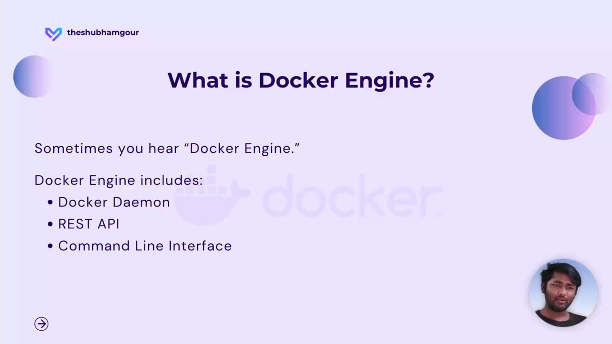
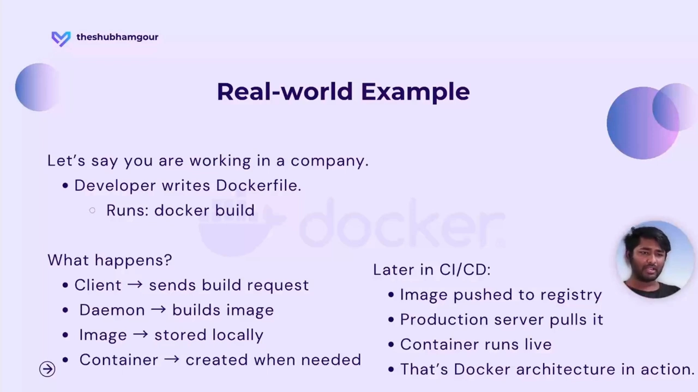

# 一次 docker run 背后发生了什么：Docker 三大组件与镜像分发

> 视频来源：[Docker Architecture Explained | Client, Daemon & Registry — Shubham Gour](https://www.youtube.com/watch?v=FKCAekH4B38)（约 9 分钟，英文字幕）
> 本文基于该视频的完整字幕与画面整理：以"`docker run nginx` 提示本地找不到镜像，却自动把镜像拉了下来"这个现象为引子，循序渐进讲清 Docker 的三大组件——**client（客户端）、daemon（守护进程）、registry（镜像仓库）**，以及它们如何协作完成"取镜像 → 起容器"的全过程，最后落到开发与 CI/CD 场景中的镜像分发链路。所有结论都可在对应时间戳处核对。

## 本讲要解决的核心问题（SCQA）

**背景**：我们在终端敲下 `docker run nginx`。本地从没下载过 `nginx` 镜像，可它居然能跑起来。[【跳转到 00:10】](https://www.youtube.com/watch?v=FKCAekH4B38&t=10)

**冲突**：终端先是提示 `Unable to find image 'nginx:latest' locally`，紧接着又从 **library** 里把镜像**拉取**了下来。奇怪的是：**它怎么知道要去哪里拉、又怎么知道地址在哪？**[【跳转到 00:16】](https://www.youtube.com/watch?v=FKCAekH4B38&t=16) [【跳转到 00:21】](https://www.youtube.com/watch?v=FKCAekH4B38&t=21)

**疑问**：要回答这个问题，得先弄清 **Docker 内部由哪些组件构成、它们之间如何对话**。

**回答（中心思想）**：Docker 有三个关键组件——**client**（下达命令的地方）、**daemon**（后台真正干活的"大脑"）、**registry**（存放镜像的"仓库"）。当本地没有镜像时，由 **daemon 主动去 registry 拉取**，再把它变成容器运行起来。[【跳转到 02:23】](https://www.youtube.com/watch?v=FKCAekH4B38&t=143)

## 一、Docker 的三个关键组件

讲者打了个比方：所谓 Docker 架构，并不是一张巨大复杂的图，而是回答三个问题——Docker 内部**怎么组织、有哪些组件、它们怎么互相通信**。[【跳转到 01:03】](https://www.youtube.com/watch?v=FKCAekH4B38&t=63)

> 类比：这就像用外卖 App 点餐。你打开 App 下单，饭就送到了；但"幕后"其实发生了一连串事——订单下到餐厅、厨房接单、厨师做菜、打包、交给骑手、骑手送到你家。Docker 架构讲的，就是这套"幕后流程"。[【跳转到 01:08】](https://www.youtube.com/watch?v=FKCAekH4B38&t=68)

### 1.1 Docker Client：指挥官

**Docker client** 是我们**直接打交道**的地方，也是我们**输入命令**的地方。当我们敲下 `docker run`、`docker build`、`docker pull` 时，是 client 把请求**发送给后台服务**。[【跳转到 02:48】](https://www.youtube.com/watch?v=FKCAekH4B38&t=168)

### 1.2 Docker Daemon：真正干活的大脑

后台服务就是**docker daemon**——一个**在后台运行**的进程。它承担了**繁重的实际工作**，可以理解为 Docker 的"大脑与肌肉"：[【跳转到 03:13】](https://www.youtube.com/watch?v=FKCAekH4B38&t=193)

- 构建镜像（build）
- 创建容器
- 启动容器 / 停止容器
- **拉取镜像（pull）**……等等

### 1.3 Docker Registry：存放镜像的仓库

请求发出去、活儿也干完了，那**镜像存在哪里**？答案是 **docker registry**——存放 Docker 镜像的地方。[【跳转到 03:38】](https://www.youtube.com/watch?v=FKCAekH4B38&t=218)

最流行、最典型的开源 registry 是 **Docker Hub**；此外你可能还听过 **Google Artifact Registry**、**Amazon ECR** 等，它们也都是市面上常见的 registry。[【跳转到 03:38】](https://www.youtube.com/watch?v=FKCAekH4B38&t=218) [【跳转到 04:03】](https://www.youtube.com/watch?v=FKCAekH4B38&t=243)

## 二、`docker run nginx` 的完整流程

现在回到那个引子——`docker run nginx` 到底发生了什么？答案是：**Docker 会先检查本地有没有 `nginx` 镜像；没有的话，就从 registry 下载**。所以镜像正是**从 docker registry 拉取的**。[【跳转到 04:03】](https://www.youtube.com/watch?v=FKCAekH4B38&t=243) [【跳转到 04:28】](https://www.youtube.com/watch?v=FKCAekH4B38&t=268)

把它拆成步骤：

1. 你运行 `docker run nginx`，**client 把请求发给 daemon**；
2. **daemon 检查本地系统里有没有这个镜像**；
3. 如果没有，**daemon 去 Docker Hub 把镜像拉下来**；
4. 镜像下载完成后，**daemon 运行镜像，把它变成容器**；
5. 容器跑起来，我们就能看到应用了。

整个过程**在一秒之内完成**，我们几乎察觉不到后台跑了这么多事。[【跳转到 04:53】](https://www.youtube.com/watch?v=FKCAekH4B38&t=293) [【跳转到 05:18】](https://www.youtube.com/watch?v=FKCAekH4B38&t=318)

用流程图表示：如果**本地已有**该镜像，就直接变成容器、应用上线；如果**本地没有**，就把请求交给 daemon，daemon 判断"没有"，于是去 **Docker Hub 拉取**，再转成容器、让应用上线。[【跳转到 05:35】](https://www.youtube.com/watch?v=FKCAekH4B38&t=335) [【跳转到 05:40】](https://www.youtube.com/watch?v=FKCAekH4B38&t=340)

## 三、别混淆：镜像 vs 容器，以及 Docker Engine 的组成

### 3.1 镜像与容器

容易混淆的一对概念是 **image（镜像）** 和 **container（容器）**，讲者给了一个极简的区分：[【跳转到 06:04】](https://www.youtube.com/watch?v=FKCAekH4B38&t=364)

- **镜像是蓝本（blueprint）**，是**静态**的；就像编程里的函数，定义了"要做什么"。
- **容器是镜像的运行实例**：镜像一执行，就变成容器；容器是**活的**。

一句话回答"镜像和容器有什么区别"：**镜像是创建容器的蓝本，是静态的；当你执行它时，它才变成容器。**[【跳转到 06:29】](https://www.youtube.com/watch?v=FKCAekH4B38&t=389)

### 3.2 Docker Engine 包含什么

有时会听到 **Docker Engine** 这个词，它其实由三部分组成：[【跳转到 06:29】](https://www.youtube.com/watch?v=FKCAekH4B38&t=389)

- **docker daemon**（我们刚讲的守护进程）
- **REST API**（client 与 daemon 通信的接口）
- **命令行接口 CLI**（我们输入 `docker ...` 命令的地方）

## 四、真实世界的一条链路：从 `docker build` 到 CI/CD

讲者举了一个企业里的真实例子，把前面所有组件串了起来。[【跳转到 06:54】](https://www.youtube.com/watch?v=FKCAekH4B38&t=414)

**开发阶段**：开发者在公司里写 **Dockerfile**，执行 `docker build`。

1. **client 发出构建请求**；
2. **daemon 构建镜像**；
3. 镜像**先存在本地**；
4. 工作完成后，把镜像**推到 registry**（例如 Docker Hub）；
5. 镜像就绪后**运行它**，变成容器，用户便能体验到这个应用。[【跳转到 07:19】](https://www.youtube.com/watch?v=FKCAekH4B38&t=439)

**投产阶段**：开发完成、进入 DevOps，同一套产物被接入 **CI/CD 流水线**——

- 流水线把镜像 **push 到 registry**；
- **生产服务器从 registry 把镜像 pull 下来**；
- 容器运行，应用上线。

这正是 Docker 架构在**真实世界的运作方式**。[【跳转到 07:19】](https://www.youtube.com/watch?v=FKCAekH4B38&t=439) [【跳转到 07:44】](https://www.youtube.com/watch?v=FKCAekH4B38&t=464)

## 小结

- Docker 架构回答三个问题：**内部怎么组织、有哪些组件、它们怎么通信**。
- 三大组件：**client**（下达命令的指挥官）、**daemon**（后台真正干活的大脑，负责 build/run/pull 等）、**registry**（存放镜像的仓库）。
- `docker run nginx` 的实质：**daemon 先查本地，缺了就去 registry（如 Docker Hub）拉取**，再转成容器运行——全过程不到一秒。
- **镜像是静态蓝本，容器是它的运行实例**；**Docker Engine = daemon + REST API + CLI**。
- 真实链路：开发 `docker build` → 镜像推到 registry → 生产/CI-CD 从 registry **pull** 下来运行。**registry 始终是镜像分发的中枢**。

## 关键术语速查

| 术语 | 一句话解释 |
| --- | --- |
| Docker client | 我们输入 `docker run/build/pull` 命令、把请求发往 daemon 的客户端 |
| Docker daemon | 在后台运行的进程，真正执行构建镜像、起停容器、拉取镜像等重活 |
| Docker registry | 存放与分发镜像的仓库；Docker Hub 是最流行的公共 registry |
| Docker Hub | 最流行的开源/公共 registry；另有 Google Artifact Registry、Amazon ECR 等 |
| library（命名空间） | Docker Hub 上官方镜像所在的默认命名空间 |
| 镜像（image） | 静态蓝本，定义了要运行什么 |
| 容器（container） | 镜像的运行实例，是"活"的 |
| Docker Engine | 由 daemon、REST API、CLI 三部分组成的引擎 |
| push / pull | 把镜像推到 registry / 从 registry 拉取镜像 |
| CI/CD | 持续集成/持续交付流水线；典型地把镜像 push 到 registry，生产端再 pull 运行 |
