# 动手搭建 Docker 私有镜像仓库：从官方 registry 到带界面的 registry-ui

> 视频来源：[打造 Docker 私有镜像仓库 — 莲城的老李](https://www.bilibili.com/video/BV1QC411n73p/)（约 24 分钟，中文字幕）
> 本文基于该视频的完整字幕与画面整理：先讲清"私有仓库是什么、为什么要用"，再**手把手**用官方 `registry` 镜像搭出一套基础版私有仓库（拉镜像 → 建目录 → 跑容器 → 测试），接着解决客户端因 HTTPS 校验而 push/pull 失败的问题，最后用 **docker compose** 把官方的 `registry` 与第三方的 `registry-ui` 组合起来，给仓库加一个图形界面。所有结论都可在对应时间戳处核对。

## 本讲要解决的核心问题（SCQA）

**背景**：日常拉镜像、推镜像，用的多是**公有镜像仓库**，比如鼎鼎大名的 **Docker Hub**、**阿里云镜像仓库**——它们对所有人开放。[【跳转到 00:00】](https://www.bilibili.com/video/BV1QC411n73p/?t=0)

**冲突**：企业里做出来的镜像往往**带有商业机密**，一旦公开就等于泄露；同时，很多私有仓库建在**局域网**内，网络传输比走公网**更快、更高效**。于是需要一种"只在局部范围内使用"的仓库。[【跳转到 00:25】](https://www.bilibili.com/video/BV1QC411n73p/?t=25)

**疑问**：私有仓库怎么搭？是不是要额外装一堆软件包？

**回答（中心思想）**：不用。官方已经把 registry 打包成**一个镜像**——在"一切皆容器"的思路下，**下载这个镜像、把它跑成一个容器，私有仓库就搭好了**。想要图形界面，再叠加一个第三方的 **registry-ui** 镜像即可。下文从基础版一路做到带 UI 的版本。[【跳转到 00:50】](https://www.bilibili.com/video/BV1QC411n73p/?t=50)

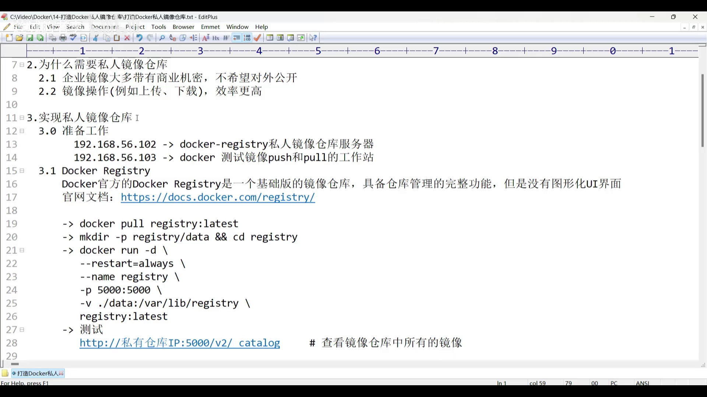

## 一、私有仓库是什么、为什么要用

### 1.1 公有仓库与私有仓库

镜像仓库分两类：[【跳转到 00:00】](https://www.bilibili.com/video/BV1QC411n73p/?t=0)

- **公有仓库**：如 Docker Hub、阿里云镜像仓库，**对所有人开放**；
- **私有仓库**：**基于本地打造、只在局部范围内使用**，不对外公开。

### 1.2 私有仓库的两个动机

1. **私密性与安全性**：企业创造的镜像常含**商业机密**，若开放给所有人，机密就泄露了，所以通常只暴露给**本公司内部人员**使用。[【跳转到 00:25】](https://www.bilibili.com/video/BV1QC411n73p/?t=25)
2. **效率更高**：私有仓库多基于**本地局域网**搭建，镜像操作时**网络传输更快**。[【跳转到 00:50】](https://www.bilibili.com/video/BV1QC411n73p/?t=50)

## 二、用官方 registry 镜像搭一套私有仓库

### 2.1 环境准备：两台机器

为便于演示，讲者准备了两台虚拟机：[【跳转到 01:15】](https://www.bilibili.com/video/BV1QC411n73p/?t=75)

- 一台主机名为 **`docker-registry`**：充当**私有仓库的服务器**（IP 为 `192.168.56.102`）；
- 一台普通的 **Docker 工作站**：稍后从这里把镜像**推送**到仓库服务器。

关键：**拉取 registry 镜像、运行仓库容器，都在服务器（`docker-registry`）上做**，而不是在工作站上。[【跳转到 01:15】](https://www.bilibili.com/video/BV1QC411n73p/?t=75)

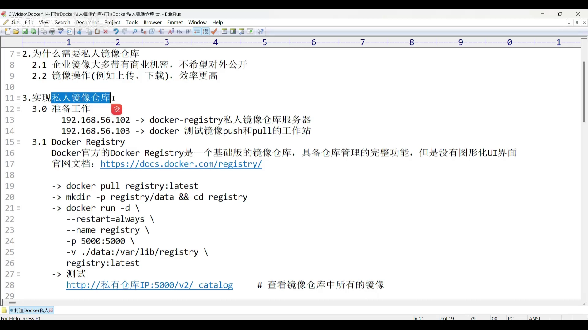

### 2.2 认识官方 registry：基础版，没有图形界面

官方提供的 `docker registry` 是一个**基础版镜像仓库**：它具备仓库管理的**完整功能**，但**没有图形化 UI 界面**。[【跳转到 02:05】](https://www.bilibili.com/video/BV1QC411n73p/?t=125)

在官方文档里可以看到它的 **media types（媒体类型）** 与**授权**相关信息，并给出了完整的搭建命令。[【跳转到 02:34】](https://www.bilibili.com/video/BV1QC411n73p/?t=154)

### 2.3 第一步：把 registry 镜像拉到服务器

在**仓库服务器**上，把官方 registry 的**最新版**拉到本地：[【跳转到 02:49】](https://www.bilibili.com/video/BV1QC411n73p/?t=169) [【跳转到 03:14】](https://www.bilibili.com/video/BV1QC411n73p/?t=194)

```bash
docker pull registry          # 拉取官方 registry 镜像（体积很小，约 26 MB）
```

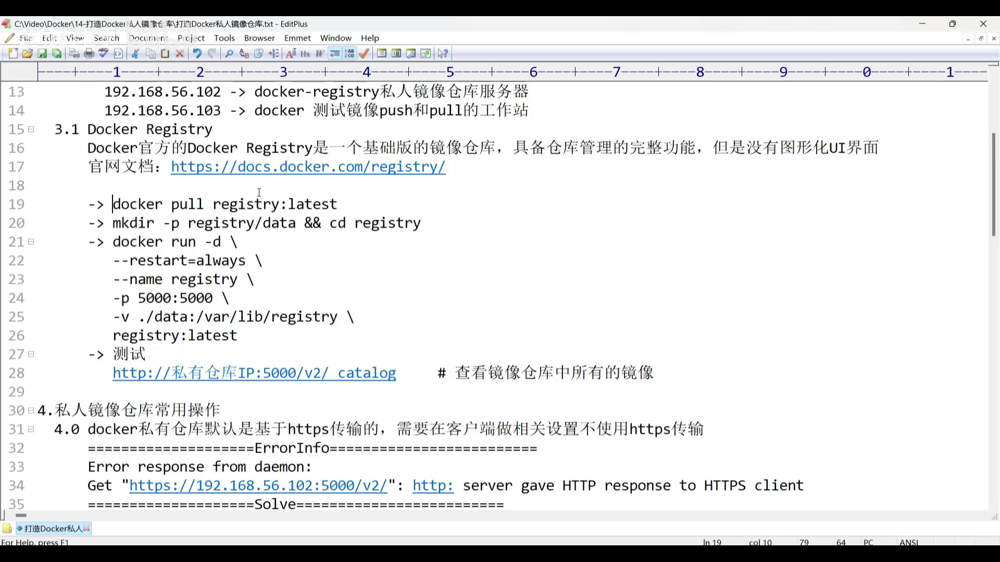

### 2.4 建一个专用目录，并准备好数据目录

为存放仓库数据，建议创建一个**registry 专用目录**，并在其中再建一个 **`data` 子目录**——将来工作站推送的镜像就存放在这个 `data` 目录里。[【跳转到 03:39】](https://www.bilibili.com/video/BV1QC411n73p/?t=219)

```bash
mkdir -p registry/data
cd registry
```

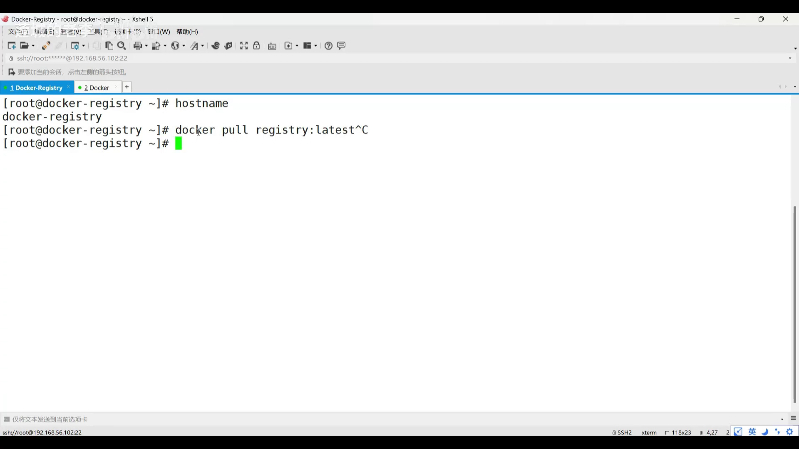

### 2.5 运行容器：逐行拆解那条启动命令

用刚才拉取到的镜像**运行一个容器**，私有仓库就启动了。命令大致如下：[【跳转到 04:25】](https://www.bilibili.com/video/BV1QC411n73p/?t=265) [【跳转到 04:30】](https://www.bilibili.com/video/BV1QC411n73p/?t=270)

```bash
docker run -d \
  --restart=always \
  --name registry \
  -p 5000:5000 \
  -v "$(pwd)/data:/var/lib/registry" \
  registry
```

逐部分解释：

- `docker run`：运行容器的命令；`-d` 表示**以守护（后台）方式**运行；
- `--restart=always`：容器**随 Docker 服务启动而启动**——Docker 服务重启后容器会自动重启，免去手动再起容器的麻烦；
- `--name registry`：指定容器名字；
- `-p 5000:5000`：**端口映射**，把宿主机 `5000` 端口映射到容器端口。这个容器端口**不能乱填**——用 `docker inspect registry` 查看镜像可知，registry **对外暴露的端口正是 `5000`**；[【跳转到 04:55】](https://www.bilibili.com/video/BV1QC411n73p/?t=295) [【跳转到 05:13】](https://www.bilibili.com/video/BV1QC411n73p/?t=313)
- `-v "$(pwd)/data:/var/lib/registry"`：**数据卷挂载**，把容器内 `/var/lib/registry` 目录挂到宿主机的 `data` 目录，让镜像数据**持久化**在宿主机上；[【跳转到 05:19】](https://www.bilibili.com/video/BV1QC411n73p/?t=319)
- 末尾的 `registry`：镜像名（默认 tag 为 `latest`）。

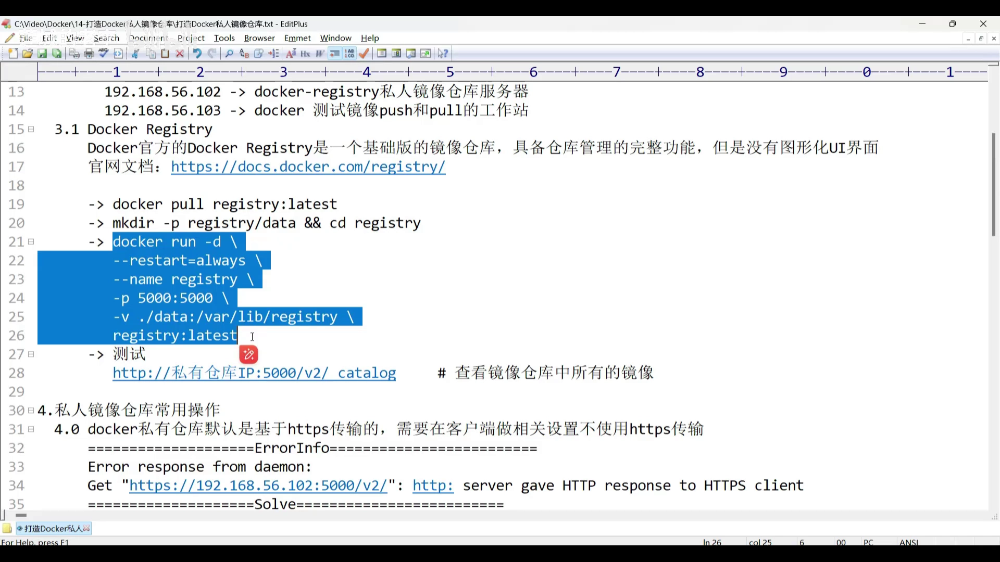

执行后检查容器是否正常运行。**若服务器开了防火墙，需要放行 `5000` 端口**（讲者的机器未开防火墙，故跳过）。[【跳转到 06:00】](https://www.bilibili.com/video/BV1QC411n73p/?t=360)

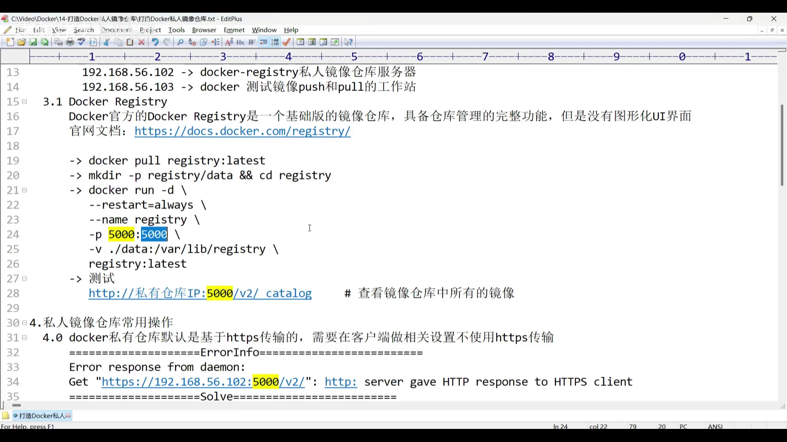

### 2.6 测试仓库是否搭好

在浏览器访问下面这个地址，即可测试私有仓库是否搭建成功：[【跳转到 06:25】](https://www.bilibili.com/video/BV1QC411n73p/?t=385)

```text
http://192.168.56.102:5000/v2/_catalog
```

- `http://`：协议；
- `192.168.56.102`：私有仓库 IP；
- `5000`：端口；
- `/v2/`：因为拉取的 `latest` 其实是 **v2** 版本；
- `_catalog`：查询仓库中**所有仓库**的路径。

打开后应能看到返回的 JSON。由于还没有推送任何镜像，此时中括号里是**空的**：`{"repositories":[]}`。[【跳转到 07:25】](https://www.bilibili.com/video/BV1QC411n73p/?t=445)

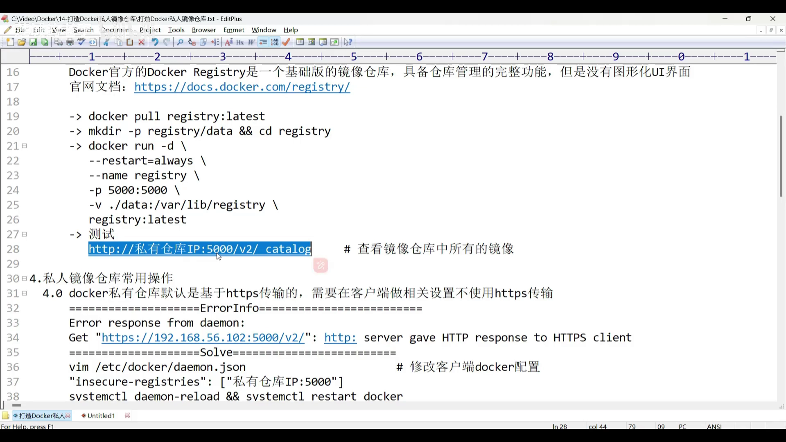

## 三、让客户端信任私有仓库（绕过 HTTPS 校验）

Docker 客户端**默认用 HTTPS** 与私有仓库通信——这样更安全，代价是**要申请 HTTPS 证书（且需付费）**。演示环境里我们改用 HTTP，办法是**修改客户端（工作站）的 Docker 配置**。[【跳转到 07:30】](https://www.bilibili.com/video/BV1QC411n73p/?t=450)

> ⚠️ 先给个提示：如果不做这个设置就强行 push/pull，Docker 会报错 `server gave HTTP response to HTTPS client`。看到这句话，就该意识到是漏了这一步。[【跳转到 07:55】](https://www.bilibili.com/video/BV1QC411n73p/?t=475)

**注意这里是改"客户端"的配置**（主机名不带 `-registry` 后缀的那台）。进入 `/etc/docker`，编辑 **`daemon.json`**，在原有内容基础上加入可信任的私有仓库地址（记得补上逗号）：[【跳转到 08:20】](https://www.bilibili.com/video/BV1QC411n73p/?t=500) [【跳转到 08:45】](https://www.bilibili.com/video/BV1QC411n73p/?t=525) [【跳转到 09:10】](https://www.bilibili.com/video/BV1QC411n73p/?t=550)

```json
{
  "insecure-registries": ["192.168.56.102:5000"]
}
```

改完保存后，**重新加载配置并重启 Docker 服务**，设置才生效。[【跳转到 09:35】](https://www.bilibili.com/video/BV1QC411n73p/?t=575)

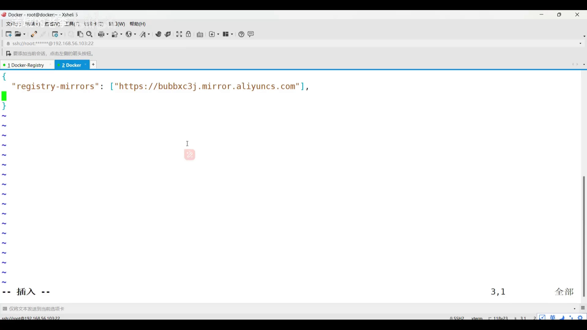

## 四、推送与拉取镜像

### 4.1 推送前必须"重做 tag"

推送镜像前有一个**必要步骤**：**重做镜像 tag**。原因是——推送时 Docker 必须知道**镜像要推往哪台服务器、哪个端口**，而"服务器地址 + 端口"是写在**镜像名字里**的。[【跳转到 10:00】](https://www.bilibili.com/video/BV1QC411n73p/?t=600) [【跳转到 10:25】](https://www.bilibili.com/video/BV1QC411n73p/?t=625)

格式为 `私有仓库IP:端口/镜像名:tag`：

```bash
# 以本地一个镜像为例，重做 tag：加上仓库地址与端口
docker tag <原镜像名>:<tag> 192.168.56.102:5000/<镜像名>:<tag>
```

其中 **tag 若为 `latest` 可以省略不写**；镜像名也可以改名，也可以保持原名。[【跳转到 10:50】](https://www.bilibili.com/video/BV1QC411n73p/?t=650)

> 💡 一个容易误解的点：**重做 tag 并不会生成新镜像**。`docker images` 里看起来多了一个镜像，其实两位只是**名字不同**——通过**镜像 ID** 可以看出它们是同一个。[【跳转到 11:15】](https://www.bilibili.com/video/BV1QC411n73p/?t=675)

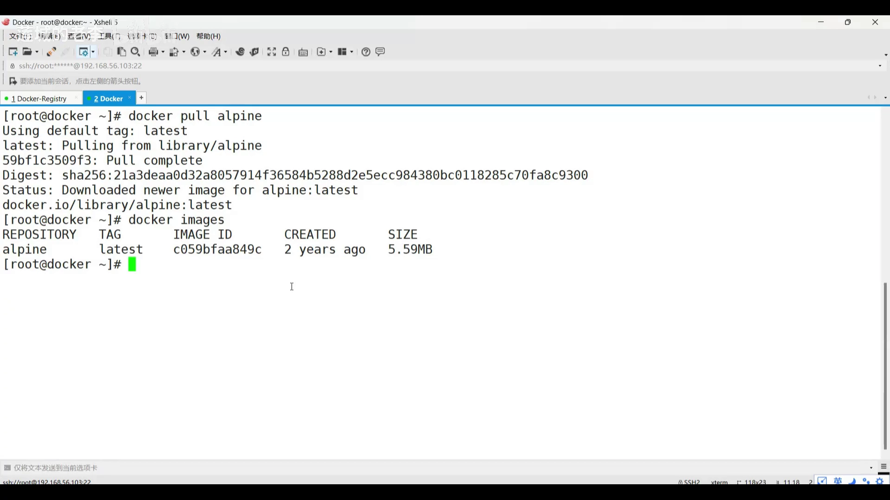

### 4.2 push：推送镜像并验证

推送命令就是在**镜像名里带上仓库地址**：[【跳转到 11:40】](https://www.bilibili.com/video/BV1QC411n73p/?t=700)

```bash
docker push 192.168.56.102:5000/<镜像名>:<tag>
```

推送完成后，有**两种验证方式**：

- **方式一（在仓库服务器上看）**：查看数据卷映射的 `data` 目录，里面会生成按镜像名组织的目录结构（`data/docker/registry/v2/...`），能直接看到上传的镜像数据；[【跳转到 12:30】](https://www.bilibili.com/video/BV1QC411n73p/?t=750) [【跳转到 12:55】](https://www.bilibili.com/video/BV1QC411n73p/?t=775)
- **方式二（在客户端上查）**：刷新浏览器里的 `http://192.168.56.102:5000/v2/_catalog`，能看到镜像名已经出现，说明**上传成功**。[【跳转到 13:20】](https://www.bilibili.com/video/BV1QC411n73p/?t=800) [【跳转到 13:45】](https://www.bilibili.com/video/BV1QC411n73p/?t=825)

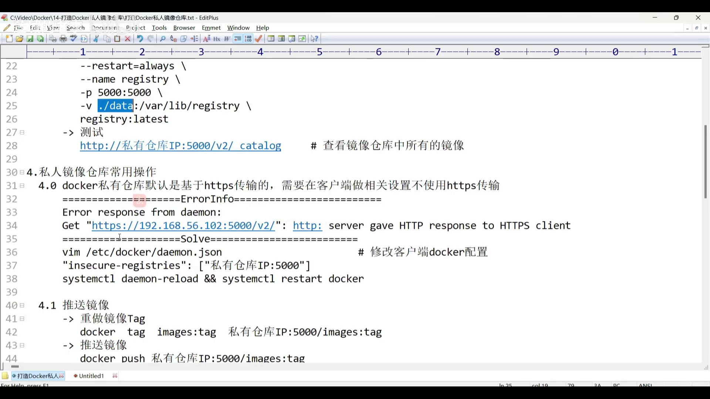

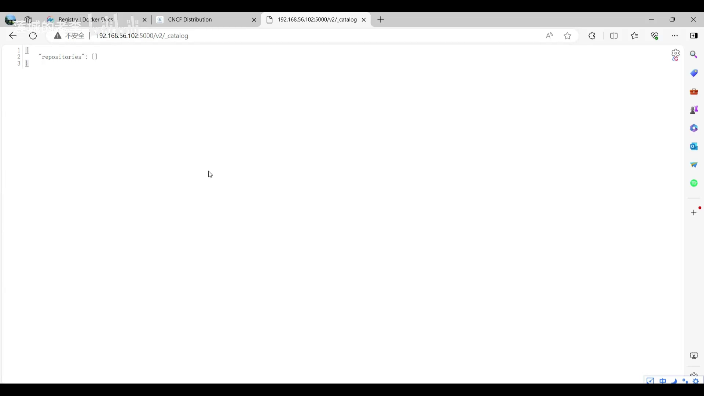

### 4.3 pull：拉取镜像

拉取与推送**参数格式一样**，只是把 `docker push` 换成 `docker pull`：[【跳转到 14:02】](https://www.bilibili.com/video/BV1QC411n73p/?t=842) [【跳转到 14:27】](https://www.bilibili.com/video/BV1QC411n73p/?t=867)

```bash
docker pull 192.168.56.102:5000/<镜像名>:<tag>
```

到此，"推送镜像、拉取镜像、更改设置"这几个私有仓库的常用操作就介绍完了。

## 五、进阶：给仓库加一个图形界面（registry-ui + docker compose）

### 5.1 registry-ui 是什么

`registry-ui` 带 **UI**，自然就是**带图形界面**的镜像。它由**第三方基于官方 registry 镜像**制作，所以使用时会同时用到**两个镜像**（官方 `registry` + `registry-ui`）。因此建议用 **docker compose** 来编排。[【跳转到 15:17】](https://www.bilibili.com/video/BV1QC411n73p/?t=917)

从官方（第三方仓库）简介可知，`registry-ui` 镜像**基于 NGINX**，所以它的容器端口是 **80**。[【跳转到 15:42】](https://www.bilibili.com/video/BV1QC411n73p/?t=942) [【跳转到 15:48】](https://www.bilibili.com/video/BV1QC411n73p/?t=948)

### 5.2 编写 compose 编排文件

先在仓库服务器上回到 **registry 专用目录**（之前的 `data` 目录里已经存着演示镜像，可以**复用**）。compose 文件的要点：[【跳转到 16:07】](https://www.bilibili.com/video/BV1QC411n73p/?t=967) [【跳转到 16:31】](https://www.bilibili.com/video/BV1QC411n73p/?t=991)

- **语法版本**：`3.8`；
- 定义**两个服务**：一个官方的 `registry`，一个 `registry-ui`；
- **数据卷挂载**：与前面单个容器运行时一致，把容器内的镜像目录映射到宿主机 `data` 目录，从而**复用已有镜像数据**；[【跳转到 16:51】](https://www.bilibili.com/video/BV1QC411n73p/?t=1011)
- **registry-ui 的基础镜像**特别提示：末尾带 `-static` 的是**静态接口版**，不带的是**标准版**。区别是：**static 版占用资源更小、运行更快、配置更容易、访问更轻松**，但**功能没有标准版齐全**；本演示为求快速上手，用的是 **static 版**；[【跳转到 17:16】](https://www.bilibili.com/video/BV1QC411n73p/?t=1036) [【跳转到 17:41】](https://www.bilibili.com/video/BV1QC411n73p/?t=1061)
- **端口映射**：宿主机 80 端口已被占用，故用 **`81:80`**（宿主机 81 → 容器 80）；[【跳转到 18:06】](https://www.bilibili.com/video/BV1QC411n73p/?t=1086)
- 指定私有仓库 URL 时：协议选 **HTTP**（因为我们前面已配置为不使用 HTTPS）；地址**不要写 IP**，而写 **服务名**（IP 一变 compose 就访问不到了）+ 端口号；[【跳转到 18:31】](https://www.bilibili.com/video/BV1QC411n73p/?t=1111)
- `depends_on`：表示 **registry-ui 服务必须在 registry 服务启动之后才运行**。[【跳转到 18:56】](https://www.bilibili.com/video/BV1QC411n73p/?t=1136)

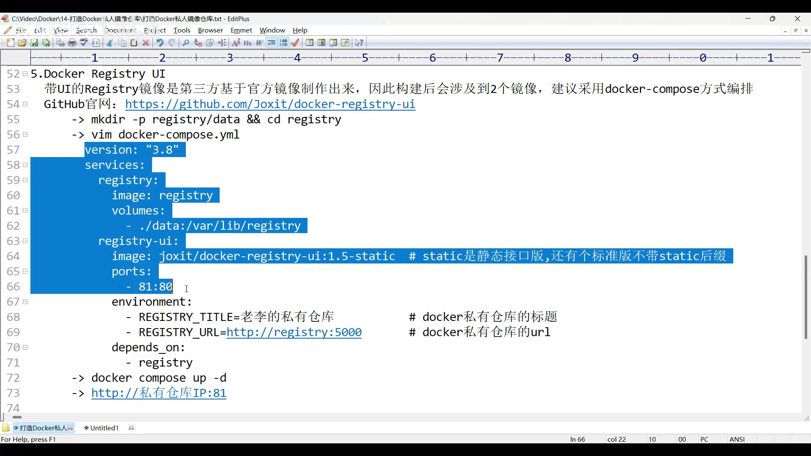

```yaml
version: "3.8"
services:
  registry:
    image: registry
    ports:
      - "5000:5000"
    volumes:
      - ./data:/var/lib/registry
  registry-ui:
    image: <registry-ui 的 static 版镜像>
    ports:
      - "81:80"
    environment:
      - NGINX_PROXY_PASS_URL=http://registry:5000
    depends_on:
      - registry
```

把内容写入 `registry` 目录下的 `docker-compose.yml`，然后执行：[【跳转到 19:24】](https://www.bilibili.com/video/BV1QC411n73p/?t=1164)

```bash
docker compose up -d
```

（讲者非首次构建，因而用到了缓存，启动很快。）

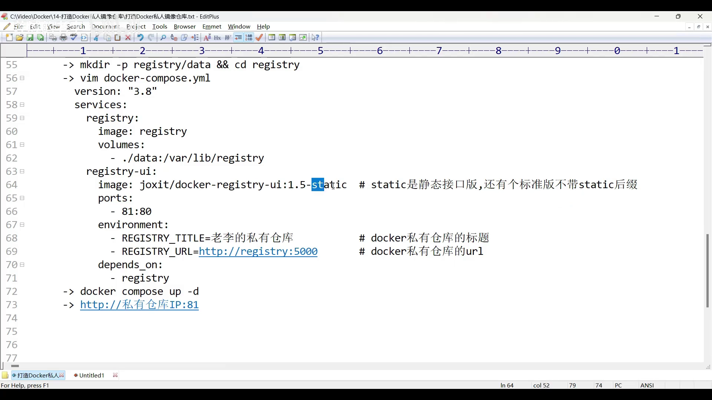

### 5.3 验证 UI

浏览器访问 `http://192.168.56.102:81`，即可看到 **UI 界面**：页面标题正是之前设置的"老李私有仓库"。仓库里**已经有一个镜像**——因为它挂载了之前用官方镜像推送过数据的那份 `data` 目录，所以 UI 把它**读取并展示**了出来。[【跳转到 20:11】](https://www.bilibili.com/video/BV1QC411n73p/?t=1211) [【跳转到 20:22】](https://www.bilibili.com/video/BV1QC411n73p/?t=1222) [【跳转到 20:30】](https://www.bilibili.com/video/BV1QC411n73p/?t=1230) [【跳转到 20:40】](https://www.bilibili.com/video/BV1QC411n73p/?t=1240)

展开镜像还能看到**详情**：大小、创建时间、操作历史等。[【跳转到 20:49】](https://www.bilibili.com/video/BV1QC411n73p/?t=1249) [【跳转到 20:54】](https://www.bilibili.com/video/BV1QC411n73p/?t=1254)

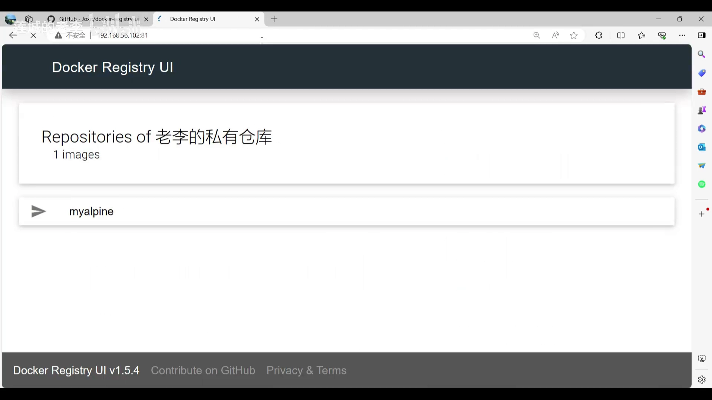

### 5.4 用新端口（81）推送与拉取

启用 registry-ui 后，推送/拉取**主要是改端口**：由原来的 **5000** 改成 **UI 提供的 81**（UI 通过 **NGINX 反向代理**访问后端接口）。修改仍在**工作站（客户端）**的 `daemon.json` 里完成——把可信任地址的端口从 5000 改成 81，然后重新加载配置、重启 Docker。[【跳转到 20:59】](https://www.bilibili.com/video/BV1QC411n73p/?t=1259) [【跳转到 21:04】](https://www.bilibili.com/video/BV1QC411n73p/?t=1264) [【跳转到 21:29】](https://www.bilibili.com/video/BV1QC411n73p/?t=1289) [【跳转到 21:54】](https://www.bilibili.com/video/BV1QC411n73p/?t=1314)

接着**重做 tag**，把地址改成 `192.168.56.102:81/...`，再 push：[【跳转到 22:19】](https://www.bilibili.com/video/BV1QC411n73p/?t=1339) [【跳转到 22:44】](https://www.bilibili.com/video/BV1QC411n73p/?t=1364)

```bash
docker tag <镜像> 192.168.56.102:81/<镜像>
docker push 192.168.56.102:81/<镜像>
```

推送后在网页端刷新，能看到**第二个镜像**出现，说明成功。拉取同理——先删掉本地带 UI 后缀的镜像，再 `docker pull 192.168.56.102:81/<镜像>` 拉回本地即可。[【跳转到 23:09】](https://www.bilibili.com/video/BV1QC411n73p/?t=1389) [【跳转到 23:16】](https://www.bilibili.com/video/BV1QC411n73p/?t=1396) [【跳转到 23:25】](https://www.bilibili.com/video/BV1QC411n73p/?t=1405)

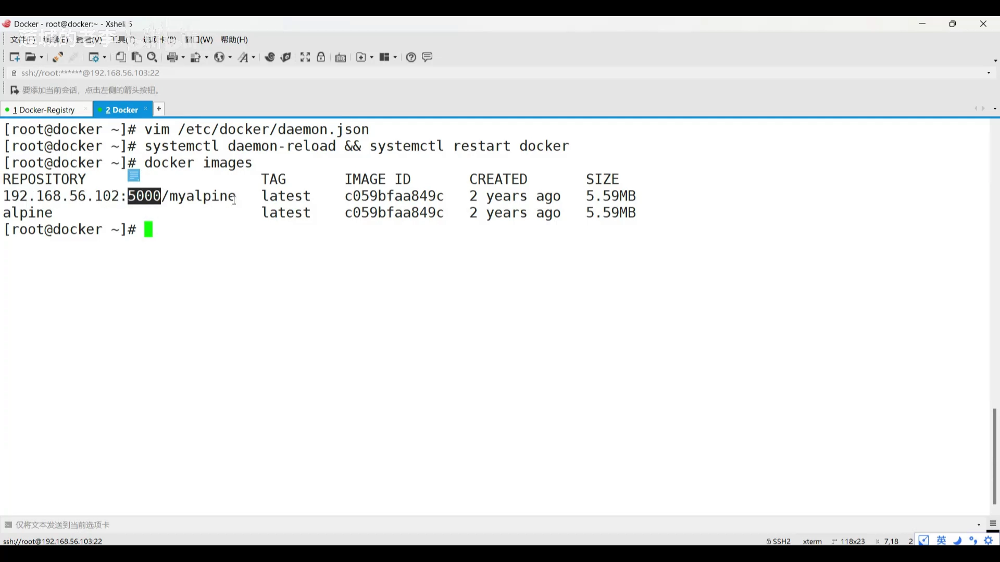

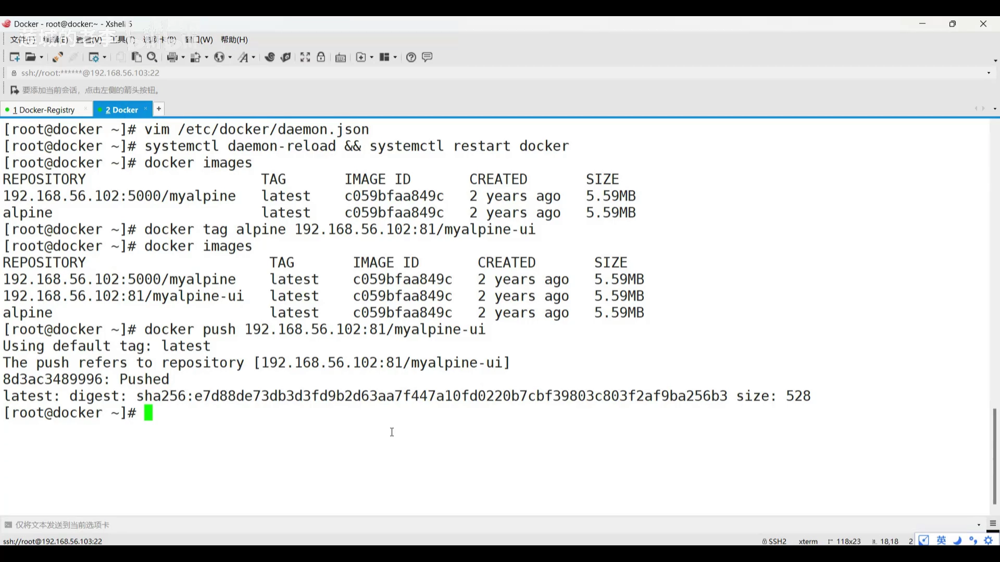

## 小结

- **私有仓库**存在的两个动机：**私密性/安全性**（企业镜像含商业机密，只对内开放）与**局域网更高效**（网络传输更快）。
- 搭建私有仓库**不需要额外安装包**：官方 `registry` 本身就是一个镜像——**拉镜像、跑容器，仓库即成**（"一切皆容器"）。
- 官方 `registry` 是**基础版**，功能完整但**没有 UI**；其**对外端口固定为 `5000`**，可用 `docker inspect` 确认。
- 启动容器时用 `-d --restart=always -p 5000:5000 -v <本地>/data:/var/lib/registry registry`：**后台运行、自动重启、端口映射、数据卷持久化**。
- 默认走 HTTPS 会因缺证书而失败，需在**客户端**的 `/etc/docker/daemon.json` 配置 **`insecure-registries`** 并重启 Docker；否则报 `server gave HTTP response to HTTPS client`。
- **推送前必须重做 tag**（把 `仓库IP:端口/名字:tag` 写进镜像名）；`docker tag` **不产生新镜像**（镜像 ID 不变）。
- 验证推送：看服务器 `data/docker/registry/v2/...` 目录，或刷新 `/v2/_catalog`。
- 想要图形界面：用 **docker compose** 组合官方 `registry` + 第三方 **registry-ui**（基于 NGINX，端口 80）；注意 **static 版 vs 标准版**、**端口映射 81:80**、**URL 用服务名而非 IP**、以及 **`depends_on`**。
- 用 UI 时，push/pull 的端口相应由 **5000 改为 81**。

## 关键术语速查

| 术语 | 一句话解释 |
| --- | --- |
| 公有仓库 | 对所有人开放的镜像仓库，如 Docker Hub、阿里云镜像仓库 |
| 私有仓库 | 建在本地/内网、只对内部开放的镜像仓库 |
| 官方 registry 镜像 | Docker 官方提供的基础版仓库，功能完整但无图形界面 |
| `-p 5000:5000` | 把宿主机 5000 端口映射到容器；registry 容器端口固定为 5000 |
| 数据卷挂载 `-v` | 把容器内 `/var/lib/registry` 挂到宿主机目录，实现镜像数据持久化 |
| `/v2/_catalog` | registry 的 API 路径，用于列出仓库中的所有镜像 |
| insecure-registries | 客户端 `daemon.json` 配置项，声明可信任的（HTTP）私有仓库地址 |
| `server gave HTTP response to HTTPS client` | 未配置 insecure-registries 时强行 push/pull 的典型报错 |
| 重做 tag | 用 `docker tag` 把"仓库地址:端口/名字:tag"写进镜像名；不产生新镜像 |
| registry-ui | 第三方基于官方 registry 做的带图形界面仓库，基础镜像为 NGINX（端口 80） |
| static 版 / 标准版 | registry-ui 的两种版本：static 更省资源更快但功能少；标准版功能更全 |
| `depends_on` | compose 中声明服务启动先后依赖，registry-ui 需在 registry 之后启动 |
