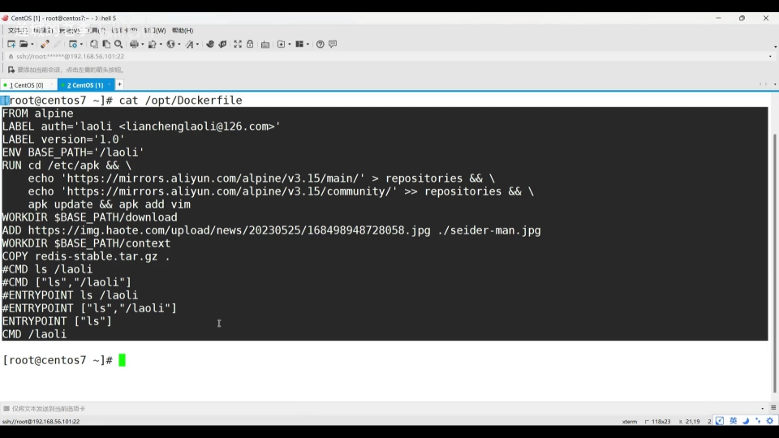
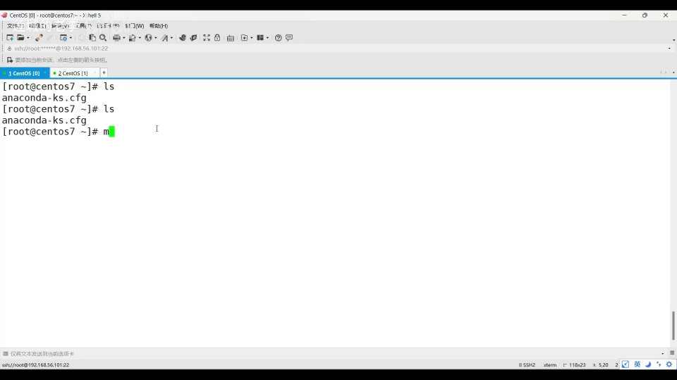
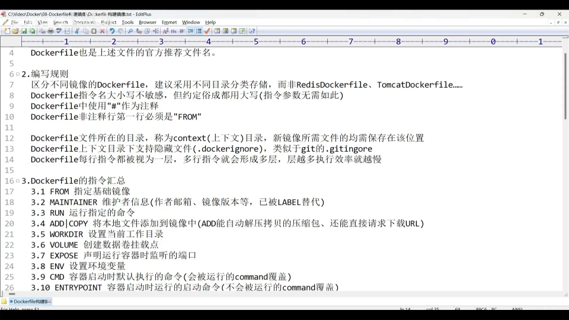
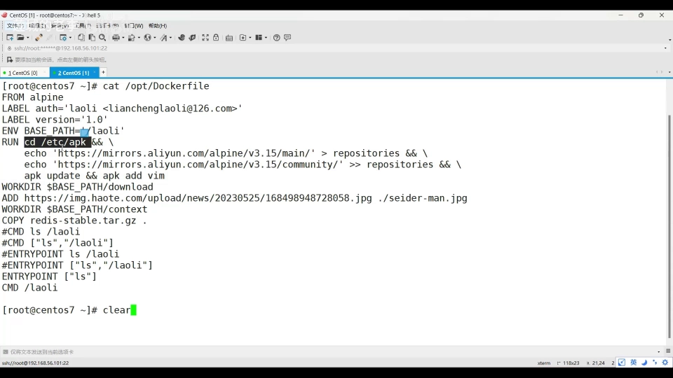
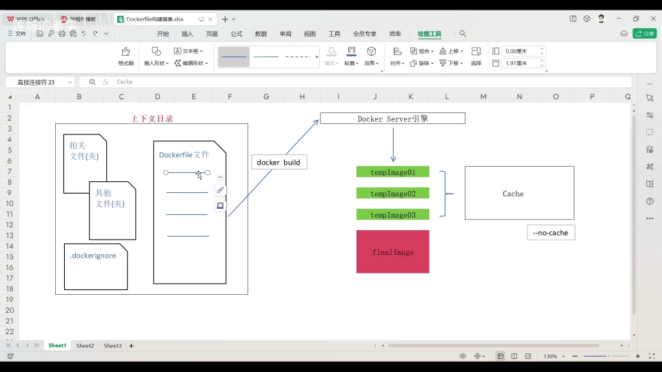
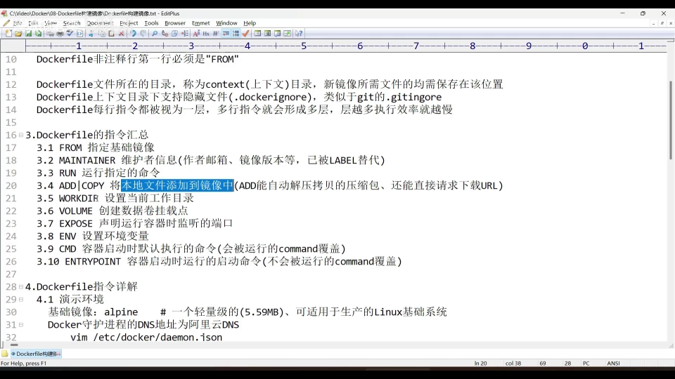
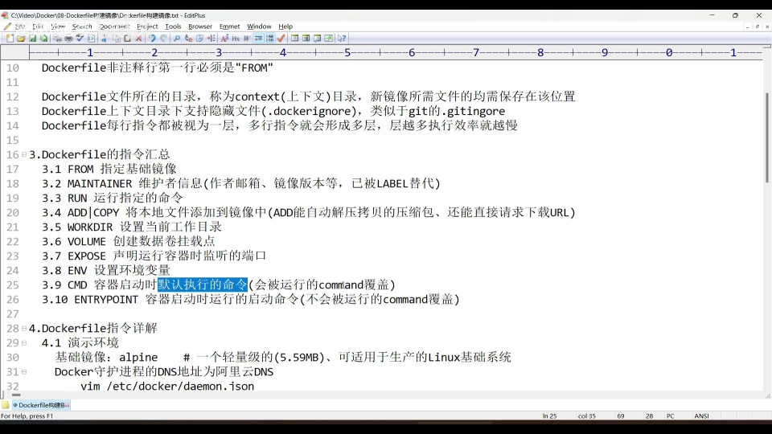
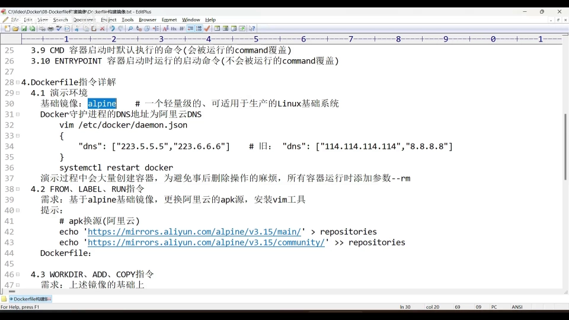
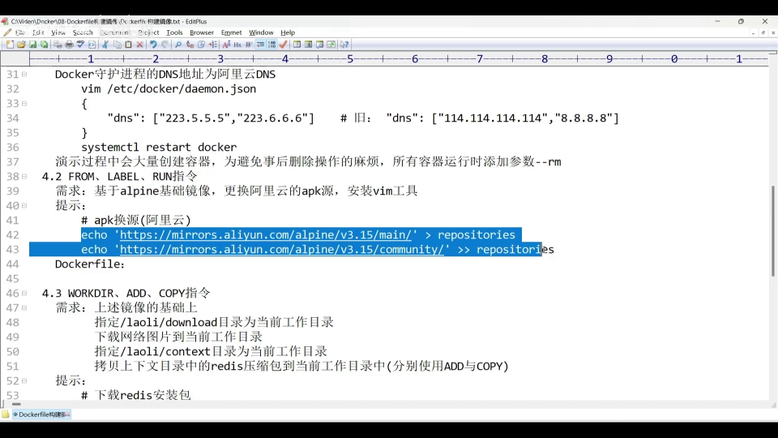
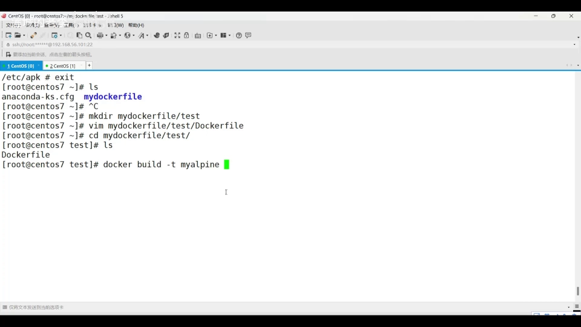

# Dockerfile 构建镜像：从语法规则到十条常用指令

> 本文据 B 站视频[《Dockerfile构建镜像(上)》](https://www.bilibili.com/video/BV1kK421e7JR/)（UP 主：莲城老李）整理而成，与同系列的[《容器镜像构建上下文 Context 详解》](镜像构建上下文Context详解.md)配套阅读。文中带时间戳的链接均可点击跳转到原视频对应位置；配图取自视频画面。

## 本讲要解决的核心问题（SCQA）

**背景**：我们知道 Docker 用**镜像（image）**把应用和它的运行环境打包在一起，再用**容器（container）**把镜像跑起来。但镜像自己不会凭空出现，它需要被「构建」出来。

**冲突**：构建镜像最常见的做法是写一个 `Dockerfile`。它看起来只是几行简单的文本，可新手却经常踩坑：文件名随意、指令大小写混乱、在无关的大目录里构建导致构建巨慢甚至失败、`RUN` 写得太碎让镜像层数暴增……

**疑问**：`Dockerfile` 到底是什么？一份合格的 `Dockerfile` 该怎么写？里面常用哪些指令？写完又怎样变成一个可用的镜像？

**回答（中心思想）**：`Dockerfile` 本质上是一份「构建镜像的说明书」——用一个文本文件，按顺序写下构建镜像所需的全部指令。只要掌握**几条编写规则 + 三条原理规则 + 十来个常用指令**，再用一条 `docker build` 命令，就能把一份纯文本变成自定义镜像。

---

## 一、Dockerfile 是什么：一份「构建镜像的说明书」

`Dockerfile` 是一种**文本文件**，里面包含了构建某个镜像所需的全部指令。换个说法，它其实是由一段段指令组合起来的文本文件。

可以把它类比成一个 **Java 源文件**：Java 源文件里是一行行 Java 代码；`Dockerfile` 里则是一行行「构建镜像」的指令——里面装的是构建镜像所需的东西。



每个构建脚本都必须有自己的文件名。`Dockerfile` 这类文件，**官方推荐的文件名就叫 `Dockerfile`**（没有后缀）。好处很直接：文件名统一，就免去了为每个构建脚本单独取名的烦恼。

但统一命名也带来一个问题——如果每个文件都叫 `Dockerfile`，光看文件名根本不知道它构建的是哪个镜像。因此推荐用**目录分类**来存放：

```
my-dockerfile/
├── redis/
│   └── Dockerfile      # 用来构建 Redis 镜像
└── tomcat/
    └── Dockerfile      # 用来构建 Tomcat 镜像
```

将来要新建一个 Redis 镜像的构建脚本，只要在 `redis/` 目录里 `touch` 出一个名为 `Dockerfile` 的文件即可。



## 二、编写规则：命名、大小写与注释

先看三条**比较容易理解**的规则：

1. **文件名规则**：都推荐命名为 `Dockerfile`，并用不同目录区分不同用途（见上）。
2. **大小写规则**：`Dockerfile` 里的**指令名大小写不敏感**——`FROM`、`from`、`From` 都能识别。但约定俗成的习惯是**指令名全大写**，而**参数部分全小写**。所以大写写指令、小写写参数，是最不容易出错的写法。
3. **注释规则**：用井号 `#` 表示注释；**非注释行的第一行必须是 `FROM`**（用于指定基础镜像，下一节会讲），这是硬性要求。

## 三、运行原理：上下文目录、分层与缓存

再看三条**反映运行原理**、相对难理解的规则。理解它们，才能写出真正高效的 `Dockerfile`。

### 3.1 上下文目录（context）与 `.dockerignore`

**`Dockerfile` 文件所在的目录，被称为 `context` 目录，中文叫「上下文目录」**。构建新镜像所需的一些外部文件，都应该保存在这个位置。

要理解这一点，得先知道：构建镜像时，Docker 会在「上下文目录」里扫描文件，它把这些文件当作构建镜像所需的必需文件。


如果上下文目录里混入了一些**与本次构建无关**的文件，可以用一个 **`.dockerignore`** 文件把它们排除掉。它是个隐藏文件（Linux 下以 `.` 开头），**作用类似于 git 的 `.gitignore`**：写进去的文件就不会被送去参与构建。


不过更推荐的做法是：**上下文目录里干脆不要存放与本次构建无关的文件或文件夹**。这样既能省去编写忽略文件的过程，又能提高 Docker 引擎扫描的速度。

### 3.2 一行指令一层：层越多越慢

`Dockerfile` 的**每一行指令都会被视为一层（layer）**，多行指令就形成多层，而**层越多，执行效率越慢**。

为什么？看示意图：假定 `Dockerfile` 里有四条指令，每条指令执行完后，Docker 服务端引擎都会自动生成一个对应的**镜像层**，而这只是**临时的镜像**——因为底下还有指令。当运行下一条指令时，它会在前一个临时镜像的基础上**再加一层**；一条条叠加下去。



比如原本要跑五条命令，如果写成五个 `RUN`，就会在构建过程中多出五个临时镜像层，效率降低。解决办法是**把这五条命令合并成一个 `RUN`**，用逻辑与符号 `&&` 把它们串起来，让它们最终只生成一个层。



### 3.3 构建缓存（cache）

为了提升构建速度，`Dockerfile` 还引入了**缓存区（缓存层）**的概念：既然每条指令都会生成一个镜像层、而**只要指令没变、层的内容也不变**，那就可以把这个层放进缓存区，下次遇到同样的指令时直接取出来用，无需重新生成，效率自然更高。

反过来，如果指令发生了变化、缓存区里没有对应的层，那这一层就必须重新构建。你也可以通过 `--no-cache` 参数强制每次都不使用缓存、全部重新生成——这个参数要加在 `docker build` 命令上。不过通常**不建议**这么做，因为并没有什么好处。



## 四、十条常用指令速览

下面这十条是写 `Dockerfile` 最常用的指令，先建立整体印象（详细用法见下一节实验）：

| 指令 | 一句话作用 |
| :--- | :--- |
| `FROM` | 指定**基础镜像**（构建自定义镜像的起点，好比一个操作系统） |
| `MAINTAINER` | 声明维护者信息（作者、邮箱、版本等）；**现已少用**，被 `LABEL` 取代 |
| `RUN` | 构建镜像时**要执行的命令**，每条命令前都要加 `RUN` |
| `ADD` | 把本地文件添加到镜像里；**额外支持解压压缩包** |
| `COPY` | 把本地文件添加到镜像里；**推荐优先使用它**（不做多余动作） |
| `WORKDIR` | 设置当前工作目录，作用类似 Linux 的 `cd` |
| `VOLUME` | 设置数据卷挂载点 |
| `EXPOSE` | 声明容器运行时所监听的端口 |
| `ENV` | 设置镜像中可用的环境变量（`environment` 的前三个字母） |
| `CMD` | 容器**启动时默认执行**的命令，**可以被覆盖** |
| `ENTRYPOINT` | 容器的**入口命令**，**不允许被覆盖** |



这里最容易混淆的是 `CMD` 和 `ENTRYPOINT`：前者是「默认执行的命令」，后期可以被覆盖；后者是「入口命令」，不被允许覆盖。



## 五、动手实验：用 Dockerfile 定制一个带 vim 的 Alpine

### 5.1 演示环境

- **基础镜像**：选用 **Alpine**，它是一个轻量级、可用于生产的 Linux 发行版，大小只有 **5.59 兆**，而且里面已经集成了很多基础工具，不用自己再去下载安装。



- 演示前对 Docker 守护进程配置（`/etc/docker/daemon.json`）做了修改：把 DNS 解析地址换成了阿里云提供的两个地址并重启 Docker 服务，否则构建时可能无法联网下载工具。
- 演示中会创建大量容器，因此运行容器时加了自动删除参数，退出即删，免去事后清理的麻烦。

### 5.2 先手动做一遍

进入一个 Alpine 容器，手动完成两件事：**把 APK 软件源换成阿里云**，**安装 vim**。换源用两条命令完成（一条覆盖写入源文件内容、一条用 `>>` 追加），随后 `apk update` 更新软件列表、`apk add vim` 安装，最后 `vim --help` 验证安装成功。

### 5.3 再改用 Dockerfile 实现

把上面的手动步骤写成 `Dockerfile`。核心思路是：

```dockerfile
# 1. 指定基础镜像（非注释行的第一行必须是 FROM）
FROM alpine
# 2. 切换工作目录到 /etc/apk，后续命令都在这里执行
WORKDIR /etc/apk
# 3. 把换源 + 更新 + 安装 vim 这几条命令合并成一个 RUN（用 && 连接）
RUN echo "..." > repositories && \
    apk update && \
    apk add vim
# 4. 用 LABEL 标注作者与版本（取代已少用的 MAINTAINER）
LABEL author="laoli" version="1.0"
```



把多条命令合并进一个 `RUN`、用 `&&` 连接，正是第三节「一行指令一层」原理的落地——避免产生多余的临时镜像层。

### 5.4 构建与验证

在 `Dockerfile` 所在目录执行 `docker build -t my-alpine .`：`-t` 指定镜像名，最后的 `.` 表示**以当前目录为构建上下文**（这正是配套文章《容器镜像构建上下文 Context 详解》要讲的重点）。命令会依次执行各条指令完成构建。



构建结束后 `docker images` 能看到生成的镜像；再用 `docker run` 起一个容器，检查 `/etc/apk/repositories` 已换成阿里云源、`vim` 也已装好，实验就成功了。

## 小结

- **`Dockerfile` = 构建镜像的说明书**：一个按顺序写满构建指令的文本文件，官方推荐文件名就叫 `Dockerfile`，用目录分类存放不同用途的脚本。
- **三条简单规则**：文件名统一 `Dockerfile`；指令名大写、参数小写（大小写不敏感但别乱写）；`#` 注释、非注释首行必须 `FROM`。
- **三条原理规则**：`Dockerfile` 所在目录是**上下文目录**（无关文件用 `.dockerignore` 排除）；**一行指令一层**、层多则慢（多命令用 `&&` 合并到一个 `RUN`）；**构建缓存**可复用未变化的层。
- **十条常用指令**：`FROM`、`MAINTAINER`(→`LABEL`)、`RUN`、`ADD`、`COPY`、`WORKDIR`、`VOLUME`、`EXPOSE`、`ENV`、`CMD`、`ENTRYPOINT`。
- **落地流程**：把需求写成 `Dockerfile` → `docker build -t 镜像名 .` 构建 → `docker run` 起容器验证。

## 关键术语速查

| 术语 | 一句话解释 |
| :--- | :--- |
| 镜像（image） | 把应用及其运行环境打包成的只读模板，容器由它启动 |
| 容器（container） | 镜像运行起来的实例 |
| Dockerfile | 描述「如何构建镜像」的文本文件，由一条条指令组成 |
| 上下文目录（context） | Dockerfile 所在的目录；构建时会扫描其中内容并作为构建的输入 |
| `.dockerignore` | 与 `.gitignore` 用法类似的忽略文件，排除不参与构建的文件 |
| 镜像层（layer） | 每条指令生成的只读层，层层叠加最终形成镜像 |
| 构建缓存（cache） | 指令未变时复用已有层，加快构建速度；`--no-cache` 可禁用 |
| `docker build` | 依据 Dockerfile 构建镜像的命令，`-t` 指定镜像名，末尾参数为上下文路径 |
