# 容器镜像构建上下文 Context 详解

> 本文据 B 站视频[《Dockerfile教程：镜像构建上下文 Context 详解》](https://www.bilibili.com/video/BV17T411y74p/) 整理而成，与同目录的[《Dockerfile 构建镜像：从语法规则到十条常用指令》](Dockerfile构建镜像（上）.md)配套阅读。文中带时间戳的链接均可点击跳转到原视频对应位置；配图取自视频画面。

## 本讲要解决的核心问题（SCQA）

**背景**：我们用 `docker build -t 镜像名 .` 构建镜像时，命令末尾总有一个「点」。写了 `Dockerfile`、执行了命令，镜像就构建出来了。

**冲突**：很多人从没想过那个「点」是什么——有人以为它指向 `Dockerfile` 的路径，有人干脆把它当成一个固定写法抄下来。于是问题接踵而至：`COPY` 用绝对路径怎么都不生效；把 `Dockerfile` 放在一个大目录里构建，`docker build` 却慢得像在打包整个硬盘，甚至直接失败。

**疑问**：`docker build` 命令末尾的那个「点」到底是什么？它为什么会带来这么多麻烦？

**回答（中心思想）**：那个「点」指定的是**构建上下文（context / build context）路径**——它是 Docker「打包并发送给服务端」的文件范围。理解了上下文，就理解了 `COPY` 为什么只能用相对路径、为什么 `Dockerfile` 要放在小目录里，以及 `.dockerignore` 和 `-f` 参数的意义。

---

## 一、命令末尾的那个「点」，不是 Dockerfile 的路径

先看一条最普通的构建命令：

```bash
docker build -t my-image:v1 .
```

这里 `-t` 指定的是**镜像名称（含 tag）**，而末尾的「点」指定的是**上下文路径**——它表示**当前目录**。

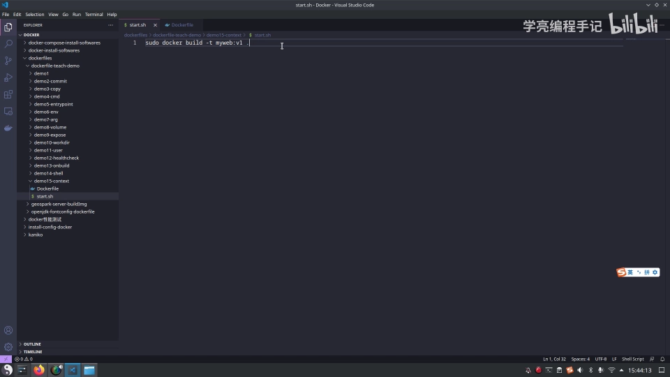

初次接触 `Dockerfile` 的同学，往往会以为这个路径是在指定 **`Dockerfile` 所在的路径**，这样理解其实**不太准确**。要讲清楚这个点，得先理解 `docker build` 的运行原理。

## 二、为什么需要上下文：Docker 的 C/S 架构

Docker 在运行时分为两大部分：

- **Docker 引擎（服务端守护进程，docker daemon）**：真正干活的「大脑」；
- **客户端工具（docker client）**：我们敲 `docker` 命令时用的那个程序。

Docker 引擎提供了一组 **REST API**，也就是 **Docker Remote API**；客户端通过这组 API 与引擎交互，相当于一次 **RPC 远程调用**。

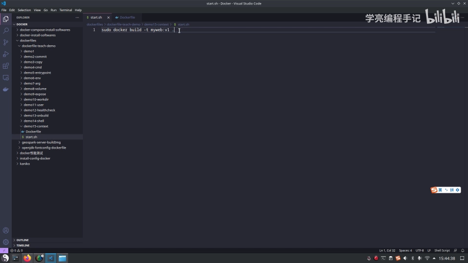

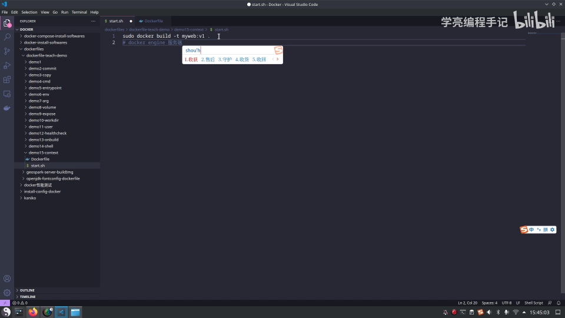

表面上我们像是在本机执行各种 Docker 功能——`docker build`、`docker run`、`docker exec`、`docker push`……**实际上一切都是以远程调用的形式，由服务端引擎完成的**。

只不过安装 Docker 时，它**同时安装了 server 端和 client 端**，两者都跑在你本机，所以你就感知不到「到底在哪运行」。假如你只在本机装了 client、而把服务端放在另一台服务器上，就一目了然了：所有运行都在服务端进行，客户端只是调用服务端提供的 API。正是这种 **C/S（客户端 / 服务端）设计**，让我们操作远程服务器上的 Docker 引擎变得轻而易举。

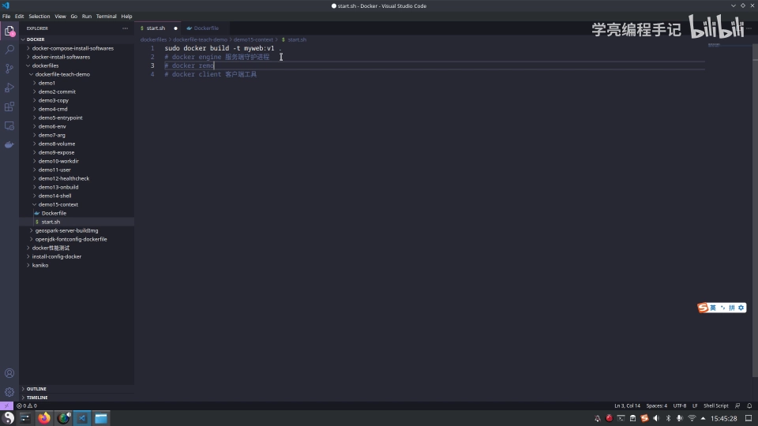

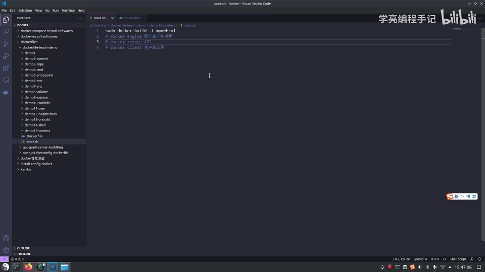

**这一点是理解「上下文」的关键**：既然构建镜像是在**服务端**完成的，那服务端要怎么拿到你**本机**的文件呢？

## 三、构建上下文如何工作

构建镜像时，并非所有定制都能靠 `RUN` 指令完成。很多时候我们还需要把本地文件（比如项目的 `package.json`）**复制到镜像里**，这就要用到 `COPY` 或 `ADD` 指令。

- `COPY` 和 `ADD` 十分相似，区别在于 **`ADD` 还能解压压缩包**（复制进去后会自动解压）；
- 由于 `COPY` 语义更单纯，**一般场景下推荐直接使用 `COPY`**。

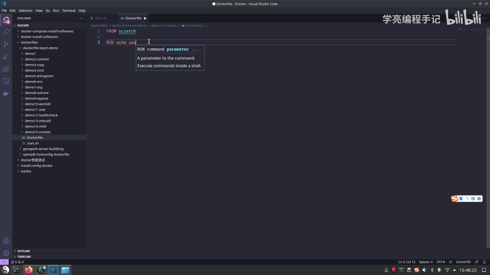

问题来了：构建在服务端进行，服务端怎么获取你本机的文件？答案就是 **context（上下文）**：

1. 构建时，用户通过 `docker build` 命令末尾的「点」**指定上下文路径**；
2. `docker build` 得知这个路径后，会**把该路径下的所有内容打包**——也就是说，你的 Dockerfile 同级目录下有多少内容，就打多少；
3. 这个包会被**发送给 Docker 引擎**；
4. 引擎收到后**解包展开**，就得到了构建镜像所需的一切文件。

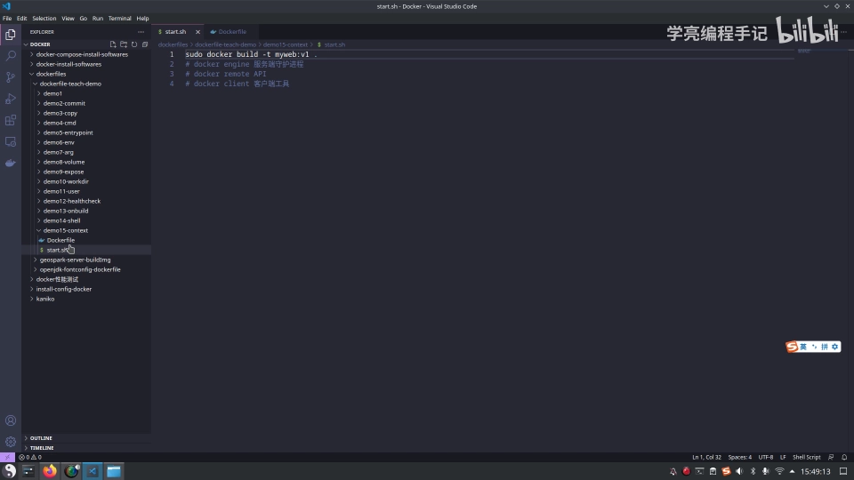

也因此，**放置 Dockerfile 的目录里的文件要尽量少，最好是一个空目录**——不必要的内容都会被打包发送，徒增开销。

构建时终端里能看到对应的日志：**`Sending build context to Docker daemon 3.584kB`**，那 3.584kB 就是上下文目录里那些文件的大小。

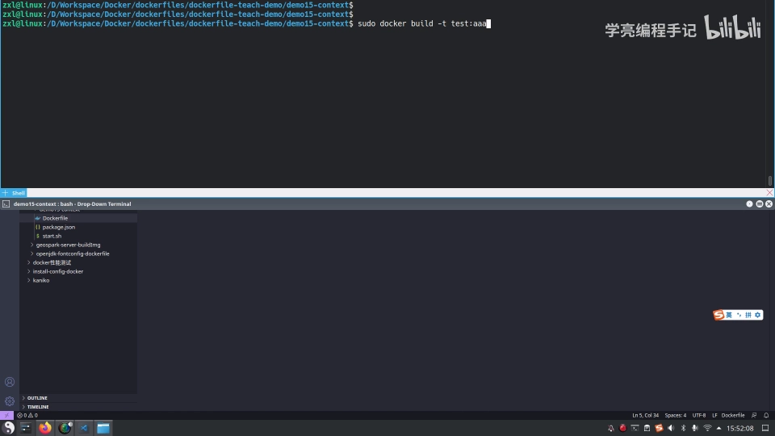

## 四、两个必须避开的坑

### 4.1 `COPY` 的源只能用相对路径，绝对路径不生效

既然 `COPY` 的源文件是相对**上下文**的路径，那就很容易理解一个经典问题：为什么在 `Dockerfile` 里写**绝对路径**（比如 `/app/some/path`）不生效、会「找不到文件」？

因为**这个绝对路径已经超出了上下文的范围**，Docker 引擎根本拿不到这些位置的文件。

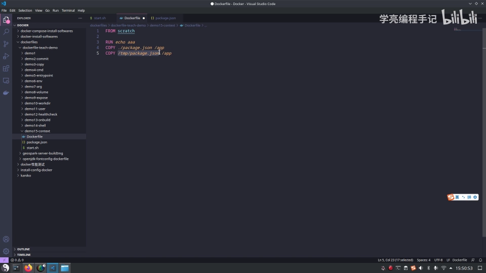

如果确实需要这些文件，正确做法是**先把它复制到上下文目录里**。而上下文目录是由命令里的「点」指定的——点就是当前目录，所以需要什么内容，就把它放进当前目录下。

### 4.2 别把 `Dockerfile` 放在大目录里构建

反过来还有一个更常见的错误：有人把 `Dockerfile` 放在**硬盘根目录 `/`** 下构建，结果 `docker build` 时提示要发送**几十 GB** 的内容。

原因还是那个「点」——它指向当前目录，会把目录下**所有**文件都打包发送。你这里可能只有几 KB 的小文件，但**根目录下内容极多**，Dockerfile 和它们同级，于是全都被发了过去，过程自然**极其缓慢，而且很容易构建失败**。

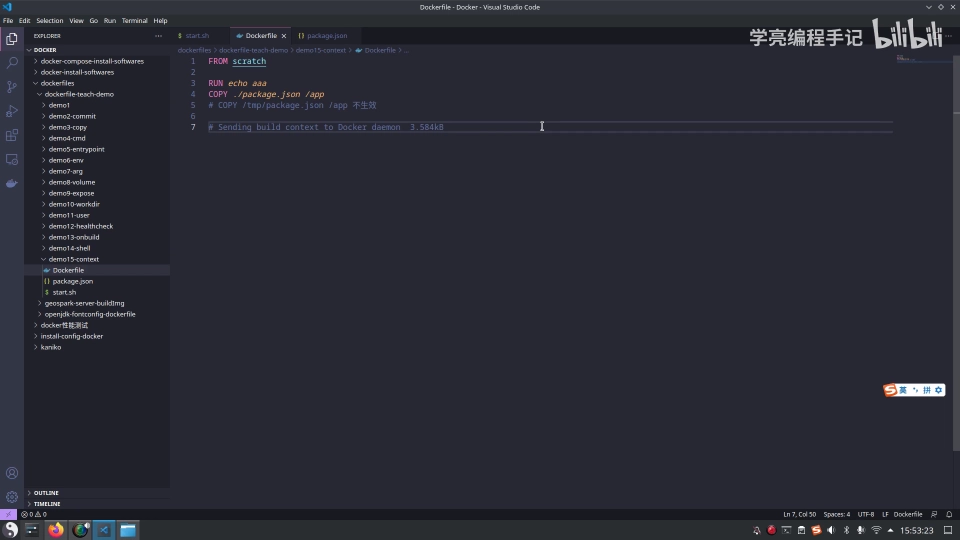

所以正确做法是：**把 `Dockerfile` 放在一个空目录，或者项目的根目录下**；如果缺少所需文件，就把那个文件拷贝一份过来。

## 五、`.dockerignore` 与 `Dockerfile` 的定位

如果上下文目录里确实有些内容**不希望参与构建**，可以用 **`.dockerignore`** 文件把它们排除掉：它的写法和 git 的 `.gitignore` 类似，写进去的文件和目录在构建时**就不会被传给 Docker 引擎**。

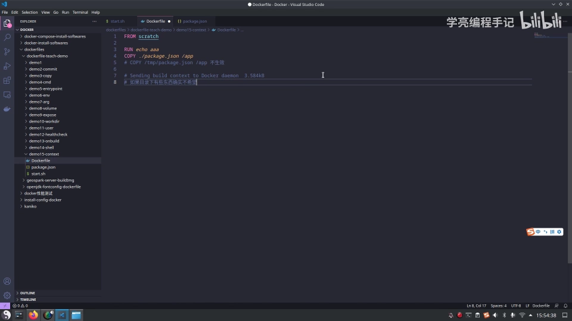

最后澄清一个常见误解——**为什么大家会以为那个「点」就是 Dockerfile 所在的目录？**

因为在**默认情况下**，如果不额外指定，`docker build` 会把**上下文目录下名为 `Dockerfile` 的文件**拿来用。但这只是「默认行为」而已：

- `Dockerfile` 的**文件名并非必须叫 `Dockerfile`**；
- 它也**不要求必须位于上下文目录中**；
- 可以用 **`-f` 参数**指定构建文件，例如 `docker build -f Dockerfile.xxx .`。

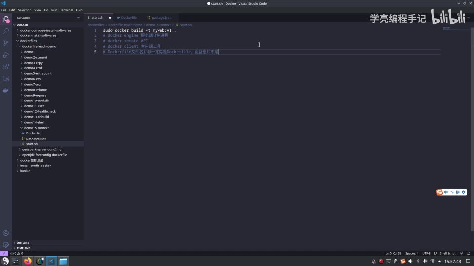

不过一般情况下，大家还是会用默认文件名 `Dockerfile`，并把 `Dockerfile` 放进上下文目录——这是最约定俗成、也最符合镜像构建规范的做法。

## 小结

- `docker build` 末尾的「点」不是 `Dockerfile` 的路径，而是**构建上下文（context）路径**，表示当前目录。
- Docker 是 **C/S 架构**：客户端发命令、服务端引擎干活，构建发生在服务端。
- 服务端要拿到本机文件，就靠**上下文**：`docker build` 把上下文路径下的**全部内容打包发送**给引擎，引擎解包后用于构建。
- **`COPY`/`ADD` 的源路径相对上下文**，所以写绝对路径会因超出上下文范围而失效；构建日志里的 `Sending build context to Docker daemon ...` 就是在发送上下文。
- **别把 `Dockerfile` 放在大目录（如 `/`）里构建**，否则会把大量无关文件一起打包，缓慢且易失败；放到空目录或项目根目录。
- **`.dockerignore`** 可排除不参与构建的文件；`Dockerfile` 文件名与位置并非强制，可用 **`-f`** 指定。

## 关键术语速查

| 术语 | 一句话解释 |
| :--- | :--- |
| 构建上下文（context / build context） | `docker build` 末尾路径所指定的目录，其内容会被打包发送给 Docker 引擎 |
| Docker 引擎（docker daemon） | C/S 架构中的服务端，真正执行构建、运行等操作 |
| docker client | 客户端工具，通过 REST API 向引擎发起远程调用 |
| REST / Remote API | Docker 引擎对外提供的一组 HTTP 接口，供客户端调用 |
| `COPY` / `ADD` | 把本地文件复制进镜像；`ADD` 额外会解压，`COPY` 更单纯、推荐使用 |
| `Sending build context to Docker daemon` | 构建日志，表示正在把上下文打包发送给引擎 |
| `.dockerignore` | 排除不参与构建文件的忽略文件，语法类似 `.gitignore` |
| `-f` | `docker build` 参数，用于指定任意文件名 / 位置的 Dockerfile |
