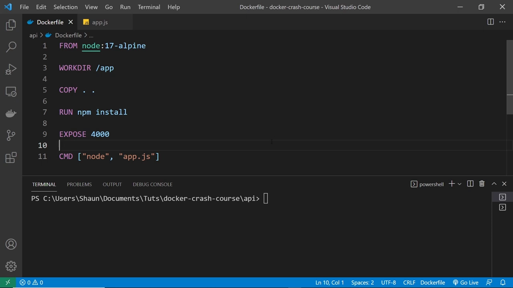
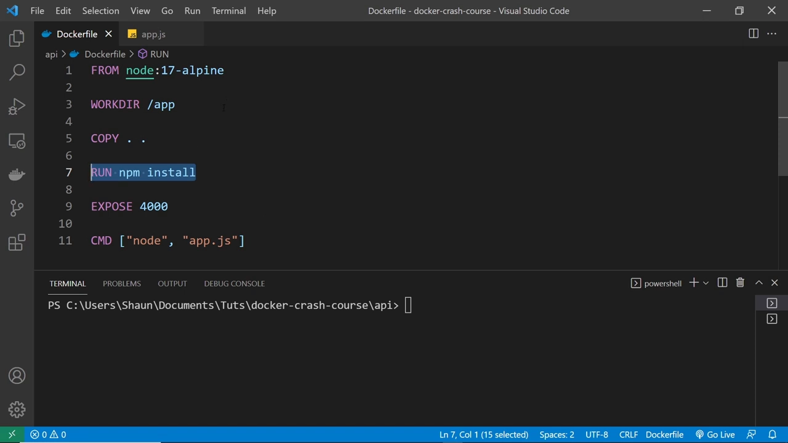
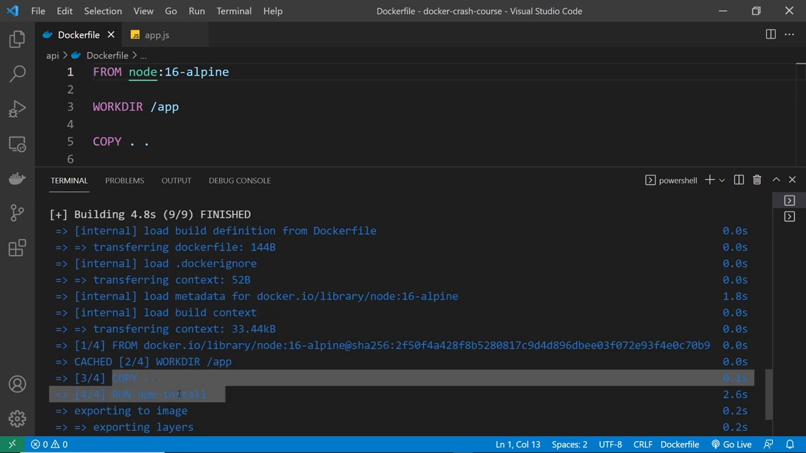
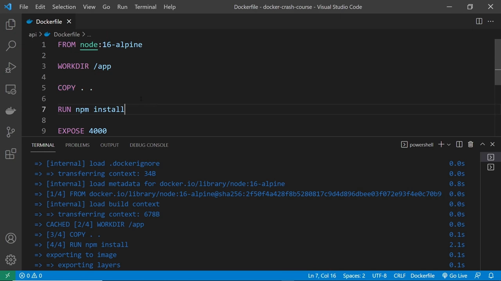
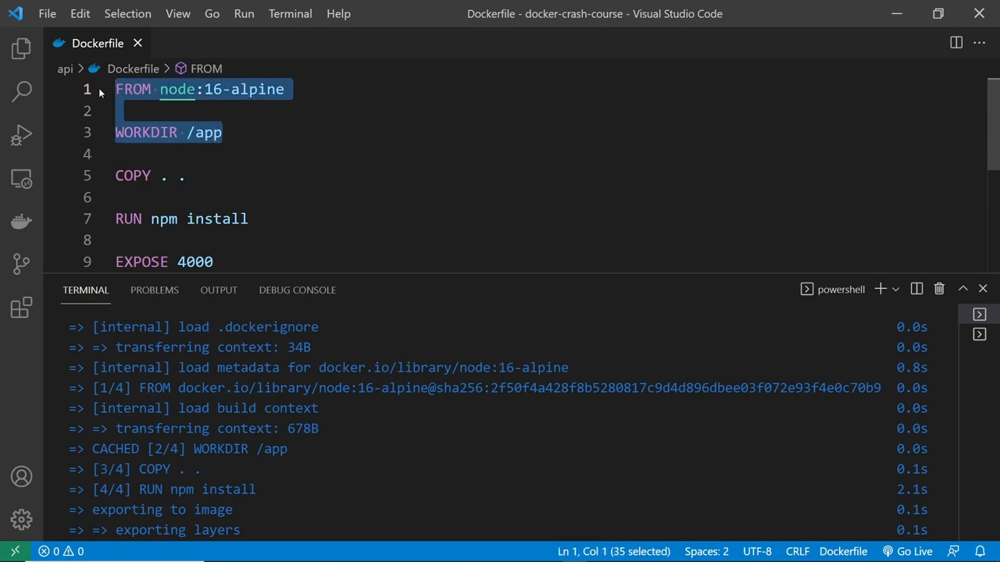
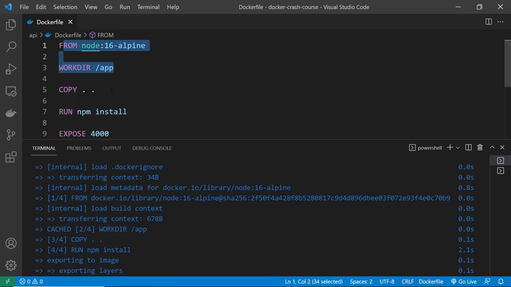
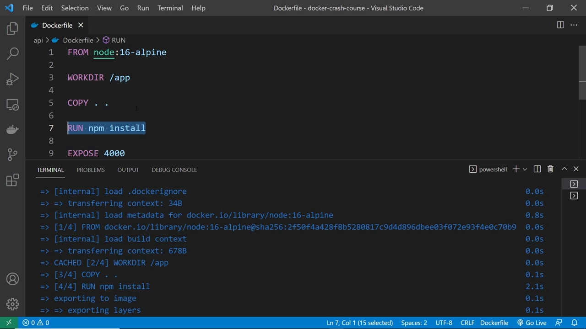
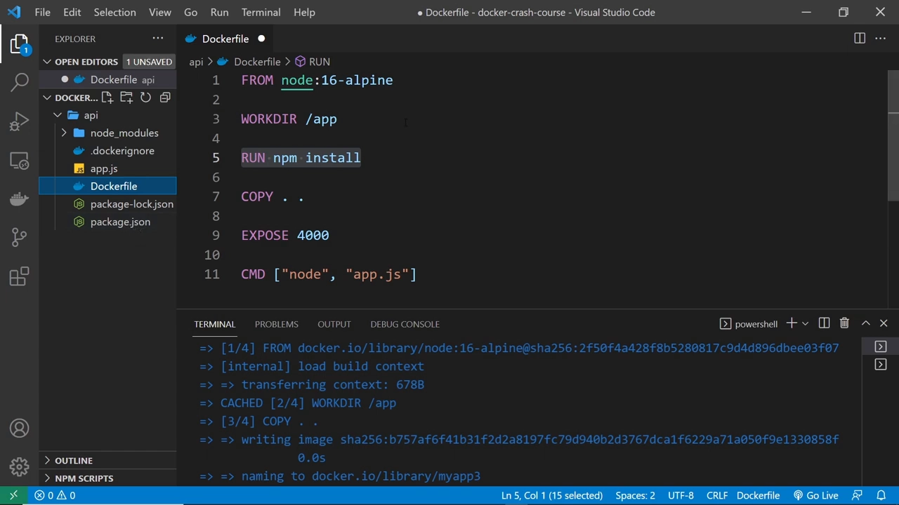
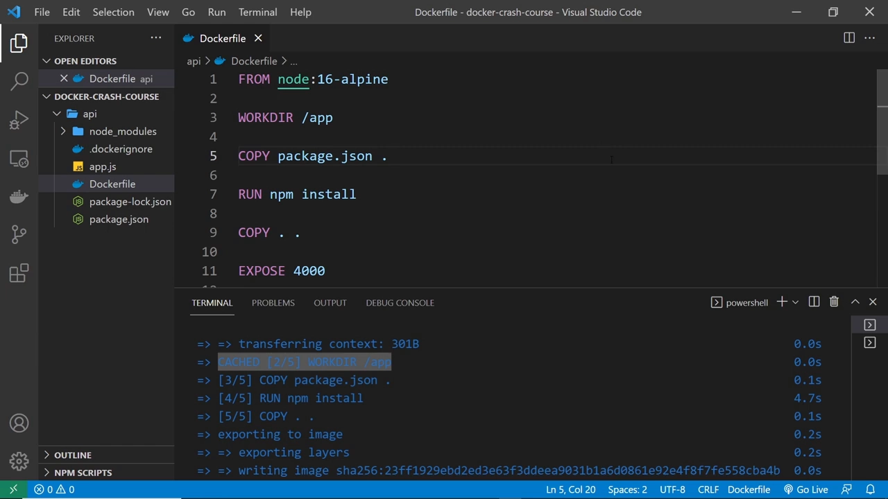
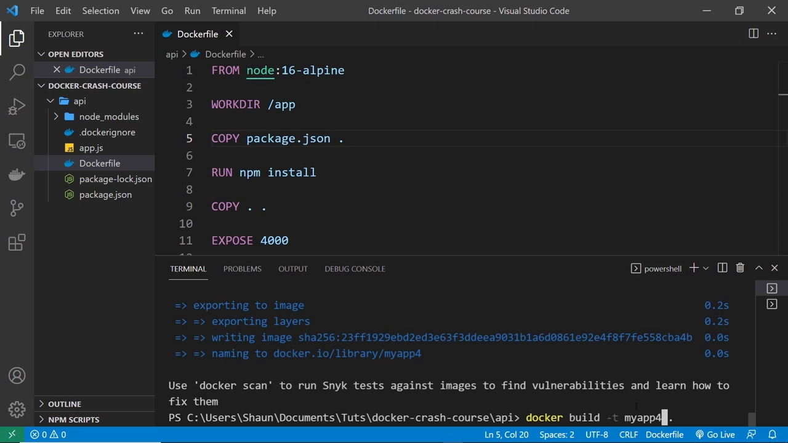

# Docker Crash Course #8 - Layer Caching（层缓存）

> 视频来源：YouTube 视频 [Docker Crash Course #8 - Layer Caching](https://www.youtube.com/watch?v=_nMpndIyaBU)（频道 **The Net Ninja**，约 9 分 52 秒）。本文基于视频演说图文稿整理，时间戳可跳转到原视频对应位置；配图取自视频画面。原视频为英文，字幕由 ASR 生成，个别拼写已按上下文订正。
>
> 本条目的另外两篇配套阅读：[《镜像分层机制：一行指令一层，多个镜像共用存储》](【Docker】8-2 Dockerfile-镜像分层机制.md) 讲「层」的基础，[《Docker 镜像最佳实践：从 1.2GB 到 10MB》](Docker镜像最佳实践：从1.2GB到10MB.md) 讲怎么把镜像做小。

## 本讲要解决的核心问题（SCQA）

**背景**：前面几讲我们已经会构建镜像、把镜像跑成一个容器、以及停止容器了，流程本身没有错。

**冲突**：但每次改一点代码就要**从头重新构建**——重新下载父镜像、重新安装一堆依赖，动辄几十秒。明明只改了一行，凭什么要重做前面所有工作？

**疑问**：Docker 到底是怎么缓存镜像层的？改动一层，为什么它后面的层全都要重做？有没有办法让「安装依赖」这类耗时步骤也命中缓存？

**回答（中心思想）**：容器构建的核心优化叫 **层缓存（layer caching）**。`Dockerfile` 里**每一行指令都是一层**，Docker 会把「每一步为止的整叠层」都存进缓存；下次构建时，只要**从头到第一次变化的那一层**没变，就能直接从缓存取用。因此**把稳定、耗时的步骤（如装依赖）排在易变步骤（如复制源码）之前**，就能让它们长期命中缓存。

---

## 一、每一行指令 = 一层

先说回顾：我们此前已看过怎么构建镜像、把镜像跑成容器、以及怎么停止容器。而这里要做的改进，就是 **层缓存（layer caching）**。

记住一个前提：**`Dockerfile` 里几乎每一行都代表镜像中新的一层**，因为每一行都给镜像添加了新东西。比如：

- 第一层：拉入 `node` 基础镜像；
- 第二层：指定工作目录（`WORKDIR`），这条信息作为一层加入；
- 第三层：把源码文件复制进去（`COPY`），又是一层；
- 第四层：安装依赖（`RUN npm install`），再加一层……

每一行都在给镜像**叠加新的一层**，镜像就是**一层叠一层**这样构建出来的。



## 二、每加一层，都要花时间

既然每加一层都是在**改变镜像**，那每加一层就等于**让 Docker 多做一份工作**，而每份工作都要花时间：下载父镜像可能几秒，安装全部依赖可能 20 秒，等等。



如果我们把父镜像换成一个本地没下过的新版本 node，就能看到整个构建过程**从头在终端里重跑一遍**：

```bash
docker build -t myapp2 .        # -t 给镜像命名，末尾的 . 是 Dockerfile 的相对路径
```

执行时会**依次走过每一步**，一层层往镜像上加。构建完成后向上翻，能看到这次构建花了多少秒，以及每一步分别加了什么——**1/4 是父镜像、2/4 是工作目录、3/4 是复制源码、4/4 是安装依赖**。



**每次生成新镜像，Docker 都要按顺序把这些步骤再走一遍。**

## 三、改一行代码要重建：缓存在起作用

现在假设我们改了 `app.js`（比如把返回给客户端的 JSON 改一下）。因为**镜像是只读的、不会自动更新**，代码一变，就必须**构建一个新镜像**来接纳这个改动。



于是再跑一次：

```bash
docker build -t myapp3 .
```

这次**快得多**——这正是**层缓存**在起作用。原理是：Docker 每次构建、走过每一层时，都会**把「到该步为止的镜像」存进缓存**；再次构建时，它在从头开始之前会先去缓存里找**能复用的镜像**。

在本例中，改的是 `app.js`，它影响的是**复制源码那一层及其之后**的所有层，但**不影响它之前的层**——也就是最初的 node 父镜像层和工作目录层。所以 Docker 会从缓存里取到**「工作目录层为止」的那份镜像**（因为到这里镜像仍然一模一样），然后只在它之上重新添加后续层。



终端里能直接看到证据：**第二层旁边标着 `cached`**，说明它来自缓存；从它之后的层才开始重新做。

你可能会问：**为什么后面的层（装依赖、复制源码）不也从缓存取？** 因为源码变了，复制源码这一层必须重跑；而且**每层都建立在上一层之上**，一个层变了，它后面的层都得重新添加。这里的关键点是：**缓存的不只是「单个层」，而是「每一步为止的整叠层」**——比如安装依赖那一步缓存的，是「到那一步为止的整叠层」。



## 四、让「装依赖」也命中缓存：调整顺序 + 先 COPY package.json

不过有一点仍然成立：**如果 `npm install` 之前已经做过，就没有必要再重做一次**。有没有办法让它也缓存起来？有——**把它放到复制所有文件之前去跑**。

于是先把 `RUN npm install` 剪切、粘贴到 `COPY` 那一行**上面**。这样将来再改源码时，**前三层（含 `npm install`）都能从缓存取用**，不必重跑。

但这样一来有个新问题：构建时会**先执行 `npm install`，可 `package.json` 还没复制进去**，它就不知道该装什么——`npm install` 需要 `package.json` 先就位。



**解决方案：把 `package.json` 单独作为一层、先复制进去，再执行 `npm install`。**



在 `npm install` 上面加一条 `COPY package.json .`，它只把这一个文件复制进工作目录；随后的层再执行 `npm install`（此时就能正常工作了）；再下面的层才复制其余源码。这样，**改动 `app.js` 时，前四层（含 `npm install`）都能从缓存取用**。

## 五、验证效果

先构建一次确认一切正常：

```bash
docker build -t myapp4 .
```

可以看到：一开始就拿到一份**缓存的镜像**（因为前两层上次已经做过、且没变），然后在其上把额外的层建起来。



再改一次 `app.js`、重新构建：

```bash
docker build -t myapp5 .
```

这次**连安装依赖那一层也从缓存里取了**，整个过程更快——这就是层缓存的精华所在。

最后把它跑起来验证：

```bash
docker run --name myapp5_c -p 4000:4000 myapp5
```

容器起来后，浏览器一切正常。



---

## 小结

- **一行一层**：`Dockerfile` 里几乎每一行都是镜像中的一层，镜像由层逐层堆叠而成。
- **缓存的是「每一步为止的整叠层」**：Docker 在每一步都把当时的镜像存进缓存，下次构建时先找可复用的部分。
- **变化点决定重做范围**：改动某一层，它之后的层都要重做，但它之前没变的层可直接从缓存取用。
- **让耗时步骤长期命中缓存**：把**稳定、耗时**的步骤（装依赖）排在**易变**的步骤（复制源码）之前——先 `COPY package.json`，再 `RUN npm install`，最后 `COPY . .`。
- **本质规律**：把最稳定的层放最上面、最常改动的层放最下面，就能让尽可能多的层命中缓存，让每次构建都快。

## 关键术语速查

| 术语 | 一句话解释 |
| :--- | :--- |
| 层（layer） | `Dockerfile` 每一行指令在镜像里新增的一层，只读、可被复用 |
| 层缓存（layer caching） | Docker 把每步为止的镜像存入缓存，构建时复用未变化的部分 |
| 缓存失效（cache invalidation） | 某层发生变化后，该层及其之后所有层都必须重新构建 |
| `cached` 标记 | `docker build` 输出中某层旁标注 `cached`，表示该层来自缓存 |
| 构建顺序优化 | 把「稳定且耗时」的层放前面（先 `COPY package.json` + `RUN npm install`），把易变的源码复制放最后 |
| `-t` 与末尾的 `.` | `-t` 给镜像命名；末尾的 `.` 是 Dockerfile 的相对路径（构建上下文） |
