# Docker 镜像最佳实践：从 1.2GB 到 10MB

> 视频来源：B 站视频[《Docker镜像最佳实践：从1.2GB到10MB！》](https://www.bilibili.com/video/BV1QmkVYiEjg/)（UP 主「比特光锥_BightCone」，约 7 分 15 秒）。本文基于视频演说图文稿整理，时间戳可跳转到原视频对应位置；配图取自视频画面。
>
> 本条目的另外两篇配套阅读：[《镜像分层机制：一行指令一层，多个镜像共用存储》](【Docker】8-2 Dockerfile-镜像分层机制.md) 讲清「层」是什么，[《Docker Crash Course #8 - Layer Caching》](Docker Crash Course #8 - Layer Caching.md) 专门讲层缓存。

## 本讲要解决的核心问题（SCQA）

**背景**：一个 Docker 镜像动辄几百 MB 甚至上 GB。很多人用的还是 `node:latest`、`python:latest` 这类「什么都塞进去」的官方大镜像。

**冲突**：镜像越大，占的存储越多、拉取和部署越慢，在 Kubernetes 这类环境里这些代价还会被放大。可很多人用了几年 Docker，也没系统想过「怎么把镜像做小、做快」。

**疑问**：有哪些具体、可落地的技巧，能把一个镜像从 GB 级一路瘦身到 MB 级？这些技巧背后的原理是什么？

**回答（中心思想）**：把镜像做小做快，靠的是**五步组合拳**——换更小的基础镜像、用好层缓存、用 `.dockerignore` 剔除无关文件、把清理动作并入同一条 `RUN`（利用层的不可变性）、用多阶段构建只保留构建产物；再配合 `dive`、`slim` 这类工具检查与优化。

---

## 一、为什么镜像体积值得较真

视频作者把自己一个 Docker 镜像一路瘦身：从一个巨大的体积**减到 10 MB**。他甚至说，这些技巧是他用了四年 Docker 后才新学到的，就算你是有经验的开发者，也值得一看。

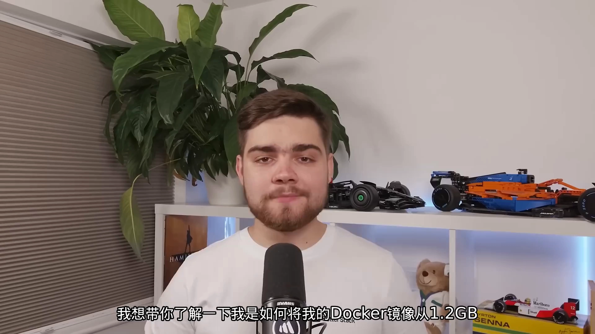

为什么要在意？因为**每一兆字节都很重要**：它不仅影响**存储成本**，还影响**部署时间、可扩展性，甚至安全性**；如果你用 Kubernetes 这类工具，这些影响都会被放大。下面用一个 **Node + React** 应用演示，但这些技巧适用于所有 Docker 镜像。

## 二、第一步：换一个更小的基础镜像

起点是 `node:latest`——**一个超过 1 GB 的镜像**。这类镜像把 Python 之类的所有东西都塞了进来，打个比方，**就像用货船去送一封信**，太浪费了。

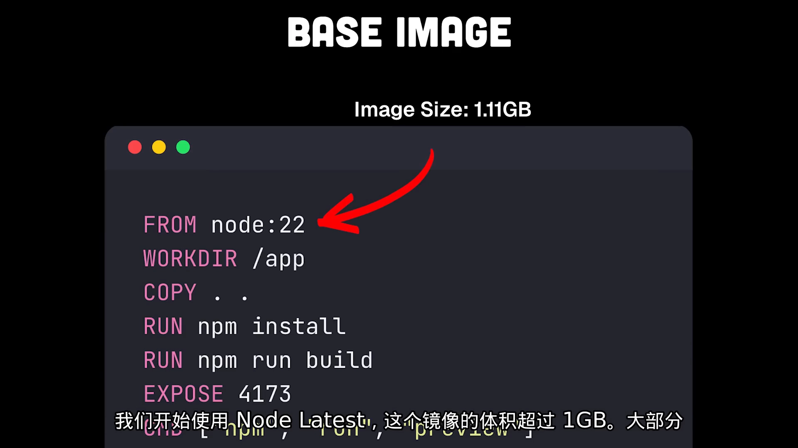

选更好的基础镜像其实很简单：**给镜像名加上 `-alpine` 后缀**（如 `node:alpine`），这个镜像只有 **155 MB**。用它构建，我们的镜像能降到 **250 MB**——**多敲 7 个字符，体积就减少 80%**。它为什么有效？**Alpine 专门为容器设计**，被「削」到极致，只保留运行应用所必需的基本要素。

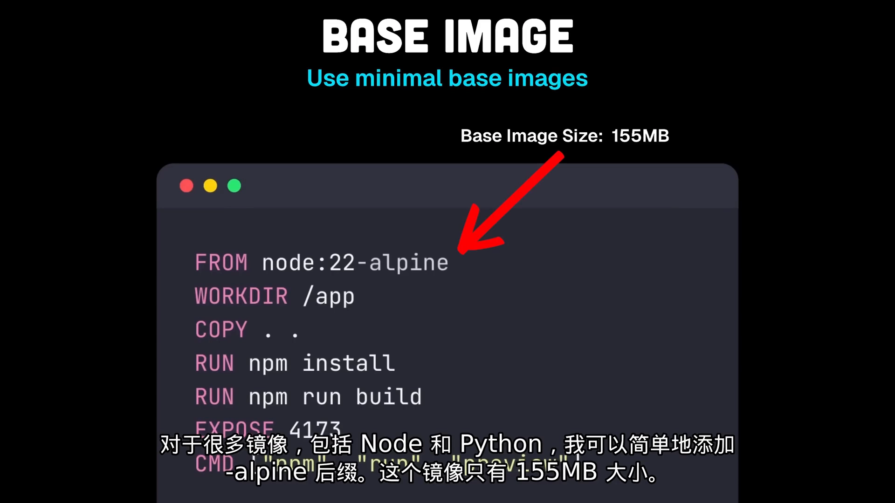

当然它不总是最佳选择：为了实现极致精简，Alpine 使用了与标准 Linux 发行版不同的系统库，可能带来**兼容性问题**，尤其是和**原生模块**打交道时。但几乎所有流行镜像都提供了比标准镜像更精简的变体。另一个方向是 **distroless** 镜像（谷歌对最小化镜像的看法）：**完全不包含操作系统**，你没有 shell、没有包管理器，连基本的 Linux 命令都没有，里面只有你的应用及其运行时；配置起来稍复杂一些。

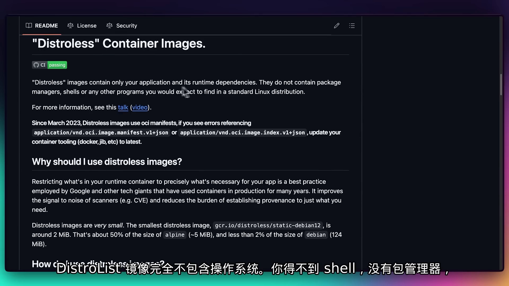

一个实用策略是：**开发时用完整镜像，生产环境再换成最小化的那个**。

## 三、第二步：用好层缓存，别让改一行代码就重装依赖

把基础镜像换小之后，来看**速度**——每次改一行代码，不该等上几分钟让 Docker 重新构建、重新安装所有依赖。

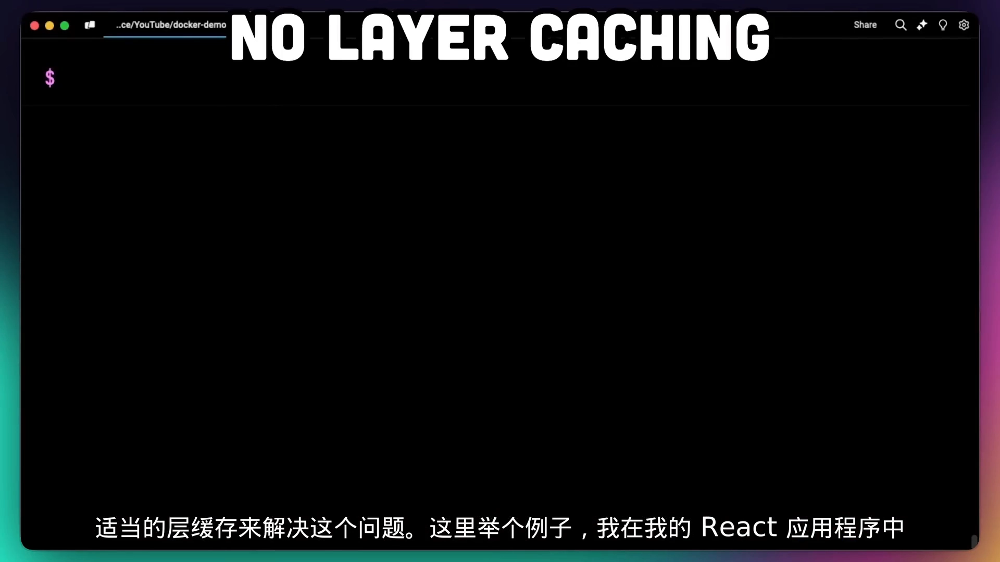

问题出在：`Dockerfile` 里**每个指令都会创建一个新层**，所以代码一变，它所在的那一层及其之后的所有层都会失效、重做。解决办法是**重写 `Dockerfile` 以利用层缓存**——关键动作是**先只复制 `package.json`**（而不是一开始就把所有源码都复制进去）：

```dockerfile
COPY package.json .      # 依赖清单变化频率低 → 单独一层
RUN npm install          # 依赖不变时，这一层可复用缓存
COPY . .                 # 源码变化频率高 → 放到后面
```

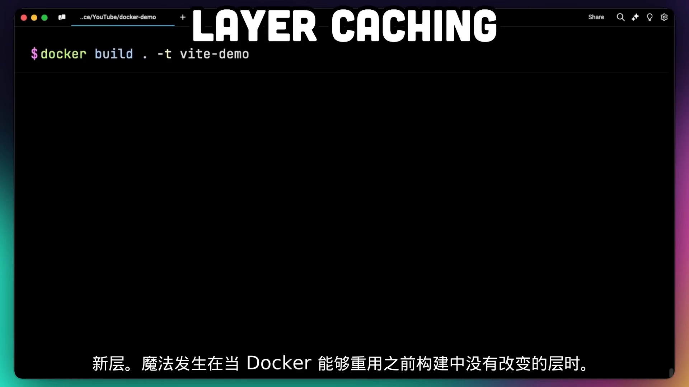

这样重建时，**依赖步骤能复用上一次构建的缓存，只有代码构建步骤需要重做**。用 Python 的 `requirements.txt` 也是同样的道理。

要知道，有**三件事会触发缓存失效**：一是你复制的文件发生了变化；二是 `Dockerfile` 指令本身变了；三是任何**先前层的改变**（因为缓存的是「到这一步为止的整叠层」，前面一变，后面全得重来）。这就是为什么**顺序很重要**——把最稳定的层放在最上面，把最常改动的层放在最下面。

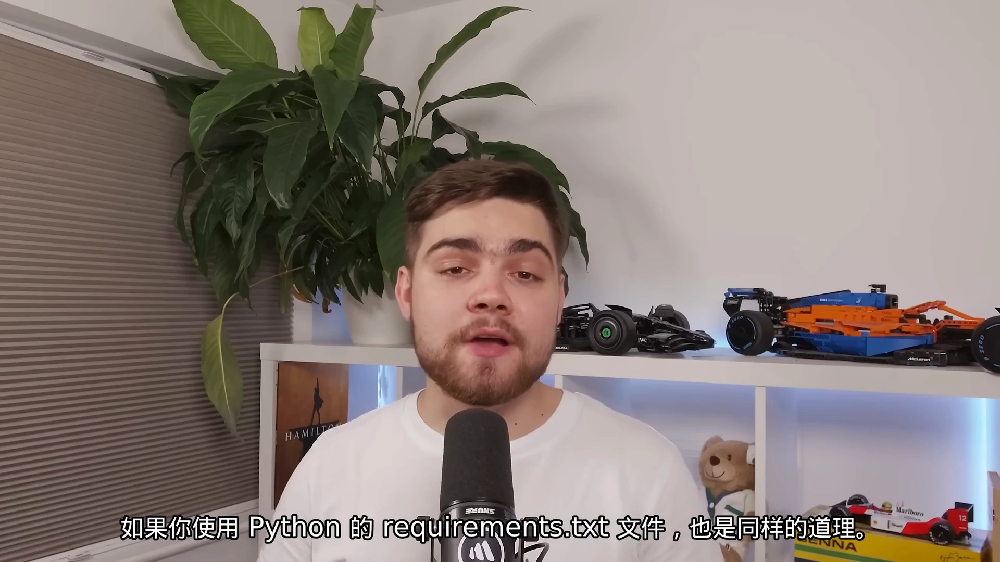

## 四、第三步：用 `.dockerignore` 剔除无关文件

本地开发时通常已经 `npm install` 生成了 `node_modules`，导致 `COPY` 时把这些其实不需要的额外文件夹也带进了构建上下文。**构建命令的输出里会告诉你传输了多少构建上下文**——而 `node_modules` 在构建镜像时完全没用（镜像里会重新安装一遍）。

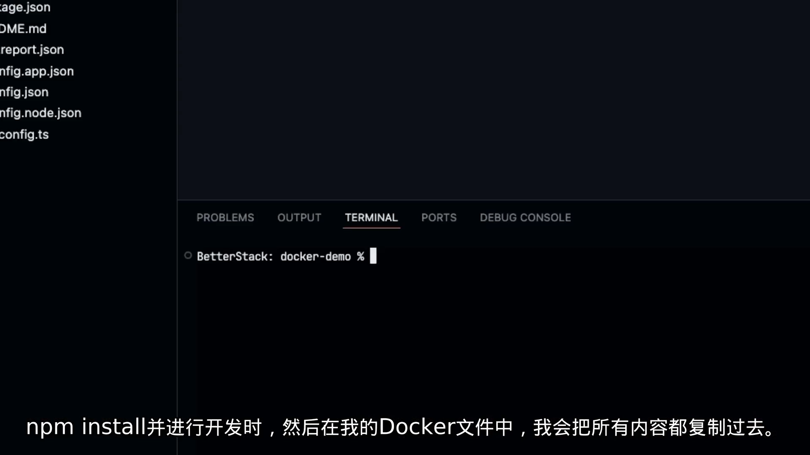

所以要设置一个 **`.dockerignore`**：把明知不需要进镜像的文件（如 `node_modules`）写进去排除——**顺便也确保你的密钥不会被打包进去**。再跑一次构建，你会发现传输的构建上下文少得多，**在大应用里能显著加快构建速度**。

## 五、第四步：记住「层不可变」，把清理并入同一条 `RUN`

如果我们清理缓存、删除临时文件、删掉 `node_modules`——镜像应该变小才对，**但并没有**。

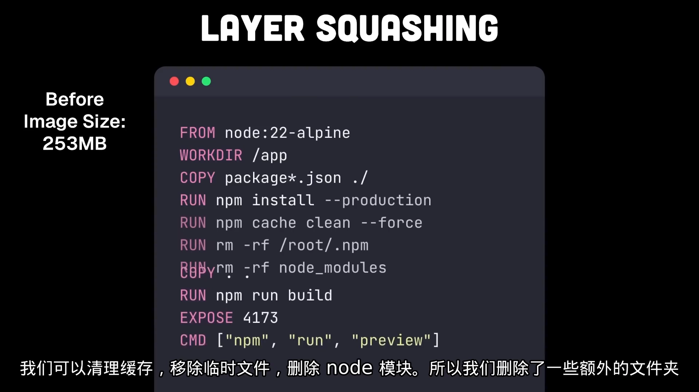

原因在于：**每一层都是不可变的，只包含相对上一层的改变**。当你把删除操作写成单独的 `RUN`，**即使后面的层里删了文件，这些文件依然存在于更早的层中**——Docker 无法从之前的不可变层里抹掉数据，在新层里删除文件，只是把这些文件标记为「在最终容器里不可用」，它们在镜像里**仍然占着空间**。

**解决办法是把所有操作合并到一条 `RUN` 命令里**，这样它们都在同一个层里进行，这一层提交时只包含**最终状态**（包括被清理过的文件），不再留下中间状态的额外文件。

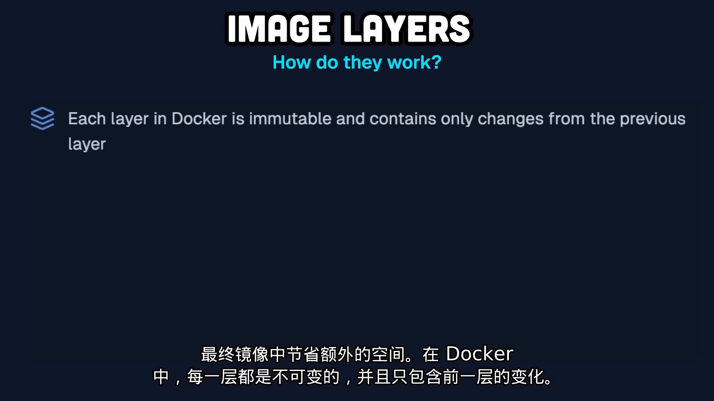

这**还有安全意义**：如果你不小心 `COPY` 了一个 `.env` 文件（本来就不该这么做），再在另一行里把它删掉——**它实际上仍然能在镜像里被找到**，有人可以进去把那些机密文件提取出来。所以「合并到一条 `RUN`」既省空间、又更安全。

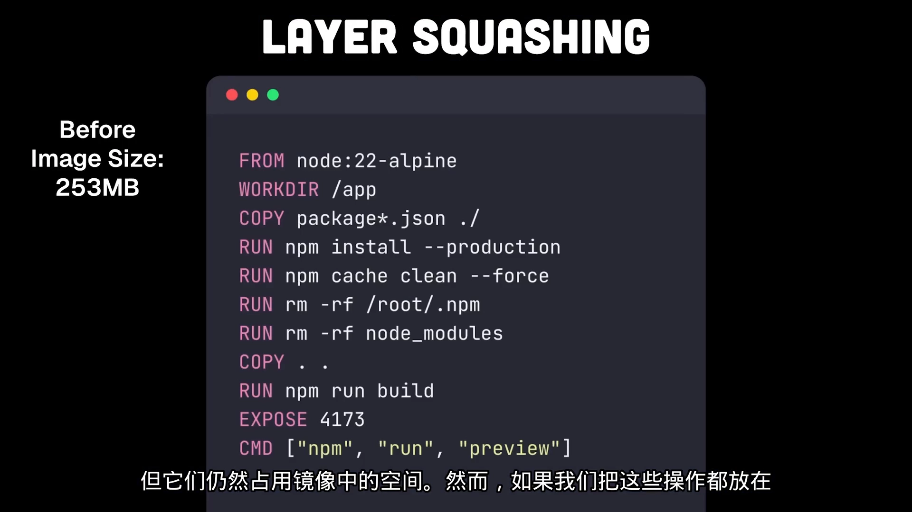

## 六、第五步：多阶段构建，只发构建产物

合并 `RUN` 之后，我们的应用按当时的状态跑不起来（前面删掉了 `node_modules`）——这正好引出 **Dockerfile 的第一要点：多阶段构建**。

应用构建完成后，其实**只需要分发构建产物**（这里是静态 HTML 文件），用 nginx 之类的服务器托管即可，**完全不需要 node、npm 或其它任何东西**。

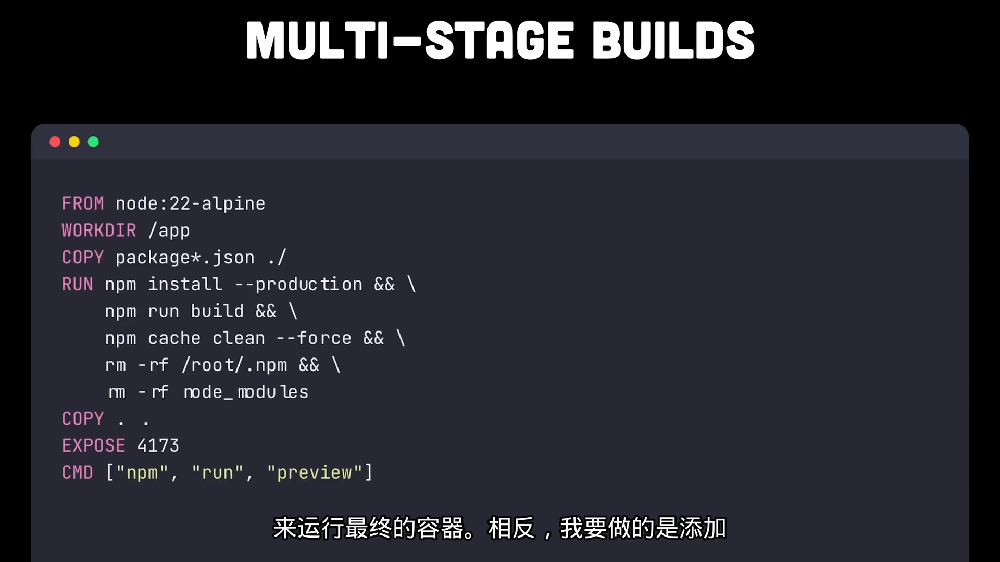

做法就是**再加一行 `FROM`**：构建阶段里的一切——Node.js、npm、`node_modules`、原始代码——**都会被丢弃**，最终镜像只包含从构建阶段复制过来的构建产物，以及 nginx 镜像本身（它非常小）。这样一来，镜像一下子只剩 **5、7 MB**，超级简单。

## 七、辅助工具：dive 与 slim

`Dockerfile` 可以变得非常复杂，作者推荐两个能帮上忙的工具。

**`dive`**：一个**镜像浏览器**，能让你查看镜像里的单个层，用来帮你**找到优化点、调试构建**。

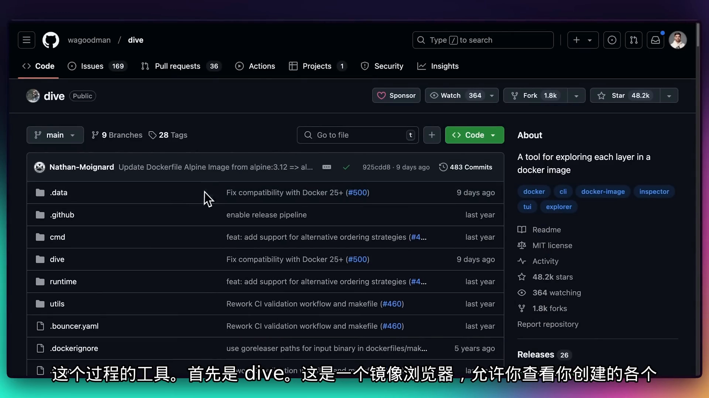

**`slim`**：允许开发者**检查、优化和调试容器**，**无需改动镜像本身**，就能把它最小化**多达 30 倍**，同时还让它更安全；它还提供 X-ray、linting 等能力，帮你更好地理解和创建镜像。作者这里正是用 **`slim build` 命令**把镜像最终降到了 10 MB。

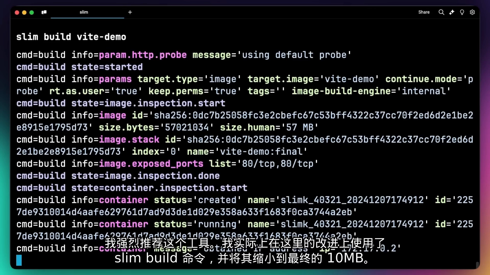

---

## 小结

- **换小基础镜像**：`node:latest`（>1GB）→ `node:alpine`（155MB），多敲 `-alpine` 省 80% 体积；要求极致可用 **distroless**，但要留意系统库兼容性。
- **用好层缓存**：先 `COPY package.json` 再 `RUN npm install`，让依赖层可复用；记住**天然顺序 = 稳定在上、易变在下**。
- **`.dockerignore`**：排除 `node_modules`、密钥等无关文件，缩小构建上下文、加快构建。
- **层不可变**：单独 `RUN` 删文件并不会缩小镜像，**清理动作要并入同一条 `RUN`**；这也避免机密文件残留在旧层。
- **多阶段构建**：用多行 `FROM` 分离构建与运行，最终镜像只保留构建产物 + 小运行时（本例降到 5、7MB）。
- **检查工具**：`dive` 看层、`slim` 免改镜像瘦身（最多 30 倍）。

## 关键术语速查

| 术语 | 一句话解释 |
| :--- | :--- |
| 基础镜像（base image） | `FROM` 指定的起点镜像，体积大小直接决定成品的下限 |
| Alpine / distroless | 两种「最小化」镜像：Alpine 精简发行版，distroless 连操作系统都不要 |
| 层缓存（layer cache） | 指令未变时复用已有层；被复制文件、指令本身、先前层变化都会使其失效 |
| `.dockerignore` | 构建时排除文件（如 `node_modules`、密钥），缩小上下文并加速构建 |
| 层不可变（immutable layers） | 每层只记录相对上一层的改变，后续层删文件不会真正腾出空间 |
| 多阶段构建 | 多个 `FROM` 分段，只把构建产物复制到最终镜像，丢弃工具链与源码 |
| `dive` / `slim` | 前者查看镜像分层，后者免改镜像即可优化瘦身并做安全检查 |
