# 镜像分层机制：一行指令一层，多个镜像共用存储

> 视频来源：B 站视频[《【Docker】8-2 Dockerfile-镜像分层机制》](https://www.bilibili.com/video/BV12uYUzjE2d/)（UP 主「小尹不吱声」，约 7 分 47 秒）。本文基于视频演说图文稿整理，时间戳可跳转到原视频对应位置；配图取自视频画面。
>
> 本条目的另外两篇配套阅读：[《Docker 镜像最佳实践：从 1.2GB 到 10MB》](Docker镜像最佳实践：从1.2GB到10MB.md) 讲怎么把镜像做小，[《Docker Crash Course #8 - Layer Caching》](Docker Crash Course #8 - Layer Caching.md) 讲层缓存怎么加速构建。

## 本讲要解决的核心问题（SCQA）

**背景**：我们知道 Docker 用**镜像**打包应用和它的运行环境。当我们写下 `Dockerfile`、执行 `docker build` 时，Docker 会把镜像「一层一层」地拼出来。

**冲突**：镜像为什么是分层的？如果本地下载了十几个看似不同的镜像，磁盘是不是就被重复占了十几份？为什么容器一删，里面改过的数据就没了？

**疑问**：分层存储到底是什么机制？它怎么帮我们省磁盘？镜像和容器在存储上又是什么关系？

**回答（中心思想）**：Docker 镜像**在底层是分层存储**的，这些层直接来自 `Dockerfile` 里的每一行指令。**多个镜像会共用相同的底层**，各自只额外存自己的增量；而容器在只读的镜像层之上，再单独叠一层可读可写的容器层——这正是「容器删掉、数据就丢」的根源。

---

## 一、镜像为什么是分层的：一行指令一层

Docker 在底层存储一个镜像时，用的是**分层存储**的方式。这些层从哪来？来自你编写的 `Dockerfile`：构建器读取 `Dockerfile`，里面写了非常多的指令，**每一行指令都可能下载一些内容、或者修改文件系统里的某些东西**，于是每一行指令就产生一个存储层；这一行指令引起的内容变化，就存到它对应的那一层里。

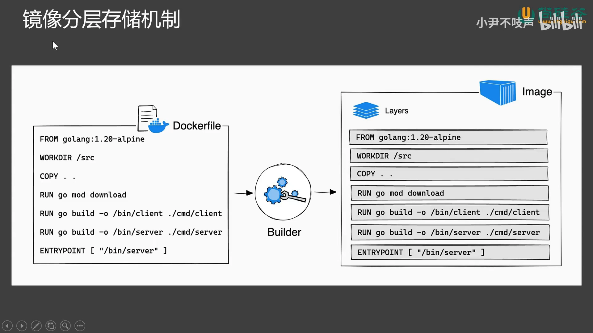

这样做最直接的好处是**减轻磁盘存储压力**。举个例子：现在要构建 app1、app2 两个应用，各有自己的代码和依赖，但**都基于 openjdk17**，而 openjdk17 又是在 **Debian** 系统下装的 Java 环境。

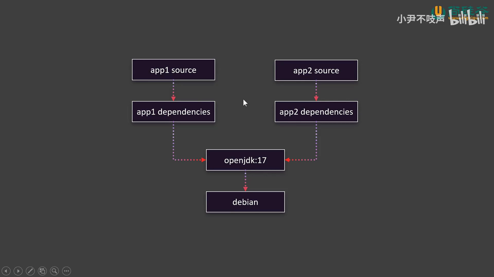

如果采用分层存储，**Debian 和 openjdk17 这两层是两个镜像共用的**，存在同一个地方；每个镜像各自不同的内容再另存一处。这样两个镜像就共用了底层，**只额外存储自己的增量部分**。这套机制就像大家熟悉的 **Git 版本控制**：一份基础代码可以分出几个分支，每个分支只增量保存它自己改动的内容。

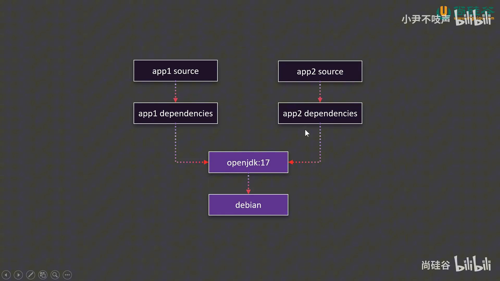

## 二、亲手验证：两个镜像其实只多占几 KB

打开 Docker 客户端就能直观看到。比如本地有一堆镜像：我们自己做了一个 `my-nginx` 镜像（它是在启动一个 nginx 容器后改了首页、再提交出来的），官方又有 `nginx` 镜像。这两个镜像看起来不一样，`docker images` 里存储空间都显示 188 MB。那么问题来了：它们**总共占用 300 多兆，还是只多占一点点**？

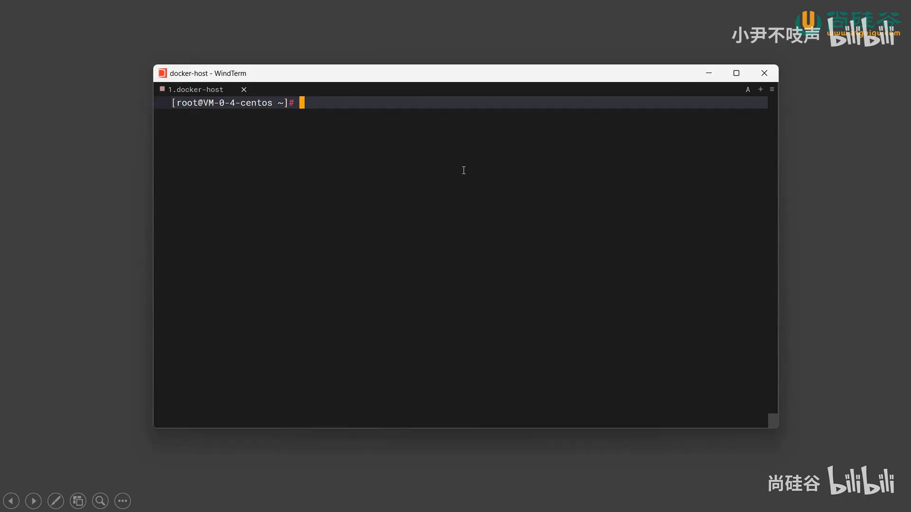

答案的关键在于它们**共用了底层**。用一条命令就能看出来——`docker image history`，它展示一个镜像的构建历史。先看官方 `nginx` 镜像，会打印出官方镜像当时的整个构建历史（其实就是官方当初写的那份 `Dockerfile`），每一行指令都在某一步产生了内容变化。

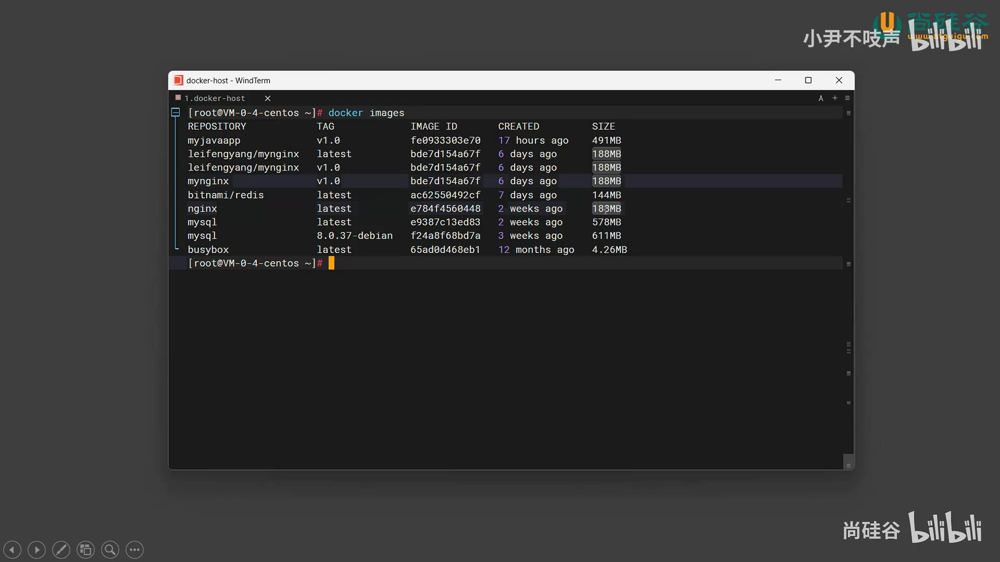

再对比我们自制的 `docker image history my-nginx:v1.0`，会发现：**唯一的差别就是最后一步多产生了 1.23 KB**，其余步骤（如 4.62 KB 那些）跟官方完全一样；从下往上读构建命令，几乎一模一样，只是末尾多了一点点东西。

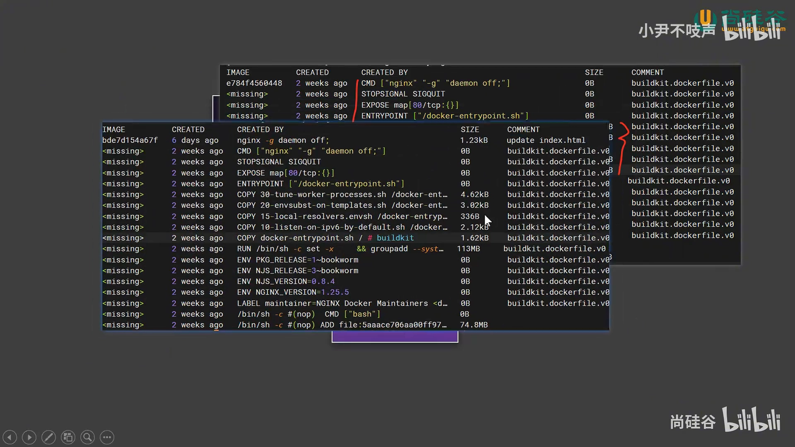

再用 `docker image inspect` 对比两者的层：官方镜像分了一些层，自制镜像里 **大部分层 ID 完全一样，只是末尾多了一个 `7cfc` 的层**——这一层正是我们修改的那个页面。

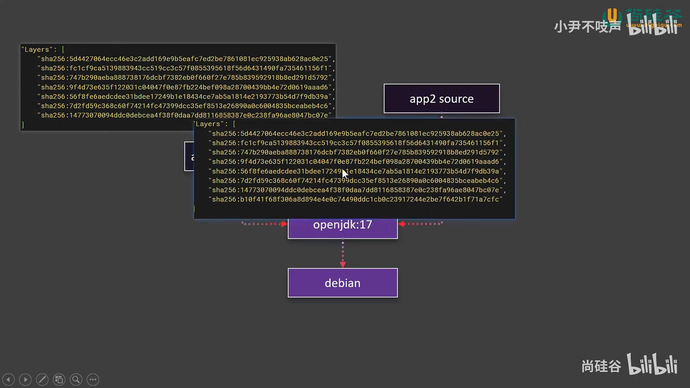

所以结论很清楚：以 `my-nginx` 和 `nginx` 为例，它们看起来该占 `188 + 188`，**实际上只占 188 MB 再加几 KB**。表面上你有多个镜像，实际上它们**共用存储**，看起来占很大空间，其实占用很小——`docker images` 一查便知。

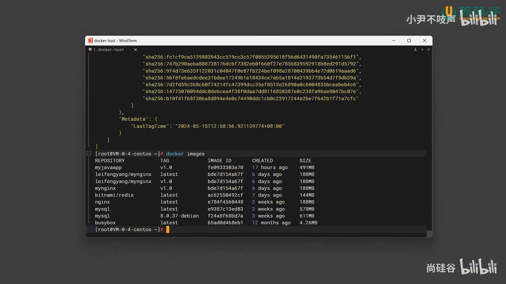

理解了这一点，就不必担心「我把一堆 Java 应用镜像都下下来会不会非常浪费磁盘」——Docker 能共用就共用，已经做到非常节省，放心使用即可。

## 三、镜像层（只读）与容器层（可写）

有了分层存储，**镜像和容器的关系**就变得清晰了。

假设要启动一个容器，它基于某个已经存在磁盘里的镜像。**整个镜像存储的内容称为镜像层，这一层是只读的（RO，read only）**。如果按这个镜像启动容器后，要对镜像里的内容做修改，容器就要**单独再开一层存储**——这一层叫 **RW，即「可读可写层」**，容器把所有修改都放到这一层里。

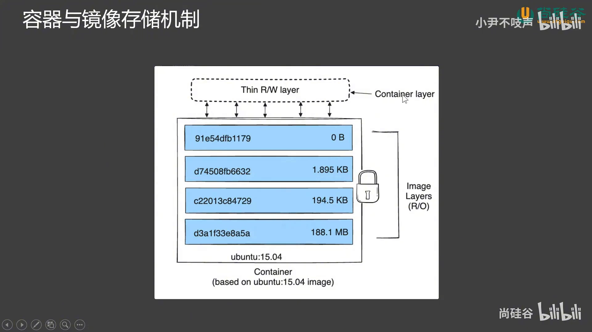

由此就解释了一个常见现象：**为什么容器删掉以后数据就丢了**？因为容器把所有数据都写到自己这一层（RW），容器一删，这个读写层就没了；而**只要不动镜像，镜像的基础数据仍在磁盘里**。

那如果一个镜像启动了多个容器呢？比如用 `nginx` 起了 8 个实例，**每个容器都有自己独立的读写层，互不相干**——这也是容器隔离机制的一种；同样，容器一删，它那个读写层也一起删掉。

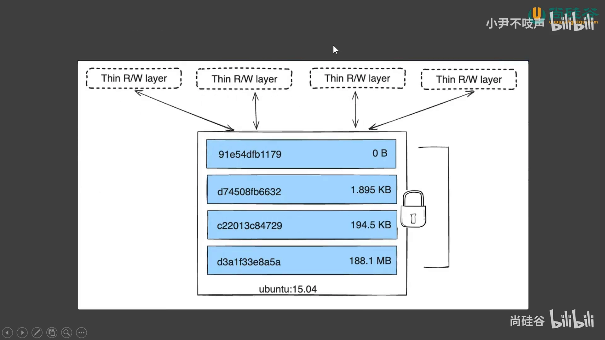

这也是为什么我们**推荐把容器运行期间要修改的数据挂载到「外面」**（挂载到宿主机或数据卷）——这样容器的读写层删掉后，外边的数据依然还在，数据就不会丢失。

### 观察一下：docker ps -s

进入终端，`docker ps` 能看到所有已启动的容器。再起一个 `docker run -d -p`（把 nginx 的 80 端口对外暴露），然后给 `docker ps` 加上 `-s`（size）参数，就能看到每个容器的「总文件大小」。

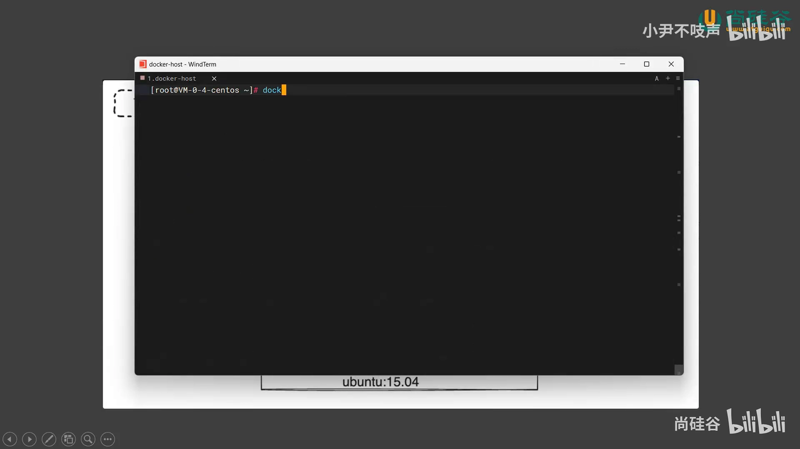

比如输出里：一个 nginx 容器显示 `1.09 KB`、虚拟部分 `188 MB`；另一个容器显示 `32.8 KB`、虚拟部分 `491 MB`。这些数字的含义是：**镜像占了 188 MB（存在磁盘里、多个镜像共用），而容器自己的读写层只占了 1.09 KB**。如果你在容器里做大量修改，这一块数值就会不断往上涨。

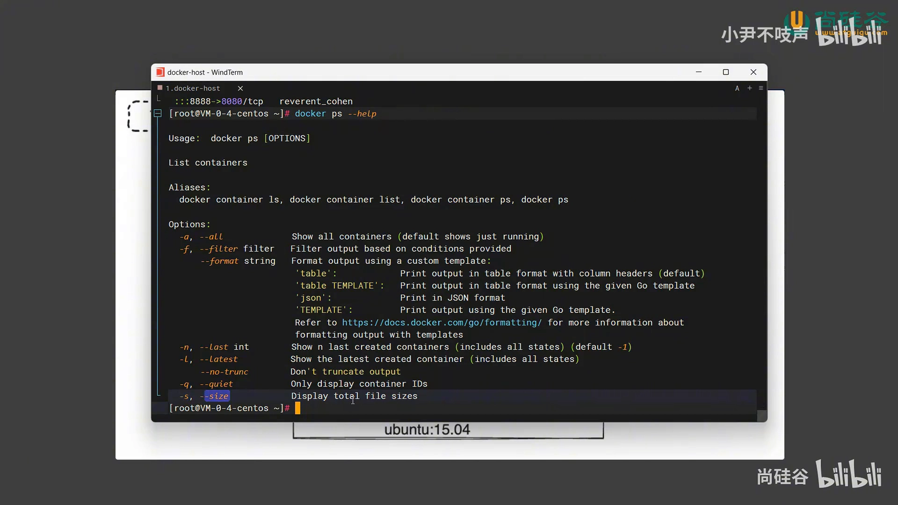

---

## 小结

- **一行指令一层**：`Dockerfile` 里每条指令都会产生一个镜像层，指令引起的内容变化存进对应的层。
- **多镜像共用底层**：分层存储让相同的基础层（如 Debian、openjdk17）被多个镜像共享，各自只额外存增量——像 Git 分支一样省空间。实测 `my-nginx` 只比官方 `nginx` 多一个层、几 KB。
- **镜像层只读、容器层可写**：容器在只读镜像层之上叠一个可写层（RW），所有修改都在这里；容器删掉 = 读写层丢失，所以数据要挂载到外面才持久。
- **一个镜像可开多个容器**：每个容器的读写层各自独立、互不相干，这是隔离机制的一部分。

## 关键术语速查

| 术语 | 一句话解释 |
| :--- | :--- |
| 镜像层（image layer） | 由 `Dockerfile` 每条指令生成的**只读**层，可被多个镜像共用 |
| 读写层 / 容器层（RW） | 容器启动后在只读镜像层之上叠加的**可写**层，容器的修改都写在这里 |
| `docker image history` | 查看镜像的构建历史（即当初的 `Dockerfile` 与每步产生的大小变化） |
| `docker image inspect` | 查看镜像详情，包括它由哪些层（层 ID）组成，可用来对比两个镜像共用了几层 |
| `docker ps -s` | 列出容器时附带大小：一列是容器读写层的占用，另一列是共享镜像的虚拟大小 |
| 分层存储 | Docker 底层以层为单位存储镜像、多个镜像共用相同层的机制 |
