# Dockerfile 多阶段构建：为什么要一次构建拆成几段

> 视频来源：Bilibili 视频 [Dockerfile多阶段构建镜像](https://www.bilibili.com/video/BV1FE421u7nH/)（UP 主 **莲城的老李**，约 24 分钟）。本文基于视频演说图文稿整理，时间戳可跳转到原视频对应位置；配图取自视频画面。
>
> 本条目的另外两篇配套阅读：[《用三个例子学会 Docker 多阶段构建》](Learn Multi-Stage Builds Easy With Examples - Docker Development Tips & Tricks.md) 从零讲清原理并给出三个可动手的完整例子，[《多阶段构建到底省了什么，又会踩哪些坑》](docker multi-stage builds（intermediate）anthony explains 503.md) 用 C 例子量化省下的体积，并讲透它容易踩的坑。

## 本讲要解决的核心问题（SCQA）

**背景**：一个项目最终都想打包成**自定义镜像**，再 `docker run` 跑起来。开发时我们习惯在**自己的电脑**上装好 Maven、Node 这类工具，写个 Dockerfile 就能构建。

**冲突**：可一搬到**生产环境**，情况就变了——源码要从代码托管平台 `git clone`，而且生产机上**不会安装 Maven**这类开发工具。没有 Maven，就拿不到项目需要的 `jar` 包，流程直接卡住。

**疑问**：生产机不装 Maven，那 `jar` 包到底从哪来？能不能让 Maven、Java 这类"环境"也由 Docker 提供，而不用真的装到机器上？

**回答（中心思想）**：用 **多阶段构建（multi-stage build）**——在**一个 Dockerfile 里写多个 `FROM`**，每个 `FROM` 是一个"阶段"：前一阶段用 Maven 环境把源码打成 `jar`，后一阶段只把这个 `jar` 复制过去、配上精简的 Java 运行环境。最终镜像只保留必要数据，多余环境全部丢掉，于是**体积更小、构建更快、更安全**。

---

## 一、多阶段构建是什么：一个 Dockerfile，多个 FROM

先分清概念。与"多阶段构建"相对的是"**单阶段构建**"，分界线是 **Docker 17.05**：

- 17.05 之前，一个 Dockerfile **只能有一个 `FROM`**，也就是只能指定一个基础镜像——这叫**单阶段构建**；
- 17.05 之后，Dockerfile 里**允许写多个 `FROM`、也就是多个基础镜像**，**每一个 `FROM` 代表一个阶段**——这就叫**多阶段构建**。

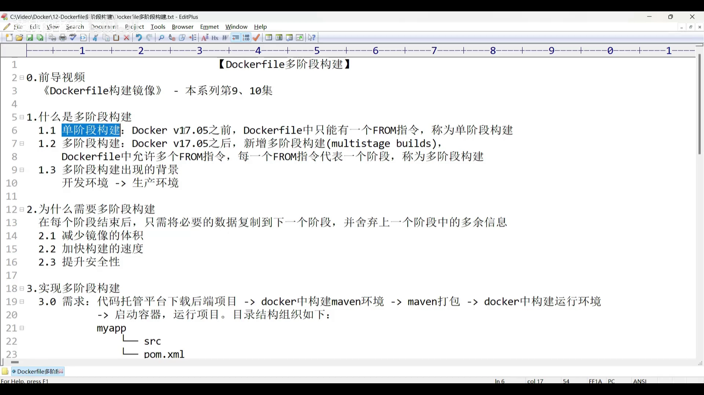

举个直观的例子：假设 Dockerfile 里写了**四个 `FROM`**，构建时就会**分成四个阶段**依次进行，依次叫阶段一、阶段二、阶段三和**最终镜像阶段**（也就是**最后一个 `FROM`** 对应的阶段）。

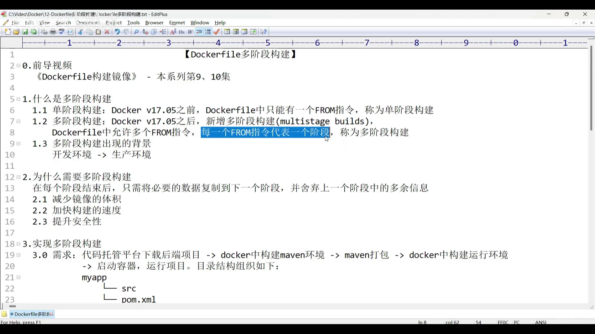

## 二、为什么会出现多阶段构建：开发 vs 生产

多阶段构建不是凭空冒出来的，它的**背景**要从"**开发环境 → 生产环境**"的转变说起。

[**开发环境**](https://www.bilibili.com/video/BV1FE421u7nH/?t=85)以后端 Spring Boot 项目为例：源码就在自己电脑上，由 IntelliJ IDEA 这类工具管理；电脑上**已经装好了 Maven**（视频里是 Maven 3.6.0）。用 `mvn` 打个包得到 `jar`，再准备一个 Java 环境跑它就行。所以开发环境的 Dockerfile **只需要一个基础镜像——Java 环境**，因为 Maven 机器上已经有了。

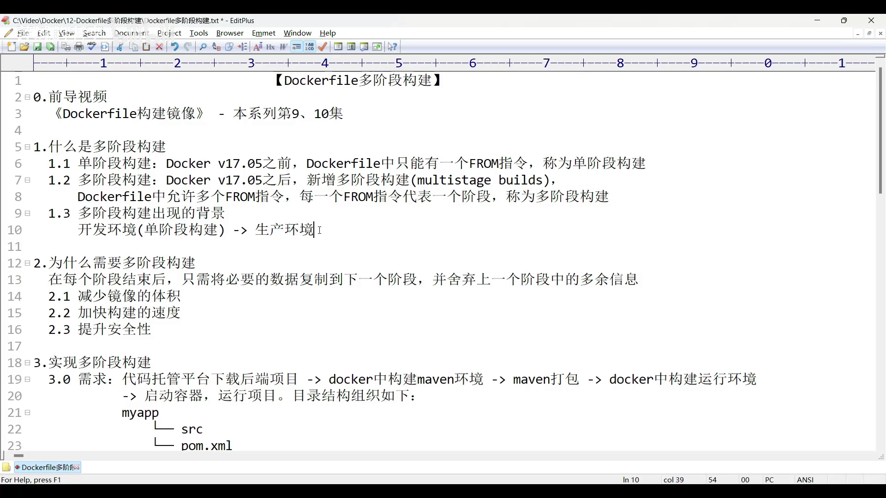

[**生产环境**](https://www.bilibili.com/video/BV1FE421u7nH/?t=220)则有两个重要区别：

1. **源码获取方式不同**——不再是自己电脑上的文件，而是通过代码托管平台（视频里用的是 Gitee）`git clone` 到生产机；
2. **生产机不会安装 Maven / Node.js**——生产机要承担类似服务器的职责，不该再装开发工具。

矛盾由此产生：**生产机没有 Maven，却必须靠 Maven 才能得到 `jar`**。作者给的思路是——**把 Maven 也当成一种"环境 / 基础镜像"，交给 Dockerfile 去提供**，这样根本不必在生产机上真装 Maven。于是就有了**两个基础镜像**：一个 Maven 负责打包，一个 Java 负责运行。这正是单阶段构建做不到、必须靠多阶段构建的地方。

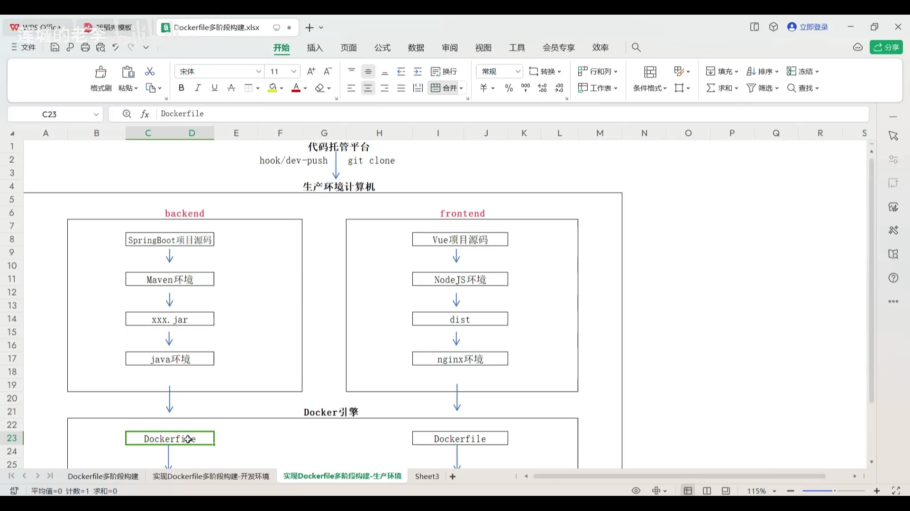

## 三、多阶段构建的优势：只搬"有效数据"

理解优势，只需把握**一条原则**：**每个阶段结束后，只把必要的数据复制到下一阶段，其余全部舍弃。**把它拆成两个词就好记：

- **有效数据**：下一阶段还需要的东西（比如打包出来的 `jar`）；
- **无效数据**：只在本阶段用得上、后面不再需要的东西（比如 Maven 环境本身）。

到最终镜像里，**只保留各阶段的有效数据，无效数据统统丢掉**。

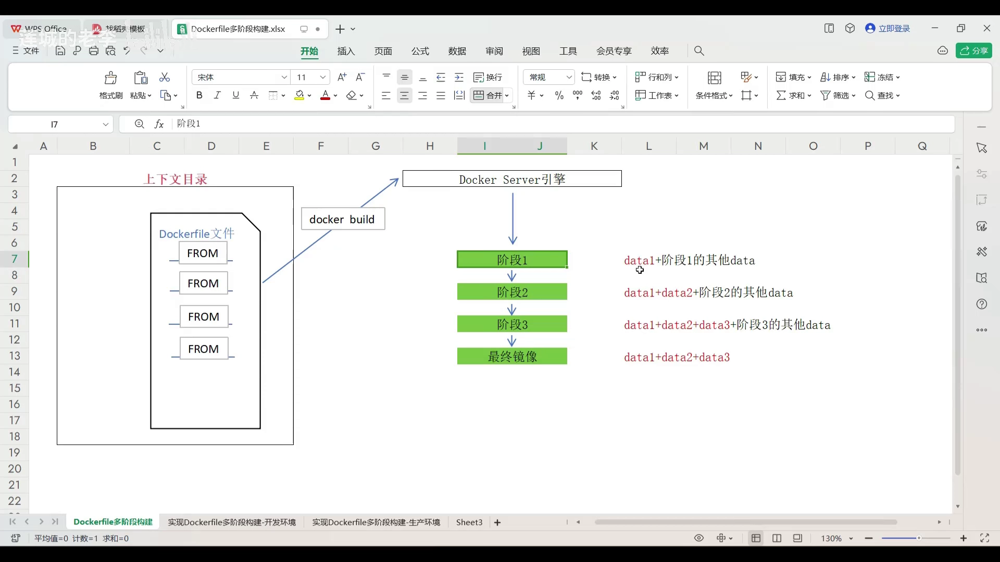

回到那个后端镜像：最终我们只需要**能运行 `jar` 的 Java 环境**，而 Maven 只是"临时的打包工具"，完全不必留在最终镜像里。把第一阶段产出的 `jar` 复制到下一阶段、丢掉 Maven，好处立刻显现（[06:35](https://www.bilibili.com/video/BV1FE421u7nH/?t=395)）：

1. **镜像体积减小**；
2. 体积小了，镜像的**构建与传输更快**；
3. **安全性提升**——最终镜像里只留 `jar` 和 Java 运行环境，**连 Java 源码都不保留**。

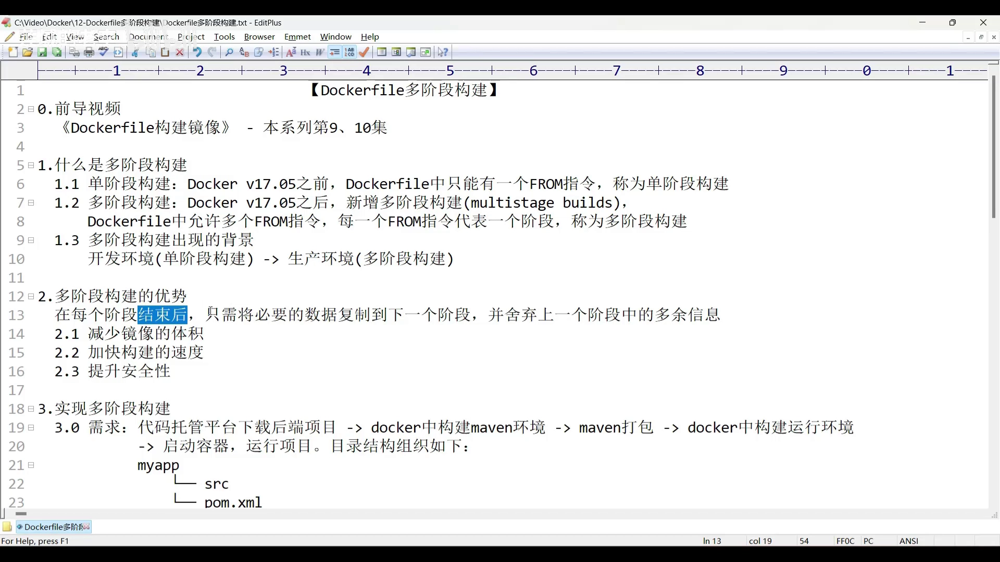

## 四、动手第一步：先用单阶段构建出 build01

视频下半段是实操，完全模仿上面的生产流程，分三步走：从代码托管平台 `git clone` 后端项目 `myapp`；把 `pom` 和 `src` 整理到一个 `myapplication` 目录作为构建上下文；再在目录里写一个 Dockerfile。

先用**传统单阶段**方式构建，好与多阶段对比。这个 Dockerfile **只有一个 `FROM`**，基础镜像为 `maven:3.8.3`，随后设置工作目录 `/app`、把 `pom` 和 `src` 拷进去、执行 `mvn` 打包、暴露 8080 端口，并把默认命令设为运行 `jar`。

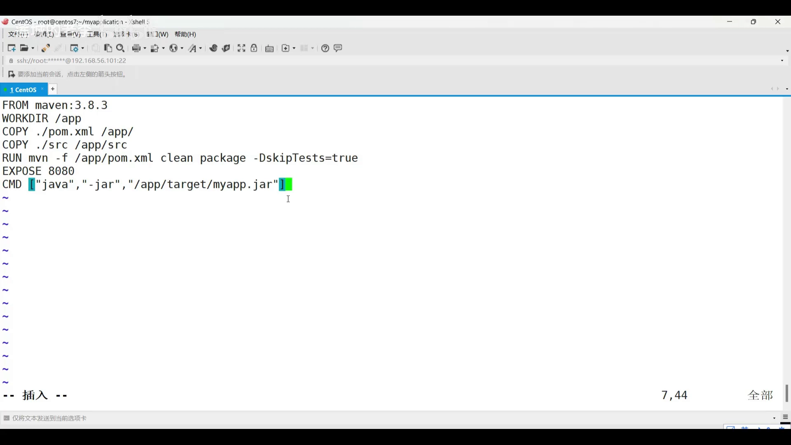

**这里有个真实的坑值得记下**：作者本机装的是 Maven 3.6.0，就顺手在 Dockerfile 里也写了 3.6.0，结果**构建失败**。原因是项目用的是 Spring Boot 3.1.7，而 **Spring Boot 3 之后最低要求 Java 17**；Maven 镜像**自带 JDK**，3.6.0 这版镜像里带的是 **JDK 11**，于是构建不过。换成 **3.8.3**（自带 JDK 17）才行。所以**选 Maven 版本要看项目要求的 Java 版本**。要确认镜像里自带什么 JDK，可以用 `docker inspect <镜像ID>` 查看——作者查到的正是 **17.0.1**。

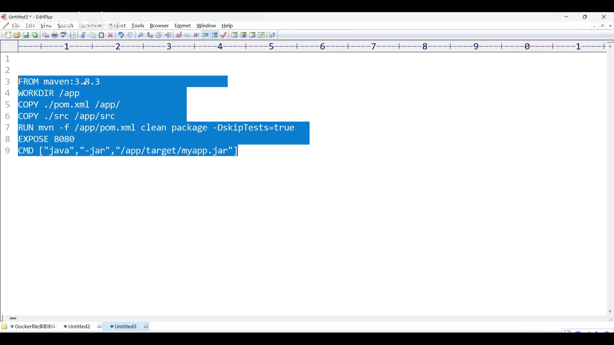

`docker build -t build01 .` 构建完，结果很能说明问题：**耗时约 576 秒，镜像体积 851MB**——而项目只是一个"请求 `/hello` 返回 `hello world`"的最简 Spring Boot 应用，没有任何多余依赖。可见**单阶段把 Maven、依赖、源码全都装进了镜像**，非常臃肿。用 `docker run` 启动、借 Postman 测试能正常返回 `hello world`，说明**功能没问题，问题只在于"太重"**。

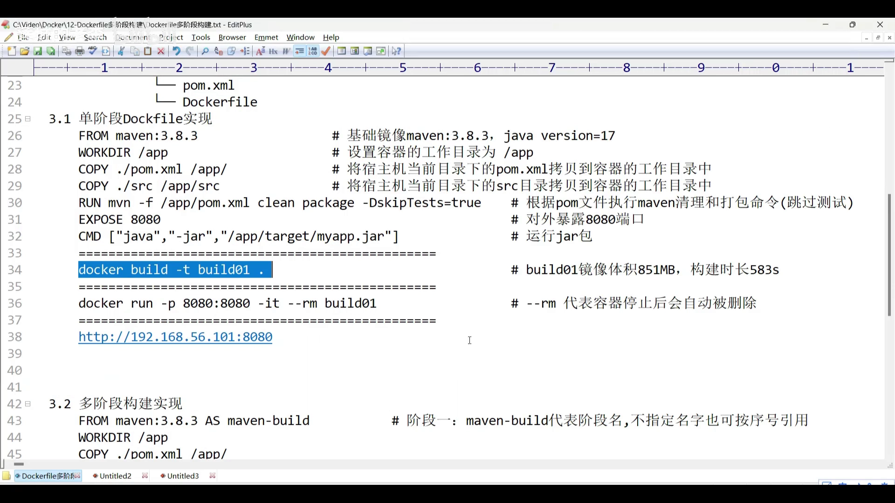

## 五、动手第二步：改成多阶段构建出 build02

换成多阶段版本，一眼就看出区别——Dockerfile 里出现了**两个 `FROM`**，也就是**两个阶段**。

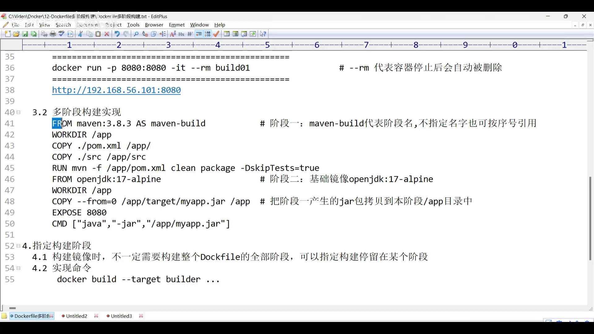

- **阶段一**：和单阶段差不多，仍基于 `maven:3.8.3`，但在后面加了 **`AS` 起别名**，例如 `AS maven-build`。别名可自定义；**不起名也行**，那样第一阶段就叫**阶段一，序号为 0**——注意**序号从 0 开始**。后面要引用这一阶段的数据时，用**别名或序号**都可以（作者习惯用序号 `0`）。

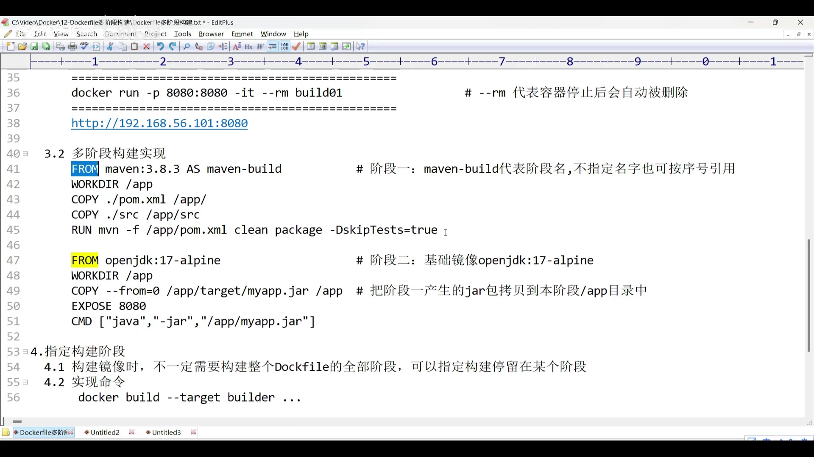

- **阶段二**：换掉镜像，**不再用 Maven**（最终镜像不需要它，直接舍弃），改用 **JDK 17 的 `slim` 版**（`slim` 体积更小）作为运行环境；然后**把第一阶段产出的 `jar`（位于 `/app/target/myapp.jar`）复制到本阶段**——这一步**必须用参数指明"从哪个阶段、把什么、拷到哪里"**；最后同样暴露 8080、把默认命令设为运行 `jar`。

完整的多阶段 Dockerfile，就是这样一份"两个 `FROM` + 一次跨阶段 `COPY`"的脚本。

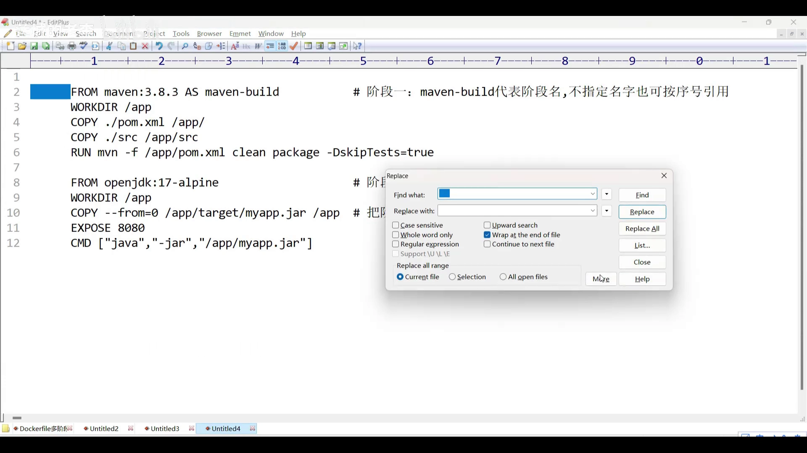

重新构建成 `build02`，结果对比鲜明：**镜像体积从 851MB 降到 345MB**，因为里面只剩 Java 运行环境、**没有 Maven 了**。同样启动容器、用 Postman 访问，依旧正常返回 `hello world`。

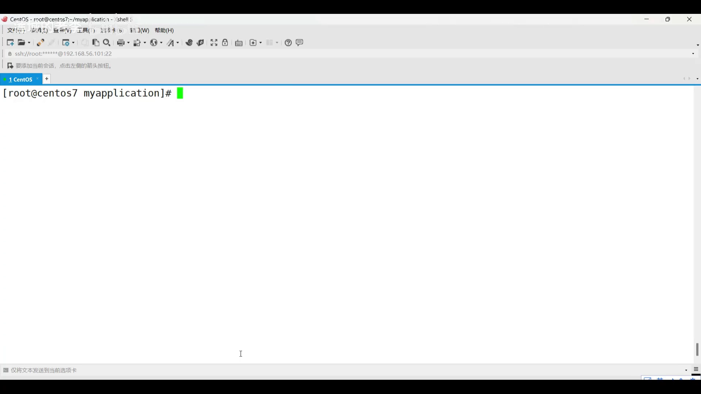

> 顺带澄清一个易被误解的点：多阶段这次构建只花了约 **0.5 秒**，但**不能**拿它和单阶段的 500 多秒对比——因为这次用到了 Dockerfile 的**层缓存**，很多步骤直接复用了，时间对比没有意义。

## 六、动手第三步：用 --target 把构建停在指定阶段

多阶段还有个实用参数 **`--target`**：可以让构建**停在某个指定阶段**，不必等整个 Dockerfile 全部走完，主要用于**测试**。比如第二阶段依赖第一阶段产出的 `jar`，那就可以先把构建停在第一阶段，验证它**是否真的生成了 `jar`**——只有第一阶段正常，第二阶段才有意义。用法是在构建命令里加 `--target <阶段名>`。

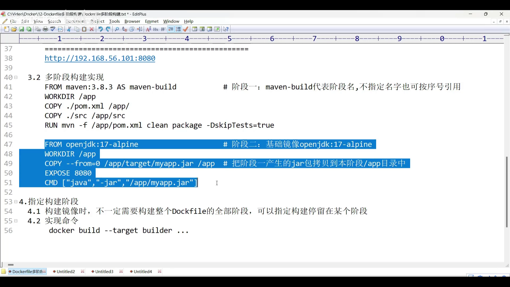

视频里把构建停在 `maven-build` 阶段、产出 `build03`（因只含 Maven 环境，体积仍不小），然后**只做测试**：`docker run` 进容器执行 `ls /app/target`，看到 `myapp.jar` 存在，就证明**指定的阶段构建已经通过**。

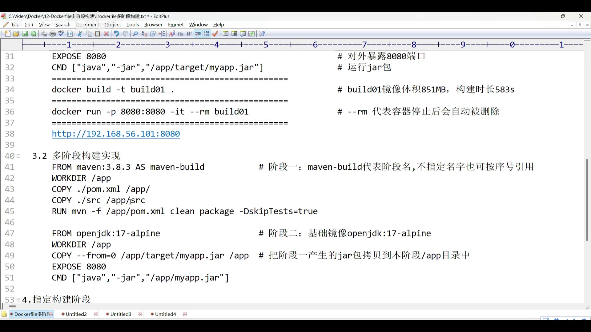

## 小结

- **多阶段构建 = 一个 Dockerfile 里写多个 `FROM`**，每个 `FROM` 是一个阶段，默认最终镜像来自**最后一个阶段**；
- 它解决的核心问题是：**生产机上没有 Maven 这类构建工具**，于是让 Docker 用一个 Maven 阶段负责打包、一个 Java 阶段负责运行；
- 原则是**每个阶段只把有效数据传给下一阶段、丢掉无效数据**，于是**体积更小、构建更快、更安全**（源码不进最终镜像）；
- 跨阶段复制靠 `COPY --from=<阶段名|序号>`，**别名用 `AS` 指定、序号从 0 开始**；
- **`--target <阶段名>`** 可让构建停在指定阶段，便于调试与测试。
