# 用三个例子学会 Docker 多阶段构建

> 视频来源：YouTube 视频 [Learn Multi-Stage Builds Easy With Examples - Docker Development Tips & Tricks](https://www.youtube.com/watch?v=vIfS9bZVBaw)（频道 **Manuel Castellin**，约 12 分 54 秒）。本文基于视频演说图文稿整理，时间戳可跳转到原视频对应位置；配图取自视频画面。原视频为英文，字幕由 ASR 生成，个别拼写已按上下文订正。
>
> 本条目的另外两篇配套阅读：[《Dockerfile 多阶段构建：为什么要一次构建拆成几段》](Dockerfile多阶段构建镜像.md) 用中文实操完整对比单阶段与多阶段的镜像体积，[《多阶段构建到底省了什么，又会踩哪些坑》](docker multi-stage builds（intermediate）anthony explains 503.md) 用 C 例子量化收益并讲透各种坑。

## 本讲要解决的核心问题（SCQA）

**背景**：你已经会写 Dockerfile，能把应用跑进容器里，构建流程本身没问题。

**冲突**：但构建用的编译器、JDK、Maven 这类工具**全都留在了最终镜像里**。它们只在"构建时"有用，运行时根本用不到，却白白撑大了镜像——镜像一大，传输就慢、启动前拉取也慢，暴露的软件包还更多。

**疑问**：有没有办法既保留完整的构建工具链，又让**最终镜像只装运行所需的那点东西**？

**回答（中心思想）**：用**多阶段构建（multi-stage build）**——把整个构建拆成多个阶段，用**一个**阶段（如带 Maven/JDK 的镜像）负责编译，再把编译产物**复制**到一个**干净**的最终镜像里。这样最终镜像通常小得多、传输更快，也更安全，因为里面的软件包更少、可被利用的漏洞也更少。

---

## 一、什么是多阶段构建

**多阶段构建是一种特殊的容器构建方式：它允许你把整个构建拆成多个阶段。** 判断方法很简单——**如果 Dockerfile 里的 `FROM` 不止一个，它就是多阶段构建**。

- 每个阶段都以一条 **`FROM`** 开头，之后可以跑任意多条构建步骤，各自生成自己的镜像；
- 但整个构建结束时，Docker **只把其中某一个镜像**提交进本地镜像仓库，作为这次构建的最终结果；
- 默认是 **Dockerfile 里最后一个阶段**产出的镜像，不过你也可以**指定别的阶段**（后面会看到例子）。

既然只能产出一个镜像，那多阶段的意义在哪？关键在于——**阶段之间可以共享数据**。于是你可以**用一个镜像来编译应用代码，再把生成的二进制文件搬到一个"只够运行"的干净镜像里**。

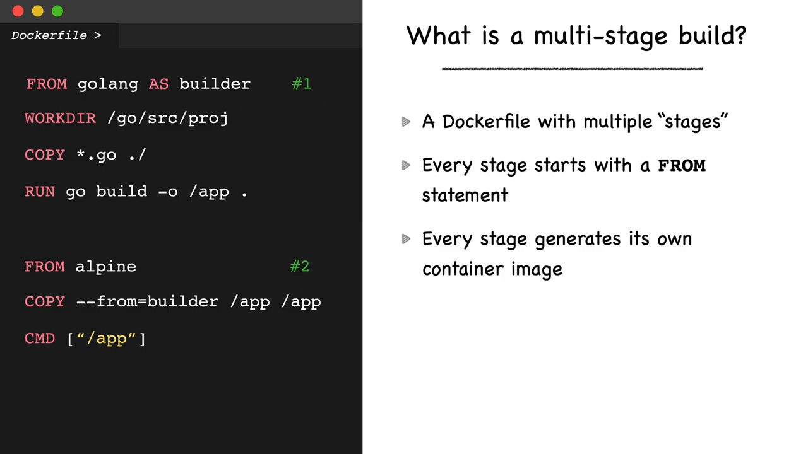

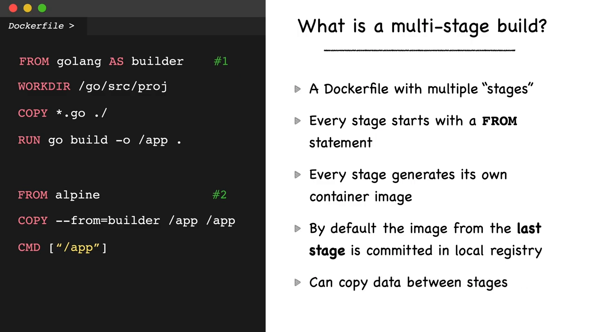

## 二、多阶段构建的三大好处

到这里，多阶段构建的主要优势就呼之欲出了：

1. **最终镜像通常小得多**——结果容器不会拖着所有阶段产生的所有层，而只是**一个基础镜像 + 编译好的应用二进制 + 极少量的软件**；
2. **传输更快**——镜像小，通过网络传输的时间就短，构建流水线也跟着省时间；
3. **更安全**——最终镜像只含"运行所必需"的软件，**包更少、潜在攻击者可利用的漏洞也更少**。

## 三、一个最小的 Java 例子

假设要构建一个 Java 应用，并想用上多阶段构建，思路是这样的：

- **第一个阶段**用一个**带 JDK 11 的 Maven 容器**：用 **`AS` 关键字给这个阶段起别名**，方便后面引用；然后复制应用源码、执行 Maven 构建。此时这个镜像里含有一大堆运行应用**并不需要**的东西——Maven、JDK、源码等等。

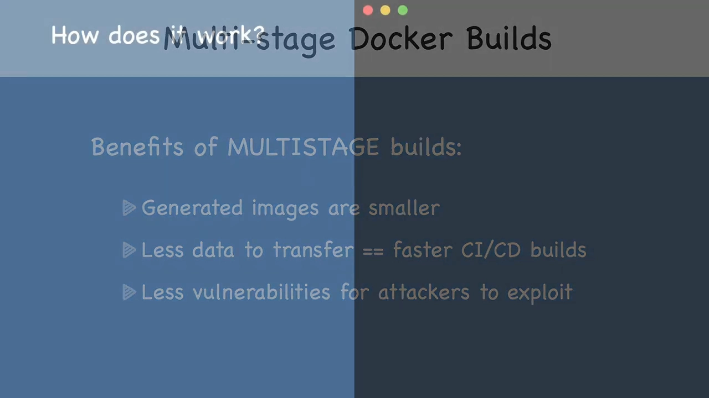

- **第二个阶段**引入**第二条 `FROM`**，这次换成 **Tomcat + JRE 11** 作为基础镜像。用过 Tomcat 就知道，部署应用只需把生成的 **web archive（war 包）**放进 Tomcat 的 `webapp` 目录。这里用带额外选项的 `COPY` 指令——**`COPY --from=builder`**（`builder` 就是第一阶段的别名）——Docker 就会**从那个 builder 阶段**（而不是宿主机文件系统）复制产物。

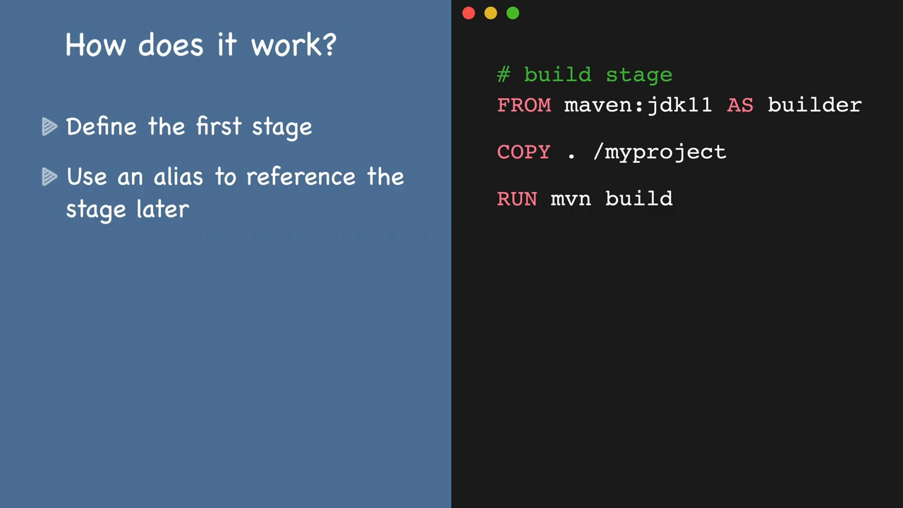

这样构建出来的镜像里**只有 Tomcat 服务器和生成的 war 包**，干净利落。

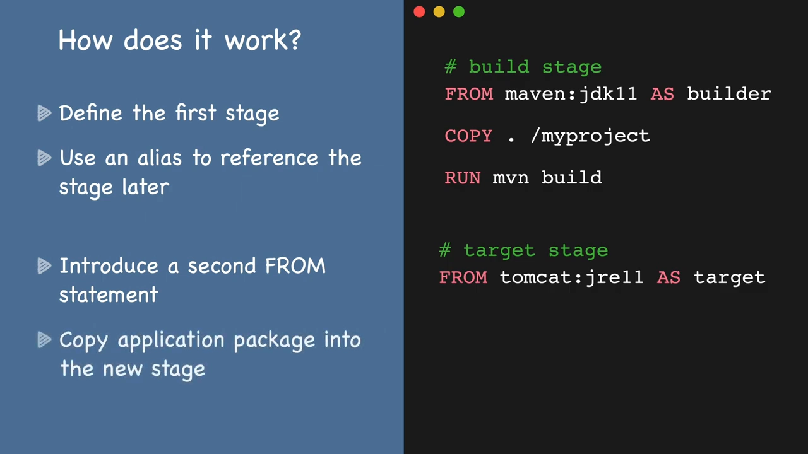

## 四、例一：Go API → scratch，从 800MB 减到 6MB

作者最近在学 Go，所以第一个例子是给一个简单 API 写 Dockerfile。这个应用就是一个把字符串转成**大写 / 小写 / 首字母大写**的接口。按前面的思路：一个容器负责构建，再把产物搬到目标容器。

Dockerfile 以 **`FROM golang:1.16 AS builder`** 开头——之后就能用 `builder` 这个别名引用该阶段；接着把工作目录切到 `/go/src/echo-go`、复制应用文件，用 `go build` 编译出一个独立的二进制 `echo-app`。

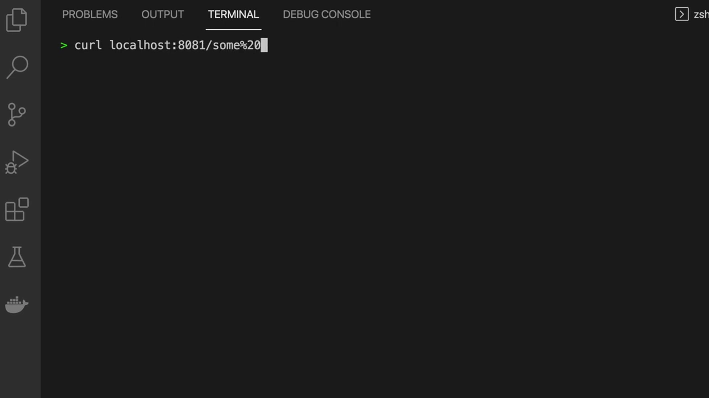

构建、运行都正常，但一看镜像——**结果体积 800 多 MB**，对这么简单的应用来说太大了。用 **`docker history echo`** 逐层拆开看，会发现里面拖着基础镜像的一堆大层；而作者知道，**自己的应用二进制只有约 6MB**，也就是说容器里有大量**根本用不到的数据**。

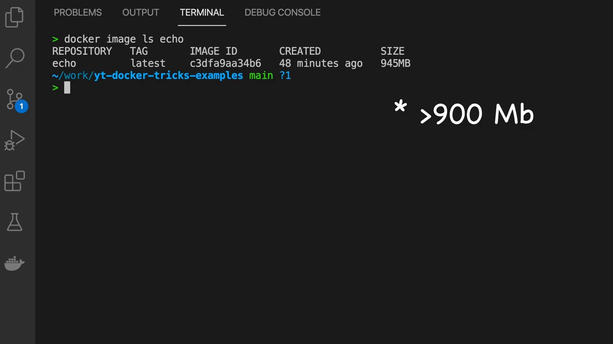

于是回到 Dockerfile **加一个新阶段**。既然要尽可能缩小体积，为什么不直接用 **`scratch`**？`scratch` 是一个**完全空的层**——如果应用需要 Python 或 Java 解释器，用基于 Alpine 的版本更合适；但对**自包含的二进制应用**，`scratch` 是完美选择。要做的只剩一件事：用 **`COPY --from=builder`** 把二进制从 builder 阶段复制过来，再暴露 8081、把命令设为 `echo-app`。

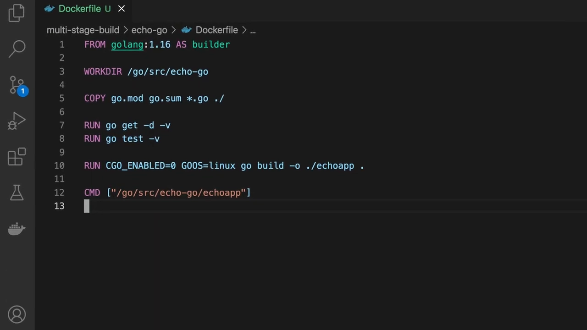

重新构建后再看层，就**只剩那个约 6MB 的应用二进制**了——**镜像从 800 多 MB 一路降到 6MB**。

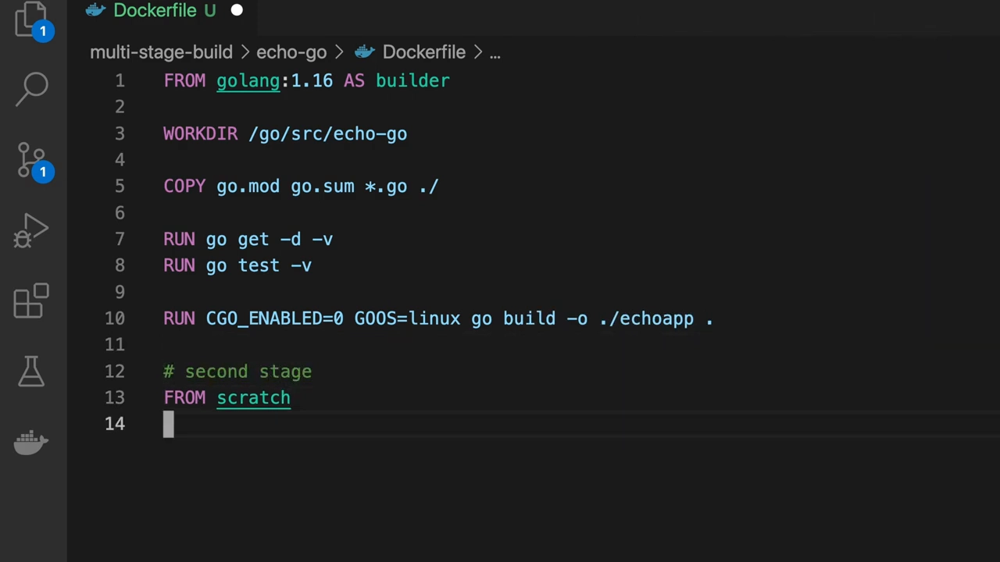

## 五、例二：Jenkins 构建代理，从外部镜像里"拿"工具

我们已经会用 `COPY --from` 从**别的构建阶段**拷文件，但真正好玩的是——它还可以**引用外部容器**，包括本地仓库甚至远端的 Docker Hub 上的现成镜像。为什么这事重要？看第二个例子。

作者要做一个能部署到云上的 **Jenkins 构建代理**，需要 **Java 8 和 Java 11 两个版本**、Maven，还要装 git 等额外软件包。全部自己装会很麻烦，于是用多阶段构建偷懒：

- 用 **`jenkinsci/jnlp-agent`** 作为底座（它**自带 Java 8**）；
- 还需要 JDK 11？不必自己装，直接从**官方 `openjdk` 镜像**里拷：**`COPY --from=openjdk:11-jdk`**，把 `/usr/local/openjdk-11` 整个 Java 11 发行版复制到容器里同一个目录；
- Maven 同理，从官方镜像拷：**`COPY --from=maven:3-jdk-8`**，把 `/usr/share/maven` 复制进来（作者喜欢保持各二进制路径一致）；
- 再设置 `MAVEN_HOME=/usr/share/maven` 并把它的 `bin` 加进 `PATH`，装好 git、把容器用户切回 `jenkins`，完成。

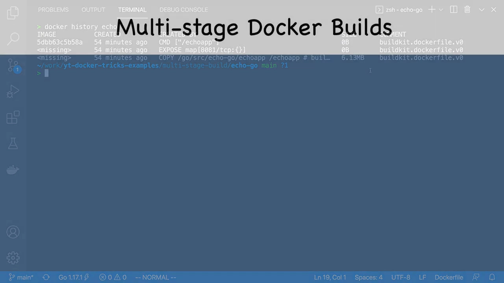

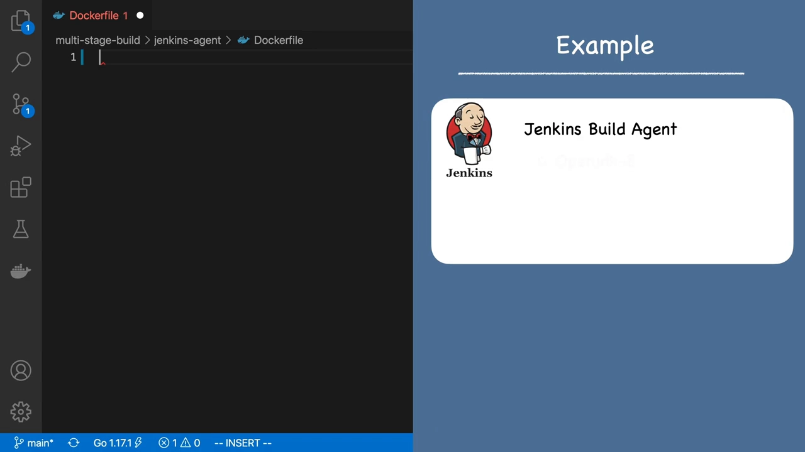

保存并构建成 `jenkins-agent`，进容器实测：`java -version` 是 1.8；把 `JAVA_HOME` 指向 `/usr/local/openjdk-11` 并更新 `PATH` 后，跑的就是 **11**；`mvn --version` 也正常工作。

## 六、例三：四阶段 Dockerfile + --target 按需出镜像

默认情况下，Docker 会把**最后一个构建阶段**产出的镜像打上 tag，但你也可以**让构建停在其它任意阶段**——只要给 `docker build` 加上 **`--target=<阶段名>`**。用这个功能主要有两个理由：

1. **调试某个阶段**——Docker 不会保存中间阶段产生的层，所以如果 Dockerfile 有问题，**没法从最终提交的镜像里**去检查前面阶段的内容；
2. **为不同用途产出不同镜像**——比如在同一个 Dockerfile 里，一个阶段用调试标志编译、一个阶段加入测试数据、还有一个作为最终生产镜像。

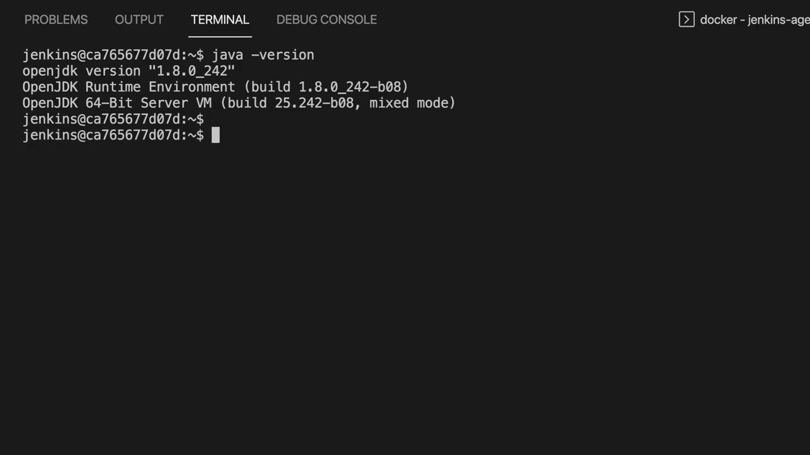

回到那个 echo 应用演示——作者准备了一个稍复杂、**含四个构建阶段**的 Dockerfile：

- 第一个是原来的 **`builder`** 阶段：拷源码、装依赖、跑测试；
- 第二个是新的 **`debug`** 阶段：用调试标志编译，并配合远程调试器 go-delve 运行；
- 第三个是 **`prod-builder`** 阶段：只生成一个用于生产的自包含二进制；
- 第四个是 **`production`** 阶段：把 `prod-builder` 产出的二进制拷进 **scratch** 镜像。

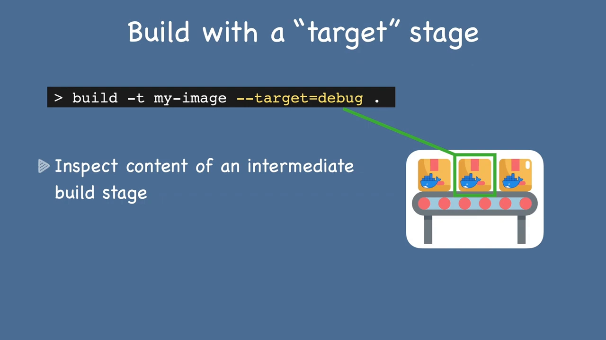

注意第二、三阶段都以 `builder` 作为基础镜像——这是一种**在已经关闭的上一阶段之上继续构建**的办法，好处是不必在 `debug` 和 `prod-builder` 里**重复** `builder` 里定义过的步骤。

接着跑构建：默认会得到**最后一个（production）阶段**的镜像，用 `docker history` 验证，里面**只有应用二进制**，没有构建过程中的其它层。想从 **debug** 阶段出镜像，就用 `docker build -f Dockerfile.solution2 -t echo-debug --target=debug`——构建完你会发现 debug 镜像**大小不同**，逐层看还能看到**带调试标志编译**的那些指令。

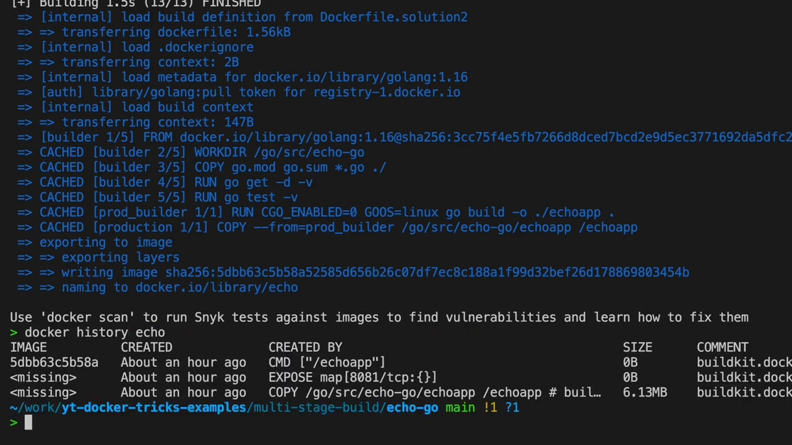

## 小结

- **多个 `FROM` = 多阶段构建**；默认只提交**最后一个阶段**，可用 **`--target=<阶段名>`** 改选别的阶段；
- 阶段之间靠 **`COPY --from=<阶段名>`** 共享数据，既能从**前一个构建阶段**拷，也能从**外部现成镜像**（如 `openjdk`、`maven`）拷；
- 收益有三：**镜像更小、传输更快、更安全**（包更少、漏洞更少）；
- 常见套路是"**builder 阶段编译 + 干净/`scratch` 阶段只放产物**"，例一的 Go 应用因此从 800 多 MB 缩到约 6MB；
- 同一个 Dockerfile 还能借 **`--target`** 按用途产出不同镜像（调试版、生产版等）。
