# 多阶段构建到底省了什么，又会踩哪些坑

> 视频来源：YouTube 视频 [docker: multi-stage builds (intermediate) anthony explains #503](https://www.youtube.com/watch?v=OVYNUg0aODw)（频道 **anthonywritescode**，约 11 分 41 秒）。本文基于视频演说图文稿整理，时间戳可跳转到原视频对应位置；配图取自视频画面。原视频为英文，字幕由 ASR 生成，个别拼写已按上下文订正。
>
> 本条目的另外两篇配套阅读：[《Dockerfile 多阶段构建：为什么要一次构建拆成几段》](Dockerfile多阶段构建镜像.md) 用中文实操完整对比单阶段与多阶段的镜像体积，[《用三个例子学会 Docker 多阶段构建》](Learn Multi-Stage Builds Easy With Examples - Docker Development Tips & Tricks.md) 用三个例子讲原理与用法。

## 本讲要解决的核心问题（SCQA）

**背景**：写 Dockerfile 时，为了让镜像能**编译**代码，我们往往把编译器、工具链一起装进镜像——这很自然，因为构建就得靠它们。

**冲突**：结果是镜像"虚胖"。作者现场用一个 **hello world 的 C 程序**演示：程序本体只有 **12K**，构建出的镜像却有 **221MB**，**多出来的约 150MB 全是编译工具链**。你不希望每个生产节点上都拖着一堆 GCC。

**疑问**：怎样才能**保留完整的构建能力**，又**不把工具链留在最终镜像里**？

**回答（中心思想）**：用**多阶段构建**——把构建拆成阶段，前面一个 **builder** 阶段负责装工具链、编译出产物，后面一个 **final** 阶段**只把产物拷进来**。同一例子改完后，镜像**从 221MB 回到约 71.8MB**，程序照常运行。但要真正用好，还得知道它的几个**坑**（镜像要匹配、scratch 难调试、运行期依赖要补齐），以及它在**构建缓存**上的代价。

---

## 一、什么是多阶段构建

多阶段构建允许你把**最终镜像分阶段构建**，并在阶段之间**复制文件**。常见形态是：一个 **builder 基础阶段**，加上末尾的 **final 阶段**，把前面阶段里的**构建产物拷进最终阶段**——主要目的就是**省磁盘空间、缩小镜像体积**。而镜像小了，上传、复用、拉取时**带宽更省、启动更快**。

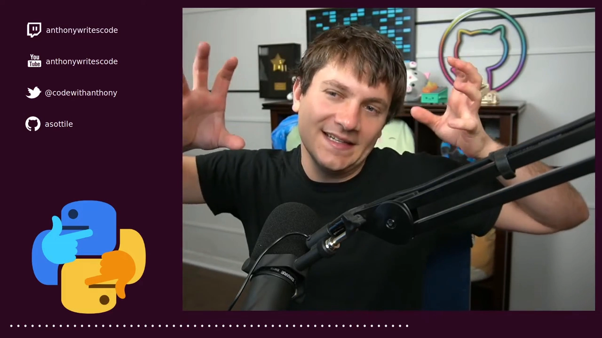

## 二、先看"不划算"在哪：一个 12K 的程序撑出 221MB 镜像

作者用一个**只编译 hello world 的小 C 文件**来演示。先写一个**普通单阶段的 Dockerfile**：从 Ubuntu 起步，`apt-get` 装 **GCC**，还要装 **`libc6-dev`**（否则拿不到 `stdio.h`），清理 apt 列表，再把 C 文件拷进镜像、用 GCC 编译好。

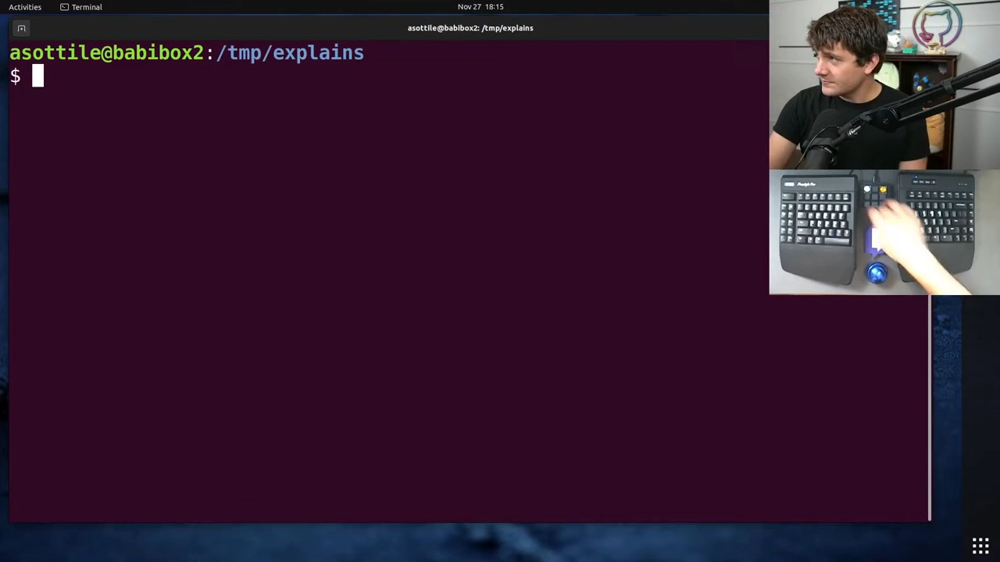

这个 Dockerfile 的结构一眼就能看出问题：**末尾虽然只有一个小二进制，但镜像里同时还躺着那一大坨编译器工具链**。

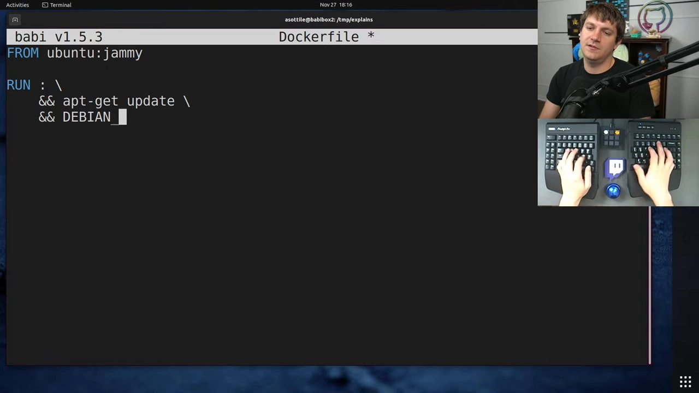

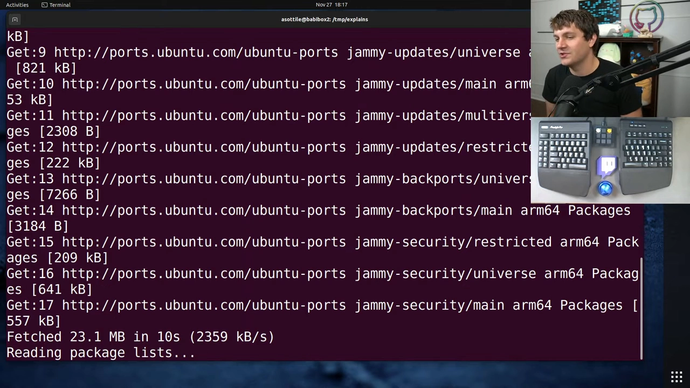

跑起来一看体积：**221MB**——也就是说，在基础镜像之上**多加了约 150MB**，只为编译一个 hello world。而那个程序本体**只有 12K**，等于**白白背了 150MB 的开销**。

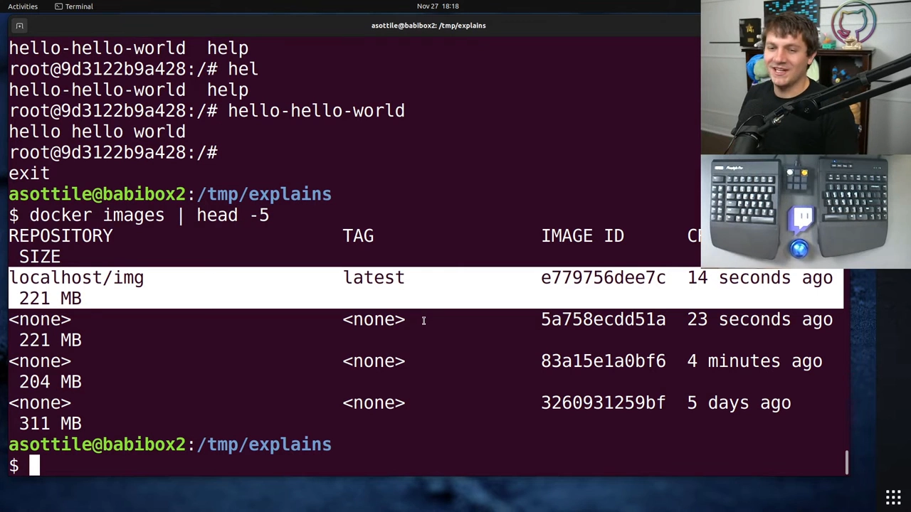

## 三、改成多阶段：给 FROM 起名 + 加 final 阶段

破解办法就是多阶段。做法是**给 `FROM` 行末尾加一个名字**——也就是**阶段名**。这里把第一阶段命名为 **`builder`**；再在末尾**新增一个阶段**，习惯上叫 **`final`**（名字其实随你，作者习惯用 `final`；这也正是"默认会被构建出来"的那个阶段）。

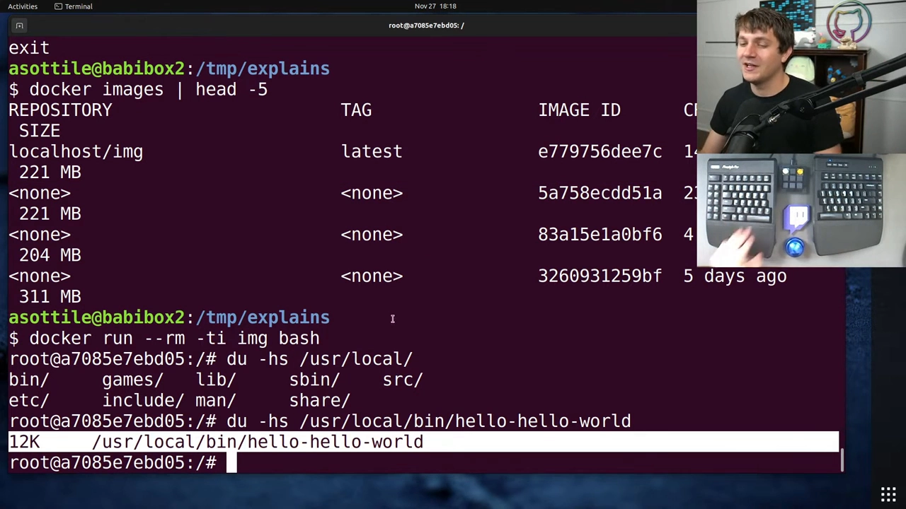

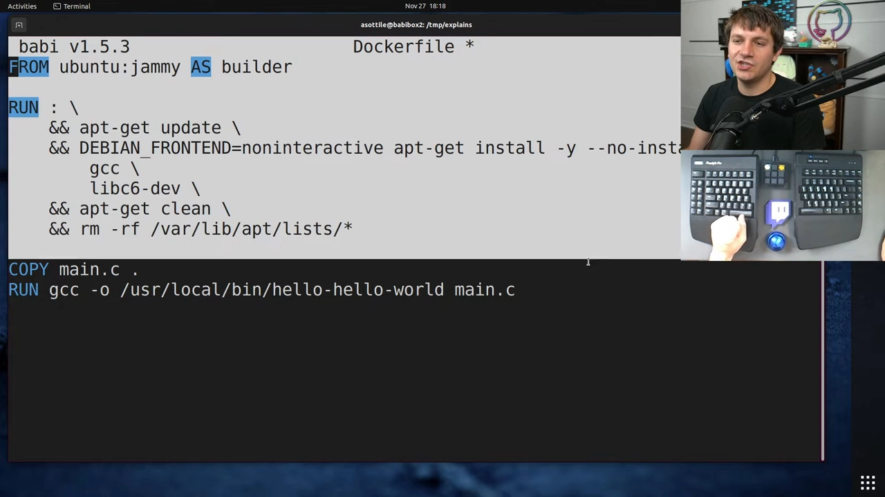

然后就可以把这个可执行文件从上一个阶段**拷到 final 阶段**：用 **`COPY --from=builder`**，拷到相同位置。这样就能**避开编译器工具链**，只留下一个精简的最终镜像。

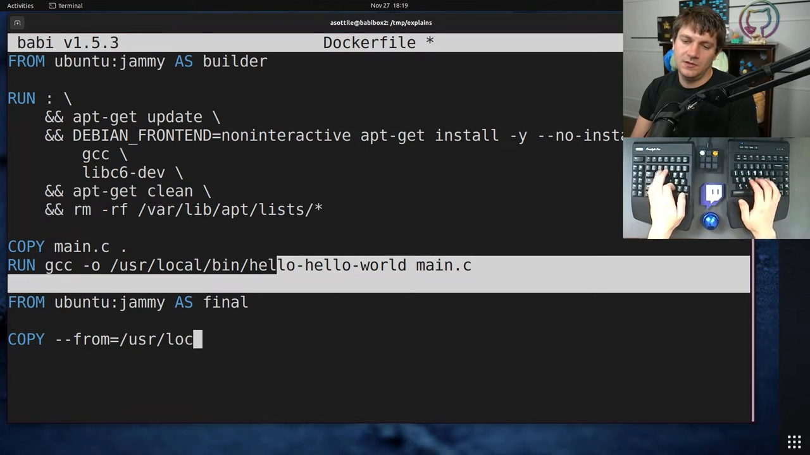

再构建一次，**镜像回到约 71.8MB**；运行它、跑一下 hello world，**依然正常工作**。

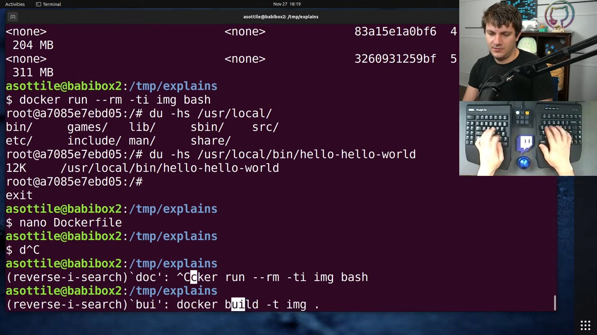

## 四、坑一：各阶段镜像版本要尽量一致

不过这里有几个**很容易搞砸**的地方。第一个：注意作者**所有阶段都用了同一个镜像**。

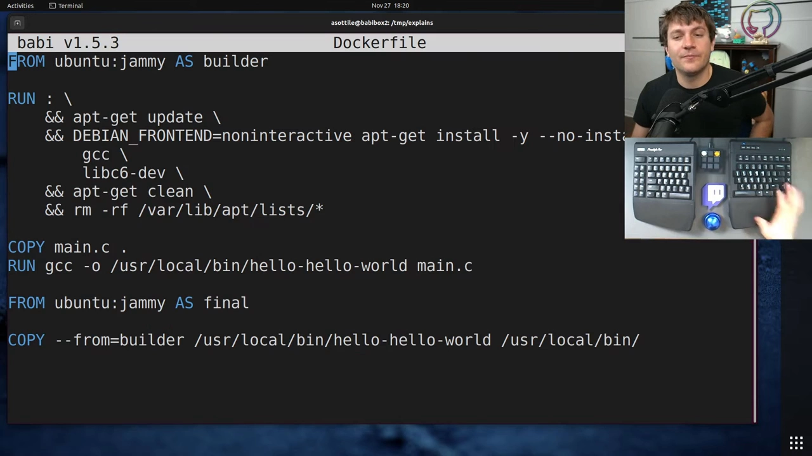技术上你在各阶段**可以随意选镜像**，但一旦**版本不匹配**，就会冒出一堆莫名其妙的错误。作者现场把某个阶段换成很老的 `precise` 版试了试——直接触发**诡异的报错**，甚至**莫名其妙地开始构建 ARM 架构**，而机器明明是 x86-64，让人完全摸不着头脑。

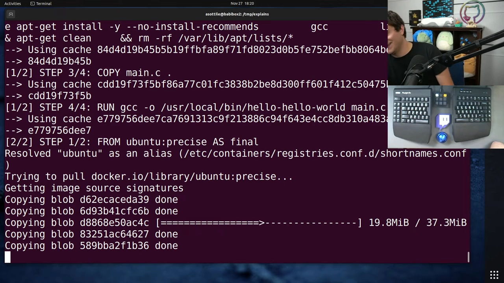

所以**建议：多阶段里各阶段尽量用相互匹配的镜像**。

## 五、坑二：静态链接时可用 scratch，但它很难调试

这条规则有个例外——不过作者自己也不爱用——那就是：**如果构建的是完全静态链接的二进制**。这时你有时会用 **`FROM scratch`** 作为最终镜像。`scratch` 是一个**几乎完全空的镜像**（本质上是个**零字节**镜像），于是可以做出一个**只含那一个可执行文件**的镜像，**小到极致**。

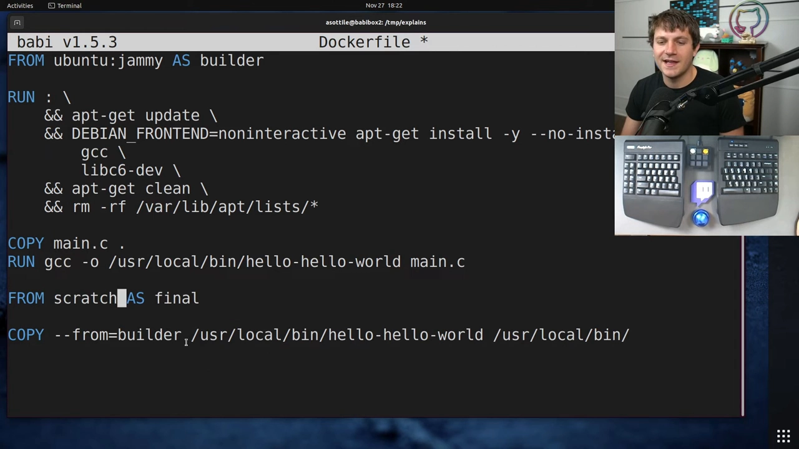

但作者**个人不喜欢用 `scratch`**，因为它让**调试容器内容变得极难**：如果你 `exec` 进一个基于 `scratch` 的容器，会发现**没有 shell、没有 `ls`、没有 `cp`——什么都没有**，只剩你要发布的那一个二进制。所以作者一般避开 `scratch`；但如果你追求**绝对最小**的镜像，它确实有用。

## 六、坑三：运行期依赖要在最终镜像里补齐

另一个容易出错的地方是**动态库依赖**。如果你的二进制依赖某个**只在 builder 镜像里有的东西**，就必须保证**最终镜像里也有对应的运行期版本**。作者举例：假设你在 builder 里装了 **OpenSSL 的开发头文件（dev headers）**，编出一个**动态链接 libssl** 的二进制，然后到 final 镜像里——它会**找不到 SSL**，因为干净的最终镜像里**根本不包含它**。所以你必须**再往最终镜像里装一个普通的 `libssl`（应该是 `libssl3`）**。可见**把这些库配齐是有一定出错风险的**，这是多阶段构建的另一处坑。

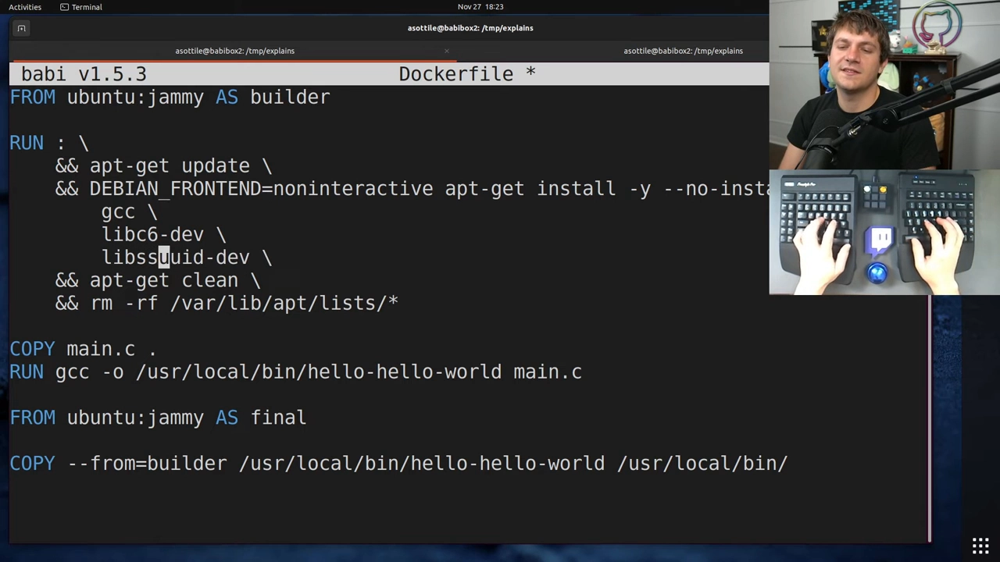

## 七、坑四：多阶段的构建缓存不好，作者因此用得少

作者还解释了为什么他觉得多阶段构建**有点"fiddly"（麻烦）、自己不太常用**，**主因是构建性能：多阶段镜像的缓存通常表现不佳**。

- **BuildKit 里有个小机制**能让这件事"自然就好"——作者**自己没玩过**、演示不了，但理论上这个方案会把 builder 层的**缓存镜像存下来而并不 push**，从而在最后能重新生成镜像；
- **老办法**是**把每个阶段单独构建、各自打 tag**：用 **`docker build -t image-builder --target=builder`**，让构建**正好停在 `builder` 阶段**；再用另一个 `--target` 构建并 tag 最终阶段；然后**把这两个镜像都 push**，构建时用 **`--cache-from`** 指向它们。**麻烦一点，但确实能用**。

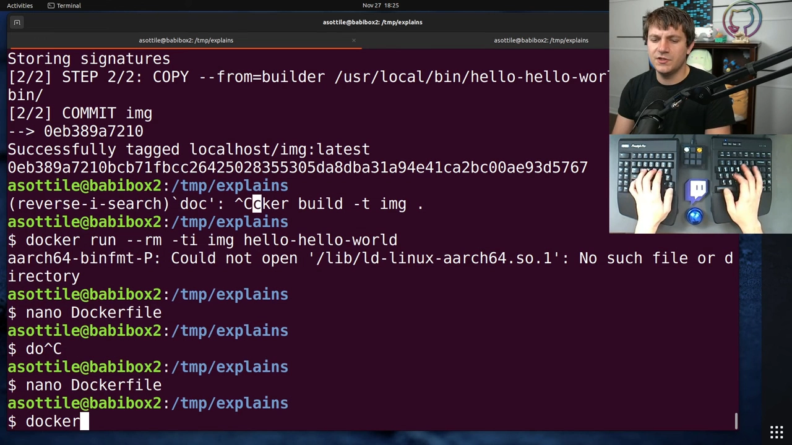

作者的结论很坦诚：他**倾向于少用多阶段构建**，因为"**省下的磁盘空间，未必抵得上失去真实构建缓存带来的开发体验损失**"——不过他也承认，新机制看起来能同时解决这两个问题，**该抽空去学一学**。

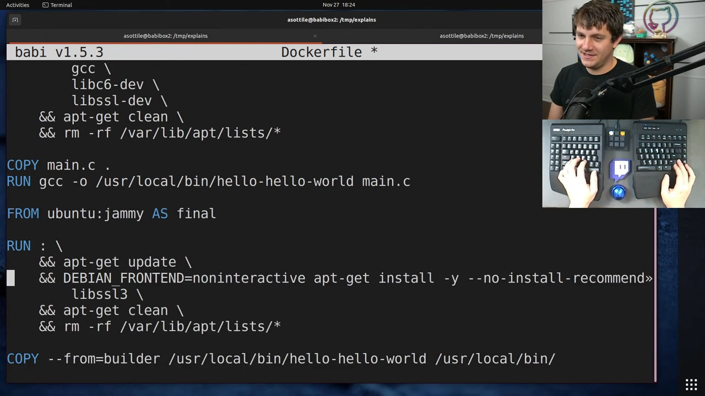

## 小结

- **多阶段构建**把一个最终镜像**分阶段**做出来，用一个 **builder** 阶段编译、再用 **final** 阶段只拷产物，核心收益就是**更小的镜像**（本例 221MB → 71.8MB）+ 随之而来的**更省带宽、启动更快**；
- 做法是**给 `FROM` 加阶段名**，再用 **`COPY --from=<阶段名>`** 跨阶段拷文件；
- 四个**易踩的坑**：① 各阶段镜像**尽量版本匹配**，否则会出诡异错误；② 静态链接可用 **`scratch`** 做最小镜像，但**几乎无法调试**；③ 动态库（如 **`libssl`**）的**运行期版本**要在最终镜像里补齐；④ 多阶段**构建缓存不好**，必要时用 `--target` 分阶段构建配合 `--cache-from`；
- 作者的实用建议：**多阶段是个好工具，但不必迷信**——如果省下的体积换不来好的构建缓存体验，可以不用。
